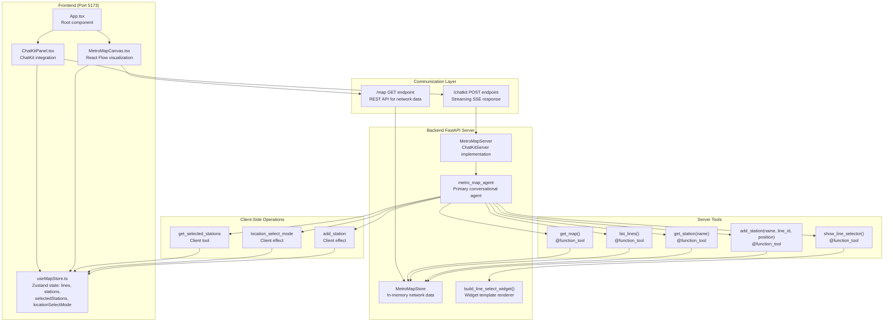
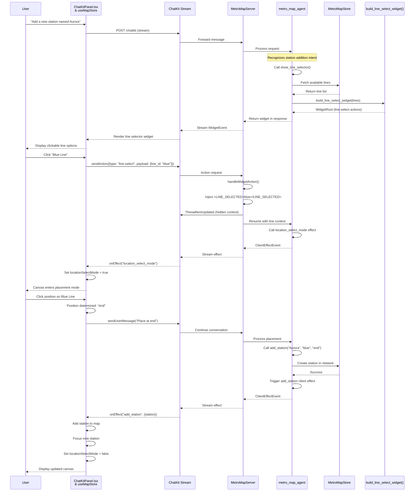
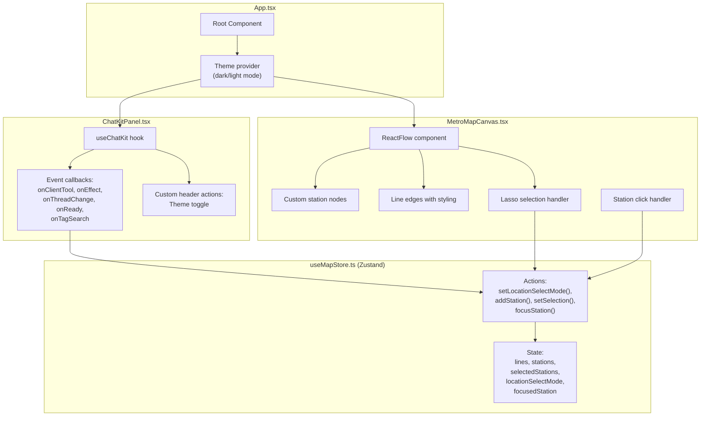
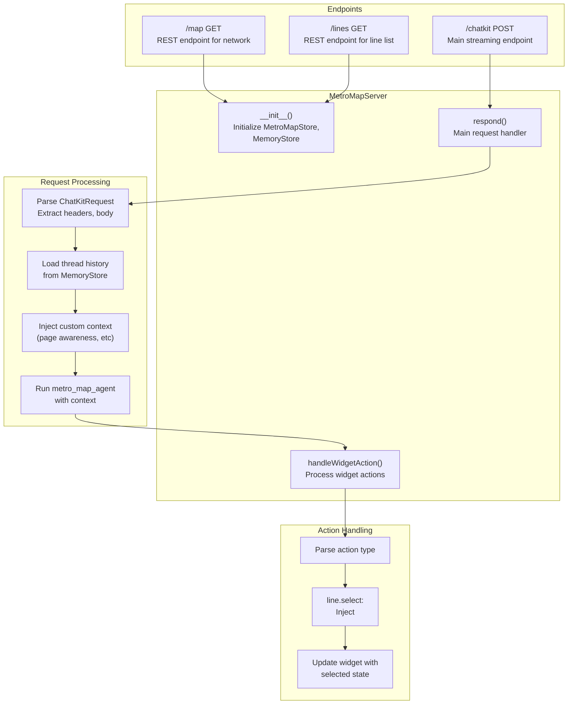
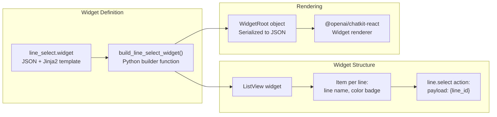
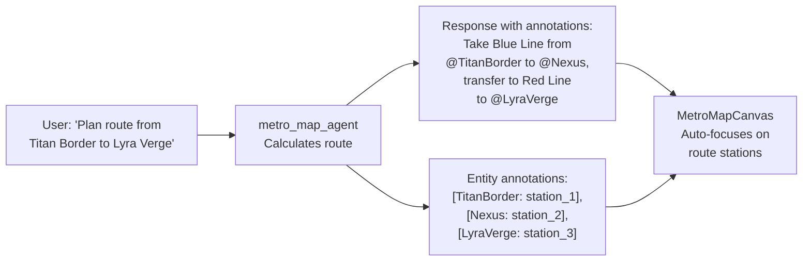

<!-- source: DeepWiki mcp.deepwiki.com · repo openai/openai-chatkit-advanced-samples · page 4 Example: Metro Map · fetched 2026-10-26 -->

# Example: Metro Map

<details>
<summary>Relevant source files</summary>

The following files were used as context for generating this wiki page:

- [examples/cat-lounge/README.md](examples/cat-lounge/README.md)
- [examples/cat-lounge/frontend/src/components/ChatKitPanel.tsx](examples/cat-lounge/frontend/src/components/ChatKitPanel.tsx)
- [examples/metro-map/README.md](examples/metro-map/README.md)
- [examples/metro-map/backend/app/widgets/line_select_widget.py](examples/metro-map/backend/app/widgets/line_select_widget.py)
- [examples/metro-map/backend/pyproject.toml](examples/metro-map/backend/pyproject.toml)
- [examples/metro-map/frontend/package.json](examples/metro-map/frontend/package.json)

</details>


**Purpose and Scope**: This document provides comprehensive documentation of the Metro Map example application, the most feature-rich demonstration in the ChatKit Advanced Samples repository. It covers the application's purpose, architecture, agent implementation, frontend components, server handling, and widget system. For general ChatKit integration patterns (client tools, effects, entity tags), see [ChatKit Integration Guide](#7). For architectural patterns shared across all examples, see [Common Architecture](#3).

## Overview

Metro Map is an interactive transit planning assistant that demonstrates ChatKit's advanced features through a visual metro network interface. The application combines natural language conversation with a React Flow canvas, allowing users to query station information, plan routes, add new stations, and interact with the network through both chat and direct canvas manipulation.

**Port**: 5173

**Key Features Demonstrated**:
- **Client Tools**: Bidirectional state queries using `get_selected_stations` to read frontend selection state
- **Client Effects**: Fire-and-forget UI updates via `location_select_mode` for interactive placement
- **Interactive Widgets**: Line selector widget with server-side action handling
- **Entity Tags**: @-mention stations for focused queries with `<STATION_TAG>` markers
- **Annotations**: Route planning responses attach entity sources to keep canvas focused on relevant stations
- **Progress Updates**: Streaming progress events during initial map load
- **Custom Header Actions**: Theme toggle in ChatKit header
- **Context Management**: Hidden context tags like `<LINE_SELECTED>` track interaction state

**Example Prompts**:
```
"Add a new station named Aurora"
"Plan a route from Titan Border to Lyra Verge."
"Tell me about @Cinderia station."
"Tell me about the stations I've selected."
```

**Sources**: [examples/metro-map/README.md:1-28]()

---

## Architecture Overview

The Metro Map application follows the standard FastAPI + React architecture with specialized components for metro network visualization and interaction.

### System Component Diagram



**Analysis**: The architecture separates concerns across three primary layers: the **Frontend** manages visualization and user interaction through React Flow and Zustand state management; the **Backend** handles conversational logic through `metro_map_agent` and maintains network data in `MetroMapStore`; and the **Communication Layer** bridges them via ChatKit streaming protocol and REST endpoints. Server tools query and mutate backend state, while client tools/effects enable the agent to read from or trigger updates in frontend state. Widget builders generate interactive UI components that are rendered in the chat interface.

**Sources**: [examples/metro-map/README.md:18-28](), [examples/metro-map/backend/pyproject.toml:1-30](), [examples/metro-map/frontend/package.json:1-48]()

---

## Station Creation Flow

The station creation workflow is the most complex feature in Metro Map, demonstrating the coordination between server tools, widgets, client effects, and context management.

### Station Creation Sequence



**Analysis**: Station creation requires seven distinct steps: (1) User initiates with natural language, (2) Agent calls `show_line_selector()` to stream an interactive widget, (3) User clicks a line triggering a server action, (4) Server injects `<LINE_SELECTED>` hidden context and resumes agent, (5) Agent triggers `location_select_mode` client effect to enable UI placement mode, (6) User clicks canvas position and confirms, (7) Agent calls `add_station()` which mutates backend state and triggers `add_station` client effect to update canvas. This pattern demonstrates widget actions for user input, hidden context for state tracking, and client effects for UI coordination.

**Sources**: [examples/metro-map/README.md:23-24]()

---

## Agent Implementation

The `metro_map_agent` is implemented in [backend/app/agents/metro_map_agent.py]() and serves as the primary conversational interface for metro network queries and modifications.

### Agent Tools and Effects

| Tool/Effect Name | Type | Purpose | Parameters |
|------------------|------|---------|------------|
| `get_map` | Server Tool | Fetch complete network topology | None |
| `list_lines` | Server Tool | List all metro lines with metadata | None |
| `list_stations` | Server Tool | List all stations with connections | None |
| `get_line_route` | Server Tool | Get ordered stations for a specific line | `line_id: str` |
| `get_station` | Server Tool | Get detailed station information | `name: str` |
| `show_line_selector` | Server Tool | Stream line selector widget | None |
| `add_station` | Server Tool | Create new station in network | `name: str, line_id: str, position: str` |
| `get_selected_stations` | Client Tool | Query currently selected stations from canvas | None (reads frontend state) |
| `location_select_mode` | Client Effect | Enable/disable placement mode on canvas | `enabled: bool` |
| `add_station` (effect) | Client Effect | Trigger canvas update and focus new station | `station: dict` |

### Agent Instructions Pattern

The agent's system instructions emphasize:
1. **Grounding in data**: Always use lookup tools (`get_map`, `get_station`) before answering questions
2. **Selection awareness**: Call `get_selected_stations` client tool when user references "selected" or "these stations"
3. **Route planning**: Attach entity sources using `@station_name` format for each station in recommended routes
4. **Station creation workflow**: Guide user through line selection → position placement → confirmation
5. **Context awareness**: Recognize `<LINE_SELECTED>` and `<STATION_TAG>` markers in conversation history

### StopAtTools Behavior

The agent uses `StopAtTools` configuration, meaning after calling tools like `show_line_selector`, the agent returns control to the user rather than continuing generation. This ensures the user sees and interacts with widgets before the conversation proceeds.

**Sources**: [examples/metro-map/README.md:18-27]()

---

## Frontend Implementation

The frontend combines ChatKit's conversational UI with a React Flow canvas for metro network visualization.

### Key Frontend Components



### Client Tool Handling

The `onClientTool` callback in ChatKitPanel handles the `get_selected_stations` client tool:

```typescript
onClientTool: async ({ name, arguments: args }) => {
  if (name === "get_selected_stations") {
    const selectedStations = useMapStore.getState().selectedStations;
    return { stations: selectedStations };
  }
  throw new Error(`Unknown client tool: ${name}`);
}
```

This enables the agent to query which stations the user has selected on the canvas (via lasso selection) before generating responses.

### Client Effect Handling

The `onEffect` callback handles two effects:

```typescript
onEffect: ({ name, data }) => {
  if (name === "location_select_mode") {
    useMapStore.getState().setLocationSelectMode(data.enabled);
  }
  if (name === "add_station") {
    useMapStore.getState().addStation(data.station);
    useMapStore.getState().focusStation(data.station.id);
  }
}
```

- **`location_select_mode`**: Toggles a UI mode where the canvas highlights insertion points for new stations
- **`add_station`**: Adds the station to the canvas and animates focus to the new node

### Entity Tag Handling

The `onTagSearch` callback enables @-mention functionality for stations:

```typescript
onTagSearch: async ({ query, type }) => {
  if (type === "station") {
    const stations = await fetch("/map").then(r => r.json());
    return stations
      .filter(s => s.name.toLowerCase().includes(query.toLowerCase()))
      .map(s => ({
        id: s.id,
        label: s.name,
        preview: { type: "station", data: s }
      }));
  }
}
```

When users type `@` in the composer, they can search and select stations. The selected tag is converted to `<STATION_TAG id="station_id">Station Name</STATION_TAG>` in the message sent to the agent, and clicking the tag in chat focuses the station on the canvas.

**Sources**: [examples/metro-map/README.md:21-27](), [examples/cat-lounge/frontend/src/components/ChatKitPanel.tsx:1-154]() (similar pattern)

---

## Server Implementation

The backend server is implemented in [backend/app/server.py]() as `MetroMapServer`, extending `ChatKitServer`.

### Server Architecture



### Widget Action Handling

When users interact with widgets, the server's `handleWidgetAction` method processes the action:

```python
def handleWidgetAction(self, action, widget_id, request):
    if action["type"] == "line.select":
        line_id = action["payload"]["line_id"]
        
        # Inject hidden context marker
        context = f"<LINE_SELECTED>{line_id}</LINE_SELECTED>"
        self.memory_store.append_context(request.thread_id, context)
        
        # Update widget to show selection
        updated_widget = build_line_select_widget(
            self.metro_store.get_lines(),
            selected=line_id
        )
        return ThreadItemUpdated(
            widget_id=widget_id,
            widget=updated_widget
        )
```

This pattern demonstrates:
1. **Hidden context injection**: The `<LINE_SELECTED>` tag is added to thread history but not visible in UI
2. **Widget state update**: The widget is re-rendered with visual selection feedback
3. **Agent resumption**: The agent continues processing with the line choice available in context

### REST Endpoints

Beyond the primary `/chatkit` endpoint, the server exposes domain-specific REST APIs:

| Endpoint | Method | Purpose |
|----------|--------|---------|
| `/chatkit` | POST | Main ChatKit streaming endpoint |
| `/map` | GET | Return complete network topology (stations, lines, connections) |
| `/lines` | GET | Return list of metro lines with metadata |
| `/stations` | GET | Return list of all stations |

These REST endpoints enable the frontend to independently fetch network data for canvas initialization and updates without going through the conversational interface.

**Sources**: [examples/metro-map/README.md:23]()

---

## Widget System

Metro Map uses a template-based widget for line selection during station creation.

### Line Selector Widget

The widget is defined in [backend/app/widgets/line_select.widget]() and built via [backend/app/widgets/line_select_widget.py:1-22]():



### Widget Builder Implementation

[examples/metro-map/backend/app/widgets/line_select_widget.py:1-22]()

```python
line_select_widget_template = WidgetTemplate.from_file("line_select.widget")

def build_line_select_widget(lines: list[Line], selected: str | None = None) -> WidgetRoot:
    """Render a line selector widget from the provided line metadata."""
    return line_select_widget_template.build(
        data={
            "items": lines,
            "selected": selected,
        }
    )
```

The template receives a list of `Line` objects and an optional `selected` line ID. Each line renders as a clickable item with:
- Line name label
- Color badge (using line's color metadata)
- `line.select` action with `line_id` payload

### Widget Lifecycle

1. **Creation**: Agent calls `show_line_selector()` tool, which invokes `build_line_select_widget()` and returns the widget in the response stream
2. **User Interaction**: User clicks a line, triggering `line.select` action
3. **Server Handling**: `MetroMapServer.handleWidgetAction()` processes the action, injects `<LINE_SELECTED>` context, and returns `ThreadItemUpdated` event with widget showing visual selection
4. **Agent Continuation**: Agent resumes with line selection available in context and proceeds to location placement

This pattern demonstrates server-side action handling where the widget action both persists state (in thread context) and provides immediate UI feedback (via widget update).

**Sources**: [examples/metro-map/backend/app/widgets/line_select_widget.py:1-22](), [examples/metro-map/README.md:23]()

---

## Entity Annotations and Route Planning

Metro Map demonstrates entity annotations for route planning responses. When the agent recommends a route between stations, it attaches entity sources to each station mentioned.

### Annotation Pattern



When entity annotations are present, the ChatKit UI keeps the canvas viewport focused on the referenced stations as the user scrolls through the response. This creates a synchronized experience where the visual map highlights the route being discussed.

**Implementation Pattern**: The agent formats station references using `@station_name` syntax in its response text. ChatKit's annotation system automatically parses these and attaches entity sources, which the frontend's `onAnnotation` callback can use to update canvas focus.

**Sources**: [examples/metro-map/README.md:22]()

---

## Technology Stack

### Backend Dependencies

[examples/metro-map/backend/pyproject.toml:1-30]()

| Package | Version | Purpose |
|---------|---------|---------|
| `fastapi` | 0.114.1 - 0.116 | Web framework for HTTP endpoints |
| `uvicorn[standard]` | 0.36 - 0.37 | ASGI server with WebSocket support |
| `openai` | 1.40+ | OpenAI API client |
| `openai-chatkit` | 1.4.0 - 2.0 | ChatKit agent framework |
| `jinja2` | 3.1 - 4.0 | Widget template rendering |

**Development Tools**: `ruff` (linting/formatting), `mypy` (type checking)

### Frontend Dependencies

[examples/metro-map/frontend/package.json:1-48]()

| Package | Version | Purpose |
|---------|---------|---------|
| `react` | ^19.2.0 | UI framework |
| `@openai/chatkit-react` | ^1.3.0 | ChatKit UI components |
| `reactflow` | ^11.11.3 | Interactive graph visualization |
| `zustand` | ^5.0.8 | Lightweight state management |
| `react-router-dom` | ^6.28.0 | Client-side routing |
| `lucide-react` | ^0.544.0 | Icon library |
| `vite` | ^7.1.9 | Build tool with HMR |
| `typescript` | ^5.4.0 | Type system |

**Unique to Metro Map**: The `reactflow` package (^11.11.3) provides the interactive node-based canvas for metro network visualization, including features like lasso selection, node dragging, and edge routing.

**Sources**: [examples/metro-map/backend/pyproject.toml:1-30](), [examples/metro-map/frontend/package.json:1-48]()

---

## Running Metro Map

### Quickstart

```bash
# From repository root
npm run metro-map

# Or from example directory
cd examples/metro-map
npm install
npm run start
```

### Configuration

**Required Environment Variables**:
- `OPENAI_API_KEY`: OpenAI API key for model access
- `VITE_CHATKIT_API_DOMAIN_KEY`: Set to `domain_pk_local_dev` for local development

**Ports**:
- Frontend: http://localhost:5173
- Backend: Defaults to port configured in backend service

**Sources**: [examples/metro-map/README.md:5-10]()

---

