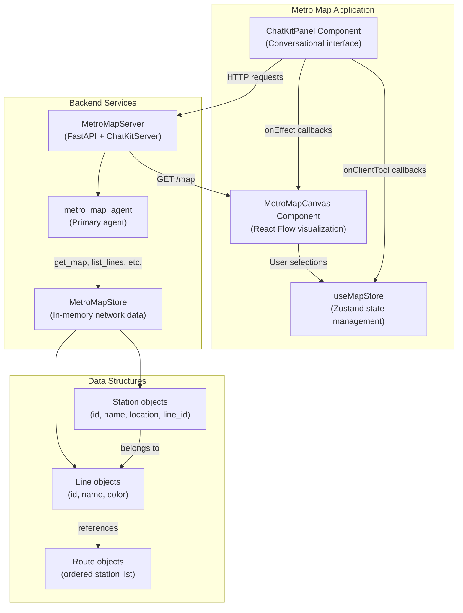
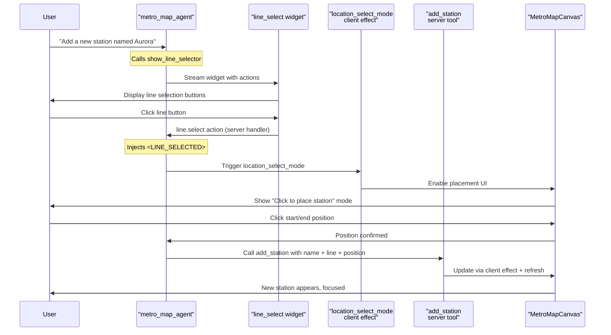
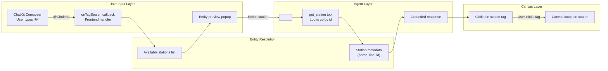

<!-- source: DeepWiki mcp.deepwiki.com · repo openai/openai-chatkit-advanced-samples · page 4.1 Metro Map Overview · fetched 2026-10-26 -->

# Metro Map Overview

Relevant source files

The following files were used as context for generating this wiki page:

- [examples/cat-lounge/README.md](examples/cat-lounge/README.md)
- [examples/cat-lounge/frontend/src/components/ChatKitPanel.tsx](examples/cat-lounge/frontend/src/components/ChatKitPanel.tsx)
- [examples/metro-map/README.md](examples/metro-map/README.md)

## Purpose and Scope

This page provides an overview of the Metro Map example application, describing its purpose, the ChatKit features it demonstrates, and what makes it unique among the four sample applications. For detailed implementation documentation, see:
- Agent implementation: [Metro Map Agent](#4.2)
- Frontend implementation: [Metro Map Frontend](#4.3)
- Server implementation: [Metro Map Server](#4.4)
- Widget system: [Metro Map Widgets](#4.5)

For architectural patterns shared across all examples, see [Common Architecture](#3).

**Sources:** README.md structure, examples/metro-map/README.md

---

## What is Metro Map?

Metro Map is a chat-driven metro network editor that enables users to explore, extend, and navigate a fictional transit system through natural language conversation. The application combines a React Flow-based interactive canvas with ChatKit's conversational interface, allowing users to:

- View and explore an existing metro network with multiple lines and stations
- Add new stations to specific transit lines through conversation
- Plan routes between stations with visual highlighting
- Query information about stations using @-mention entity tags
- Interact with selected stations on the canvas

The application runs on **port 5173** and represents the most comprehensive demonstration of ChatKit features across all four examples in the repository.

**Sources:** [examples/metro-map/README.md:1-3](), [examples/metro-map/README.md:9]()

---

## Application Components

The application follows a client-server architecture where the frontend maintains UI state (`useMapStore`) and visualization logic (`MetroMapCanvas`), while the backend manages network data (`MetroMapStore`) and conversational logic (`metro_map_agent`). The `ChatKitPanel` acts as the bridge, translating ChatKit events into frontend state updates and canvas manipulations.

**Sources:** [examples/metro-map/README.md:20-27](), Diagram 4 (Frontend Architecture Pattern)

---

## Features Demonstrated

Metro Map demonstrates more ChatKit features than any other example in the repository. The following table maps natural language capabilities to the underlying ChatKit mechanisms:

| Feature | ChatKit Mechanism | Code References |
|---------|-------------------|-----------------|
| Network data queries | Server Tools | `get_map`, `list_lines`, `list_stations`, `get_line_route`, `get_station` |
| Selection-aware responses | Client Tools | `get_selected_stations` (agent → frontend query) |
| Station creation workflow | Interactive Widgets | `show_line_selector` widget with `line.select` action |
| Canvas placement mode | Client Effects | `location_select_mode`, `add_station` (fire-and-forget UI updates) |
| Route planning visualization | Entity Annotations | Stations in route tagged with entity sources for highlighting |
| Station @-mentions | Entity Tags | `<STATION_TAG>` content markers in composer |
| Loading feedback | Progress Updates | `ProgressUpdateEvent` during `get_map` execution |
| Theme toggle | Custom Header Actions | Dark/light mode switch in ChatKit header |
| Action state persistence | Server-Side Widget Actions | `<LINE_SELECTED>` hidden context tag |

**Sources:** [examples/metro-map/README.md:18-27]()

---

## Station Creation Flow

The following diagram illustrates the multi-step station creation process, showing how different ChatKit features coordinate to enable a complex user workflow:

This sequence demonstrates:
1. **Server Tools** (`show_line_selector`) streaming interactive widgets
2. **Widget Actions** (`line.select`) handled server-side with hidden context injection
3. **Client Effects** (`location_select_mode`) enabling UI placement mode
4. **Server Tools** (`add_station`) completing the operation with state mutation

**Sources:** [examples/metro-map/README.md:23-24]()

---

## Entity Tag System

Metro Map implements a complete entity tag system for station @-mentions. The flow bridges user input to agent-readable markers:

The entity tag system enables:
- **Search**: Real-time station name filtering as user types `@`
- **Preview**: Station information popup before insertion
- **Conversion**: Human-readable `@Cinderia` becomes `<STATION_TAG id="cinderia">` for agent
- **Interaction**: Tags in responses are clickable to focus the canvas

**Sources:** [examples/metro-map/README.md:26](), [examples/metro-map/README.md:15]()

---

## What Makes It Unique

Metro Map stands apart from the other examples in several ways:

### Feature Completeness
Metro Map is the **only example that demonstrates all major ChatKit features** in a single application:
- Server Tools (5 tools for network queries)
- Client Tools (`get_selected_stations`)
- Client Effects (`location_select_mode`, `add_station`)
- Interactive Widgets (line selector)
- Entity Tags (station @-mentions)
- Entity Annotations (route planning)
- Progress Updates (map loading)
- Custom Header Actions (theme toggle)

By comparison:
- Cat Lounge focuses on client effects and widgets ([Cat Lounge Overview](#5.1))
- News Guide emphasizes page awareness and tool choice ([News Guide Overview](#6.1))
- Customer Support demonstrates basic patterns

### Technical Complexity
Metro Map uses **ReactFlow** for canvas visualization, making it the only example with complex graph rendering. The bidirectional state synchronization between canvas selections and agent responses demonstrates advanced state coordination.

### Multi-Step Workflows
The station creation flow involves four distinct ChatKit mechanisms working in sequence (widget → action → effect → tool), showcasing how features compose for complex interactions.

### Hidden Context Management
Metro Map demonstrates server-side widget action handling with hidden context injection (`<LINE_SELECTED>`), enabling the agent to maintain workflow state across multiple turns without exposing implementation details to the user.

**Sources:** [examples/metro-map/README.md:18-27](), Diagram 2 (Feature Demonstration Matrix), Diagram 6 (Technology Stack)

---

## Example Prompts

The following prompts demonstrate key features:

| Prompt | Demonstrates |
|--------|-------------|
| `"Add a new station named Aurora"` | Interactive widget workflow, client effects, server tools |
| `"Plan a route from Titan Border to Lyra Verge."` | Entity annotations, route planning algorithm |
| `"Tell me about @Cinderia station."` | Entity tags, station lookup tool |
| `"Tell me about the stations I've selected."` | Client tools querying canvas state |

**Note:** Entity tags require typing `@` manually in the composer; copy-paste will not trigger the entity search popup.

**Sources:** [examples/metro-map/README.md:11-16]()

---

## Next Steps

To understand the implementation details:
- **Agent logic**: See [Metro Map Agent](#4.2) for `metro_map_agent` instructions, tools, and `StopAtTools` behavior
- **Frontend implementation**: See [Metro Map Frontend](#4.3) for `MetroMapCanvas`, state management, and event handlers
- **Server implementation**: See [Metro Map Server](#4.4) for `MetroMapServer` respond method and action handling
- **Widget system**: See [Metro Map Widgets](#4.5) for line selector widget implementation

For general ChatKit concepts demonstrated here:
- [Client Tools](#7.2) for bidirectional queries
- [Client Effects](#7.3) for fire-and-forget UI updates
- [Entity Tags and @-mentions](#7.5) for entity system architecture

**Sources:** Table of contents structure

---

