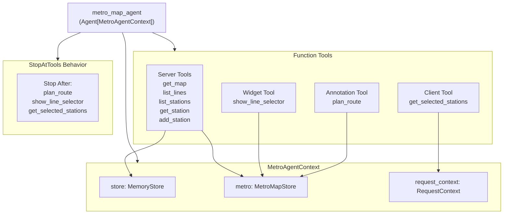
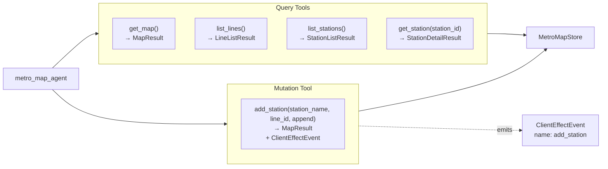
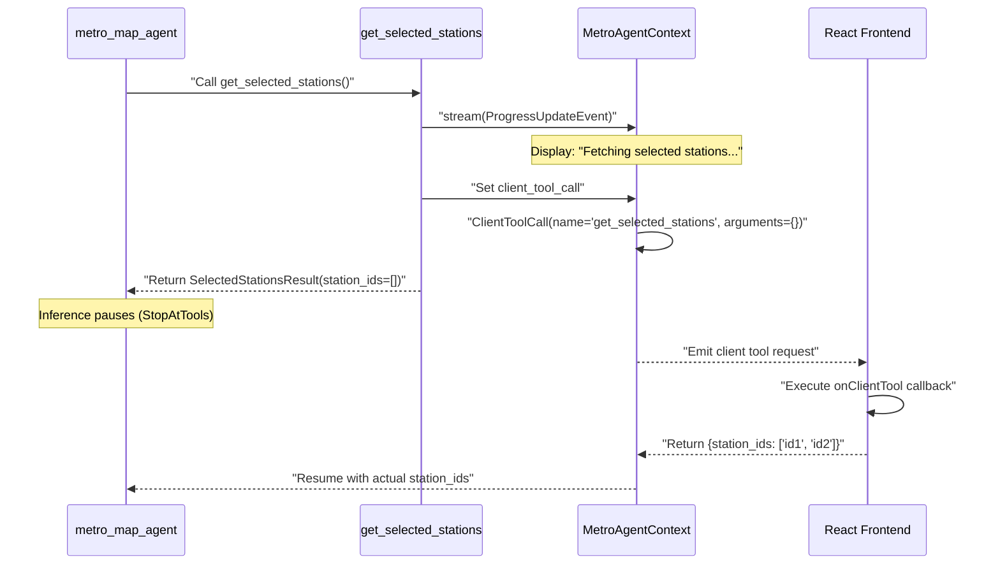
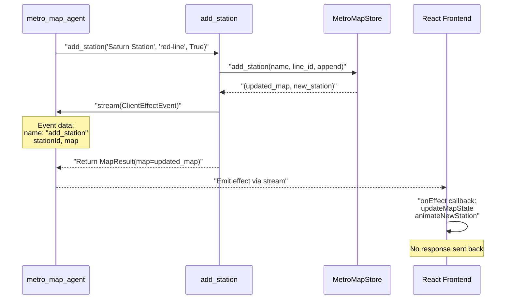
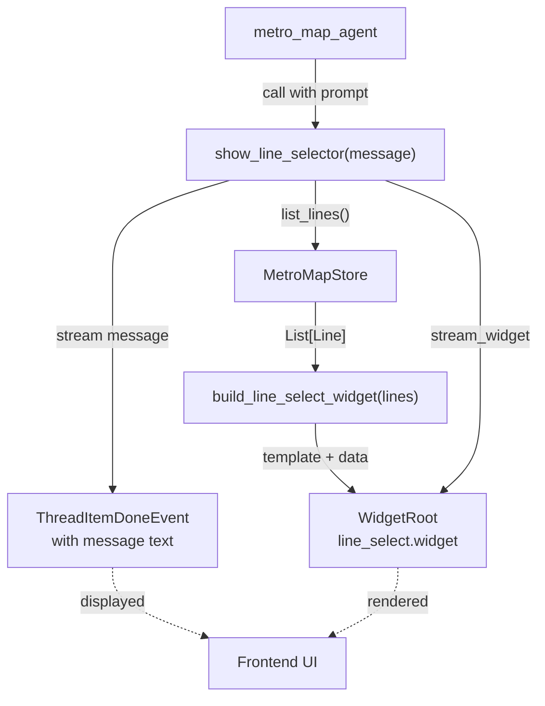
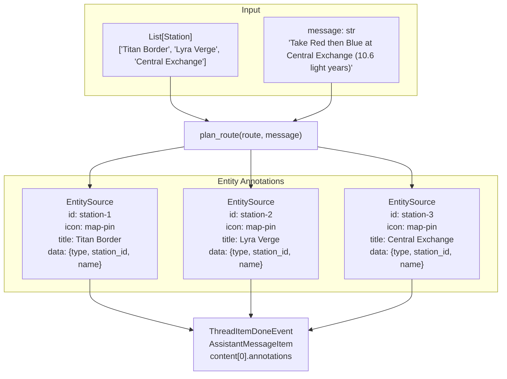
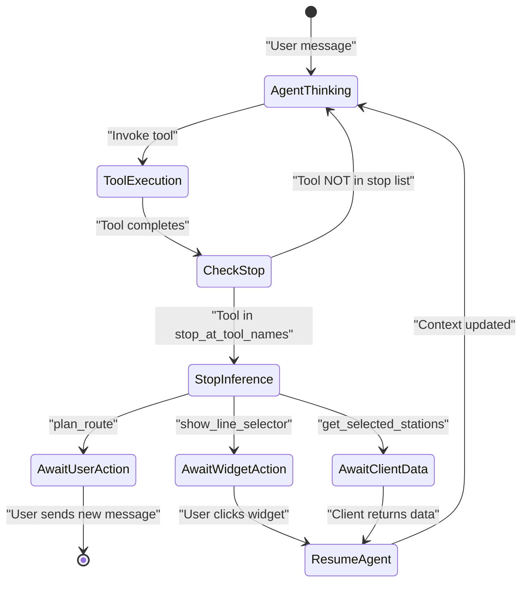

<!-- source: DeepWiki mcp.deepwiki.com · repo openai/openai-chatkit-advanced-samples · page 4.2 Metro Map Agent · fetched 2026-10-26 -->

# Metro Map Agent

<details>
<summary>Relevant source files</summary>

The following files were used as context for generating this wiki page:

- [examples/metro-map/backend/app/agents/metro_map_agent.py](examples/metro-map/backend/app/agents/metro_map_agent.py)

</details>


## Purpose and Scope

This document describes the `metro_map_agent`, the core AI agent powering the Metro Map example application. The agent enables natural language interactions for planning metro routes, adding stations, and exploring the Orbital Transit map. It demonstrates advanced ChatKit patterns including client tools, client effects, widget integration, progress updates, annotations, and controlled tool execution with `StopAtTools`.

For information about the Metro Map server implementation and action handling, see [Metro Map Server](#4.4). For frontend integration and state management, see [Metro Map Frontend](#4.3).

**Sources**: [examples/metro-map/backend/app/agents/metro_map_agent.py:1-314]()

---

## Agent Architecture

The `metro_map_agent` is defined as an `Agent[MetroAgentContext]` instance that orchestrates metro planning operations through a set of function tools. It uses the `StopAtTools` behavior to pause inference after executing specific tools that require user interaction or produce final outputs.

### Agent Definition

```python
metro_map_agent = Agent[MetroAgentContext](
    name="metro_map",
    instructions=INSTRUCTIONS,
    model="gpt-4o-mini",
    tools=[...],
    tool_use_behavior=StopAtTools(
        stop_at_tool_names=[
            plan_route.name,
            show_line_selector.name,
            get_selected_stations.name,
        ]
    ),
)
```

The agent operates with a custom context type (`MetroAgentContext`) that provides access to the `MemoryStore`, `MetroMapStore`, and `RequestContext` needed for managing conversational state and metro map data.

**Diagram: Metro Map Agent Architecture**



**Sources**: [examples/metro-map/backend/app/agents/metro_map_agent.py:286-313](), [examples/metro-map/backend/app/agents/metro_map_agent.py:77-81]()

---

## Agent Instructions

The agent's system prompt is defined in the `INSTRUCTIONS` constant and establishes its role as a "concise metro planner helping city planners update the Orbital Transit map."

### Key Behavioral Rules

| Behavior Area | Rules |
|--------------|-------|
| **Response Style** | Short answers, list 2-3 options, highlight lines/interchanges |
| **Map Syncing** | Always call `get_map` before recommending routes or when user mentions a station |
| **Line Selection** | MUST call `show_line_selector` when user wants to add a station without specifying a line |
| **Route Planning** | MUST call `plan_route` with station list and one-sentence description including travel time |
| **Station Citations** | MUST call `cite_stations_for_route` when listing stations in response |
| **Station Descriptions** | Use whimsical, poetic language after adding; omit IDs and coordinates |

### Custom Tag Handling

The agent recognizes two custom XML tags injected into the conversation context:

- **`<LINE_SELECTED>{line_id}</LINE_SELECTED>`**: Injected by the server after user selects a line from the widget. When this appears in the latest message, the agent acknowledges the selection and proceeds with the station addition flow.

- **`<STATION_TAG>...</STATION_TAG>`**: Contains complete station details (id, name, description, coordinates, served lines). The agent uses this data directly without calling `get_station` to resolve tagged stations.

**Sources**: [examples/metro-map/backend/app/agents/metro_map_agent.py:28-74]()

---

## Context and Dependencies

### MetroAgentContext

The `MetroAgentContext` class extends `AgentContext` to provide agent-specific dependencies:

```python
class MetroAgentContext(AgentContext):
    model_config = ConfigDict(arbitrary_types_allowed=True)
    store: Annotated[MemoryStore, Field(exclude=True)]
    metro: Annotated[MetroMapStore, Field(exclude=True)]
    request_context: Annotated[RequestContext, Field(exclude=True)]
```

| Field | Type | Purpose |
|-------|------|---------|
| `store` | `MemoryStore` | Thread history and conversational state management |
| `metro` | `MetroMapStore` | Metro map data operations (lines, stations, mutations) |
| `request_context` | `RequestContext` | Request-scoped data including client tool call state |

All three fields are marked with `Field(exclude=True)` to prevent serialization in tool results, keeping only domain data in the conversation.

**Sources**: [examples/metro-map/backend/app/agents/metro_map_agent.py:77-81]()

---

## Server Tools

The agent provides seven server-side function tools for querying and mutating metro map data. These tools execute on the backend and return typed results to the agent.

**Diagram: Server Tool Flow**



### Query Tools

#### get_map
Retrieves the complete metro map with all lines and stations. Emits a `ProgressUpdateEvent` before returning.

- **Parameters**: None
- **Returns**: `MapResult` containing the `MetroMap` object
- **Implementation**: [examples/metro-map/backend/app/agents/metro_map_agent.py:131-138]()

#### list_lines
Returns all metro lines with their colors and endpoints.

- **Parameters**: None
- **Returns**: `LineListResult` containing list of `Line` objects
- **Implementation**: [examples/metro-map/backend/app/agents/metro_map_agent.py:141-146]()

#### list_stations
Lists all stations and the lines that serve them.

- **Parameters**: None
- **Returns**: `StationListResult` containing list of `Station` objects
- **Implementation**: [examples/metro-map/backend/app/agents/metro_map_agent.py:149-154]()

#### get_station
Looks up a single station and its served lines.

- **Parameters**: `station_id: str`
- **Returns**: `StationDetailResult` with `station` and `lines` fields
- **Error Handling**: Raises `ValueError` if station not found
- **Implementation**: [examples/metro-map/backend/app/agents/metro_map_agent.py:198-216]()

### Mutation Tool

#### add_station
Adds a new station to the specified line and emits a client effect to update the UI.

- **Parameters**: 
  - `station_name: str` - Name of the station (trimmed and title-cased)
  - `line_id: str` - ID of the line to add to
  - `append: bool = True` - Whether to add at end (True) or beginning (False)
- **Returns**: `MapResult` with updated metro map
- **Side Effects**:
  - Streams `ProgressUpdateEvent` with "Adding station..." message
  - Streams `ClientEffectEvent` with name `"add_station"` and data containing station ID and updated map
- **Error Handling**: Catches exceptions, streams error message, and re-raises
- **Implementation**: [examples/metro-map/backend/app/agents/metro_map_agent.py:219-265]()

**Sources**: [examples/metro-map/backend/app/agents/metro_map_agent.py:110-265]()

---

## Client Tool: get_selected_stations

The `get_selected_stations` tool is a **client tool** that queries the frontend's UI state for currently selected stations. This enables bidirectional data flow where the agent can request information from the client.

**Diagram: Client Tool Call Flow**



### Implementation Details

The tool immediately returns an empty result but sets `ctx.context.client_tool_call` to signal that a client-side operation is required:

```python
async def get_selected_stations(
    ctx: RunContextWrapper[MetroAgentContext],
) -> SelectedStationsResult:
    logger.info("[TOOL CALL] get_selected_stations")
    await ctx.context.stream(ProgressUpdateEvent(text="Fetching selected stations from the map..."))
    ctx.context.client_tool_call = ClientToolCall(
        name="get_selected_stations",
        arguments={},
    )
    return SelectedStationsResult(station_ids=[])
```

The `StopAtTools` behavior halts inference after this tool executes. The server then waits for the frontend to provide the actual selected station IDs before resuming agent execution with the real data.

**Sources**: [examples/metro-map/backend/app/agents/metro_map_agent.py:268-283](), [examples/metro-map/backend/app/agents/metro_map_agent.py:306-311]()

---

## Client Effect: add_station

The `add_station` tool demonstrates the **client effect** pattern by emitting a `ClientEffectEvent` after successfully adding a station. This is a fire-and-forget message that updates the frontend UI without requiring acknowledgment.

**Diagram: Client Effect Flow**



### Event Structure

The `ClientEffectEvent` contains:

```python
ClientEffectEvent(
    name="add_station",
    data={
        "stationId": new_station.id,
        "map": updated_map.model_dump(mode="json"),
    },
)
```

- **`name`**: Identifies the effect type for frontend routing
- **`data.stationId`**: ID of the newly created station for highlighting/animation
- **`data.map`**: Complete updated metro map for state synchronization

The frontend's `onEffect` callback processes this event to update the Zustand store and trigger UI animations, but sends no response back to the server. This enables immediate visual feedback while the agent continues processing.

**Sources**: [examples/metro-map/backend/app/agents/metro_map_agent.py:236-247]()

---

## Widget Integration: show_line_selector

The `show_line_selector` tool demonstrates widget integration by generating and streaming a line selector widget to the user. This is invoked when the agent needs the user to choose a metro line before adding a station.

**Diagram: Widget Tool Flow**



### Implementation Flow

1. **Prompt Message**: The tool receives a `message` parameter (e.g., "Please choose a line from the list:")
2. **Widget Building**: Calls `build_line_select_widget` with available metro lines
3. **Message Streaming**: Streams a `ThreadItemDoneEvent` containing the prompt message
4. **Widget Streaming**: Streams the widget using `ctx.context.stream_widget(widget)`

```python
async def show_line_selector(ctx: RunContextWrapper[MetroAgentContext], message: str):
    widget = build_line_select_widget(ctx.context.metro.list_lines())
    await ctx.context.stream(
        ThreadItemDoneEvent(
            item=AssistantMessageItem(
                thread_id=ctx.context.thread.id,
                id=ctx.context.generate_id("message"),
                created_at=datetime.now(),
                content=[AssistantMessageContent(text=message)],
            ),
        )
    )
    await ctx.context.stream_widget(widget)
```

### StopAtTools Integration

The `show_line_selector` tool is included in the `StopAtTools` configuration, meaning inference halts after the widget is displayed. When the user clicks a line in the widget, the server handles the action and injects a `<LINE_SELECTED>` tag into the conversation before resuming the agent.

**Sources**: [examples/metro-map/backend/app/agents/metro_map_agent.py:110-128](), [examples/metro-map/backend/app/agents/metro_map_agent.py:306-311]()

---

## Annotation Tool: plan_route

The `plan_route` tool generates route planning responses with entity annotations. Each station in the route becomes an interactive entity with metadata that can be displayed in the UI.

**Diagram: Route Annotation Structure**



### Entity Source Structure

Each station in the route is converted to an `EntitySource`:

```python
EntitySource(
    id=station.id,
    icon="map-pin",
    title=station.name,
    description=station.description,
    data={"type": "station", "station_id": station.id, "name": station.name},
)
```

These entity sources are attached as annotations to the message content:

```python
AssistantMessageContent(
    text=message,
    annotations=[Annotation(source=source, index=0) for source in sources],
)
```

The frontend can render these annotations as interactive elements, allowing users to click stations in the route to view details or trigger map navigation.

**Sources**: [examples/metro-map/backend/app/agents/metro_map_agent.py:157-195]()

---

## StopAtTools Behavior

The agent uses `StopAtTools` behavior to pause inference after executing specific tools that produce terminal outputs or require external input. This ensures the agent doesn't continue generating text after displaying a widget or requesting client data.

### Configuration

```python
tool_use_behavior=StopAtTools(
    stop_at_tool_names=[
        plan_route.name,
        show_line_selector.name,
        get_selected_stations.name,
    ]
)
```

### Tool Stopping Behaviors

| Tool | Stop Reason | Next Action |
|------|-------------|-------------|
| `plan_route` | Route with annotations is the final response | User reads route; may start new request |
| `show_line_selector` | Widget requires user interaction | User clicks line; server injects `<LINE_SELECTED>` tag; agent resumes |
| `get_selected_stations` | Client tool requires round-trip | Frontend returns station IDs; agent resumes with data |

**Diagram: StopAtTools Execution Flow**



Without `StopAtTools`, the agent would continue generating text after displaying widgets or requesting client data, leading to incomplete or redundant responses. This behavior ensures clean interaction boundaries between the agent, UI, and user actions.

**Sources**: [examples/metro-map/backend/app/agents/metro_map_agent.py:306-312]()

---

## Result Types

The agent tools use strongly-typed Pydantic models for all return values, ensuring type safety and clear contracts:

| Model | Fields | Used By |
|-------|--------|---------|
| `MapResult` | `map: MetroMap` | `get_map`, `add_station` |
| `LineListResult` | `lines: list[Line]` | `list_lines` |
| `StationListResult` | `stations: list[Station]` | `list_stations` |
| `LineDetailResult` | `line: Line`, `stations: list[Station]` | Not used in current tools |
| `StationDetailResult` | `station: Station`, `lines: list[Line]` | `get_station` |
| `SelectedStationsResult` | `station_ids: list[str]` | `get_selected_stations` |

These models are defined in [examples/metro-map/backend/app/agents/metro_map_agent.py:84-108]() and inherit from Pydantic `BaseModel` for automatic validation and serialization.

**Sources**: [examples/metro-map/backend/app/agents/metro_map_agent.py:84-108]()

---

