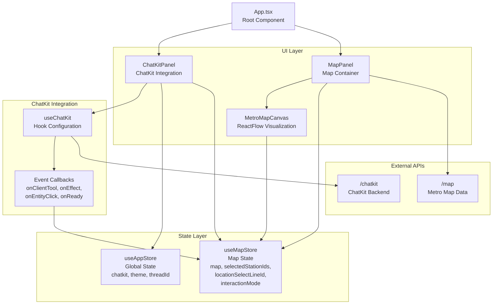
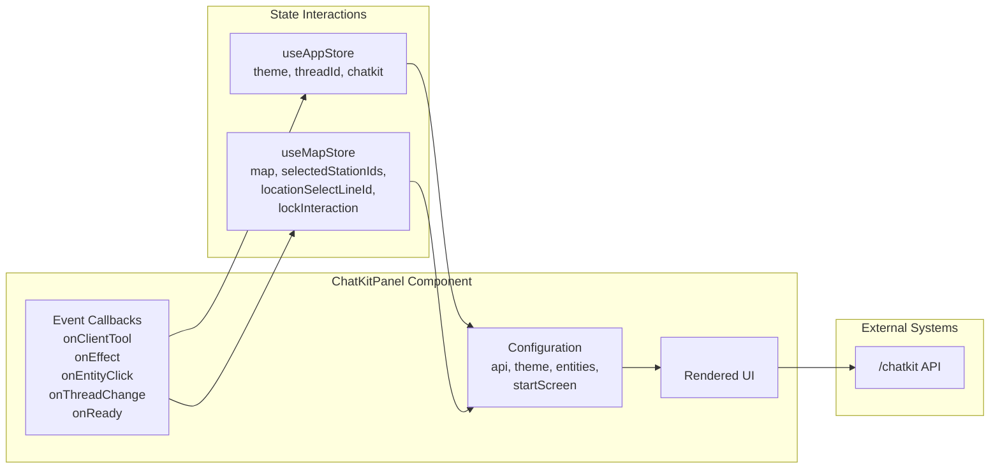
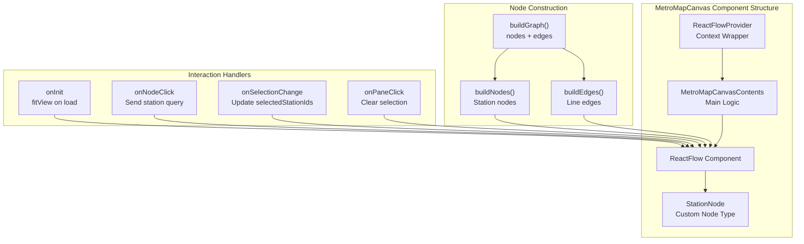
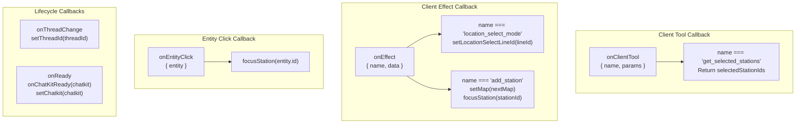
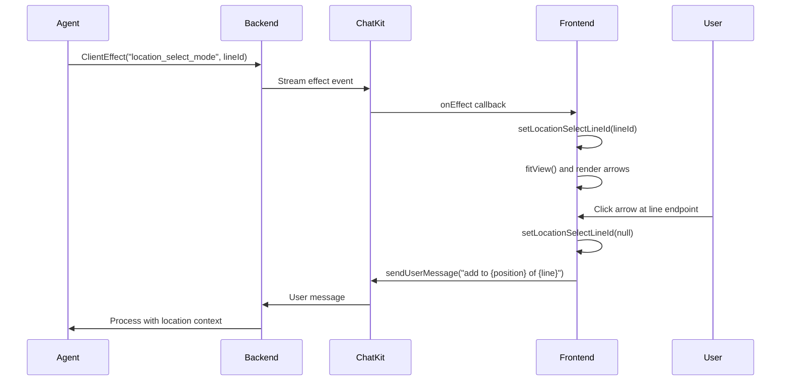
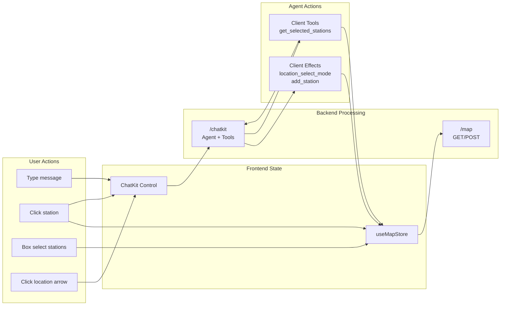

<!-- source: DeepWiki mcp.deepwiki.com · repo openai/openai-chatkit-advanced-samples · page 4.3 Metro Map Frontend · fetched 2026-10-26 -->

# Metro Map Frontend

<details>
<summary>Relevant source files</summary>

The following files were used as context for generating this wiki page:

- [examples/metro-map/frontend/package-lock.json](examples/metro-map/frontend/package-lock.json)
- [examples/metro-map/frontend/src/components/ChatKitPanel.tsx](examples/metro-map/frontend/src/components/ChatKitPanel.tsx)
- [examples/metro-map/frontend/src/components/MapPanel.tsx](examples/metro-map/frontend/src/components/MapPanel.tsx)
- [examples/metro-map/frontend/src/components/MetroMapCanvas.tsx](examples/metro-map/frontend/src/components/MetroMapCanvas.tsx)
- [examples/metro-map/frontend/src/lib/config.ts](examples/metro-map/frontend/src/lib/config.ts)
- [examples/metro-map/frontend/src/store/useMapStore.ts](examples/metro-map/frontend/src/store/useMapStore.ts)

</details>


## Purpose and Scope

This document covers the React frontend implementation of the Metro Map example application (port 5173). It details the component architecture, Zustand-based state management, ChatKit integration, ReactFlow-powered map visualization, and interactive patterns including station selection, location selection mode, and entity @-mentions.

For backend server implementation, see [4.4](#4.4). For agent implementation and tool definitions, see [4.2](#4.2). For widget system details, see [4.5](#4.5).

---

## Architecture Overview

The Metro Map frontend follows a React + TypeScript architecture with clear separation between conversational UI (ChatKit), domain-specific UI (metro map canvas), and state management (Zustand).



**Sources**: 
- [examples/metro-map/frontend/src/components/ChatKitPanel.tsx:1-219]()
- [examples/metro-map/frontend/src/components/MetroMapCanvas.tsx:1-492]()
- [examples/metro-map/frontend/src/components/MapPanel.tsx:1-280]()
- [examples/metro-map/frontend/src/store/useMapStore.ts:1-86]()

---

## Core Components

### ChatKitPanel

The `ChatKitPanel` component configures and renders the ChatKit UI, handling all bidirectional communication between the conversational interface and the map visualization.



#### Key Configuration Elements

The `useChatKit` hook at [examples/metro-map/frontend/src/components/ChatKitPanel.tsx:155-211]() configures:

| Configuration | Purpose | Key Values |
|--------------|---------|------------|
| `api` | Backend connection | `url: CHATKIT_API_URL`, `domainKey: CHATKIT_API_DOMAIN_KEY` |
| `theme` | Visual styling | `colorScheme: theme`, `density: "spacious"`, `radius: "pill"` |
| `header` | Custom actions | `rightAction: headerRightAction` (dark/light mode toggle) |
| `entities` | @-mention system | `onTagSearch: searchStations`, `onClick: handleEntityClick` |
| `startScreen` | Contextual prompts | Dynamic based on `selectedStationIds` |

#### Entity System Implementation

Station entities are built from the current map data at [examples/metro-map/frontend/src/components/ChatKitPanel.tsx:73-88]():

```typescript
const stationEntities = useMemo<Entity[]>(() => {
  if (!currentMap) return [];
  return currentMap.stations.map((station) => {
    return {
      id: station.id,
      title: station.name,
      interactive: true,
      group: "Stations",
      data: {
        type: "station",
        station_id: station.id,
        name: station.name,
      },
    };
  });
}, [currentMap]);
```

The `searchStations` callback at [examples/metro-map/frontend/src/components/ChatKitPanel.tsx:90-105]() filters entities by name or line membership, enabling fuzzy @-mention searching.

**Sources**:
- [examples/metro-map/frontend/src/components/ChatKitPanel.tsx:1-219]()
- [examples/metro-map/frontend/src/lib/config.ts:1-68]()

---

### MetroMapCanvas

The `MetroMapCanvas` component uses ReactFlow to render an interactive metro map with stations as nodes and lines as edges. It supports pan/zoom, station selection, and location selection mode.



#### Station Node Structure

The `StationNode` component at [examples/metro-map/frontend/src/components/MetroMapCanvas.tsx:164-289]() renders individual stations with:

- **Visual appearance**: Circular node with line color(s), exchange stations show multiple colored dots
- **Hidden ReactFlow handles**: Four directional handles (`target-left`, `source-right`, etc.) for edge connections
- **Location selection arrows**: Appear when `locationSelectLineId` is set, allowing users to choose start/end positions
- **Station label**: Rotated text positioned below the node

#### Graph Construction

The `buildGraph` function at [examples/metro-map/frontend/src/components/MetroMapCanvas.tsx:291-295]() constructs:

- **Nodes** from `map.stations`, positioned using `X_UNIT` and `Y_UNIT` multipliers
- **Edges** from `map.lines`, with dynamic `sourceHandle` and `targetHandle` based on station positions
- **Selection state** mapped from `selectedStationIds`

#### Interaction Modes

Two interaction modes controlled by [examples/metro-map/frontend/src/store/useMapStore.ts:25-26,83-84]():

| Mode | Behavior | Controls |
|------|----------|----------|
| `"select"` | Box selection for multi-select | `selectionOnDrag={true}`, cursor: `crosshair` |
| `"pan"` | Click-and-drag to pan | `panOnDrag={true}`, cursor: `grab` |

Toggled via [examples/metro-map/frontend/src/components/MapPanel.tsx:169-190]() in the top-right UI.

**Sources**:
- [examples/metro-map/frontend/src/components/MetroMapCanvas.tsx:1-492]()
- [examples/metro-map/frontend/src/lib/map.ts]() (type definitions)
- [examples/metro-map/frontend/src/store/useMapStore.ts:1-86]()

---

### MapPanel

The `MapPanel` component wraps the `MetroMapCanvas` and provides UI controls for adding stations and toggling interaction modes.

#### Add Station Modal

Implemented using `react-modal` at [examples/metro-map/frontend/src/components/MapPanel.tsx:194-274](), with:

- **Station name input**: Text field with title-case formatting
- **Line selector**: Dropdown to choose which line the station will join
- **Position calculation**: `computePosition` function places new stations adjacent to the line's last station
- **ID generation**: `nextStationId` ensures unique IDs with collision handling

The `handleAddStation` callback at [examples/metro-map/frontend/src/components/MapPanel.tsx:95-154]():
1. Validates input
2. Constructs new `Station` object
3. Updates `MetroMap` by appending to `stations` array and line's `stations` array
4. Calls `/map` API via `updateMetroMap`
5. Focuses the new station and sends follow-up prompt to ChatKit

**Sources**:
- [examples/metro-map/frontend/src/components/MapPanel.tsx:1-280]()

---

## State Management

### useMapStore

The `useMapStore` Zustand store at [examples/metro-map/frontend/src/store/useMapStore.ts:1-86]() manages all map-specific state:

| State Field | Type | Purpose |
|-------------|------|---------|
| `map` | `MetroMap \| null` | Current metro map data |
| `reactFlow` | `ReactFlowInstance \| null` | ReactFlow API instance |
| `selectedStationIds` | `string[]` | Currently selected stations |
| `locationSelectLineId` | `string \| null` | Active line for location selection mode |
| `interactionLocked` | `boolean` | Disable interactions during agent responses |
| `interactionMode` | `"select" \| "pan"` | Current interaction mode |

#### Key Actions

- **`focusStation(stationId, map?)`** at [examples/metro-map/frontend/src/store/useMapStore.ts:44-59](): Centers and zooms to a station
- **`setLocationSelectLineId(lineId)`** at [examples/metro-map/frontend/src/store/useMapStore.ts:61-66](): Activates location selection mode, clears selection, and calls `fitView`
- **`clearLocationSelectMode()`** at [examples/metro-map/frontend/src/store/useMapStore.ts:67](): Exits location selection mode
- **`lockInteraction()` / `unlockInteraction()`** at [examples/metro-map/frontend/src/store/useMapStore.ts:81-82](): Called during agent streaming

**Sources**:
- [examples/metro-map/frontend/src/store/useMapStore.ts:1-86]()

### useAppStore

Global application state managed by `useAppStore` (not shown in provided files but referenced throughout):

| State Field | Purpose |
|-------------|---------|
| `chatkit` | ChatKit control instance for programmatic message sending |
| `theme` / `scheme` | Dark/light mode (`"dark"` or `"light"`) |
| `threadId` | Current ChatKit thread ID |

**Sources**:
- [examples/metro-map/frontend/src/components/ChatKitPanel.tsx:14,41-54]()

---

## ChatKit Integration

### Event Callback Handlers

The Metro Map frontend implements four key ChatKit callbacks to synchronize map state with conversational interactions:



#### onClientTool Handler

Implemented at [examples/metro-map/frontend/src/components/ChatKitPanel.tsx:119-128]():

```typescript
const handleClientTool = useCallback(
  ({name}: { name: string; params: Record<string, unknown> }) => {
    if (name === "get_selected_stations") {
      return { stationIds: selectedStationIds };
    }
  },
  [selectedStationIds]
);
```

This allows the agent to query the current selection state without a server round-trip. See [4.2](#4.2) for how the agent uses this.

#### onEffect Handler

Implemented at [examples/metro-map/frontend/src/components/ChatKitPanel.tsx:130-153]():

**`location_select_mode` effect**: Enters location selection mode for the specified line, triggering UI changes in `StationNode` to show directional arrows at line endpoints.

**`add_station` effect**: Updates the map with the new station data returned from the server, clears location selection mode, and focuses the newly added station.

#### onEntityClick Handler

Implemented at [examples/metro-map/frontend/src/components/ChatKitPanel.tsx:109-117]():

When a user clicks an entity (station) in the ChatKit UI, the map focuses on that station using the `focusStation` action, which centers and zooms to the station's coordinates.

#### Response Lifecycle Callbacks

- **`onResponseStart`** at [examples/metro-map/frontend/src/components/ChatKitPanel.tsx:205-207](): Calls `lockInteraction()` to disable map interactions during agent responses
- **`onResponseEnd`** at [examples/metro-map/frontend/src/components/ChatKitPanel.tsx:208-210](): Calls `unlockInteraction()` to re-enable interactions

**Sources**:
- [examples/metro-map/frontend/src/components/ChatKitPanel.tsx:119-153,205-210]()

---

## Interaction Patterns

### Station Selection

The Metro Map supports multi-station selection via ReactFlow's box selection:

1. **Select mode active**: User drags to create selection box (controlled by `interactionMode === "select"`)
2. **Selection callback**: `onSelectionChange` at [examples/metro-map/frontend/src/components/MetroMapCanvas.tsx:407-413]() updates `selectedStationIds`
3. **Visual feedback**: Selected stations have `selected={true}` in their node data, applying `.StationNode--selected` CSS class
4. **Contextual prompts**: Start screen prompts change based on selection count via `getStartScreenPrompts` at [examples/metro-map/frontend/src/lib/config.ts:46-62]()

#### Direct Node Click

Clicking a station node at [examples/metro-map/frontend/src/components/MetroMapCanvas.tsx:415-431]() both selects it and sends a prompt: `"Tell me about {stationName}"` to ChatKit via `chatkit.sendUserMessage()`.

**Sources**:
- [examples/metro-map/frontend/src/components/MetroMapCanvas.tsx:407-431]()
- [examples/metro-map/frontend/src/lib/config.ts:46-62]()

---

### Location Selection Mode

Location selection mode enables the agent to collect user input for where to add a new station on a line. This mode is triggered by the `location_select_mode` client effect from the backend.



#### Visual Indicators

When `locationSelectLineId` is set:

1. **Station nodes** with [examples/metro-map/frontend/src/components/MetroMapCanvas.tsx:232]() apply `.location-select-mode` class
2. **Line endpoints** are calculated via `resolveLineEndpoints` at [examples/metro-map/frontend/src/components/MetroMapCanvas.tsx:69-93]()
3. **LocationSelectArrow** components at [examples/metro-map/frontend/src/components/MetroMapCanvas.tsx:125-158]() appear at start/end stations, pointing in the direction of extension

#### Arrow Click Handler

The `handleLocationSelection` callback at [examples/metro-map/frontend/src/components/MetroMapCanvas.tsx:214-228]():
1. Clears location selection mode
2. Sends a natural language message: `"I would like to add the station to the {beginning|end} of the {line.name} line"`
3. Agent receives this and processes the add_station flow

**Sources**:
- [examples/metro-map/frontend/src/components/MetroMapCanvas.tsx:125-228]()
- [examples/metro-map/frontend/src/components/ChatKitPanel.tsx:130-137]()

---

### Entity Tags and @-Mentions

The Metro Map implements ChatKit's entity system to allow users to @-mention stations in their messages.

#### Entity Definition

Station entities are constructed at [examples/metro-map/frontend/src/components/ChatKitPanel.tsx:73-88]() with:
- `id`: Station ID (e.g., `"lyra-verge"`)
- `title`: Display name (e.g., `"Lyra Verge"`)
- `interactive: true`: Enables click handling
- `group: "Stations"`: Groups in entity picker
- `data`: Custom metadata including station details

#### Search Implementation

The `searchStations` callback at [examples/metro-map/frontend/src/components/ChatKitPanel.tsx:90-105]() provides fuzzy matching:
- Searches station `title` (name)
- Searches station `id`
- Searches `line_names` (if present in entity data)
- Returns filtered list as user types after `@`

#### Click Behavior

The `handleEntityClick` callback at [examples/metro-map/frontend/src/components/ChatKitPanel.tsx:109-117]() extracts the `station_id` from entity data and calls `focusStation()`, centering the map on the mentioned station.

**Sources**:
- [examples/metro-map/frontend/src/components/ChatKitPanel.tsx:73-117,186-189]()

---

## Configuration and Environment

### Environment Variables

Configuration loaded from [examples/metro-map/frontend/src/lib/config.ts:1-14]():

| Variable | Default | Purpose |
|----------|---------|---------|
| `VITE_CHATKIT_API_URL` | `"/chatkit"` | ChatKit backend endpoint |
| `VITE_CHATKIT_API_DOMAIN_KEY` | `"domain_pk_localhost_dev"` | Domain allowlist key (production requires real key) |
| `VITE_MAP_API_URL` | `"/map"` | Metro map data endpoint |

### Start Screen Configuration

The `getStartScreenPrompts` function at [examples/metro-map/frontend/src/lib/config.ts:46-62]() returns contextual prompts:

- **Multiple stations selected**: Prompts about selected stations, asking for itineraries
- **No selection**: Default prompts for adding stations, planning routes, and getting station/line overviews

Default prompts defined at [examples/metro-map/frontend/src/lib/config.ts:16-37]():
- "Add a station"
- "Plan a route" (Cinderia to Lyra Verge example)
- "Station overview" (Titan Border example)
- "Line overview" (crossing analysis)

### Theme Customization

ChatKit theme configured at [examples/metro-map/frontend/src/components/ChatKitPanel.tsx:161-181]():
- **Color scheme**: Follows global `theme` state (`"dark"` or `"light"`)
- **Surface colors**: Custom dark mode background (`#0d1117`, `#1d222b`)
- **Accent color**: Sky blue (`#0ea5e9`)
- **Typography**: OpenAI Sans font with custom font sources
- **Radius**: `"pill"` shape for rounded corners
- **Density**: `"spacious"` layout

### Header Customization

The `headerRightAction` at [examples/metro-map/frontend/src/components/ChatKitPanel.tsx:56-71]() provides a dark/light mode toggle button, demonstrating ChatKit's custom header action capabilities.

**Sources**:
- [examples/metro-map/frontend/src/lib/config.ts:1-68]()
- [examples/metro-map/frontend/src/components/ChatKitPanel.tsx:56-71,161-181]()

---

## Data Flow Summary



**Key data flows**:

1. **User → ChatKit → Agent**: Natural language input processed by agent with access to map data
2. **Agent → ClientEffect → MapStore**: Fire-and-forget UI updates (location mode, map updates)
3. **Agent → ClientTool → MapStore → Agent**: Bidirectional query of current selection state
4. **User → MapStore → ChatKit**: Station clicks generate prompts sent to agent
5. **MapPanel → MapAPI → MapStore**: Direct map modifications (add station button)

**Sources**:
- [examples/metro-map/frontend/src/components/ChatKitPanel.tsx:119-153]()
- [examples/metro-map/frontend/src/components/MetroMapCanvas.tsx:415-431]()
- [examples/metro-map/frontend/src/components/MapPanel.tsx:95-154]()

---

