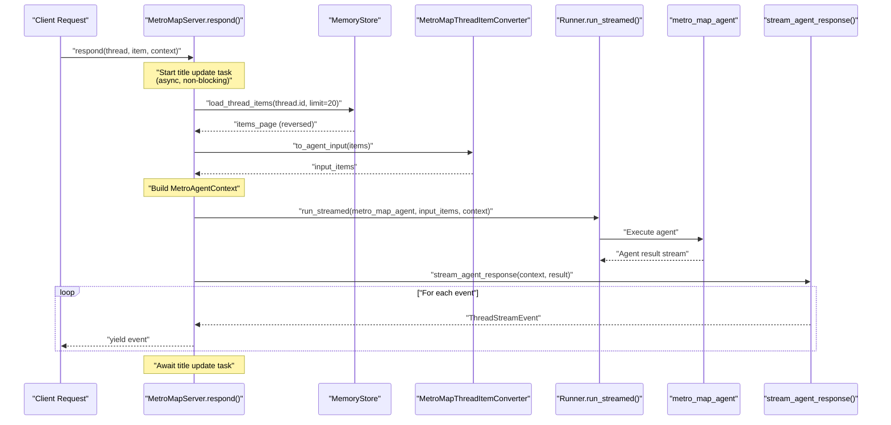
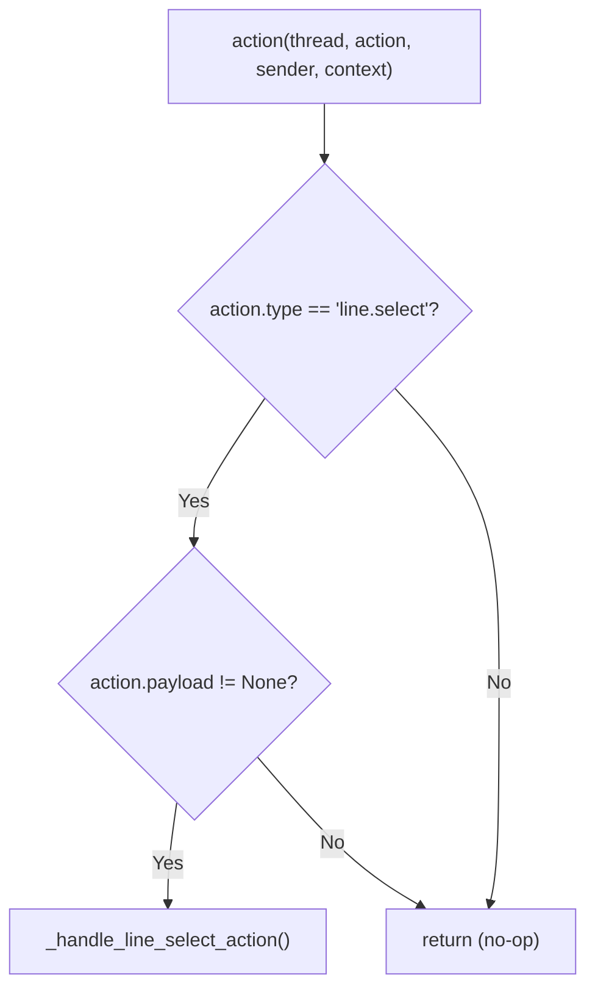
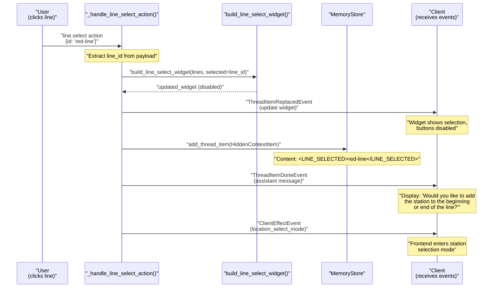
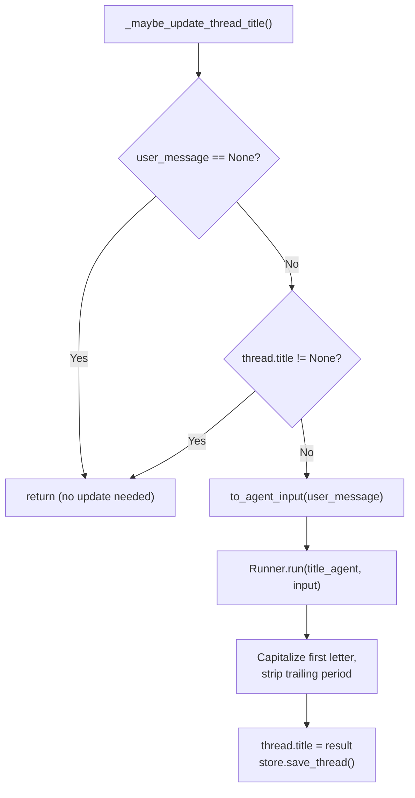

<!-- source: DeepWiki mcp.deepwiki.com · repo openai/openai-chatkit-advanced-samples · page 4.4 Metro Map Server · fetched 2026-10-26 -->

# Metro Map Server

<details>
<summary>Relevant source files</summary>

The following files were used as context for generating this wiki page:

- [examples/metro-map/backend/app/server.py](examples/metro-map/backend/app/server.py)

</details>


## Purpose and Scope

This document describes the `MetroMapServer` class, which implements the ChatKit server interface for the Metro Map example application. This server coordinates between incoming requests, the metro map agent, data stores, and widget interactions. It is responsible for processing user messages, handling widget actions (particularly line selection), and managing thread metadata.

For information about the metro map agent itself, see [Metro Map Agent](#4.2). For frontend integration, see [Metro Map Frontend](#4.3). For widget implementation details, see [Metro Map Widgets](#4.5).

**Sources:** [examples/metro-map/backend/app/server.py:1-185]()

---

## Class Structure and Dependencies

The `MetroMapServer` class extends `ChatKitServer[RequestContext]` and acts as the central coordinator for the Metro Map example. It manages multiple data stores, agents, and converters to process incoming requests and generate appropriate responses.

```mermaid
graph TB
    MetroMapServer["MetroMapServer"]
    ChatKitServer["ChatKitServer[RequestContext]"]
    
    subgraph "Data Layer"
        MemoryStore["MemoryStore<br/>(thread history)"]
        MetroMapStore["MetroMapStore<br/>(metro map data)"]
    end
    
    subgraph "Agent Layer"
        MetroMapAgent["metro_map_agent"]
        TitleAgent["title_agent"]
    end
    
    subgraph "Converters"
        ThreadItemConverter["MetroMapThreadItemConverter<br/>(items to agent input)"]
    end
    
    subgraph "Widget Builders"
        LineSelectWidget["build_line_select_widget()"]
    end
    
    MetroMapServer --|"extends"| ChatKitServer
    MetroMapServer --> MemoryStore
    MetroMapServer --> MetroMapStore
    MetroMapServer --> ThreadItemConverter
    MetroMapServer --> MetroMapAgent
    MetroMapServer --> TitleAgent
    MetroMapServer --> LineSelectWidget
    
    ThreadItemConverter --> MetroMapStore
```

**Sources:** [examples/metro-map/backend/app/server.py:41-51]()

---

## Initialization

The `__init__` method sets up the server's dependencies during instantiation:

| Component | Type | Purpose |
|-----------|------|---------|
| `self.store` | `MemoryStore` | Stores thread history and items |
| `self.metro_map_store` | `MetroMapStore` | Provides access to metro map data |
| `self.thread_item_converter` | `MetroMapThreadItemConverter` | Converts thread items to agent input format |
| `self.title_agent` | `Agent` | Generates thread titles from user messages |

The `MetroMapStore` is initialized with a data directory located at `backend/app/data` relative to the server file. The parent `ChatKitServer` constructor is called with the `MemoryStore` instance.

**Sources:** [examples/metro-map/backend/app/server.py:44-51]()

---

## The `respond` Method

The `respond` method is invoked when a user sends a message. It coordinates thread title updates, loads conversation history, converts items to agent input format, and streams the agent's response.



### Key Steps

1. **Thread Title Update**: Asynchronously spawns `_maybe_update_thread_title()` using `asyncio.create_task()`. This runs in the background without blocking response generation.

2. **Load History**: Retrieves the last 20 thread items in descending order, then reverses them to chronological order.

3. **Convert Items**: Uses `MetroMapThreadItemConverter.to_agent_input()` to transform thread items into agent-compatible input format.

4. **Build Context**: Creates a `MetroAgentContext` containing:
   - Thread metadata
   - Memory store reference
   - Metro map store reference
   - Request context

5. **Run Agent**: Executes `metro_map_agent` via `Runner.run_streamed()` with the prepared input and context.

6. **Stream Response**: Uses `stream_agent_response()` to convert agent output into `ThreadStreamEvent` objects, which are yielded to the client.

**Sources:** [examples/metro-map/backend/app/server.py:54-86]()

---

## Action Handling

The `action` method handles widget action events. Currently, it only processes the `line.select` action type, which is triggered when a user selects a metro line from the line selector widget.



The method signature receives:
- `thread`: Current thread metadata
- `action`: The action object with `type` and `payload` fields
- `sender`: The widget item that triggered the action (may be `None`)
- `context`: Request context for the operation

If the action type matches `line.select` and a payload is present, the method delegates to `_handle_line_select_action()`. Otherwise, it returns without yielding any events.

**Sources:** [examples/metro-map/backend/app/server.py:88-104]()

---

## Line Selection Flow

The `_handle_line_select_action` method implements a multi-step flow when a user selects a metro line. This demonstrates server-side action handling, widget updates, hidden context injection, and client effect triggering.



### Step-by-Step Process

1. **Extract Line ID**: Retrieves the selected `line_id` from `action.payload["id"]`.

2. **Update Widget**: Calls `build_line_select_widget()` with the selected line ID, which returns an updated widget with:
   - The selected line visually highlighted
   - All buttons disabled to prevent further clicks

3. **Replace Widget Item**: If a `sender` widget exists, yields a `ThreadItemReplacedEvent` to update the widget in the thread.

4. **Inject Hidden Context**: Adds a `HiddenContextItem` to the thread with content:
   ```
   <LINE_SELECTED>{line_id}</LINE_SELECTED>
   ```
   This provides context to the agent in subsequent interactions without displaying it to the user.

5. **Send Assistant Message**: Yields a `ThreadItemDoneEvent` with an `AssistantMessageItem` asking the user to choose where to add the station (beginning or end).

6. **Trigger Client Effect**: Yields a `ClientEffectEvent` named `location_select_mode` with data `{"lineId": line_id}`. This signals the frontend to enter interactive station selection mode on the map canvas.

**Sources:** [examples/metro-map/backend/app/server.py:110-159]()

---

## Thread Title Management

The `_maybe_update_thread_title` method generates a thread title from the first user message using the `title_agent`. This runs asynchronously without blocking the main response flow.



### Behavior

- **Guard Conditions**: Only generates a title if:
  - A user message is provided (`user_message is not None`)
  - The thread does not already have a title (`thread.title is None`)

- **Title Generation**: Runs `title_agent` synchronously via `Runner.run()` with the converted user message as input.

- **Formatting**: The generated title is:
  - Capitalized (first character uppercased)
  - Stripped of trailing periods

- **Persistence**: Updates the `thread.title` field and saves the thread to the memory store.

This method is called via `asyncio.create_task()` in the `respond` method, allowing title generation to happen concurrently with agent response streaming.

**Sources:** [examples/metro-map/backend/app/server.py:161-177]()

---

## Integration with FastAPI

The `create_chatkit_server()` factory function instantiates the `MetroMapServer` for use by the FastAPI application. It returns `None` if imports fail, allowing graceful degradation.

This function is typically called in the main FastAPI application setup (not shown in the provided file) to create the server instance that handles the `/chatkit` endpoint.

**Sources:** [examples/metro-map/backend/app/server.py:180-184]()

---

## File Attachment Handling

The `to_message_content` method is required by the `ChatKitServer` interface but is not implemented in this example. It raises a `RuntimeError` indicating that file attachments are not supported:

```python
async def to_message_content(self, _input: Attachment) -> ResponseInputContentParam:
    raise RuntimeError("File attachments are not supported in this demo.")
```

Applications that need to support file attachments (images, documents, etc.) would implement this method to convert `Attachment` objects into `ResponseInputContentParam` format suitable for the OpenAI API.

**Sources:** [examples/metro-map/backend/app/server.py:106-107]()

---

## Summary of Responsibilities

The `MetroMapServer` class serves as the orchestration layer for the Metro Map example, with these key responsibilities:

| Responsibility | Implementation |
|----------------|----------------|
| Request Routing | Implements `respond()` for user messages, `action()` for widget interactions |
| Agent Execution | Runs `metro_map_agent` via `Runner.run_streamed()` with proper context |
| State Management | Coordinates between `MemoryStore` (threads) and `MetroMapStore` (map data) |
| Widget Updates | Rebuilds and replaces widgets in response to user actions |
| Context Injection | Adds `HiddenContextItem` to provide agent context without user visibility |
| Client Effects | Triggers frontend state changes via `ClientEffectEvent` |
| Thread Metadata | Generates and persists thread titles asynchronously |

This architecture separates HTTP concerns (handled by FastAPI), business logic (agents and tools), and data persistence (stores), creating a maintainable and testable system.

**Sources:** [examples/metro-map/backend/app/server.py:1-185]()

---

