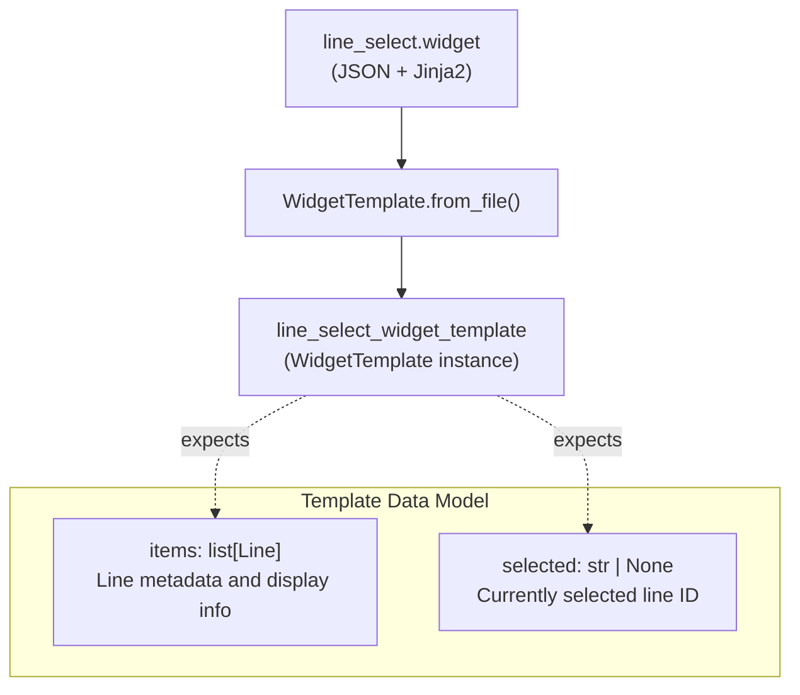
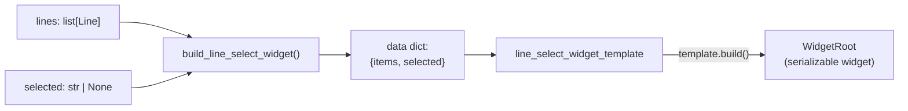
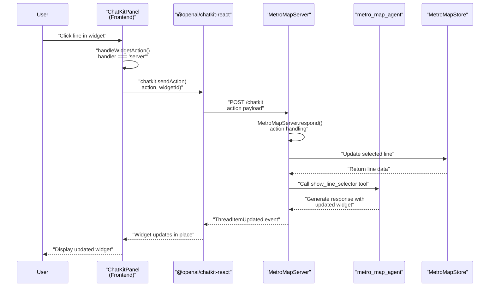
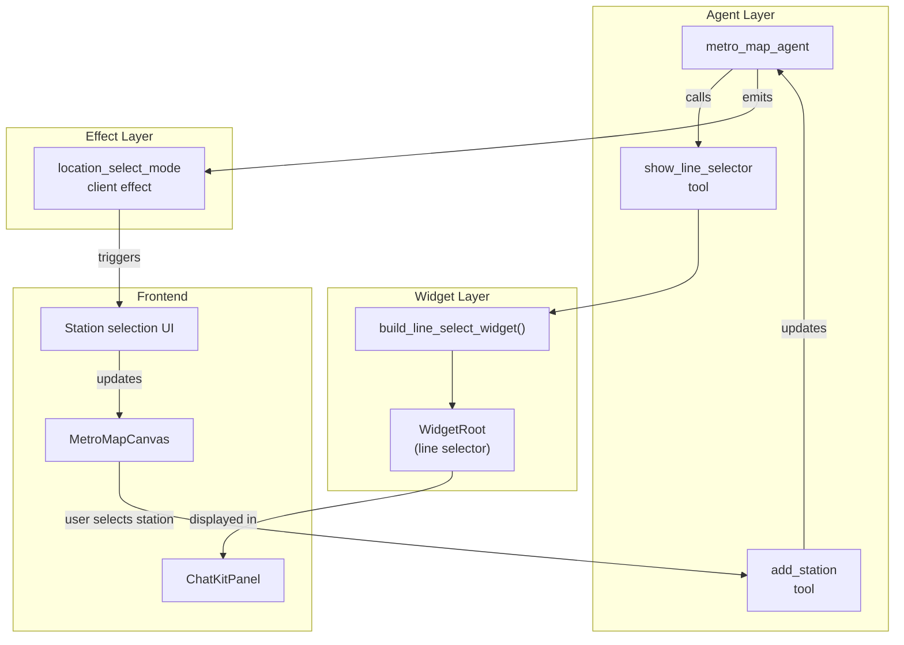
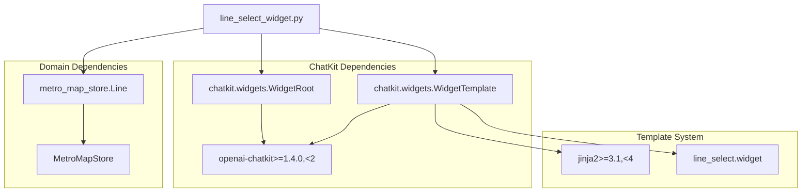

<!-- source: DeepWiki mcp.deepwiki.com · repo openai/openai-chatkit-advanced-samples · page 4.5 Metro Map Widgets · fetched 2026-10-26 -->

# Metro Map Widgets

<details>
<summary>Relevant source files</summary>

The following files were used as context for generating this wiki page:

- [examples/metro-map/backend/app/widgets/line_select_widget.py](examples/metro-map/backend/app/widgets/line_select_widget.py)
- [examples/metro-map/backend/pyproject.toml](examples/metro-map/backend/pyproject.toml)
- [examples/metro-map/frontend/package.json](examples/metro-map/frontend/package.json)

</details>


## Purpose and Scope

This page documents the widget system implementation in the Metro Map example, focusing specifically on the **line selector widget** and its integration with the location selection mode. The line selector widget demonstrates interactive widget patterns with server-side action handling.

For general widget architecture concepts shared across all examples, see [Widget System](#3.4). For the Metro Map agent that generates these widgets, see [Metro Map Agent](#4.2). For frontend handling of widget interactions, see [Metro Map Frontend](#4.3).

---

## Overview

The Metro Map example implements a single interactive widget type: the **line selector widget**. This widget allows users to select a metro line when planning routes, and it integrates with the map's location selection mode to enable interactive station selection.

**Key characteristics:**

| Aspect | Implementation |
|--------|----------------|
| Widget Type | Interactive with server-side action handling |
| Template File | `line_select.widget` |
| Builder Function | `build_line_select_widget()` |
| Action Handler | Server (`line.select` action) |
| Integration Point | Location selection mode in `MetroMapCanvas` |
| Data Source | `Line` objects from `MetroMapStore` |

The widget follows the template-based pattern: a `.widget` file defines the UI structure using JSON and Jinja2, while a Python builder function populates it with data from the metro map store.

**Sources:** [examples/metro-map/backend/app/widgets/line_select_widget.py:1-22]()

---

## Widget Template Structure

The line selector widget is defined in a `.widget` template file that combines JSON structure with Jinja2 templating. The template is loaded at module initialization time using `WidgetTemplate.from_file()`.



**Template loading pattern:**

[examples/metro-map/backend/app/widgets/line_select_widget.py:11]() shows the template initialization:

```python
line_select_widget_template = WidgetTemplate.from_file("line_select.widget")
```

The `WidgetTemplate.from_file()` method resolves the template path relative to the widget module's directory, loading and parsing the `.widget` file into a reusable template object.

**Data model:**

The template expects two data fields:
- **`items`**: A list of `Line` objects containing metro line information (ID, name, color, stations)
- **`selected`**: Optional string indicating which line ID is currently selected

**Sources:** [examples/metro-map/backend/app/widgets/line_select_widget.py:11]()

---

## Widget Building Process

The `build_line_select_widget()` function creates `WidgetRoot` objects by populating the template with runtime data.



**Function signature:**

[examples/metro-map/backend/app/widgets/line_select_widget.py:14-21]() defines the builder:

```python
def build_line_select_widget(lines: list[Line], selected: str | None = None) -> WidgetRoot:
    """Render a line selector widget from the provided line metadata."""
    return line_select_widget_template.build(
        data={
            "items": lines,
            "selected": selected,
        }
    )
```

**Parameters:**

| Parameter | Type | Purpose |
|-----------|------|---------|
| `lines` | `list[Line]` | Metro lines to display in the selector |
| `selected` | `str \| None` | ID of the currently selected line (optional) |

**Return value:**

Returns a `WidgetRoot` object that can be included in agent responses. The ChatKit framework automatically serializes this to JSON for transmission to the frontend.

**Type imports:**

[examples/metro-map/backend/app/widgets/line_select_widget.py:7-9]() shows the required imports:

```python
from chatkit.widgets import WidgetRoot, WidgetTemplate
from ..data.metro_map_store import Line
```

The `Line` type comes from the domain data model, ensuring type safety between the data store and widget rendering.

**Sources:** [examples/metro-map/backend/app/widgets/line_select_widget.py:5-21]()

---

## Widget Action Flow

The line selector widget defines server-side actions that trigger when users interact with it. The action handling flow connects the frontend widget interaction to backend state updates.



**Action handling stages:**

1. **User interaction**: User clicks a line option in the rendered widget
2. **Frontend routing**: `handleWidgetAction` callback inspects the action's `handler` field
3. **Server dispatch**: For `handler: "server"`, the action is sent via `chatkit.sendAction()`
4. **Backend processing**: `MetroMapServer.respond()` receives the action in the request context
5. **State mutation**: Server updates the selected line in `MetroMapStore`
6. **Widget update**: Agent calls `show_line_selector` tool again with the new selection
7. **UI refresh**: `ThreadItemUpdated` event causes the widget to re-render with the updated state

**Action definition in template:**

The `.widget` file defines actions with the following structure:

```json
{
  "action": "line.select",
  "handler": "server",
  "payload": { "line_id": "{{line.id}}" }
}
```

The `handler: "server"` field indicates this action requires backend processing rather than client-side handling.

**Sources:** [examples/metro-map/backend/app/widgets/line_select_widget.py:1-22]()

---

## Integration with Location Selection Mode

The line selector widget is tightly integrated with the Metro Map's location selection mode, enabling a coordinated workflow for route planning.



**Workflow sequence:**

1. **Widget display**: Agent calls `show_line_selector` tool, which invokes `build_line_select_widget()` with available lines
2. **Mode activation**: Agent emits `location_select_mode` client effect with line ID
3. **Map interaction**: `MetroMapCanvas` enters selection mode, highlighting stations on the selected line
4. **Station selection**: User clicks a station on the map
5. **State update**: Frontend calls `add_station` tool (client effect) to add the station
6. **Agent continuation**: Agent processes the station addition and continues the conversation

**Coordination mechanism:**

The widget and the location selection mode are coordinated through:
- **Shared line ID**: The widget action payload contains `line_id`, which is also passed to the `location_select_mode` effect
- **State synchronization**: `MetroMapStore` maintains the selected line state used by both the widget and the map canvas
- **Sequential flow**: Widget selection typically precedes mode activation, establishing context for station selection

**Sources:** [examples/metro-map/backend/app/widgets/line_select_widget.py:1-22]()

---

## Dependencies

The line selector widget implementation depends on the ChatKit widget framework and the Metro Map domain model.



**Backend dependencies:**

[examples/metro-map/backend/pyproject.toml:7-12]() specifies the required packages:

| Package | Version Constraint | Purpose |
|---------|-------------------|---------|
| `openai-chatkit` | `>=1.4.0,<2` | Widget framework (WidgetRoot, WidgetTemplate) |
| `jinja2` | `>=3.1,<4` | Template rendering engine for .widget files |

**Frontend dependencies:**

[examples/metro-map/frontend/package.json:17]() includes the ChatKit React library:

| Package | Version | Purpose |
|---------|---------|---------|
| `@openai/chatkit-react` | `^1.3.0` | Widget rendering and action handling |

The frontend library automatically handles widget rendering based on the JSON structure provided by the backend, requiring no widget-specific code on the frontend side.

**Sources:** [examples/metro-map/backend/pyproject.toml:7-12](), [examples/metro-map/frontend/package.json:17]()

---

## Extension Points

The line selector widget can be extended or customized in several ways:

**Template customization:**

The `.widget` file can be modified to:
- Add additional metadata fields (e.g., line color, station count)
- Include icons or visual indicators
- Support multi-select behavior
- Add filtering or search capabilities

**Builder function enhancement:**

[examples/metro-map/backend/app/widgets/line_select_widget.py:14-21]() can be extended to:
- Filter lines based on user preferences or context
- Pre-select a line based on conversation history
- Include additional computed fields (e.g., line popularity, distance)
- Support pagination for large line lists

**Action handler expansion:**

Additional actions can be defined in the widget template:
- `line.deselect`: Clear the current selection
- `line.info`: Show detailed information about a line
- `line.favorite`: Mark a line as a favorite for quick access

**Integration with other features:**

The widget can be coordinated with:
- Entity tags: Allow @-mentioning lines in chat to trigger widget display
- Annotations: Highlight selected line in response text
- Progress updates: Show loading state while fetching line data

**Sources:** [examples/metro-map/backend/app/widgets/line_select_widget.py:1-22]()

---

