<!-- source: DeepWiki mcp.deepwiki.com · repo openai/openai-chatkit-advanced-samples · page 5 Example: Cat Lounge · fetched 2026-10-26 -->

# Example: Cat Lounge

<details>
<summary>Relevant source files</summary>

The following files were used as context for generating this wiki page:

- [examples/cat-lounge/README.md](examples/cat-lounge/README.md)
- [examples/cat-lounge/backend/app/cat_agent.py](examples/cat-lounge/backend/app/cat_agent.py)
- [examples/cat-lounge/frontend/src/components/ChatKitPanel.tsx](examples/cat-lounge/frontend/src/components/ChatKitPanel.tsx)
- [examples/metro-map/README.md](examples/metro-map/README.md)

</details>


The Cat Lounge example demonstrates a virtual pet management application that focuses on **client effects** and **interactive widgets** in ChatKit. This example shows how to synchronize backend state with frontend UI through fire-and-forget effects, handle widget actions both client-side and server-side, and maintain per-thread conversational state with hidden context markers.

**Scope**: This page covers the Cat Lounge implementation, including the cat agent, state management patterns, widget architecture, and client effect handling. For the common architectural patterns shared across all examples, see [Common Architecture](#3). For other example applications demonstrating different ChatKit features, see [Metro Map](#4) and [News Guide](#6).

## Architecture Overview

The Cat Lounge follows a state-synchronization pattern where backend mutations trigger client effects to update the UI in real-time. The agent manages a `CatState` object per thread and uses hidden context items to track actions.

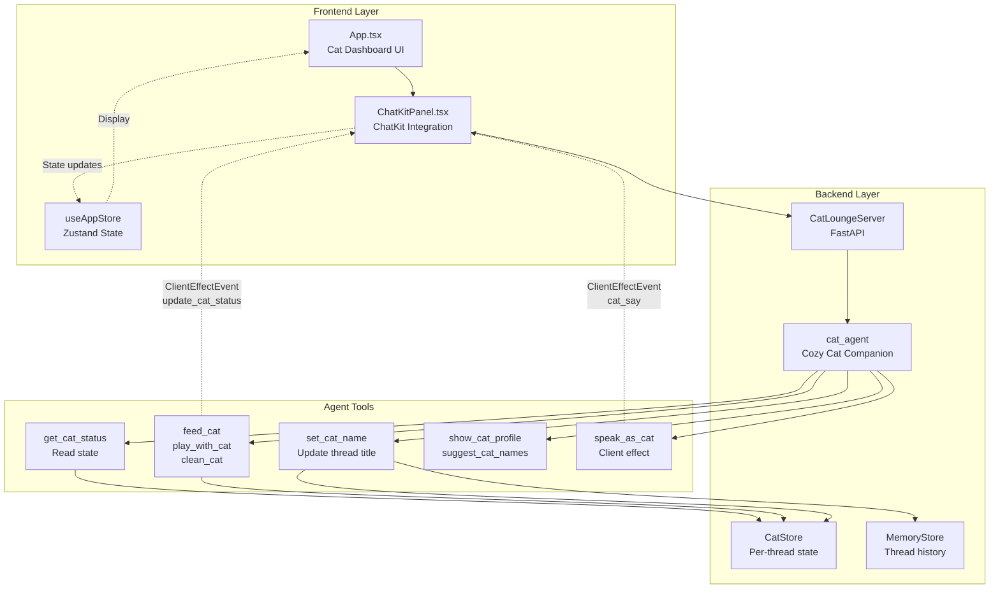

**Sources**: 
- [examples/cat-lounge/backend/app/cat_agent.py:1-397]()
- [examples/cat-lounge/frontend/src/components/ChatKitPanel.tsx:1-154]()
- [examples/cat-lounge/README.md:1-27]()

## Key Features Demonstrated

| Feature | Implementation | Purpose |
|---------|---------------|---------|
| **Client Effects** | `update_cat_status`, `cat_say` | Fire-and-forget UI updates without server acknowledgment |
| **Interactive Widgets** | `suggest_cat_names` with action buttons | Agent-generated content with user interaction |
| **Presentation Widgets** | `show_cat_profile` | Read-only display cards |
| **Hidden Context** | `<FED_CAT>`, `<CAT_NAME_SELECTED>` tags | Track actions without cluttering visible thread |
| **State Mutation** | `feed_cat`, `play_with_cat`, `clean_cat` | Backend state changes synchronized to frontend |
| **Thread Title Updates** | Dynamic title in `set_cat_name` | Conversational context reflected in UI |
| **Mixed Action Handling** | Client-side `cats.more_names`, server-side `cats.select_name` | Demonstrates both action patterns |

**Sources**: 
- [examples/cat-lounge/README.md:19-27]()
- [examples/cat-lounge/backend/app/cat_agent.py:27-68]()

## Agent Instructions and Behavior

The `cat_agent` is configured with detailed instructions that define its personality and tool usage patterns. The agent operates as "Cozy Cat Companion" and manages virtual cat care interactions.

### Agent Configuration

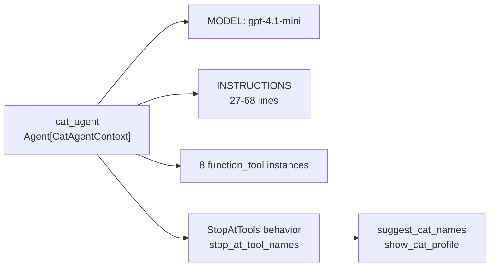

The agent uses `StopAtTools` behavior to prevent repetition after rendering widgets. When `suggest_cat_names` or `show_cat_profile` completes, inference stops immediately rather than generating additional text.

**Sources**: 
- [examples/cat-lounge/backend/app/cat_agent.py:368-396]()
- [examples/cat-lounge/backend/app/cat_agent.py:27-68]()
- [examples/cat-lounge/backend/app/cat_agent.py:70-70]()

### Tool Organization

The agent's tools are organized by function:

| Tool Name | Type | Description | Returns Payload |
|-----------|------|-------------|-----------------|
| `get_cat_status` | Read | Fetch current cat state | ✓ Yes (dict) |
| `feed_cat` | Mutate + Effect | Increase energy, sync UI | ✗ No |
| `play_with_cat` | Mutate + Effect | Increase happiness, sync UI | ✗ No |
| `clean_cat` | Mutate + Effect | Increase cleanliness, sync UI | ✗ No |
| `set_cat_name` | Mutate + Effect | Rename cat, update thread title | ✗ No |
| `show_cat_profile` | Widget | Display profile card | ✗ No |
| `suggest_cat_names` | Widget | Render name suggestions | ✗ No |
| `speak_as_cat` | Effect Only | Show speech bubble in UI | ✗ No |

Tools that mutate state or render widgets typically don't return payloads because the agent is configured to stop after calling them via `StopAtTools`.

**Sources**: 
- [examples/cat-lounge/backend/app/cat_agent.py:372-388]()
- [examples/cat-lounge/backend/app/cat_agent.py:125-136]()

## State Management Pattern

### Backend State Flow

The Cat Lounge uses three helper functions to manage state operations consistently:

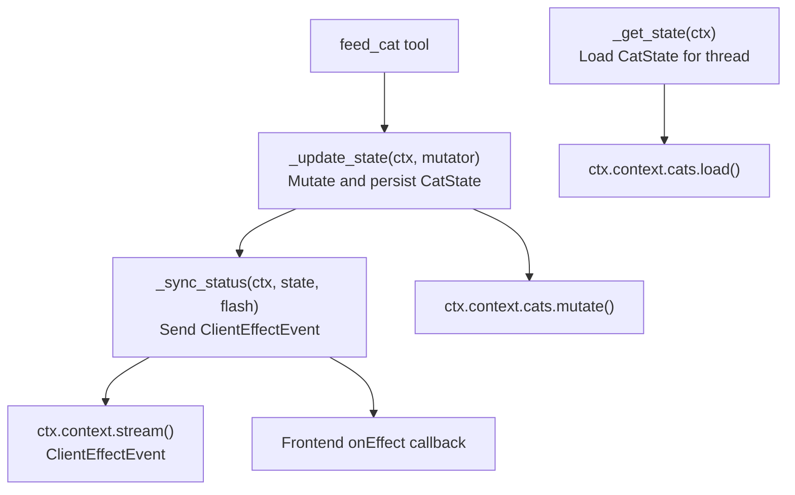

**Implementation Details**:

1. **`_get_state(ctx)`**: Returns the `CatState` for the current thread by calling `ctx.context.cats.load(thread_id)`. Used by read-only tools like `get_cat_status`.

2. **`_update_state(ctx, mutator)`**: Accepts a mutator function that modifies the `CatState` in-place, then persists changes via `ctx.context.cats.mutate(thread_id, mutator)`. The mutator pattern ensures atomic updates.

3. **`_sync_status(ctx, state, flash)`**: Streams a `ClientEffectEvent` with name `"update_cat_status"` containing the updated state payload and optional flash message.

**Sources**: 
- [examples/cat-lounge/backend/app/cat_agent.py:80-106]()

### Hidden Context Markers

The agent uses `_add_hidden_context()` to inject `HiddenContextItem` entries that track actions without visible output. These tags prevent duplicate actions when the user sends similar messages.

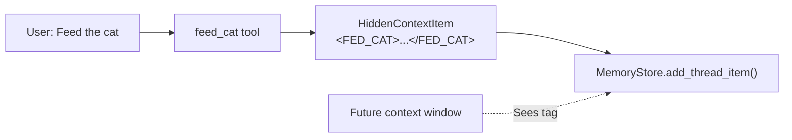

Tag format examples:
- `<FED_CAT>Fed Whiskers tuna</FED_CAT>`
- `<PLAYED_WITH_CAT>Playtime</PLAYED_WITH_CAT>`
- `<CLEANED_CAT>Bath time</CLEANED_CAT>`
- `<CAT_NAME_SELECTED>Whiskers</CAT_NAME_SELECTED>`

**Sources**: 
- [examples/cat-lounge/backend/app/cat_agent.py:109-122]()
- [examples/cat-lounge/backend/app/cat_agent.py:152-153]()
- [examples/cat-lounge/backend/app/cat_agent.py:229-229]()

## Tool Implementation Patterns

### Read-Only Tool: `get_cat_status`

The simplest tool pattern returns data for the agent to use in generating responses:

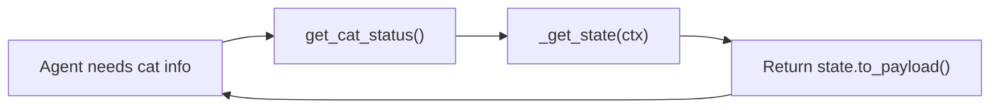

**Code Structure**:
```python
@function_tool(description_override="...")
async def get_cat_status(ctx: RunContextWrapper[CatAgentContext]) -> dict[str, Any]:
    state = await _get_state(ctx)
    return state.to_payload(ctx.context.thread.id)
```

Returns a dictionary payload that the agent can reference when generating natural language responses about the cat's current state.

**Sources**: 
- [examples/cat-lounge/backend/app/cat_agent.py:125-136]()

### Mutation + Sync Tool: `feed_cat`

State mutation tools follow a consistent pattern: mutate state, add hidden context, sync to frontend.

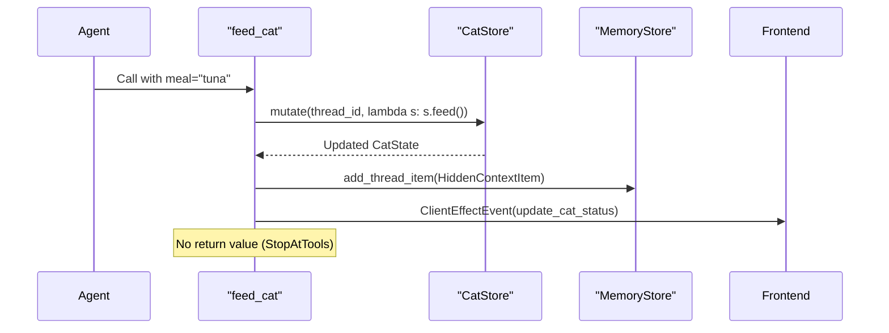

**Code Structure**:
```python
@function_tool(description_override="...")
async def feed_cat(ctx: RunContextWrapper[CatAgentContext], meal: str | None = None):
    state = await _update_state(ctx, lambda s: s.feed())
    flash = f"Fed {state.name} {meal}" if meal else f"{state.name} enjoyed a snack"
    await _add_hidden_context(ctx, f"<FED_CAT>{flash}</FED_CAT>")
    await _sync_status(ctx, state, flash)
    # No return - agent stops after this tool via StopAtTools
```

The `play_with_cat` and `clean_cat` tools follow identical patterns with different state mutations.

**Sources**: 
- [examples/cat-lounge/backend/app/cat_agent.py:139-154]()
- [examples/cat-lounge/backend/app/cat_agent.py:157-172]()
- [examples/cat-lounge/backend/app/cat_agent.py:175-190]()

### Complex State Tool: `set_cat_name`

The `set_cat_name` tool demonstrates multi-layer state management by updating both `CatState` and the thread's title:

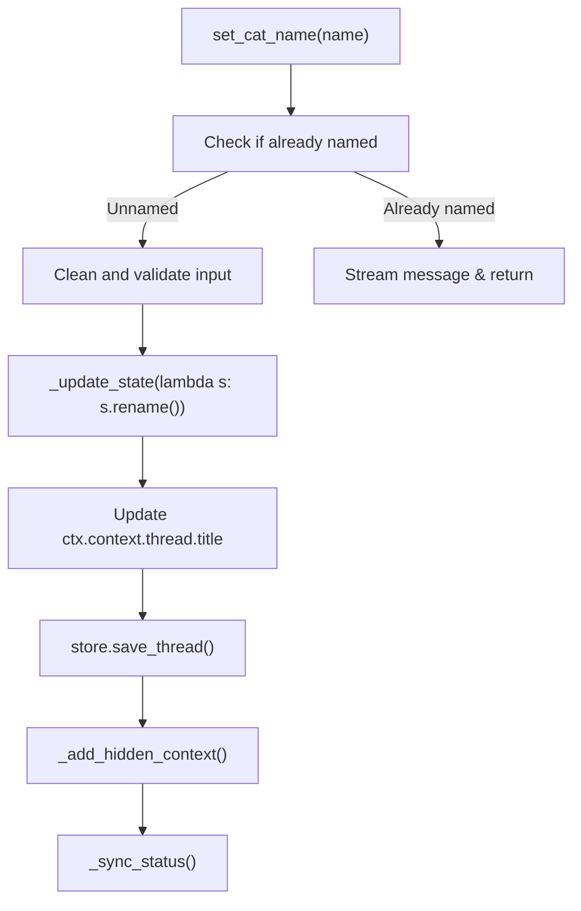

**Key behaviors**:
- Early exit if cat is already named (prevents renaming)
- Thread title becomes `"{name}'s Lounge"`
- Hidden context tag: `<CAT_NAME_SELECTED>{name}</CAT_NAME_SELECTED>`
- Syncs new state to frontend with flash message

**Sources**: 
- [examples/cat-lounge/backend/app/cat_agent.py:193-235]()
- [examples/cat-lounge/backend/app/cat_agent.py:226-227]()

### Widget Tool: `show_cat_profile`

Widget tools use `ctx.context.stream_widget()` to render UI components with optional copy text:

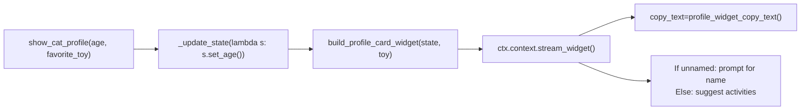

After streaming the widget, the tool sends a follow-up message using `ThreadItemDoneEvent` with different content based on whether the cat is named.

**Sources**: 
- [examples/cat-lounge/backend/app/cat_agent.py:238-286]()

### Effect-Only Tool: `speak_as_cat`

Pure effect tools trigger UI updates without state persistence:

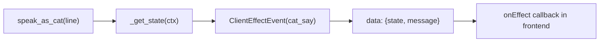

This demonstrates the fire-and-forget pattern—the tool streams an effect but doesn't wait for acknowledgment or return data to the agent.

**Sources**: 
- [examples/cat-lounge/backend/app/cat_agent.py:288-318]()

## Widget System

### Profile Card Widget

The profile card is a **presentation widget** (read-only) that displays the cat's avatar and stats.

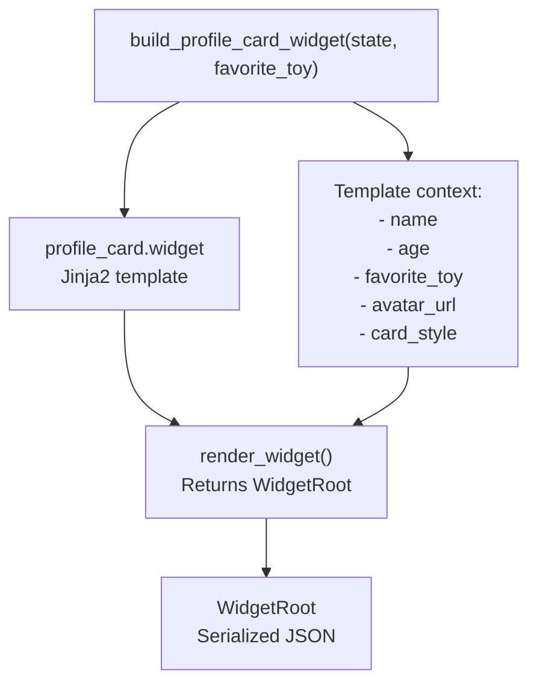

**Avatar URL Construction**: The avatar is generated using a deterministic pattern based on the cat's name. Unnamed cats get a placeholder URL.

**Card Styling**: The template conditionally applies styles based on whether the cat has been named (affecting color, pattern visibility, etc.).

**Sources**: 
- [examples/cat-lounge/backend/app/cat_agent.py:254-255]()
- [examples/cat-lounge/backend/app/cat_agent.py:22-22]()

### Name Suggestions Widget

The name suggestions widget is **interactive**, allowing users to select a name or request more suggestions.

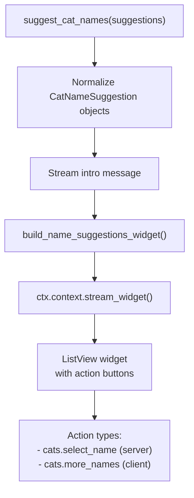

**Action Handling Split**:

| Action Type | Handler Location | Behavior |
|-------------|-----------------|----------|
| `cats.select_name` | **Server** | Sends action to backend, which updates state and returns `ThreadItemUpdated` event |
| `cats.more_names` | **Client** | Immediately calls `chatkit.sendUserMessage()` with canned text |

**Data Structure**: Each suggestion is a `CatNameSuggestion` object containing:
```python
{
  "name": str,      # e.g., "Whiskers"
  "reason": str     # e.g., "Suits their curious personality"
}
```

**Sources**: 
- [examples/cat-lounge/backend/app/cat_agent.py:321-365]()
- [examples/cat-lounge/backend/app/cat_agent.py:21-21]()

## Frontend Integration

### ChatKitPanel Effect Handling

The `ChatKitPanel` component sets up callbacks to handle client effects streamed from the backend:

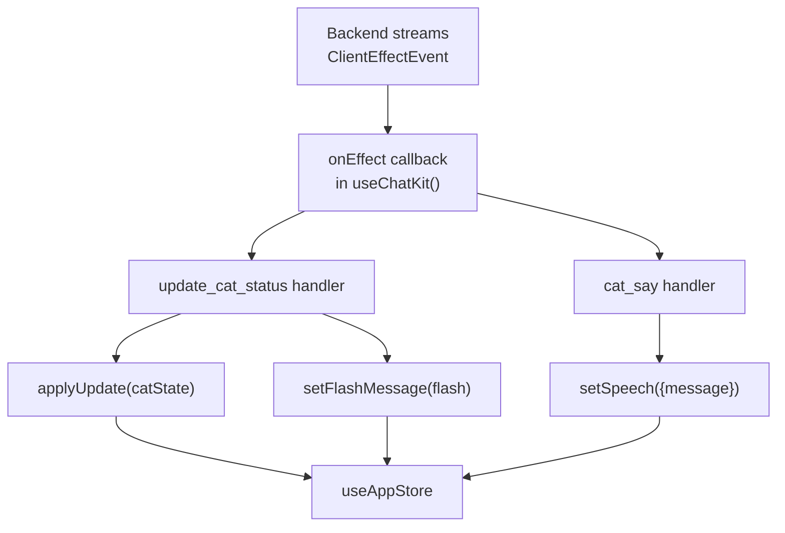

**Implementation**:
```typescript
const handleClientEffect = useCallback(({name, data}: {
  name: string;
  data: Record<string, unknown>;
}) => {
  if (name === "update_cat_status") {
    const catState = data.state as CatStatePayload | undefined;
    if (catState) {
      handleStatusUpdate(catState, data.flash as string | undefined);
    }
  }

  if (name === "cat_say") {
    const message = String(data.message ?? "");
    if (message) {
      setSpeech({message});
    }
  }
}, [])
```

The callback pattern enables the frontend to respond to backend effects without blocking agent inference.

**Sources**: 
- [examples/cat-lounge/frontend/src/components/ChatKitPanel.tsx:86-103]()
- [examples/cat-lounge/frontend/src/components/ChatKitPanel.tsx:144-144]()

### Widget Action Handling

The `handleWidgetAction` callback demonstrates the distinction between client-side and server-side action processing:

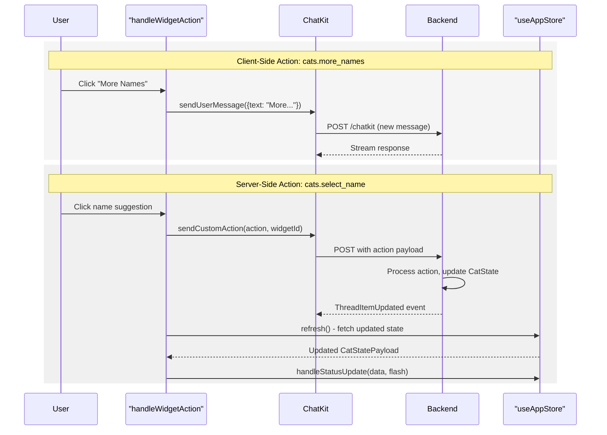

**Client Action**: The `cats.more_names` action immediately sends a user message, triggering a new agent response cycle. This is the simplest action pattern.

**Server Action**: The `cats.select_name` action requires server processing to persist the name choice. After the server action completes, the frontend explicitly fetches the updated cat state to synchronize the UI.

**Sources**: 
- [examples/cat-lounge/frontend/src/components/ChatKitPanel.tsx:50-84]()

### State Synchronization Flow

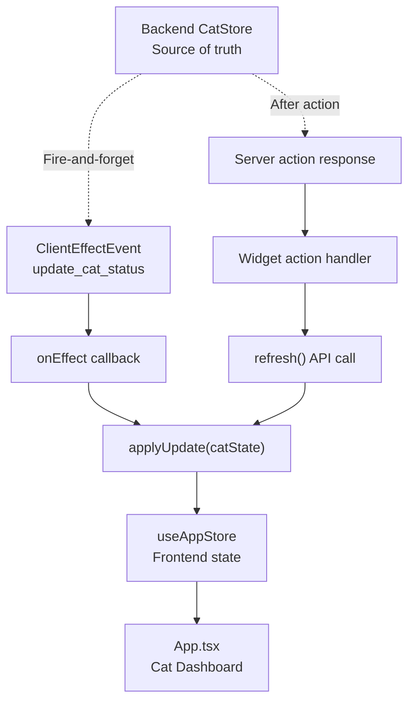

The frontend maintains a Zustand store with the cat state, which is updated through two paths:
1. **Push updates** via `ClientEffectEvent` handled by `onEffect`
2. **Pull updates** via REST API after server-side widget actions

This dual-path approach ensures the UI stays synchronized regardless of how state changes are initiated.

**Sources**: 
- [examples/cat-lounge/frontend/src/components/ChatKitPanel.tsx:39-48]()
- [examples/cat-lounge/frontend/src/components/ChatKitPanel.tsx:68-80]()

## Example Interaction Flow

### Complete Feed Interaction

This diagram traces a complete "feed the cat" interaction from user input to UI update:

```mermaid
sequenceDiagram
    participant User
    participant ChatKit as "ChatKit UI"
    participant Panel as "ChatKitPanel"
    participant Backend
    participant Agent as "cat_agent"
    participant CatStore
    participant MemStore as "MemoryStore"
    
    User->>ChatKit: "Feed the cat tuna"
    ChatKit->>Backend: POST /chatkit (stream)
    Backend->>Agent: Process with CatAgentContext
    
    Agent->>Agent: Decide to call feed_cat
    Agent->>CatStore: mutate(thread_id, lambda: s.feed())
    CatStore-->>Agent: Updated CatState
    
    Agent->>MemStore: add_thread_item(HiddenContextItem)
    Note over MemStore: Stores &lt;FED_CAT&gt; tag
    
    Agent->>Backend: ClientEffectEvent(update_cat_status)
    Backend-->>ChatKit: Stream event
    ChatKit->>Panel: onEffect({name: "update_cat_status"})
    Panel->>Panel: applyUpdate(catState)
    Panel->>Panel: setFlashMessage("Fed Whiskers tuna")
    
    Note over Agent: StopAtTools halts inference
    
    Backend-->>ChatKit: Stream complete
    ChatKit-->>User: Display updated UI
```

**Key Points**:
- The hidden context tag prevents duplicate feeds if the user repeats the request
- The agent stops after `feed_cat` due to `StopAtTools` configuration
- The frontend receives the state update without sending a response back
- The flash message appears transiently in the UI

**Sources**: 
- [examples/cat-lounge/backend/app/cat_agent.py:139-154]()
- [examples/cat-lounge/frontend/src/components/ChatKitPanel.tsx:86-103]()

## Configuration and Initialization

### Backend Context

The agent uses a custom `CatAgentContext` that extends `AgentContext` to provide type-safe access to stores:

```python
class CatAgentContext(AgentContext):
    model_config = ConfigDict(arbitrary_types_allowed=True)
    store: Annotated[MemoryStore, Field(exclude=True)]
    cats: Annotated[CatStore, Field(exclude=True)]
    request_context: dict[str, Any]
```

This context is injected into `RunContextWrapper[CatAgentContext]` when tools are executed, providing:
- `ctx.context.store`: Access to thread history via `MemoryStore`
- `ctx.context.cats`: Access to per-thread cat state via `CatStore`
- `ctx.context.thread`: Current thread metadata
- `ctx.context.request_context`: HTTP request context

**Sources**: 
- [examples/cat-lounge/backend/app/cat_agent.py:73-77]()

### Frontend Configuration

The `useChatKit` hook in `ChatKitPanel` configures the ChatKit instance with:

```typescript
{
  api: { url: CHATKIT_API_URL, domainKey: CHATKIT_API_DOMAIN_KEY },
  theme: { density: "spacious", colorScheme: theme, radius: "round" },
  startScreen: { greeting: GREETING, prompts: STARTER_PROMPTS },
  composer: { placeholder: getPlaceholder(cat.name) },
  widgets: { onAction: handleWidgetAction },
  onThreadChange: ({ threadId }) => setThreadId(threadId),
  onEffect: handleClientEffect,
  onReady: () => onChatKitReady(chatkit)
}
```

**Dynamic Placeholder**: The composer placeholder updates based on whether the cat is named, demonstrating reactive configuration.

**Sources**: 
- [examples/cat-lounge/frontend/src/components/ChatKitPanel.tsx:105-145]()

## Summary

The Cat Lounge example demonstrates:

1. **Client Effects** for fire-and-forget UI synchronization (`update_cat_status`, `cat_say`)
2. **State Mutation Pattern** using helper functions (`_get_state`, `_update_state`, `_sync_status`)
3. **Hidden Context Markers** to track actions without visible output
4. **Mixed Widget Actions** with both client-side (immediate) and server-side (persistent) handling
5. **Thread Title Updates** synchronized with state changes
6. **StopAtTools Behavior** to prevent redundant text generation after widget rendering

The architecture maintains a clear separation between backend state (source of truth in `CatStore`) and frontend state (synchronized copy in `useAppStore`), with bidirectional communication through client effects and REST API calls.

**Sources**: 
- [examples/cat-lounge/README.md:1-27]()
- [examples/cat-lounge/backend/app/cat_agent.py:1-397]()
- [examples/cat-lounge/frontend/src/components/ChatKitPanel.tsx:1-154]()

---

