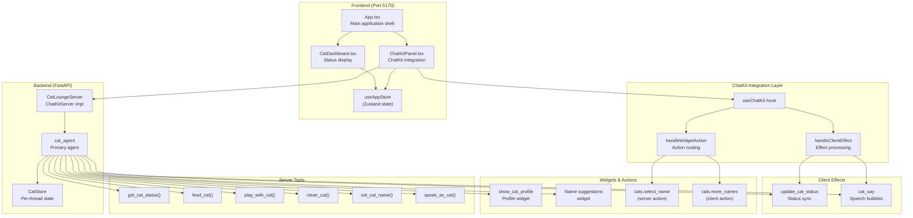
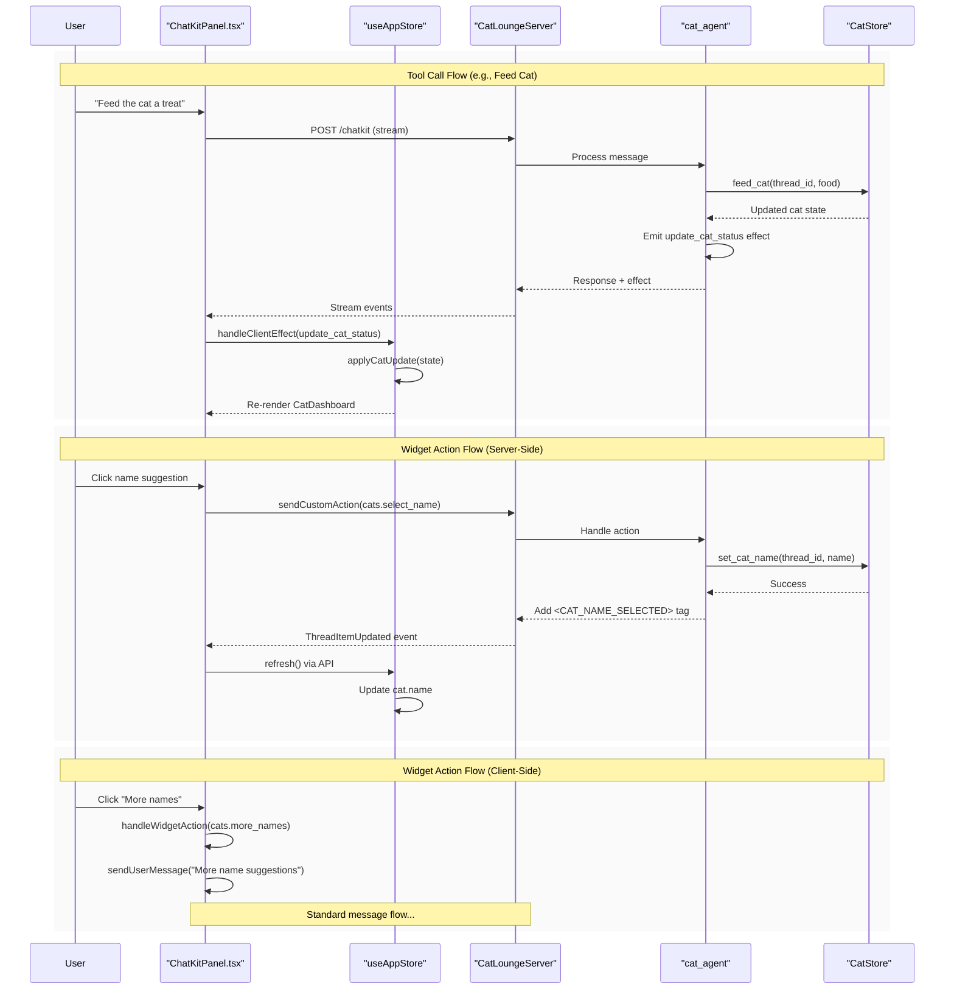
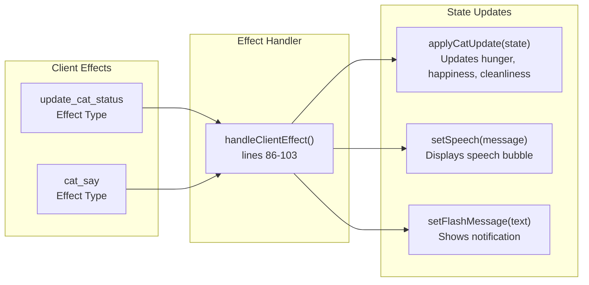
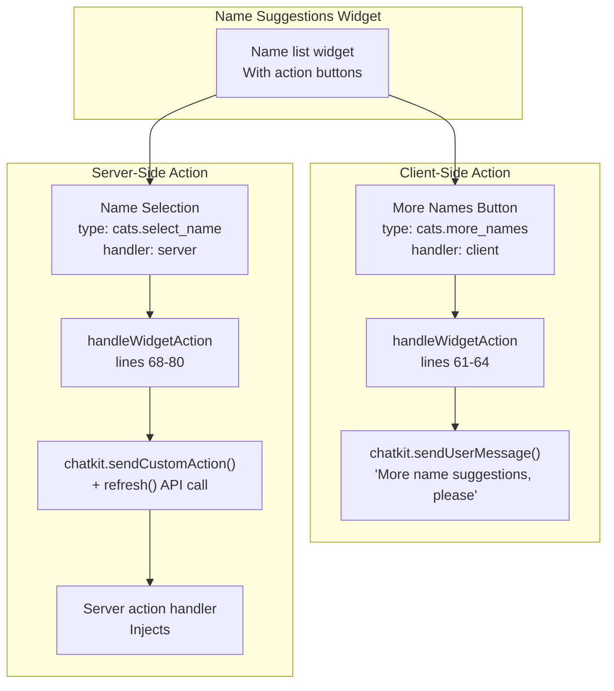

<!-- source: DeepWiki mcp.deepwiki.com · repo openai/openai-chatkit-advanced-samples · page 5.1 Cat Lounge Overview · fetched 2026-10-26 -->

# Cat Lounge Overview

<details>
<summary>Relevant source files</summary>

The following files were used as context for generating this wiki page:

- [examples/cat-lounge/README.md](examples/cat-lounge/README.md)
- [examples/cat-lounge/frontend/src/components/ChatKitPanel.tsx](examples/cat-lounge/frontend/src/components/ChatKitPanel.tsx)
- [examples/metro-map/README.md](examples/metro-map/README.md)

</details>


## Purpose and Scope

This document provides an overview of the **Cat Lounge** example application, a virtual cat caretaker demonstration that showcases ChatKit's client effects, widget interactions, and per-thread state management patterns. Cat Lounge is the simplest of the four examples in the repository, making it an ideal starting point for understanding ChatKit's core capabilities.

Cat Lounge demonstrates:
- **Client effects** for fire-and-forget UI updates
- **Interactive widgets** with both client-side and server-side action handling
- **Per-thread state persistence** for maintaining cat status across conversations
- **Hidden context tags** for tracking agent actions without cluttering the UI

For detailed documentation of the cat agent's behavior and tools, see [Cat Agent](#5.2). For widget implementation details, see [Cat Lounge Widgets](#5.3).

**Sources:** [examples/cat-lounge/README.md:1-27]()

---

## Application Overview

Cat Lounge implements a conversational interface where users care for a virtual cat through natural language. Each thread maintains independent cat state (hunger, happiness, cleanliness, name), allowing multiple concurrent cat care sessions. The application runs on **port 5170** and follows the standard FastAPI + Vite/React architecture pattern used across all repository examples.

### Quick Start

```bash
# From repository root
npm run cat-lounge

# Or from example directory
cd examples/cat-lounge
npm install
npm run start

# Navigate to http://localhost:5170
```

The application requires `OPENAI_API_KEY` to be set in the environment.

**Sources:** [examples/cat-lounge/README.md:5-9]()

---

## System Architecture

The following diagram illustrates the Cat Lounge architecture, mapping high-level concepts to specific code entities in the codebase:



**Key Components:**

| Component | Location | Purpose |
|-----------|----------|---------|
| `App.tsx` | `frontend/src/App.tsx` | Main application shell with quick action buttons |
| `ChatKitPanel.tsx` | `frontend/src/components/ChatKitPanel.tsx` | ChatKit integration and event handling |
| `CatDashboard.tsx` | `frontend/src/components/CatDashboard.tsx` | Real-time cat status visualization |
| `useAppStore` | `frontend/src/store/useAppStore.ts` | Zustand store for cat state and UI state |
| `CatLoungeServer` | `backend/app/server.py` | FastAPI server implementing `ChatKitServer` |
| `cat_agent` | `backend/app/cat_agent.py` | Primary agent with cat care instructions |
| `CatStore` | `backend/app/cat_store.py` | Per-thread cat state persistence |

**Sources:** [examples/cat-lounge/README.md:1-27](), [examples/cat-lounge/frontend/src/components/ChatKitPanel.tsx:1-154]()

---

## Key Features Demonstrated

Cat Lounge focuses on specific ChatKit patterns that showcase client-server interaction:

### Feature Matrix

| Feature | ChatKit Concept | Implementation | Purpose |
|---------|----------------|----------------|---------|
| Cat care actions | Server tools | `feed_cat`, `play_with_cat`, `clean_cat` | State mutation via agent function calls |
| Status queries | Server tools | `get_cat_status` | Grounding agent in current state |
| Name assignment | Server tool | `set_cat_name` | Persistent identity across messages |
| Cat speech | Server tool + Client effect | `speak_as_cat` → `cat_say` | Agent-controlled UI animation |
| Status synchronization | Client effects | `update_cat_status` | Fire-and-forget UI updates after tool calls |
| Profile display | Presentation widget | `show_cat_profile` | Read-only information card |
| Name suggestions | Interactive widget | Name list with `cats.select_name` action | Server-side action handling |
| More names button | Interactive widget | `cats.more_names` action | Client-side action handling |
| Hidden context | Context tags | `<FED_CAT>`, `<PLAYED_WITH_CAT>`, etc. | Agent memory without UI clutter |
| Quick actions | `sendUserMessage` | Canned prompt buttons | Programmatic message sending |

**Sources:** [examples/cat-lounge/README.md:19-26]()

---

## State Management Pattern

Cat Lounge demonstrates a clear separation between server-side persistence and client-side UI state:



**State Synchronization Mechanisms:**

1. **Client Effects:** After each server tool invocation that modifies cat state, the agent emits an `update_cat_status` effect containing the new state. The frontend's `handleClientEffect` callback receives this and updates the Zustand store immediately.

2. **Manual Refresh:** For server-side widget actions like `cats.select_name`, the frontend explicitly calls the `/api/cat/{thread_id}` endpoint after receiving the action response to fetch the updated state.

3. **Hidden Context Tags:** Tags like `<FED_CAT>`, `<PLAYED_WITH_CAT>`, `<CLEANED_CAT>`, and `<CAT_NAME_SELECTED>` are injected into the thread context to help the agent remember recent actions without displaying them to the user.

**Sources:** [examples/cat-lounge/frontend/src/components/ChatKitPanel.tsx:39-103](), [examples/cat-lounge/README.md:24-25]()

---

## Client Effects as Primary Pattern

Cat Lounge is the primary demonstration of **client effects** in the repository. Unlike client tools (which require bidirectional communication) or widget actions (which require user input), client effects are fire-and-forget commands from the server that update the UI immediately.

### Effect Handling Implementation

The `handleClientEffect` callback in `ChatKitPanel.tsx` processes two effect types:



**Effect Types:**

| Effect Name | Data Payload | Frontend Action | Visual Result |
|-------------|--------------|-----------------|---------------|
| `update_cat_status` | `{state: CatStatePayload, flash?: string}` | Update `useAppStore` cat state | Cat dashboard updates instantly |
| `cat_say` | `{message: string}` | Set speech bubble in store | Speech bubble appears above cat |

The pattern ensures that every tool call that modifies cat state is immediately reflected in the UI without requiring a separate API request or user action.

**Sources:** [examples/cat-lounge/frontend/src/components/ChatKitPanel.tsx:86-103](), [examples/cat-lounge/README.md:24]()

---

## Widget Action Patterns

Cat Lounge demonstrates both **client-side** and **server-side** widget action handling within the same feature (name suggestions):



### Handling Logic Comparison

**Client-Side (`cats.more_names`):**
- Immediately sends a user message requesting more suggestions
- No server round-trip for the action itself
- Simple, lightweight interaction

**Server-Side (`cats.select_name`):**
- Calls `chatkit.sendCustomAction()` to notify server
- Server updates cat name and injects context tag
- Frontend then calls `refresh()` to fetch updated state
- More complex but enables server-side persistence and context injection

This dual approach demonstrates the flexibility of the widget action system: developers can choose client-side handling for immediate UI feedback or server-side handling when state persistence and context tracking are required.

**Sources:** [examples/cat-lounge/frontend/src/components/ChatKitPanel.tsx:50-84](), [examples/cat-lounge/README.md:22]()

---

## Per-Thread State Isolation

Each ChatKit thread maintains its own independent cat state, allowing multiple concurrent cat care sessions. The `CatStore` backend class uses `thread_id` as the primary key for state retrieval and mutation:

| State Field | Type | Description | Default |
|-------------|------|-------------|---------|
| `name` | `str` | Cat's name | `"the cat"` |
| `hunger` | `int` (0-100) | Hunger level | 50 |
| `happiness` | `int` (0-100) | Happiness level | 50 |
| `cleanliness` | `int` (0-100) | Cleanliness level | 50 |

All server tools receive the current thread ID from the agent context and use it to fetch/update the appropriate cat state. This ensures:
- Users can have multiple cat threads without interference
- Cat state persists across page refreshes (until server restart)
- Each conversation has its own cat personality and history

**Sources:** [examples/cat-lounge/README.md:21]()

---

## Example Prompts

Cat Lounge supports natural language interactions for all cat care actions:

| Prompt | Triggered Feature | Result |
|--------|-------------------|--------|
| `"Feed the cat a tuna treat."` | `feed_cat` tool | Decreases hunger, shows update effect |
| `"The cat looks messy—give them a bath."` | `clean_cat` tool | Increases cleanliness, shows update effect |
| `"What should I name the cat?"` | Name suggestion widget | Displays selectable name list |
| `"Can I see the cat's profile card?"` | `show_cat_profile` tool | Displays profile widget with stats |
| `"Hello, cat! How are you feeling?"` | `speak_as_cat` tool | Cat responds with `cat_say` effect |

The quick action buttons in `App.tsx` also provide one-click access to common interactions, demonstrating programmatic use of `chatkit.sendUserMessage()`.

**Sources:** [examples/cat-lounge/README.md:11-17](), [examples/cat-lounge/README.md:26]()

---

## Comparison to Other Examples

Cat Lounge occupies a specific niche in the repository's example portfolio:

| Example | Complexity | Primary Focus | Cat Lounge Comparison |
|---------|------------|---------------|----------------------|
| **Cat Lounge** | Low | Client effects, widget actions | Baseline reference implementation |
| Metro Map | High | Client tools, entity tags, annotations | Cat Lounge + bidirectional client tools + complex UI |
| News Guide | Medium | Page awareness, tool choice, sub-agents | Cat Lounge + routing logic + external data |
| Customer Support | Medium | Multi-turn workflows, form collection | Cat Lounge + structured data collection |

Cat Lounge is recommended as the **first example to study** because it demonstrates core ChatKit concepts without the complexity of external APIs, multi-agent orchestration, or advanced UI libraries like ReactFlow.

**Sources:** High-level system architecture diagrams (Diagram 2)

---

## Architecture Patterns

Cat Lounge follows the repository's standard architectural patterns:

**Backend:**
- FastAPI server implementing `ChatKitServer` interface
- Single primary agent (`cat_agent`) with no sub-agents
- Function tools decorated with `@function_tool`
- In-memory data store (`CatStore`) for thread state
- Widget templates (`.widget` files) with Jinja2
- Client effect emission after tool calls

**Frontend:**
- Vite + React + TypeScript
- `ChatKitPanel` component wrapping ChatKit UI
- Zustand for state management (`useAppStore`)
- Event callbacks for effects and widget actions
- Domain-specific UI (`CatDashboard`) alongside chat panel

For detailed information on these common patterns, see [Backend Architecture Pattern](#3.1) and [Frontend Architecture Pattern](#3.2).

**Sources:** High-level system architecture diagrams (Diagram 3, Diagram 4)

---

## Next Steps

After understanding the Cat Lounge overview:

- **[Cat Agent](#5.2)**: Detailed documentation of `cat_agent.py`, including all tools, instructions, and state mutation logic
- **[Cat Lounge Widgets](#5.3)**: Widget implementation details for profile cards and name suggestions
- **[Client Effects](#7.3)**: Cross-example documentation of client effect patterns
- **[Widget Actions](#7.4)**: Comprehensive guide to widget action handling strategies

**Sources:** Table of contents structure

---

