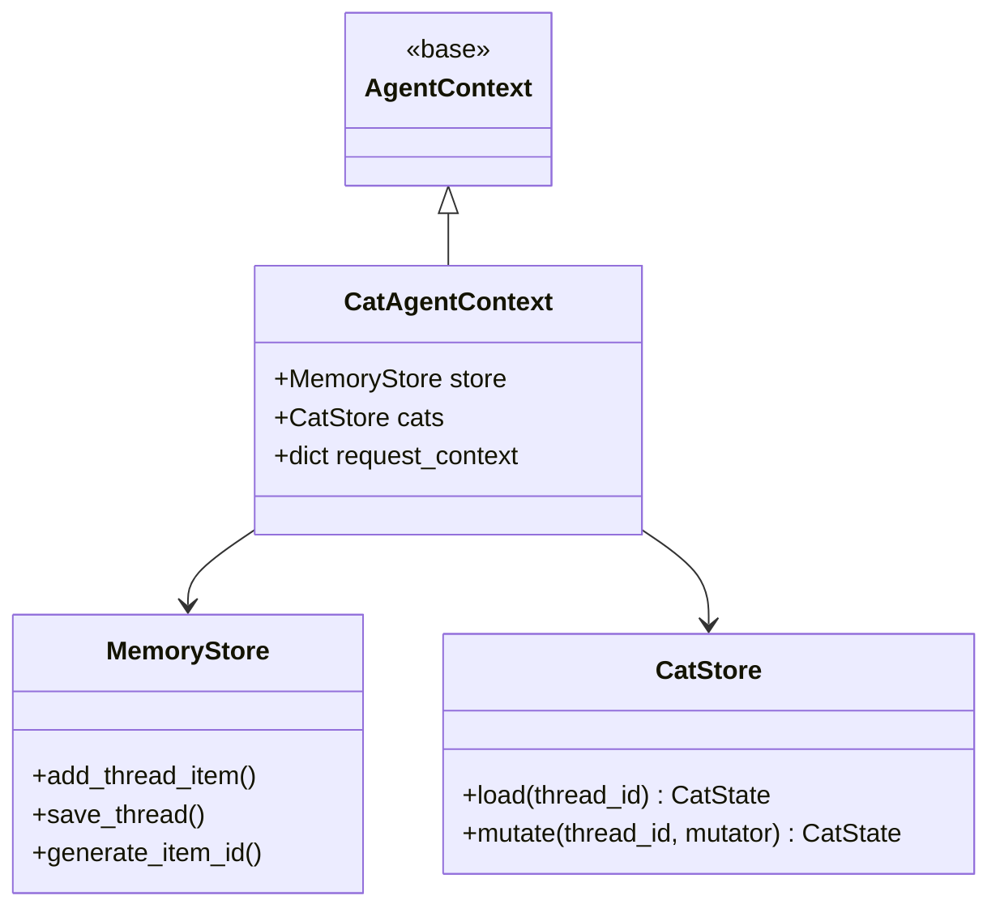
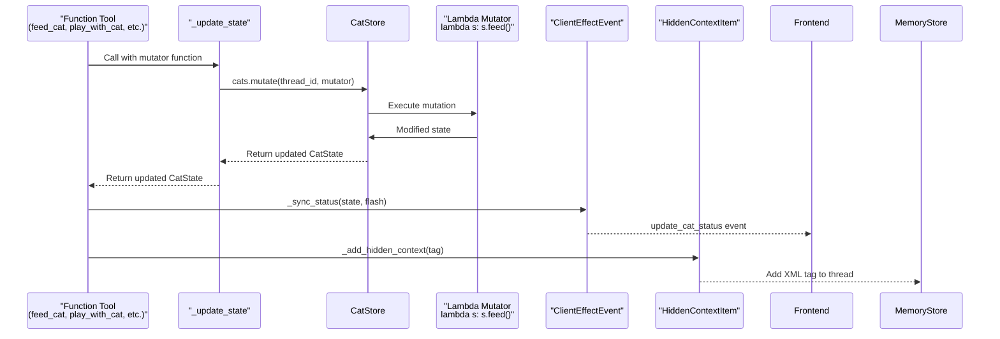
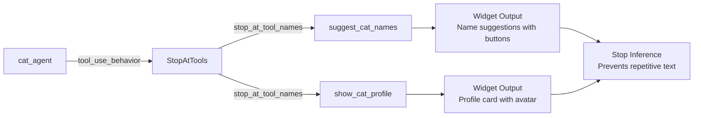
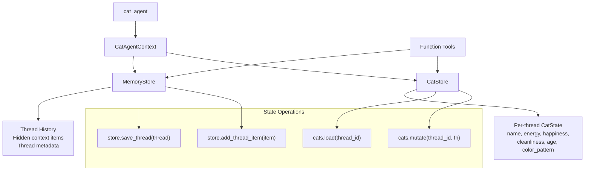

<!-- source: DeepWiki mcp.deepwiki.com · repo openai/openai-chatkit-advanced-samples · page 5.2 Cat Agent · fetched 2026-10-26 -->

# Cat Agent

<details>
<summary>Relevant source files</summary>

The following files were used as context for generating this wiki page:

- [examples/cat-lounge/backend/app/cat_agent.py](examples/cat-lounge/backend/app/cat_agent.py)

</details>


The **Cat Agent** is the primary AI agent in the Cat Lounge example application. It implements a virtual pet caretaker that helps users manage a cat's wellbeing through conversational interactions. The agent handles state mutations, triggers client effects for real-time UI updates, generates interactive widgets, and maintains thread-level context.

This page documents the agent's implementation, tools, state management patterns, and integration with the Cat Lounge frontend. For the overall Cat Lounge architecture, see [Cat Lounge Overview](#5.1). For widget implementations, see [Cat Lounge Widgets](#5.3).

**Sources**: [examples/cat-lounge/backend/app/cat_agent.py:1-397]()

---

## Agent Configuration

The `cat_agent` instance is configured with specific personality traits, model selection, and tool availability:

| Property | Value | Description |
|----------|-------|-------------|
| **Model** | `gpt-4.1-mini` | Language model used for inference |
| **Name** | `Cozy Cat Companion` | Agent's display name |
| **Instructions** | [cat_agent.py:27-68]() | System prompt defining behavior and tool usage guidelines |
| **Tools** | 8 function tools | See Tool Inventory section below |
| **Tool Use Behavior** | `StopAtTools` | Stops inference after calling `suggest_cat_names` or `show_cat_profile` |

The agent's instructions emphasize:
- Light, imaginative interactions focused on cat wellbeing
- Synchronization of per-thread cat stats (energy, happiness, cleanliness, name, age)
- Mystery cat color pattern revealed only after naming
- Prohibition on renaming once a cat has a name
- Creative narrative details (specific snacks, toys, cleaning methods)

**Sources**: [examples/cat-lounge/backend/app/cat_agent.py:27-68](), [examples/cat-lounge/backend/app/cat_agent.py:368-396]()

---

## Agent Context

### CatAgentContext Class Diagram



The `CatAgentContext` class extends `AgentContext` and provides access to:
- **`store`**: `MemoryStore` instance for managing thread history and hidden context items
- **`cats`**: `CatStore` instance for loading and mutating per-thread cat state
- **`request_context`**: Dictionary containing request-level metadata

The context uses `arbitrary_types_allowed=True` in its Pydantic configuration to support non-serializable store objects, and marks stores with `Field(exclude=True)` to prevent serialization attempts.

**Sources**: [examples/cat-lounge/backend/app/cat_agent.py:73-78]()

---

## Tool Inventory

The Cat Agent provides eight function tools organized by capability:

### Tool Organization by Function Type

```mermaid
graph TB
    subgraph "Read Tools"
        get_cat_status["get_cat_status<br/>Queries current cat state"]
    end
    
    subgraph "State Mutation + Client Effect Tools"
        feed_cat["feed_cat<br/>Replenishes energy"]
        play_with_cat["play_with_cat<br/>Boosts happiness"]
        clean_cat["clean_cat<br/>Improves cleanliness"]
        set_cat_name["set_cat_name<br/>Names cat + updates thread title"]
    end
    
    subgraph "Widget Generation Tools"
        show_cat_profile["show_cat_profile<br/>Profile card widget"]
        suggest_cat_names["suggest_cat_names<br/>Name suggestions widget"]
    end
    
    subgraph "Client Effect Only Tools"
        speak_as_cat["speak_as_cat<br/>Cat speech bubble"]
    end
    
    get_cat_status --> CatStore
    feed_cat --> CatStore
    play_with_cat --> CatStore
    clean_cat --> CatStore
    set_cat_name --> CatStore
    set_cat_name --> MemoryStore
    show_cat_profile --> CatStore
    
    feed_cat --> update_cat_status_effect["ClientEffectEvent:<br/>update_cat_status"]
    play_with_cat --> update_cat_status_effect
    clean_cat --> update_cat_status_effect
    set_cat_name --> update_cat_status_effect
    speak_as_cat --> cat_say_effect["ClientEffectEvent:<br/>cat_say"]
    
    show_cat_profile --> profile_widget["WidgetRoot"]
    suggest_cat_names --> names_widget["WidgetRoot"]
```



**Sources**: [examples/cat-lounge/backend/app/cat_agent.py:372-388]()

---

## State Management Pattern

The Cat Agent uses a consistent pattern for accessing and mutating cat state through helper functions:

### State Access Helpers

| Function | Purpose | Returns |
|----------|---------|---------|
| `_get_state(ctx)` | Loads current cat state for thread | `CatState` |
| `_update_state(ctx, mutator)` | Applies mutation function to state | `CatState` |
| `_sync_status(ctx, state, flash)` | Sends client effect with updated state | `None` |
| `_add_hidden_context(ctx, content)` | Adds hidden XML tag to thread | `None` |

### State Mutation Flow



The mutation pattern ensures:
1. State changes are atomic through `CatStore.mutate()`
2. UI updates immediately via `update_cat_status` client effect
3. Action history persists in hidden context items (e.g., `<FED_CAT>`, `<PLAYED_WITH_CAT>`)
4. Future agent invocations see hidden tags to avoid duplicate actions

**Sources**: [examples/cat-lounge/backend/app/cat_agent.py:80-123]()

---

## Read Tools

### get_cat_status

**Signature**: `async def get_cat_status(ctx: RunContextWrapper[CatAgentContext]) -> dict[str, Any]`

Retrieves the current cat state and returns it as a dictionary payload for agent inference. The agent must call this before making decisions about cat care actions.

**Return Payload Structure**:
```python
{
    "thread_id": str,
    "name": str,
    "energy": int,
    "happiness": int,
    "cleanliness": int,
    "age": int | None,
    "color_pattern": str | None  # Only revealed after naming
}
```

**Implementation**: [examples/cat-lounge/backend/app/cat_agent.py:125-136]()

**Sources**: [examples/cat-lounge/backend/app/cat_agent.py:125-136]()

---

## State Mutation Tools

These tools modify cat state, emit client effects for UI synchronization, and add hidden context markers.

### feed_cat

**Signature**: `async def feed_cat(ctx: RunContextWrapper[CatAgentContext], meal: str | None = None)`

**Parameters**:
- `meal` (optional): Description of food used (e.g., "tuna treats", "kibble")

**Behavior**:
1. Calls `state.feed()` to increment energy stat
2. Generates flash message: `"Fed {name} {meal}"` or `"{name} enjoyed a snack"`
3. Adds `<FED_CAT>{flash}</FED_CAT>` to hidden context
4. Emits `update_cat_status` client effect with updated state and flash message

**Tool Use Behavior**: Agent continues after this tool call (no return value needed due to `StopAtTools` configuration).

**Sources**: [examples/cat-lounge/backend/app/cat_agent.py:139-154]()

---

### play_with_cat

**Signature**: `async def play_with_cat(ctx: RunContextWrapper[CatAgentContext], activity: str | None = None)`

**Parameters**:
- `activity` (optional): Toy or activity description (e.g., "feather wand", "laser pointer")

**Behavior**:
1. Calls `state.play()` to increment happiness stat
2. Generates flash message with activity description
3. Adds `<PLAYED_WITH_CAT>{flash}</PLAYED_WITH_CAT>` to hidden context
4. Emits `update_cat_status` client effect

**Sources**: [examples/cat-lounge/backend/app/cat_agent.py:157-172]()

---

### clean_cat

**Signature**: `async def clean_cat(ctx: RunContextWrapper[CatAgentContext], method: str | None = None)`

**Parameters**:
- `method` (optional): Cleaning method (e.g., "warm bath", "grooming brush")

**Behavior**:
1. Calls `state.clean()` to increment cleanliness stat
2. Generates flash message with method description
3. Adds `<CLEANED_CAT>{flash}</CLEANED_CAT>` to hidden context
4. Emits `update_cat_status` client effect

**Sources**: [examples/cat-lounge/backend/app/cat_agent.py:175-190]()

---

### set_cat_name

**Signature**: `async def set_cat_name(ctx: RunContextWrapper[CatAgentContext], name: str)`

**Parameters**:
- `name`: Desired cat name (required)

**Behavior**:
1. Validates cat is currently unnamed (name is `"Unnamed Cat"`)
2. If already named, streams an `AssistantMessageItem` and returns early
3. Normalizes name with `.strip().title()`
4. Calls `state.rename(cleaned)` to update cat state
5. Updates thread title to `"{name}'s Lounge"`
6. Saves updated thread via `store.save_thread()`
7. Adds `<CAT_NAME_SELECTED>{name}</CAT_NAME_SELECTED>` to hidden context
8. Emits `update_cat_status` client effect with flash: `"Now called {name}"`

**Thread Title Synchronization**:
```python
ctx.context.thread.title = f"{state.name}'s Lounge"
await ctx.context.store.save_thread(ctx.context.thread, ctx.context.request_context)
```

This tool demonstrates multi-layered state mutation: cat state, thread metadata, and hidden context all update atomically.

**Sources**: [examples/cat-lounge/backend/app/cat_agent.py:193-235]()

---

## Widget Generation Tools

### show_cat_profile

**Signature**: `async def show_cat_profile(ctx: RunContextWrapper[CatAgentContext], age: int | None = None, favorite_toy: str | None = None)`

**Parameters**:
- `age` (optional): Cat age in years to display and persist
- `favorite_toy` (optional): Favorite toy description (e.g., "Ball of yarn", "Stuffed mouse")

**Behavior**:
1. Updates cat state with age if provided: `state.set_age(age)`
2. Calls `build_profile_card_widget(state, favorite_toy)` to generate widget
3. Streams widget with `stream_widget(widget, copy_text=...)`
4. If cat is unnamed, streams follow-up message asking to name the cat
5. If cat is named, streams follow-up message prompting next action

**Copy Text**: Generated by `profile_widget_copy_text(state)` for clipboard functionality.

**Widget Display Conditions**:
- Avatar color pattern only visible if cat has been named
- Age displays if set, otherwise shows placeholder

**Sources**: [examples/cat-lounge/backend/app/cat_agent.py:238-286]()

---

### suggest_cat_names

**Signature**: `async def suggest_cat_names(ctx: RunContextWrapper[CatAgentContext], suggestions: list[CatNameSuggestion])`

**Parameters**:
- `suggestions`: List of name suggestion objects with `name` and `reason` fields

**CatNameSuggestion Schema**:
```python
class CatNameSuggestion:
    name: str      # Short, unique name (1-2 words)
    reason: str    # Explanation why it fits the cat
```

**Behavior**:
1. Validates and normalizes suggestion entries
2. Raises `ValueError` if no valid suggestions provided
3. Streams introductory `AssistantMessageItem`: `"Here are some name suggestions for your cat."`
4. Calls `build_name_suggestions_widget(normalized)` to generate interactive widget
5. Streams widget with copy text containing comma-separated names

**Validation**: Handles both `CatNameSuggestion` instances and raw dictionaries, logging warnings for invalid entries.

**Widget Actions**: Each suggestion button triggers the `cats.select_name` action handled server-side.

**Sources**: [examples/cat-lounge/backend/app/cat_agent.py:321-366]()

---

## Client Effect Tools

### speak_as_cat

**Signature**: `async def speak_as_cat(ctx: RunContextWrapper[CatAgentContext], line: str)`

**Parameters**:
- `line`: Text for the cat to say (e.g., `"meow (I'm hungry)"`)

**Behavior**:
1. Validates line is non-empty
2. Loads current cat state
3. Emits `cat_say` client effect with payload:
   ```python
   {
       "state": state.to_payload(thread_id),
       "message": message
   }
   ```

**Frontend Handling**: The frontend's `onEffect` callback receives this event and displays a speech bubble in the cat dashboard UI.

**Usage Pattern**: Agent instructions specify to use format like `"meow (translation)"` for cat speech.

**Sources**: [examples/cat-lounge/backend/app/cat_agent.py:288-319]()

---

## Tool Use Behavior Configuration

### StopAtTools Pattern



The agent uses `StopAtTools` to prevent redundant text generation after widget outputs:

```python
tool_use_behavior=StopAtTools(
    stop_at_tool_names=[
        suggest_cat_names.name,
        show_cat_profile.name,
    ]
)
```

**Rationale**: Widget tools already provide rich visual content and contextual messaging. Allowing the agent to continue would result in repetitive descriptions of the widget content.

**Non-Stopped Tools**: State mutation tools (`feed_cat`, `play_with_cat`, etc.) allow the agent to continue, enabling narrative responses like *"You fed Whiskers some tuna treats! Their energy is now at 85%."*

**Sources**: [examples/cat-lounge/backend/app/cat_agent.py:390-395]()

---

## Hidden Context Pattern

### XML Tag Structure

The agent adds hidden context items after state mutations to create an audit trail visible to future invocations:

| Tool | Hidden Context Tag | Purpose |
|------|-------------------|---------|
| `feed_cat` | `<FED_CAT>{description}</FED_CAT>` | Prevent duplicate feeding |
| `play_with_cat` | `<PLAYED_WITH_CAT>{activity}</PLAYED_WITH_CAT>` | Track play sessions |
| `clean_cat` | `<CLEANED_CAT>{method}</CLEANED_CAT>` | Record cleaning events |
| `set_cat_name` | `<CAT_NAME_SELECTED>{name}</CAT_NAME_SELECTED>` | Mark naming completion |

### Hidden Context Implementation

```python
async def _add_hidden_context(ctx: RunContextWrapper[CatAgentContext], content: str) -> None:
    thread = ctx.context.thread
    request_context = ctx.context.request_context
    await ctx.context.store.add_thread_item(
        thread.id,
        HiddenContextItem(
            id=ctx.context.store.generate_item_id("message", thread, request_context),
            thread_id=thread.id,
            created_at=datetime.now(),
            content=content,
        ),
        context=request_context,
    )
```

**Usage Pattern**: Agent instructions reference these tags to guide behavior. For example:
- *"Once an action has been performed, it will be reflected as a `<FED_CAT>`, `<PLAYED_WITH_CAT>`, or `<CLEANED_CAT>` tag in the thread content."*
- *"Do not fire off multiple tool calls for the same action unless the user explicitly asks for it."*

**Sources**: [examples/cat-lounge/backend/app/cat_agent.py:109-123]()

---

## Agent Instructions Analysis

### Key Instruction Patterns

The agent's system prompt ([cat_agent.py:27-68]()) enforces several behavioral patterns:

#### Naming Workflow
1. Mystery element: *"Let the user know that the cat's color pattern will stay a mystery until they officially name it."*
2. First interaction prompt: *"When the user interacts with an unnamed cat, prompt the user to name the cat."*
3. Disambiguation: *"If a user addresses an unnamed cat by a name for the first time, ask the user whether they'd like to name the cat."*
4. Name suggestion trigger: *"If a user indicates they want to name the cat but does not provide a name, call the `suggest_cat_names` tool."*
5. Finality: *"Once a cat is named, it cannot be renamed. Do not invoke the `set_cat_name` tool if the cat has already been named."*

#### Tool Usage Guidelines
- **State synchronization**: *"Always keep the per-thread cat stats... in sync with the tools provided. When you need the latest numbers, call `get_cat_status` before making a plan."*
- **Immediate action**: *"When the user asks you to feed, play with, or clean the cat, immediately call the respective tool."*
- **Creative details**: *"When feeding, mention specific snacks or cat treats... When playing, mention specific toys... When cleaning, mention specific items or methods."*
- **Action deduplication**: *"Once an action has been performed, it will be reflected as a tag in the thread content. Do not fire off multiple tool calls for the same action."*

#### Personality Guidelines
- *"Keep interactions light, imaginative, and focused on the cat's wellbeing."*
- *"Stay in character: talk about caring for the cat, suggest next steps if the stats look unbalanced, and avoid unrelated topics."*

**Sources**: [examples/cat-lounge/backend/app/cat_agent.py:27-68]()

---

## Integration Points

### Data Store Dependencies



### Frontend Communication

The agent communicates with the Cat Lounge frontend through:
1. **Client Effects**: `update_cat_status` and `cat_say` events handled by `onEffect` callback
2. **Widgets**: Profile cards and name suggestion widgets rendered by ChatKit UI
3. **Widget Actions**: Server-handled actions from name suggestion button clicks

**Sources**: [examples/cat-lounge/backend/app/cat_agent.py:73-78](), [examples/cat-lounge/backend/app/cat_agent.py:1-23]()

---

