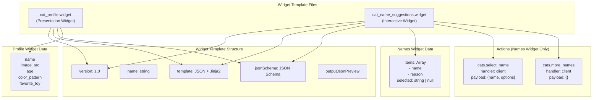
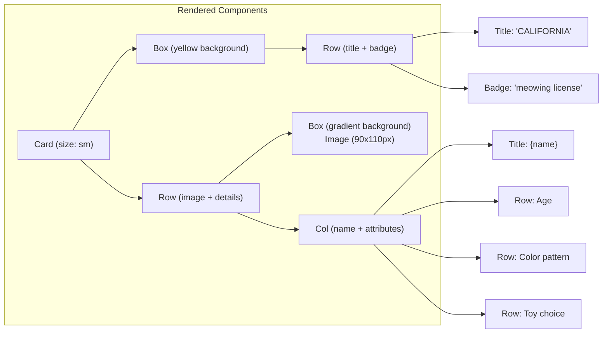
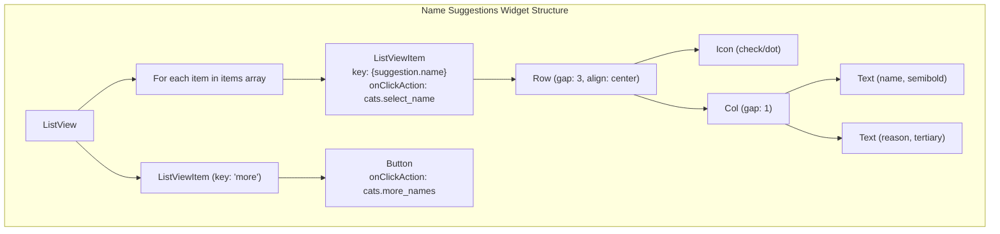
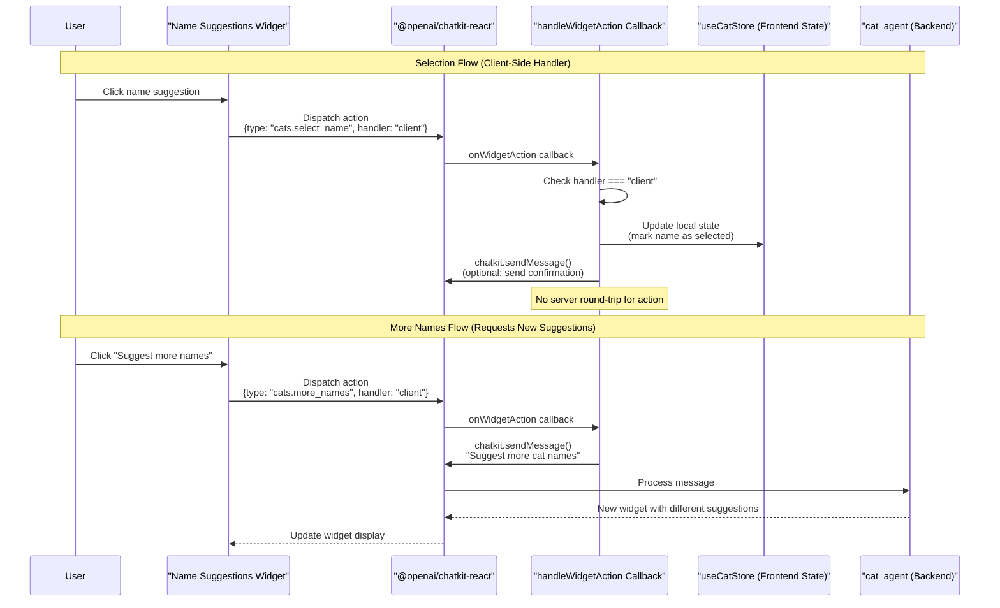

<!-- source: DeepWiki mcp.deepwiki.com · repo openai/openai-chatkit-advanced-samples · page 5.3 Cat Lounge Widgets · fetched 2026-10-26 -->

# Cat Lounge Widgets

<details>
<summary>Relevant source files</summary>

The following files were used as context for generating this wiki page:

- [examples/cat-lounge/backend/app/widgets/cat_name_suggestions.widget](examples/cat-lounge/backend/app/widgets/cat_name_suggestions.widget)
- [examples/cat-lounge/backend/app/widgets/cat_profile.widget](examples/cat-lounge/backend/app/widgets/cat_profile.widget)

</details>


This document describes the two widget implementations in the Cat Lounge example: the cat profile presentation widget and the name suggestions interactive widget. These widgets demonstrate ChatKit's template-based widget system with client-side action handling.

For information about the Cat Agent and its tools, see [Cat Agent](#5.2). For the overall Cat Lounge architecture, see [Cat Lounge Overview](#5.1). For general widget system concepts, see [Widget System](#3.4).

---

## Widget Overview

The Cat Lounge example implements two widgets that showcase different widget interaction patterns:

| Widget | File | Type | Purpose | Actions |
|--------|------|------|---------|---------|
| Cat Profile | `cat_profile.widget` | Presentation | Display cat information (name, age, color pattern, toy) | None (read-only) |
| Name Suggestions | `cat_name_suggestions.widget` | Interactive | Present name options with selection UI | `cats.select_name`, `cats.more_names` |

Both widgets use the `.widget` template format, which combines JSON structure with Jinja2 templating for dynamic content generation. The name suggestions widget demonstrates **client-side action handling**, where user interactions are processed locally without server round-trips.

**Sources:** 
- [examples/cat-lounge/backend/app/widgets/cat_profile.widget:1-176]()
- [examples/cat-lounge/backend/app/widgets/cat_name_suggestions.widget:1-247]()

---

## Widget File Structure



**Diagram: Widget File Organization**

Both widget files follow the same structural pattern defined by the ChatKit widget template format. Each file contains a `version` field, display `name`, Jinja2 `template` string, `jsonSchema` for validation, and an `outputJsonPreview` showing example rendered output.

**Sources:**
- [examples/cat-lounge/backend/app/widgets/cat_profile.widget:1-5]()
- [examples/cat-lounge/backend/app/widgets/cat_name_suggestions.widget:1-5]()

---

## Cat Profile Widget

The cat profile widget is a **presentation widget** that displays read-only cat information styled as a California driver's license. It contains no interactive elements.

### Template Structure

The template renders a card with two main sections:

1. **Header bar** - Yellow background with "CALIFORNIA" title and "meowing license" badge
2. **Content area** - Cat image with gradient background alongside profile details



**Diagram: Cat Profile Widget Component Hierarchy**

**Sources:**
- [examples/cat-lounge/backend/app/widgets/cat_profile.widget:4-4]() (template field)
- [examples/cat-lounge/backend/app/widgets/cat_profile.widget:36-174]() (outputJsonPreview)

### Data Schema

The widget requires five string fields, all marked as required:

| Field | Type | Format | Example |
|-------|------|--------|---------|
| `name` | string | - | "Luna" |
| `image_src` | string | uri | "https://files.catbox.moe/pbkakb.png" |
| `age` | string | - | "2 years" |
| `color_pattern` | string | - | "Calico" |
| `favorite_toy` | string | - | "Feather wand" |

The schema uses `additionalProperties: false` to enforce strict validation. The Jinja2 template accesses these fields using `{{ (name) | tojson }}` syntax to ensure proper JSON escaping.

**Sources:**
- [examples/cat-lounge/backend/app/widgets/cat_profile.widget:5-34]() (jsonSchema)
- [examples/cat-lounge/backend/app/widgets/cat_profile.widget:35-174]() (outputJsonPreview with example values)

---

## Name Suggestions Widget

The name suggestions widget is an **interactive widget** that presents a list of cat name options with visual selection state and client-side action handling. It demonstrates the **client-handled action pattern** where user interactions execute locally without server communication.

### Template Structure

The widget renders a `ListView` with multiple `ListViewItem` components, each representing a name suggestion plus a "Suggest more names" button:



**Diagram: Name Suggestions Widget Layout**

The visual selection state is determined by comparing `selected` to each `suggestion.name`:
- **Selected name**: Green checkmark icon, emphasis text color, no click action
- **Unselected names**: Gray dot icon, normal/tertiary color based on whether any selection exists, click action enabled
- **"More" button**: Disabled when `selected` is not null

**Sources:**
- [examples/cat-lounge/backend/app/widgets/cat_name_suggestions.widget:4-4]() (template field)
- [examples/cat-lounge/backend/app/widgets/cat_name_suggestions.widget:47-244]() (outputJsonPreview)

### Data Schema

The widget schema defines an array of name suggestions and an optional selection state:

```json
{
  "items": [
    {
      "name": "string (minLength: 1, required)",
      "reason": "string (minLength: 1, optional)"
    }
  ],
  "selected": "string | null"
}
```

The `items` array contains name objects with an optional `reason` field for explanation text. The `selected` field tracks the currently chosen name (null when no selection has been made).

**Sources:**
- [examples/cat-lounge/backend/app/widgets/cat_name_suggestions.widget:5-46]() (jsonSchema)

### Action Definitions

The name suggestions widget defines two client-side actions:

#### cats.select_name Action

Triggered when a user clicks a name suggestion item.

| Property | Value |
|----------|-------|
| `type` | `"cats.select_name"` |
| `handler` | `"client"` |
| `payload.name` | Selected name string |
| `payload.options` | Full array of name suggestions (for context) |

This action is conditionally included: when `selected` is not null, the `onClickAction` is set to `null` to disable further clicks.

#### cats.more_names Action

Triggered when the user clicks the "Suggest more names" button.

| Property | Value |
|----------|-------|
| `type` | `"cats.more_names"` |
| `handler` | `"client"` |
| `payload` | `{}` (empty object) |
| `disabled` | `true` when `selected` is not null |

The button is visually disabled but the action is still defined. The client-side handler should check the disabled state before processing.

**Sources:**
- [examples/cat-lounge/backend/app/widgets/cat_name_suggestions.widget:53-73]() (cats.select_name action)
- [examples/cat-lounge/backend/app/widgets/cat_name_suggestions.widget:227-231]() (cats.more_names action)

---

## Client-Side Action Handling Flow



**Diagram: Client-Side Action Processing**

Both actions in the name suggestions widget use `"handler": "client"`, meaning the frontend processes them directly without invoking the backend's action handler. This enables immediate UI updates and reduces latency for non-persistent interactions.

The typical client-side action handler pattern:

1. **Receive action**: `handleWidgetAction` callback invoked by ChatKit
2. **Route by handler type**: Check `action.handler === "client"`
3. **Execute local logic**: Update frontend state, perform UI changes
4. **Optional message**: Send conversational message to continue interaction

For server-side actions (like those in Metro Map's line selector), the action would be routed through `chatkit.sendAction()` instead, triggering the backend's `respond` method with `ActionSource` context.

**Sources:**
- [examples/cat-lounge/backend/app/widgets/cat_name_suggestions.widget:53-73]() (select_name action with client handler)
- [examples/cat-lounge/backend/app/widgets/cat_name_suggestions.widget:227-231]() (more_names action with client handler)

---

## Widget Building and Rendering

While the `.widget` template files define the structure, the actual widget building process involves:

1. **Backend builder functions** create `WidgetRoot` objects
2. **Populate template variables** using Jinja2 rendering
3. **Return serialized JSON** to ChatKit for transmission
4. **Frontend rendering** by `@openai/chatkit-react` library

The Cat Lounge example follows the standard widget pattern described in [Widget System](#3.4), where:
- Template files live in `examples/cat-lounge/backend/app/widgets/`
- Builder functions (not shown in provided files) would use these templates
- The agent returns widgets in thread items during conversation
- ChatKit automatically renders them in the UI

The key difference in Cat Lounge widgets is the exclusive use of **client-side action handlers**, enabling lightweight interactions without server state persistence. This contrasts with Metro Map's server-side action handling for state mutation and context injection.

**Sources:**
- [examples/cat-lounge/backend/app/widgets/cat_profile.widget:1-176]()
- [examples/cat-lounge/backend/app/widgets/cat_name_suggestions.widget:1-247]()

---

