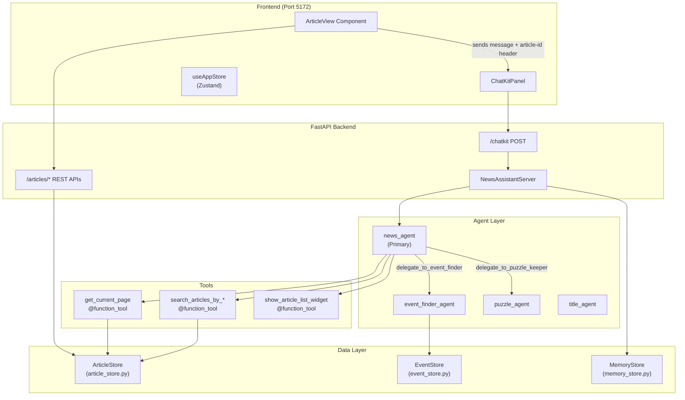
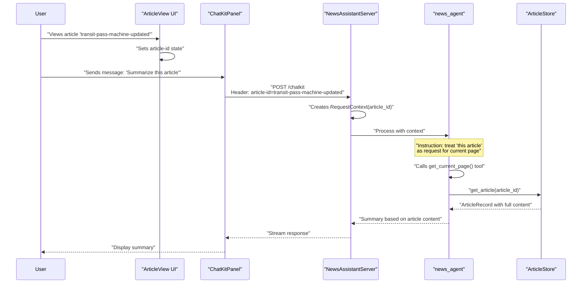
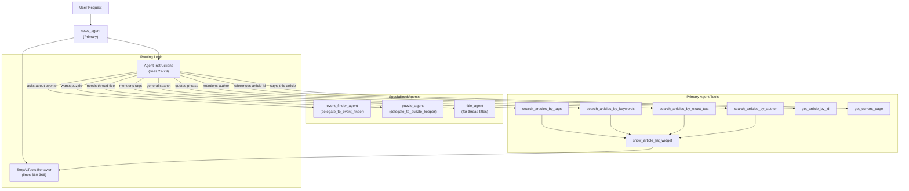
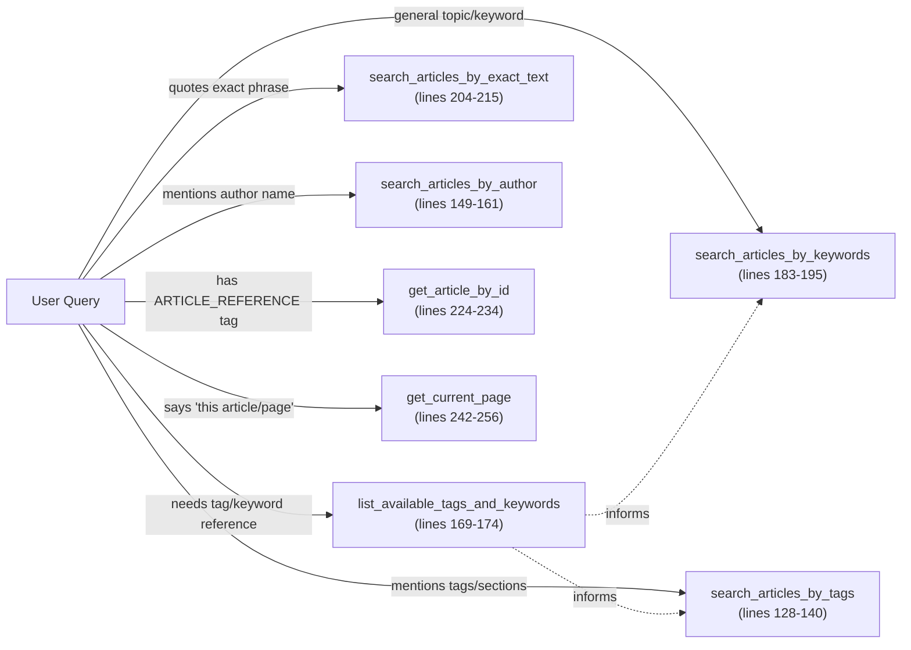
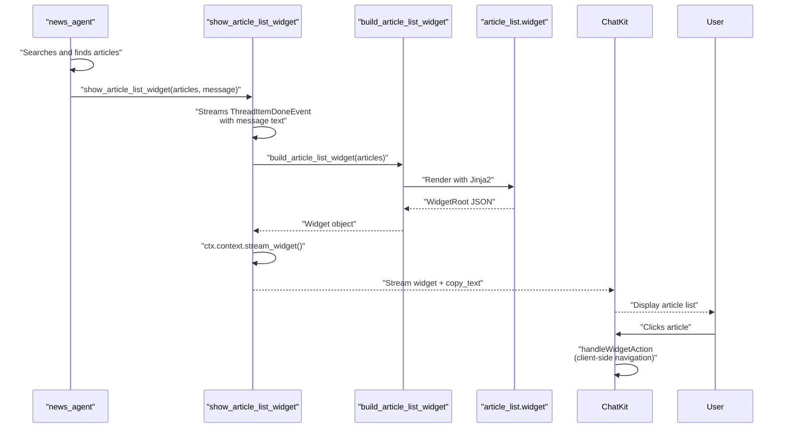
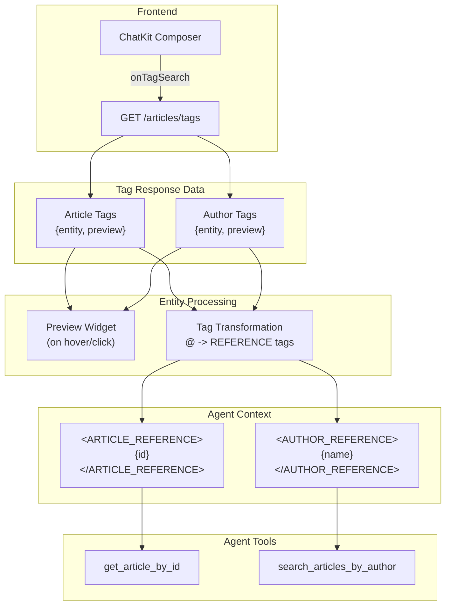
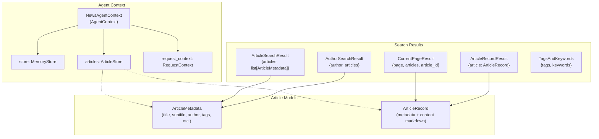

<!-- source: DeepWiki mcp.deepwiki.com · repo openai/openai-chatkit-advanced-samples · page 6 Example: News Guide · fetched 2026-10-26 -->

# Example: News Guide

<details>
<summary>Relevant source files</summary>

The following files were used as context for generating this wiki page:

- [examples/cat-lounge/README.md](examples/cat-lounge/README.md)
- [examples/cat-lounge/frontend/src/components/ChatKitPanel.tsx](examples/cat-lounge/frontend/src/components/ChatKitPanel.tsx)
- [examples/metro-map/README.md](examples/metro-map/README.md)
- [examples/news-guide/backend/app/agents/news_agent.py](examples/news-guide/backend/app/agents/news_agent.py)
- [examples/news-guide/backend/app/main.py](examples/news-guide/backend/app/main.py)

</details>


This document provides comprehensive documentation for the **News Guide** example application, a ChatKit-powered editorial assistant that demonstrates page-aware responses, agent routing, and content discovery patterns. The News Guide helps readers navigate a fictional newsroom ("Foxhollow Dispatch") by searching articles, providing summaries, and delegating specialized requests to sub-agents.

For overview of all examples, see [Examples Overview](#1.1). For common architectural patterns shared across examples, see [Common Architecture](#3). For implementation details of specific subsystems, see [News Guide Overview](#6.1), [News Agent](#6.2), [News Guide Server](#6.3), and [News Guide Widgets](#6.4).

**Sources:** README.md, examples/news-guide/backend/app/agents/news_agent.py, examples/news-guide/backend/app/main.py

---

## Purpose and Scope

The News Guide example demonstrates:

- **Page awareness**: Agent responds contextually based on the article the user is currently viewing, passed via the `article-id` HTTP header
- **Tool choice with agent routing**: Primary agent delegates to specialized sub-agents (`event_finder_agent`, `puzzle_agent`, `title_agent`) based on request type
- **Multi-modal article search**: Search by tags, keywords, exact text, or author
- **Progress updates**: Streaming feedback during search operations
- **Entity tags**: @-mention support for articles and authors with preview widgets
- **Interactive widgets**: Article list and event list widgets with server-side action handlers
- **Context injection**: Hidden tags track user's page state for continuity

The application runs on **port 5172** and features a FastAPI backend with React frontend.

**Sources:** README.md:28-170, examples/news-guide/backend/app/agents/news_agent.py:1-368

---

## Architecture Overview

### System Component Diagram



**Key Components:**

| Component | File Path | Purpose |
|-----------|-----------|---------|
| `NewsAssistantServer` | [examples/news-guide/backend/app/server.py]() | Implements `ChatKitServer`, routes requests to agents, handles widget actions |
| `news_agent` | [examples/news-guide/backend/app/agents/news_agent.py:334-367]() | Primary agent with search and content tools |
| `event_finder_agent` | [examples/news-guide/backend/app/agents/event_finder_agent.py]() | Specialized agent for event queries |
| `puzzle_agent` | [examples/news-guide/backend/app/agents/puzzle_agent.py]() | Specialized agent for puzzle requests |
| `ArticleStore` | [examples/news-guide/backend/app/data/article_store.py]() | In-memory article database with search methods |
| `EventStore` | [examples/news-guide/backend/app/data/event_store.py]() | In-memory event database |
| `MemoryStore` | [examples/news-guide/backend/app/memory_store.py]() | Thread conversation history |

**Sources:** examples/news-guide/backend/app/agents/news_agent.py, examples/news-guide/backend/app/server.py, examples/news-guide/backend/app/main.py

---

## Page Awareness System

### Request Flow with Article Context



The page awareness system enables contextual responses by:

1. **Header propagation**: Frontend sends `article-id` header with each ChatKit request [examples/news-guide/backend/app/main.py:39]()
2. **RequestContext**: Server extracts header and creates `RequestContext` object [examples/news-guide/backend/app/main.py:40]()
3. **Context attachment**: `RequestContext` is attached to `NewsAgentContext` and available to all tools [examples/news-guide/backend/app/agents/news_agent.py:89]()
4. **get_current_page tool**: Retrieves full article content using the context's `article_id` [examples/news-guide/backend/app/agents/news_agent.py:242-256]()
5. **Agent instructions**: Agent is instructed to interpret "this article" as the current page [examples/news-guide/backend/app/agents/news_agent.py:40-42]()

The `RequestContext` class:

```python
# Simplified structure from request_context.py
class RequestContext:
    request: Request
    article_id: str | None  # Extracted from article-id header
```

**Sources:** examples/news-guide/backend/app/main.py:34-46, examples/news-guide/backend/app/agents/news_agent.py:237-256, examples/news-guide/backend/app/request_context.py

---

## Agent Routing and Tool Choice

### Agent Delegation Pattern



The agent routing system uses two mechanisms:

**1. Instruction-based delegation** [examples/news-guide/backend/app/agents/news_agent.py:67-70]():
- Agent instructions specify when to delegate: "If the reader explicitly asks about events...call `delegate_to_event_finder`"
- Sub-agents are registered as tools using `.as_tool()` method [examples/news-guide/backend/app/agents/news_agent.py:350-357]()

**2. StopAtTools behavior** [examples/news-guide/backend/app/agents/news_agent.py:360-366]():
```python
tool_use_behavior=StopAtTools(
    stop_at_tool_names=[
        show_article_list_widget.name,
        "delegate_to_event_finder",
        "delegate_to_puzzle_keeper",
    ]
)
```
This prevents the agent from continuing after showing widgets or delegating, avoiding repetitive content.

**Sources:** examples/news-guide/backend/app/agents/news_agent.py:27-79, examples/news-guide/backend/app/agents/news_agent.py:334-367

---

## Search Tool Inventory

### Search Tool Decision Tree



### Tool Function Signatures

| Tool | Parameters | Return Type | Purpose |
|------|------------|-------------|---------|
| `list_available_tags_and_keywords` | None | `TagsAndKeywords` | Lists all unique tags and keywords in the archive |
| `search_articles_by_tags` | `tags: List[str]` | `ArticleSearchResult` | Filters articles by tag membership |
| `search_articles_by_keywords` | `keywords: List[str]` | `ArticleSearchResult` | Searches metadata (title, tags, keywords) |
| `search_articles_by_exact_text` | `text: str` | `ArticleSearchResult` | Full-text search in article content |
| `search_articles_by_author` | `author: str` | `AuthorSearchResult` | Finds articles by author name |
| `get_article_by_id` | `article_id: str` | `ArticleRecordResult` | Fetches full article by ID |
| `get_current_page` | None | `CurrentPageResult` | Loads article user is currently viewing |

All search tools emit `ProgressUpdateEvent` before fetching data [examples/news-guide/backend/app/agents/news_agent.py:137-138, 158, 173, 192, 212, 229, 251-253]().

**Search Strategy** (from agent instructions, [examples/news-guide/backend/app/agents/news_agent.py:55-66]()):
1. Call `list_available_tags_and_keywords` to get available options
2. Fuzzy match user's phrasing to actual tags/keywords (case-insensitive, partial matches OK)
3. Use `search_articles_by_tags` only when user explicitly references tags/sections
4. Default to `search_articles_by_keywords` for general searches
5. Use `search_articles_by_exact_text` when user quotes a phrase

**Sources:** examples/news-guide/backend/app/agents/news_agent.py:122-256, examples/news-guide/backend/app/agents/news_agent.py:334-367

---

## Widget System

### Article List Widget Flow



The `show_article_list_widget` tool follows a two-step pattern [examples/news-guide/backend/app/agents/news_agent.py:266-292]():

1. **Text message**: Streams a `ThreadItemDoneEvent` with the explanatory message
2. **Widget**: Streams the widget using `stream_widget()` with article titles as `copy_text`

Widget structure from [examples/news-guide/backend/app/widgets/article_list.widget]():
- Type: `Widgets.ListView`
- Items: One per article with title, subtitle, tags, URL
- Actions: Client-side `open_article` action for navigation

**StopAtTools Effect**: After calling `show_article_list_widget`, the agent stops execution to prevent repeating content [examples/news-guide/backend/app/agents/news_agent.py:360-366]().

**Sources:** examples/news-guide/backend/app/agents/news_agent.py:259-292, examples/news-guide/backend/app/widgets/article_list.widget

---

## Entity Tag System

### Entity Tag Architecture



The entity tag system enables @-mentions of articles and authors:

**1. Tag Registration** [examples/news-guide/backend/app/main.py:72-127]():
- `/articles/tags` endpoint returns all articles and authors as entity tags
- Each tag includes:
  - `entity`: Metadata (title, id, icon, group, data)
  - `preview`: Preview widget (rendered when hovering/clicking)

**2. Preview Widgets**:
- Article preview: `build_article_preview_widget` [examples/news-guide/backend/app/widgets/preview_widgets.py]()
- Author preview: `build_author_preview_widget` [examples/news-guide/backend/app/widgets/preview_widgets.py]()

**3. Tag Transformation**:
- Frontend converts @-mentions to `<ARTICLE_REFERENCE>` or `<AUTHOR_REFERENCE>` tags before sending to agent
- Agent instructions specify how to handle these tags [examples/news-guide/backend/app/agents/news_agent.py:72-76]():
  - `<ARTICLE_REFERENCE>`: Call `get_article_by_id` with the id
  - `<AUTHOR_REFERENCE>`: Call `search_articles_by_author` with the author

**Entity Structure Example**:
```json
{
  "entity": {
    "title": "Transit Pass Machine Updated",
    "id": "transit-pass-machine-updated",
    "icon": "document",
    "interactive": true,
    "group": "Articles",
    "data": {
      "article_id": "transit-pass-machine-updated",
      "url": "/article/transit-pass-machine-updated"
    }
  },
  "preview": { /* WidgetRoot */ }
}
```

**Sources:** examples/news-guide/backend/app/main.py:72-127, examples/news-guide/backend/app/agents/news_agent.py:72-76, examples/news-guide/backend/app/widgets/preview_widgets.py

---

## Progress Updates

Progress updates provide real-time feedback during long-running operations. Each search tool emits a `ProgressUpdateEvent` before executing:

```python
await ctx.context.stream(ProgressUpdateEvent(text=f"Searching for tags: {tag_label}"))
```

**Progress Update Examples**:

| Tool | Progress Message | Code Reference |
|------|------------------|----------------|
| `search_articles_by_tags` | "Searching for tags: {tags}" | [examples/news-guide/backend/app/agents/news_agent.py:137]() |
| `search_articles_by_author` | "Looking for articles by {name}..." | [examples/news-guide/backend/app/agents/news_agent.py:158]() |
| `list_available_tags_and_keywords` | "Referencing available tags and keywords..." | [examples/news-guide/backend/app/agents/news_agent.py:173]() |
| `search_articles_by_keywords` | "Searching for keywords: {keywords}" | [examples/news-guide/backend/app/agents/news_agent.py:192]() |
| `search_articles_by_exact_text` | "Scanning articles for: {text}" | [examples/news-guide/backend/app/agents/news_agent.py:212]() |
| `get_article_by_id` | "Loading article..." | [examples/news-guide/backend/app/agents/news_agent.py:229]() |
| `get_current_page` | "Page contents retrieved" / "Full article retrieved" | [examples/news-guide/backend/app/agents/news_agent.py:251-253]() |

The `ProgressUpdateEvent` is imported from `chatkit.types` [examples/news-guide/backend/app/agents/news_agent.py:12]() and streamed using `ctx.context.stream()`.

**Sources:** examples/news-guide/backend/app/agents/news_agent.py:122-256

---

## REST API Endpoints

The News Guide server exposes domain-specific REST endpoints alongside the ChatKit endpoint:

| Endpoint | Method | Purpose | Response |
|----------|--------|---------|----------|
| `/chatkit` | POST | ChatKit streaming endpoint | Server-sent events |
| `/articles/featured` | GET | Lists featured articles | `{"articles": [...]}` |
| `/articles/tags` | GET | Entity tag registry | `{"tags": [...]}` |
| `/articles/{article_id}` | GET | Full article content | `{"article": {...}}` |

**Featured Articles** [examples/news-guide/backend/app/main.py:49-65]():
- Hardcoded list of featured article IDs
- Returns metadata for each article
- Used to populate the featured page view

**Tags Endpoint** [examples/news-guide/backend/app/main.py:72-127]():
- Returns all articles and authors as entity tags
- Each entry includes entity metadata and preview widget
- Powers @-mention search and preview functionality

**Article Endpoint** [examples/news-guide/backend/app/main.py:130-141]():
- Fetches full article content by ID
- Returns 404 if article not found
- Used by frontend to display article content

**Sources:** examples/news-guide/backend/app/main.py:34-141

---

## Data Models

### Key Data Structures



**NewsAgentContext** [examples/news-guide/backend/app/agents/news_agent.py:85-90]():
```python
class NewsAgentContext(AgentContext):
    store: MemoryStore           # Thread conversation history
    articles: ArticleStore       # Article database
    request_context: RequestContext  # Current request (with article_id)
```

**ArticleMetadata**: Lightweight article information (title, subtitle, author, date, tags, keywords, URL) used in search results.

**ArticleRecord**: Full article with metadata + markdown content. Used when agent needs to read article text.

**Search Result Models** [examples/news-guide/backend/app/agents/news_agent.py:95-117]():
- Structured return types for tool calls
- Enable type-safe data passing between tools and agent
- Pydantic models ensure validation

**Sources:** examples/news-guide/backend/app/agents/news_agent.py:85-117, examples/news-guide/backend/app/data/article_store.py

---

## Example Interaction Flow

### Complete Request-Response Cycle

```mermaid
sequenceDiagram
    participant User
    participant UI as "ArticleView<br/>(viewing article-123)"
    participant ChatKit
    participant Server as "NewsAssistantServer"
    participant Agent as "news_agent"
    participant Store as "ArticleStore"
    
    User->>ChatKit: "Tell me about @Roxanne_Park"
    Note over ChatKit: "Transforms to:<br/>&lt;AUTHOR_REFERENCE&gt;roxanne-park&lt;/AUTHOR_REFERENCE&gt;"
    ChatKit->>Server: "POST /chatkit<br/>Header: article-id=article-123"
    Server->>Server: "Create RequestContext(article_id='article-123')"
    Server->>Agent: "Process message with context"
    
    Note over Agent: "Sees AUTHOR_REFERENCE tag<br/>in instructions"
    Agent->>Agent: "Call search_articles_by_author('roxanne-park')"
    Agent->>Server: "Stream ProgressUpdateEvent"
    Server-->>ChatKit: "Looking for articles by Roxanne Park..."
    ChatKit-->>User: "Show progress"
    
    Agent->>Store: "search_metadata_by_author('roxanne-park')"
    Store-->>Agent: "List[ArticleMetadata]"
    Agent->>Agent: "Format response with titles"
    Agent-->>Server: "Response stream"
    Server-->>ChatKit: "Text response"
    ChatKit-->>User: "Display response"
```

This flow demonstrates:
1. **Entity tag transformation**: @-mention converted to `<AUTHOR_REFERENCE>` tag
2. **Page context**: `article-id` header attached to request
3. **Instruction-based tool selection**: Agent recognizes author reference and calls appropriate tool
4. **Progress feedback**: User sees search status before results
5. **Structured results**: Tool returns typed data structure

**Sources:** examples/news-guide/backend/app/main.py:34-46, examples/news-guide/backend/app/agents/news_agent.py:149-161

---

## Configuration

### Environment Variables

| Variable | Purpose | Required |
|----------|---------|----------|
| `OPENAI_API_KEY` | OpenAI API authentication | Yes |
| `VITE_CHATKIT_API_DOMAIN_KEY` | Domain key for local development | Local only |

### Constants

From [examples/news-guide/backend/app/agents/news_agent.py:81-82]():
```python
MODEL = "gpt-4.1-mini"
FEATURED_PAGE_ID = "featured"
```

From [examples/news-guide/backend/app/main.py:49-54]():
```python
FEATURED_ARTICLE_IDS = [
    "unscheduled-parade-formation",
    "community-fridge-apple-pies",
    "missed-connection-reunion",
    "transit-pass-machine-updated",
]
```

**Sources:** examples/news-guide/backend/app/agents/news_agent.py:81-82, examples/news-guide/backend/app/main.py:49-54

---

## Running the Example

From repository root:
```bash
npm run news-guide
```

Or from example directory:
```bash
cd examples/news-guide
npm install
npm run start
```

Navigate to http://localhost:5172

**Example Prompts**:
- "Show me articles about parks"
- "What's happening this weekend?" (delegates to event_finder_agent)
- "Summarize this article" (uses get_current_page)
- "@Transit Pass Machine Updated" (@-mention to reference specific article)
- "Show me articles by @Roxanne Park" (@-mention author)
- "I need a puzzle" (delegates to puzzle_agent)

**Sources:** README.md, examples/news-guide/README.md

---

