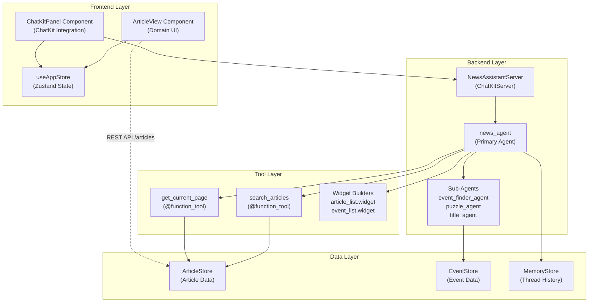
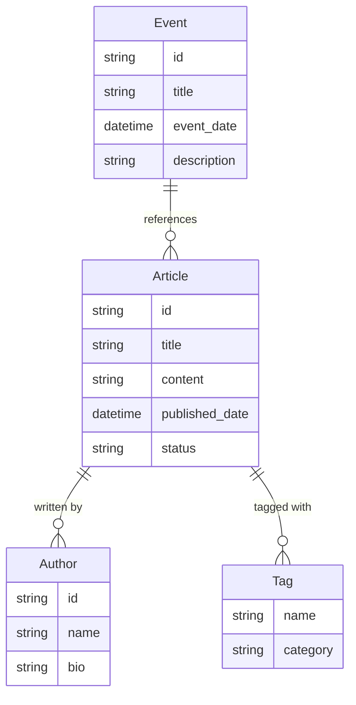
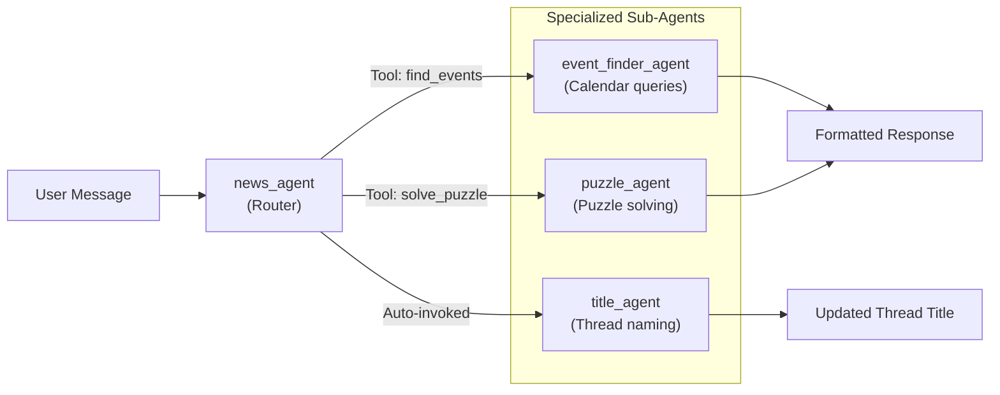
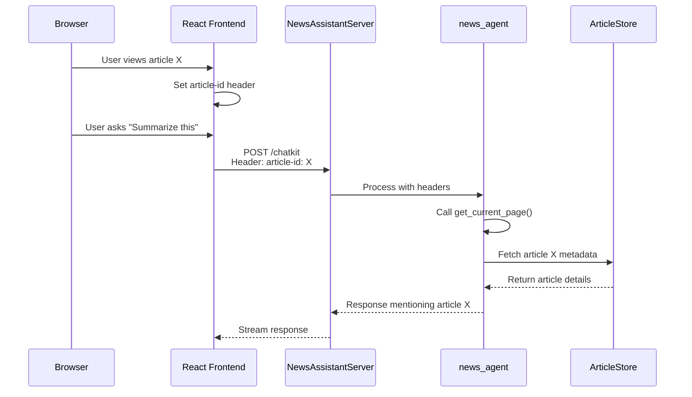

<!-- source: DeepWiki mcp.deepwiki.com · repo openai/openai-chatkit-advanced-samples · page 6.1 News Guide Overview · fetched 2026-10-26 -->

# News Guide Overview

<details>
<summary>Relevant source files</summary>

The following files were used as context for generating this wiki page:

- [examples/cat-lounge/README.md](examples/cat-lounge/README.md)
- [examples/cat-lounge/frontend/src/components/ChatKitPanel.tsx](examples/cat-lounge/frontend/src/components/ChatKitPanel.tsx)
- [examples/metro-map/README.md](examples/metro-map/README.md)

</details>


This document introduces the News Guide example application, an editorial assistant that demonstrates ChatKit's page-aware conversation capabilities, agent routing via tool choice, and article/event discovery features. For detailed information about the news agent implementation, see [News Agent](#6.2). For server-side handling and REST endpoints, see [News Guide Server](#6.3). For widget implementations, see [News Guide Widgets](#6.4).

---

## Purpose and Application Domain

News Guide is a conversational interface for an editorial news platform. It simulates an assistant that helps editors and readers discover articles, track events, search content, and understand authorship relationships. The application demonstrates how ChatKit can provide context-aware responses based on the user's current page location and intelligently route requests to specialized sub-agents.

The example runs on **port 5172** and showcases advanced ChatKit patterns including page awareness, tool choice for agent delegation, progress updates during searches, and rich entity tagging for articles and authors.

**Sources:** High-level system architecture diagrams (Diagram 1, Diagram 2)

---

## Key Features Demonstrated

News Guide highlights the following ChatKit capabilities:

| Feature | Implementation | Purpose |
|---------|---------------|---------|
| **Page Awareness** | `article-id` HTTP header | Agent provides contextual responses based on current article being viewed |
| **Tool Choice** | Agent routing configuration | Main agent delegates to specialized sub-agents (event finder, puzzle solver, title generator) |
| **Progress Updates** | `ProgressUpdateEvent` streaming | Real-time feedback during article search operations |
| **Entity Tags** | `@-mention` for articles/authors | Rich entity preview and conversion to model-readable markers |
| **Server Tools** | `search_articles`, `get_current_page` | Backend functions for content discovery and context retrieval |
| **Interactive Widgets** | Article lists, event calendars | Server-side action handling for navigation and detail views |
| **Thread Titles** | `title_agent` sub-agent | Dynamic thread naming based on conversation content |

**Sources:** High-level system architecture diagrams (Diagram 2, Diagram 5)

---

## Architecture Overview

The News Guide follows the standard ChatKit example pattern with domain-specific extensions for editorial workflows.



**Diagram: News Guide Component Architecture**

The architecture separates concerns into four layers:

1. **Frontend Layer**: `ChatKitPanel` handles conversational UI while `ArticleView` displays article content. State management via `useAppStore`.
2. **Backend Layer**: `NewsAssistantServer` implements the ChatKit interface, routing requests to `news_agent` which delegates to specialized sub-agents using tool choice.
3. **Data Layer**: Domain stores (`ArticleStore`, `EventStore`) manage content data, while `MemoryStore` maintains conversation history.
4. **Tool Layer**: Function tools decorated with `@function_tool` provide search and context retrieval. Widget builders generate interactive UI components.

**Sources:** High-level system architecture diagrams (Diagram 3, Diagram 4)

---

## Domain Model

News Guide operates on three primary entity types:



**Diagram: News Guide Domain Model**

- **Articles**: Core content items with title, body, publication metadata
- **Authors**: Writers with biographical information
- **Events**: Calendar items that may reference articles
- **Tags**: Categorization and discovery metadata

Entity tags in the composer allow users to @-mention articles and authors, which are converted to model-readable markers like `<ARTICLE id="...">` for context injection.

**Sources:** High-level system architecture diagrams (Diagram 2)

---

## Agent Routing and Tool Choice

News Guide's primary innovation is its use of **tool choice** to delegate specialized tasks to sub-agents:



**Diagram: Agent Routing via Tool Choice**

The `news_agent` acts as a router, exposing tools that internally delegate to specialized agents. When a user asks about events, the agent invokes the `find_events` tool which activates `event_finder_agent`. This pattern keeps agent instructions focused while maintaining composability.

**Sources:** High-level system architecture diagrams (Diagram 2)

---

## Page Awareness

A distinguishing feature of News Guide is its **context-aware responses** based on the current article being viewed:



**Diagram: Page Awareness Flow**

The frontend sets an `article-id` HTTP header when the user navigates to an article. The backend's `get_current_page` tool extracts this header and retrieves the corresponding article, allowing the agent to provide contextual answers without requiring the user to explicitly mention the article.

**Sources:** High-level system architecture diagrams (Diagram 2)

---

## Quick Start

To run News Guide locally:

```bash
# From repository root
export OPENAI_API_KEY=sk-...
npm run news-guide

# Or from the example directory
cd examples/news-guide
npm install
npm run start
```

The application launches on `http://localhost:5172` with both frontend and backend services.

**Sources:** High-level system architecture diagrams (Diagram 1)

---

## Example Interactions

News Guide supports the following interaction patterns:

| User Action | System Response | Features Demonstrated |
|-------------|-----------------|----------------------|
| "Search for articles about AI" | Progress update → Article list widget | Progress updates, widget rendering, search tools |
| "Tell me about @TechDaily" | Author preview with entity tag | Entity tags, author metadata |
| View article + "What's this about?" | Context-aware summary | Page awareness via `get_current_page` |
| "Find upcoming tech events" | Event list widget | Sub-agent delegation via tool choice |
| Click article in widget | Navigate to article view | Server-side widget action handling |
| "Show me event details" | Event detail widget | Widget actions (`view_event_details`) |

**Sources:** High-level system architecture diagrams (Diagram 2, Diagram 5)

---

## What Makes News Guide Unique

Compared to other examples in the repository:

| Aspect | News Guide Approach | Contrast with Other Examples |
|--------|---------------------|------------------------------|
| **Agent Architecture** | Router pattern with sub-agent delegation | Cat Lounge/Metro Map use single primary agent |
| **Context Source** | HTTP headers provide page state | Metro Map uses client tools for UI state |
| **Search UX** | Progress updates during async operations | Other examples have synchronous tool calls |
| **Entity System** | Bidirectional (search + preview + injection) | Metro Map has entity tags but simpler model |
| **Widget Actions** | All server-side for context injection | Cat Lounge mixes client/server handling |
| **Thread Naming** | Dedicated sub-agent generates titles | Cat Lounge uses inline logic |

News Guide demonstrates **production-ready patterns** for content platforms where conversation context depends on navigation state and where specialized AI capabilities (search, event discovery, puzzle solving) benefit from modular agent design.

**Sources:** High-level system architecture diagrams (Diagram 2, Diagram 5), README.md feature comparison

---

