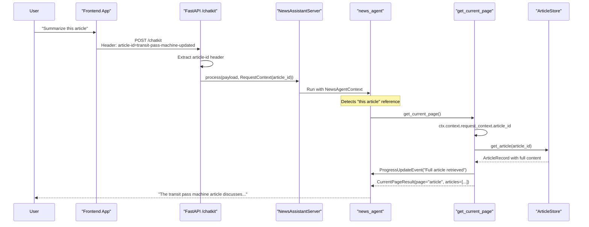
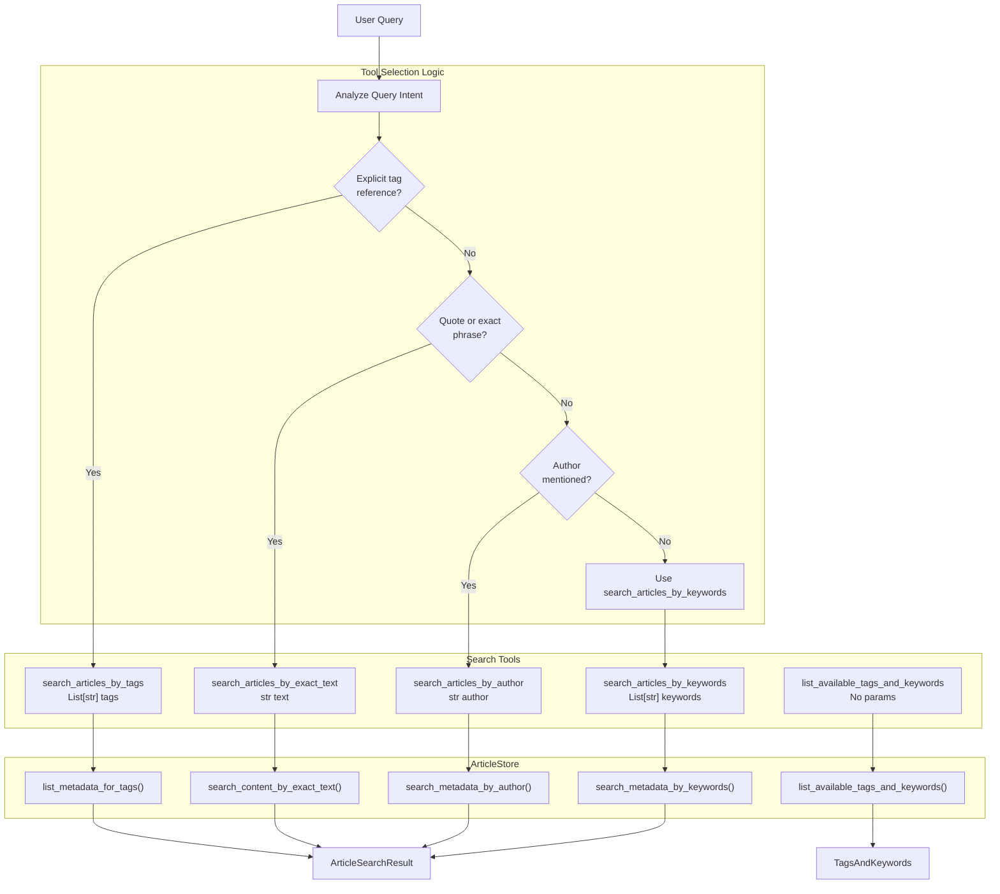
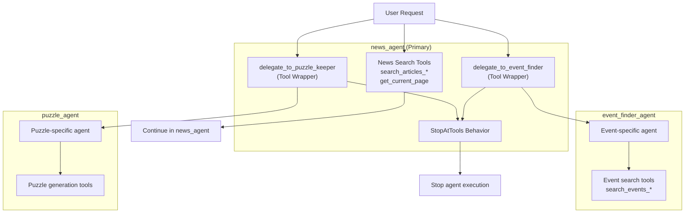
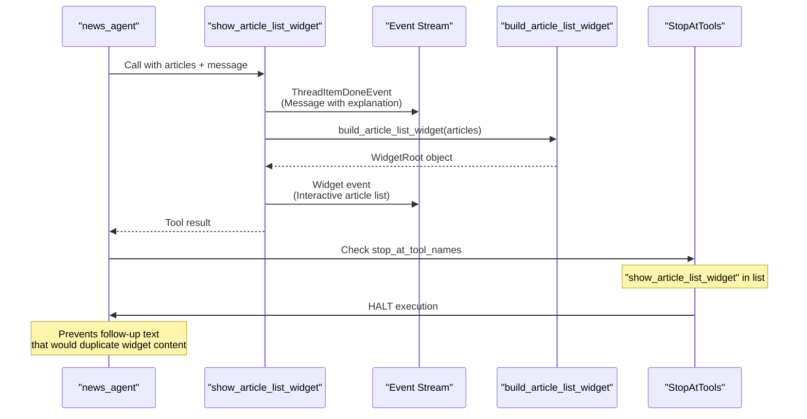
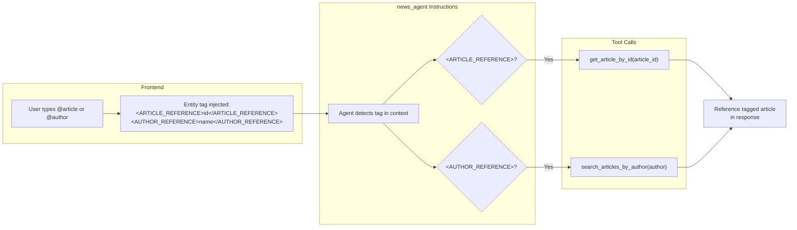

<!-- source: DeepWiki mcp.deepwiki.com · repo openai/openai-chatkit-advanced-samples · page 6.2 News Agent · fetched 2026-10-26 -->

# News Agent

<details>
<summary>Relevant source files</summary>

The following files were used as context for generating this wiki page:

- [examples/news-guide/backend/app/agents/news_agent.py](examples/news-guide/backend/app/agents/news_agent.py)
- [examples/news-guide/backend/app/main.py](examples/news-guide/backend/app/main.py)

</details>


## Purpose

This document covers the `news_agent` implementation in the News Guide example, which serves as the primary conversational agent for the Foxhollow Dispatch editorial assistant. The agent helps readers discover news articles through natural language queries, manages page-aware responses, and delegates specialized requests to sub-agents.

For information about the News Guide server implementation and agent selection logic, see [News Guide Server](#6.3). For documentation of the widgets used by this agent, see [News Guide Widgets](#6.4).

## Agent Configuration

The `news_agent` is defined in [examples/news-guide/backend/app/agents/news_agent.py:334-367]() and configured with GPT-4.1-mini as its language model. The agent is instantiated as:

```python
news_agent = Agent[NewsAgentContext](
    model="gpt-4.1-mini",
    name="Foxhollow Dispatch News Guide",
    instructions=INSTRUCTIONS,
    tools=[...],
    tool_use_behavior=StopAtTools(...)
)
```

### Agent Context

The agent operates with a specialized `NewsAgentContext` that provides access to three key resources:

| Context Field | Type | Purpose |
|--------------|------|---------|
| `store` | `MemoryStore` | Thread history and conversational state |
| `articles` | `ArticleStore` | Article database for search and retrieval |
| `request_context` | `RequestContext` | Current page ID from HTTP headers |

**Sources:** [examples/news-guide/backend/app/agents/news_agent.py:85-90]()

### Instructions and Behavior

The agent follows comprehensive instructions [examples/news-guide/backend/app/agents/news_agent.py:27-79]() that define its personality and operational guidelines:

- **Service-forward approach**: Prioritizes clarity and quick discovery
- **Metadata-first**: Always consults latest article data before recommendations
- **Default recommendations**: Suggests 2 articles unless explicitly asked otherwise
- **Page awareness**: Interprets "this article" or "this page" as the currently open article
- **Formatting**: Italicizes titles, uses blockquotes for excerpts, adds generous paragraph breaks
- **Tool selection logic**: Detailed rules for choosing between search tools based on user intent

**Sources:** [examples/news-guide/backend/app/agents/news_agent.py:27-79]()

## Page Awareness System

The News Agent demonstrates ChatKit's page awareness pattern, allowing it to reference the specific article the user currently has open in the frontend UI.

### Page Awareness Flow



**Sources:** [examples/news-guide/backend/app/agents/news_agent.py:237-257](), [examples/news-guide/backend/app/main.py:34-47]()

### RequestContext and article-id Header

The frontend sends the current article ID via the `article-id` HTTP header [examples/news-guide/backend/app/main.py:39](). This is captured in a `RequestContext` object that flows through the agent execution:

```python
article_id = request.headers.get("article-id")
context = RequestContext(request=request, article_id=article_id)
result = await server.process(payload, context)
```

The `get_current_page` tool retrieves this ID from the context [examples/news-guide/backend/app/agents/news_agent.py:245]():

```python
article_id = ctx.context.request_context.article_id
if not article_id:
    raise ValueError("No article id is available in the current request context.")
```

**Sources:** [examples/news-guide/backend/app/main.py:34-46](), [examples/news-guide/backend/app/agents/news_agent.py:242-257]()

### Featured Page Handling

When `article_id` is `"featured"`, the tool loads multiple featured articles rather than a single article [examples/news-guide/backend/app/agents/news_agent.py:319-323](). This supports the homepage scenario where multiple featured articles are displayed.

**Sources:** [examples/news-guide/backend/app/agents/news_agent.py:298-329]()

## Search Tool Suite

The agent provides five distinct search tools, each optimized for different query patterns. The agent's instructions include explicit logic for selecting the appropriate tool based on user intent.

### Tool Architecture



**Sources:** [examples/news-guide/backend/app/agents/news_agent.py:122-216](), [examples/news-guide/backend/app/agents/news_agent.py:55-70]()

### Search Tool Descriptions

| Tool | Parameters | Use Case | Progress Message |
|------|-----------|----------|------------------|
| `list_available_tags_and_keywords` | None | List all searchable tags/keywords before matching | "Referencing available tags and keywords..." |
| `search_articles_by_tags` | `List[str] tags` | User explicitly references tags/sections | "Searching for tags: {tags}" |
| `search_articles_by_keywords` | `List[str] keywords` | **Default** metadata search for most queries | "Searching for keywords: {keywords}" |
| `search_articles_by_exact_text` | `str text` | User quotes a phrase or wants exact content match | "Scanning articles for: {text}" |
| `search_articles_by_author` | `str author` | User mentions or tags an author | "Looking for articles by {author}..." |
| `get_article_by_id` | `str article_id` | Fetch specific article by ID | "Loading article..." |

**Sources:** [examples/news-guide/backend/app/agents/news_agent.py:122-235]()

### Progress Updates During Search

All search tools emit `ProgressUpdateEvent` messages to provide real-time feedback during searches. For example [examples/news-guide/backend/app/agents/news_agent.py:137]():

```python
await ctx.context.stream(ProgressUpdateEvent(text=f"Searching for tags: {tag_label}"))
```

This creates streaming UI feedback that displays while the search executes, improving perceived responsiveness for potentially slow operations.

**Sources:** [examples/news-guide/backend/app/agents/news_agent.py:137](), [examples/news-guide/backend/app/agents/news_agent.py:158](), [examples/news-guide/backend/app/agents/news_agent.py:192]()

### Return Types

Search tools return structured results rather than plain text:

```python
class ArticleSearchResult(BaseModel):
    articles: list[ArticleMetadata]

class AuthorSearchResult(BaseModel):
    author: str
    articles: list[ArticleMetadata]

class TagsAndKeywords(BaseModel):
    tags: list[str]
    keywords: list[str]
```

These structured results allow the model to process search results uniformly and maintain type safety throughout the agent execution.

**Sources:** [examples/news-guide/backend/app/agents/news_agent.py:95-107]()

## Sub-Agent Delegation

The News Agent delegates specialized requests to two sub-agents using the `as_tool()` pattern, which wraps a complete agent as a callable tool within the parent agent's tool set.

### Delegation Architecture



**Sources:** [examples/news-guide/backend/app/agents/news_agent.py:350-357](), [examples/news-guide/backend/app/agents/news_agent.py:360-366]()

### Tool Wrapper Configuration

Sub-agents are wrapped as tools using the `as_tool()` method [examples/news-guide/backend/app/agents/news_agent.py:350-357]():

```python
event_finder_agent.as_tool(
    tool_name="delegate_to_event_finder",
    tool_description="Delegate event-specific requests to the Foxhollow Event Finder agent.",
)

puzzle_agent.as_tool(
    tool_name="delegate_to_puzzle_keeper",
    tool_description="Delegate coffee break puzzle requests to the Foxhollow Puzzle Keeper agent.",
)
```

This pattern allows the News Agent to hand off complete conversational control to specialized agents while maintaining a unified chat experience.

**Sources:** [examples/news-guide/backend/app/agents/news_agent.py:350-357]()

### Delegation Triggers

The agent's instructions specify when to delegate [examples/news-guide/backend/app/agents/news_agent.py:67-70]():

- **Event Finder**: "If the reader explicitly asks about events, happenings, or things to do"
- **Puzzle Keeper**: "If the reader wants a Foxhollow-flavored puzzle, coffee-break brain teaser, or mentions the puzzle tool"

**Sources:** [examples/news-guide/backend/app/agents/news_agent.py:67-70]()

## Widget Integration and StopAtTools

The agent uses the `show_article_list_widget` tool to present search results in a structured, interactive format. This tool is paired with `StopAtTools` behavior to prevent redundant content generation.

### Widget Display Flow



**Sources:** [examples/news-guide/backend/app/agents/news_agent.py:266-292](), [examples/news-guide/backend/app/agents/news_agent.py:360-366]()

### StopAtTools Configuration

The agent halts execution after calling specific tools [examples/news-guide/backend/app/agents/news_agent.py:360-366]():

```python
tool_use_behavior=StopAtTools(
    stop_at_tool_names=[
        show_article_list_widget.name,
        "delegate_to_event_finder",
        "delegate_to_puzzle_keeper",
    ]
)
```

This prevents the agent from generating additional text after showing the widget, which would be redundant since the widget itself presents the search results visually. The same behavior applies to delegation tools, transferring control cleanly to sub-agents.

**Sources:** [examples/news-guide/backend/app/agents/news_agent.py:360-366]()

### Widget Display Implementation

The `show_article_list_widget` tool [examples/news-guide/backend/app/agents/news_agent.py:266-292]():

1. Validates that articles list is non-empty
2. Streams a `ThreadItemDoneEvent` with the explanatory message
3. Builds the widget using `build_article_list_widget(articles)`
4. Streams the widget with `stream_widget()`, using article titles as copy text

**Sources:** [examples/news-guide/backend/app/agents/news_agent.py:266-292]()

## Custom Entity Tags

The agent handles custom XML-style tags that appear in the conversation context when users @-mention articles or authors in the chat interface.

### Entity Tag Processing



**Sources:** [examples/news-guide/backend/app/agents/news_agent.py:72-76]()

### Tag Handler Instructions

The agent's instructions provide explicit guidance for handling entity tags [examples/news-guide/backend/app/agents/news_agent.py:72-76]():

```
Custom tags:
 - When you see an <ARTICLE_REFERENCE>{article_id}</ARTICLE_REFERENCE> tag in the context, 
   call `get_article_by_id` with that id before citing details so your answer can reference 
   the tagged article accurately.
 - When you see an <AUTHOR_REFERENCE>{author}</AUTHOR_REFERENCE> tag in the context, or the 
   reader names an author, call `search_articles_by_author` with that author before 
   recommending pieces so you feature their work first.
```

This pattern enables seamless integration between the frontend's entity tagging system and the agent's tool calls, ensuring that @-mentions in the chat are resolved to actual article data or author searches.

**Sources:** [examples/news-guide/backend/app/agents/news_agent.py:72-76]()

---

**Summary**: The `news_agent` serves as the primary conversational interface for the News Guide example, demonstrating page awareness through `get_current_page`, comprehensive search capabilities with progress updates, clean sub-agent delegation via the `as_tool()` pattern, and careful response control through `StopAtTools` behavior.

---

