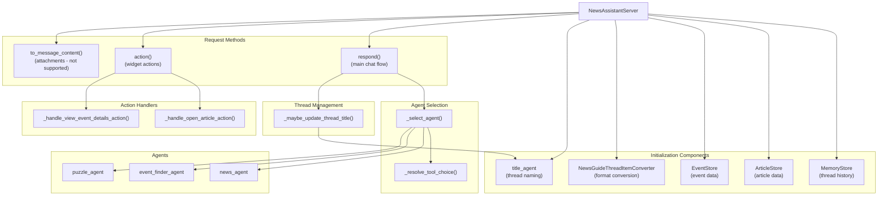
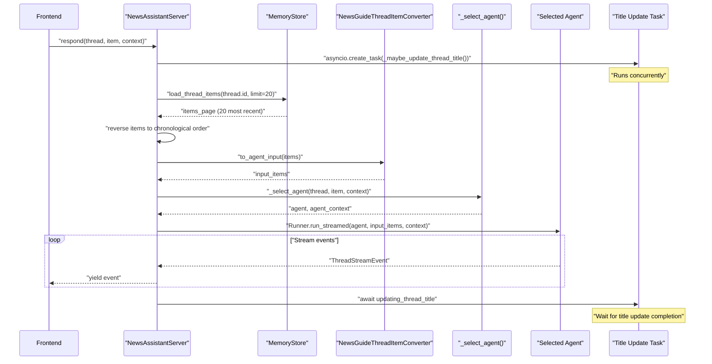
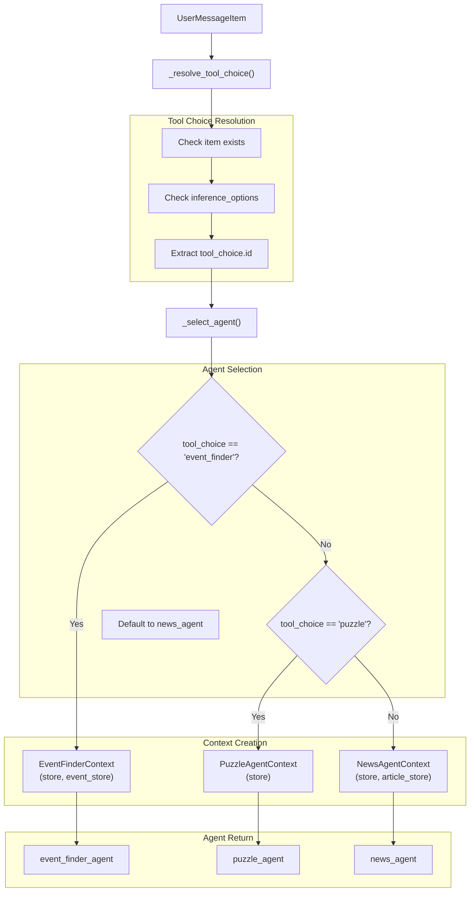
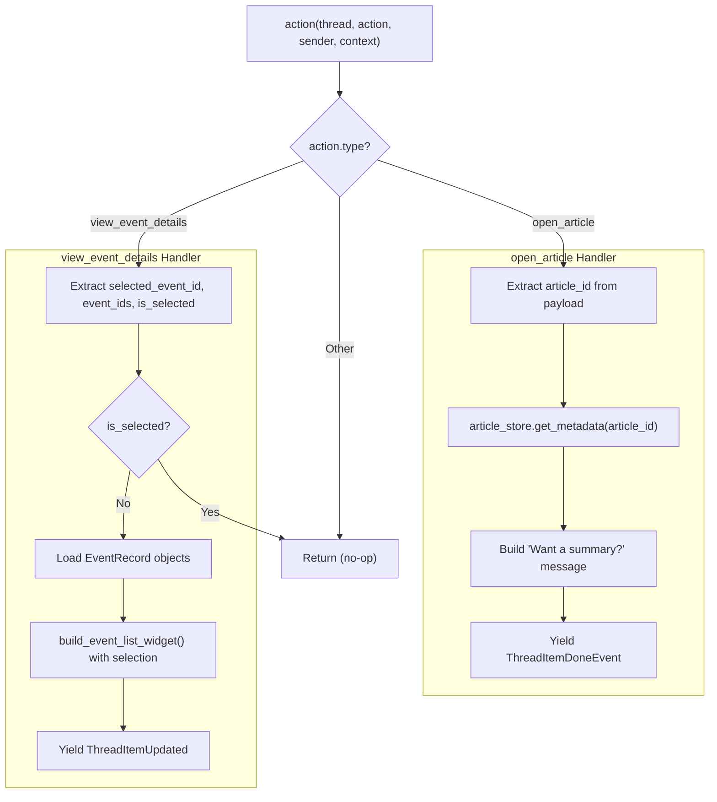
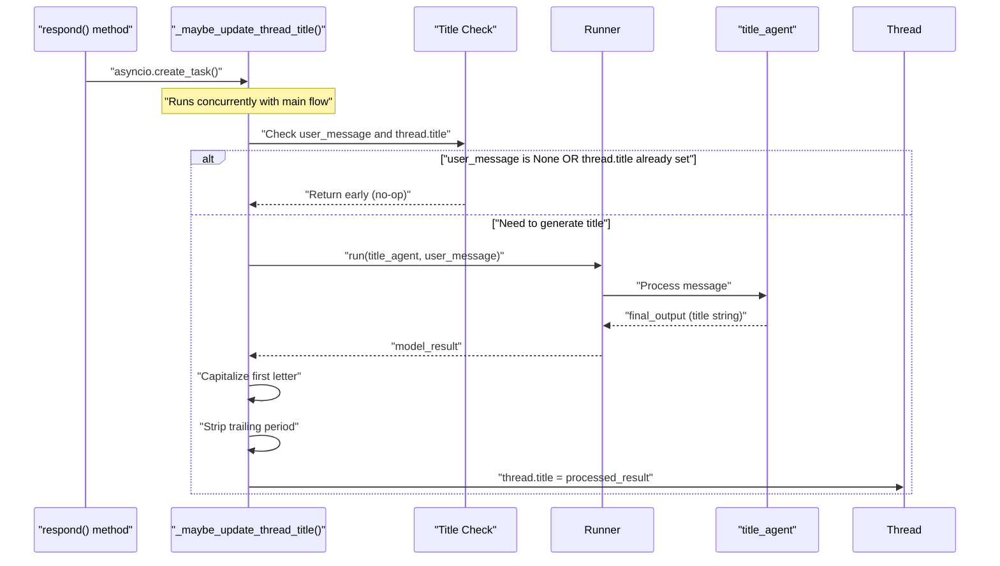

<!-- source: DeepWiki mcp.deepwiki.com · repo openai/openai-chatkit-advanced-samples · page 6.3 News Guide Server · fetched 2026-10-26 -->

# News Guide Server

<details>
<summary>Relevant source files</summary>

The following files were used as context for generating this wiki page:

- [examples/news-guide/backend/app/server.py](examples/news-guide/backend/app/server.py)

</details>


## Purpose and Scope

This document describes the `NewsAssistantServer` implementation, which is the ChatKit server backend for the News Guide example application. The server orchestrates agent selection, handles widget actions, manages thread titles, and streams AI responses to the frontend.

For information about the News Guide agents themselves, see [News Agent](#6.2). For widget implementations, see [News Guide Widgets](#6.4). For general backend architecture patterns, see [Backend Architecture Pattern](#3.1).

---

## Server Architecture Overview

The `NewsAssistantServer` class extends `ChatKitServer` and serves as the central orchestration layer for the News Guide application.



**Sources:** [examples/news-guide/backend/app/server.py:42-227]()

---

## Initialization and Dependencies

The `NewsAssistantServer` constructor initializes multiple data stores and supporting components:

| Component | Type | Purpose |
|-----------|------|---------|
| `self.store` | `MemoryStore` | Stores conversation thread history and items |
| `self.article_store` | `ArticleStore` | Provides access to article metadata and content |
| `self.event_store` | `EventStore` | Provides access to event records |
| `self.thread_item_converter` | `NewsGuideThreadItemConverter` | Converts between ChatKit items and agent input formats |
| `self.title_agent` | `Agent` | Specialized agent for generating thread titles |

The initialization occurs in the constructor and creates the data stores from a shared `data` directory:

```python
def __init__(self) -> None:
    self.store: MemoryStore = MemoryStore()
    super().__init__(self.store)

    data_dir = Path(__file__).resolve().parent / "data"
    self.article_store = ArticleStore(data_dir)
    self.event_store = EventStore(data_dir)
    self.thread_item_converter = NewsGuideThreadItemConverter()
    self.title_agent = title_agent
```

**Sources:** [examples/news-guide/backend/app/server.py:45-53]()

---

## Request Handling Flow

The `respond` method implements the main conversation loop, orchestrating agent selection, response streaming, and thread title updates.



The method performs the following steps:

1. **Concurrent Title Update**: Spawns an async task to update the thread title if needed
2. **Load History**: Retrieves the last 20 thread items in descending order, then reverses them to chronological
3. **Format Conversion**: Converts ChatKit thread items to agent-compatible input format
4. **Agent Selection**: Chooses the appropriate agent based on tool choice hints
5. **Stream Response**: Runs the agent in streaming mode and yields events
6. **Await Title Update**: Ensures the title update task completes before returning

**Sources:** [examples/news-guide/backend/app/server.py:56-80]()

---

## Agent Selection and Tool Choice

The server dynamically routes requests to different specialized agents based on the `tool_choice` inference option in the user message.



### Tool Choice Resolution

The `_resolve_tool_choice` method extracts the tool choice ID from the user message:

```python
def _resolve_tool_choice(self, item: UserMessageItem | None) -> str | None:
    if not item or not item.inference_options:
        return None
    tool_choice = item.inference_options.tool_choice
    if tool_choice and isinstance(tool_choice.id, str):
        return tool_choice.id
    return None
```

### Agent Selection Logic

The `_select_agent` method maps tool choice IDs to specific agents and their contexts:

| Tool Choice | Agent | Context Type | Data Sources |
|-------------|-------|--------------|--------------|
| `"event_finder"` | `event_finder_agent` | `EventFinderContext` | `store`, `event_store` |
| `"puzzle"` | `puzzle_agent` | `PuzzleAgentContext` | `store` |
| `None` or other | `news_agent` | `NewsAgentContext` | `store`, `article_store` |

Each context includes the thread metadata, memory store, and relevant domain-specific stores. The `request_context` is always passed through for request-scoped data like page awareness headers.

**Sources:** [examples/news-guide/backend/app/server.py:181-221]()

---

## Widget Action Handling

The `action` method processes widget interactions from the frontend. The News Guide server handles two action types:



### open_article Action

When a user clicks "Open in new tab" or similar actions on an article widget, the server injects a contextual message into the thread:

1. Extracts `article_id` from `action.payload`
2. Retrieves article metadata to get the title
3. Creates an `AssistantMessageItem` with a contextual prompt
4. Yields `ThreadItemDoneEvent` to add the message to the thread

This pattern allows widget actions to seamlessly continue the conversation with implicit context.

**Sources:** [examples/news-guide/backend/app/server.py:118-142]()

### view_event_details Action

When a user clicks on an event in the event list widget, the server updates the widget to show the selected event:

1. Extracts `selected_event_id`, `event_ids`, and `is_selected` from `action.payload`
2. Short-circuits if the event is already selected (no-op)
3. Loads all `EventRecord` objects for the event IDs
4. Rebuilds the event list widget with `selected_event_id` highlighted
5. Yields `ThreadItemUpdated` to replace the widget in-place

This demonstrates in-place widget updates without creating new thread items.

**Sources:** [examples/news-guide/backend/app/server.py:144-179]()

---

## Thread Title Management

The server automatically generates thread titles using a specialized `title_agent` when a thread receives its first user message.



The title generation logic:

1. **Guards**: Returns early if `user_message` is `None` or `thread.title` is already set
2. **Agent Execution**: Runs `title_agent` with the user message converted to agent input format
3. **Post-processing**: Capitalizes the first letter and strips trailing periods
4. **Assignment**: Sets `thread.title` directly on the `ThreadMetadata` object

This task runs concurrently with the main agent response flow and completes before the `respond` method returns, ensuring the title is available for subsequent requests.

**Sources:** [examples/news-guide/backend/app/server.py:104-116]()

---

## Server Factory Function

The module exports a factory function for creating server instances:

```python
def create_chatkit_server() -> NewsAssistantServer | None:
    """Return a configured ChatKit server instance if dependencies are available."""
    return NewsAssistantServer()
```

This function is called by the FastAPI application setup to instantiate the server. The return type allows for `None` to signal dependency unavailability, though the current implementation always returns an instance.

**Sources:** [examples/news-guide/backend/app/server.py:224-226]()

---

## Unsupported Features

The `to_message_content` method is required by the `ChatKitServer` interface but not supported in the News Guide example:

```python
async def to_message_content(self, _input: Attachment) -> ResponseInputContentParam:
    raise RuntimeError("File attachments are not supported in this demo.")
```

This explicitly rejects file attachment handling, as the News Guide focuses on text-based article searches and event finding.

**Sources:** [examples/news-guide/backend/app/server.py:100-101]()

---

## Request Context Integration

Throughout the server implementation, the `RequestContext` object flows through all method calls. This context carries request-scoped information such as:

- **Page Awareness**: The current `article-id` header for page-specific responses (see [News Agent](#6.2))
- **Authentication**: Potential user identity or session data
- **Request Metadata**: Timestamps, request IDs, etc.

The context is created by the FastAPI layer and passed to all ChatKit server methods, enabling agents and tools to access request-specific information without global state.

**Sources:** [examples/news-guide/backend/app/server.py:56-213]()

---

