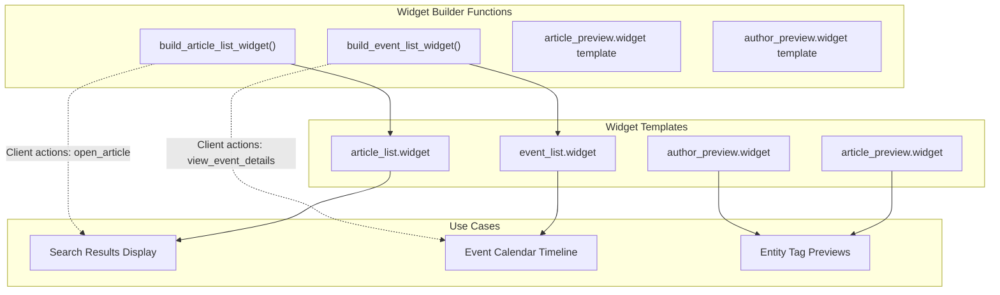
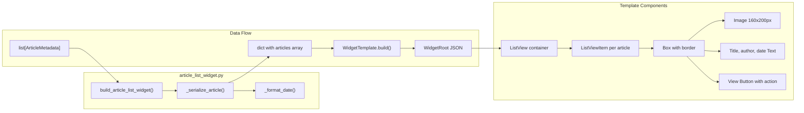
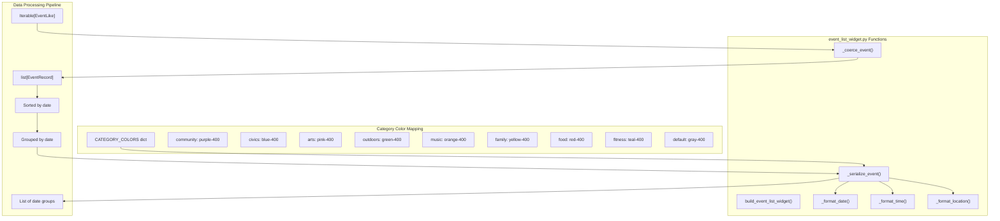
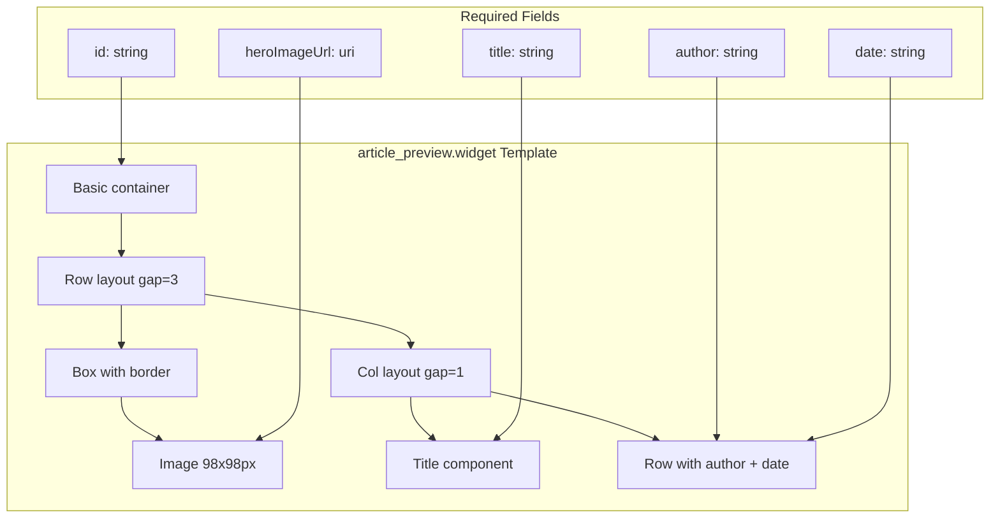
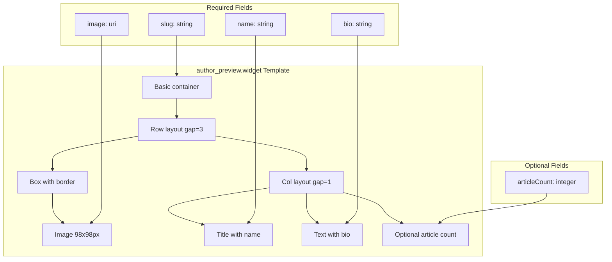
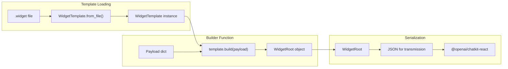
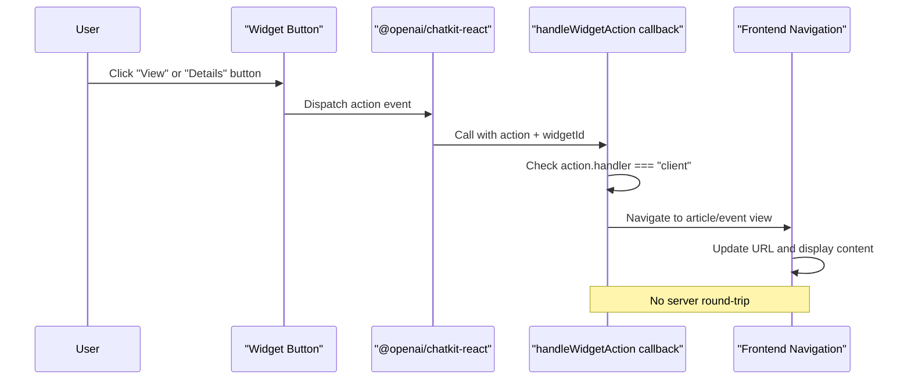

<!-- source: DeepWiki mcp.deepwiki.com · repo openai/openai-chatkit-advanced-samples · page 6.4 News Guide Widgets · fetched 2026-10-26 -->

# News Guide Widgets

<details>
<summary>Relevant source files</summary>

The following files were used as context for generating this wiki page:

- [examples/news-guide/backend/app/widgets/article_list.widget](examples/news-guide/backend/app/widgets/article_list.widget)
- [examples/news-guide/backend/app/widgets/article_list_widget.py](examples/news-guide/backend/app/widgets/article_list_widget.py)
- [examples/news-guide/backend/app/widgets/article_preview.widget](examples/news-guide/backend/app/widgets/article_preview.widget)
- [examples/news-guide/backend/app/widgets/author_preview.widget](examples/news-guide/backend/app/widgets/author_preview.widget)
- [examples/news-guide/backend/app/widgets/event_list_widget.py](examples/news-guide/backend/app/widgets/event_list_widget.py)

</details>


This document covers the four widget types implemented in the News Guide example application: article lists, event lists, article previews, and author previews. These widgets demonstrate presentation-based UI components with client-side action handling for navigation. For information about widget actions and server-side handling, see [Widget Actions](#7.4). For the overall News Guide architecture, see [News Guide Overview](#6.1).

## Widget Types Overview

The News Guide example implements four distinct widget types, each serving a specific role in the editorial assistant interface.



**Sources:** [examples/news-guide/backend/app/widgets/article_list_widget.py:1-38](), [examples/news-guide/backend/app/widgets/event_list_widget.py:1-91]()

| Widget Type | Builder Function | Template File | Interactive | Primary Use |
|-------------|-----------------|---------------|-------------|-------------|
| Article List | `build_article_list_widget()` | `article_list.widget` | Yes | Display search results with view actions |
| Event List | `build_event_list_widget()` | `event_list.widget` | Yes | Show events grouped by date with detail actions |
| Article Preview | Direct template | `article_preview.widget` | No | Entity tag preview for @-mentioned articles |
| Author Preview | Direct template | `author_preview.widget` | No | Entity tag preview for @-mentioned authors |

## Article List Widget

The article list widget displays search results in a card-based layout with hero images, metadata, and view buttons.

### Widget Structure



**Sources:** [examples/news-guide/backend/app/widgets/article_list_widget.py:24-37]()

### Article Data Serialization

The `build_article_list_widget()` function transforms `ArticleMetadata` objects into widget-compatible dictionaries:

[examples/news-guide/backend/app/widgets/article_list_widget.py:24-27]()

Each article is serialized with:
- `id`: Article identifier for action payloads
- `title`: Article headline
- `author`: Author name prefixed with "by "
- `heroImageUrl`: Image URL for 160x200px display
- `date`: Formatted date string (e.g., "Feb 4, 2025")

The date formatting uses `_format_date()` to convert `datetime` objects to human-readable strings:

[examples/news-guide/backend/app/widgets/article_list_widget.py:16-18]()

**Sources:** [examples/news-guide/backend/app/widgets/article_list_widget.py:16-37]()

### Template Structure

The `article_list.widget` template defines a `ListView` with nested layout components. The template uses Jinja2 syntax to iterate over articles:

[examples/news-guide/backend/app/widgets/article_list.widget:1-5]()

Key template features:
- **ListView container**: Wraps all article cards
- **ListViewItem**: Each article gets a unique `key` for React rendering
- **Box layout**: 300-450px width with gray border
- **Row layout**: Horizontal arrangement of image and content
- **Image**: 160x200px hero image with cover fit
- **Column layout**: Metadata and button stack
- **View Button**: Ghost variant with chevron icon and `open_article` action

**Sources:** [examples/news-guide/backend/app/widgets/article_list.widget:1-253]()

### Client-Side Action

Each article card includes a "View" button with a client-side action:

```json
{
  "type": "open_article",
  "handler": "client",
  "payload": {
    "id": "article-id"
  }
}
```

The `handler: "client"` indicates this action is processed by the frontend's `handleWidgetAction` callback, typically triggering navigation to the article view without server round-trip.

**Sources:** [examples/news-guide/backend/app/widgets/article_list.widget:134-140]()

## Event List Widget

The event list widget displays upcoming events grouped by date in a timeline format with category-based visual styling.

### Event Data Model and Grouping



**Sources:** [examples/news-guide/backend/app/widgets/event_list_widget.py:32-53]()

The `build_event_list_widget()` function performs event grouping and serialization:

[examples/news-guide/backend/app/widgets/event_list_widget.py:32-53]()

**Processing steps:**
1. Coerce input events to `EventRecord` objects
2. Sort events chronologically by date
3. Group events by date using `itertools.groupby`
4. Serialize each group with formatted date labels
5. Track event IDs for selection state

**Sources:** [examples/news-guide/backend/app/widgets/event_list_widget.py:32-60]()

### Event Serialization

Each event is serialized with category-based color coding:

[examples/news-guide/backend/app/widgets/event_list_widget.py:62-74]()

The category colors are mapped using a predefined dictionary:

[examples/news-guide/backend/app/widgets/event_list_widget.py:15-25]()

Serialized event fields:
- `id`: Event identifier
- `title`: Event name
- `location`: Venue information
- `timeLabel`: Formatted time (e.g., "2:30 PM")
- `dateLabel`: Formatted date (e.g., "Monday, Feb 5")
- `color`: Tailwind color class based on category
- `details`: Event description

**Sources:** [examples/news-guide/backend/app/widgets/event_list_widget.py:15-74]()

### Date and Time Formatting

The widget uses specialized formatting functions for human-readable displays:

**Date formatting:**
[examples/news-guide/backend/app/widgets/event_list_widget.py:77-80]()

Produces strings like "Monday, Feb 5" combining weekday and abbreviated month.

**Time formatting:**
[examples/news-guide/backend/app/widgets/event_list_widget.py:83-86]()

Produces strings like "2:30 PM" with leading zeros stripped from hours.

**Sources:** [examples/news-guide/backend/app/widgets/event_list_widget.py:77-90]()

### Selected Event State

The event list widget supports highlighting a selected event:

[examples/news-guide/backend/app/widgets/event_list_widget.py:32-53]()

The `selected_event_id` parameter enables visual indication of the currently active event, useful when displaying event details alongside the list.

**Sources:** [examples/news-guide/backend/app/widgets/event_list_widget.py:32-35]()

## Article and Author Preview Widgets

The preview widgets provide compact displays for entity tag hover previews when users @-mention articles or authors in chat.

### Article Preview Widget Structure



**Sources:** [examples/news-guide/backend/app/widgets/article_preview.widget:1-104]()

The article preview widget displays:
- Hero image in a bordered 98x98px box
- Article title as a small title component
- Author name prefixed with "by "
- Publication date
- Dot separator icon between author and date

Template structure from [examples/news-guide/backend/app/widgets/article_preview.widget:4]():

The widget uses a horizontal row layout with the image on the left and text content on the right. This compact format fits within entity tag preview popovers.

**Sources:** [examples/news-guide/backend/app/widgets/article_preview.widget:1-104]()

### Author Preview Widget Structure

The author preview widget displays journalist information with optional article count:



**Sources:** [examples/news-guide/backend/app/widgets/author_preview.widget:1-94]()

Template structure from [examples/news-guide/backend/app/widgets/author_preview.widget:4]():

The author preview includes:
- Profile image (98x98px with border)
- Author name as small title
- Bio text
- Optional article count (e.g., "2 articles in the archive")

The article count field is optional, indicated by the conditional rendering in the template. When present, it displays with proper singular/plural handling.

**Sources:** [examples/news-guide/backend/app/widgets/author_preview.widget:1-94]()

## Widget Template System

All News Guide widgets use the ChatKit template-based widget system with Jinja2 templating.

### Template Loading Pattern



**Sources:** [examples/news-guide/backend/app/widgets/article_list_widget.py:21](), [examples/news-guide/backend/app/widgets/event_list_widget.py:29]()

### Template File Format

Widget template files (`.widget`) contain:
- `version`: Template format version ("1.0")
- `name`: Human-readable widget name
- `template`: Jinja2 template string (JSON structure)
- `jsonSchema`: JSON Schema for payload validation
- `outputJsonPreview`: Example rendered output
- `encodedWidget`: Base64-encoded widget definition

Example schema structure from article list widget:

[examples/news-guide/backend/app/widgets/article_list.widget:5-50]()

The `jsonSchema` section defines required fields and their types, enabling validation of payload data before template rendering.

**Sources:** [examples/news-guide/backend/app/widgets/article_list.widget:1-253]()

### Template Instantiation

Builder functions load templates once at module level:

[examples/news-guide/backend/app/widgets/article_list_widget.py:21]()

[examples/news-guide/backend/app/widgets/event_list_widget.py:29]()

This pattern avoids repeated file I/O by loading templates at import time. The template instance is then reused for all widget builds.

**Sources:** [examples/news-guide/backend/app/widgets/article_list_widget.py:21](), [examples/news-guide/backend/app/widgets/event_list_widget.py:29]()

### Payload Building

Builder functions construct payload dictionaries matching the template's JSON schema:

**Article List Example:**
[examples/news-guide/backend/app/widgets/article_list_widget.py:26-27]()

**Event List Example:**
[examples/news-guide/backend/app/widgets/event_list_widget.py:47-51]()

The payload dictionary keys must match the template's `jsonSchema` requirements. Builder functions handle:
- Data type conversions (datetime to string)
- Field formatting (date/time display)
- Optional field handling (null checks)
- Array construction (lists of items)

**Sources:** [examples/news-guide/backend/app/widgets/article_list_widget.py:24-27](), [examples/news-guide/backend/app/widgets/event_list_widget.py:47-53]()

## Action Handling in News Guide Widgets

The article list and event list widgets include interactive buttons with client-side action handlers.

### Client-Side Action Flow



**Sources:** [examples/news-guide/backend/app/widgets/article_list.widget:134-140]()

### Action Types

| Action Type | Handler | Payload | Purpose |
|------------|---------|---------|---------|
| `open_article` | `client` | `{ id: string }` | Navigate to article detail view |
| `view_event_details` | `client` | Event data | Display event detail panel |

**Article List Action Example:**
[examples/news-guide/backend/app/widgets/article_list.widget:134-140]()

The action structure includes:
- `type`: Action identifier
- `handler`: "client" for frontend handling
- `payload`: Data for the action (article ID)

### Client-Side Handler Implementation

Frontend callback processes client actions without server involvement:

```typescript
// Simplified example from ChatKitPanel
const handleWidgetAction = (action: any, widgetId: string) => {
  if (action.handler === "client") {
    if (action.type === "open_article") {
      navigate(`/articles/${action.payload.id}`);
    }
    // No chatkit.sendAction() call
  } else if (action.handler === "server") {
    chatkit.sendAction(action, widgetId);
  }
};
```

Client-handled actions enable immediate UI responses without network latency, ideal for navigation and state changes that don't require server-side processing.

**Sources:** [examples/news-guide/backend/app/widgets/article_list.widget:134-140]()

### Widget Action vs Server Action Pattern

News Guide widgets exclusively use **client-side actions** for navigation, while other examples (Cat Lounge, Metro Map) use **server-side actions** for state persistence. This design choice reflects different use cases:

- **Client actions (News Guide)**: Read-only navigation, no state mutation, immediate response
- **Server actions (other examples)**: State persistence, context injection, widget updates

For server-side action handling patterns, see [Widget Actions](#7.4).

**Sources:** [examples/news-guide/backend/app/widgets/article_list.widget:134-140]()

---

