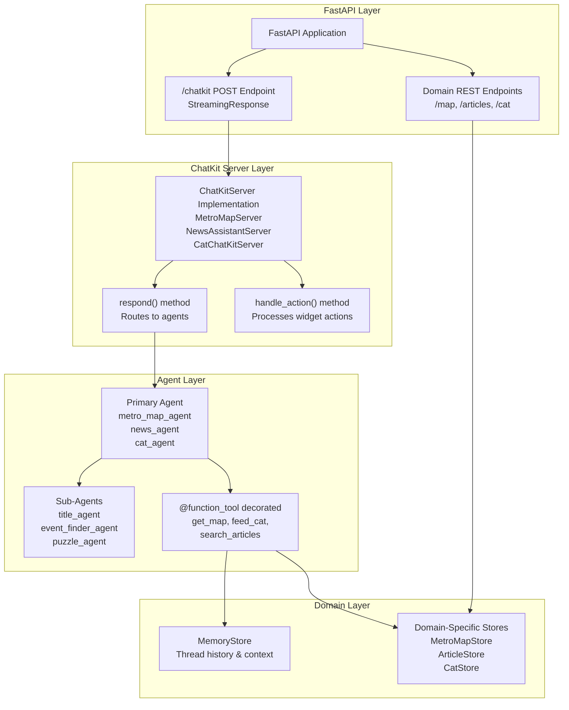
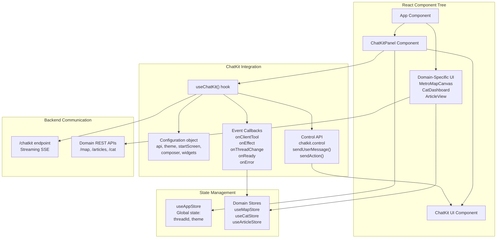
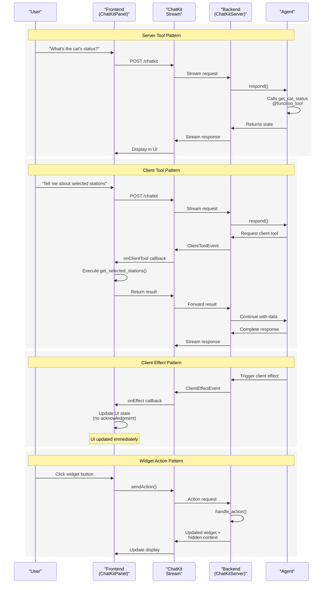
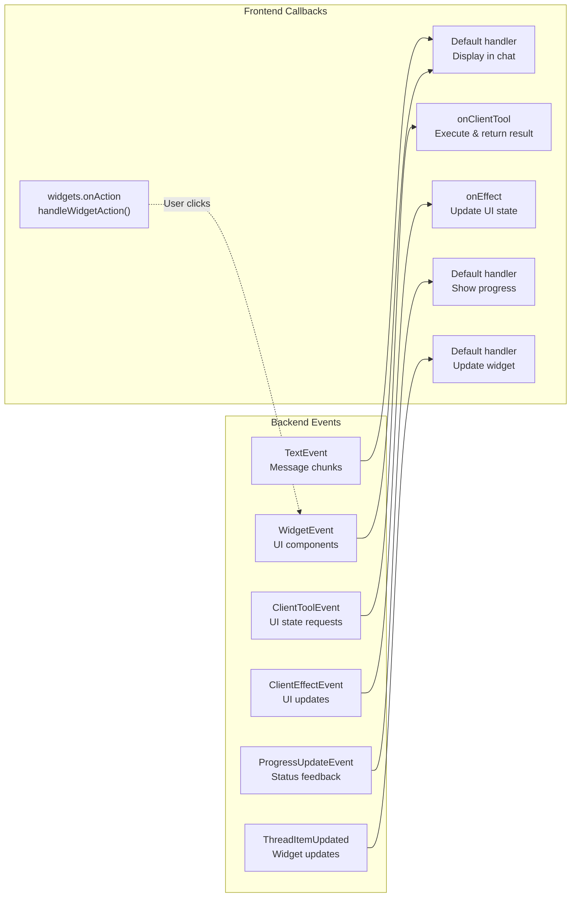

<!-- source: DeepWiki mcp.deepwiki.com · repo openai/openai-chatkit-advanced-samples · page 7 ChatKit Integration Guide · fetched 2026-10-26 -->

# ChatKit Integration Guide

<details>
<summary>Relevant source files</summary>

The following files were used as context for generating this wiki page:

- [README.md](README.md)
- [examples/cat-lounge/README.md](examples/cat-lounge/README.md)
- [examples/cat-lounge/frontend/src/components/ChatKitPanel.tsx](examples/cat-lounge/frontend/src/components/ChatKitPanel.tsx)
- [examples/metro-map/README.md](examples/metro-map/README.md)

</details>


This document provides a comprehensive guide to integrating OpenAI ChatKit in full-stack applications, as demonstrated by the four example applications in this repository. It covers the core integration patterns, communication flows, and architectural decisions that enable bidirectional interaction between AI agents and user interfaces.

**Scope**: This page focuses on how ChatKit SDK components integrate with application code to enable AI-powered conversational interfaces. For detailed implementation guidance on specific features, see:
- Server tools: [Server Tools](#7.1)
- Client tools: [Client Tools](#7.2)
- Client effects: [Client Effects](#7.3)
- Widget actions: [Widget Actions](#7.4)
- Entity tags: [Entity Tags and @-mentions](#7.5)
- Thread management: [Thread Management](#7.6)
- Progress updates and annotations: [Progress Updates and Annotations](#7.7)

For architecture patterns common across all examples, see [Common Architecture](#3). For example-specific implementations, see [Metro Map](#4), [Cat Lounge](#5), and [News Guide](#6).

---

## ChatKit SDK Components

ChatKit integration requires two SDK packages that work in tandem:

### Backend: ChatKit Python SDK

The backend uses the `openai-chatkit` Python package (versions 1.4.0-2.0) which provides:

- **`ChatKitServer`** base class for implementing custom servers
- **`@function_tool`** decorator for defining agent tools
- **`Agent`** class for creating conversational AI agents
- **Event types** for streaming responses (ProgressUpdateEvent, ClientEffectEvent, etc.)
- **`WidgetRoot`** for building interactive UI components

All backend implementations inherit from `ChatKitServer` and implement the `respond` method to handle incoming chat requests.

### Frontend: ChatKit.js React Library

The frontend uses `@openai/chatkit-react` (version ^1.3.0) which provides:

- **`useChatKit`** hook for initializing and configuring the ChatKit client
- **`ChatKit`** React component for rendering the chat interface
- **Event callbacks** (onClientTool, onEffect, onAction, onThreadChange, onReady, onError)
- **Control API** for programmatic interaction (sendUserMessage, sendAction)

**Sources**: 
- [README.md:1-4]()
- All pyproject.toml files
- All package.json files

---

## Backend Integration Architecture



**Backend Integration Flow**:

1. **FastAPI routes** `/chatkit` requests to the ChatKitServer implementation
2. **ChatKitServer.respond()** method processes chat requests and routes to appropriate agents
3. **Agents** use `@function_tool` decorated functions to access application data
4. **Tools** query MemoryStore for conversation history and domain stores for application state
5. **Streaming responses** return events (text, widgets, effects) to the client

**Key Code Entities**:
- `ChatKitServer` base class implementations in `server.py` files
- `respond(request, context)` method signature in all server implementations
- `handle_action(action, thread_id, widget_item_id)` for widget interactions
- Agent instances created with `Agent.from_model()` factory method

**Sources**:
- [README.md:3-11]()
- All backend/app/server.py files across examples
- All backend/app/agents/*_agent.py files

---

## Frontend Integration Architecture



**Frontend Integration Flow**:

1. **ChatKitPanel component** initializes ChatKit using the `useChatKit` hook
2. **Configuration object** sets API URL, theme, and enables callbacks
3. **Event callbacks** handle server events and update application state
4. **Control API** enables programmatic interaction with ChatKit
5. **State updates** propagate to domain-specific UI components

**Key Code Entities**:
- `useChatKit()` hook initialization in ChatKitPanel.tsx files
- `chatkit.control` object for programmatic control
- Callback functions: `onClientTool`, `onEffect`, `onAction` (via widgets.onAction)
- `chatkit.sendUserMessage()` and `chatkit.sendAction()` methods

**Sources**:
- [examples/cat-lounge/frontend/src/components/ChatKitPanel.tsx:1-153]()
- All frontend/src/components/ChatKitPanel.tsx files across examples
- All frontend/src/store/*.ts files

---

## Communication Patterns Overview

ChatKit enables four distinct communication patterns between frontend and backend:

| Pattern | Direction | Purpose | Response Required | Example Use Case |
|---------|-----------|---------|-------------------|------------------|
| **Server Tools** | Frontend → Backend | Query application data for agent inference | Synchronous (agent waits) | `get_cat_status`, `get_map`, `search_articles` |
| **Client Tools** | Backend → Frontend → Backend | Query UI state during agent execution | Synchronous (agent waits) | `get_selected_stations` |
| **Client Effects** | Backend → Frontend | Update UI state without agent blocking | Fire-and-forget | `update_cat_status`, `location_select_mode`, `add_station` |
| **Widget Actions** | User → Frontend → Backend | Process user interactions with widgets | Optional response | `line.select`, `cats.select_name`, `view_event_details` |

### Pattern Comparison Diagram



**Sources**:
- [README.md:27-95]()

---

## Feature Demonstration Matrix

Each example application demonstrates specific ChatKit integration patterns:

### Cat Lounge Features

| Feature | Code Location | Purpose |
|---------|---------------|---------|
| **Server Tools** | [cat_agent.py]() | `get_cat_status`, `feed_cat`, `play_with_cat`, `clean_cat` |
| **Client Effects** | [cat_agent.py](), [ChatKitPanel.tsx:86-103]() | `update_cat_status`, `cat_say` for UI sync |
| **Presentation Widgets** | [profile_card_widget.py]() | `show_cat_profile` displays cat stats |
| **Interactive Widgets** | [name_suggestions_widget.py]() | Name selection with client actions |
| **Client-Handled Actions** | [ChatKitPanel.tsx:50-84]() | `cats.select_name`, `cats.more_names` |
| **Server-Handled Actions** | [server.py]() | `cats.select_name` updates name and widget |
| **Thread Titles** | [cat_agent.py]() | `set_cat_name` updates thread title |
| **Quick Actions** | [App.tsx]() | `sendUserMessage()` for canned prompts |

### Metro Map Features

| Feature | Code Location | Purpose |
|---------|---------------|---------|
| **Server Tools** | [metro_map_agent.py]() | `get_map`, `list_lines`, `get_station`, `plan_route` |
| **Client Tools** | [metro_map_agent.py](), [ChatKitPanel.tsx]() | `get_selected_stations` queries UI state |
| **Client Effects** | [server.py](), [ChatKitPanel.tsx]() | `location_select_mode`, `add_station` |
| **Interactive Widgets** | [line_select_widget.py]() | Line picker with `line.select` action |
| **Server-Handled Actions** | [server.py]() | `line.select` adds hidden context |
| **Entity Tags** | [ChatKitPanel.tsx](), [thread_item_converter.py]() | @-mention stations with `<STATION_TAG>` |
| **Annotations** | [metro_map_agent.py]() | Entity sources on route planning responses |
| **Progress Updates** | [metro_map_agent.py]() | During `get_map` and `get_selected_stations` |
| **Response Lifecycle** | [ChatKitPanel.tsx]() | `onResponseStart`, `onResponseEnd` lock canvas |
| **Custom Header** | [ChatKitPanel.tsx]() | Theme toggle action in header |
| **Thread Titles** | [title_agent.py]() | Dynamic title generation on first turn |

### News Guide Features

| Feature | Code Location | Purpose |
|---------|---------------|---------|
| **Server Tools** | [news_agent.py]() | `search_articles`, `get_article_by_id`, `get_current_page` |
| **Page Awareness** | [ChatKitPanel.tsx](), [main.py]() | `article-id` header for context |
| **Tool Choice** | [ChatKitPanel.tsx](), [server.py]() | Composer menu routes to specialized agents |
| **Progress Updates** | [news_agent.py](), [event_finder_agent.py]() | Search and scan feedback |
| **Interactive Widgets** | [article_list_widget.py](), [event_list_widget.py]() | Article/event lists with actions |
| **Client-Handled Actions** | [ChatKitPanel.tsx]() | `open_article` for navigation |
| **Server-Handled Actions** | [server.py]() | `view_event_details` expands inline |
| **Entity Tags** | [ChatKitPanel.tsx](), [thread_item_converter.py]() | @-mention articles/authors |
| **Thread Titles** | [title_agent.py]() | Newsroom-friendly title generation |

**Sources**:
- [README.md:28-132]()
- [examples/metro-map/README.md:18-28]()
- [examples/cat-lounge/README.md:19-27]()

---

## Integration Configuration

### Backend Configuration

Backend servers inherit from `ChatKitServer` and implement required methods:

```python
# Common pattern across all examples
class MyServer(ChatKitServer):
    def respond(self, request: Request, context: RequestContext):
        # Route to appropriate agent
        # Return streaming response
        pass
    
    async def handle_action(self, action, thread_id, widget_item_id):
        # Process widget actions
        # Return updated widgets and/or hidden context
        pass
```

**Key Configuration Points**:
- FastAPI endpoint at `/chatkit` returns `StreamingResponse`
- Domain-specific REST endpoints for frontend data fetching
- CORS configuration for local development
- Environment variable `OPENAI_API_KEY` for AI model access

**Server Implementation Locations**:
- [examples/metro-map/backend/app/server.py]()
- [examples/cat-lounge/backend/app/server.py]()
- [examples/news-guide/backend/app/server.py]()

### Frontend Configuration

Frontend integration uses `useChatKit` hook with configuration object:

| Configuration Key | Purpose | Example Values |
|-------------------|---------|----------------|
| `api.url` | ChatKit endpoint URL | `"http://localhost:5170/chatkit"` |
| `api.domainKey` | Domain key for authentication | `"domain_pk_local_dev"` |
| `theme` | Visual styling | `{ colorScheme: "dark" \| "light" }` |
| `startScreen` | Initial UI state | `{ greeting, prompts }` |
| `composer` | Input configuration | `{ placeholder, tools }` |
| `widgets.onAction` | Widget action handler | Callback function |
| `onClientTool` | Client tool handler | Callback function |
| `onEffect` | Client effect handler | Callback function |
| `onThreadChange` | Thread ID updates | Callback function |
| `onReady` | Initialization complete | Callback function |
| `onError` | Error handling | Callback function |

**Frontend Configuration Locations**:
- [examples/cat-lounge/frontend/src/components/ChatKitPanel.tsx:105-145]()
- All frontend/src/components/ChatKitPanel.tsx files
- All frontend/src/lib/config.ts files

**Sources**:
- [examples/cat-lounge/frontend/src/components/ChatKitPanel.tsx:1-153]()
- All backend/app/server.py files
- All backend/app/main.py files

---

## Event-Driven Integration Model

ChatKit uses an event-driven model where the backend streams events and the frontend responds via callbacks:



**Event Types to Code Mapping**:

| Backend Event | Frontend Handler | Code Reference |
|---------------|------------------|----------------|
| Text streaming | Auto-handled by ChatKit | Default behavior |
| `WidgetEvent` | Auto-displayed in thread | Created by widget builders |
| `ClientToolEvent` | `onClientTool(tool, params)` | [ChatKitPanel.tsx:onClientTool]() |
| `ClientEffectEvent` | `onEffect(name, data)` | [ChatKitPanel.tsx:86-103]() |
| `ProgressUpdateEvent` | Auto-displayed progress | Created by agents |
| User widget click | `widgets.onAction(action, widgetItem)` | [ChatKitPanel.tsx:50-84]() |

**Sources**:
- [README.md:27-95]()
- [examples/cat-lounge/frontend/src/components/ChatKitPanel.tsx:86-145]()

---

## Programmatic Control API

The `useChatKit` hook returns a control object for programmatic interaction:

### Core Control Methods

| Method | Signature | Purpose | Example Usage |
|--------|-----------|---------|---------------|
| `sendUserMessage` | `(message: {text: string})` | Send message as user | Quick actions, automated flows |
| `sendAction` | `(action, widgetItemId)` | Send widget action to server | Server-handled widget actions |
| `sendCustomAction` | Alias for `sendAction` | Same as above | Legacy compatibility |

**Usage Examples**:

```typescript
// Send canned message (Cat Lounge quick actions)
chatkit.sendUserMessage({ text: "Feed the cat" });

// Send server action from client handler (Cat Lounge name selection)
await chatkit.sendCustomAction(action, widgetItem.id);
```

**Control API Locations**:
- [examples/cat-lounge/frontend/src/components/ChatKitPanel.tsx:62-74]()
- [examples/cat-lounge/frontend/src/App.tsx]() for quick actions

**Sources**:
- [examples/cat-lounge/frontend/src/components/ChatKitPanel.tsx:50-84]()
- [README.md:26]()

---

## Summary

ChatKit integration follows a consistent pattern across all examples:

1. **Backend** inherits from `ChatKitServer`, implements `respond()` and optionally `handle_action()`
2. **Frontend** uses `useChatKit()` hook with configuration object and event callbacks
3. **Communication** flows through four patterns: server tools, client tools, client effects, widget actions
4. **Events** stream from backend to frontend via SSE, frontend responds via callbacks
5. **State** managed separately in domain-specific stores, synchronized via callbacks

For detailed implementation of each feature, see the child pages:
- [Server Tools](#7.1) - `@function_tool` decorator and agent tools
- [Client Tools](#7.2) - Bidirectional UI state queries
- [Client Effects](#7.3) - Fire-and-forget UI updates
- [Widget Actions](#7.4) - Interactive component handling
- [Entity Tags and @-mentions](#7.5) - Structured entity references
- [Thread Management](#7.6) - Thread lifecycle and titles
- [Progress Updates and Annotations](#7.7) - Status feedback and entity sources

**Sources**:
- [README.md:1-132]()
- [examples/metro-map/README.md:1-28]()
- [examples/cat-lounge/README.md:1-27]()
- [examples/cat-lounge/frontend/src/components/ChatKitPanel.tsx:1-153]()

---

