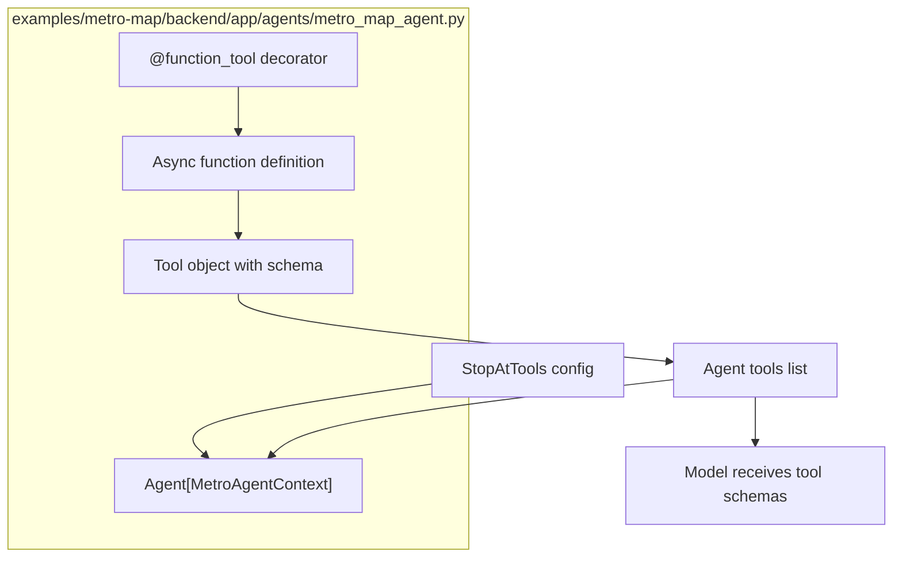
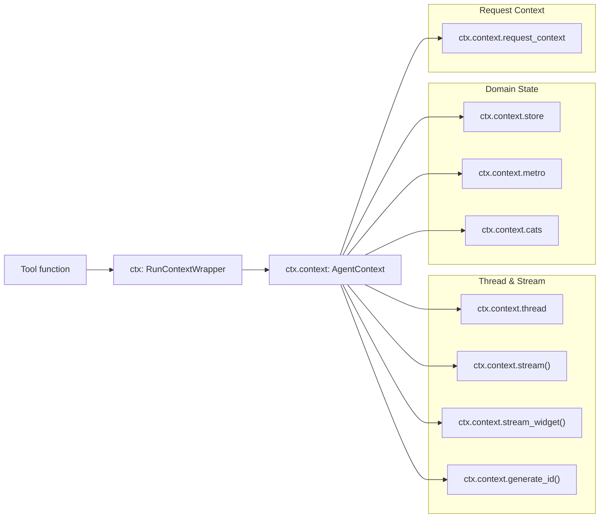
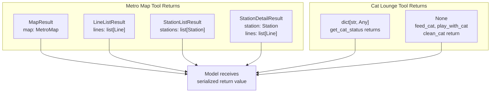
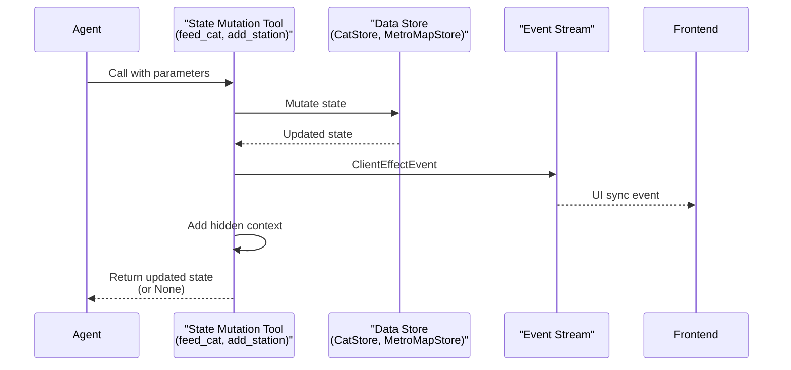
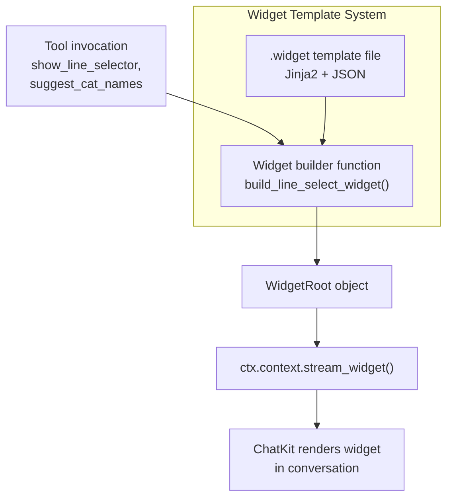
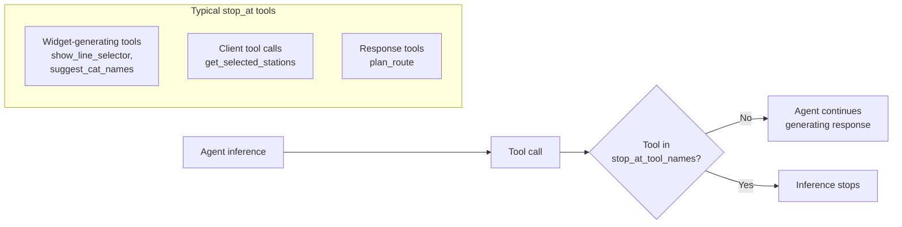
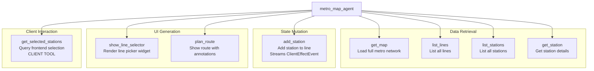
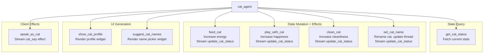

<!-- source: DeepWiki mcp.deepwiki.com · repo openai/openai-chatkit-advanced-samples · page 7.1 Server Tools · fetched 2026-10-26 -->

# Server Tools

<details>
<summary>Relevant source files</summary>

The following files were used as context for generating this wiki page:

- [README.md](README.md)
- [examples/cat-lounge/backend/app/cat_agent.py](examples/cat-lounge/backend/app/cat_agent.py)
- [examples/metro-map/backend/app/agents/metro_map_agent.py](examples/metro-map/backend/app/agents/metro_map_agent.py)

</details>


Server tools are backend functions that agents call during inference to retrieve application data, mutate state, or trigger UI updates. They are defined using the `@function_tool` decorator from the ChatKit Python SDK and execute on the server within the agent's runtime context.

**Scope**: This document covers synchronous server-side function tools. For client-side tools that query frontend state, see [Client Tools](#7.2). For fire-and-forget UI updates, see [Client Effects](#7.3). For user-triggered widget interactions, see [Widget Actions](#7.4).

---

## Function Tool Decorator

The `@function_tool` decorator converts Python async functions into tools that agents can invoke. The decorator inspects function signatures to generate JSON Schema descriptions that are passed to the model.

```python
from agents import function_tool, RunContextWrapper

@function_tool(
    description_override=(
        "Read the cat's current stats before deciding what to do next. No parameters."
    )
)
async def get_cat_status(
    ctx: RunContextWrapper[CatAgentContext],
) -> dict[str, Any]:
    state = await _get_state(ctx)
    return state.to_payload(ctx.context.thread.id)
```

**Key characteristics**:
- `description_override` provides model-facing documentation
- All tools receive a `RunContextWrapper[AgentContext]` parameter
- Return values must be JSON-serializable (typically Pydantic models or primitives)
- Tools can be async and perform I/O operations

**Sources**: [examples/cat-lounge/backend/app/cat_agent.py:125-137]()

---

## Tool Registration and Agent Configuration

Tools are registered with agents during initialization and included in the model's system prompt:



**Tool registration example**:

[examples/metro-map/backend/app/agents/metro_map_agent.py:286-313]()

The `Agent` constructor receives a `tools` list containing decorated function objects. The agent framework serializes each tool's signature and `description_override` into the model's system prompt.

**Sources**: [examples/metro-map/backend/app/agents/metro_map_agent.py:286-313](), [examples/cat-lounge/backend/app/cat_agent.py:368-396]()

---

## Tool Context and AgentContext

Every tool receives a `RunContextWrapper[AgentContext]` parameter that provides access to application state, thread metadata, and streaming primitives.

### AgentContext Subclasses

Each example defines a custom `AgentContext` subclass to inject domain-specific dependencies:

| Application | Context Class | Injected Dependencies |
|-------------|---------------|----------------------|
| Metro Map | `MetroAgentContext` | `store: MemoryStore`, `metro: MetroMapStore`, `request_context: RequestContext` |
| Cat Lounge | `CatAgentContext` | `store: MemoryStore`, `cats: CatStore`, `request_context: dict[str, Any]` |
| News Guide | `NewsAgentContext` | `store: MemoryStore`, `articles: ArticleStore`, `events: EventStore`, `request_context: RequestContext` |

**Example context definition**:

[examples/metro-map/backend/app/agents/metro_map_agent.py:77-82]()

```python
class MetroAgentContext(AgentContext):
    model_config = ConfigDict(arbitrary_types_allowed=True)
    store: Annotated[MemoryStore, Field(exclude=True)]
    metro: Annotated[MetroMapStore, Field(exclude=True)]
    request_context: Annotated[RequestContext, Field(exclude=True)]
```

The `Field(exclude=True)` annotation prevents these fields from being serialized into the model input.

### Accessing Context in Tools

Tools access dependencies through the context wrapper:



**Common context usage patterns**:

- **Thread ID**: `ctx.context.thread.id`
- **Thread metadata**: `ctx.context.thread.title`
- **Streaming events**: `await ctx.context.stream(event)`
- **Streaming widgets**: `await ctx.context.stream_widget(widget)`
- **ID generation**: `ctx.context.generate_id("message")`
- **Data stores**: `ctx.context.metro.get_map()`, `ctx.context.cats.load(thread_id)`

**Sources**: [examples/metro-map/backend/app/agents/metro_map_agent.py:77-82](), [examples/cat-lounge/backend/app/cat_agent.py:73-78]()

---

## Tool Return Values

Tools return data that the model uses to ground its response. Return types must be JSON-serializable.

### Structured Return Types

Tools typically return Pydantic models for type safety:



**Example return type definitions**:

[examples/metro-map/backend/app/agents/metro_map_agent.py:84-108]()

```python
class MapResult(BaseModel):
    map: MetroMap

class StationDetailResult(BaseModel):
    station: Station
    lines: list[Line]
```

**Tool returning structured data**:

[examples/metro-map/backend/app/agents/metro_map_agent.py:131-138]()

The model receives the serialized JSON of the return value and uses it to formulate responses.

### Tools Without Return Values

Tools that produce widgets or trigger client effects often return `None` or empty results:

[examples/cat-lounge/backend/app/cat_agent.py:145-154]()

These tools are configured to stop agent inference (see `StopAtTools` behavior below).

**Sources**: [examples/metro-map/backend/app/agents/metro_map_agent.py:84-108](), [examples/metro-map/backend/app/agents/metro_map_agent.py:131-138](), [examples/cat-lounge/backend/app/cat_agent.py:145-154]()

---

## Tool Categories and Execution Patterns

Server tools fall into four primary categories based on their behavior:

### 1. Data Retrieval Tools

Query application state without side effects:

| Application | Tool Name | Purpose | Return Type |
|-------------|-----------|---------|-------------|
| Metro Map | `get_map` | Load current metro network | `MapResult` |
| Metro Map | `list_lines` | List all metro lines | `LineListResult` |
| Metro Map | `list_stations` | List all stations | `StationListResult` |
| Cat Lounge | `get_cat_status` | Fetch cat stats | `dict[str, Any]` |
| News Guide | `get_article_by_id` | Retrieve article content | Article data |
| News Guide | `search_articles_by_tags` | Search by taxonomy | Article list |

**Example implementation**:

[examples/metro-map/backend/app/agents/metro_map_agent.py:131-138]()

```python
@function_tool(description_override=("Load the latest metro map with lines and stations. No parameters."))
async def get_map(ctx: RunContextWrapper[MetroAgentContext]) -> MapResult:
    logger.info("[TOOL CALL] get_map")
    metro_map = ctx.context.metro.get_map()
    await ctx.context.stream(ProgressUpdateEvent(text="Retrieving the latest metro map..."))
    return MapResult(map=metro_map)
```

**Sources**: [examples/metro-map/backend/app/agents/metro_map_agent.py:131-138](), [examples/cat-lounge/backend/app/cat_agent.py:125-137](), [README.md:28-38]()

### 2. State Mutation Tools

Modify application state and optionally trigger UI synchronization:



**Cat Lounge state mutation example**:

[examples/cat-lounge/backend/app/cat_agent.py:145-154]()

```python
@function_tool(description_override=("Feed the cat to replenish energy and keep moods stable.\n- `meal`: Meal or snack description to include in the update."))
async def feed_cat(ctx: RunContextWrapper[CatAgentContext], meal: str | None = None):
    logger.info("[TOOL CALL] feed_cat")
    state = await _update_state(ctx, lambda s: s.feed())
    flash = f"Fed {state.name} {meal}" if meal else f"{state.name} enjoyed a snack"
    await _add_hidden_context(ctx, f"<FED_CAT>{flash}</FED_CAT>")
    await _sync_status(ctx, state, flash)
```

The tool mutates state, adds hidden context to the thread, and streams a `ClientEffectEvent` to sync frontend state.

**Metro Map state mutation example**:

[examples/metro-map/backend/app/agents/metro_map_agent.py:228-265]()

The `add_station` tool updates the metro map, streams a `ClientEffectEvent` to highlight the new station on the canvas, and returns the updated map for the agent.

**Sources**: [examples/cat-lounge/backend/app/cat_agent.py:145-154](), [examples/metro-map/backend/app/agents/metro_map_agent.py:228-265]()

### 3. Widget-Generating Tools

Stream interactive UI components into the conversation:



**Metro Map widget tool**:

[examples/metro-map/backend/app/agents/metro_map_agent.py:110-128]()

```python
@function_tool(description_override=("Show a clickable widget listing metro lines.\n- `message`: Text shown above the widget to prompt the user."))
async def show_line_selector(ctx: RunContextWrapper[MetroAgentContext], message: str):
    widget = build_line_select_widget(ctx.context.metro.list_lines())
    await ctx.context.stream(ThreadItemDoneEvent(item=AssistantMessageItem(...)))
    await ctx.context.stream_widget(widget)
```

The tool streams a text message followed by the widget. For more on widget architecture, see [Widget System](#3.4).

**Sources**: [examples/metro-map/backend/app/agents/metro_map_agent.py:110-128](), [examples/cat-lounge/backend/app/cat_agent.py:327-365]()

### 4. Response Enhancement Tools

Generate assistant messages with annotations, entity sources, or progress updates:

**Route planning with annotations**:

[examples/metro-map/backend/app/agents/metro_map_agent.py:164-195]()

The `plan_route` tool creates an assistant message with `Annotation` objects containing `EntitySource` data for each station. These render as interactive citations in the UI.

**Progress updates during long operations**:

[examples/metro-map/backend/app/agents/metro_map_agent.py:136-137]()

```python
await ctx.context.stream(ProgressUpdateEvent(text="Retrieving the latest metro map..."))
```

The `ProgressUpdateEvent` displays a temporary status message while the tool executes. For more details, see [Progress Updates and Annotations](#7.7).

**Sources**: [examples/metro-map/backend/app/agents/metro_map_agent.py:164-195](), [examples/metro-map/backend/app/agents/metro_map_agent.py:136-137](), [README.md:59-64]()

---

## StopAtTools Behavior

Some tools should halt agent inference after execution to prevent redundant model responses:



**Metro Map StopAtTools configuration**:

[examples/metro-map/backend/app/agents/metro_map_agent.py:306-312]()

```python
tool_use_behavior=StopAtTools(
    stop_at_tool_names=[
        plan_route.name,
        show_line_selector.name,
        get_selected_stations.name,
    ]
)
```

**When to stop**:
- **Widget tools**: The widget is the response; no additional text needed
- **Client tools**: Must wait for client to return data before continuing
- **Effect tools**: The effect (like a route annotation) is the complete response

**Cat Lounge StopAtTools configuration**:

[examples/cat-lounge/backend/app/cat_agent.py:390-395]()

Tools like `feed_cat` are *not* in the stop list because the agent should describe the action outcome after mutating state.

**Sources**: [examples/metro-map/backend/app/agents/metro_map_agent.py:306-312](), [examples/cat-lounge/backend/app/cat_agent.py:390-395]()

---

## Complete Tool Examples by Application

### Metro Map Tools



| Tool | Parameters | Return Type | Behavior |
|------|-----------|-------------|----------|
| `get_map` | None | `MapResult` | Loads full metro network from `MetroMapStore` |
| `list_lines` | None | `LineListResult` | Lists all lines with colors and endpoints |
| `list_stations` | None | `StationListResult` | Lists all stations and their served lines |
| `get_station` | `station_id: str` | `StationDetailResult` | Retrieves single station with line info |
| `add_station` | `station_name: str`<br/>`line_id: str`<br/>`append: bool` | `MapResult` | Adds station to metro map, streams `ClientEffectEvent` |
| `show_line_selector` | `message: str` | None | Streams widget with line selection UI |
| `plan_route` | `route: list[Station]`<br/>`message: str` | None | Streams message with entity annotations |
| `get_selected_stations` | None | `SelectedStationsResult` | **Client tool**: queries frontend for selection |

**Sources**: [examples/metro-map/backend/app/agents/metro_map_agent.py:110-313](), [README.md:34-38]()

### Cat Lounge Tools



| Tool | Parameters | Return Type | Behavior |
|------|-----------|-------------|----------|
| `get_cat_status` | None | `dict[str, Any]` | Retrieves current cat stats from `CatStore` |
| `feed_cat` | `meal: str \| None` | None | Mutates cat energy, streams `update_cat_status` effect |
| `play_with_cat` | `activity: str \| None` | None | Mutates cat happiness, streams `update_cat_status` effect |
| `clean_cat` | `method: str \| None` | None | Mutates cat cleanliness, streams `update_cat_status` effect |
| `set_cat_name` | `name: str` | None | Renames cat, updates thread title, streams effect |
| `show_cat_profile` | `age: int \| None`<br/>`favorite_toy: str \| None` | None | Streams profile card widget |
| `suggest_cat_names` | `suggestions: list[CatNameSuggestion]` | None | Streams name picker widget with options |
| `speak_as_cat` | `line: str` | None | Streams `cat_say` client effect to show speech bubble |

**Sources**: [examples/cat-lounge/backend/app/cat_agent.py:125-396](), [README.md:29-30]()

### News Guide Tools

Based on README documentation:

| Tool | Purpose | Example Use Case |
|------|---------|------------------|
| `get_article_by_id` | Fetch full article content | Resolve @-mentioned articles or tagged references |
| `search_articles_by_tags` | Search by taxonomy tags | "Find articles about technology" |
| `search_articles_by_keywords` | Search by keyword terms | "Find articles mentioning 'election'" |
| `search_articles_by_exact_text` | Search by exact phrase | "Find articles with 'climate change'" |
| `list_available_tags_and_keywords` | List searchable terms | Help agent understand available taxonomy |
| `get_current_page` | Load article from request context | "Summarize this article" (page-aware) |
| `show_article_list_widget` | Render search results widget | Display article results with "View" buttons |

**Progress updates**: News Guide tools stream `ProgressUpdateEvent` during searches to keep users informed of retrieval progress.

**Sources**: [README.md:31-33](), [README.md:54-62]()

---

## Tool Implementation Pattern Summary

All server tools follow a consistent pattern:

1. **Decorator**: `@function_tool(description_override=...)`
2. **Context parameter**: `ctx: RunContextWrapper[CustomAgentContext]`
3. **Data access**: `ctx.context.store`, `ctx.context.metro`, etc.
4. **Optional streaming**: `await ctx.context.stream(ProgressUpdateEvent(...))`
5. **Return value**: Pydantic model or None for agent consumption
6. **Registration**: Add to `Agent(tools=[...])` list
7. **Stop behavior**: Configure `tool_use_behavior=StopAtTools(...)` if needed

**Example template**:

```python
@function_tool(description_override="Tool description for the model")
async def my_tool(
    ctx: RunContextWrapper[MyAgentContext],
    param1: str,
    param2: int | None = None,
) -> MyResultType:
    # Access application state
    data = ctx.context.my_store.query(param1)
    
    # Optional progress indicator
    await ctx.context.stream(ProgressUpdateEvent(text="Processing..."))
    
    # Return structured data for agent
    return MyResultType(result=data)
```

**Sources**: [examples/metro-map/backend/app/agents/metro_map_agent.py:110-313](), [examples/cat-lounge/backend/app/cat_agent.py:125-396]()

---

