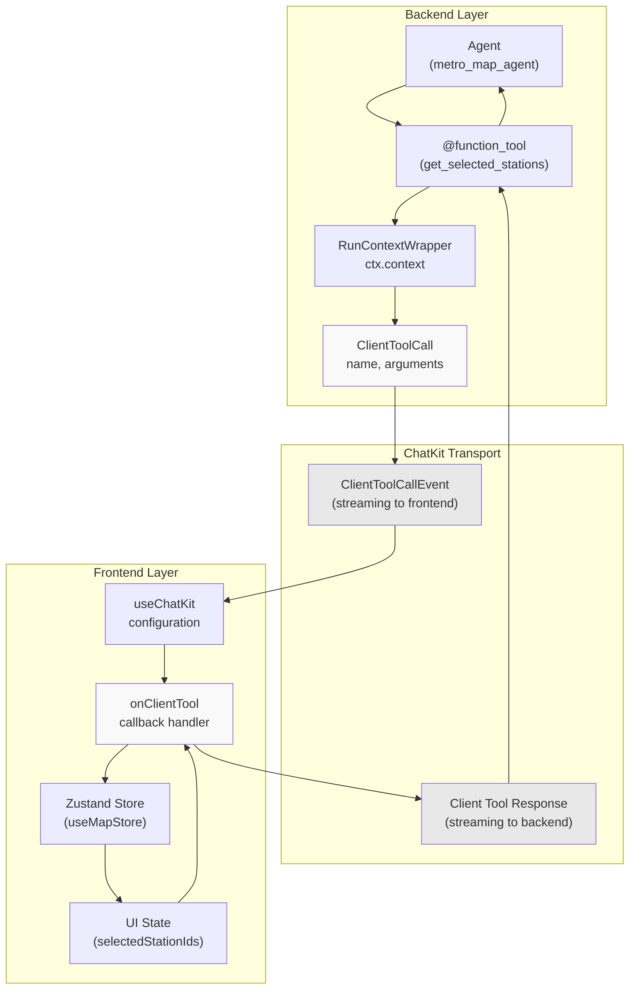
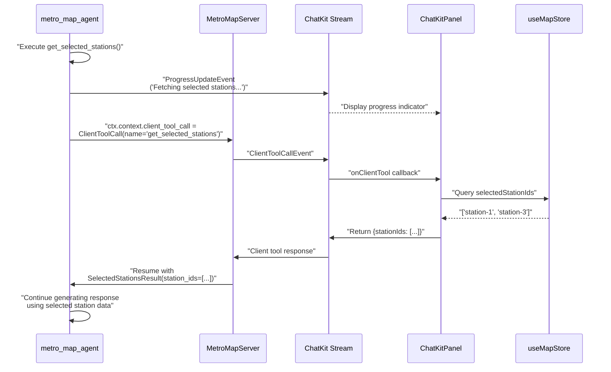

<!-- source: DeepWiki mcp.deepwiki.com · repo openai/openai-chatkit-advanced-samples · page 7.2 Client Tools · fetched 2026-10-26 -->

# Client Tools

<details>
<summary>Relevant source files</summary>

The following files were used as context for generating this wiki page:

- [README.md](README.md)
- [examples/metro-map/backend/app/agents/metro_map_agent.py](examples/metro-map/backend/app/agents/metro_map_agent.py)
- [examples/metro-map/frontend/src/components/ChatKitPanel.tsx](examples/metro-map/frontend/src/components/ChatKitPanel.tsx)

</details>


Client tools enable agents to query UI state that exists only in the frontend. Unlike server tools that query backend data stores, client tools request information from the browser, creating a round-trip communication pattern where the agent waits for the frontend to return data before continuing its response.

For information about server-side function tools, see [Server Tools](#7.1). For fire-and-forget UI updates that don't require a response, see [Client Effects](#7.3).

---

## Overview

Client tools solve the problem of grounding agent responses in client-side application state. When an agent needs information that only the frontend knows—such as which items are currently selected, what viewport is visible, or what filters are applied—it can invoke a client tool to fetch that data synchronously.

The key distinction from server tools:

| Aspect | Server Tools | Client Tools |
|--------|--------------|--------------|
| **Execution location** | Backend process | Frontend browser |
| **Data source** | Backend stores, databases, APIs | UI state, DOM, browser state |
| **Communication** | Synchronous function call | Round-trip server→client→server |
| **Agent behavior** | Continues immediately | Waits for client response |
| **Declaration** | `@function_tool` decorator | `ClientToolCall` object |

**Sources:** [examples/metro-map/backend/app/agents/metro_map_agent.py:268-283](), [examples/metro-map/frontend/src/components/ChatKitPanel.tsx:119-128](), [README.md:39-42]()

---

## Client Tool Architecture



**Diagram: Client Tool Request-Response Flow**

The backend agent invokes a function tool that sets a `ClientToolCall` object on the context. This triggers a streaming event to the frontend, which is routed to the `onClientTool` callback. The callback queries local state (typically from Zustand stores) and returns data, which streams back to the backend to resume agent execution.

**Sources:** [examples/metro-map/backend/app/agents/metro_map_agent.py:8,268-283](), [examples/metro-map/frontend/src/components/ChatKitPanel.tsx:155-211]()

---

## Backend Implementation

### Defining a Client Tool

Client tools are declared as regular function tools using the `@function_tool` decorator. The critical difference is that instead of returning actual data, they set `ctx.context.client_tool_call` to trigger a frontend request:

```python
from chatkit.agents import ClientToolCall

@function_tool(
    description_override=(
        "Fetch the ids of the currently selected stations from the client UI. No parameters."
    )
)
async def get_selected_stations(
    ctx: RunContextWrapper[MetroAgentContext],
) -> SelectedStationsResult:
    logger.info("[TOOL CALL] get_selected_stations")
    await ctx.context.stream(ProgressUpdateEvent(text="Fetching selected stations from the map..."))
    ctx.context.client_tool_call = ClientToolCall(
        name="get_selected_stations",
        arguments={},
    )
    return SelectedStationsResult(station_ids=[])
```

**Key implementation details:**

| Element | Purpose |
|---------|---------|
| `ClientToolCall(name, arguments)` | Specifies the tool name and parameters for the frontend |
| `ctx.context.client_tool_call` | Assignment triggers the client request event |
| Return value (`station_ids=[]`) | Placeholder; actual data comes from client response |
| `ProgressUpdateEvent` | Optional UI feedback during the wait |

**Sources:** [examples/metro-map/backend/app/agents/metro_map_agent.py:268-283]()

### ClientToolCall Configuration

The `ClientToolCall` object accepts two parameters:

```python
ClientToolCall(
    name="get_selected_stations",  # Must match frontend handler
    arguments={},                   # Optional parameters for frontend
)
```

The `name` field is used by the frontend's `onClientTool` callback to route the request. The `arguments` dictionary can pass parameters if the frontend needs additional context (e.g., filtering criteria, viewport bounds).

**Sources:** [examples/metro-map/backend/app/agents/metro_map_agent.py:279-282]()

### Progress Updates During Client Tools

Since client tools require a round-trip, they may take noticeable time. Streaming a `ProgressUpdateEvent` before setting `client_tool_call` provides user feedback:

```python
await ctx.context.stream(ProgressUpdateEvent(text="Fetching selected stations from the map..."))
ctx.context.client_tool_call = ClientToolCall(...)
```

This progress message displays in the ChatKit UI while the system waits for the frontend response.

**Sources:** [examples/metro-map/backend/app/agents/metro_map_agent.py:278-282](), [README.md:63-64]()

---

## Frontend Implementation

### onClientTool Callback

The `useChatKit` hook accepts an `onClientTool` callback that receives client tool requests:

```typescript
const handleClientTool = useCallback(
  ({name, params}: { name: string; params: Record<string, unknown> }) => {
    if (name === "get_selected_stations") {
      return { stationIds: selectedStationIds };
    }
  },
  [selectedStationIds]
);

const chatkit = useChatKit({
  // ... other config
  onClientTool: handleClientTool,
});
```

**Parameters:**

| Field | Type | Description |
|-------|------|-------------|
| `name` | `string` | Tool name from `ClientToolCall.name` |
| `params` | `Record<string, unknown>` | Arguments from `ClientToolCall.arguments` |

**Return value:** The callback must return a serializable object that will be sent back to the backend and become the function tool's actual return value.

**Sources:** [examples/metro-map/frontend/src/components/ChatKitPanel.tsx:119-128,193]()

### Accessing UI State

Client tool handlers typically query Zustand stores or component state:

```typescript
const handleClientTool = useCallback(
  ({name}: { name: string; params: Record<string, unknown> }) => {
    if (name === "get_selected_stations") {
      return { stationIds: selectedStationIds };  // From useMapStore
    }
  },
  [selectedStationIds]
);
```

The `useCallback` dependency array ensures the handler always sees current state values.

**Sources:** [examples/metro-map/frontend/src/components/ChatKitPanel.tsx:46,119-128]()

### Handler Routing Pattern

When multiple client tools exist, use a switch-case or if-else chain to route by `name`:

```typescript
const handleClientTool = useCallback(
  ({name, params}: { name: string; params: Record<string, unknown> }) => {
    if (name === "get_selected_stations") {
      return { stationIds: selectedStationIds };
    }
    if (name === "get_viewport_bounds") {
      return { bounds: currentViewport };
    }
    // Return undefined or throw for unknown tools
  },
  [selectedStationIds, currentViewport]
);
```

**Sources:** [examples/metro-map/frontend/src/components/ChatKitPanel.tsx:119-128]()

---

## Communication Flow



**Diagram: Client Tool Round-Trip Sequence**

The agent initiates the request by setting `client_tool_call`, which streams to the frontend. The frontend queries its Zustand store and returns data, which streams back to resume agent execution. The entire round-trip is synchronous from the agent's perspective—it waits for the frontend response before continuing.

**Sources:** [examples/metro-map/backend/app/agents/metro_map_agent.py:273-283](), [examples/metro-map/frontend/src/components/ChatKitPanel.tsx:119-128]()

---

## Complete Example: get_selected_stations

The Metro Map application demonstrates client tools by allowing the agent to query which stations the user has selected on the canvas.

### Backend Declaration

[examples/metro-map/backend/app/agents/metro_map_agent.py:268-283]()

```python
class SelectedStationsResult(BaseModel):
    station_ids: list[str]

@function_tool(
    description_override=(
        "Fetch the ids of the currently selected stations from the client UI. No parameters."
    )
)
async def get_selected_stations(
    ctx: RunContextWrapper[MetroAgentContext],
) -> SelectedStationsResult:
    logger.info("[TOOL CALL] get_selected_stations")
    await ctx.context.stream(ProgressUpdateEvent(text="Fetching selected stations from the map..."))
    ctx.context.client_tool_call = ClientToolCall(
        name="get_selected_stations",
        arguments={},
    )
    return SelectedStationsResult(station_ids=[])
```

The function returns a placeholder `SelectedStationsResult` with an empty list. The actual `station_ids` are populated from the frontend response.

**Sources:** [examples/metro-map/backend/app/agents/metro_map_agent.py:106-108,268-283]()

### Agent Registration

[examples/metro-map/backend/app/agents/metro_map_agent.py:286-313]()

```python
metro_map_agent = Agent[MetroAgentContext](
    name="metro_map",
    instructions=INSTRUCTIONS,
    model="gpt-4o-mini",
    tools=[
        # ... other tools
        get_selected_stations,
    ],
    tool_use_behavior=StopAtTools(
        stop_at_tool_names=[
            # ... other stop-at tools
            get_selected_stations.name,
        ]
    ),
)
```

The tool is registered with `StopAtTools` behavior because the agent should stop generating after requesting client data, allowing the response to resume once data arrives.

**Sources:** [examples/metro-map/backend/app/agents/metro_map_agent.py:286-313]()

### Agent Instructions

[examples/metro-map/backend/app/agents/metro_map_agent.py:73-74]()

The agent instructions document the tool:

```
When the user mentions "selected stations" or asks about the current selection, 
call `get_selected_stations` to fetch the station ids from the client.
```

This guides the agent to invoke the client tool when user messages reference selections.

**Sources:** [examples/metro-map/backend/app/agents/metro_map_agent.py:28-74]()

### Frontend Handler

[examples/metro-map/frontend/src/components/ChatKitPanel.tsx:119-128]()

```typescript
const handleClientTool = useCallback(
  ({name}: { name: string; params: Record<string, unknown> }) => {
    if (name === "get_selected_stations") {
      return { stationIds: selectedStationIds };
    }
  },
  [selectedStationIds]
);
```

The handler queries `selectedStationIds` from the `useMapStore` Zustand store (line 46) and returns it in the expected format.

**Sources:** [examples/metro-map/frontend/src/components/ChatKitPanel.tsx:46,119-128]()

### Store State

[examples/metro-map/frontend/src/store/useMapStore.ts]()

The `useMapStore` maintains `selectedStationIds` as an array of station ID strings, updated when users click stations on the canvas. This state is the source of truth for the client tool.

**Sources:** [examples/metro-map/frontend/src/store/useMapStore.ts]()

---

## Best Practices

### When to Use Client Tools

**Use client tools when:**
- Data exists only in browser state (selections, viewport, filters)
- State is ephemeral and not persisted to backend
- Real-time UI state affects agent logic (e.g., "analyze these selected items")

**Use server tools when:**
- Data is persisted in backend stores or databases
- Multiple clients need consistent data access
- Data requires backend computation or authorization

**Sources:** [README.md:39-42](), [examples/metro-map/backend/app/agents/metro_map_agent.py:73-74]()

### Naming Conventions

Match the `ClientToolCall.name` exactly to the frontend handler routing:

```python
# Backend
ctx.context.client_tool_call = ClientToolCall(name="get_selected_stations", ...)

# Frontend
if (name === "get_selected_stations") { ... }
```

Use descriptive, action-oriented names like `get_*`, `query_*`, `fetch_*` to clarify intent.

**Sources:** [examples/metro-map/backend/app/agents/metro_map_agent.py:279-282](), [examples/metro-map/frontend/src/components/ChatKitPanel.tsx:123]()

### Return Value Typing

Define Pydantic models for return values on both sides to ensure type safety:

```python
# Backend
class SelectedStationsResult(BaseModel):
    station_ids: list[str]

# Frontend return value must match
return { stationIds: selectedStationIds };
```

Note the casing difference: Python uses `snake_case`, TypeScript uses `camelCase`. The ChatKit framework handles serialization.

**Sources:** [examples/metro-map/backend/app/agents/metro_map_agent.py:106-108](), [examples/metro-map/frontend/src/components/ChatKitPanel.tsx:124]()

### Error Handling

If the frontend cannot fulfill a client tool request, return an error indicator:

```typescript
if (name === "get_selected_stations") {
  if (selectedStationIds.length === 0) {
    return { stationIds: [], error: "No stations selected" };
  }
  return { stationIds: selectedStationIds };
}
```

The agent can check the error field and respond appropriately.

**Sources:** [examples/metro-map/frontend/src/components/ChatKitPanel.tsx:119-128]()

### Progress Feedback

Always emit a progress update before setting `client_tool_call` to inform users of the delay:

```python
await ctx.context.stream(ProgressUpdateEvent(text="Fetching..."))
ctx.context.client_tool_call = ClientToolCall(...)
```

Without this, the UI may appear frozen during the round-trip.

**Sources:** [examples/metro-map/backend/app/agents/metro_map_agent.py:278-279](), [README.md:63-64]()

### StopAtTools Behavior

Register client tools with `StopAtTools` to prevent the agent from continuing before receiving data:

```python
tool_use_behavior=StopAtTools(
    stop_at_tool_names=[get_selected_stations.name]
)
```

This ensures the agent waits for the frontend response rather than hallucinating data.

**Sources:** [examples/metro-map/backend/app/agents/metro_map_agent.py:306-312]()

---

