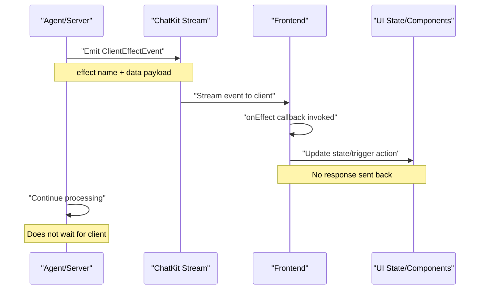
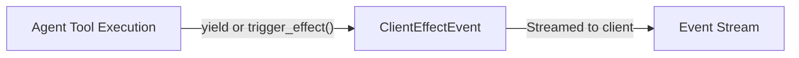
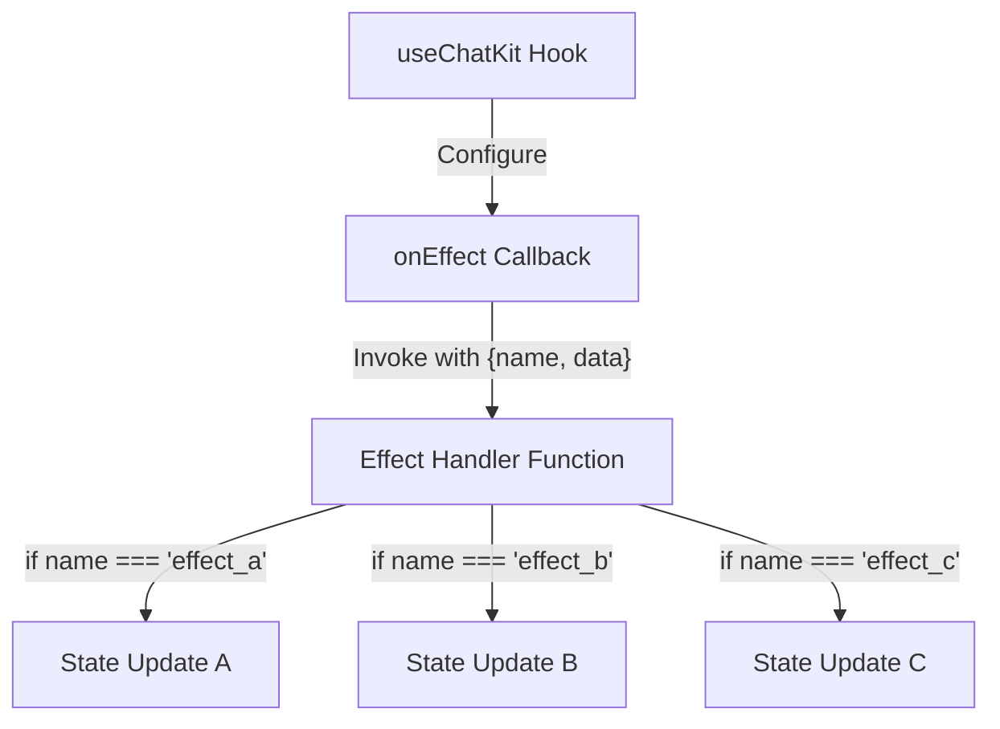
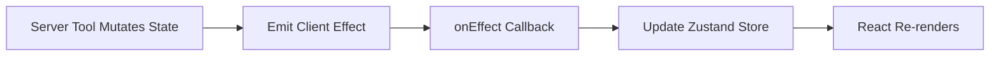
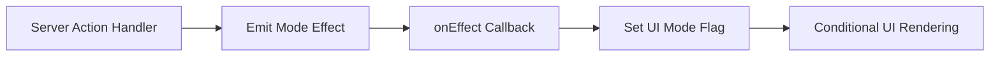
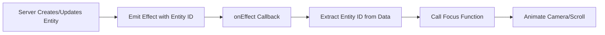

<!-- source: DeepWiki mcp.deepwiki.com · repo openai/openai-chatkit-advanced-samples · page 7.3 Client Effects · fetched 2026-10-26 -->

# Client Effects

<details>
<summary>Relevant source files</summary>

The following files were used as context for generating this wiki page:

- [README.md](README.md)
- [examples/cat-lounge/README.md](examples/cat-lounge/README.md)
- [examples/cat-lounge/frontend/src/components/ChatKitPanel.tsx](examples/cat-lounge/frontend/src/components/ChatKitPanel.tsx)
- [examples/metro-map/README.md](examples/metro-map/README.md)
- [examples/metro-map/frontend/src/components/ChatKitPanel.tsx](examples/metro-map/frontend/src/components/ChatKitPanel.tsx)

</details>


This document describes client effects, a fire-and-forget communication pattern that allows the backend to trigger UI updates without waiting for acknowledgment. Client effects are one-way actions streamed from the server to update client-side state, display notifications, or change UI modes during agent responses.

For information about client tools (which require a response), see [Client Tools](#7.2). For information about widget actions, see [Widget Actions](#7.4).

---

## Overview

Client effects provide a mechanism for the backend to update the frontend UI in real-time without blocking the agent's response flow. Unlike client tools, which request information from the client and wait for a result, client effects are **fire-and-forget**: the server streams an effect event, the client handles it, and no response is sent back.

### Key Characteristics

| Aspect | Description |
|--------|-------------|
| **Direction** | Server → Client (one-way) |
| **Response** | None (fire-and-forget) |
| **Timing** | Streamed during agent response or action handling |
| **Purpose** | Update UI state, trigger animations, change modes |
| **Handler** | `onEffect` callback in `useChatKit` configuration |

Client effects are ideal for:
- Synchronizing UI state with backend changes (e.g., updating cat status after feeding)
- Changing UI modes (e.g., entering station placement mode)
- Focusing or highlighting UI elements (e.g., panning to a newly created station)
- Displaying transient notifications or speech bubbles

**Sources**: [README.md:44-50](), [examples/metro-map/frontend/src/components/ChatKitPanel.tsx:130-153](), [examples/cat-lounge/frontend/src/components/ChatKitPanel.tsx:86-103]()

---

## Client Effect Flow



**Diagram: Client Effect Communication Flow**

The server emits a `ClientEffectEvent` containing an effect name and data payload. The frontend's `onEffect` callback receives the event, performs local actions (state updates, UI changes), and the server continues without waiting.

**Sources**: [README.md:44-50](), [examples/metro-map/README.md:24]()

---

## Backend: Emitting Client Effects

### From Agent Tools

Agents can emit client effects using the `trigger_effect` method or by yielding `ClientEffectEvent` objects during tool execution.



**Diagram: Agent Emitting Client Effects**

#### Cat Lounge: Status Update Effect

In Cat Lounge, server tools emit `update_cat_status` effects after modifying cat state:

[examples/cat-lounge/backend/app/cat_agent.py]() (specific lines not visible in provided files, but pattern shown in README.md)

The `feed_cat`, `play_with_cat`, and `clean_cat` tools mutate the cat's stats and then trigger an `update_cat_status` effect with the updated state, causing the frontend to refresh the displayed stats and animations.

#### Metro Map: Add Station Effect

In Metro Map, the agent emits an `add_station` effect after creating a new station:

[examples/metro-map/backend/app/agents/metro_map_agent.py]() (referenced in README.md:50)

This effect carries the updated map data and the new station's ID, allowing the frontend to immediately render the new station and focus the canvas on it.

**Sources**: [README.md:46-50](), [examples/cat-lounge/README.md:24](), [examples/metro-map/README.md:23-24]()

### From Server Action Handlers

Client effects can also be emitted during server-side widget action handling:

#### Metro Map: Location Select Mode

When a user selects a line in the line selector widget, the server action handler emits a `location_select_mode` effect:

[examples/metro-map/backend/app/server.py]() (referenced in README.md:49)

This effect switches the canvas into placement mode, allowing the user to choose where to insert the new station (start or end of the selected line).

**Sources**: [README.md:49](), [examples/metro-map/README.md:24]()

---

## Frontend: Handling Client Effects

### The onEffect Callback

The frontend handles client effects through the `onEffect` callback configured in the `useChatKit` hook. This callback receives an object with:
- `name`: The effect name (string)
- `data`: The effect payload (Record<string, unknown>)



**Diagram: Frontend Effect Handler Pattern**

The `onEffect` callback typically uses a switch or if-else pattern to route different effect names to appropriate handlers.

**Sources**: [examples/metro-map/frontend/src/components/ChatKitPanel.tsx:204](), [examples/cat-lounge/frontend/src/components/ChatKitPanel.tsx:144]()

### Cat Lounge Implementation

[examples/cat-lounge/frontend/src/components/ChatKitPanel.tsx:86-103]()

```typescript
const handleClientEffect = useCallback(({name, data}: {
  name: string;
  data: Record<string, unknown>;
}) => {
    if (name === "update_cat_status") {
      const catState = data.state as CatStatePayload | undefined;
      if (catState) {
        handleStatusUpdate(catState, data.flash as string | undefined);
      }
    }

    if (name === "cat_say") {
      const message = String(data.message ?? "");
      if (message) {
        setSpeech({message});
      }
    }
  }, [])
```

The Cat Lounge handles two client effects:
- **`update_cat_status`**: Updates the cat's energy, happiness, and cleanliness stats in the UI state
- **`cat_say`**: Displays a speech bubble with the cat's message

Both effects update local Zustand store state without sending any response back to the server.

**Sources**: [examples/cat-lounge/frontend/src/components/ChatKitPanel.tsx:86-103](), [README.md:46-47]()

### Metro Map Implementation

[examples/metro-map/frontend/src/components/ChatKitPanel.tsx:130-153]()

```typescript
const handleClientEffect = useCallback(
  ({name, data}: { name: string; data: Record<string, unknown> }) => {
    if (name === "location_select_mode") {
      const lineId = data.lineId as string | undefined;
      if (lineId) {
        setLocationSelectLineId(lineId);
      }
    }
    if (name === "add_station") {
      const stationId = data.stationId as string | undefined;
      const nextMap = data.map as MetroMap | undefined;
      clearLocationSelectMode();

      if (nextMap) {
        setMap(nextMap);
      }

      if (stationId) {
        requestAnimationFrame(() => focusStation(stationId, nextMap));
      }
    }
  },
  [clearLocationSelectMode, focusStation, setLocationSelectLineId, setMap]
);
```

The Metro Map handles two client effects:
- **`location_select_mode`**: Sets the active line ID for station placement, changing the canvas UI mode
- **`add_station`**: Updates the map data, clears placement mode, and focuses the camera on the newly added station

The `add_station` effect demonstrates a common pattern: combining state updates with focus/navigation actions using `requestAnimationFrame` to ensure DOM updates complete before focusing.

**Sources**: [examples/metro-map/frontend/src/components/ChatKitPanel.tsx:130-153](), [README.md:48-50]()

---

## Client Effect Patterns

### State Synchronization Pattern



**Diagram: State Synchronization via Client Effects**

Used when server tools modify backend state that must be reflected in the UI. Examples:
- **Cat Lounge**: `update_cat_status` keeps cat stats synchronized after feeding, playing, or cleaning
- **Metro Map**: `add_station` updates the metro map data structure after the agent creates a new station

**Sources**: [examples/cat-lounge/frontend/src/components/ChatKitPanel.tsx:86-103](), [examples/metro-map/frontend/src/components/ChatKitPanel.tsx:138-150]()

### UI Mode Change Pattern



**Diagram: UI Mode Change via Client Effects**

Used when the UI needs to enter a special interaction mode. Examples:
- **Metro Map**: `location_select_mode` switches the canvas into station placement mode after line selection

This pattern enables server-driven UI state machines where the backend orchestrates when the frontend enters/exits specific modes.

**Sources**: [examples/metro-map/frontend/src/components/ChatKitPanel.tsx:132-137](), [README.md:49]()

### Focus/Navigation Pattern



**Diagram: Focus Action via Client Effects**

Used when creating or updating entities that should be immediately visible. Examples:
- **Metro Map**: `add_station` includes the new station's ID, triggering a camera pan to that station

The Metro Map implementation uses `requestAnimationFrame` to ensure the new station is rendered before focusing:

[examples/metro-map/frontend/src/components/ChatKitPanel.tsx:147-149]()

This pattern ensures users see the result of their actions immediately, improving perceived responsiveness.

**Sources**: [examples/metro-map/frontend/src/components/ChatKitPanel.tsx:138-150](), [examples/metro-map/README.md:23-24]()

---

## Configuration Reference

### Backend Effect Emission

| Method | Context | Description |
|--------|---------|-------------|
| `yield ClientEffectEvent(...)` | Agent tool | Yield effect event during tool execution |
| `trigger_effect(name, data)` | Agent context | Call method to emit effect |
| Stream `ClientEffectEvent` | Action handler | Emit during widget action handling |

### Frontend Effect Handling

| Configuration Key | Type | Description |
|------------------|------|-------------|
| `onEffect` | `({name, data}) => void` | Callback invoked when client effect received |

Example configuration:

[examples/metro-map/frontend/src/components/ChatKitPanel.tsx:155-211]()

```typescript
const chatkit = useChatKit({
  api: { url: CHATKIT_API_URL, domainKey: CHATKIT_API_DOMAIN_KEY },
  onEffect: handleClientEffect,
  // ... other config
});
```

**Sources**: [examples/metro-map/frontend/src/components/ChatKitPanel.tsx:155-211](), [examples/cat-lounge/frontend/src/components/ChatKitPanel.tsx:105-146]()

---

## Summary of Client Effects by Example

### Cat Lounge

| Effect Name | Purpose | Data Fields | Handler Action |
|------------|---------|-------------|----------------|
| `update_cat_status` | Sync cat stats | `state: CatStatePayload`, `flash?: string` | Update cat store, optionally show flash message |
| `cat_say` | Display speech bubble | `message: string` | Set speech state for bubble display |

**Sources**: [examples/cat-lounge/frontend/src/components/ChatKitPanel.tsx:86-103](), [README.md:46-47]()

### Metro Map

| Effect Name | Purpose | Data Fields | Handler Action |
|------------|---------|-------------|----------------|
| `location_select_mode` | Enter station placement mode | `lineId: string` | Set active line ID for placement UI |
| `add_station` | Update map and focus new station | `stationId: string`, `map: MetroMap` | Update map data, clear mode, focus station |

**Sources**: [examples/metro-map/frontend/src/components/ChatKitPanel.tsx:130-153](), [README.md:48-50]()

---

