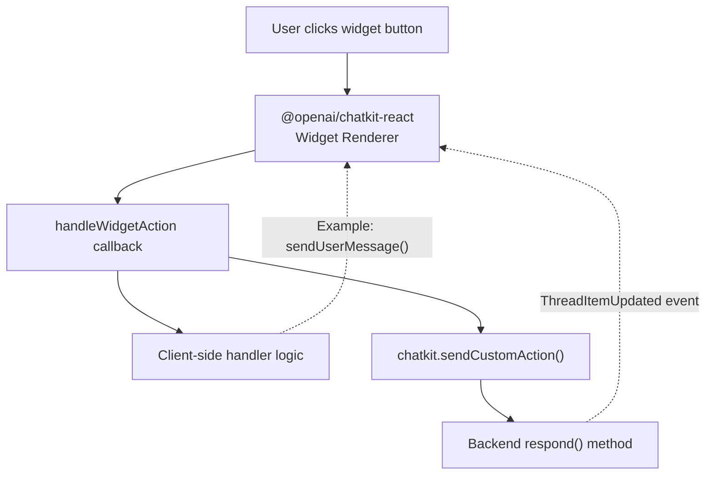
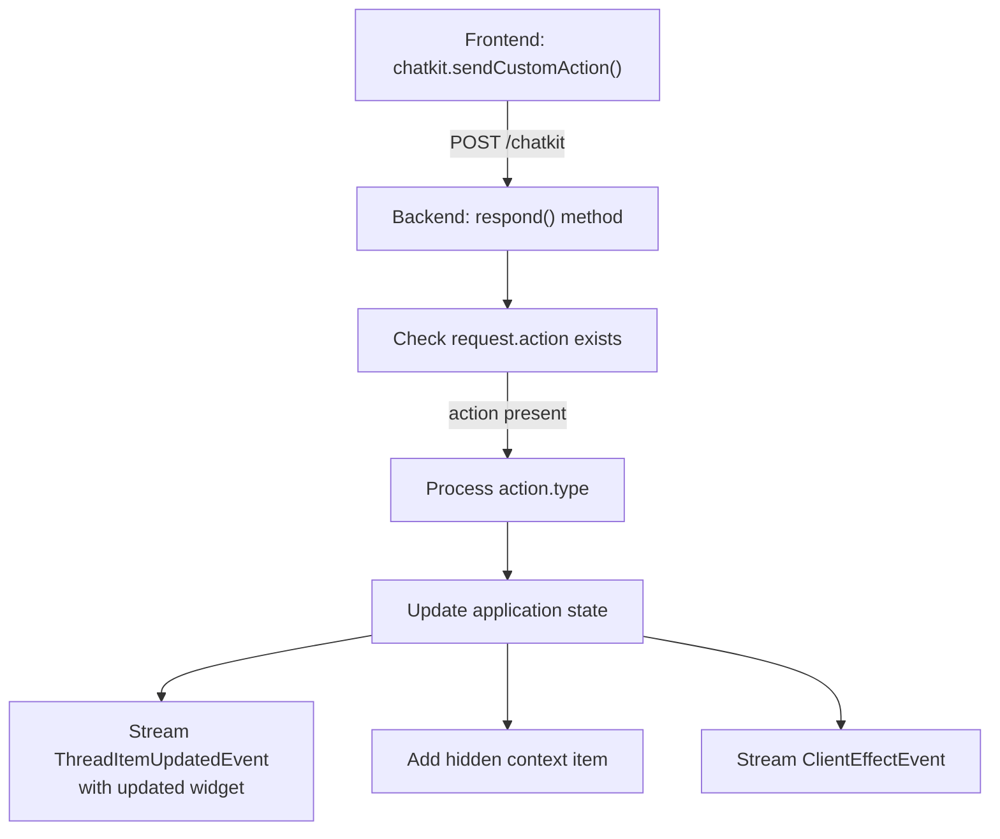
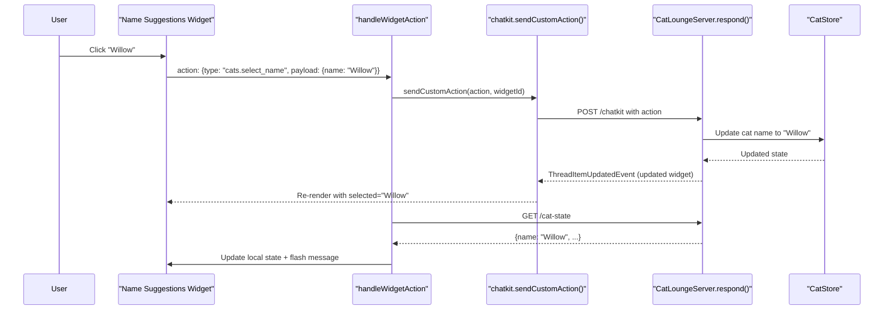
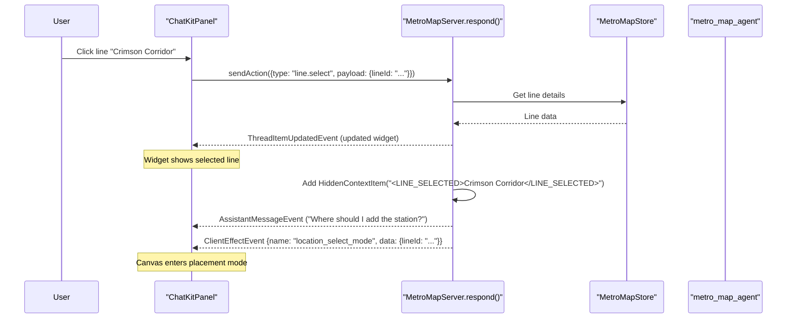

<!-- source: DeepWiki mcp.deepwiki.com · repo openai/openai-chatkit-advanced-samples · page 7.4 Widget Actions · fetched 2026-10-26 -->

# Widget Actions

<details>
<summary>Relevant source files</summary>

The following files were used as context for generating this wiki page:

- [README.md](README.md)
- [examples/cat-lounge/README.md](examples/cat-lounge/README.md)
- [examples/cat-lounge/backend/app/widgets/cat_name_suggestions.widget](examples/cat-lounge/backend/app/widgets/cat_name_suggestions.widget)
- [examples/cat-lounge/backend/app/widgets/cat_profile.widget](examples/cat-lounge/backend/app/widgets/cat_profile.widget)
- [examples/cat-lounge/frontend/src/components/ChatKitPanel.tsx](examples/cat-lounge/frontend/src/components/ChatKitPanel.tsx)
- [examples/metro-map/README.md](examples/metro-map/README.md)

</details>


Widget actions enable user interactions with widgets rendered in the chat thread. Actions can be handled either client-side for immediate UI updates (such as navigation or sending messages) or server-side for state persistence and widget updates. This page explains how actions are defined in widget templates, routed through the frontend callback system, and processed by the backend.

For information about widget template creation and structure, see [Creating Widgets](#8.4). For server tools that stream widgets, see [Server Tools](#7.1).

---

## Action Definition in Widget Templates

Widget actions are defined in the `.widget` template files as part of interactive elements like buttons or list items. Each action specifies a `type`, `handler`, and `payload`.

**Action Structure:**

| Field | Type | Description |
|-------|------|-------------|
| `type` | `string` | Unique identifier for the action (e.g., `"cats.select_name"`, `"line.select"`) |
| `handler` | `"client"` \| `"server"` | Determines whether the action is handled client-side or server-side |
| `payload` | `object` | Data passed to the action handler |

**Example from Cat Name Suggestions Widget:**

[examples/cat-lounge/backend/app/widgets/cat_name_suggestions.widget:53-73]() defines a client-handled action for name selection:

```json
{
  "type": "cats.select_name",
  "handler": "client",
  "payload": {
    "name": "Willow",
    "options": [...]
  }
}
```

The `onClickAction` field is populated by Jinja2 templating. When `selected` is `null`, the action is enabled; when a name is selected, `onClickAction` is set to `null` to disable further clicks.

**Example from Cat Name Suggestions - "More Names" Button:**

[examples/cat-lounge/backend/app/widgets/cat_name_suggestions.widget:227-231]() defines another client-handled action:

```json
{
  "type": "cats.more_names",
  "handler": "client",
  "payload": {}
}
```

**Sources:** [examples/cat-lounge/backend/app/widgets/cat_name_suggestions.widget:1-246](), [README.md:76-86]()

---

## Frontend Action Handling Flow

When a user clicks an interactive widget element, the action flows through the ChatKit frontend system to the application's callback handler.



**Diagram: Widget Action Dispatch Flow**

**Sources:** [examples/cat-lounge/frontend/src/components/ChatKitPanel.tsx:50-84](), [README.md:76-96]()

---

## Client-Side Action Handling

Client-side actions (marked with `"handler": "client"`) are processed in the `handleWidgetAction` callback without a round-trip to the server. This enables immediate UI updates, navigation, or message sending.

**The handleWidgetAction Callback:**

[examples/cat-lounge/frontend/src/components/ChatKitPanel.tsx:50-84]() implements the callback:

```typescript
const handleWidgetAction = useCallback(
  async (
    action: { type: string; payload?: Record<string, unknown> },
    widgetItem: { id: string; widget: Widgets.Card | Widgets.ListView }
  ) => {
    const chatkit = chatkitRef.current;
    if (!chatkit) {
      return;
    }
    // Client-side handling example
    if (action.type === "cats.more_names") {
      await chatkit.sendUserMessage({ text: "More name suggestions, please" });
      return;
    }
    // Server-side handling example (see next section)
    if (action.type === "cats.select_name") {
      await chatkit.sendCustomAction(action, widgetItem.id);
      // ... additional client-side logic
    }
  },
  [...]
);
```

**Registering the Callback:**

[examples/cat-lounge/frontend/src/components/ChatKitPanel.tsx:133-135]() registers the callback in the `useChatKit` configuration:

```typescript
widgets: {
  onAction: handleWidgetAction,
}
```

**Common Client-Side Action Patterns:**

| Pattern | Description | Example |
|---------|-------------|---------|
| Send message | Use `chatkit.sendUserMessage()` | `cats.more_names` sends "More name suggestions, please" |
| Navigate | Update URL or client state | `open_article` navigates to article page |
| Update UI | Modify local state | Toggle selection, show/hide panels |

**Sources:** [examples/cat-lounge/frontend/src/components/ChatKitPanel.tsx:50-84](), [examples/cat-lounge/frontend/src/components/ChatKitPanel.tsx:133-135](), [README.md:79-80]()

---

## Server-Side Action Handling

Server-side actions (marked with `"handler": "server"` or invoked via `chatkit.sendCustomAction()`) are sent to the backend for processing. The server can:
- Update application state
- Stream updated widgets
- Add hidden context to the thread
- Trigger client effects

**Sending Server Actions from Frontend:**

[examples/cat-lounge/frontend/src/components/ChatKitPanel.tsx:68-80]() shows invoking a server action:

```typescript
if (action.type === "cats.select_name") {
  if (!activeThread) {
    console.warn("Ignoring name selection without an active thread.");
    return;
  }
  // Send the server action.
  await chatkit.sendCustomAction(action, widgetItem.id);
  // Then fetch the latest cat status so that we can reflect the update client-side.
  const data = await refresh();
  if (data) {
    handleStatusUpdate(data, `Now called ${data.name}`);
  }
  return;
}
```

**Backend Action Processing:**

Server-side actions are processed in the `ChatKitServer.respond()` method by checking for `request.action` and `request.widget_id`. The backend can:

1. **Update state** based on action payload
2. **Stream updated widget** via `ThreadItemUpdatedEvent`
3. **Add hidden context** to the thread
4. **Trigger client effects** for UI synchronization

**Action Processing Pattern:**



**Diagram: Server-Side Action Processing**

**Sources:** [README.md:87-96]()

---

## Example: Cat Lounge Name Selection

The Cat Lounge example demonstrates both client-side and server-side handling of the same action type.

**Widget Definition:**

[examples/cat-lounge/backend/app/widgets/cat_name_suggestions.widget:53-73]() defines selectable list items with the `cats.select_name` action.

**Client-Side Handling:**

[examples/cat-lounge/frontend/src/components/ChatKitPanel.tsx:68-80]() handles the action by:
1. Calling `chatkit.sendCustomAction()` to invoke server-side processing
2. Fetching updated cat state via `refresh()`
3. Updating local UI state with `handleStatusUpdate()`

**Server-Side Handling:**

[README.md:89-91]() describes the server processing:
- The action is handled in [examples/cat-lounge/backend/app/server.py]()
- Updates cat name in the data store
- Streams back an updated version of the name suggestions widget
- The updated widget shows the selected name with a checkmark icon

**Action Flow Diagram:**



**Diagram: Cat Name Selection Flow**

**Sources:** [examples/cat-lounge/frontend/src/components/ChatKitPanel.tsx:68-80](), [examples/cat-lounge/backend/app/widgets/cat_name_suggestions.widget:53-73](), [README.md:89-91]()

---

## Example: News Guide Article Actions

The News Guide demonstrates both client-side navigation and server-side widget expansion.

**Client-Side Action: open_article**

[README.md:81-82]() describes article list widgets with "View" buttons that dispatch `open_article` actions for client-side navigation:
- Widget: [examples/news-guide/backend/app/widgets/article_list_widget.py]()
- Action type: `open_article`
- Handler: `client`
- Behavior: Navigate to article page in the application

**Server-Side Action: view_event_details**

[README.md:83-84](), [README.md:92-93]() describe event timeline widgets with `view_event_details` buttons:
- Widget: [examples/news-guide/backend/app/widgets/event_list_widget.py]()
- Action type: `view_event_details`
- Handler: `server`
- Behavior: Server updates widget with expanded event descriptions without model invocation

**Action Type Comparison:**

| Action | Handler | Purpose | Implementation |
|--------|---------|---------|----------------|
| `open_article` | client | Navigate to article page | URL update or state change |
| `view_event_details` | server | Expand event in widget | Update widget JSON, stream `ThreadItemUpdatedEvent` |

**Sources:** [README.md:81-84](), [README.md:92-93]()

---

## Example: Metro Map Line Selection

The Metro Map demonstrates server-side actions that trigger multiple side effects.

**Widget and Action Definition:**

[README.md:84-86]() describes the line selector widget:
- Tool: `show_line_selector` in [examples/metro-map/backend/app/agents/metro_map_agent.py]()
- Widget: [examples/metro-map/backend/app/widgets/line_select_widget.py]()
- Action type: `line.select`
- Handler: `server`

**Server-Side Processing:**

[README.md:94-95]() details the `line.select` action handling in [examples/metro-map/backend/app/server.py]():

1. **Stream updated widget** - Visually confirms selection
2. **Add hidden context** - Inject `<LINE_SELECTED>` tag into thread
3. **Stream assistant message** - Ask user where to add the station (start or end of line)
4. **Trigger client effect** - `location_select_mode` to enable canvas placement UI

**Multi-Step Action Flow:**



**Diagram: Metro Map Line Selection Multi-Step Flow**

**Sources:** [README.md:84-86](), [README.md:94-95]()

---

## Action Handler Decision Matrix

When implementing widget actions, choose the handler type based on the following criteria:

| Requirement | Handler Type | Rationale |
|-------------|--------------|-----------|
| Immediate UI feedback | `client` | No network latency |
| Navigate to different page | `client` | Client-side routing |
| Send a message on user's behalf | `client` | Use `chatkit.sendUserMessage()` |
| Update backend state | `server` | State persistence required |
| Modify widget content | `server` | Server streams `ThreadItemUpdatedEvent` |
| Add context to thread | `server` | Hidden context items require server |
| Trigger subsequent agent response | `server` | Agent invocation requires server |
| Coordinate multiple side effects | `server` | Orchestration logic on backend |

**Hybrid Pattern:**

Some actions, like `cats.select_name`, use both handlers:
1. Client calls `chatkit.sendCustomAction()` to invoke server
2. Server updates state and widget
3. Client fetches updated state via REST API for local UI sync

**Sources:** [examples/cat-lounge/frontend/src/components/ChatKitPanel.tsx:68-80](), [README.md:76-96]()

---

## Integration with useChatKit Hook

The `handleWidgetAction` callback is configured during ChatKit initialization:

[examples/cat-lounge/frontend/src/components/ChatKitPanel.tsx:105-145]() shows the complete integration:

```typescript
const chatkit = useChatKit({
  api: { url: CHATKIT_API_URL, domainKey: CHATKIT_API_DOMAIN_KEY },
  widgets: {
    onAction: handleWidgetAction,
  },
  // ... other configuration
});
```

**Key ChatKit Methods for Actions:**

| Method | Purpose | Usage |
|--------|---------|-------|
| `chatkit.sendUserMessage({text})` | Send user message | Client-side action triggers new message |
| `chatkit.sendCustomAction(action, widgetId)` | Invoke server action | Forward action to backend |
| `chatkit.sendAction(...)` | Alternative action method | Similar to `sendCustomAction` |

**Sources:** [examples/cat-lounge/frontend/src/components/ChatKitPanel.tsx:105-145](), [examples/cat-lounge/frontend/src/components/ChatKitPanel.tsx:133-135]()

---

## Summary

Widget actions provide a flexible interaction model for ChatKit applications:

- **Actions are defined** in `.widget` template files with `type`, `handler`, and `payload` fields
- **Client-side actions** (`"handler": "client"`) enable immediate UI updates without server round-trips
- **Server-side actions** (`"handler": "server"`) enable state persistence, widget updates, and hidden context injection
- **The handleWidgetAction callback** routes actions to appropriate handlers
- **Hybrid patterns** combine client and server handling for complex workflows

Examples across Cat Lounge, News Guide, and Metro Map demonstrate various action patterns from simple message sending to multi-step orchestration with client effects and hidden context.

**Sources:** [README.md:76-96](), [examples/cat-lounge/frontend/src/components/ChatKitPanel.tsx:50-84](), [examples/cat-lounge/backend/app/widgets/cat_name_suggestions.widget:1-246]()

---

