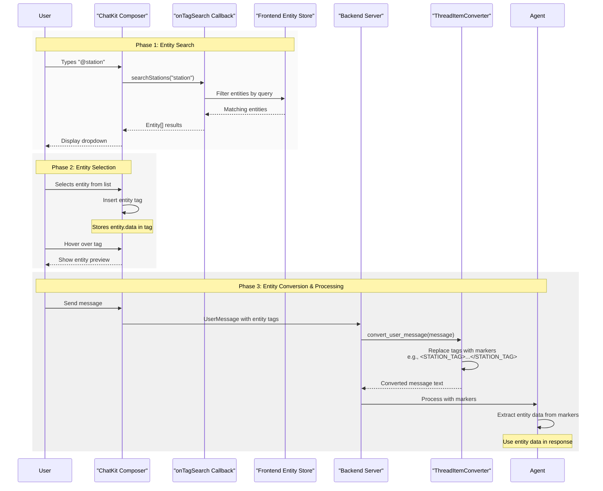
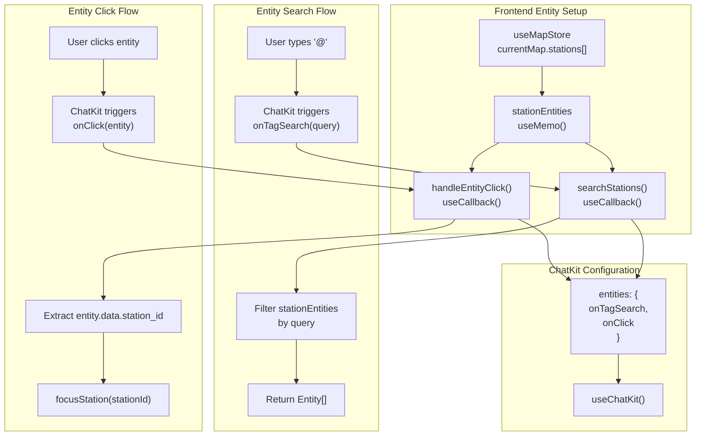
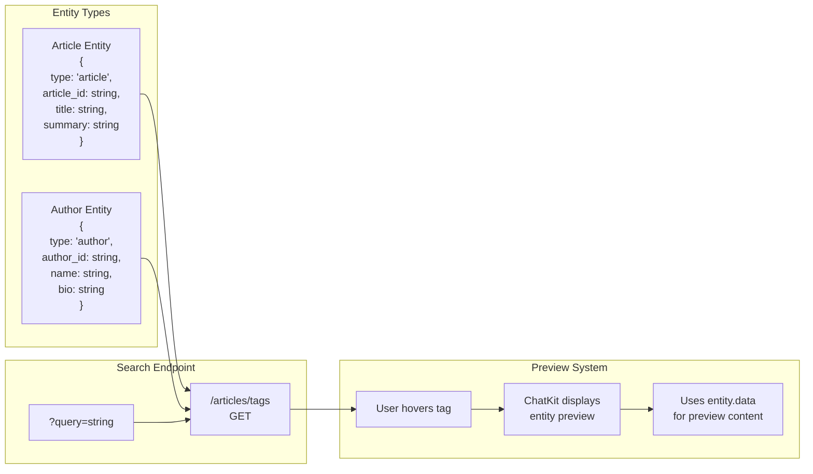
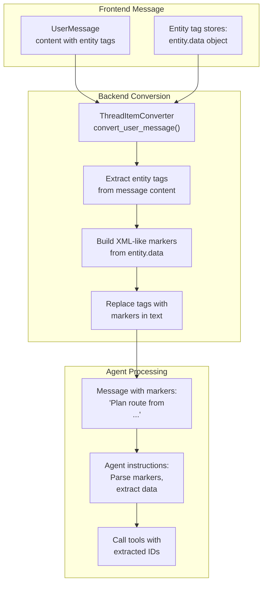
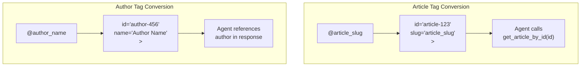
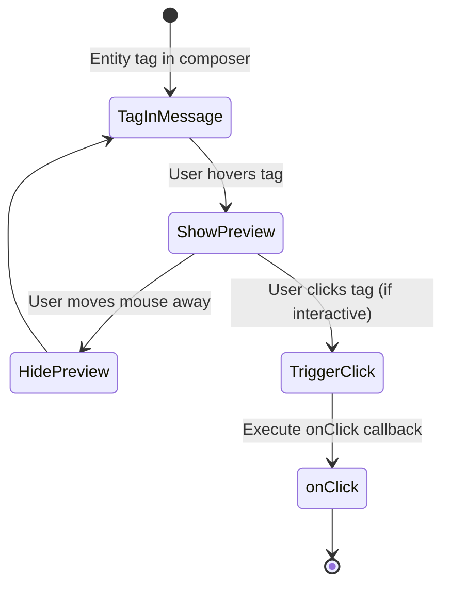

<!-- source: DeepWiki mcp.deepwiki.com · repo openai/openai-chatkit-advanced-samples · page 7.5 Entity Tags and @-mentions · fetched 2026-10-26 -->

# Entity Tags and @-mentions

<details>
<summary>Relevant source files</summary>

The following files were used as context for generating this wiki page:

- [README.md](README.md)
- [examples/metro-map/frontend/src/components/ChatKitPanel.tsx](examples/metro-map/frontend/src/components/ChatKitPanel.tsx)

</details>


This document explains the entity tag system in ChatKit, which enables users to @-mention domain-specific objects (stations, articles, authors) in the composer. It covers entity configuration, search implementation, click handling, preview display, and conversion to model-readable markers that agents can process.

For information about annotations that appear in assistant responses, see [Progress Updates and Annotations](#7.7). For widget-based entity selection, see [Widget Actions](#7.4).

---

## Overview

The entity tag system provides autocomplete @-mention functionality in the ChatKit composer, allowing users to reference domain objects directly in their messages. When a user types `@`, the system triggers entity search, displays matching results with previews, and converts selected entities into markers that agents can understand and process.

The flow involves three main phases:
1. **Entity Search**: User types `@` → frontend searches entities → displays results
2. **Entity Selection**: User selects entity → tag inserted in composer → preview shown on hover
3. **Entity Conversion**: Message sent → backend converts tags to model-readable markers → agent processes

**Sources**: [README.md:111-120]()

---

## Entity Tag Data Flow



**Sources**: [README.md:111-120](), [examples/metro-map/frontend/src/components/ChatKitPanel.tsx:73-189]()

---

## Entity Configuration

Entities are configured via the `entities` option in `useChatKit`. Each entity object represents a domain object that can be @-mentioned.

### Entity Object Structure

| Field | Type | Description |
|-------|------|-------------|
| `id` | `string` | Unique identifier for the entity |
| `title` | `string` | Display name shown in search results and tags |
| `interactive` | `boolean` | Whether clicking the entity triggers `onClick` |
| `group` | `string` | Category label (e.g., "Stations", "Articles") |
| `data` | `object` | Custom data passed to backend in conversion |

### Configuration Options

| Option | Type | Description |
|--------|------|-------------|
| `onTagSearch` | `(query: string) => Promise<Entity[]>` | Callback for searching entities |
| `onClick` | `(entity: Entity) => void` | Optional callback when entity is clicked |

**Sources**: [examples/metro-map/frontend/src/components/ChatKitPanel.tsx:186-189]()

---

## Implementation Pattern



**Sources**: [examples/metro-map/frontend/src/components/ChatKitPanel.tsx:73-189]()

---

## Metro Map Example: Station Entities

The Metro Map example demonstrates entity tags for station @-mentions with canvas focusing.

### Entity Creation

Entities are derived from the metro map's station data:

[examples/metro-map/frontend/src/components/ChatKitPanel.tsx:73-88]()

```typescript
const stationEntities = useMemo<Entity[]>(() => {
  if (!currentMap) return [];
  return currentMap.stations.map((station) => {
    return {
      id: station.id,
      title: station.name,
      interactive: true,
      group: "Stations",
      data: {
        type: "station",
        station_id: station.id,
        name: station.name,
      },
    };
  });
}, [currentMap]);
```

**Key Points**:
- `id` and `station_id` match the station's canonical ID
- `title` displays the human-readable station name
- `interactive: true` enables click handling
- `data` contains metadata passed to backend during conversion
- `group: "Stations"` categorizes all station entities together

### Entity Search Implementation

Search filters entities by query against multiple fields:

[examples/metro-map/frontend/src/components/ChatKitPanel.tsx:90-105]()

```typescript
const searchStations = useCallback(
  async (query: string) => {
    if (!stationEntities.length) return [];
    const normalized = query.trim().toLowerCase();
    if (!normalized) return stationEntities;  // Empty query returns all
    return stationEntities.filter((entity) => {
      const lineNames = entity.data?.line_names?.toLowerCase() ?? "";
      return (
        entity.title.toLowerCase().includes(normalized) ||
        entity.id.toLowerCase().includes(normalized) ||
        lineNames.includes(normalized)
      );
    });
  },
  [stationEntities]
);
```

**Search Strategy**:
- Returns all entities when query is empty
- Searches across `title` (station name), `id`, and custom `line_names`
- Case-insensitive substring matching
- Async signature allows for API-based search in other implementations

### Entity Click Handler

Clicking a station entity focuses it on the canvas:

[examples/metro-map/frontend/src/components/ChatKitPanel.tsx:109-117]()

```typescript
const handleEntityClick = useCallback(
  (entity: Entity) => {
    const stationId = (entity.data?.station_id || entity.id || "").trim();
    if (stationId) {
      focusStation(stationId, currentMap ?? undefined);
    }
  },
  [currentMap, focusStation]
);
```

**Behavior**:
- Extracts `station_id` from `entity.data`
- Calls `focusStation()` to pan/zoom canvas to the station
- Provides immediate visual feedback when entity is clicked

### ChatKit Configuration

[examples/metro-map/frontend/src/components/ChatKitPanel.tsx:186-189]()

```typescript
entities: {
  onTagSearch: searchStations,
  onClick: handleEntityClick,
}
```

**Sources**: [examples/metro-map/frontend/src/components/ChatKitPanel.tsx:73-189]()

---

## News Guide Example: Article and Author Entities

The News Guide example demonstrates entity tags for articles and authors with REST API-based search and previews.

### Multi-Type Entity System



**Key Differences from Metro Map**:
- Multiple entity types in one system (articles + authors)
- Backend API endpoint (`/articles/tags`) provides search results
- Entity previews show rich metadata (summary, bio)
- Click handling navigates to article/author pages

**Sources**: [README.md:113-115]()

---

## Entity Conversion to Model-Readable Markers

When a message containing entity tags is sent to the backend, the tags are converted into structured markers that agents can parse and process.

### Conversion Architecture



**Sources**: [README.md:115-119]()

---

## Metro Map: Station Tag Conversion

Metro Map converts station tags into `<STATION_TAG>` markers with embedded line metadata.

### Conversion Implementation

The conversion happens in the backend before the message reaches the agent:

[README.md:118-119]()

**Conversion Process**:
1. Frontend sends message with station entity tags
2. `ThreadItemConverter` extracts entity tags from message
3. For each station tag, builds `<STATION_TAG>` block with:
   - Station ID
   - Station name
   - Associated line information
4. Replaces entity tag with marker in message text
5. Agent receives message with inline station data

### Example Conversion

| Original User Message | Converted Message to Agent |
|-----------------------|----------------------------|
| `"How do I get from @Central_Station to @Park_Plaza?"` | `"How do I get from <STATION_TAG id='central' lines='Red,Blue'>Central Station</STATION_TAG> to <STATION_TAG id='park_plaza' lines='Green'>Park Plaza</STATION_TAG>?"` |

### Agent Processing

The agent's instructions explain how to parse these markers:

**Benefits**:
- Agent can extract station IDs without additional tool calls
- Line metadata enables route planning without lookups
- Reduces latency by embedding context in the message
- Agent can validate station references before responding

**Sources**: [README.md:118-119]()

---

## News Guide: Article and Author Reference Conversion

News Guide converts article and author tags into distinct marker types that trigger agent tool calls.

### Marker Types



### Article Reference Flow

[README.md:115-116]()

**Process**:
1. User types `@article_title` in composer
2. Frontend searches articles via `/articles/tags` endpoint
3. User selects article, tag inserted with `entity.data` containing article ID
4. Message sent to backend with entity tag
5. `ThreadItemConverter` converts to `<ARTICLE_REFERENCE>` marker
6. Agent parses marker, extracts article ID
7. Agent instructions prompt call to `get_article_by_id()` tool
8. Tool fetches full article content
9. Agent cites article details in response

### Conversion Code Location

The conversion logic is centralized in dedicated converter modules:

- **News Guide**: [examples/news-guide/backend/app/thread_item_converter.py]()
- **Metro Map**: [examples/metro-map/backend/app/thread_item_converter.py]()

**Sources**: [README.md:115-116]()

---

## Entity Preview System

ChatKit automatically displays hover previews for entity tags based on the data provided in the `entity.data` object.

### Preview Data Structure

| Entity Type | Preview Fields | Source |
|-------------|----------------|--------|
| Station | `name`, `station_id`, line information | `entity.data` from `stationEntities` |
| Article | `title`, `summary`, `article_id` | `/articles/tags` API response |
| Author | `name`, `bio`, `author_id` | `/articles/tags` API response |

### Preview Behavior



**Preview Features**:
- Hover displays without network request (data from entity object)
- Click behavior independent of preview display
- Preview content determined by entity type in `entity.data`
- ChatKit handles preview rendering automatically

**Sources**: [README.md:114]()

---

## Implementation Checklist

To implement entity tags in a ChatKit application:

### Frontend Setup

- [ ] **Create entity objects** from domain data
  - Define `id`, `title`, `group`, and `data` fields
  - Store entities in React state (e.g., `useMemo`)
  
- [ ] **Implement search callback**
  - Create `onTagSearch` function
  - Filter entities by query
  - Return `Promise<Entity[]>`
  
- [ ] **Implement click handler** (optional)
  - Create `onClick` function
  - Extract data from `entity.data`
  - Perform UI action (focus, navigate, etc.)
  
- [ ] **Configure ChatKit**
  - Pass `onTagSearch` to `entities.onTagSearch`
  - Pass `onClick` to `entities.onClick`

### Backend Setup

- [ ] **Create ThreadItemConverter**
  - Implement `convert_user_message()` method
  - Extract entity tags from message content
  - Build model-readable markers
  
- [ ] **Define marker format**
  - Choose XML-like syntax (e.g., `<STATION_TAG>`)
  - Include relevant metadata in marker attributes
  - Document marker format in agent instructions
  
- [ ] **Update agent instructions**
  - Explain marker syntax to agent
  - Prompt agent to extract IDs from markers
  - Specify when to call tools vs. use inline data
  
- [ ] **Apply conversion in server**
  - Call converter before passing messages to agent
  - Ensure conversion happens for all user messages

### Testing

- [ ] **Search behavior**
  - Empty query returns all entities
  - Query filters results correctly
  - Case-insensitive matching works
  
- [ ] **Tag insertion**
  - Entity tag appears in composer
  - Preview shows on hover
  - Click triggers callback (if interactive)
  
- [ ] **Marker conversion**
  - Tags converted to markers in backend
  - Agent receives markers in message
  - Agent extracts and uses entity data correctly

**Sources**: [examples/metro-map/frontend/src/components/ChatKitPanel.tsx:73-189](), [README.md:115-119]()

---

## Advanced Patterns

### API-Based Entity Search

For large datasets or dynamic content, implement server-side entity search:

```typescript
const searchArticles = useCallback(async (query: string) => {
  const response = await fetch(`/articles/tags?query=${encodeURIComponent(query)}`);
  const data = await response.json();
  return data.entities; // Array of Entity objects
}, []);
```

**Benefits**:
- No need to load all entities into frontend memory
- Can implement complex search logic (fuzzy matching, relevance scoring)
- Fresh results from database on each query

### Conditional Entity Availability

Enable/disable entity tags based on application state:

```typescript
const stationEntities = useMemo<Entity[]>(() => {
  // Only show entities when map is loaded
  if (!currentMap) return [];
  
  // Filter based on user permissions, context, etc.
  return currentMap.stations
    .filter(station => station.isAccessible)
    .map(station => ({ /* ... */ }));
}, [currentMap]);
```

### Entity Groups for Organization

Use groups to categorize entities in search results:

```typescript
{
  id: "station_001",
  title: "Central Station",
  group: "Stations",  // Groups all stations together
  // ...
}

{
  id: "article_123",
  title: "Breaking News Article",
  group: "Articles",  // Separates from authors
  // ...
}
```

**Sources**: [examples/metro-map/frontend/src/components/ChatKitPanel.tsx:73-88]()

---

