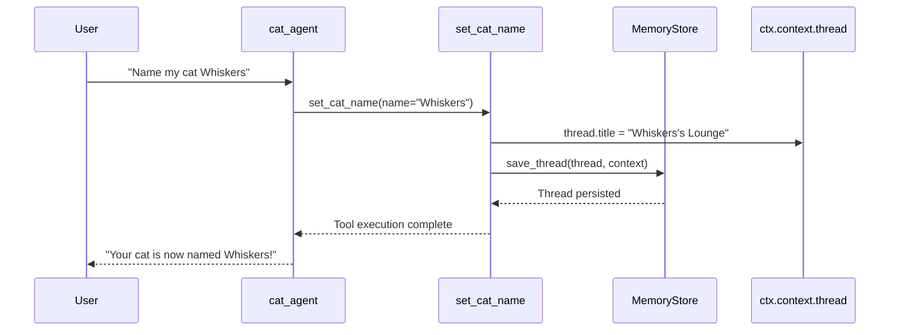
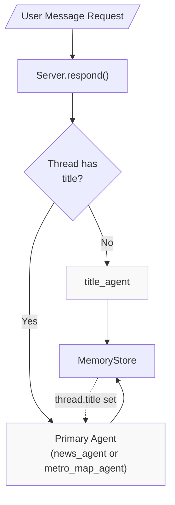
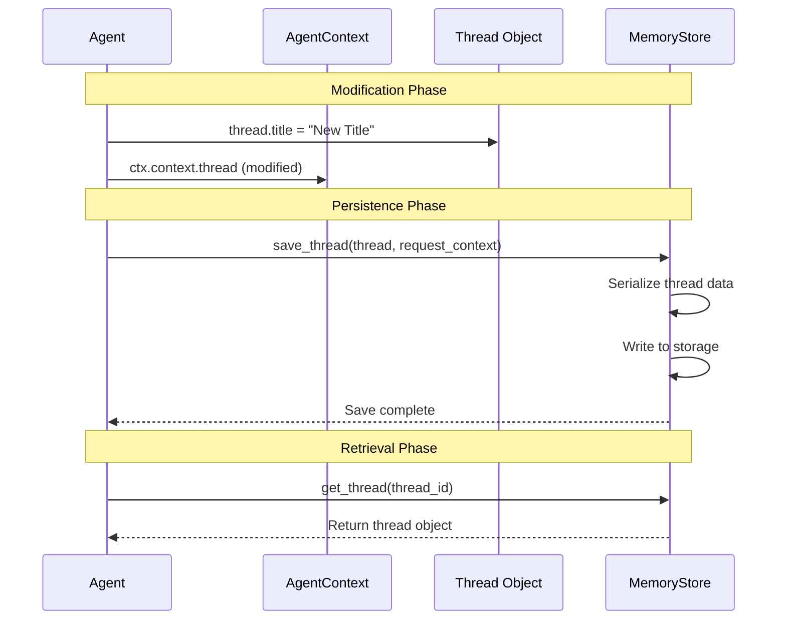
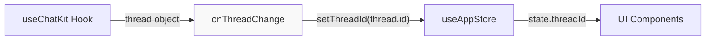
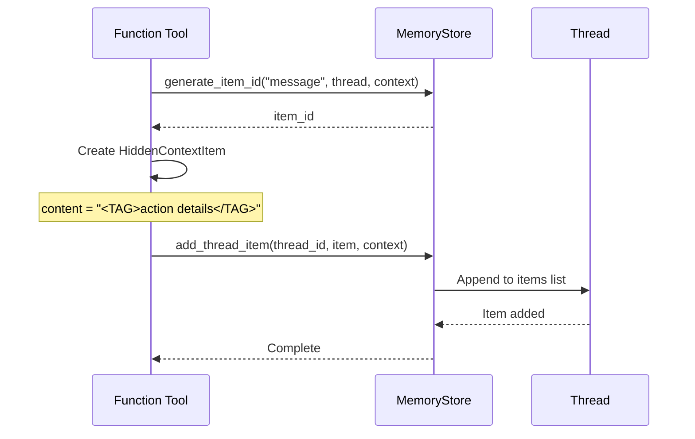
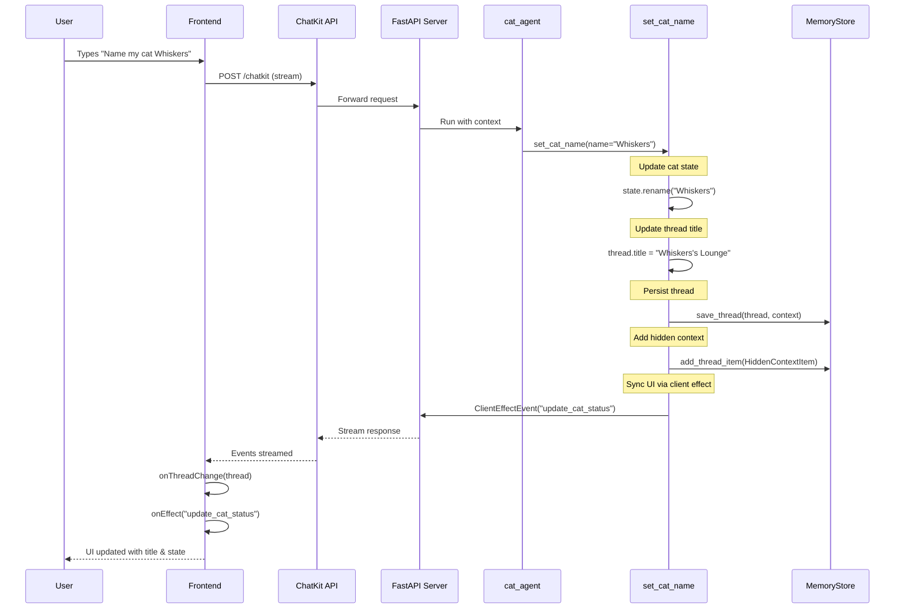

<!-- source: DeepWiki mcp.deepwiki.com · repo openai/openai-chatkit-advanced-samples · page 7.6 Thread Management · fetched 2026-10-26 -->

# Thread Management

<details>
<summary>Relevant source files</summary>

The following files were used as context for generating this wiki page:

- [README.md](README.md)
- [examples/cat-lounge/backend/app/cat_agent.py](examples/cat-lounge/backend/app/cat_agent.py)

</details>


This page explains thread management in ChatKit applications, including thread lifecycle, thread titles, and dynamic title updates. It covers how threads are created, persisted, and updated both from backend tools and frontend callbacks.

For information about server tools and client effects that operate within threads, see [Server Tools](#7.1) and [Client Effects](#7.3). For widget actions that may affect thread state, see [Widget Actions](#7.4).

---

## Thread Concept

A thread represents a conversation session in ChatKit. Each thread has:

| Property | Type | Description |
|----------|------|-------------|
| `id` | string | Unique identifier for the thread |
| `title` | string | Display title shown in the UI |
| `created_at` | datetime | When the thread was created |
| `updated_at` | datetime | Last modification timestamp |
| Items | list | Sequence of messages, widgets, and context |

Threads are persisted in a `MemoryStore` and can be retrieved, updated, and saved throughout the application lifecycle. The thread object is accessible to agents via the `AgentContext` at `ctx.context.thread`.

**Sources:** [examples/cat-lounge/backend/app/cat_agent.py:73-78](), README.md feature index

---

## Thread Titles

### Default Titles

When a thread is first created without an explicit title, it typically defaults to a generic value or remains empty. Applications can set initial titles either:
- During first message processing
- Via a dedicated title generation agent
- Through explicit user action

### Setting Titles from Tools

Backend tools can directly modify the thread title by accessing `ctx.context.thread.title` and then persisting the thread to storage.

**Example: Cat Lounge Name-Based Title**

The `set_cat_name` tool updates the thread title when a cat is named:

```
Thread Title Update Flow (Cat Lounge)
```



The implementation at [examples/cat-lounge/backend/app/cat_agent.py:199-234]() shows:

```python
async def set_cat_name(
    ctx: RunContextWrapper[CatAgentContext],
    name: str,
):
    # ... validation and state update ...
    
    # Update thread title
    ctx.context.thread.title = f"{state.name}'s Lounge"
    
    # Persist to storage
    await ctx.context.store.save_thread(
        ctx.context.thread, 
        ctx.context.request_context
    )
```

**Sources:** [examples/cat-lounge/backend/app/cat_agent.py:199-234](), [README.md:104-105]()

---

## Dynamic Title Generation with Sub-Agents

Both News Guide and Metro Map use dedicated title generation agents that run on the first user message to create contextually appropriate titles.

### Title Agent Pattern

```
Title Agent Architecture
```



The server checks if the thread already has a title. If not, it invokes the title agent before proceeding to the main agent.

**Sources:** [README.md:106-109]()

---

## Title Agent Implementation Examples

### News Guide Title Agent

The News Guide uses a `title_agent` to generate newsroom-appropriate titles:

| Configuration | Value |
|---------------|-------|
| Model | GPT-4o-mini or similar |
| Purpose | Generate concise editorial titles |
| Trigger | First user message when `thread.title` is empty |
| Style | Short, newsroom-friendly, no quotation marks |

The title agent receives the first user message as context and generates a brief title that reflects the conversation topic.

**Sources:** [README.md:106-107]()

### Metro Map Title Agent

The Metro Map application similarly uses a dedicated title agent:

| Configuration | Value |
|---------------|-------|
| Model | GPT-4o-mini or similar |
| Purpose | Generate brief metro-planning titles |
| Trigger | First turn when no title exists |
| Style | Short, descriptive of routing intent |

**Sources:** [README.md:108-109]()

---

## Thread Persistence Flow

```
Thread Save Flow
```



The `MemoryStore` provides methods for thread lifecycle management:

| Method | Purpose |
|--------|---------|
| `get_thread(thread_id)` | Retrieve existing thread |
| `save_thread(thread, context)` | Persist thread modifications |
| `add_thread_item(thread_id, item, context)` | Add message/widget to thread |
| `generate_item_id(item_type, thread, context)` | Create unique item ID |

**Sources:** [examples/cat-lounge/backend/app/cat_agent.py:113-123]()

---

## Frontend Thread Change Handling

### onThreadChange Callback

The frontend receives thread updates through the `onThreadChange` callback in the ChatKit configuration. This callback fires when:
- A new thread is created
- The thread title changes
- Thread metadata is updated

**Callback Signature:**

```typescript
onThreadChange?: (thread: Thread) => void
```

### Usage Pattern

Frontend applications typically use `onThreadChange` to:
1. Update the application state with the new thread ID
2. Display the updated title in the UI
3. Trigger navigation or UI updates based on thread state

**Example: Storing Thread ID**

```
Frontend Thread State Management
```



Applications store the thread ID in their state management (e.g., Zustand store) so that:
- The current thread can be referenced throughout the app
- UI can display thread-specific information
- Thread-scoped API calls include the correct thread ID

**Sources:** High-level diagram analysis (Frontend Architecture Pattern)

---

## Thread Context in Widget Actions

When widget actions are handled server-side, they receive the full thread context. This enables actions to:

- Access current thread title
- Read existing thread items
- Modify thread metadata
- Add hidden context items

### Hidden Context Items

Tools often add hidden context to threads to track state changes without displaying them to users:

```
Hidden Context Flow
```



**Example from Cat Lounge:**

[examples/cat-lounge/backend/app/cat_agent.py:109-123]() shows hidden context addition:

```python
async def _add_hidden_context(ctx: RunContextWrapper[CatAgentContext], content: str) -> None:
    thread = ctx.context.thread
    await ctx.context.store.add_thread_item(
        thread.id,
        HiddenContextItem(
            id=ctx.context.store.generate_item_id(
                "message", 
                thread, 
                ctx.context.request_context
            ),
            thread_id=thread.id,
            created_at=datetime.now(),
            content=content,  # e.g., "<CAT_NAME_SELECTED>Whiskers</CAT_NAME_SELECTED>"
        ),
        context=ctx.context.request_context,
    )
```

These hidden items allow agents to track actions (like feeding, naming, or selecting) without cluttering the visible conversation.

**Sources:** [examples/cat-lounge/backend/app/cat_agent.py:109-123](), [examples/cat-lounge/backend/app/cat_agent.py:152](), [examples/cat-lounge/backend/app/cat_agent.py:170](), [examples/cat-lounge/backend/app/cat_agent.py:188](), [examples/cat-lounge/backend/app/cat_agent.py:229]()

---

## Thread Title Update Examples Summary

| Application | Method | Trigger | Title Format | Implementation |
|-------------|--------|---------|--------------|----------------|
| **Cat Lounge** | Direct tool modification | `set_cat_name` tool execution | `"{name}'s Lounge"` | [cat_agent.py:226]() |
| **News Guide** | Sub-agent generation | First user message if no title | Newsroom-friendly summary | title_agent |
| **Metro Map** | Sub-agent generation | First turn if no title | Metro-planning description | title_agent |

All methods require:
1. Access to `ctx.context.thread`
2. Setting `thread.title` property
3. Calling `ctx.context.store.save_thread()` to persist

**Sources:** [README.md:102-109]()

---

## Complete Thread Update Example

The following sequence shows the complete flow of a thread title update in Cat Lounge:

```
Complete Cat Naming Flow
```



This demonstrates how thread management integrates with:
- State updates (cat renaming)
- Title modification
- Persistence
- Hidden context tracking
- Client effects for UI synchronization

**Sources:** [examples/cat-lounge/backend/app/cat_agent.py:199-234](), [examples/cat-lounge/backend/app/cat_agent.py:93-106]()

---

