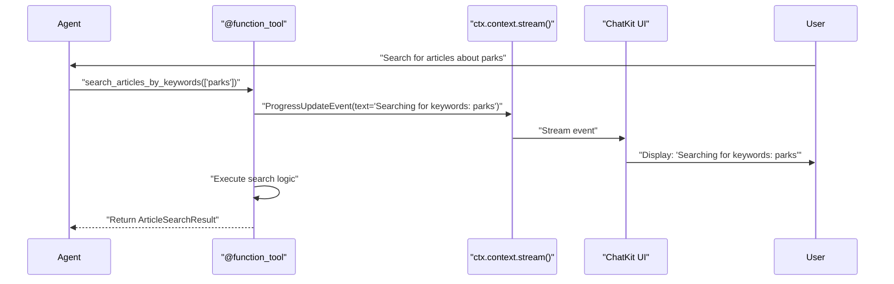
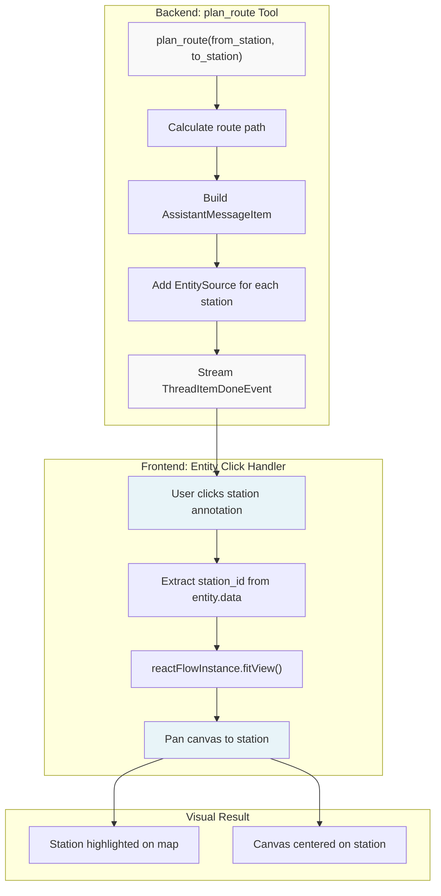
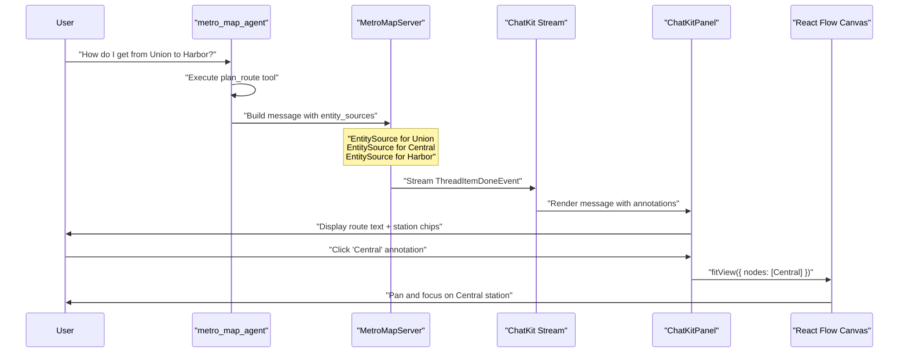

<!-- source: DeepWiki mcp.deepwiki.com · repo openai/openai-chatkit-advanced-samples · page 7.7 Progress Updates and Annotations · fetched 2026-10-26 -->

# Progress Updates and Annotations

<details>
<summary>Relevant source files</summary>

The following files were used as context for generating this wiki page:

- [README.md](README.md)
- [examples/news-guide/backend/app/agents/news_agent.py](examples/news-guide/backend/app/agents/news_agent.py)
- [examples/news-guide/backend/app/main.py](examples/news-guide/backend/app/main.py)

</details>


This page documents two mechanisms for enhancing user experience during agent interactions: **progress updates** that provide real-time feedback during long-running operations, and **annotations** that attach contextual entity references to assistant messages.

For information about other streaming events and callbacks, see [Communication Patterns](#3.3). For entity tags in user input, see [Entity Tags and @-mentions](#7.5).

---

## Overview

Progress updates and annotations address different aspects of the conversational experience:

| Feature | Purpose | Direction | User Visibility |
|---------|---------|-----------|-----------------|
| Progress Updates | Provide feedback during long operations | Backend → Frontend | Status messages in UI |
| Annotations | Attach entity references to responses | Backend → Frontend | Clickable entity chips |

Both are streamed from the backend using the ChatKit event system and rendered by the frontend's ChatKit UI components.

**Sources:** [README.md:58-64](), [README.md:97-100]()

---

## Progress Updates

### Purpose and Use Cases

Progress updates stream `ProgressUpdateEvent` messages during tool execution to inform users that work is in progress. They prevent perceived UI freezes during operations like:

- Searching large datasets
- Loading article content
- Retrieving map information
- Waiting for client tool responses

Without progress updates, users see no feedback between submitting a query and receiving results, which can create uncertainty during multi-second operations.

**Sources:** [README.md:58-64]()

### Streaming Progress Events

Progress events are streamed using `ctx.context.stream()` within function tools. The event contains a single `text` field displayed in the ChatKit UI.



**Sources:** [examples/news-guide/backend/app/agents/news_agent.py:12](), [examples/news-guide/backend/app/agents/news_agent.py:137]()

### Implementation Pattern

The typical pattern for streaming progress updates:

1. Import `ProgressUpdateEvent` from `chatkit.types`
2. Call `await ctx.context.stream(ProgressUpdateEvent(text="Status message"))` before long-running operations
3. Continue with tool logic after streaming

**News Guide Search Tools**

The News Guide demonstrates comprehensive progress feedback across all search tools:

| Tool Function | Progress Message Pattern | Example |
|---------------|-------------------------|---------|
| `search_articles_by_tags` | `"Searching for tags: {tag_label}"` | "Searching for tags: parks, events" |
| `search_articles_by_author` | `"Looking for articles by {display_name}..."` | "Looking for articles by Jamie Chen..." |
| `list_available_tags_and_keywords` | `"Referencing available tags and keywords..."` | Static message |
| `search_articles_by_keywords` | `"Searching for keywords: {formatted}"` | "Searching for keywords: transit, buses" |
| `search_articles_by_exact_text` | `"Scanning articles for: {trimmed}"` | "Scanning articles for: community fridge" |
| `get_article_by_id` | `"Loading article..."` | Static message |
| `get_current_page` | `"Page contents retrieved"` or `"Full article retrieved"` | Context-dependent |

**Sources:** [examples/news-guide/backend/app/agents/news_agent.py:136-137](), [examples/news-guide/backend/app/agents/news_agent.py:158](), [examples/news-guide/backend/app/agents/news_agent.py:173](), [examples/news-guide/backend/app/agents/news_agent.py:192](), [examples/news-guide/backend/app/agents/news_agent.py:212](), [examples/news-guide/backend/app/agents/news_agent.py:229](), [examples/news-guide/backend/app/agents/news_agent.py:251-253]()

### Code Example: Search Tool with Progress

The `search_articles_by_keywords` tool demonstrates the pattern:

```python
@function_tool(
    description_override=(
        "Search newsroom articles by keywords within their metadata (title, tags, keywords, etc.).\n"
        "- `keywords`: List of keywords to match against metadata."
    )
)
async def search_articles_by_keywords(
    ctx: RunContextWrapper[NewsAgentContext],
    keywords: List[str],
) -> ArticleSearchResult:
    cleaned = [keyword.strip().lower() for keyword in keywords if keyword and keyword.strip()]
    logger.info("[TOOL CALL] search_articles_by_keywords %s", cleaned)
    if not cleaned:
        raise ValueError("Please provide at least one non-empty keyword to search for.")
    formatted = ", ".join(cleaned)
    
    # Stream progress update before executing search
    await ctx.context.stream(ProgressUpdateEvent(text=f"Searching for keywords: {formatted}"))
    
    # Execute the actual search operation
    records = ctx.context.articles.search_metadata_by_keywords(cleaned)
    articles = [ArticleMetadata.model_validate(record) for record in records]
    return ArticleSearchResult(articles=articles)
```

**Key implementation details:**

- Progress event is streamed **before** the expensive operation (`search_metadata_by_keywords`)
- The message includes specific details (keyword list) for user clarity
- No await/response needed after streaming—it's fire-and-forget
- The tool continues execution immediately after streaming

**Sources:** [examples/news-guide/backend/app/agents/news_agent.py:177-195]()

### Metro Map Progress Updates

The Metro Map example demonstrates progress updates in two distinct scenarios:

**Scenario 1: Server-Side Data Retrieval**

The `get_map` tool streams progress while loading map data:

```
await ctx.context.stream(ProgressUpdateEvent(text="Retrieving map information..."))
```

**Scenario 2: Client Tool Wait State**

The `get_selected_stations` tool streams progress while waiting for the client tool response:

```
await ctx.context.stream(ProgressUpdateEvent(text="Checking selected stations..."))
```

This second pattern is particularly important because client tool calls require a round-trip to the frontend, which can take perceptible time.

**Sources:** [README.md:63-64]()

---

## Annotations

### Purpose and Entity Sources

Annotations attach structured entity references to assistant messages, creating clickable elements that link responses to specific domain objects. In the Metro Map example, route planning responses include annotations for each station in the suggested route.

When users click an annotation, the frontend can:

- Navigate to the entity
- Highlight it in the UI
- Pan visualizations to focus on it
- Display additional context

**Sources:** [README.md:97-100]()

### Route Planning Example



**Sources:** [README.md:99-100]()

### Backend Implementation

Annotations are created by attaching `EntitySource` objects to `AssistantMessageItem.entity_sources`. Each entity source requires:

| Field | Type | Purpose |
|-------|------|---------|
| `entity` | `Entity` | Defines the entity's identity, type, and display properties |
| `entity.id` | `str` | Unique identifier (e.g., station ID) |
| `entity.title` | `str` | Display text for the annotation chip |
| `entity.icon` | `str` | Icon identifier for visual representation |
| `entity.data` | `dict` | Arbitrary data passed to click handlers |

**Metro Map Route Annotations**

When the `plan_route` tool generates a route, it creates entity sources for each station:

```python
# Pseudo-code illustrating annotation pattern
entity_sources = []
for station in route_stations:
    entity_sources.append(
        EntitySource(
            entity=Entity(
                id=station.id,
                title=station.name,
                icon="location-pin",
                data={
                    "station_id": station.id,
                    "type": "station"
                }
            )
        )
    )

# Attach to assistant message
message = AssistantMessageItem(
    thread_id=ctx.context.thread.id,
    id=ctx.context.generate_id("message"),
    created_at=datetime.now(),
    content=[AssistantMessageContent(text=route_description)],
    entity_sources=entity_sources
)
```

**Sources:** [README.md:99-100]()

### Frontend Handling

The ChatKit UI automatically renders annotations as interactive chips below the message content. The frontend registers an entity click handler to process user interactions:

**Metro Map Entity Click Handler**

```typescript
// In ChatKitPanel.tsx
const handleEntityClick = (entity: Entity) => {
  if (entity.data?.station_id) {
    const stationId = entity.data.station_id as string;
    
    // Pan React Flow canvas to the station
    if (reactFlowInstance) {
      const node = nodes.find(n => n.id === stationId);
      if (node) {
        reactFlowInstance.fitView({
          nodes: [node],
          duration: 800,
          padding: 0.5
        });
      }
    }
  }
};
```

The handler extracts the `station_id` from the entity's data payload and uses React Flow's `fitView` method to smoothly pan and zoom the canvas to focus on the clicked station.

**Sources:** [README.md:100]()

### Integration Flow



**Sources:** [README.md:99-100]()

---

## Comparison with Related Features

Progress updates and annotations complement other ChatKit features but serve distinct purposes:

| Feature | Timing | User Action | Backend Response |
|---------|--------|-------------|------------------|
| Progress Updates | During tool execution | None (passive feedback) | No response expected |
| Annotations | After message completion | Click annotation chip | Navigate/highlight entity |
| Client Effects | During agent streaming | None (automatic UI update) | No response expected |
| Widget Actions | After widget render | Click widget button | May trigger server action |
| Entity Tags | During message composition | Type @-mention | Search and preview entities |

**Key distinctions:**

- **Progress Updates** provide transient status during operations, not requiring user interaction
- **Annotations** create persistent, interactive references that remain clickable after the response completes
- **Client Effects** ([see #7.3](#7.3)) immediately update UI state without user action
- **Widget Actions** ([see #7.4](#7.4)) respond to explicit user clicks within widget components
- **Entity Tags** ([see #7.5](#7.5)) enable @-mentions in user input, while annotations attach entities to assistant output

**Sources:** [README.md:44-100]()

---

## Best Practices

### Progress Updates

1. **Stream before expensive operations** - Emit progress events immediately before long-running logic, not after
2. **Be specific** - Include relevant details (e.g., "Searching for keywords: parks, events" not "Searching...")
3. **Use consistent language** - Maintain similar phrasing across related tools
4. **Avoid excessive updates** - One update per tool invocation is typically sufficient
5. **Keep messages concise** - Progress text appears in a compact UI space

### Annotations

1. **Attach to relevant messages** - Only annotate messages that reference specific domain entities
2. **Include complete entity data** - Populate the `entity.data` field with all information needed for click handling
3. **Use descriptive titles** - Entity titles should clearly identify what clicking will do
4. **Match icons to entity types** - Use consistent icons for the same entity type across the application
5. **Test click handlers** - Ensure frontend handlers gracefully handle missing or invalid entity data

**Sources:** [examples/news-guide/backend/app/agents/news_agent.py:136-256](), [README.md:99-100]()

---

