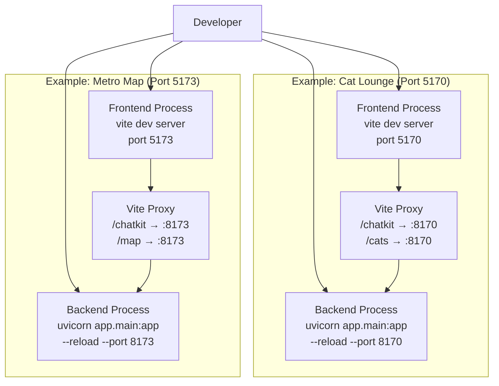
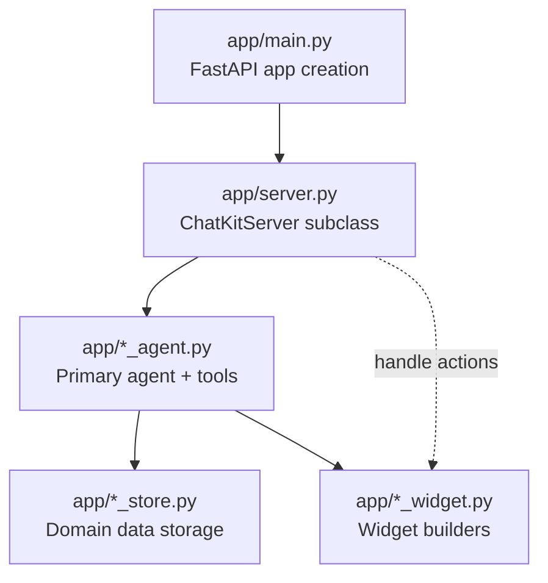
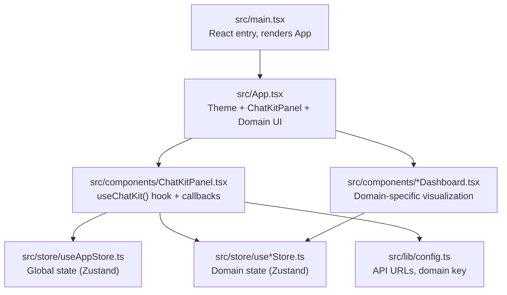
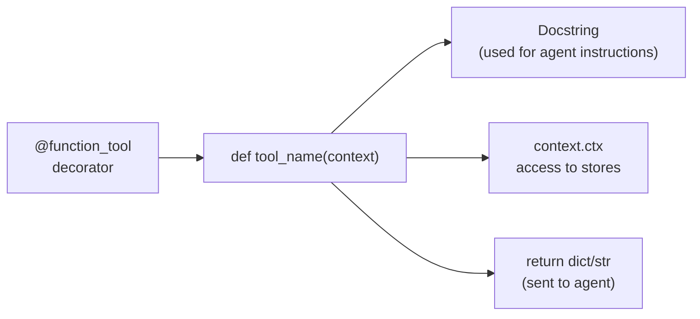
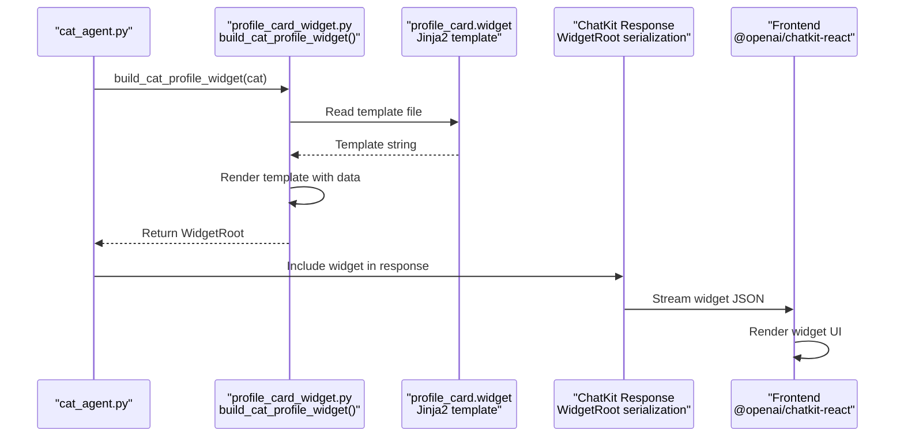

<!-- source: DeepWiki mcp.deepwiki.com · repo openai/openai-chatkit-advanced-samples · page 8 Development Guide · fetched 2026-10-26 -->

# Development Guide

<details>
<summary>Relevant source files</summary>

The following files were used as context for generating this wiki page:

- [README.md](README.md)
- [examples/news-guide/backend/pyproject.toml](examples/news-guide/backend/pyproject.toml)
- [examples/news-guide/backend/uv.lock](examples/news-guide/backend/uv.lock)

</details>


This document covers development practices, tooling, and workflows for building and extending the ChatKit Advanced Samples repository. It provides guidance on setting up the development environment, working with the common architecture patterns, adding new functionality to the examples, and maintaining code quality across the codebase.

## Development Environment Overview

The repository contains four example applications, each following an identical architectural pattern: a FastAPI backend paired with a Vite + React frontend. Each example demonstrates different ChatKit features while maintaining consistent development practices and tooling.

### Technology Stack

| Component | Technology | Version | Package Manager |
|-----------|-----------|---------|-----------------|
| Backend | Python + FastAPI | 3.11+ | `uv` |
| Frontend | Node.js + React + Vite | 18.18+ | `npm` |
| Backend Framework | ChatKit Python SDK | 1.4.0-2.0 | `uv` |
| Frontend Library | @openai/chatkit-react | ^1.3.0 | `npm` |
| Type Checking | TypeScript / mypy | 5.4 / 1.8+ | - |
| Linting | ESLint / Ruff | - / 0.6.4+ | - |
| Formatting | Prettier / Ruff | - / 0.6.4+ | - |

**Example Applications**

| Example | Port | Key Features |
|---------|------|--------------|
| Cat Lounge | 5170 | Client effects, widgets with actions, thread titles |
| Customer Support | 5171 | Timeline syncing, domain-specific tools |
| News Guide | 5172 | Page awareness, entity tags, tool choice, progress updates |
| Metro Map | 5173 | Client tools, annotations, custom headers, ReactFlow integration |

Sources: [README.md:1-24](), [examples/news-guide/backend/pyproject.toml:6-12]()

**Development Server Architecture**



**Diagram: Development Server Architecture**

Each example runs two concurrent processes: a FastAPI backend and a Vite frontend development server. The frontend proxies API requests to the backend, eliminating CORS issues during local development. Backend ports follow the pattern `817X` where `X` matches the frontend port's last digit (e.g., frontend 5170 → backend 8170).

Sources: [README.md:18-23](), Diagram 1 and Diagram 4 from system architecture

## Environment Setup

### Prerequisites

Before starting development, ensure the following tools are installed:

| Tool | Minimum Version | Installation | Verification |
|------|----------------|--------------|--------------|
| Python | 3.11+ | python.org | `python --version` |
| Node.js | 18.18+ | nodejs.org | `node --version` |
| npm | 8.0+ | Included with Node | `npm --version` |
| uv | Latest | `pip install uv` | `uv --version` |

### Setting Up an Example

Choose any of the four examples to work with. The setup process is identical for all:

```bash
# Clone the repository
git clone https://github.com/openai/openai-chatkit-advanced-samples.git
cd openai-chatkit-advanced-samples

# Set required environment variable
export OPENAI_API_KEY="sk-..."

# Option 1: Launch from repository root
npm run cat-lounge       # Launches Cat Lounge on port 5170
npm run customer-support # Launches Customer Support on port 5171
npm run news-guide       # Launches News Guide on port 5172
npm run metro-map        # Launches Metro Map on port 5173

# Option 2: Launch from example directory
cd examples/cat-lounge
npm install
npm run start           # Runs both backend and frontend concurrently
```

The root-level launch commands automatically:
1. Install backend dependencies with `uv sync`
2. Install frontend dependencies with `npm install`
3. Start the backend with `uvicorn --reload`
4. Start the frontend with `vite dev`
5. Open the browser to the appropriate port

Sources: [README.md:12-23]()

### Manual Development Server Launch

For more control during development, start the backend and frontend separately:

**Backend (Terminal 1)**
```bash
cd examples/cat-lounge/backend
export OPENAI_API_KEY="sk-..."
uv sync                          # Install dependencies
uv run uvicorn app.main:app --reload --port 8170
```

**Frontend (Terminal 2)**
```bash
cd examples/cat-lounge/frontend
npm install                      # Install dependencies
npm run dev                      # Start Vite dev server on port 5170
```

The backend `--reload` flag enables automatic restart when Python files change. The frontend Vite server provides Hot Module Replacement (HMR) for instant React component updates.

Sources: Repository structure, Diagram 3 from system architecture

## Code Structure

### Repository Organization

```
openai-chatkit-advanced-samples/
├── examples/
│   ├── cat-lounge/
│   │   ├── backend/
│   │   │   ├── app/
│   │   │   │   ├── main.py          # FastAPI app entry
│   │   │   │   ├── server.py        # CatLoungeServer implementation
│   │   │   │   ├── cat_agent.py     # Primary agent with tools
│   │   │   │   ├── cat_store.py     # Domain data store (CatStore)
│   │   │   │   ├── profile_card_widget.py  # Widget builder
│   │   │   │   └── name_suggestions_widget.py
│   │   │   └── pyproject.toml       # Dependencies (uv)
│   │   └── frontend/
│   │       ├── src/
│   │       │   ├── main.tsx         # React entry point
│   │       │   ├── App.tsx          # Root component
│   │       │   ├── components/
│   │       │   │   ├── ChatKitPanel.tsx  # ChatKit integration
│   │       │   │   └── CatDashboard.tsx  # Domain UI
│   │       │   ├── store/
│   │       │   │   ├── useAppStore.ts    # Global state (Zustand)
│   │       │   │   └── useCatStore.ts    # Cat state
│   │       │   └── lib/
│   │       │       └── config.ts    # API URLs, theme config
│   │       ├── vite.config.ts       # Proxy configuration
│   │       ├── package.json         # Dependencies (npm)
│   │       └── tsconfig.json        # TypeScript config
│   ├── metro-map/                   # Similar structure
│   ├── news-guide/                  # Similar structure
│   └── customer-support/            # Similar structure
├── README.md                        # Repository overview
└── package.json                     # Root-level launch scripts
```

Sources: Repository structure, Diagram 2 from system architecture

### Common Backend Patterns

All examples follow the same backend architecture pattern:

**Backend Layer Structure**



**Diagram: Backend Layer Dependencies**

| File Pattern | Purpose | Example |
|--------------|---------|---------|
| `app/main.py` | FastAPI application entry point, creates app and mounts `ChatKitServer` | [examples/cat-lounge/backend/app/main.py]() |
| `app/server.py` | `ChatKitServer` implementation, handles `respond()` and widget actions | [examples/metro-map/backend/app/server.py]() |
| `app/*_agent.py` | Primary agent definition with `@function_tool` decorated methods | [examples/cat-lounge/backend/app/cat_agent.py](), [examples/metro-map/backend/app/agents/metro_map_agent.py]() |
| `app/*_store.py` | Domain-specific data storage (in-memory classes like `CatStore`, `MetroMapStore`) | [examples/cat-lounge/backend/app/cat_store.py]() |
| `app/*_widget.py` | Widget builder functions that return `WidgetRoot` objects | [examples/cat-lounge/backend/app/profile_card_widget.py]() |
| `app/widgets/*.widget` | Jinja2 widget templates (JSON with templating) | [examples/news-guide/backend/app/widgets/article_list.widget]() |

Sources: Diagram 3 from system architecture, [README.md:28-109]()

### Common Frontend Patterns

All examples follow the same frontend architecture pattern:

**Frontend Component Structure**



**Diagram: Frontend Component Dependencies**

| File Pattern | Purpose | Example |
|--------------|---------|---------|
| `src/main.tsx` | React application entry point, renders root `<App />` | [examples/cat-lounge/frontend/src/main.tsx]() |
| `src/App.tsx` | Root component, manages theme and layout | [examples/cat-lounge/frontend/src/App.tsx]() |
| `src/components/ChatKitPanel.tsx` | ChatKit integration with `useChatKit()` hook and event callbacks | [examples/metro-map/frontend/src/components/ChatKitPanel.tsx]() |
| `src/components/*Dashboard.tsx` | Domain-specific UI (e.g., `CatDashboard`, `MetroMapCanvas`) | Domain-specific |
| `src/store/useAppStore.ts` | Global Zustand store (theme, chatkit instance, thread ID) | [examples/metro-map/frontend/src/store/useAppStore.ts]() |
| `src/store/use*Store.ts` | Domain-specific Zustand store (e.g., `useCatStore`, `useMapStore`) | [examples/metro-map/frontend/src/store/useMapStore.ts]() |
| `src/lib/config.ts` | Configuration constants (API URLs, domain key, theme settings) | Domain-specific |
| `vite.config.ts` | Vite configuration including proxy rules | Each example |

Sources: Diagram 4 from system architecture, [README.md:28-109]()

## Adding New Tools

ChatKit tools are Python functions decorated with `@function_tool` that the agent can invoke during conversation. Adding a new tool follows this pattern:

### Server Tool Implementation

Server tools execute on the backend and can access application state, databases, or external APIs.

**Example: Adding a Tool to Cat Lounge**

```python
# examples/cat-lounge/backend/app/cat_agent.py

from openai_agents.agents import function_tool
from openai_chatkit import AgentContext

@function_tool
def get_cat_status(context: AgentContext) -> dict:
    """Get current status of the cat including energy, happiness, and cleanliness."""
    store = context.ctx["cat_store"]
    cat = store.get_cat()
    return {
        "name": cat.name,
        "energy": cat.energy,
        "happiness": cat.happiness,
        "cleanliness": cat.cleanliness
    }
```

**Tool Definition Pattern**



**Diagram: Tool Implementation Pattern**

| Component | Purpose | Notes |
|-----------|---------|-------|
| `@function_tool` | Registers function as agent tool | Required decorator from `openai_agents` |
| `context: AgentContext` | Provides access to stores and metadata | Pass via `context.ctx["key"]` |
| Docstring | Describes tool purpose for agent | Agent reads this to decide when to use tool |
| Return value | Data sent back to agent | Can be dict, string, or primitive types |

Sources: [examples/cat-lounge/backend/app/cat_agent.py](), [README.md:28-37]()

### Accessing Context in Tools

Tools access application state through `context.ctx`, which is a dictionary populated when the `ChatKitServer` creates agent context:

**Context Dictionary Pattern (from Server)**

```python
# examples/cat-lounge/backend/app/server.py

async def respond(self, request: ChatKitRequest):
    context = {
        "cat_store": self.cat_store,      # Domain store
        "thread_id": request.thread_id,   # Current thread
        "memory": self.memory_store        # Conversation history
    }
    
    response = await cat_agent.run(
        request.messages,
        context=context,
        ...
    )
```

Tools then access these via `context.ctx["cat_store"]`.

Sources: [examples/cat-lounge/backend/app/server.py](), Diagram 3 from system architecture

### Client Tools

Client tools execute in the frontend and return results to the agent. They're useful for querying UI state.

**Example: Client Tool in Metro Map**

```python
# Backend declares the tool
@function_tool
def get_selected_stations(context: AgentContext) -> list[str]:
    """Get the list of stations currently selected on the map."""
    return []  # Placeholder, actual execution happens client-side
```

```typescript
// Frontend handles execution
// examples/metro-map/frontend/src/components/ChatKitPanel.tsx

const handleClientTool = useCallback(async (toolCall: ClientToolCall) => {
  if (toolCall.name === 'get_selected_stations') {
    const selectedStations = useMapStore.getState().selectedStations;
    return { stations: selectedStations.map(s => s.name) };
  }
}, []);

const chatkit = useChatKit({
  onClientTool: handleClientTool,
  // ...
});
```

Client tools require coordination between backend declaration and frontend implementation via the `onClientTool` callback.

Sources: [README.md:39-42](), [examples/metro-map/frontend/src/components/ChatKitPanel.tsx]()

## Creating Widgets

Widgets are interactive UI components rendered inside the chat interface. They're defined using Jinja2 templates on the backend and automatically rendered by the ChatKit frontend library.

### Widget Template Structure

Widgets are defined in `.widget` files using JSON with Jinja2 templating:

**Example: Cat Profile Widget Template**

```json
{
  "title": "{{ cat.name }}'s Status",
  "sections": [
    {
      "rows": [
        {
          "label": "Energy",
          "value": "{{ cat.energy }}/100"
        },
        {
          "label": "Happiness",
          "value": "{{ cat.happiness }}/100"
        }
      ]
    }
  ]
}
```

### Widget Builder Functions

Builder functions populate widget templates with data and return `WidgetRoot` objects:

```python
# examples/cat-lounge/backend/app/profile_card_widget.py

from openai_chatkit import WidgetRoot
from pathlib import Path

def build_cat_profile_widget(cat: Cat) -> WidgetRoot:
    """Build a widget displaying cat status."""
    template_path = Path(__file__).parent / "profile_card.widget"
    return WidgetRoot.from_template(
        template_path,
        cat=cat
    )
```

**Widget Creation Flow**



**Diagram: Widget Build and Render Flow**

Sources: [examples/cat-lounge/backend/app/profile_card_widget.py](), Diagram 7 from system architecture

### Interactive Widgets with Actions

Widgets can include action definitions that trigger when users interact with them:

```python
# Widget with action buttons
def build_name_suggestions_widget(suggestions: list[str]) -> WidgetRoot:
    return WidgetRoot.from_template(
        template_path,
        suggestions=suggestions,
        actions=[
            {
                "id": "cats.select_name",
                "handler": "server",  # or "client"
                "label": "Select"
            }
        ]
    )
```

**Action Handling (Server-Side)**

```python
# examples/cat-lounge/backend/app/server.py

async def respond(self, request: ChatKitRequest):
    if request.action:
        if request.action.name == "cats.select_name":
            selected_name = request.action.payload["name"]
            self.cat_store.get_cat().name = selected_name
            # Return updated widget
            return await self.update_widget(...)
```

**Action Handling (Client-Side)**

```typescript
// examples/cat-lounge/frontend/src/components/ChatKitPanel.tsx

const handleWidgetAction = useCallback((action: WidgetAction) => {
  if (action.name === 'cats.select_name') {
    // Handle locally for immediate UI feedback
    navigate(`/cat/${action.payload.name}`);
    // Optionally also send to server
    chatkit.sendAction(action);
  }
}, []);
```

Actions can be handled client-side (for navigation or immediate UI updates) or server-side (for state persistence and agent updates).

Sources: [README.md:76-95](), [examples/cat-lounge/backend/app/server.py](), Diagram 7 from system architecture

### Widget Types

| Widget Type | Purpose | Action Handler | Example |
|-------------|---------|----------------|---------|
| Presentation | Display information without interaction | N/A | Cat profile card, article preview |
| Interactive (Client) | User actions handled in frontend | `client` | Navigation buttons, UI toggles |
| Interactive (Server) | User actions trigger backend updates | `server` | Name selection, data submission |

Sources: Diagram 7 from system architecture

## Development Best Practices

### Type Safety

Both frontend and backend enforce strict type checking:

**Backend (Python)**
- All functions should have type annotations
- The `mypy` checker runs with `--ignore-missing-imports`
- Type checking is enforced in CI at [.github/workflows/ci.yml:55-57]()

**Frontend (TypeScript)**
- `strict` mode enabled in [frontend/tsconfig.json]()
- ESLint uses type-aware rules via `projectService: true` at [frontend/eslint.config.js:15]()
- No `any` types should be used without justification

### Code Formatting

**Backend**: Ruff handles both linting and formatting. Format violations fail CI at [.github/workflows/ci.yml:47-53](). Run `ruff format app` to auto-fix formatting issues.

**Frontend**: ESLint handles linting. Prettier configuration is implicit through Vite's defaults.

### Component Organization

React components follow this pattern in [frontend/src/components/]():
- Each major feature gets its own component file
- Shared hooks go in [frontend/src/hooks/]()
- Configuration is centralized in [frontend/src/config.ts]()
- The root component [frontend/src/App.tsx]() handles theme orchestration

### Hot Reload Behavior

**Backend**: Full server restart when files in `app/` change. Active API connections are dropped.

**Frontend**: Hot Module Replacement (HMR) preserves React state when components change. CSS updates don't reset state. Adding new files requires manual browser refresh.

Sources: [frontend/src/main.tsx:11-14](), [frontend/src/App.tsx]()

## Multi-Project Support

The repository contains multiple example projects beyond the main demo:

```
├── backend/                              # Main demo backend
├── frontend/                             # Main demo frontend
├── examples/
│   ├── customer-support/
│   │   ├── backend/
│   │   └── frontend/
│   ├── knowledge-assistant/
│   │   ├── backend/
│   │   └── frontend/
│   └── marketing-assets/
│       ├── backend/
│       └── frontend/
```

The CI pipeline at [.github/workflows/ci.yml:11-21]() uses matrix builds to test all projects simultaneously:

```yaml
matrix:
  project:
    - backend
    - examples/customer-support/backend
    - examples/knowledge-assistant/backend
    - examples/marketing-assets/backend
```

Each project is tested independently with the same quality checks. This ensures consistency across all examples in the repository.

Sources: [.github/workflows/ci.yml:11-21](), [.github/workflows/ci.yml:64-69]()

## Common Development Issues

### Proxy Not Working

If API requests fail during local development, verify:
1. Backend is running on port 8000
2. Frontend is running on port 5170
3. Vite proxy configuration in [frontend/vite.config.ts]() includes the correct target
4. No other services are using these ports

### Type Errors

**Backend**: If `mypy` reports errors about missing imports, verify dependencies are installed with `uv sync`.

**Frontend**: If TypeScript errors appear, ensure `npm install` has been run and [frontend/tsconfig.json]() includes the correct paths.

### ChatKit Domain Key Issues

In local development, any placeholder domain key works. The actual validation only applies in production. See [Domain Allowlisting](#7.1) for production setup.

Sources: [frontend/vite.config.ts](), Diagram 6 from system architecture

---

