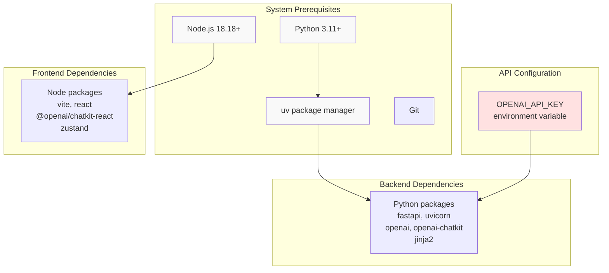
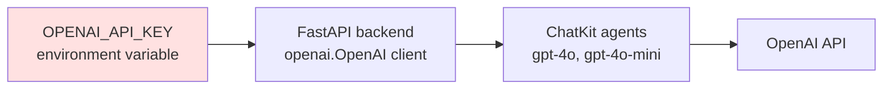
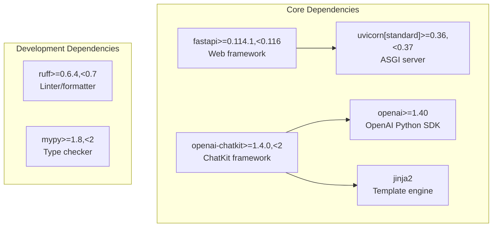
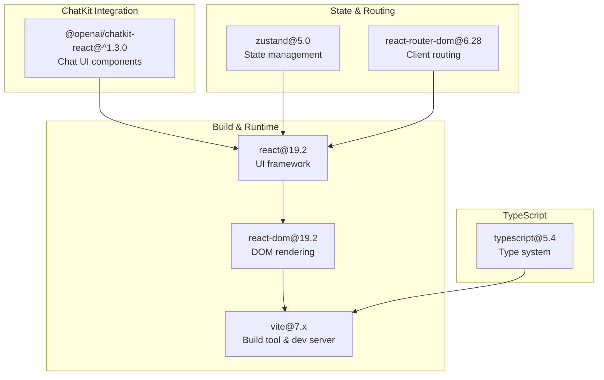
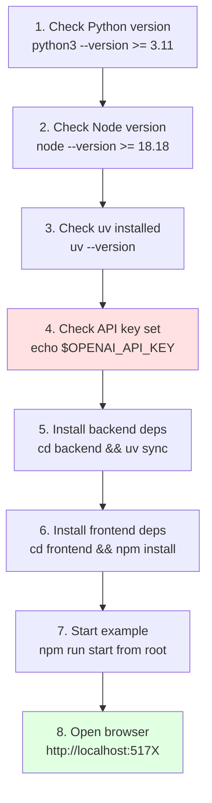

<!-- source: DeepWiki mcp.deepwiki.com · repo openai/openai-chatkit-advanced-samples · page 8.1 Environment Setup · fetched 2026-10-26 -->

# Environment Setup

<details>
<summary>Relevant source files</summary>

The following files were used as context for generating this wiki page:

- [README.md](README.md)
- [examples/news-guide/backend/pyproject.toml](examples/news-guide/backend/pyproject.toml)
- [examples/news-guide/backend/uv.lock](examples/news-guide/backend/uv.lock)

</details>


This page provides detailed instructions for configuring a development environment to run and modify the ChatKit example applications. It covers prerequisite software installation, dependency management, API key configuration, and development tool setup.

For instructions on running the examples after setup, see [Running Examples](#2.2).

---

## Overview

Setting up the development environment requires installing runtime environments (Python 3.11+ and Node.js 18.18+), package managers (`uv` for Python, `npm` for Node.js), and configuring OpenAI API credentials. Each example application consists of independent backend and frontend projects with their own dependency trees.



**Sources:** [README.md:12-23](), [examples/news-guide/backend/pyproject.toml:1-30]()

---

## System Requirements

The examples require specific minimum versions of Python and Node.js, along with sufficient system resources for concurrent backend and frontend processes.

| Requirement | Minimum Version | Purpose |
|-------------|----------------|---------|
| Python | 3.11 | Backend runtime (FastAPI, ChatKit Python SDK) |
| Node.js | 18.18 | Frontend build tool (Vite) and runtime |
| `uv` | Latest | Python package manager (faster than pip) |
| OpenAI API Key | N/A | Required for LLM inference |
| RAM | 4GB+ recommended | Concurrent Python/Node processes |
| Disk Space | 500MB+ | Dependencies and example data |

**Sources:** [README.md:14-15](), [examples/news-guide/backend/pyproject.toml:6]()

---

## Installing Prerequisites

### Python 3.11+

Install Python 3.11 or later using your platform's package manager:

**macOS (Homebrew):**
```bash
brew install python@3.11
```

**Ubuntu/Debian:**
```bash
sudo apt update
sudo apt install python3.11 python3.11-venv
```

**Windows:**
Download the installer from [python.org](https://www.python.org/downloads/) and ensure "Add Python to PATH" is checked during installation.

Verify installation:
```bash
python3 --version  # Should show 3.11.x or higher
```

### Node.js 18.18+

Install Node.js 18.18 or later:

**macOS (Homebrew):**
```bash
brew install node@18
```

**Ubuntu/Debian:**
```bash
curl -fsSL https://deb.nodesource.com/setup_18.x | sudo -E bash -
sudo apt install -y nodejs
```

**Windows:**
Download the LTS installer from [nodejs.org](https://nodejs.org/).

Verify installation:
```bash
node --version  # Should show v18.18.x or higher
npm --version   # npm is bundled with Node.js
```

### uv Package Manager

The repository uses `uv` for fast Python dependency management. Install via the official installer:

**macOS/Linux:**
```bash
curl -LsSf https://astral.sh/uv/install.sh | sh
```

**Windows (PowerShell):**
```powershell
powershell -c "irm https://astral.sh/uv/install.ps1 | iex"
```

Verify installation:
```bash
uv --version
```

The `uv` tool manages Python environments and dependencies defined in [pyproject.toml:1-30]() and locks them in [examples/news-guide/backend/uv.lock:1-100]().

**Sources:** [README.md:15]()

---

## OpenAI API Key Configuration

All examples require an OpenAI API key to function. The key is read from the `OPENAI_API_KEY` environment variable by the backend server.



### Obtaining an API Key

1. Create an account at [platform.openai.com](https://platform.openai.com/)
2. Navigate to **API Keys** in your account settings
3. Click **Create new secret key**
4. Copy the key (it will only be shown once)

### Setting the Environment Variable

**Temporary (Current Shell Session):**

**macOS/Linux:**
```bash
export OPENAI_API_KEY='sk-proj-...'
```

**Windows (PowerShell):**
```powershell
$env:OPENAI_API_KEY='sk-proj-...'
```

**Windows (Command Prompt):**
```cmd
set OPENAI_API_KEY=sk-proj-...
```

**Persistent (All Shell Sessions):**

**macOS/Linux (bash):**
Add to `~/.bashrc` or `~/.bash_profile`:
```bash
export OPENAI_API_KEY='sk-proj-...'
```
Then reload:
```bash
source ~/.bashrc
```

**macOS/Linux (zsh):**
Add to `~/.zshrc`:
```bash
export OPENAI_API_KEY='sk-proj-...'
```
Then reload:
```bash
source ~/.zshrc
```

**Windows (System Environment Variables):**
1. Open **System Properties** → **Advanced** → **Environment Variables**
2. Under **User variables**, click **New**
3. Variable name: `OPENAI_API_KEY`
4. Variable value: `sk-proj-...`
5. Click **OK** and restart your terminal

### Verifying the Configuration

Check that the variable is set:
```bash
# macOS/Linux
echo $OPENAI_API_KEY

# Windows PowerShell
echo $env:OPENAI_API_KEY

# Windows Command Prompt
echo %OPENAI_API_KEY%
```

**Security Note:** Never commit API keys to version control. Add `.env` files to `.gitignore` if using environment file managers.

**Sources:** [README.md:14]()

---

## Backend Dependency Installation

Each example's backend is an independent Python project with dependencies managed by `uv`. The dependency specifications are in [pyproject.toml:6-13](), and exact versions are locked in [uv.lock:1-100]().

### Core Backend Dependencies



**Sources:** [examples/news-guide/backend/pyproject.toml:7-13](), [examples/news-guide/backend/pyproject.toml:16-18]()

### Installation Process

Navigate to an example's backend directory:
```bash
cd examples/cat-lounge/backend
# or examples/customer-support/backend
# or examples/metro-map/backend
# or examples/news-guide/backend
```

Install dependencies using `uv`:
```bash
uv sync
```

This command:
1. Creates a virtual environment in `.venv/`
2. Installs packages from [uv.lock:100-564]() for reproducible builds
3. Installs the local package in editable mode

**Development Dependencies:**

To install development tools (linters, type checkers):
```bash
uv sync --extra dev
```

This installs `ruff` for linting/formatting and `mypy` for static type checking, as specified in [pyproject.toml:16-18]().

### Activating the Virtual Environment

**macOS/Linux:**
```bash
source .venv/bin/activate
```

**Windows:**
```cmd
.venv\Scripts\activate
```

Verify activation by checking the Python path:
```bash
which python  # Should point to .venv/bin/python
```

### Verifying Backend Setup

Test that dependencies are installed correctly:
```bash
# Check FastAPI version
python -c "import fastapi; print(fastapi.__version__)"

# Check ChatKit version
python -c "import openai_chatkit; print(openai_chatkit.__version__)"

# Check OpenAI client
python -c "import openai; print(openai.__version__)"
```

**Sources:** [README.md:15](), [examples/news-guide/backend/pyproject.toml:1-30](), [examples/news-guide/backend/uv.lock:100-564]()

---

## Frontend Dependency Installation

Each example's frontend is a Vite + React application with dependencies managed by `npm`. The frontend can be developed independently of the backend.

### Core Frontend Dependencies



**Sources:** Package.json files in each example's frontend directory

### Installation Process

Navigate to an example's frontend directory:
```bash
cd examples/cat-lounge/frontend
# or examples/customer-support/frontend
# or examples/metro-map/frontend
# or examples/news-guide/frontend
```

Install dependencies:
```bash
npm install
```

This reads `package.json` and installs all dependencies into `node_modules/`.

### Verifying Frontend Setup

Check that core dependencies are installed:
```bash
# List installed packages
npm list --depth=0

# Verify specific packages
npm list @openai/chatkit-react
npm list vite
npm list react
```

### TypeScript Configuration

Each frontend includes TypeScript for type safety. The configuration is in `tsconfig.json` and `tsconfig.app.json`. No additional setup is required beyond `npm install`.

**Sources:** README.md structure, package.json patterns across examples

---

## Development Tools Setup

### Code Editor Configuration

**Visual Studio Code (Recommended):**

Install recommended extensions:
- **Python** (ms-python.python) - Python language support
- **Pylance** (ms-python.vscode-pylance) - Fast Python language server
- **Ruff** (charliermarsh.ruff) - Python linting/formatting
- **ESLint** (dbaeumer.vscode-eslint) - JavaScript/TypeScript linting
- **Prettier** (esbenp.prettier-vscode) - Code formatting

Create `.vscode/settings.json` in the repository root:
```json
{
  "python.defaultInterpreterPath": "${workspaceFolder}/examples/cat-lounge/backend/.venv/bin/python",
  "python.linting.enabled": true,
  "python.linting.mypyEnabled": true,
  "python.formatting.provider": "none",
  "[python]": {
    "editor.defaultFormatter": "charliermarsh.ruff",
    "editor.formatOnSave": true,
    "editor.codeActionsOnSave": {
      "source.organizeImports": true
    }
  },
  "[typescript]": {
    "editor.defaultFormatter": "esbenp.prettier-vscode",
    "editor.formatOnSave": true
  }
}
```

### Linting and Type Checking

**Backend (Python):**

Run `ruff` for linting and formatting:
```bash
cd examples/cat-lounge/backend
uv run ruff check .          # Lint
uv run ruff format .         # Format
uv run mypy app              # Type check
```

Configuration is in [pyproject.toml:25-29]():
- Line length: 100 characters
- Import sorting enabled
- Type checking with `mypy`

**Frontend (TypeScript):**

TypeScript type checking happens automatically during development:
```bash
cd examples/cat-lounge/frontend
npm run dev  # Vite performs type checking in watch mode
```

Build to verify types:
```bash
npm run build  # Fails if type errors exist
```

**Sources:** [examples/news-guide/backend/pyproject.toml:25-29]()

---

## Verification Checklist

After completing the setup, verify that all components work together by running an example application.



### Step-by-Step Verification

**1. Verify Python:**
```bash
python3 --version
# Expected: Python 3.11.x or higher
```

**2. Verify Node.js:**
```bash
node --version
# Expected: v18.18.x or higher
```

**3. Verify uv:**
```bash
uv --version
# Expected: uv x.x.x
```

**4. Verify API key:**
```bash
echo $OPENAI_API_KEY
# Expected: sk-proj-... (your actual key)
```

**5. Install backend dependencies:**
```bash
cd examples/cat-lounge/backend
uv sync
# Expected: Dependencies installed successfully
```

**6. Install frontend dependencies:**
```bash
cd ../frontend
npm install
# Expected: node_modules/ created
```

**7. Run the example:**
```bash
cd ../..  # Back to repository root
npm run cat-lounge
# Expected: Backend and frontend start in parallel
```

**8. Open the application:**
Navigate to http://localhost:5170 in your browser.
- Cat Lounge: port 5170
- Customer Support: port 5171
- News Guide: port 5172
- Metro Map: port 5173

You should see the chat interface load and be able to send messages.

**Sources:** [README.md:12-23]()

---

## Troubleshooting Common Issues

| Issue | Cause | Solution |
|-------|-------|----------|
| `OPENAI_API_KEY not set` error | Environment variable not configured | Follow [API Key Configuration](#openai-api-key-configuration) |
| `Python version 3.11 required` | Older Python version | Install Python 3.11+ and update `PATH` |
| `uv: command not found` | `uv` not installed or not in PATH | Reinstall `uv` and verify shell configuration |
| `Module not found` errors (Python) | Dependencies not installed | Run `uv sync` in backend directory |
| `Cannot find module` errors (Node) | Dependencies not installed | Run `npm install` in frontend directory |
| `Port already in use` | Another service using 5170-5173 | Stop conflicting service or modify port in config |
| Backend starts but frontend fails | Node version too old | Install Node.js 18.18+ |
| Type errors in IDE | Wrong Python interpreter selected | Point IDE to `.venv/bin/python` |
| `ruff: command not found` | Dev dependencies not installed | Run `uv sync --extra dev` |

### Getting Additional Help

If issues persist after following troubleshooting steps:
1. Check that all prerequisite versions meet minimum requirements
2. Verify the `OPENAI_API_KEY` is valid and has available quota
3. Review backend logs for specific error messages
4. Ensure no firewall rules block localhost connections

**Sources:** [README.md:12-23](), common development environment issues

---

## Next Steps

After completing environment setup:
- **Run Examples:** See [Running Examples](#2.2) for detailed instructions on launching each application
- **Understand Code Structure:** See [Code Structure](#8.2) to navigate the codebase
- **Add Features:** See [Adding New Tools](#8.3) to extend agent capabilities
- **Create Widgets:** See [Creating Widgets](#8.4) to build custom UI components

**Sources:** Table of contents structure

---

