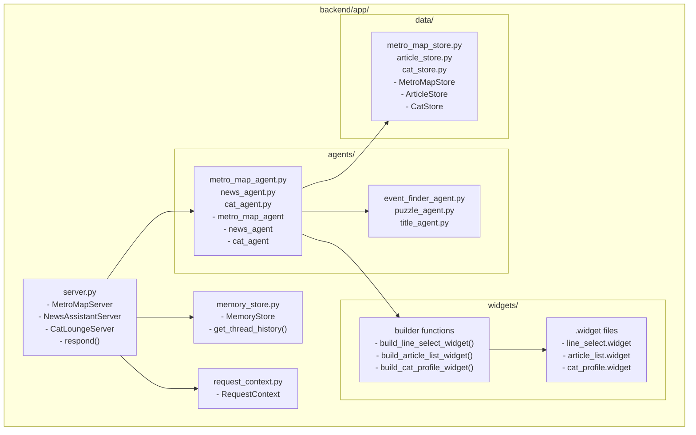
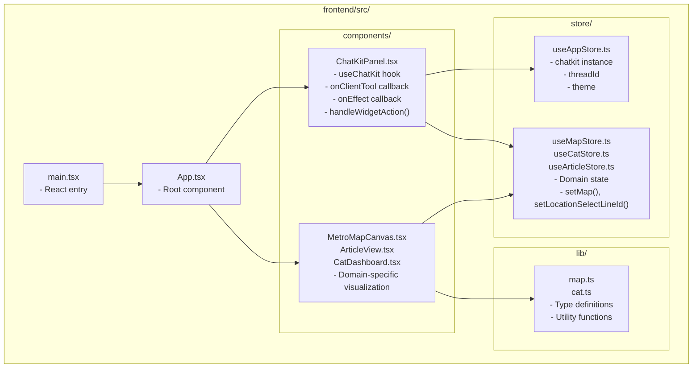
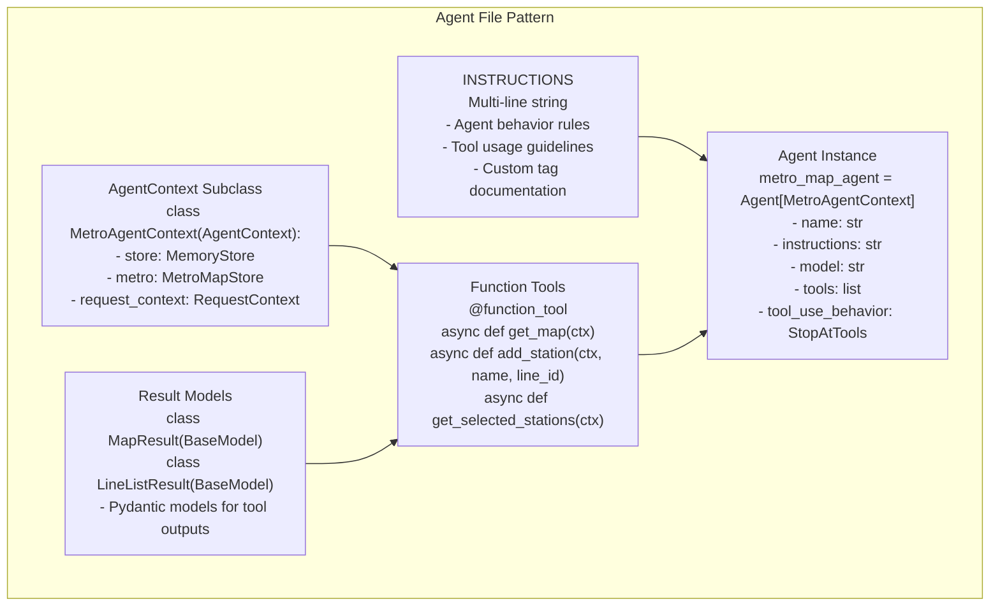
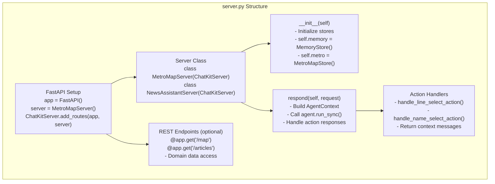

<!-- source: DeepWiki mcp.deepwiki.com · repo openai/openai-chatkit-advanced-samples · page 8.2 Code Structure · fetched 2026-10-26 -->

# Code Structure

<details>
<summary>Relevant source files</summary>

The following files were used as context for generating this wiki page:

- [examples/metro-map/backend/app/agents/metro_map_agent.py](examples/metro-map/backend/app/agents/metro_map_agent.py)
- [examples/metro-map/frontend/src/components/MetroMapCanvas.tsx](examples/metro-map/frontend/src/components/MetroMapCanvas.tsx)
- [examples/metro-map/frontend/src/store/useMapStore.ts](examples/metro-map/frontend/src/store/useMapStore.ts)

</details>


This page documents the common code organization patterns used across all example applications in the repository. It explains the directory layout, file naming conventions, and the typical structure of agent files, widget files, store files, and React components. For instructions on setting up your development environment, see [Environment Setup](#8.1). For guides on extending the codebase, see [Adding New Tools](#8.3) and [Creating Widgets](#8.4).

## Backend Directory Structure

All example applications follow a consistent backend directory structure under `examples/{example-name}/backend/`:

```
backend/
├── app/
│   ├── __init__.py
│   ├── server.py              # FastAPI server + ChatKitServer implementation
│   ├── request_context.py     # RequestContext dataclass
│   ├── memory_store.py        # MemoryStore for thread history
│   ├── agents/                # Agent definitions
│   │   ├── __init__.py
│   │   └── {agent_name}.py    # Individual agent files
│   ├── widgets/               # Widget templates and builders
│   │   ├── {widget_name}.widget
│   │   └── {widget_name}.py
│   └── data/                  # Domain-specific data stores
│       ├── __init__.py
│       └── {domain}_store.py
├── pyproject.toml             # Poetry/uv dependencies
└── uv.lock
```

### Backend Directory Structure Diagram



**Sources**: 
- [examples/metro-map/backend/app/server.py]()
- [examples/metro-map/backend/app/agents/metro_map_agent.py:1-314]()
- [examples/newsguide/backend/app/server.py]()
- [examples/cat-lounge/backend/app/server.py]()

## Frontend Directory Structure

All example applications follow a consistent frontend directory structure under `examples/{example-name}/frontend/`:

```
frontend/
├── src/
│   ├── main.tsx               # React app entry point
│   ├── App.tsx                # Root component
│   ├── components/            # React components
│   │   ├── ChatKitPanel.tsx   # ChatKit integration wrapper
│   │   └── {DomainUI}.tsx     # Domain-specific UI components
│   ├── store/                 # Zustand state management
│   │   ├── useAppStore.ts     # Global app state
│   │   └── use{Domain}Store.ts # Domain-specific state
│   ├── lib/                   # Utility functions and types
│   │   └── {domain}.ts
│   └── index.css
├── package.json
├── tsconfig.json
└── vite.config.ts
```

### Frontend Directory Structure Diagram



**Sources**:
- [examples/metro-map/frontend/src/components/ChatKitPanel.tsx]()
- [examples/metro-map/frontend/src/store/useMapStore.ts:1-86]()
- [examples/metro-map/frontend/src/components/MetroMapCanvas.tsx:1-492]()
- [examples/cat-lounge/frontend/src/components/ChatKitPanel.tsx]()

## Agent File Structure

Agent files define the conversational AI logic and are located in `backend/app/agents/`. Each agent file follows a consistent pattern:

| Component | Purpose | Example |
|-----------|---------|---------|
| **Instructions** | Multi-line string defining agent behavior | `INSTRUCTIONS = """You are a concise metro planner..."""` |
| **AgentContext** | Pydantic model extending `AgentContext` with domain stores | `class MetroAgentContext(AgentContext)` |
| **Result Models** | Pydantic models for tool return values | `class MapResult(BaseModel)`, `class StationListResult(BaseModel)` |
| **Tool Functions** | Functions decorated with `@function_tool` | `async def get_map(ctx)`, `async def add_station(ctx, ...)` |
| **Agent Instance** | `Agent[Context]` configuration with tools and behavior | `metro_map_agent = Agent[MetroAgentContext](...)` |

### Agent File Structure Diagram



**Sources**:
- [examples/metro-map/backend/app/agents/metro_map_agent.py:28-313]()
- [examples/newsguide/backend/app/agents/news_agent.py]()
- [examples/cat-lounge/backend/app/cat_agent.py]()

### Agent Context Pattern

The `AgentContext` subclass provides tools with access to domain stores and services:

```python
class MetroAgentContext(AgentContext):
    model_config = ConfigDict(arbitrary_types_allowed=True)
    store: Annotated[MemoryStore, Field(exclude=True)]
    metro: Annotated[MetroMapStore, Field(exclude=True)]
    request_context: Annotated[RequestContext, Field(exclude=True)]
```

Each context field uses `Annotated` with `Field(exclude=True)` to prevent serialization while maintaining type safety. Tools access these through the `ctx.context` parameter:

```python
@function_tool(description_override="Load the latest metro map...")
async def get_map(ctx: RunContextWrapper[MetroAgentContext]) -> MapResult:
    metro_map = ctx.context.metro.get_map()
    await ctx.context.stream(ProgressUpdateEvent(text="Retrieving..."))
    return MapResult(map=metro_map)
```

**Sources**:
- [examples/metro-map/backend/app/agents/metro_map_agent.py:77-82]()
- [examples/metro-map/backend/app/agents/metro_map_agent.py:110-138]()

### Tool Use Behavior Configuration

Agents use `StopAtTools` to pause after specific tool calls, particularly for client tools, widget displays, and effects:

```python
metro_map_agent = Agent[MetroAgentContext](
    # ... other config ...
    tool_use_behavior=StopAtTools(
        stop_at_tool_names=[
            plan_route.name,              # Stops after annotations
            show_line_selector.name,      # Stops after widget display
            get_selected_stations.name,   # Stops after client tool request
        ]
    ),
)
```

This pattern ensures the agent waits for user interaction or client-side data before continuing inference.

**Sources**:
- [examples/metro-map/backend/app/agents/metro_map_agent.py:286-313]()

## Widget File Structure

Widget files are organized in `backend/app/widgets/` and consist of two parts:

### Widget Template Files (`.widget`)

Template files use JSON with Jinja2 templating for dynamic content generation:

```
widgets/
├── line_select.widget         # JSON template with Jinja2 expressions
└── line_select_widget.py      # Builder function
```

The `.widget` file contains the widget JSON structure with Jinja2 placeholders:

```json
{
  "kind": "vertical-stack",
  "children": [
    
    {
      "kind": "text",
      "text": "{{ line.name }}",
      "action": {
        "type": "line.select",
        "handler": "server",
        "data": { "lineId": "{{ line.id }}" }
      }
    }
    ,
    
  ]
}
```

### Widget Builder Functions

Builder functions in the corresponding `.py` file populate templates with data and return `WidgetRoot` objects:

```python
def build_line_select_widget(lines: list[Line]) -> WidgetRoot:
    template = get_widget_template("line_select")
    content = template.render(lines=lines)
    return WidgetRoot.model_validate_json(content)
```

**Sources**:
- [examples/metro-map/backend/app/widgets/line_select_widget.py]()
- [examples/newsguide/backend/app/widgets/article_list.widget]()
- [examples/cat-lounge/backend/app/profile_card_widget.py]()

## Data Store Structure

Domain stores are located in `backend/app/data/` and encapsulate domain-specific business logic:

| Component | Purpose | Example |
|-----------|---------|---------|
| **Domain Models** | Pydantic models for domain entities | `class Station(BaseModel)`, `class Line(BaseModel)`, `class MetroMap(BaseModel)` |
| **Store Class** | Singleton or stateful class managing domain data | `class MetroMapStore`, `class ArticleStore`, `class CatStore` |
| **Query Methods** | Methods to retrieve domain data | `get_map()`, `find_station(id)`, `list_lines()` |
| **Mutation Methods** | Methods to modify domain state | `add_station(name, line_id, append)`, `update_cat_mood(delta)` |

### Data Store Pattern Example

```python
class MetroMapStore:
    def __init__(self):
        self._map: MetroMap = self._initialize_map()
    
    def get_map(self) -> MetroMap:
        """Retrieve the complete metro map."""
        return self._map
    
    def find_station(self, station_id: str) -> Station | None:
        """Look up a station by ID."""
        return next((s for s in self._map.stations if s.id == station_id), None)
    
    def add_station(self, name: str, line_id: str, append: bool) -> tuple[MetroMap, Station]:
        """Add a new station to a line."""
        # ... mutation logic ...
        return self._map, new_station
```

**Sources**:
- [examples/metro-map/backend/app/data/metro_map_store.py]()
- [examples/newsguide/backend/app/data/article_store.py]()
- [examples/cat-lounge/backend/app/data/cat_store.py]()

## Server Implementation Structure

The `server.py` file in each example implements the `ChatKitServer` interface and orchestrates the backend:

### Server Implementation Pattern



**Sources**:
- [examples/metro-map/backend/app/server.py]()
- [examples/newsguide/backend/app/server.py]()

### Action Handling Pattern

Server-side widget actions are handled through dedicated methods that return context messages:

```python
async def respond(self, request: ChatCompletionRequest) -> AsyncGenerator[ServerStreamEvent, None]:
    # Handle widget actions
    action = request.action
    if action:
        context = await self._handle_action(action, request)
        if context:
            request.context.append(context)
    
    # Build agent context and run
    agent_context = MetroAgentContext(
        store=self.memory,
        metro=self.metro,
        request_context=RequestContext(thread_id=request.thread_id),
        # ... other fields ...
    )
    
    async for event in agent.run_async(request, agent_context):
        yield event

async def _handle_action(self, action: ActionRequest, request: ChatCompletionRequest):
    if action.type == "line.select":
        line_id = action.data.get("lineId")
        line = self.metro.find_line(line_id)
        return UserMessageContent(text=f"<LINE_SELECTED>{line_id}</LINE_SELECTED>")
```

The returned context is appended to the request before agent processing, allowing the agent to respond to the user's action.

**Sources**:
- [examples/metro-map/backend/app/server.py]()

## Frontend Component Structure

### ChatKitPanel Component

The `ChatKitPanel.tsx` component is present in all examples and serves as the integration point between ChatKit and the application:

```typescript
export function ChatKitPanel() {
  const { chatkit, setChatKit } = useAppStore();
  const { setMap, setLocationSelectLineId, focusStation } = useMapStore();
  
  const config = useChatKit({
    baseURL: API_URL,
    authToken: API_AUTH_TOKEN,
    domainKey: DOMAIN_KEY,
    
    // Client tool handler
    onClientTool: async (toolCall) => {
      if (toolCall.name === "get_selected_stations") {
        const ids = useMapStore.getState().selectedStationIds;
        return { station_ids: ids };
      }
    },
    
    // Client effect handler
    onEffect: async (effect) => {
      if (effect.name === "location_select_mode") {
        setLocationSelectLineId(effect.data.lineId);
      } else if (effect.name === "add_station") {
        const map = effect.data.map;
        setMap(map);
        focusStation(effect.data.stationId, map);
      }
    },
    
    // Widget action handler
    handleWidgetAction: async (action, widgetId) => {
      if (action.handler === "client") {
        // Handle locally (e.g., navigation)
      } else {
        // Send to server
        return chatkit?.sendAction(action, widgetId);
      }
    },
    
    onReady: (instance) => setChatKit(instance),
    onThreadChange: (threadId) => { /* ... */ },
  });
  
  return <ChatKitUI {...config} />;
}
```

**Sources**:
- [examples/metro-map/frontend/src/components/ChatKitPanel.tsx]()
- [examples/cat-lounge/frontend/src/components/ChatKitPanel.tsx]()

### Domain UI Components

Domain-specific UI components (like `MetroMapCanvas.tsx`, `CatDashboard.tsx`, `ArticleView.tsx`) handle visualization and direct user interactions with domain data:

```typescript
export function MetroMapCanvas({ map }: { map: MetroMap }) {
  const { selectedStationIds, setSelectedStationIds } = useMapStore();
  const { chatkit } = useAppStore();
  
  const handleNodeClick = (node: Node) => {
    setSelectedStationIds([node.id]);
    chatkit?.sendUserMessage({ 
      text: `Tell me about ${node.data.name}` 
    });
  };
  
  return (
    <ReactFlow
      nodes={buildNodes(map, selectedStationIds)}
      edges={buildEdges(map)}
      onNodeClick={handleNodeClick}
      // ... other props ...
    />
  );
}
```

**Sources**:
- [examples/metro-map/frontend/src/components/MetroMapCanvas.tsx:372-492]()
- [examples/cat-lounge/frontend/src/components/CatDashboard.tsx]()

## Frontend Store Structure

Zustand stores manage application state and are split between global and domain-specific concerns:

### Store Type Breakdown

| Store File | Purpose | Key State | Key Actions |
|------------|---------|-----------|-------------|
| `useAppStore.ts` | Global application state | `chatkit`, `threadId`, `theme` | `setChatKit()`, `setThreadId()`, `setTheme()` |
| `useMapStore.ts` | Metro map state | `map`, `selectedStationIds`, `locationSelectLineId` | `setMap()`, `focusStation()`, `setLocationSelectLineId()` |
| `useCatStore.ts` | Cat lounge state | `cat`, `isFeeding`, `isPlaying` | `updateCat()`, `setIsFeeding()`, `setIsPlaying()` |
| `useArticleStore.ts` | News guide state | `currentArticleId`, `currentPage` | `setCurrentArticleId()`, `setCurrentPage()` |

### Zustand Store Pattern

```typescript
type MapState = {
  // State
  map: MetroMap | null;
  selectedStationIds: string[];
  locationSelectLineId: string | null;
  interactionMode: "select" | "pan";
  
  // Actions
  setMap: (map: MetroMap | null) => void;
  setSelectedStationIds: (ids: string[]) => void;
  setLocationSelectLineId: (lineId: string | null) => void;
  focusStation: (stationId: string, map?: MetroMap) => void;
  clearLocationSelectMode: () => void;
};

export const useMapStore = create<MapState>((set, get) => ({
  // Initial state
  map: null,
  selectedStationIds: [],
  locationSelectLineId: null,
  interactionMode: "select",
  
  // Action implementations
  setMap: (map) => set({ map }),
  setSelectedStationIds: (ids) => set({ selectedStationIds: ids }),
  focusStation: (stationId, currentMap) => {
    const map = currentMap ?? get().map;
    const station = map?.stations.find(s => s.id === stationId);
    if (station) {
      set({ selectedStationIds: [stationId] });
      // Trigger ReactFlow focus logic...
    }
  },
}));
```

**Sources**:
- [examples/metro-map/frontend/src/store/useMapStore.ts:6-86]()
- [examples/cat-lounge/frontend/src/store/useCatStore.ts]()

## File Naming Conventions

The repository follows consistent naming conventions across all examples:

| File Type | Convention | Examples |
|-----------|------------|----------|
| **Agent Files** | `{domain}_agent.py` | `metro_map_agent.py`, `news_agent.py`, `cat_agent.py` |
| **Sub-Agent Files** | `{purpose}_agent.py` | `event_finder_agent.py`, `title_agent.py`, `puzzle_agent.py` |
| **Widget Templates** | `{widget_name}.widget` | `line_select.widget`, `article_list.widget`, `cat_profile.widget` |
| **Widget Builders** | `{widget_name}_widget.py` | `line_select_widget.py`, `article_list_widget.py` |
| **Data Stores** | `{domain}_store.py` | `metro_map_store.py`, `article_store.py`, `cat_store.py` |
| **React Components** | `{ComponentName}.tsx` | `MetroMapCanvas.tsx`, `ChatKitPanel.tsx`, `CatDashboard.tsx` |
| **Zustand Stores** | `use{Domain}Store.ts` | `useMapStore.ts`, `useCatStore.ts`, `useArticleStore.ts` |
| **Lib Files** | `{domain}.ts` | `map.ts`, `cat.ts`, `article.ts` |

**Sources**:
- All example directories in `examples/`

## Cross-Cutting Patterns

### Memory Management

All examples use `MemoryStore` to maintain thread history:

```python
class MemoryStore:
    def __init__(self):
        self._threads: dict[str, list[ThreadItem]] = {}
    
    def get_thread_history(self, thread_id: str) -> list[ThreadItem]:
        return self._threads.get(thread_id, [])
    
    def append_thread_item(self, thread_id: str, item: ThreadItem):
        if thread_id not in self._threads:
            self._threads[thread_id] = []
        self._threads[thread_id].append(item)
```

The `MemoryStore` is initialized in the server and passed to the `AgentContext` for each request.

**Sources**:
- [examples/metro-map/backend/app/memory_store.py]()
- [examples/newsguide/backend/app/memory_store.py]()

### Request Context

The `RequestContext` dataclass tracks per-request metadata:

```python
@dataclass
class RequestContext:
    thread_id: str
    # Additional fields for request-scoped data
```

This pattern separates request-specific state from persistent stores.

**Sources**:
- [examples/metro-map/backend/app/request_context.py]()

### Configuration Files

Each example includes standard configuration files:

| File | Purpose |
|------|---------|
| `pyproject.toml` | Python dependencies and project metadata |
| `uv.lock` | Locked dependency versions for reproducibility |
| `package.json` | Node.js dependencies and scripts |
| `tsconfig.json` | TypeScript compiler configuration |
| `vite.config.ts` | Vite build tool configuration |

**Sources**:
- All example `pyproject.toml` and `package.json` files

---

