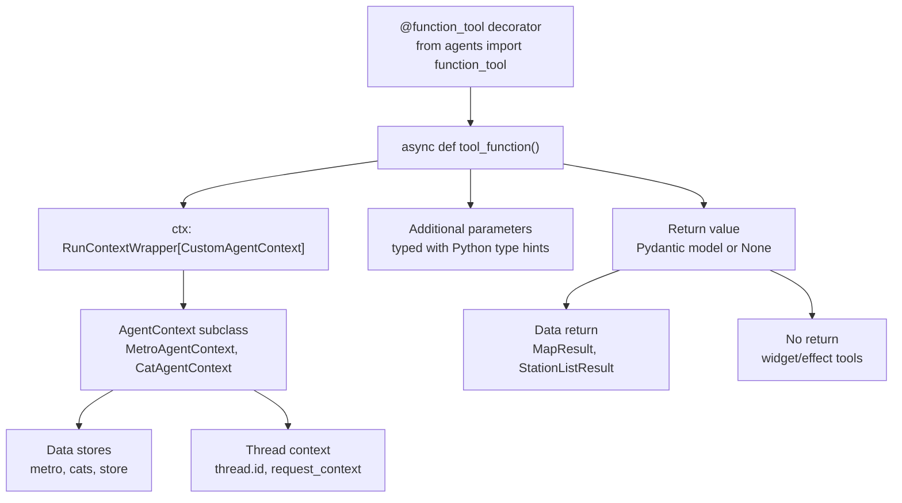
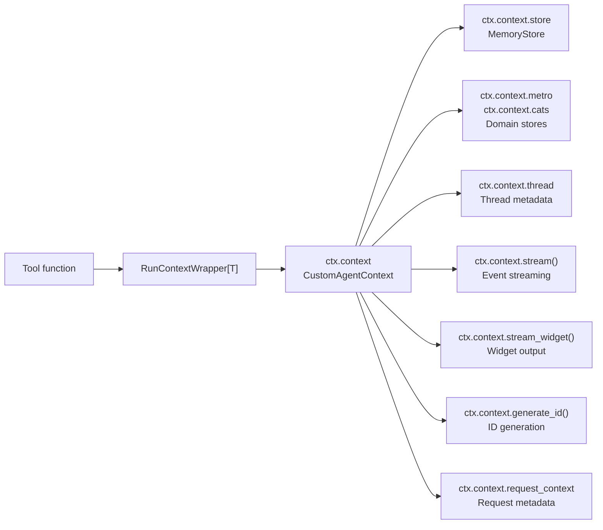
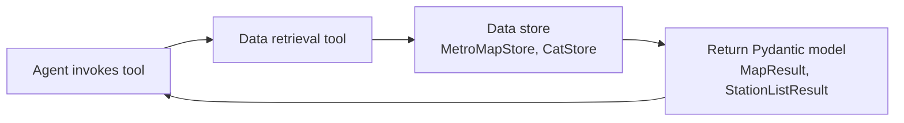
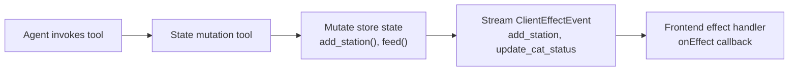
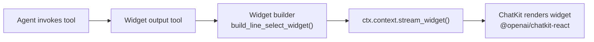
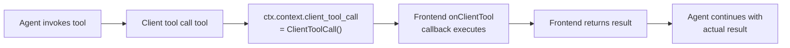
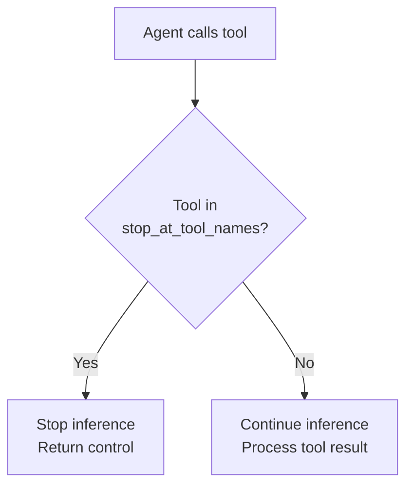

<!-- source: DeepWiki mcp.deepwiki.com · repo openai/openai-chatkit-advanced-samples · page 8.3 Adding New Tools · fetched 2026-10-26 -->

# Adding New Tools

<details>
<summary>Relevant source files</summary>

The following files were used as context for generating this wiki page:

- [examples/cat-lounge/backend/app/cat_agent.py](examples/cat-lounge/backend/app/cat_agent.py)
- [examples/metro-map/backend/app/agents/metro_map_agent.py](examples/metro-map/backend/app/agents/metro_map_agent.py)

</details>


This page provides a practical guide for adding new function tools to ChatKit agents in the example applications. Tools are Python functions decorated with `@function_tool` that agents can invoke to query data, mutate state, output widgets, or trigger client effects.

For information about how tools fit into the overall agent architecture, see [Backend Architecture Pattern](#3.1). For guidance on creating widgets that tools can output, see [Creating Widgets](#8.4). For detailed explanations of tool communication patterns, see [Communication Patterns](#3.3).

## Tool Anatomy

Function tools in ChatKit follow a consistent structure across all examples. Each tool is a Python async function decorated with `@function_tool`, accepting a typed context wrapper as its first parameter.



**Sources:**
- [examples/metro-map/backend/app/agents/metro_map_agent.py:110-313]()
- [examples/cat-lounge/backend/app/cat_agent.py:125-366]()

## Function Tool Decorator

The `@function_tool` decorator converts a regular Python function into a tool that agents can invoke. The decorator supports a `description_override` parameter that provides the agent with explicit instructions on when and how to use the tool.

| Decorator Parameter | Purpose | Example |
|-------------------|---------|---------|
| `description_override` | Provides tool usage instructions to the agent | `"Load the latest metro map with lines and stations. No parameters."` |

**Example from Metro Map:**

```python
@function_tool(
    description_override=("Load the latest metro map with lines and stations. No parameters.")
)
async def get_map(ctx: RunContextWrapper[MetroAgentContext]) -> MapResult:
    logger.info("[TOOL CALL] get_map")
    metro_map = ctx.context.metro.get_map()
    await ctx.context.stream(ProgressUpdateEvent(text="Retrieving the latest metro map..."))
    return MapResult(map=metro_map)
```

The `description_override` field becomes part of the tool schema sent to the model, guiding the agent's decision-making about when to invoke the tool.

**Sources:**
- [examples/metro-map/backend/app/agents/metro_map_agent.py:131-138]()
- [examples/cat-lounge/backend/app/cat_agent.py:125-136]()

## Context Access Pattern

All tools receive a `RunContextWrapper[CustomAgentContext]` as their first parameter. This wrapper provides access to domain stores, memory stores, streaming capabilities, and thread metadata.



### Custom AgentContext Classes

Each example defines its own `AgentContext` subclass to inject domain-specific dependencies:

**Metro Map Context:**
```python
class MetroAgentContext(AgentContext):
    model_config = ConfigDict(arbitrary_types_allowed=True)
    store: Annotated[MemoryStore, Field(exclude=True)]
    metro: Annotated[MetroMapStore, Field(exclude=True)]
    request_context: Annotated[RequestContext, Field(exclude=True)]
```

**Cat Lounge Context:**
```python
class CatAgentContext(AgentContext):
    model_config = ConfigDict(arbitrary_types_allowed=True)
    store: Annotated[MemoryStore, Field(exclude=True)]
    cats: Annotated[CatStore, Field(exclude=True)]
    request_context: dict[str, Any]
```

The `Field(exclude=True)` annotation prevents these fields from being serialized when the context is logged or transmitted.

**Sources:**
- [examples/metro-map/backend/app/agents/metro_map_agent.py:77-81]()
- [examples/cat-lounge/backend/app/cat_agent.py:73-77]()

## Tool Patterns

The examples demonstrate five distinct tool patterns, each serving a different purpose in the conversational flow.

### Pattern 1: Data Retrieval Tools

Data retrieval tools query backend stores and return structured results to the agent for reasoning. These tools always return a Pydantic model.



| Tool Name | Context Type | Return Type | Purpose |
|-----------|-------------|-------------|---------|
| `get_map` | `MetroAgentContext` | `MapResult` | Loads current metro map state |
| `list_lines` | `MetroAgentContext` | `LineListResult` | Returns all metro lines |
| `get_cat_status` | `CatAgentContext` | `dict[str, Any]` | Fetches current cat stats |
| `get_station` | `MetroAgentContext` | `StationDetailResult` | Queries single station details |

**Example Implementation:**

```python
@function_tool(
    description_override=("List all metro lines with their colors and endpoints. No parameters.")
)
async def list_lines(ctx: RunContextWrapper[MetroAgentContext]) -> LineListResult:
    logger.info("[TOOL CALL] list_lines")
    return LineListResult(lines=ctx.context.metro.list_lines())
```

**Sources:**
- [examples/metro-map/backend/app/agents/metro_map_agent.py:141-146]()
- [examples/cat-lounge/backend/app/cat_agent.py:125-136]()

### Pattern 2: State Mutation Tools

State mutation tools modify backend state and typically trigger client effects to synchronize the UI. These tools do not return values; they use `ClientEffectEvent` to update the frontend.



**Example from Cat Lounge:**

```python
@function_tool(
    description_override=(
        "Feed the cat to replenish energy and keep moods stable.\n"
        "- `meal`: Meal or snack description to include in the update."
    )
)
async def feed_cat(
    ctx: RunContextWrapper[CatAgentContext],
    meal: str | None = None,
):
    logger.info("[TOOL CALL] feed_cat")
    state = await _update_state(ctx, lambda s: s.feed())
    flash = f"Fed {state.name} {meal}" if meal else f"{state.name} enjoyed a snack"
    await _add_hidden_context(ctx, f"<FED_CAT>{flash}</FED_CAT>")
    await _sync_status(ctx, state, flash)
```

The `_sync_status` helper streams a `ClientEffectEvent`:

```python
async def _sync_status(
    ctx: RunContextWrapper[CatAgentContext],
    state: CatState,
    flash: str | None = None,
) -> None:
    await ctx.context.stream(
        ClientEffectEvent(
            name="update_cat_status",
            data={
                "state": state.to_payload(ctx.context.thread.id),
                "flash": flash,
            },
        )
    )
```

**Sources:**
- [examples/cat-lounge/backend/app/cat_agent.py:139-154]()
- [examples/cat-lounge/backend/app/cat_agent.py:93-106]()
- [examples/metro-map/backend/app/agents/metro_map_agent.py:219-265]()

### Pattern 3: Widget Output Tools

Widget output tools render interactive or presentational widgets in the chat thread. These tools call `ctx.context.stream_widget()` and typically do not return values.



**Example from Metro Map:**

```python
@function_tool(
    description_override=(
        "Show a clickable widget listing metro lines.\n"
        "- `message`: Text shown above the widget to prompt the user."
    )
)
async def show_line_selector(ctx: RunContextWrapper[MetroAgentContext], message: str):
    widget = build_line_select_widget(ctx.context.metro.list_lines())
    await ctx.context.stream(
        ThreadItemDoneEvent(
            item=AssistantMessageItem(
                thread_id=ctx.context.thread.id,
                id=ctx.context.generate_id("message"),
                created_at=datetime.now(),
                content=[AssistantMessageContent(text=message)],
            ),
        )
    )
    await ctx.context.stream_widget(widget)
```

**Sources:**
- [examples/metro-map/backend/app/agents/metro_map_agent.py:110-128]()
- [examples/cat-lounge/backend/app/cat_agent.py:238-286]()

### Pattern 4: Client Tool Call Tools

Client tool call tools request information from the frontend's local state. These tools set `ctx.context.client_tool_call` and return a placeholder value that will be replaced by the client's response.



**Example from Metro Map:**

```python
@function_tool(
    description_override=(
        "Fetch the ids of the currently selected stations from the client UI. No parameters."
    )
)
async def get_selected_stations(
    ctx: RunContextWrapper[MetroAgentContext],
) -> SelectedStationsResult:
    logger.info("[TOOL CALL] get_selected_stations")
    await ctx.context.stream(ProgressUpdateEvent(text="Fetching selected stations from the map..."))
    ctx.context.client_tool_call = ClientToolCall(
        name="get_selected_stations",
        arguments={},
    )
    return SelectedStationsResult(station_ids=[])
```

The returned `station_ids=[]` is a placeholder. The actual station IDs are provided by the frontend's `onClientTool` callback.

**Sources:**
- [examples/metro-map/backend/app/agents/metro_map_agent.py:268-283]()

### Pattern 5: Annotation Tools

Annotation tools stream messages with entity annotations, allowing the agent to reference external data sources with rich previews.

```python
@function_tool(
    description_override=(
        "Show the user the planned route.\n"
        "- `route`: Ordered list of stations in the journey.\n"
        "- `message`: One-sentence description of the itinerary."
    )
)
async def plan_route(
    ctx: RunContextWrapper[MetroAgentContext],
    route: list[Station],
    message: str,
):
    logger.info("[TOOL CALL] plan_route %s", route)
    sources = [
        EntitySource(
            id=station.id,
            icon="map-pin",
            title=station.name,
            description=station.description,
            data={"type": "station", "station_id": station.id, "name": station.name},
        )
        for station in route
    ]

    await ctx.context.stream(
        ThreadItemDoneEvent(
            item=AssistantMessageItem(
                thread_id=ctx.context.thread.id,
                id=ctx.context.generate_id("message"),
                created_at=datetime.now(),
                content=[
                    AssistantMessageContent(
                        text=message,
                        annotations=[Annotation(source=source, index=0) for source in sources],
                    )
                ],
            )
        )
    )
```

**Sources:**
- [examples/metro-map/backend/app/agents/metro_map_agent.py:157-195]()

## Registering Tools with Agents

After defining tools, register them in the `Agent` constructor's `tools` list. The order in the list does not affect agent behavior, but grouping by purpose improves readability.

### Metro Map Agent Registration

```python
metro_map_agent = Agent[MetroAgentContext](
    name="metro_map",
    instructions=INSTRUCTIONS,
    model="gpt-4o-mini",
    tools=[
        # Retrieve map data
        get_map,
        list_lines,
        list_stations,
        get_station,
        # Response with entity sources
        plan_route,
        # Respond with a widget
        show_line_selector,
        # Update the metro map
        add_station,
        # Request client selection
        get_selected_stations,
    ],
    tool_use_behavior=StopAtTools(
        stop_at_tool_names=[
            plan_route.name,
            show_line_selector.name,
            get_selected_stations.name,
        ]
    ),
)
```

### Cat Lounge Agent Registration

```python
cat_agent = Agent[CatAgentContext](
    model=MODEL,
    name="Cozy Cat Companion",
    instructions=INSTRUCTIONS,
    tools=[
        # Fetches data used by the agent to run inference.
        get_cat_status,
        # Produces a simple widget output.
        show_cat_profile,
        # Invokes a client effect to make the cat speak.
        speak_as_cat,
        # Mutates state then invokes a client effect to sync client state.
        feed_cat,
        play_with_cat,
        clean_cat,
        # Mutates both cat state and thread state then invokes a client effect
        # to sync client state.
        set_cat_name,
        # Outputs interactive widget output with partially agent-generated content.
        suggest_cat_names,
    ],
    tool_use_behavior=StopAtTools(
        stop_at_tool_names=[
            suggest_cat_names.name,
            show_cat_profile.name,
        ]
    ),
)
```

**Sources:**
- [examples/metro-map/backend/app/agents/metro_map_agent.py:286-313]()
- [examples/cat-lounge/backend/app/cat_agent.py:368-396]()

## StopAtTools Configuration

The `tool_use_behavior` parameter controls whether the agent continues inference after calling specific tools. Tools that output widgets, trigger client effects, or request client information should typically halt inference to prevent the agent from generating redundant text.



| Use Case | Should Stop? | Reason |
|----------|-------------|--------|
| Widget output tool | Yes | Widget provides visual response; text would be redundant |
| Client effect tool | Yes | Effect updates UI immediately; no response needed |
| Client tool call | Yes | Must wait for client response before continuing |
| Data retrieval tool | No | Agent needs data to formulate response |
| Annotation tool | Yes | Annotated message is complete response |

**Example:**

```python
tool_use_behavior=StopAtTools(
    stop_at_tool_names=[
        plan_route.name,           # Outputs annotated message
        show_line_selector.name,   # Outputs widget
        get_selected_stations.name, # Waits for client response
    ]
)
```

**Sources:**
- [examples/metro-map/backend/app/agents/metro_map_agent.py:305-312]()
- [examples/cat-lounge/backend/app/cat_agent.py:389-395]()

## Tool Implementation Checklist

When adding a new tool, follow this checklist:

### 1. Define Tool Function
- [ ] Use `async def` for the function signature
- [ ] Add `@function_tool` decorator with `description_override`
- [ ] First parameter: `ctx: RunContextWrapper[YourAgentContext]`
- [ ] Additional parameters: Use Python type hints
- [ ] Add docstring for developer reference (not sent to model)

### 2. Implement Tool Logic
- [ ] Access domain stores via `ctx.context.your_store`
- [ ] Log tool invocations: `logger.info("[TOOL CALL] tool_name")`
- [ ] Stream progress updates if operation is long-running
- [ ] Return Pydantic model for data retrieval tools
- [ ] Return `None` for effect/widget tools

### 3. Handle Side Effects
- [ ] Use `ClientEffectEvent` for UI updates
- [ ] Use `ctx.context.stream_widget()` for widget output
- [ ] Use `HiddenContextItem` to inject context for future turns
- [ ] Set `ctx.context.client_tool_call` for client queries

### 4. Register with Agent
- [ ] Add tool to agent's `tools` list
- [ ] Add tool name to `stop_at_tool_names` if appropriate
- [ ] Update agent instructions to reference the new tool
- [ ] Document expected parameters in instructions

### 5. Frontend Integration (if needed)
- [ ] Add `onEffect` handler for new client effects
- [ ] Add `onClientTool` handler for new client tools
- [ ] Update frontend state management
- [ ] Test bidirectional communication flow

**Sources:**
- [examples/metro-map/backend/app/agents/metro_map_agent.py:1-313]()
- [examples/cat-lounge/backend/app/cat_agent.py:1-396]()

## Example: Adding a Custom Tool

Here's a complete example of adding a new tool to the Metro Map agent that finds the shortest route between two stations:

```python
class RouteResult(BaseModel):
    stations: list[Station]
    total_stops: int
    lines_used: list[str]

@function_tool(
    description_override=(
        "Find shortest route between two stations.\n"
        "- `from_station_id`: Starting station ID.\n"
        "- `to_station_id`: Destination station ID."
    )
)
async def find_shortest_route(
    ctx: RunContextWrapper[MetroAgentContext],
    from_station_id: str,
    to_station_id: str,
) -> RouteResult:
    logger.info("[TOOL CALL] find_shortest_route %s -> %s", from_station_id, to_station_id)
    
    # Access domain store
    metro_map = ctx.context.metro.get_map()
    
    # Stream progress update
    await ctx.context.stream(
        ProgressUpdateEvent(text=f"Finding route from {from_station_id} to {to_station_id}...")
    )
    
    # Compute route (implementation details omitted)
    route = compute_shortest_path(metro_map, from_station_id, to_station_id)
    
    return RouteResult(
        stations=route.stations,
        total_stops=len(route.stations),
        lines_used=route.line_ids,
    )

# Register with agent
metro_map_agent = Agent[MetroAgentContext](
    # ... other parameters ...
    tools=[
        get_map,
        list_lines,
        find_shortest_route,  # Add new tool here
        # ... other tools ...
    ],
    # find_shortest_route returns data, so don't add to stop_at_tool_names
)
```

Update the agent instructions to reference the new tool:

```python
INSTRUCTIONS = """
    ...
    When the user asks for the shortest route between two stations,
    call `find_shortest_route` with the station IDs.
    ...
"""
```

**Sources:**
- [examples/metro-map/backend/app/agents/metro_map_agent.py:286-313]()

---

