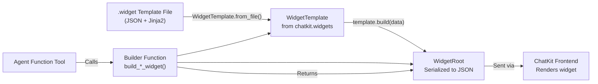
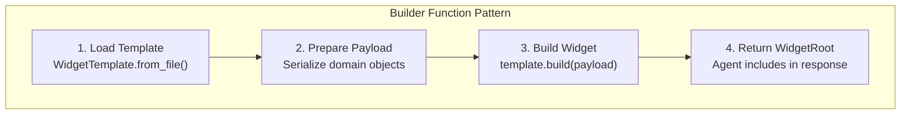
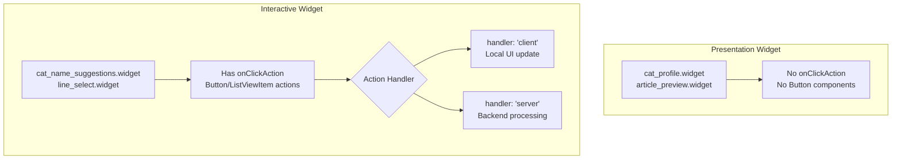
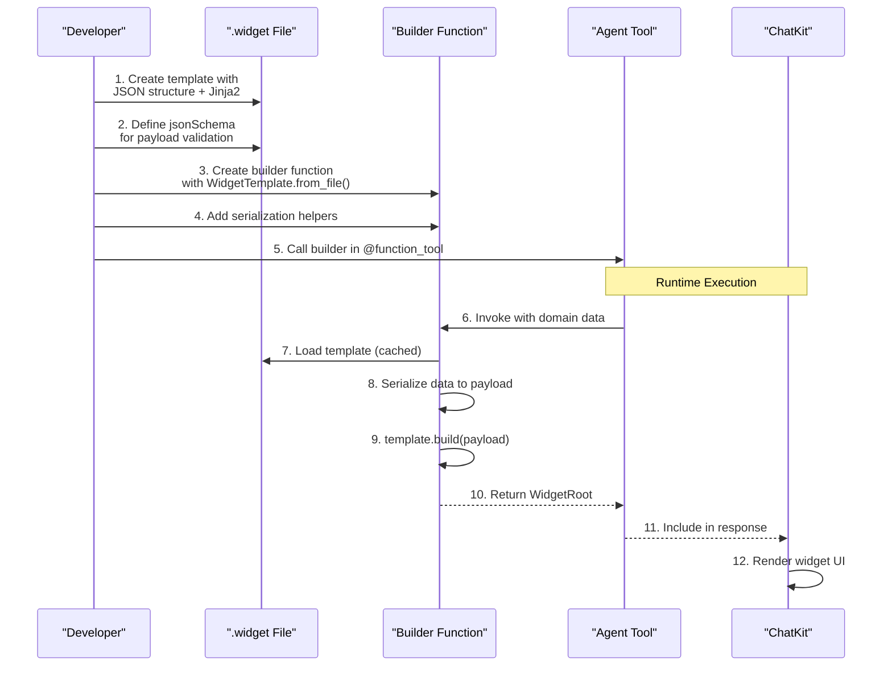

<!-- source: DeepWiki mcp.deepwiki.com · repo openai/openai-chatkit-advanced-samples · page 8.4 Creating Widgets · fetched 2026-10-26 -->

# Creating Widgets

<details>
<summary>Relevant source files</summary>

The following files were used as context for generating this wiki page:

- [examples/cat-lounge/backend/app/widgets/cat_name_suggestions.widget](examples/cat-lounge/backend/app/widgets/cat_name_suggestions.widget)
- [examples/cat-lounge/backend/app/widgets/cat_profile.widget](examples/cat-lounge/backend/app/widgets/cat_profile.widget)
- [examples/news-guide/backend/app/widgets/article_list_widget.py](examples/news-guide/backend/app/widgets/article_list_widget.py)

</details>


This guide covers the process of creating widget templates and builder functions for ChatKit applications. Widgets are structured UI components that agents can render in the chat interface to display rich, formatted information. For information about how agents call builder functions and return widgets, see [Adding New Tools](#8.3). For information about handling user interactions with widgets, see [Widget Actions](#7.4).

---

## Widget System Overview

The widget system follows a template-based architecture where `.widget` files define the structure and layout, and Python builder functions populate them with data.



**Sources**: 
- [examples/news-guide/backend/app/widgets/article_list_widget.py:1-38]()
- Diagram 7 from high-level architecture

---

## Widget Template File Structure

Widget templates are `.widget` files containing a JSON object with three key fields: `version`, `name`, and `template`. The `template` field contains a JSON-serialized widget structure with Jinja2 placeholders.

### Basic Structure

```json
{
  "version": "1.0",
  "name": "Widget Display Name",
  "template": "{...JSON with Jinja2 placeholders...}",
  "jsonSchema": {
    "$schema": "https://json-schema.org/draft/2020-12/schema",
    "type": "object",
    "properties": { ... },
    "required": [ ... ]
  }
}
```

| Field | Purpose |
|-------|---------|
| `version` | Template format version (currently "1.0") |
| `name` | Human-readable widget name for development |
| `template` | Escaped JSON string containing widget structure with Jinja2 syntax |
| `jsonSchema` | JSON Schema defining required data structure for template rendering |

The `template` field is a JSON-escaped string that will be processed as Jinja2 template, then parsed as JSON. Jinja2 placeholders like `{{ (variable) | tojson }}` are replaced with actual values during rendering.

**Sources**: 
- [examples/cat-lounge/backend/app/widgets/cat_profile.widget:1-6]()
- [examples/cat-lounge/backend/app/widgets/cat_name_suggestions.widget:1-6]()

---

## Creating Builder Functions

Builder functions instantiate widget templates with runtime data and return `WidgetRoot` objects that can be sent to the ChatKit frontend.

### Basic Builder Pattern



### Example: Article List Builder

The article list widget demonstrates the standard pattern:

```python
# Step 1: Load template (module-level)
article_list_widget_template = WidgetTemplate.from_file("article_list.widget")

# Step 2-4: Builder function
def build_article_list_widget(articles: list[ArticleMetadata]) -> WidgetRoot:
    payload = {"articles": [_serialize_article(article) for article in articles]}
    return article_list_widget_template.build(payload)
```

Key components:
- **Template Loading**: `WidgetTemplate.from_file()` loads the `.widget` file at module initialization
- **Data Serialization**: Helper functions convert domain objects to dictionaries matching the JSON schema
- **Template Building**: `template.build(payload)` applies data to Jinja2 placeholders and returns a `WidgetRoot`

**Sources**: 
- [examples/news-guide/backend/app/widgets/article_list_widget.py:21-27]()

### Data Serialization Helpers

Builder functions typically include helper functions to transform domain objects into the format expected by templates:

```python
def _serialize_article(article: ArticleMetadata) -> dict[str, Any]:
    return {
        "id": article.id,
        "title": article.title,
        "author": article.author,
        "heroImageUrl": article.heroImageUrl,
        "date": _format_date(article.date),  # Transform dates, etc.
    }
```

These helpers ensure:
- Type conversions (e.g., `datetime` to formatted strings)
- Field name mapping (e.g., `hero_image_url` → `heroImageUrl`)
- Consistent data structure across widget instances

**Sources**: 
- [examples/news-guide/backend/app/widgets/article_list_widget.py:30-37]()
- [examples/news-guide/backend/app/widgets/article_list_widget.py:16-18]()

---

## Template Syntax and Jinja2 Usage

Widget templates use Jinja2 syntax for dynamic content. All expressions must output valid JSON, so the `tojson` filter is essential.

### Variable Substitution

```jinja
"value": {{ (variable_name) | tojson }}
```

The `tojson` filter ensures proper JSON escaping for strings, booleans, nulls, and nested objects.

### Conditional Rendering

```jinja
"color": "success""gray-300"
```

Conditionals control styling, visibility, and component properties.

### List Iteration

The cat name suggestions widget demonstrates list iteration with comma management:

```jinja


,{"type": "ListViewItem", "key": {{ (suggestion.name) | tojson }}, ...}


{{- (_c[1:] if _c and _c[0] == ',' else _c) -}}
```

This pattern:
1. Accumulates list items with leading commas in `_c`
2. Strips the first comma after accumulation
3. Outputs clean JSON array

**Sources**: 
- [examples/cat-lounge/backend/app/widgets/cat_name_suggestions.widget:4]() (template field showing iteration)
- [examples/cat-lounge/backend/app/widgets/cat_profile.widget:4]() (simpler variable substitution example)

---

## Widget Types

Widgets are categorized as **presentation widgets** (read-only display) or **interactive widgets** (user actions).



### Presentation Widgets

Display-only widgets show formatted information without user interaction:

- **cat_profile.widget**: Displays cat attributes in a card layout
- **article_preview.widget**: Shows article metadata with hero image
- **author_preview.widget**: Renders author information

Presentation widgets contain only display components like `Text`, `Title`, `Image`, `Badge`, and layout containers.

**Sources**: 
- [examples/cat-lounge/backend/app/widgets/cat_profile.widget:1-175]()

### Interactive Widgets

Interactive widgets include `onClickAction` properties that trigger client-side or server-side handlers:

```json
{
  "type": "ListViewItem",
  "onClickAction": {
    "type": "cats.select_name",
    "handler": "client",
    "payload": {
      "name": "Willow",
      "options": [...]
    }
  }
}
```

Action properties:
- **type**: Action identifier (e.g., `"cats.select_name"`, `"line.select"`)
- **handler**: `"client"` for frontend handling, `"server"` for backend processing
- **payload**: Action-specific data

**Sources**: 
- [examples/cat-lounge/backend/app/widgets/cat_name_suggestions.widget:52-73]()

---

## Widget Component Library

ChatKit provides a component library for building widget layouts. Components are defined in the `template` field using type-based JSON structures.

### Core Layout Components

| Component | Purpose | Key Properties |
|-----------|---------|----------------|
| `Card` | Container with border/shadow | `size`, `padding`, `radius` |
| `Box` | Generic container | `background`, `padding`, `radius`, `align`, `justify` |
| `Row` | Horizontal layout | `gap`, `align`, `padding` |
| `Col` | Vertical layout | `gap`, `flex`, `padding` |
| `Spacer` | Flexible spacing | Automatically fills available space |

### Content Components

| Component | Purpose | Key Properties |
|-----------|---------|----------------|
| `Title` | Large heading text | `value`, `size`, `weight`, `color` |
| `Text` | Body text | `value`, `size`, `weight`, `color`, `textAlign` |
| `Caption` | Secondary text | `value`, `color` |
| `Image` | Image display | `src`, `width`, `height`, `radius`, `position` |
| `Badge` | Status indicator | `label`, `color`, `variant` |
| `Icon` | Icon display | `name`, `color`, `size` |

### Interactive Components

| Component | Purpose | Key Properties |
|-----------|---------|----------------|
| `Button` | Clickable button | `label`, `onClickAction`, `variant`, `color`, `disabled` |
| `ListView` | Scrollable list | `children` (array of ListViewItem) |
| `ListViewItem` | List row | `key`, `onClickAction`, `children` |

### Example Component Usage

The cat profile widget demonstrates nested layout components:

```json
{
  "type": "Card",
  "size": "sm",
  "padding": 0,
  "children": [
    {
      "type": "Box",
      "padding": {"x": 4, "y": 2},
      "background": {"light": "yellow-50", "dark": "yellow-900"},
      "children": [...]
    },
    {
      "type": "Row",
      "gap": 4,
      "align": "start",
      "children": [
        {"type": "Image", "src": "...", "width": 90, "height": 110},
        {"type": "Col", "gap": 2, "children": [...]}
      ]
    }
  ]
}
```

**Sources**: 
- [examples/cat-lounge/backend/app/widgets/cat_profile.widget:36-173]() (outputJsonPreview showing component structure)

---

## Complete Widget Creation Workflow



### Step-by-Step Process

1. **Create Template File**: Define widget structure in `.widget` file with Jinja2 placeholders
2. **Define Schema**: Add `jsonSchema` to validate payload structure
3. **Load Template**: Use `WidgetTemplate.from_file("widget_name.widget")` at module level
4. **Create Builder**: Write function that accepts domain objects and returns `WidgetRoot`
5. **Add Serialization**: Implement helpers to convert domain objects to JSON-compatible dicts
6. **Use in Agent**: Call builder function from `@function_tool` decorated agent tools
7. **Test Rendering**: Verify widget displays correctly in ChatKit frontend

### File Organization

Widgets are typically organized by domain:

```
backend/app/widgets/
├── cat_profile.widget
├── cat_profile_widget.py
├── cat_name_suggestions.widget
├── cat_name_suggestions_widget.py
├── article_list.widget
└── article_list_widget.py
```

Each widget has:
- **`.widget` file**: Template definition
- **`_widget.py` file**: Builder function and template loading

**Sources**: 
- [examples/news-guide/backend/app/widgets/article_list_widget.py:1-38]()
- Repository structure from Diagram 1

---

## Best Practices

### Template Design

- **Use consistent naming**: Match `jsonSchema` property names to payload keys exactly
- **Apply tojson filter**: Always use `{{ (variable) | tojson }}` to prevent JSON syntax errors
- **Handle nulls explicitly**: Use conditionals to render appropriate content when fields are null
- **Keep templates focused**: Create separate widgets for distinct UI patterns rather than one complex template

### Builder Functions

- **Load templates once**: Use module-level `WidgetTemplate.from_file()` to avoid repeated file I/O
- **Validate inputs**: Builder functions should accept typed parameters (e.g., `list[ArticleMetadata]`)
- **Separate concerns**: Use helper functions for serialization logic
- **Return WidgetRoot**: Agents expect `WidgetRoot` objects, not dictionaries

### Interactive Widgets

- **Choose handler carefully**: Use `"client"` for immediate UI updates, `"server"` for persistence
- **Include context in payload**: Server actions may need IDs or state information for processing
- **Disable when appropriate**: Set `disabled: true` on actions that shouldn't be clickable in certain states

**Sources**: 
- [examples/news-guide/backend/app/widgets/article_list_widget.py:21-27]()
- [examples/cat-lounge/backend/app/widgets/cat_name_suggestions.widget:52-73]()

---

