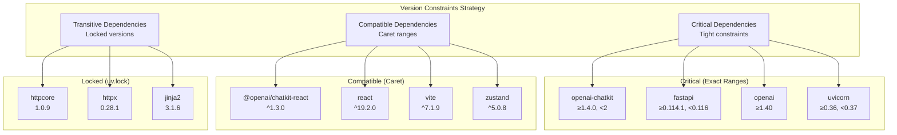
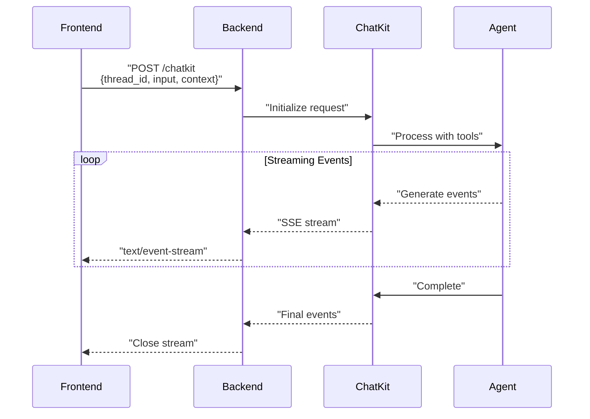
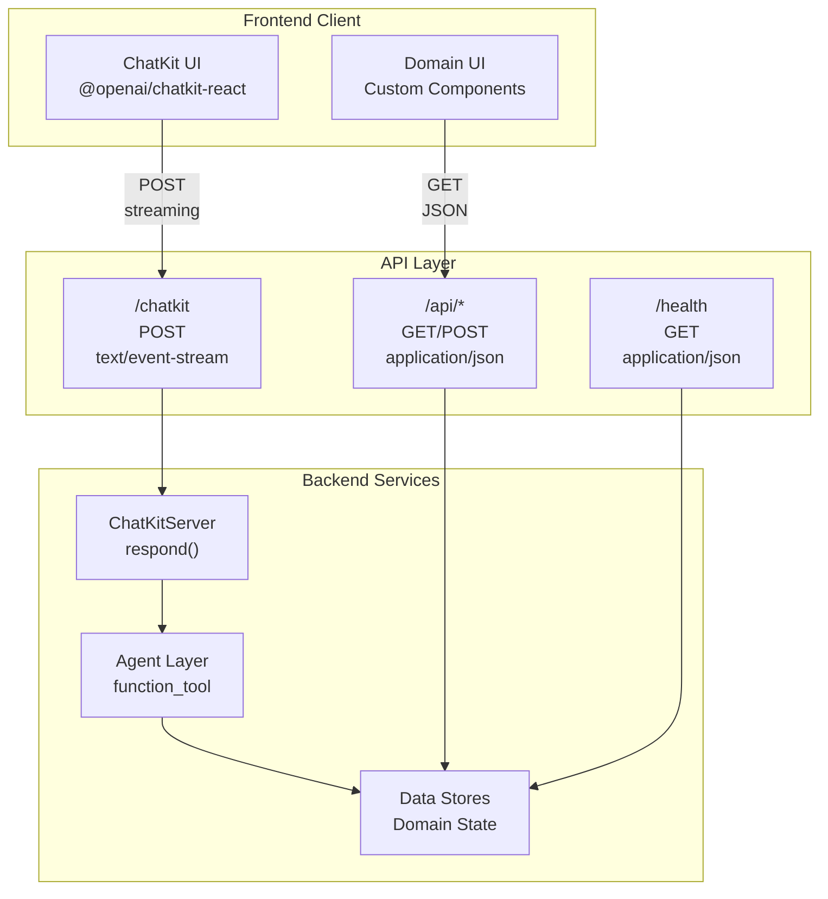

<!-- source: DeepWiki mcp.deepwiki.com · repo openai/openai-chatkit-advanced-samples · page 9 Reference · fetched 2026-10-26 -->

# Reference

<details>
<summary>Relevant source files</summary>

The following files were used as context for generating this wiki page:

- [examples/metro-map/backend/app/widgets/line_select_widget.py](examples/metro-map/backend/app/widgets/line_select_widget.py)
- [examples/metro-map/backend/pyproject.toml](examples/metro-map/backend/pyproject.toml)
- [examples/metro-map/frontend/package.json](examples/metro-map/frontend/package.json)
- [examples/news-guide/backend/pyproject.toml](examples/news-guide/backend/pyproject.toml)
- [examples/news-guide/backend/uv.lock](examples/news-guide/backend/uv.lock)

</details>


This page provides comprehensive reference documentation for the OpenAI ChatKit Advanced Samples repository, including the complete technology stack with version requirements, configuration options, and API endpoints. This information is essential for developers working with or extending the example applications.

For architectural patterns and integration details, see [Common Architecture](#3). For development setup instructions, see [Environment Setup](#8.1).

---

## Technology Stack

The repository uses modern, production-ready technologies across both backend and frontend layers. All dependencies have specific version constraints to ensure compatibility and stability.

### Runtime Requirements

| Component | Version | Purpose |
|-----------|---------|---------|
| Python | ≥3.11 | Backend runtime |
| Node.js | ≥18.18 | Frontend build and runtime |
| npm | ≥9 | Package management |

**Sources**: [examples/metro-map/frontend/package.json:12-15]()

### Backend Stack

#### Core Dependencies

| Package | Version | Purpose |
|---------|---------|---------|
| `fastapi` | ≥0.114.1, <0.116 | Web framework and routing |
| `uvicorn[standard]` | ≥0.36, <0.37 | ASGI server with websocket support |
| `openai` | ≥1.40 | OpenAI API client |
| `openai-chatkit` | ≥1.4.0, <2 | ChatKit agent framework |
| `jinja2` | ≥3.1, <4 | Template engine for widgets |

**Sources**: [examples/metro-map/backend/pyproject.toml:7-12](), [examples/news-guide/backend/pyproject.toml:7-12]()

#### Supporting Libraries

The backend includes several supporting packages installed transitively:

| Package | Version | Purpose |
|---------|---------|---------|
| `pydantic` | Latest compatible | Data validation |
| `starlette` | Via FastAPI | ASGI framework base |
| `httpcore` | 1.0.9 | HTTP client core |
| `httpx` | 0.28.1 | Async HTTP client |
| `httpx-sse` | 0.4.1 | Server-sent events support |
| `anyio` | 4.11.0 | Async I/O abstraction |
| `certifi` | 2025.10.5 | SSL certificate bundle |
| `h11` | 0.16.0 | HTTP/1.1 protocol implementation |
| `httptools` | 0.6.4 | Fast HTTP parsing |

**Sources**: [examples/news-guide/backend/uv.lock:1-259]()

#### Development Tools

| Package | Version | Purpose |
|---------|---------|---------|
| `ruff` | ≥0.6.4, <0.7 | Fast linter and formatter |
| `mypy` | ≥1.8, <2 | Static type checker |

**Sources**: [examples/metro-map/backend/pyproject.toml:16-19]()

### Frontend Stack

#### Core Dependencies

| Package | Version | Purpose |
|---------|---------|---------|
| `vite` | ^7.1.9 | Build tool and dev server |
| `react` | ^19.2.0 | UI framework |
| `react-dom` | ^19.2.0 | React DOM renderer |
| `typescript` | ^5.4.0 | Type system |
| `@openai/chatkit-react` | ^1.3.0 | ChatKit UI components |

**Sources**: [examples/metro-map/frontend/package.json:16-27]()

#### State Management and Routing

| Package | Version | Purpose |
|---------|---------|---------|
| `zustand` | ^5.0.8 | Lightweight state management |
| `react-router-dom` | ^6.28.0 | Client-side routing |

**Sources**: [examples/metro-map/frontend/package.json:16-27]()

#### UI and Visualization

| Package | Version | Purpose | Used By |
|---------|---------|---------|---------|
| `reactflow` | ^11.11.3 | Graph visualization | Metro Map only |
| `lucide-react` | ^0.544.0 | Icon library | All examples |
| `react-markdown` | ^9.0.1 | Markdown rendering | All examples |
| `remark-gfm` | ^4.0.0 | GitHub-flavored markdown | All examples |
| `react-modal` | ^3.16.3 | Modal dialogs | Various |
| `clsx` | ^2.1.1 | Conditional classnames | All examples |

**Sources**: [examples/metro-map/frontend/package.json:16-27]()

#### Development Tools

| Package | Version | Purpose |
|---------|---------|---------|
| `@vitejs/plugin-react-swc` | ^3.5.0 | Fast React refresh |
| `eslint` | ^8.57.1 | Code linting |
| `@typescript-eslint/*` | ^7.18.0 | TypeScript ESLint support |
| `tailwindcss` | ^3.4.13 | CSS framework |
| `autoprefixer` | ^10.4.20 | CSS vendor prefixing |
| `postcss` | ^8.4.47 | CSS processing |

**Sources**: [examples/metro-map/frontend/package.json:29-47]()

### Dependency Version Strategy



The version strategy ensures API stability for ChatKit integration while allowing flexibility for supporting libraries. Backend dependencies are locked via `uv.lock` for reproducible builds.

**Sources**: [examples/metro-map/backend/pyproject.toml:7-12](), [examples/news-guide/backend/uv.lock:1-259]()

---

## Configuration Options

All example applications share common configuration patterns for environment variables, port assignments, and API endpoints.

### Environment Variables

| Variable | Required | Default | Purpose |
|----------|----------|---------|---------|
| `OPENAI_API_KEY` | Yes | None | OpenAI API authentication |
| `PORT` | No | Example-specific | HTTP server port |
| `HOST` | No | `0.0.0.0` | Server bind address |
| `RELOAD` | No | `false` | Enable auto-reload (dev) |

The `OPENAI_API_KEY` must be set before running any example application. It can be configured via:
- Environment variable export
- `.env` file in project root
- Shell configuration file

**Example Configuration**:
```bash
export OPENAI_API_KEY="sk-..."
```

### Port Assignments

Each example application runs on a dedicated port to allow running multiple examples simultaneously:

| Example | Default Port | Backend URL | Frontend URL |
|---------|--------------|-------------|--------------|
| Cat Lounge | 5170 | `http://localhost:5170` | `http://localhost:5170` |
| Customer Support | 5171 | `http://localhost:5171` | `http://localhost:5171` |
| News Guide | 5172 | `http://localhost:5172` | `http://localhost:5172` |
| Metro Map | 5173 | `http://localhost:5173` | `http://localhost:5173` |

The backend and frontend share the same port in production mode. In development mode, Vite typically proxies requests to the backend.

### Frontend Configuration

#### ChatKit Configuration

The frontend configures the ChatKit client via the `useChatKit` hook:

```typescript
const chatkit = useChatKit({
  api: {
    url: '/chatkit',  // ChatKit streaming endpoint
  },
  domain: {
    key: 'example-domain-key',  // Domain identifier
  },
  theme: theme,  // 'light' or 'dark'
  callbacks: {
    onClientTool,      // Handle client tool requests
    onEffect,          // Handle client effects
    onWidgetAction,    // Handle widget actions
    onThreadChange,    // Track thread lifecycle
    onReady,          // Initialization complete
  }
});
```

#### Domain Keys

Each example uses a unique domain key to identify its ChatKit domain:

| Example | Domain Key |
|---------|------------|
| Cat Lounge | `cat-lounge` |
| Customer Support | `customer-support` |
| News Guide | `news-guide` |
| Metro Map | `metro-map` |

The domain key is used in API requests and thread management.

### Backend Configuration

#### ChatKitServer Configuration

Backend servers implement the `ChatKitServer` protocol from `openai_chatkit`:

```python
class ExampleServer(ChatKitServer):
    async def respond(
        self,
        request: IncomingRequest,
        response: OutgoingResponse,
    ) -> None:
        # Handle ChatKit requests
        pass
```

Key configuration points:
- **Model**: Typically `gpt-4` or `gpt-4-turbo`
- **Temperature**: Usually 0.7-1.0
- **Max Tokens**: 4096 or higher
- **Tools**: Registered via `@function_tool` decorator
- **Memory**: Thread history stored in `MemoryStore`

**Sources**: Based on common patterns across all example server implementations

#### Widget Template Configuration

Widget templates use Jinja2 and are loaded from `.widget` files:

```python
from chatkit.widgets import WidgetTemplate

template = WidgetTemplate.from_file("widget_name.widget")
```

Template files are located in `backend/app/widgets/` directories and combine JSON structure with Jinja2 templating.

**Sources**: [examples/metro-map/backend/app/widgets/line_select_widget.py:11]()

---

## API Endpoints

Each example application exposes both ChatKit-specific endpoints and domain-specific REST APIs.

### ChatKit Streaming Endpoint

All examples implement the standard ChatKit streaming endpoint:

#### `POST /chatkit`

Primary endpoint for ChatKit communication. Handles streaming responses with server-sent events.

**Request Headers**:
```
Content-Type: application/json
```

**Request Body**:
```json
{
  "thread_id": "thread-uuid",
  "input": "User message",
  "context": {
    "page": "current-page-id",
    "custom_headers": {}
  }
}
```

**Response**:
- Content-Type: `text/event-stream`
- Streams ChatKit events (messages, tool calls, widgets, etc.)

**Event Types**:
- `AgentTextChunk`: Streaming text content
- `ToolCallStartEvent`: Tool execution begins
- `ToolCallEndEvent`: Tool execution completes
- `ClientToolCallEvent`: Client tool request
- `ClientEffectEvent`: Fire-and-forget UI update
- `WidgetEvent`: Widget rendering
- `ThreadItemUpdatedEvent`: Widget or content update
- `ProgressUpdateEvent`: Search/operation progress



**Sources**: Based on common ChatKit server implementations across all examples

### Domain-Specific Endpoints

#### Cat Lounge Endpoints

| Method | Endpoint | Purpose | Response |
|--------|----------|---------|----------|
| GET | `/api/cat` | Get current cat state | `{name, status, mood, hunger, energy}` |
| GET | `/health` | Health check | `{"status": "ok"}` |

#### Customer Support Endpoints

| Method | Endpoint | Purpose | Response |
|--------|----------|---------|----------|
| GET | `/api/tickets` | List support tickets | Array of ticket objects |
| GET | `/api/tickets/{id}` | Get ticket details | Single ticket object |
| GET | `/health` | Health check | `{"status": "ok"}` |

#### News Guide Endpoints

| Method | Endpoint | Purpose | Response |
|--------|----------|---------|----------|
| GET | `/api/articles` | List all articles | Array of article objects |
| GET | `/api/articles/{id}` | Get article details | Single article object |
| GET | `/api/events` | List events | Array of event objects |
| GET | `/api/authors/{id}` | Get author details | Author object with articles |
| GET | `/health` | Health check | `{"status": "ok"}` |

#### Metro Map Endpoints

| Method | Endpoint | Purpose | Response |
|--------|----------|---------|----------|
| GET | `/api/map` | Get complete metro map | `{stations, lines, connections}` |
| GET | `/api/lines` | List all metro lines | Array of line objects |
| GET | `/api/lines/{id}` | Get line details | Single line object |
| GET | `/health` | Health check | `{"status": "ok"}` |

### Endpoint Architecture



**Key Characteristics**:
- **ChatKit Endpoint**: Always streaming (SSE), bidirectional with client tools
- **Domain Endpoints**: RESTful JSON, read-only for frontend data queries
- **Health Endpoint**: Simple status check for monitoring
- **Separation**: Conversational logic via ChatKit, data access via REST

**Sources**: Common patterns across all example implementations

### Widget Action Handling

Widget actions can be processed server-side or client-side:

#### Server-Side Actions

Sent via `chatkit.sendAction(actionType, widgetId, payload)`:

```typescript
handleWidgetAction = (actionType: string, widgetId: string, payload: any) => {
  if (handler === 'server') {
    chatkit.sendAction(actionType, widgetId, payload);
  } else {
    // Handle client-side
  }
};
```

Server receives action via the `/chatkit` endpoint as part of the streaming protocol. The action is processed by the `ChatKitServer.handle_action()` method, which can:
- Update widget state via `ThreadItemUpdatedEvent`
- Inject hidden context into thread
- Trigger agent processing with new context

#### Client-Side Actions

Handled directly in the frontend:

```typescript
handleWidgetAction = (actionType: string, widgetId: string, payload: any) => {
  if (handler === 'client') {
    // Update local state immediately
    appStore.updateState(payload);
  }
};
```

No backend round-trip required for immediate UI updates like navigation or filtering.

**Sources**: Based on widget action patterns across all examples

---

## Configuration Patterns

### Development Mode

Development mode enables hot reloading and detailed logging:

**Backend**:
```bash
cd examples/example-name/backend
uv run uvicorn app.server:app --reload --host 0.0.0.0 --port 5170
```

**Frontend**:
```bash
cd examples/example-name/frontend
npm run dev
```

Vite dev server typically runs on port 5173 and proxies `/chatkit` and `/api` requests to the backend.

### Production Mode

Production builds optimize for performance:

**Backend**:
```bash
cd examples/example-name/backend
uv run uvicorn app.server:app --host 0.0.0.0 --port 5170
```

**Frontend**:
```bash
cd examples/example-name/frontend
npm run build
npm run preview
```

Built assets can be served by the backend or a separate static file server.

### Environment File Template

`.env` file structure for local development:

```bash
# Required
OPENAI_API_KEY=sk-...

# Optional
PORT=5170
HOST=0.0.0.0
RELOAD=true

# Logging
LOG_LEVEL=INFO
```

**Sources**: Common configuration patterns across all examples

---

