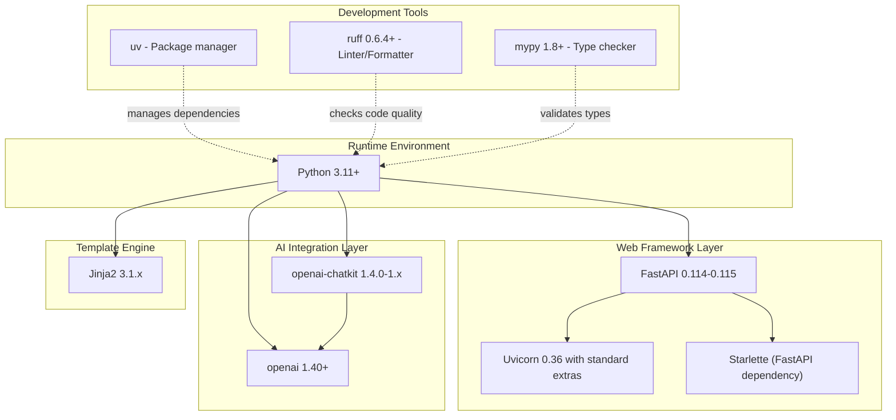
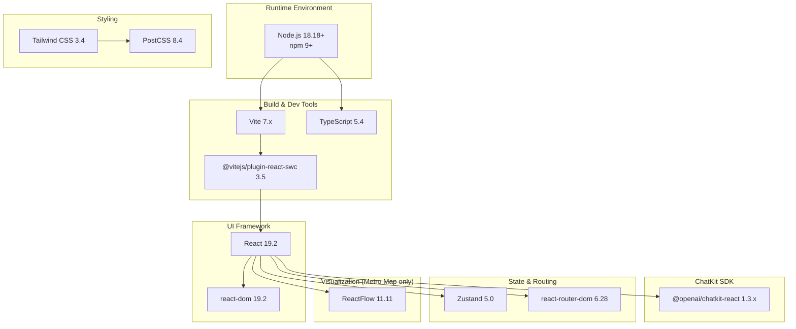

<!-- source: DeepWiki mcp.deepwiki.com · repo openai/openai-chatkit-advanced-samples · page 9.1 Technology Stack · fetched 2026-10-26 -->

# Technology Stack

<details>
<summary>Relevant source files</summary>

The following files were used as context for generating this wiki page:

- [examples/metro-map/backend/app/widgets/line_select_widget.py](examples/metro-map/backend/app/widgets/line_select_widget.py)
- [examples/metro-map/backend/pyproject.toml](examples/metro-map/backend/pyproject.toml)
- [examples/metro-map/frontend/package.json](examples/metro-map/frontend/package.json)
- [examples/news-guide/backend/pyproject.toml](examples/news-guide/backend/pyproject.toml)
- [examples/news-guide/backend/uv.lock](examples/news-guide/backend/uv.lock)

</details>


This page documents the complete technology stack used across all example applications in the OpenAI ChatKit Advanced Samples repository. Each example follows an identical architectural pattern using a modern Python backend with FastAPI and a React frontend with Vite, integrated through the ChatKit SDK.

For environment setup instructions, see [Environment Setup](#8.1). For configuration options, see [Configuration Options](#9.2).

---

## Runtime Environments

### Python Runtime

All backend applications require **Python 3.11 or higher**. This minimum version enables use of modern Python features including:
- Enhanced type hints and generic syntax
- Performance improvements in the interpreter
- Better error messages and debugging support

**Version specification:** [examples/metro-map/backend/pyproject.toml:6](), [examples/news-guide/backend/pyproject.toml:6]()

```toml
requires-python = ">=3.11"
```

**Sources:** [examples/metro-map/backend/pyproject.toml:6](), [examples/news-guide/backend/pyproject.toml:6](), [examples/news-guide/backend/uv.lock:3]()

### Node.js Runtime

All frontend applications require **Node.js 18.18 or higher** and **npm 9 or higher**. This ensures compatibility with:
- ECMAScript modules (ESM)
- Modern JavaScript features
- Vite's build optimization pipeline

**Version specification:** [examples/metro-map/frontend/package.json:12-15]()

```json
"engines": {
  "node": ">=18.18",
  "npm": ">=9"
}
```

**Sources:** [examples/metro-map/frontend/package.json:12-15]()

---

## Backend Technology Stack

### Web Framework

**FastAPI 0.114.1 - 0.115.x** serves as the web framework for all backend applications. FastAPI provides:
- High-performance async request handling via ASGI
- Automatic OpenAPI documentation generation
- Built-in request validation using Pydantic
- Native support for WebSocket and streaming responses

**Version constraint:** [examples/metro-map/backend/pyproject.toml:8](), [examples/news-guide/backend/pyproject.toml:8]()

```toml
"fastapi>=0.114.1,<0.116"
```

All examples implement the `ChatKitServer` interface and expose a `/chatkit` endpoint that handles streaming agent responses. See [Backend Architecture Pattern](#3.1) for implementation details.

**Sources:** [examples/metro-map/backend/pyproject.toml:8](), [examples/news-guide/backend/pyproject.toml:8](), [examples/news-guide/backend/uv.lock:160-171]()

### ASGI Server

**Uvicorn 0.36.x** with standard extras provides the production-grade ASGI server. The `[standard]` extra includes:
- `httptools` - Fast HTTP parsing
- `uvloop` - High-performance event loop
- `websockets` - WebSocket protocol support
- `watchfiles` - File watching for development hot reload

**Version constraint:** [examples/metro-map/backend/pyproject.toml:9](), [examples/news-guide/backend/pyproject.toml:9]()

```toml
"uvicorn[standard]>=0.36,<0.37"
```

**Sources:** [examples/metro-map/backend/pyproject.toml:9](), [examples/news-guide/backend/pyproject.toml:9](), [examples/news-guide/backend/uv.lock:208-236]()

### AI Integration

**OpenAI Python SDK 1.40+** provides the client library for interacting with OpenAI's API. This includes:
- Chat completions with streaming support
- Function calling / tool invocation
- Structured output parsing
- Error handling and retry logic

**Version constraint:** [examples/metro-map/backend/pyproject.toml:10](), [examples/news-guide/backend/pyproject.toml:10]()

```toml
"openai>=1.40"
```

**OpenAI ChatKit 1.4.0 - 1.x** is the server-side framework that abstracts agent development. It provides:
- `ChatKitServer` base class for implementing streaming endpoints
- `@function_tool` decorator for defining agent tools
- Agent instruction management and context handling
- Client effect and widget event emission
- Integration with OpenAI's structured output API

**Version constraint:** [examples/metro-map/backend/pyproject.toml:11](), [examples/news-guide/backend/pyproject.toml:11]()

```toml
"openai-chatkit>=1.4.0,<2"
```

See [Server Tools](#7.1) for usage examples of the `@function_tool` decorator.

**Sources:** [examples/metro-map/backend/pyproject.toml:10-11](), [examples/news-guide/backend/pyproject.toml:10-11](), [examples/news-guide/backend/uv.lock:100-127]()

### Template Engine

**Jinja2 3.1.x** powers the widget template system. Widget files use the `.widget` extension and combine JSON structure with Jinja2 templating for dynamic content generation.

**Version constraint:** [examples/metro-map/backend/pyproject.toml:12]()

```toml
"jinja2>=3.1,<4"
```

Example widget template usage in [examples/metro-map/backend/app/widgets/line_select_widget.py:11]():

```python
line_select_widget_template = WidgetTemplate.from_file("line_select.widget")
```

See [Widget System](#3.4) for complete documentation of the template-based widget architecture.

**Sources:** [examples/metro-map/backend/pyproject.toml:12](), [examples/metro-map/backend/app/widgets/line_select_widget.py:11]()

### Backend Development Tools

| Tool | Version | Purpose |
|------|---------|---------|
| `uv` | latest | Fast Python package installer and resolver, replacement for pip/pip-tools |
| `ruff` | 0.6.4 - 0.6.x | High-performance Python linter and code formatter, replacement for flake8/black |
| `mypy` | 1.8 - 1.x | Static type checker for Python type hints |

**Version constraints:** [examples/metro-map/backend/pyproject.toml:16-19](), [examples/news-guide/backend/pyproject.toml:16-19]()

```toml
[project.optional-dependencies]
dev = [
    "ruff>=0.6.4,<0.7",
    "mypy>=1.8,<2",
]
```

The `uv` tool is used for dependency management instead of traditional pip, providing:
- Faster dependency resolution and installation
- Deterministic lock file generation
- Integrated virtual environment management

**Sources:** [examples/metro-map/backend/pyproject.toml:15-19](), [examples/news-guide/backend/pyproject.toml:15-19]()

---

## Frontend Technology Stack

### Build Tool and Dev Server

**Vite 7.x** serves as the build tool and development server for all frontend applications. Vite provides:
- Lightning-fast hot module replacement (HMR) during development
- Optimized production builds with code splitting
- Native ESM support
- Plugin-based architecture for framework integration

**Version constraint:** [examples/metro-map/frontend/package.json:46]()

```json
"vite": "^7.1.9"
```

The Vite configuration uses the React SWC plugin for fast transpilation:

**Version constraint:** [examples/metro-map/frontend/package.json:36]()

```json
"@vitejs/plugin-react-swc": "^3.5.0"
```

**Sources:** [examples/metro-map/frontend/package.json:36](), [examples/metro-map/frontend/package.json:46]()

### UI Framework

**React 19.2.x** is the core UI framework. All examples use React with functional components and hooks. React 19 provides:
- Concurrent rendering for improved responsiveness
- Automatic batching of state updates
- Enhanced server-side rendering capabilities

**Version constraint:** [examples/metro-map/frontend/package.json:20-21]()

```json
"react": "^19.2.0",
"react-dom": "^19.2.0"
```

**Sources:** [examples/metro-map/frontend/package.json:20-21]()

### Type System

**TypeScript 5.4.x** provides static type checking for all frontend code. This version includes:
- Improved type inference
- Better error messages
- Support for modern JavaScript features

**Version constraint:** [examples/metro-map/frontend/package.json:45]()

```json
"typescript": "^5.4.0"
```

**Sources:** [examples/metro-map/frontend/package.json:45]()

### ChatKit Integration

**@openai/chatkit-react 1.3.x** is the React SDK for ChatKit. This library provides:
- `ChatKitPanel` component for chat UI rendering
- `useChatKit` hook for configuration and event handling
- Automatic widget rendering and action handling
- Real-time streaming event processing
- Thread management and persistence

**Version constraint:** [examples/metro-map/frontend/package.json:17]()

```json
"@openai/chatkit-react": "^1.3.0"
```

The ChatKit SDK integrates with backend agents through WebSocket streaming. See [ChatKitPanel](#3.2) for implementation patterns.

**Sources:** [examples/metro-map/frontend/package.json:17]()

### State Management

**Zustand 5.0.x** provides lightweight state management. Zustand is used across all examples for:
- Global application state (theme, active thread ID)
- Domain-specific state (selected stations, cat status, article filters)
- ChatKit instance reference storage

**Version constraint:** [examples/metro-map/frontend/package.json:27]()

```json
"zustand": "^5.0.8"
```

Zustand's minimal API and TypeScript support make it ideal for the relatively simple state requirements of these example applications.

**Sources:** [examples/metro-map/frontend/package.json:27]()

### Routing

**React Router 6.28.x** handles client-side routing in examples that require navigation (News Guide, Metro Map). Features used include:
- Declarative route configuration
- URL parameter parsing
- Programmatic navigation
- Route-based code splitting

**Version constraint:** [examples/metro-map/frontend/package.json:24]()

```json
"react-router-dom": "^6.28.0"
```

**Sources:** [examples/metro-map/frontend/package.json:24]()

### Specialized Libraries

**ReactFlow 11.11.x** is used exclusively in the Metro Map example for interactive graph visualization. It provides:
- Node and edge rendering
- Pan and zoom controls
- Interactive node selection
- Custom node types for station representation

**Version constraint:** [examples/metro-map/frontend/package.json:25]()

```json
"reactflow": "^11.11.3"
```

This library is not present in other examples, demonstrating how each example can include domain-specific dependencies as needed.

**Sources:** [examples/metro-map/frontend/package.json:25]()

### Frontend Development Tools

| Tool | Version | Purpose |
|------|---------|---------|
| ESLint | 8.57.x | JavaScript/TypeScript linting |
| @typescript-eslint/parser | 7.18.x | TypeScript parser for ESLint |
| @typescript-eslint/eslint-plugin | 7.18.x | TypeScript-specific lint rules |
| eslint-plugin-react-hooks | 4.6.x | React Hooks lint rules |
| eslint-plugin-react-refresh | 0.4.x | React Fast Refresh lint rules |
| Tailwind CSS | 3.4.x | Utility-first CSS framework |
| PostCSS | 8.4.x | CSS transformation tool |
| Autoprefixer | 10.4.x | CSS vendor prefix automation |

**Sources:** [examples/metro-map/frontend/package.json:29-44]()

---

## Technology Stack Overview

### Backend Stack Diagram



**Sources:** [examples/metro-map/backend/pyproject.toml:6-12](), [examples/news-guide/backend/pyproject.toml:6-12]()

### Frontend Stack Diagram



**Sources:** [examples/metro-map/frontend/package.json:12-27]()

---

## Dependency Management

### Backend: uv Package Manager

The backend uses **uv** as the modern Python package manager, replacing traditional pip and pip-tools. The `uv` tool provides:
- **10-100x faster** dependency resolution and installation compared to pip
- Deterministic lock file generation in `uv.lock`
- Integrated virtual environment management
- Cross-platform compatibility

**Lock file structure:** [examples/news-guide/backend/uv.lock:1-3]()

```
version = 1
revision = 3
requires-python = ">=3.11"
```

Each package entry includes:
- Package name and version
- Source registry URL
- SHA256 hash for integrity verification
- Dependency specifications with version constraints

**Installation workflow:**

```bash
# Synchronize environment from lock file
uv sync

# Add a new dependency
uv add package-name

# Add a development dependency
uv add --dev package-name

# Update lock file
uv lock
```

See [Environment Setup](#8.1) for complete installation instructions.

**Sources:** [examples/news-guide/backend/uv.lock:1-127](), [examples/metro-map/backend/pyproject.toml:1-30]()

### Frontend: npm Package Manager

The frontend uses **npm** for dependency management. The `package.json` file defines version constraints using semantic versioning:
- `^` prefix allows compatible updates (e.g., `^19.2.0` matches any 19.x.x version)
- Exact versions ensure reproducibility in production

**Version constraints:** [examples/metro-map/frontend/package.json:12-15]()

```json
"engines": {
  "node": ">=18.18",
  "npm": ">=9"
}
```

**Installation workflow:**

```bash
# Install all dependencies
npm install

# Install for CI/CD (uses lock file exactly)
npm ci

# Add a new dependency
npm install package-name

# Add a development dependency
npm install --save-dev package-name
```

The `package-lock.json` file (generated automatically) contains exact resolved versions for reproducible builds.

**Sources:** [examples/metro-map/frontend/package.json:6-15]()

---

## Dependency Version Matrix

### Frontend Compatibility Matrix

| React | TypeScript | Vite | Node.js | ChatKit React |
|-------|------------|------|---------|---------------|
| 19.2.0 | 5.4.0 | 7.1.9 | ≥18.18 | ^0 |

**Sources:** [frontend/package.json:12-21]()

### Backend Compatibility Matrix

| Python | FastAPI | OpenAI | ChatKit | Uvicorn |
|--------|---------|--------|---------|---------|
| ≥3.11 | 0.114.1-0.115.x | ≥1.40 | 0.0.2 | 0.36.x |

**Sources:** [backend/uv.lock:3](), [backend/uv.lock:118-128]()

---

## Critical Dependency Notes

### ChatKit SDK Versions

Both frontend and backend must use compatible ChatKit SDK versions:
- **Frontend:** `@openai/chatkit-react@^0` [frontend/package.json:17]()
- **Backend:** `openai-chatkit@0.0.2` [backend/uv.lock:467-478]()

The ChatKit SDK handles:
- Authentication via domain keys
- Real-time streaming events
- Tool invocation protocols
- Widget rendering

For ChatKit integration details, see [ChatKit Server](#5.2) and [ChatKitPanel](#4.2.1).

### Security-Critical Dependencies

The following packages handle security-sensitive operations:

**Frontend:**
- None with direct security implications (authentication handled server-side)

**Backend:**
- `certifi@2025.10.5` - SSL/TLS certificate validation [backend/uv.lock:38-44]()
- `httpx@0.28.1` - Secure HTTP communication [backend/uv.lock:239-251]()
- `openai@1.109.1` - API key handling [backend/uv.lock:429-445]()

**Sources:** [backend/uv.lock:38-44](), [backend/uv.lock:239-251](), [backend/uv.lock:429-445]()

### Type Safety Dependencies

**Frontend:**
- `typescript@5.4.0` - Type checking [frontend/package.json:39]()
- `@types/react@19.2.0` - React type definitions [frontend/package.json:25]()
- `@types/react-dom@19.2.0` - React DOM type definitions [frontend/package.json:26]()
- `@types/node@24.5.2` - Node.js type definitions [frontend/package.json:24]()

**Backend:**
- `mypy@1.18.2` - Static type checker [backend/uv.lock:382-416]()
- `pydantic@2.11.10` - Runtime type validation [backend/uv.lock:490-502]()

**Sources:** [frontend/package.json:24-26](), [frontend/package.json:39](), [backend/uv.lock:382-416](), [backend/uv.lock:490-502]()

---

## Dependency Installation Commands

### Frontend Setup

```bash
# Install all dependencies
npm install

# Install for CI/CD (uses lock file exactly)
npm ci

# Add a new dependency
npm install <package-name>

# Add a dev dependency
npm install --save-dev <package-name>

# Update dependencies within constraints
npm update
```

### Backend Setup

```bash
# Sync dependencies from lock file
uv sync

# Install with dev dependencies
uv sync --all-extras

# Add a new dependency
uv add <package-name>

# Add a dev dependency
uv add --dev <package-name>

# Update lock file
uv lock
```

For complete setup instructions including environment variables, see [Installation](#2.2) and [Environment Setup](#6.1).

**Sources:** [frontend/package.json:6-11](), [backend/uv.lock:1-3]()

---

