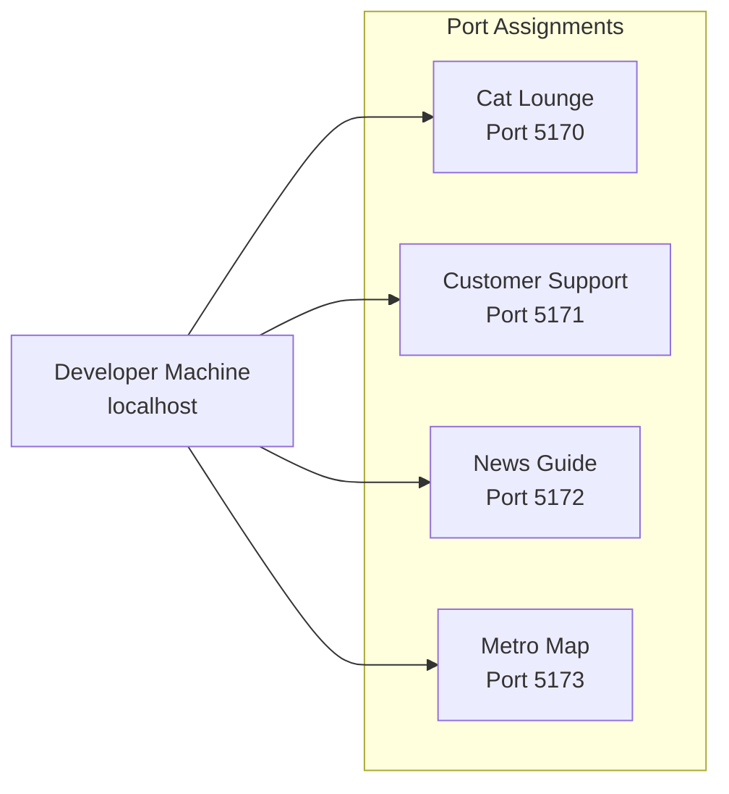
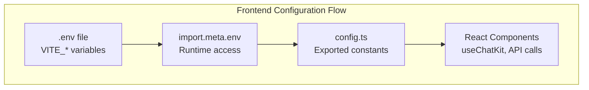
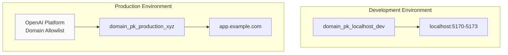
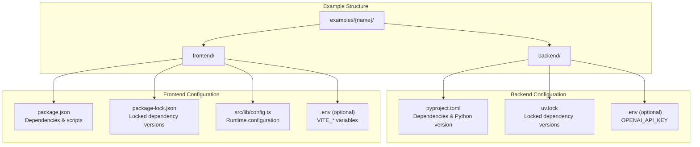
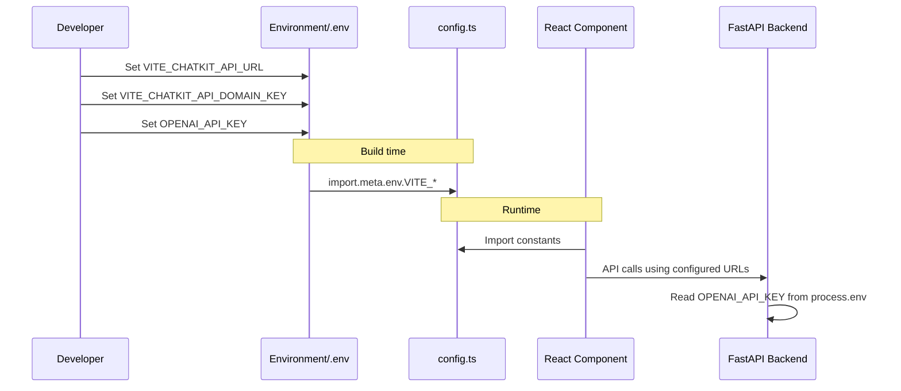

<!-- source: DeepWiki mcp.deepwiki.com · repo openai/openai-chatkit-advanced-samples · page 9.2 Configuration Options · fetched 2026-10-26 -->

# Configuration Options

<details>
<summary>Relevant source files</summary>

The following files were used as context for generating this wiki page:

- [README.md](README.md)
- [examples/metro-map/frontend/package-lock.json](examples/metro-map/frontend/package-lock.json)
- [examples/metro-map/frontend/src/components/MapPanel.tsx](examples/metro-map/frontend/src/components/MapPanel.tsx)
- [examples/metro-map/frontend/src/lib/config.ts](examples/metro-map/frontend/src/lib/config.ts)

</details>


This page documents environment variables, API URLs, domain keys, and other configuration options used across all example applications in the repository. Each example follows similar configuration patterns but may have application-specific values.

For information about the technology stack and dependency versions, see [Technology Stack](#9.1). For API endpoint implementation details, see [API Endpoints](#9.3).

---

## Overview

All examples require configuration for:
- **OpenAI API authentication** (backend)
- **ChatKit domain keys** (frontend)
- **API endpoint URLs** (frontend)
- **Port assignments** (both)
- **Application-specific endpoints** (frontend)

Configuration values are set through environment variables and have fallback defaults suitable for local development.

---

## Backend Configuration

### Required Environment Variables

| Variable | Required | Description | Default | Used In |
|----------|----------|-------------|---------|---------|
| `OPENAI_API_KEY` | Yes | OpenAI API key for model access | None | All examples |

**Sources**: [README.md:14]()

### Setting the API Key

The `OPENAI_API_KEY` must be exported before running any example:

```bash
export OPENAI_API_KEY="sk-..."
```

All backend servers read this variable at startup. Without it, the application will fail to initialize the OpenAI client.

**Sources**: [README.md:14]()

### Server Ports

Each example runs on a dedicated port to allow simultaneous execution:



**Port Assignment Table**:

| Example | Port | URL |
|---------|------|-----|
| Cat Lounge | 5170 | http://localhost:5170 |
| Customer Support | 5171 | http://localhost:5171 |
| News Guide | 5172 | http://localhost:5172 |
| Metro Map | 5173 | http://localhost:5173 |

These ports are configured in each example's `package.json` scripts and cannot be changed without modifying the startup commands.

**Sources**: [README.md:18-23]()

---

## Frontend Configuration

### Environment Variables

Frontend configuration uses Vite's environment variable system with the `VITE_` prefix. Variables are read from `.env` files or system environment.



**Sources**: [examples/metro-map/frontend/src/lib/config.ts:1-14]()

### ChatKit Configuration Variables

| Variable | Description | Default | Production Requirement |
|----------|-------------|---------|----------------------|
| `VITE_CHATKIT_API_URL` | Backend ChatKit endpoint | `"/chatkit"` | Must point to deployed backend |
| `VITE_CHATKIT_API_DOMAIN_KEY` | Domain security key | `"domain_pk_localhost_dev"` | Must be registered domain key |

**Example Configuration (Metro Map)**:

```typescript
export const CHATKIT_API_URL = 
  import.meta.env.VITE_CHATKIT_API_URL ?? "/chatkit";

export const CHATKIT_API_DOMAIN_KEY =
  import.meta.env.VITE_CHATKIT_API_DOMAIN_KEY ?? "domain_pk_localhost_dev";
```

**Sources**: [examples/metro-map/frontend/src/lib/config.ts:3-12]()

### Domain-Specific API Variables

Each example exposes domain-specific REST APIs that require configuration:

| Example | Variable | Default | Purpose |
|---------|----------|---------|---------|
| Metro Map | `VITE_MAP_API_URL` | `"/map"` | Metro map data endpoint |
| News Guide | `VITE_ARTICLES_API_URL` | `"/articles"` | Article search endpoint |
| Cat Lounge | `VITE_CAT_API_URL` | `"/cat"` | Cat state endpoint |

**Metro Map Example**:

```typescript
export const MAP_API_URL = import.meta.env.VITE_MAP_API_URL ?? "/map";
```

**Sources**: [examples/metro-map/frontend/src/lib/config.ts:14]()

---

## Domain Key Configuration

### Development vs Production



### Domain Allowlist Registration

For production deployments:

1. Register your domain at: https://platform.openai.com/settings/organization/security/domain-allowlist
2. Receive a domain key (e.g., `domain_pk_prod_abc123`)
3. Set `VITE_CHATKIT_API_DOMAIN_KEY` to the registered key
4. Deploy with the production domain

**Development Note**: The placeholder key `"domain_pk_localhost_dev"` is sufficient for local development on `localhost`.

**Sources**: [examples/metro-map/frontend/src/lib/config.ts:6-12]()

---

## Configuration File Locations



### Backend Configuration Files

| File | Purpose | Example Path |
|------|---------|--------------|
| `pyproject.toml` | Python dependencies, version constraints | `examples/metro-map/backend/pyproject.toml` |
| `uv.lock` | Locked dependency versions | `examples/metro-map/backend/uv.lock` |
| `.env` (optional) | Environment variables | `examples/metro-map/backend/.env` |

### Frontend Configuration Files

| File | Purpose | Example Path |
|------|---------|--------------|
| `package.json` | Node dependencies, npm scripts | `examples/metro-map/frontend/package.json` |
| `package-lock.json` | Locked dependency versions | `examples/metro-map/frontend/package-lock.json` |
| `src/lib/config.ts` | Runtime configuration constants | `examples/metro-map/frontend/src/lib/config.ts` |
| `.env` (optional) | Vite environment variables | `examples/metro-map/frontend/.env` |

**Sources**: [examples/metro-map/frontend/package-lock.json:1-10](), [examples/metro-map/frontend/src/lib/config.ts:1-14]()

---

## Application-Specific Configuration

### Metro Map Configuration

```typescript
// examples/metro-map/frontend/src/lib/config.ts
export const CHATKIT_API_URL = import.meta.env.VITE_CHATKIT_API_URL ?? "/chatkit";
export const CHATKIT_API_DOMAIN_KEY = 
  import.meta.env.VITE_CHATKIT_API_DOMAIN_KEY ?? "domain_pk_localhost_dev";
export const MAP_API_URL = import.meta.env.VITE_MAP_API_URL ?? "/map";
```

**Dynamic UI Configuration**:

The Metro Map also configures dynamic UI elements based on application state:

```typescript
export const getGreeting = (selectedStationIds: string[]) => {
  if (selectedStationIds.length > 1) {
    return "Any questions about the selected stations?";
  }
  return "Welcome to Orbital Transit";
};

export const getStartScreenPrompts = (selectedStationIds: string[]): StartScreenPrompt[] => {
  if (selectedStationIds.length > 1) {
    return [
      {
        label: "Tell me about these stations.",
        prompt: "Tell me about the stations I've selected",
        icon: "map-pin",
      },
      // ...
    ];
  }
  return DEFAULT_START_SCREEN_PROMPTS;
};
```

**Sources**: [examples/metro-map/frontend/src/lib/config.ts:39-66]()

---

## Configuration Pattern

All examples follow this configuration pattern:



### Pattern Steps

1. **Environment Setup**: Developer sets environment variables
2. **Build Time**: Vite injects `VITE_*` variables into `import.meta.env`
3. **Configuration Module**: `config.ts` exports constants with fallback defaults
4. **Component Usage**: React components import and use configuration constants
5. **API Communication**: Components call configured endpoints
6. **Backend Access**: FastAPI server reads `OPENAI_API_KEY` from environment

**Sources**: [examples/metro-map/frontend/src/lib/config.ts:1-14](), [README.md:14]()

---

## Running with Custom Configuration

### Local Development (Default Configuration)

```bash
# Set API key only
export OPENAI_API_KEY="sk-..."

# Run from repository root
npm run metro-map
```

### Custom Port or API URL

```bash
# Set environment variables
export OPENAI_API_KEY="sk-..."
export VITE_CHATKIT_API_URL="https://api.example.com/chatkit"
export VITE_CHATKIT_API_DOMAIN_KEY="domain_pk_prod_xyz"
export VITE_MAP_API_URL="https://api.example.com/map"

# Run example
cd examples/metro-map
npm install
npm run start
```

### Production Deployment

```bash
# Backend environment
export OPENAI_API_KEY="sk-prod-..."

# Frontend build environment
export VITE_CHATKIT_API_URL="https://api.production.com/chatkit"
export VITE_CHATKIT_API_DOMAIN_KEY="domain_pk_prod_registered"
export VITE_MAP_API_URL="https://api.production.com/map"

# Build frontend
cd examples/metro-map/frontend
npm run build

# Start backend
cd ../backend
uv run uvicorn app.main:app --host 0.0.0.0 --port 8000
```

**Sources**: [README.md:14-23]()

---

## Configuration Constants Table

### Common Configuration Values

| Constant | Type | Location | Purpose |
|----------|------|----------|---------|
| `CHATKIT_API_URL` | `string` | `config.ts` | ChatKit backend endpoint |
| `CHATKIT_API_DOMAIN_KEY` | `string` | `config.ts` | Security domain key |
| `DEFAULT_START_SCREEN_PROMPTS` | `StartScreenPrompt[]` | `config.ts` | Initial prompt suggestions |

### Metro Map Specific

| Constant | Type | Location | Purpose |
|----------|------|----------|---------|
| `MAP_API_URL` | `string` | `config.ts` | Metro map data endpoint |
| `getGreeting` | `function` | `config.ts` | Dynamic greeting based on state |
| `getStartScreenPrompts` | `function` | `config.ts` | Dynamic prompts based on selection |
| `getPlaceholder` | `function` | `config.ts` | Input placeholder text |

**Sources**: [examples/metro-map/frontend/src/lib/config.ts:3-67]()

---

## Security Considerations

### API Key Protection

- **Never commit** `OPENAI_API_KEY` to version control
- Use `.env` files and add them to `.gitignore`
- Rotate keys regularly for production deployments
- Use separate keys for development and production

### Domain Key Validation

- Domain keys bind frontend to specific domains
- Register production domains before deployment
- Test with production domain key in staging environment
- Monitor domain allowlist in OpenAI Platform settings

**Sources**: [examples/metro-map/frontend/src/lib/config.ts:6-12](), [README.md:14]()

---

## Troubleshooting

### Common Configuration Issues

| Issue | Symptom | Solution |
|-------|---------|----------|
| Missing API key | Backend fails to start | Set `OPENAI_API_KEY` environment variable |
| Wrong domain key | Frontend shows security error | Register domain and use correct `VITE_CHATKIT_API_DOMAIN_KEY` |
| API URL mismatch | Network errors in browser | Verify `VITE_CHATKIT_API_URL` points to running backend |
| Port conflict | Port already in use | Change port or stop conflicting service |

### Verification Steps

1. **Check environment variables are set**:
   ```bash
   echo $OPENAI_API_KEY
   echo $VITE_CHATKIT_API_DOMAIN_KEY
   ```

2. **Verify backend is running**:
   ```bash
   curl http://localhost:5173/chatkit
   ```

3. **Check frontend configuration in browser console**:
   ```javascript
   // In browser dev tools
   console.log(import.meta.env.VITE_CHATKIT_API_URL);
   ```

**Sources**: [README.md:14-23](), [examples/metro-map/frontend/src/lib/config.ts:3-14]()

---

