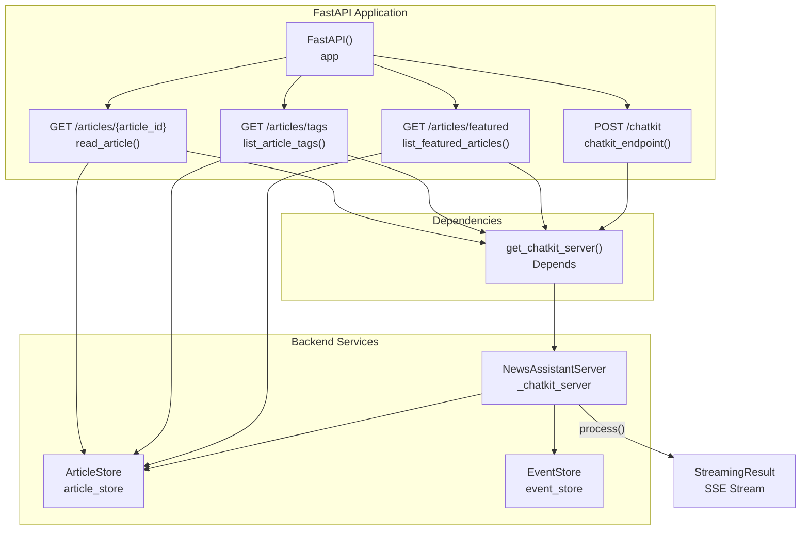
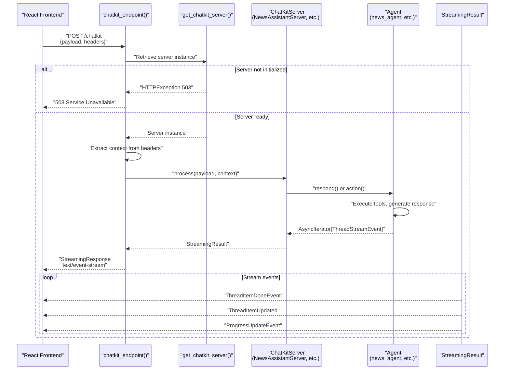
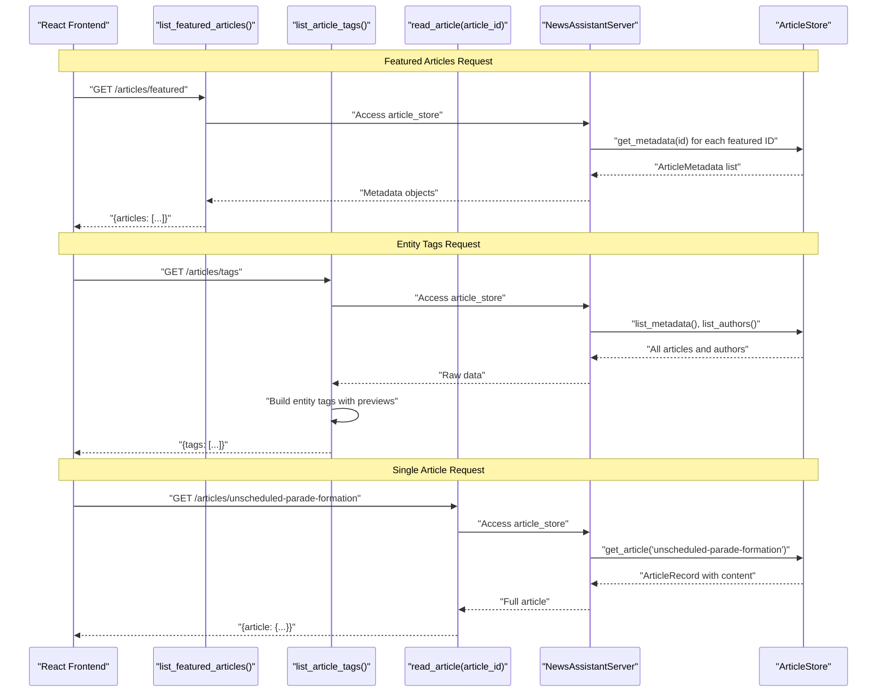

<!-- source: DeepWiki mcp.deepwiki.com · repo openai/openai-chatkit-advanced-samples · page 9.3 API Endpoints · fetched 2026-10-26 -->

# API Endpoints

<details>
<summary>Relevant source files</summary>

The following files were used as context for generating this wiki page:

- [examples/news-guide/backend/app/agents/news_agent.py](examples/news-guide/backend/app/agents/news_agent.py)
- [examples/news-guide/backend/app/main.py](examples/news-guide/backend/app/main.py)
- [examples/news-guide/backend/app/server.py](examples/news-guide/backend/app/server.py)

</details>


This document provides a reference for all HTTP endpoints exposed by the example applications in this repository. Each example application follows a common architecture pattern with a shared ChatKit streaming endpoint and application-specific REST endpoints for domain data.

## Endpoint Overview

All example applications expose the following endpoint categories:

| Category | Endpoints | Purpose |
|----------|-----------|---------|
| **ChatKit Protocol** | `POST /chatkit` | Stream conversational AI responses via Server-Sent Events (SSE) |
| **Domain REST APIs** | Various GET/POST endpoints | Retrieve and manipulate application-specific data (articles, maps, cats, etc.) |

### Example Application Endpoints

| Example | Port | ChatKit Endpoint | Domain-Specific Endpoints |
|---------|------|------------------|---------------------------|
| **Cat Lounge** | 5170 | `POST /chatkit` | Cat state management endpoints |
| **Customer Support** | 5171 | `POST /chatkit` | Support ticket and customer endpoints |
| **News Guide** | 5172 | `POST /chatkit` | `GET /articles/featured`<br/>`GET /articles/tags`<br/>`GET /articles/{article_id}` |
| **Metro Map** | 5173 | `POST /chatkit` | `GET /map` (transit system data) |

**Sources:** [examples/news-guide/backend/app/main.py](), Repository README

## Common Endpoint Architecture

All example applications follow the same FastAPI routing pattern. The following diagram shows how the News Guide example structures its endpoints:

**Diagram: News Guide Endpoint Architecture**



**Sources:** [examples/news-guide/backend/app/main.py:17-141](), [examples/news-guide/backend/app/server.py:42-53]()

## ChatKit Endpoint (Common)

### POST `/chatkit`

All example applications expose a `POST /chatkit` endpoint for ChatKit conversation processing. This endpoint receives chat messages, processes them through the application's AI agent(s), and streams back response events using Server-Sent Events (SSE).

#### Handler Function Pattern

Each example implements a `chatkit_endpoint` handler function. Here is the News Guide implementation at [examples/news-guide/backend/app/main.py:34-46]():

```python
@app.post("/chatkit")
async def chatkit_endpoint(
    request: Request, server: NewsAssistantServer = Depends(get_chatkit_server)
) -> Response:
    payload = await request.body()
    article_id = request.headers.get("article-id")
    context = RequestContext(request=request, article_id=article_id)
    result = await server.process(payload, context)
    if isinstance(result, StreamingResult):
        return StreamingResponse(result, media_type="text/event-stream")
    if hasattr(result, "json"):
        return Response(content=result.json, media_type="application/json")
    return JSONResponse(result)
```

#### Request Context

Each example can extract custom headers or request metadata to build an application-specific context object. For example:

| Example | Context Class | Custom Headers/Metadata |
|---------|---------------|-------------------------|
| **News Guide** | `RequestContext` | `article-id` header (current page context) |
| **Metro Map** | `RequestContext` | Transit system state |
| **Cat Lounge** | `RequestContext` | Cat ID or session state |

The context is passed to `server.process(payload, context)` at [examples/news-guide/backend/app/main.py:41]() and becomes available to agent tools via the `AgentContext` object.

#### Response Format

| Response Type | Media Type | Condition |
|---------------|------------|-----------|
| `StreamingResponse` | `text/event-stream` | When `result` is a `StreamingResult` (most common) |
| `Response` | `application/json` | When `result` has a `json` attribute |
| `JSONResponse` | `application/json` | Default fallback |

The streaming response emits Server-Sent Events (SSE) containing `ThreadStreamEvent` objects such as:
- `ThreadItemDoneEvent` (complete message or widget)
- `ThreadItemUpdated` (widget updates)
- `ProgressUpdateEvent` (search progress feedback)
- Client tool calls and client effects

#### Dependency Injection

All examples use FastAPI's dependency injection to retrieve the ChatKit server singleton via a `get_chatkit_server()` function. Example from News Guide at [examples/news-guide/backend/app/main.py:22-31]():

```python
def get_chatkit_server() -> NewsAssistantServer:
    if _chatkit_server is None:
        raise HTTPException(
            status_code=status.HTTP_503_SERVICE_UNAVAILABLE,
            detail=(
                "ChatKit dependencies are missing. Install the ChatKit Python "
                "package to enable the conversational endpoint."
            ),
        )
    return _chatkit_server
```

This dependency returns HTTP 503 if the server fails to initialize.

**Diagram: ChatKit Endpoint Request Flow**



**Sources:** [examples/news-guide/backend/app/main.py:22-46](), [examples/news-guide/backend/app/server.py:56-80]()

## News Guide Domain Endpoints

The News Guide example exposes three REST endpoints for article and entity tag data. These endpoints are defined in [examples/news-guide/backend/app/main.py:57-141]().

### GET `/articles/featured`

Returns a curated list of featured articles for the homepage.

#### Handler Function

Implemented at [examples/news-guide/backend/app/main.py:57-65]():

```python
@app.get("/articles/featured")
async def list_featured_articles(
    server: NewsAssistantServer = Depends(get_chatkit_server),
) -> dict[str, Any]:
    return {
        "articles": [
            server.article_store.get_metadata(article_id) for article_id in FEATURED_ARTICLE_IDS
        ]
    }
```

The featured article IDs are hard-coded at [examples/news-guide/backend/app/main.py:49-54]():

```python
FEATURED_ARTICLE_IDS = [
    "unscheduled-parade-formation",
    "community-fridge-apple-pies",
    "missed-connection-reunion",
    "transit-pass-machine-updated",
]
```

#### Response Structure

```json
{
  "articles": [
    {
      "id": "unscheduled-parade-formation",
      "title": "Unscheduled Parade Formation...",
      "subtitle": "...",
      "author": "...",
      "tags": [...],
      "url": "/articles/unscheduled-parade-formation"
    }
  ]
}
```

Each article metadata object is retrieved via `ArticleStore.get_metadata(article_id)`.

**Sources:** [examples/news-guide/backend/app/main.py:49-65]()

### GET `/articles/tags`

Returns all article and author entity tags for the `@-mention` system. This endpoint powers entity tag search and preview in the frontend.

#### Handler Function

Implemented at [examples/news-guide/backend/app/main.py:71-127](). The function builds two types of entity tags:

1. **Article tags**: Each article becomes a searchable tag with a preview widget
2. **Author tags**: Each author becomes a searchable tag with author statistics

```python
@app.get("/articles/tags")
async def list_article_tags(
    server: NewsAssistantServer = Depends(get_chatkit_server),
) -> dict[str, Any]:
    # ... helper functions _build_article_tag() and _build_author_tag() ...
    
    articles = [_build_article_tag(entry) for entry in server.article_store.list_metadata()]
    authors = [_build_author_tag(entry) for entry in server.article_store.list_authors()]
    
    return {"tags": articles + authors}
```

#### Response Structure

```json
{
  "tags": [
    {
      "entity": {
        "title": "Unscheduled Parade Formation...",
        "id": "unscheduled-parade-formation",
        "icon": "document",
        "interactive": true,
        "group": "Articles",
        "data": {
          "article_id": "unscheduled-parade-formation",
          "url": "/articles/unscheduled-parade-formation"
        }
      },
      "preview": { /* WidgetRoot object */ }
    },
    {
      "entity": {
        "title": "Jamie Rivers",
        "id": "author:jamie-rivers",
        "icon": "profile-card",
        "interactive": true,
        "group": "Authors",
        "data": {
          "author": "Jamie Rivers",
          "author_id": "jamie-rivers",
          "type": "author"
        }
      },
      "preview": { /* WidgetRoot object */ }
    }
  ]
}
```

The preview widgets are built using `build_article_preview_widget()` and `build_author_preview_widget()` from [examples/news-guide/backend/app/widgets/preview_widgets.py]().

**Sources:** [examples/news-guide/backend/app/main.py:71-127]()

### GET `/articles/{article_id}`

Fetches the full markdown content and metadata for a specific article.

#### Handler Function

Implemented at [examples/news-guide/backend/app/main.py:130-141]():

```python
@app.get("/articles/{article_id}")
async def read_article(
    article_id: str,
    server: NewsAssistantServer = Depends(get_chatkit_server),
) -> dict[str, Any]:
    article = server.article_store.get_article(article_id)
    if not article:
        raise HTTPException(
            status_code=status.HTTP_404_NOT_FOUND,
            detail=f"Article '{article_id}' not found.",
        )
    return {"article": article}
```

#### Path Parameters

| Parameter | Type | Description |
|-----------|------|-------------|
| `article_id` | `str` | Unique article identifier (e.g., `"unscheduled-parade-formation"`) |

#### Response Structure

**Success (200):**
```json
{
  "article": {
    "id": "unscheduled-parade-formation",
    "title": "...",
    "subtitle": "...",
    "author": "...",
    "content": "# Article Title\n\nMarkdown content...",
    "tags": [...],
    "keywords": [...]
  }
}
```

**Error (404):**
```json
{
  "detail": "Article 'invalid-id' not found."
}
```

**Sources:** [examples/news-guide/backend/app/main.py:130-141]()

### News Guide Endpoint Data Flow

**Diagram: News Guide Domain Endpoint Interactions**



**Sources:** [examples/news-guide/backend/app/main.py:57-141](), [examples/news-guide/backend/app/data/article_store.py]()

## Metro Map Domain Endpoints

The Metro Map example provides endpoints for retrieving transit system data. While specific endpoint implementations are not shown in the provided files, based on the architecture patterns and the `MetroMapStore` referenced in the server, the Metro Map application likely exposes:

### GET `/map`

Retrieves the complete transit map data structure including stations, lines, and connections.

#### Expected Response Structure

Based on the `MetroMapStore` usage in agents and the frontend's need for map data:

```json
{
  "stations": [
    {
      "id": "central-station",
      "name": "Central Station",
      "lines": ["red-line", "blue-line"],
      "coordinates": { "lat": 40.7128, "lng": -74.0060 }
    }
  ],
  "lines": [
    {
      "id": "red-line",
      "name": "Red Line",
      "color": "#FF0000",
      "stations": ["central-station", "north-plaza", ...]
    }
  ]
}
```

This endpoint is called by the frontend on initial load to populate the `MetroMapCanvas` visualization.

**Sources:** Architecture diagrams (Diagram 1, Diagram 3), [examples/metromap/backend/app/agents/metro_map_agent.py]() (references to MetroMapStore)

## Cat Lounge Domain Endpoints

The Cat Lounge example likely provides endpoints for cat state management, following similar patterns to the other examples. Expected endpoints include:

### GET `/cats` or GET `/cat`

Retrieves the current cat state (hunger, happiness, name, etc.) for display in the `CatDashboard` component.

### POST `/cats/action`

Handles cat interactions that may not go through the ChatKit streaming interface (e.g., direct UI button clicks).

**Note:** Specific endpoint implementations are not available in the provided files.

**Sources:** Architecture patterns from other examples, [examples/cat-lounge/backend/app/cat_agent.py]() (references to CatStore)

## Customer Support Domain Endpoints

The Customer Support example likely provides endpoints for ticket and customer management. Expected endpoints follow the pattern:

### GET `/tickets` or GET `/customers`

Retrieves support tickets or customer data for display in the support interface.

**Note:** Specific endpoint implementations are not available in the provided files.

**Sources:** Repository structure and common architectural patterns

## Error Handling

All example applications use FastAPI's `HTTPException` for error responses. Common error patterns are consistent across examples:

| Status Code | Condition | Example |
|-------------|-----------|---------|
| 404 Not Found | Resource doesn't exist | Article ID not found in News Guide |
| 503 Service Unavailable | ChatKit server not initialized | Dependency missing during startup |

### 404 Not Found Example

When a requested resource doesn't exist, endpoints raise an `HTTPException`:

From News Guide at [examples/news-guide/backend/app/main.py:137-140]():

```python
if not article:
    raise HTTPException(
        status_code=status.HTTP_404_NOT_FOUND,
        detail=f"Article '{article_id}' not found.",
    )
```

Response:
```json
{
  "detail": "Article 'invalid-id' not found."
}
```

### 503 Service Unavailable Example

When ChatKit dependencies are missing, the `get_chatkit_server()` dependency raises an error:

From News Guide at [examples/news-guide/backend/app/main.py:24-30]():

```python
if _chatkit_server is None:
    raise HTTPException(
        status_code=status.HTTP_503_SERVICE_UNAVAILABLE,
        detail=(
            "ChatKit dependencies are missing. Install the ChatKit Python "
            "package to enable the conversational endpoint."
        ),
    )
```

Response:
```json
{
  "detail": "ChatKit dependencies are missing. Install the ChatKit Python package to enable the conversational endpoint."
}
```

**Sources:** [examples/news-guide/backend/app/main.py:22-31](), [examples/news-guide/backend/app/main.py:137-140]()

## Fact Data Model

Facts stored and returned by the endpoints use the `Fact` dataclass defined at [backend/app/facts.py:21-37]():

### Fact Attributes

| Field | Type | Description | Default |
|-------|------|-------------|---------|
| `text` | `str` | The fact content | Required |
| `status` | `FactStatus` | Lifecycle state (PENDING/SAVED/DISCARDED) | `PENDING` |
| `id` | `str` | Unique identifier with `fact_` prefix | Generated via UUID |
| `created_at` | `datetime` | Creation timestamp | `datetime.utcnow()` |

### Fact Status Enum

The `FactStatus` enum at [backend/app/facts.py:13-18]() defines three states:

```
class FactStatus(str, Enum):
    PENDING = "pending"
    SAVED = "saved"
    DISCARDED = "discarded"
```

### Serialization

The `Fact.as_dict()` method at [backend/app/facts.py:30-37]() serializes facts for API responses:

```
def as_dict(self) -> dict[str, str]:
    return {
        "id": self.id,
        "text": self.text,
        "status": self.status.value,
        "createdAt": self.created_at.isoformat(),
    }
```

Note that the timestamp field is serialized as `createdAt` (camelCase) for frontend compatibility.

**Sources:** [backend/app/facts.py:13-37]()

## Thread Safety

All facts endpoints use the global `fact_store` singleton at [backend/app/facts.py:92-93](). The `FactStore` class implements thread-safe operations using an `asyncio.Lock` at [backend/app/facts.py:46]():

```
self._lock = asyncio.Lock()
```

All public methods (`create`, `mark_saved`, `discard`, `list_saved`) acquire this lock using `async with self._lock:` before modifying or reading the internal `_facts` dictionary and `_order` list. This ensures concurrent requests to facts endpoints cannot cause race conditions.

**Sources:** [backend/app/facts.py:40-90]()