# Page: Overview

# Overview

<details>
<summary>Relevant source files</summary>

The following files were used as context for generating this wiki page:

- [README.md](README.md)

</details>


This document provides a high-level introduction to the OpenAI ChatKit Advanced Samples repository. This repository is a collection of scenario-driven demonstrations showing how to build full-stack conversational AI applications using ChatKit. Each example pairs a FastAPI backend (using the ChatKit Python SDK) with a Vite + React frontend (using @openai/chatkit-react), illustrating different ChatKit features and integration patterns.

The repository contains four complete example applications, each demonstrating distinct capabilities:
- **Examples Overview**: See page [1.1]()
- **Repository Structure**: See page [1.2]()
- **Getting Started**: See page [2]()
- **Common Architecture**: See page [3]()
- **Individual Example Documentation**: See pages [4](), [5](), [6]()

## Purpose and Scope

The repository demonstrates how to build production-ready ChatKit applications by providing reference implementations across multiple domains. Each example showcases:

- **Full-stack architecture**: FastAPI backend + Vite/React frontend
- **ChatKit integration**: Server-side Python SDK and client-side React library
- **ChatKit features**: Server tools, client tools, client effects, widgets, entity tags, annotations, and more
- **Domain-specific patterns**: Virtual pet management, metro route planning, news editorial workflows, airline customer support

Developers can use these examples to understand ChatKit capabilities, compare implementation approaches across different use cases, and adapt patterns for their own applications.

**Sources**: [README.md:1-11]()
</thinking>

## Example Applications

The repository includes four complete applications, each running on a dedicated port and demonstrating distinct ChatKit features:

| Example | Port | Primary Features | What It Demonstrates |
|---------|------|------------------|---------------------|
| **Cat Lounge** | 5170 | Virtual pet caretaker | Client effects (fire-and-forget UI updates), interactive widgets with actions, dynamic thread titles |
| **Customer Support** | 5171 | Airline concierge | Live itinerary data, timeline syncing, domain-specific tools |
| **News Guide** | 5172 | Newsroom assistant | Page-aware responses, @-mentions, tool choice routing, progress updates |
| **Metro Map** | 5173 | Metro route planner | Client tools (bidirectional state queries), entity annotations, custom header actions, complex state synchronization |

Each example is self-contained with its own backend and frontend implementations, demonstrating different aspects of the ChatKit platform in domain-specific contexts.

**Sources**: [README.md:5-10](), [README.md:18-23]()

## Repository Organization

**Repository Structure Diagram**

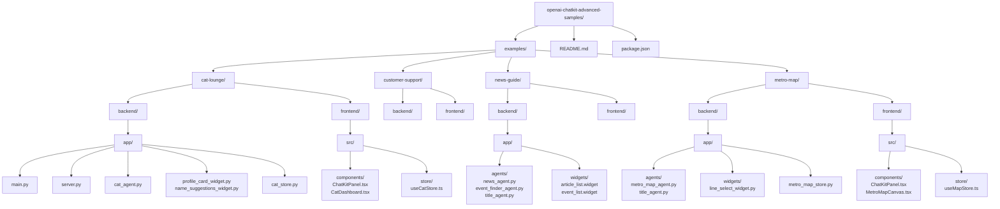

Each example follows a consistent structure:
- **`backend/`**: FastAPI application with Python 3.11+ requirement
  - **`app/`**: Main Python package
    - `main.py`: FastAPI application and HTTP endpoints
    - `server.py`: ChatKitServer implementation
    - `agents/`: AI agent implementations using ChatKit Python SDK
    - `widgets/`: Widget templates and builders
    - `*_store.py`: Domain-specific data stores
- **`frontend/`**: Vite + React application with Node 18.18+ requirement
  - **`src/`**: TypeScript source code
    - `components/`: React components including ChatKitPanel
    - `store/`: Zustand state management
    - `lib/`: Configuration and utilities

**Sources**: [README.md:1-11]()

## Common Architecture Pattern

All examples follow an identical architectural pattern: a FastAPI backend paired with a Vite + React frontend, connected through the ChatKit platform.

**High-Level Architecture Diagram**

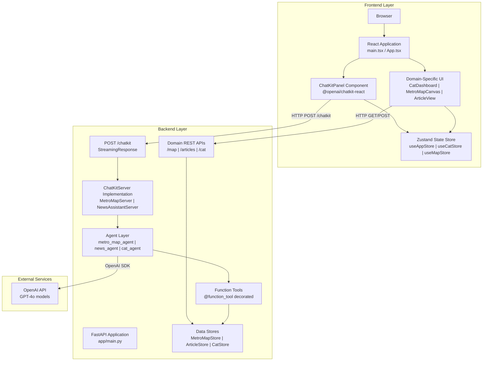

This architecture separates conversational AI (ChatKit integration) from domain-specific functionality (application data and UI), enabling clean testing and maintainability. For detailed architecture documentation, see:
- Backend architecture: [3.1]()
- Frontend architecture: [3.2]()
- Communication patterns: [3.3]()

**Sources**: [README.md:1-11]()

## Feature Demonstration Matrix

Each example demonstrates a different subset of ChatKit features, providing comprehensive coverage when viewed together:

**Feature Coverage by Example**

| Feature Category | Cat Lounge | Customer Support | News Guide | Metro Map |
|------------------|------------|------------------|------------|-----------|
| **Server Tools** | `get_cat_status`, `feed_cat`, `play_with_cat` | Itinerary tools | `search_articles`, `get_current_page` | `get_map`, `list_lines`, `list_stations` |
| **Client Tools** | — | — | — | `get_selected_stations` |
| **Client Effects** | `update_cat_status`, `cat_say` | Timeline sync | — | `location_select_mode`, `add_station` |
| **Widgets (Presentation)** | `cat_profile` | Itinerary display | `article_preview`, `author_preview` | — |
| **Widgets (Interactive)** | `name_suggestions` | — | `article_list`, `event_list` | `line_selector` |
| **Widget Actions (Client)** | `cats.select_name` (client) | — | `open_article` | — |
| **Widget Actions (Server)** | `cats.select_name` (server), `cats.more_names` | — | `view_event_details` | `line.select` |
| **Entity Tags** | — | — | @-mention articles/authors | @-mention stations |
| **Annotations** | — | — | — | Route planning with station sources |
| **Thread Titles** | Dynamic with `set_cat_name` | — | `title_agent` | `title_agent` |
| **Page Awareness** | — | — | `article-id` header | — |
| **Progress Updates** | — | — | Search feedback | Map loading |
| **Tool Choice** | — | — | Agent routing | — |
| **Custom Header** | — | — | — | Dark/light mode toggle |

This matrix reveals the complementary nature of the examples:
- **Cat Lounge**: Focus on client effects and state synchronization
- **Customer Support**: Domain-specific tools and real-time data integration
- **News Guide**: Page awareness, entity tags, and agent routing
- **Metro Map**: Most feature-rich, demonstrating client tools, complex UI interactions, and annotations

**Sources**: [README.md:25-131]()

## Technology Stack

All examples use a consistent technology stack with specific version requirements:

### Runtime Requirements

| Requirement | Version | Purpose |
|-------------|---------|---------|
| **Python** | 3.11+ | Backend runtime |
| **Node.js** | 18.18+ | Frontend build and dev server |
| **uv** | Latest | Python package manager |

### Backend Stack

| Technology | Version Range | Purpose |
|------------|---------------|---------|
| **FastAPI** | 0.114-0.116 | Async web framework and API routing |
| **Uvicorn** | 0.36 | ASGI server for FastAPI |
| **openai-chatkit** | 1.4.0-2.0 | ChatKit Python SDK for agent implementation |
| **openai** | 1.40+ | OpenAI API client |
| **Jinja2** | Latest | Widget template rendering |

### Frontend Stack

| Technology | Version Range | Purpose |
|------------|---------------|---------|
| **Vite** | 7.x | Build tool and dev server with HMR |
| **React** | 19.2 | UI framework |
| **TypeScript** | 5.4 | Type safety |
| **@openai/chatkit-react** | ^1.3.0 | ChatKit React components and hooks |
| **Zustand** | 5.0 | Lightweight state management |
| **React Router** | 6.28 | Client-side routing |

### Domain-Specific Dependencies

- **Metro Map**: ReactFlow 11.11 for interactive graph visualization
- **News Guide**: Additional date parsing and content processing utilities

The tight version constraints on ChatKit and FastAPI ensure API compatibility across examples. For complete dependency details, see [9.1]().

**Sources**: [README.md:1-11]()

## Communication Patterns

ChatKit applications use four distinct communication patterns, all demonstrated across the examples:

**Communication Patterns Diagram**

```mermaid
sequenceDiagram
    participant User
    participant Frontend["Frontend<br/>ChatKitPanel"]
    participant Backend["Backend<br/>ChatKitServer"]
    participant Agent["Agent<br/>metro_map_agent"]
    participant Store["Data Store<br/>MetroMapStore"]
    
    rect rgb(245, 245, 245)
    Note over User,Store: Pattern 1: Server Tool Call
    User->>Frontend: "Plan a route"
    Frontend->>Backend: POST /chatkit (streaming)
    Backend->>Agent: Process request
    Agent->>Store: get_map()
    Store-->>Agent: Map data
    Agent-->>Backend: Response with data
    Backend-->>Frontend: Stream events
    end
    
    rect rgb(245, 245, 245)
    Note over User,Store: Pattern 2: Client Tool Call
    Agent->>Backend: Request client tool
    Backend-->>Frontend: ClientToolCallEvent
    Frontend->>Frontend: get_selected_stations()
    Frontend-->>Backend: Return selection
    Backend->>Agent: Continue with result
    end
    
    rect rgb(245, 245, 245)
    Note over User,Store: Pattern 3: Client Effect
    Agent->>Backend: Trigger effect
    Backend-->>Frontend: ClientEffectEvent
    Frontend->>Frontend: Update UI (location_select_mode)
    Note over Frontend: No response required
    end
    
    rect rgb(245, 245, 245)
    Note over User,Store: Pattern 4: Widget Action
    User->>Frontend: Click widget button
    Frontend->>Backend: sendAction(action, widgetId)
    Backend->>Store: Process action
    Store-->>Backend: Updated data
    Backend-->>Frontend: ThreadItemUpdated
    end
```

### Pattern Summary

1. **Server Tools**: Agent queries backend data stores to ground responses in application state (synchronous from agent perspective)
2. **Client Tools**: Agent requests information from frontend UI state, requiring a round-trip (agent waits for result)
3. **Client Effects**: Fire-and-forget actions that update UI without server acknowledgment (asynchronous)
4. **Widget Actions**: User interactions with rendered widgets, handled either client-side (navigation) or server-side (state persistence)

For detailed documentation of each pattern, see [3.3]().

**Sources**: [README.md:27-95]()

## Quick Start

To run any example application:

### Prerequisites

1. **Environment Setup**
   - Python 3.11 or higher
   - Node.js 18.18 or higher
   - `uv` package manager installed
   - OpenAI API key exported: `export OPENAI_API_KEY=sk-...`

2. **Running Examples**

From the repository root:

```bash
# Cat Lounge (port 5170)
npm run cat-lounge

# Customer Support (port 5171)
npm run customer-support

# News Guide (port 5172)
npm run news-guide

# Metro Map (port 5173)
npm run metro-map
```

Alternatively, from within an example directory:

```bash
cd examples/cat-lounge
npm install
npm run start
```

Each command starts both backend and frontend servers concurrently with hot reloading enabled.

For detailed setup instructions, environment configuration, and development workflow, see [2]().

**Sources**: [README.md:12-23]()

## Quick Start Summary

To run the basic starter template:

1. **Backend**: `npm run backend` (requires `uv` and `OPENAI_API_KEY`)
2. **Frontend**: `npm run frontend` (from repository root)
3. **Both together**: `npm start` (from repository root)

The application will be accessible at `http://127.0.0.1:5170` with the backend API at `http://127.0.0.1:8000`. For detailed setup instructions, see [Getting Started](#2).

**Sources**: [README.md:12-71](), [agents.md:23-40]()

---

# Page: Examples Overview

# Examples Overview

<details>
<summary>Relevant source files</summary>

The following files were used as context for generating this wiki page:

- [README.md](README.md)
- [examples/cat-lounge/README.md](examples/cat-lounge/README.md)
- [examples/cat-lounge/frontend/src/components/ChatKitPanel.tsx](examples/cat-lounge/frontend/src/components/ChatKitPanel.tsx)
- [examples/metro-map/README.md](examples/metro-map/README.md)

</details>


## Purpose

This page provides a comprehensive overview of the four example applications included in the OpenAI ChatKit Advanced Samples repository. Each example demonstrates a distinct set of ChatKit features through a complete FastAPI + Vite/React implementation. For detailed architecture patterns shared across examples, see [Common Architecture](#3). For in-depth documentation of individual examples, see [Example: Metro Map](#4), [Example: Cat Lounge](#5), and [Example: News Guide](#6).

## Example Applications Summary

The repository contains four standalone applications, each running on a dedicated port and demonstrating different aspects of the ChatKit framework:

| Example | Port | Primary Focus | Repository Path |
|---------|------|---------------|-----------------|
| **Cat Lounge** | 5170 | Client effects and state synchronization | `examples/cat-lounge` |
| **Customer Support** | 5171 | Live data integration and timeline syncing | `examples/customer-support` |
| **News Guide** | 5172 | Page awareness, entity tags, and agent routing | `examples/news-guide` |
| **Metro Map** | 5173 | Client tools, annotations, and interactive widgets | `examples/metro-map` |

**Sources:** [README.md:5-11](), [README.md:18-23]()

## Application Port Mapping

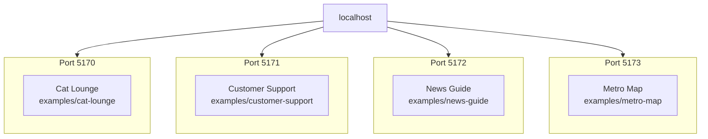

**Sources:** [README.md:18-23]()

## Cat Lounge (`examples/cat-lounge`)

The Cat Lounge example implements a virtual cat caretaker application that demonstrates fire-and-forget client effects and widget-based interactions. The application maintains per-thread cat state including energy, happiness, and cleanliness statistics.

### Key Features

- **Server Tools**: `get_cat_status`, `feed_cat`, `play_with_cat`, `clean_cat`, `set_cat_name`, `speak_as_cat` defined in `cat_agent.py`
- **Client Effects**: `update_cat_status` and `cat_say` fire-and-forget events that update UI without server acknowledgment
- **Interactive Widgets**: Name suggestion widget with `cats.select_name` and `cats.more_names` actions
- **Presentation Widgets**: `show_cat_profile` displays read-only cat profile cards
- **Dynamic Thread Titles**: Thread title updates to `{name}'s Lounge` after cat naming
- **Hidden Context**: Action tags (`<FED_CAT>`, `<PLAYED_WITH_CAT>`, `<CLEANED_CAT>`, `<CAT_NAME_SELECTED>`) track conversation history

### Primary Use Case

Demonstrates how to build stateful conversational applications where the AI agent reads and mutates domain state, with real-time UI synchronization through client effects handled in `onEffect` callback.

**Sources:** [README.md:7](), [examples/cat-lounge/README.md:1-27](), [README.md:29-30](), [README.md:46-47](), [README.md:73-80](), [README.md:89-91](), [README.md:104-105]()

## Customer Support (`examples/customer-support`)

The Customer Support example implements an airline concierge assistant with live itinerary data access and timeline synchronization capabilities.

### Key Features

- **Live Data Integration**: Server tools access real-time itinerary and booking information
- **Timeline Syncing**: Maintains temporal context for travel-related queries
- **Domain-Specific Tools**: Custom function tools for airline operations

### Primary Use Case

Demonstrates integration with external data sources and temporal awareness in customer service scenarios.

**Sources:** [README.md:8]()

## News Guide (`examples/news-guide`)

The News Guide example implements a newsroom editorial assistant for the fictional Foxhollow Dispatch, featuring comprehensive article search, page-aware responses, and agent routing capabilities.

### Key Features Demonstrated

| Feature Category | Implementation | Code References |
|------------------|----------------|-----------------|
| **Server Tools** | `list_available_tags_and_keywords`, `get_article_by_id`, `search_articles_by_tags`, `search_articles_by_keywords`, `search_articles_by_exact_text`, `get_current_page` | `news_agent.py` |
| **Page Awareness** | `article-id` header forwarded by client, exposed via `get_current_page` tool | `ChatKitPanel.tsx`, `main.py` |
| **Entity Tags** | @-mention articles and authors with preview via `/articles/tags` endpoint | `ChatKitPanel.tsx`, `main.py` |
| **Entity Conversion** | `<ARTICLE_REFERENCE>` and `<AUTHOR_REFERENCE>` markers for model | `thread_item_converter.py` |
| **Progress Updates** | `ProgressUpdateEvent` during searches and page loads | `news_agent.py`, `event_finder_agent.py` |
| **Tool Choice** | Composer menu forces specific agents (`event_finder`, `puzzle`) | `ChatKitPanel.tsx`, `config.ts`, `server.py` |
| **Widget Actions** | `open_article` (client-handled), `view_event_details` (server-handled) | `article_list_widget.py`, `event_list_widget.py` |
| **Sub-Agents** | `event_finder_agent`, `puzzle_agent`, `title_agent` for specialized tasks | `server.py` |
| **Thread Titles** | `title_agent` generates newsroom-friendly titles on first message | `title_agent.py` |

### Primary Use Case

Demonstrates page-aware conversational AI where responses adapt to the user's current context (open article), with sophisticated agent routing and entity mention capabilities for editorial workflows.

**Sources:** [README.md:9](), [README.md:31-33](), [README.md:54-56](), [README.md:60-62](), [README.md:82-83](), [README.md:92-93](), [README.md:106-107](), [README.md:113-116](), [README.md:123-126]()

## Metro Map (`examples/metro-map`)

The Metro Map example is the most feature-rich demonstration, implementing a chat-driven metro planner with an interactive React Flow canvas for visualizing and extending transit networks.

### Key Features Demonstrated

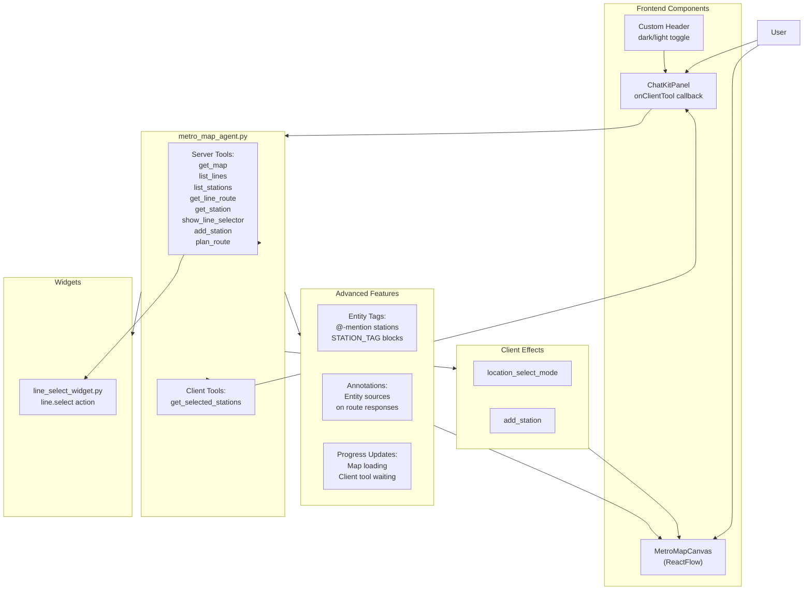

**Sources:** [README.md:10](), [examples/metro-map/README.md:1-28](), [README.md:34-37](), [README.md:41-42](), [README.md:48-50](), [README.md:63-64](), [README.md:68-69](), [README.md:84-85](), [README.md:94-95](), [README.md:99-100](), [README.md:108-109](), [README.md:117-119](), [README.md:130-131]()

### Feature Breakdown

| Feature | Purpose | Implementation |
|---------|---------|----------------|
| **Map Synchronization** | Keep agent grounded in network topology | `get_map` tool in `metro_map_agent.py` |
| **Client Tool Call** | Query UI selection state | `get_selected_stations` client tool handled in `onClientTool` callback |
| **Client Effects** | Update canvas without server roundtrip | `location_select_mode` and `add_station` effects in `ChatKitPanel.tsx` |
| **Interactive Widget** | Multi-choice line selection | `show_line_selector` streams `line_select_widget.py` |
| **Server Action Handler** | Process line selection with context injection | `line.select` action in `server.py` adds `<LINE_SELECTED>` hidden item |
| **Entity Annotations** | Clickable station references in responses | `plan_route` attaches entity sources, handled in `onEntityClick` |
| **Entity Tags** | @-mention stations with metadata | `<STATION_TAG>` blocks via `thread_item_converter.py` |
| **Progress Updates** | Loading feedback during operations | `ProgressUpdateEvent` in `get_map` and `get_selected_stations` |
| **Custom Header** | Theme switching | Dark/light mode toggle in header actions |
| **Response Locking** | Prevent state drift during agent updates | `onResponseStart` and `onResponseEnd` lock canvas interaction |

### Station Creation Flow

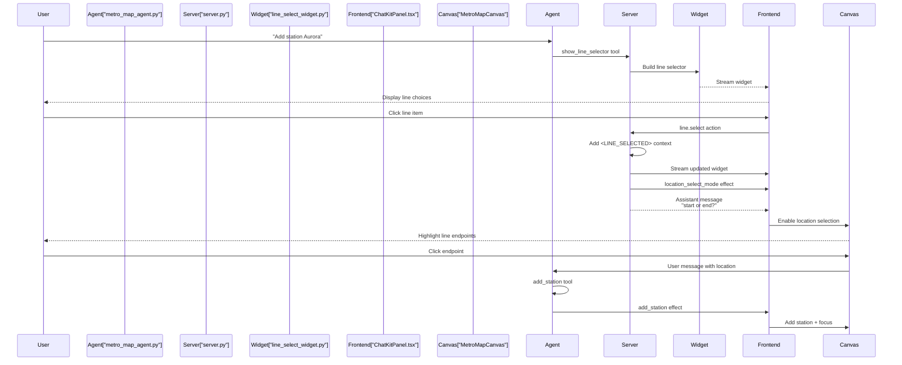

**Sources:** [examples/metro-map/README.md:23-24]()

### Primary Use Case

Demonstrates bidirectional communication patterns including client tools (frontend queries), client effects (fire-and-forget updates), interactive widgets with server-side action handling, entity annotations for clickable references, and response lifecycle management for complex GUI applications.

**Sources:** [examples/metro-map/README.md:19-27]()

## Feature Distribution Across Examples

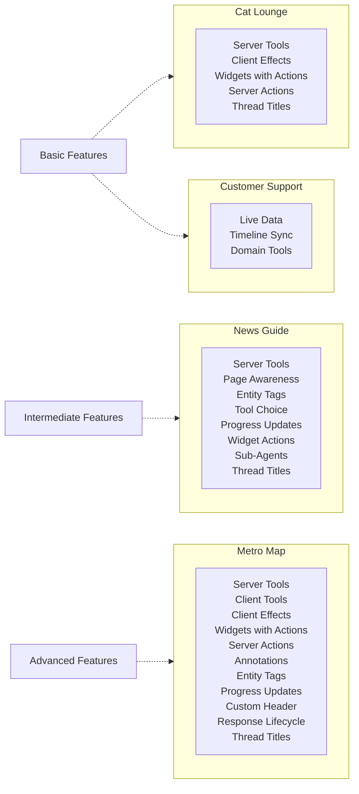

**Sources:** [README.md:25-132]()

## Quick Start Commands

Each example can be launched from the repository root using npm scripts or from the project directory:

| Example | Root Command | Project Directory Command |
|---------|--------------|---------------------------|
| Cat Lounge | `npm run cat-lounge` | `cd examples/cat-lounge && npm install && npm run start` |
| Customer Support | `npm run customer-support` | `cd examples/customer-support && npm install && npm start` |
| News Guide | `npm run news-guide` | `cd examples/news-guide && npm install && npm run start` |
| Metro Map | `npm run metro-map` | `cd examples/metro-map && npm install && npm run start` |

All examples require `OPENAI_API_KEY` environment variable and `uv` package manager installed.

**Sources:** [README.md:12-23]()

## Example Selection Guide

Choose an example based on the ChatKit features you want to explore:

- **Start with Cat Lounge** if you're learning basic client effects and widget interactions
- **Explore Customer Support** for live data integration patterns
- **Study News Guide** for page-aware responses, entity mentions, and agent routing
- **Deep-dive into Metro Map** for the complete feature set including client tools, annotations, and complex UI synchronization

For common patterns across all examples, see [Common Architecture](#3). For detailed feature documentation, see [ChatKit Integration Guide](#7).

**Sources:** [README.md:1-11]()

---

# Page: Repository Structure

# Repository Structure

<details>
<summary>Relevant source files</summary>

The following files were used as context for generating this wiki page:

- [examples/metro-map/backend/app/widgets/line_select_widget.py](examples/metro-map/backend/app/widgets/line_select_widget.py)
- [examples/metro-map/backend/pyproject.toml](examples/metro-map/backend/pyproject.toml)
- [examples/metro-map/frontend/package.json](examples/metro-map/frontend/package.json)
- [examples/news-guide/backend/pyproject.toml](examples/news-guide/backend/pyproject.toml)
- [examples/news-guide/backend/uv.lock](examples/news-guide/backend/uv.lock)

</details>


This page explains the common directory structure shared across all example applications in the OpenAI ChatKit Advanced Samples repository. Each example follows an identical organizational pattern, making it easy to understand one example and apply that knowledge to the others. For detailed information about the architecture within each directory, see page 3 (Common Architecture). For setup instructions, see page 2 (Getting Started).

## Repository Layout

The repository contains four independent example applications, each demonstrating different ChatKit features. Each example is a self-contained full-stack application with its own backend and frontend.

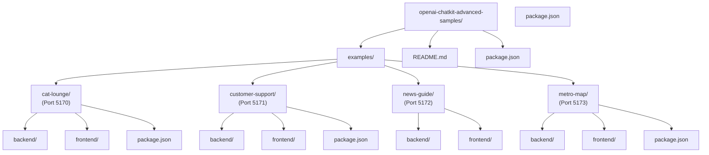

**Sources:** README.md (repository overview), examples directory structure

## Example Applications Overview

Each example application is independent and can be run on its own port:

| Example | Directory | Frontend Port | Backend Port | Key Features |
|---------|-----------|---------------|--------------|--------------|
| Cat Lounge | `examples/cat-lounge/` | 5170 | 8000 | Client effects, widget actions, dynamic thread titles |
| Customer Support | `examples/customer-support/` | 5171 | 8001 | Tool choice, progress updates, multi-agent routing |
| News Guide | `examples/news-guide/` | 5172 | 8002 | Page awareness, entity tags, sub-agent delegation |
| Metro Map | `examples/metro-map/` | 5173 | 8003 | Client tools, annotations, custom headers, ReactFlow |

Each example directory contains a `package.json` with npm scripts to run both servers:
- `npm start` - Starts both backend and frontend
- `npm run backend` - Starts only the backend
- `npm run frontend` - Starts only the frontend

**Sources:** README.md (example applications section)

## Common Backend Directory Structure

Every example's backend follows the same structure as a Python package named `chatkit-backend`. The backend implements a FastAPI server with ChatKit integration.

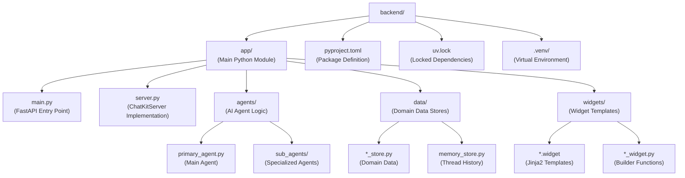

### Backend Package Configuration

All backends share the same core dependencies defined in `pyproject.toml`:

| Dependency | Version Constraint | Purpose |
|------------|-------------------|---------|
| `fastapi` | >=0.114.1,<0.116 | Web framework for HTTP APIs |
| `uvicorn[standard]` | >=0.36,<0.37 | ASGI server |
| `openai` | >=1.40 | OpenAI API client |
| `openai-chatkit` | >=1.4.0,<2 | ChatKit Python SDK |
| `jinja2` | Latest | Template engine for widgets |

**Sources:** [examples/news-guide/backend/pyproject.toml:1-30](), [examples/metro-map/backend/pyproject.toml:1-30]()

### Backend Module Organization

The `app/` module contains all application code organized into these directories:

| Directory/File | Purpose | Example Files |
|----------------|---------|---------------|
| `main.py` | FastAPI application entry point | Creates `FastAPI()` instance, defines routes |
| `server.py` | `ChatKitServer` implementation | Handles ChatKit protocol, action routing |
| `agents/` | AI agent implementations | Primary agent, sub-agents, tools |
| `data/` | Data storage layers | Domain stores (MetroMapStore, ArticleStore), MemoryStore |
| `widgets/` | Widget templates and builders | `.widget` files, `build_*_widget()` functions |

### Backend Entry Point

The FastAPI application is instantiated in `app/main.py`. The server is started using:
```bash
uvicorn app.main:app --reload --port 8000
```

All backends expose these common endpoints:
- `POST /chatkit` - ChatKit streaming endpoint (required)
- Domain-specific REST endpoints (e.g., `GET /map`, `GET /articles`)

**Sources:** [examples/news-guide/backend/uv.lock:100-129](), backend directory structure across examples

## Common Frontend Directory Structure

Every example's frontend is a React 19 application built with Vite 7 and TypeScript. All frontends share the same structural pattern.

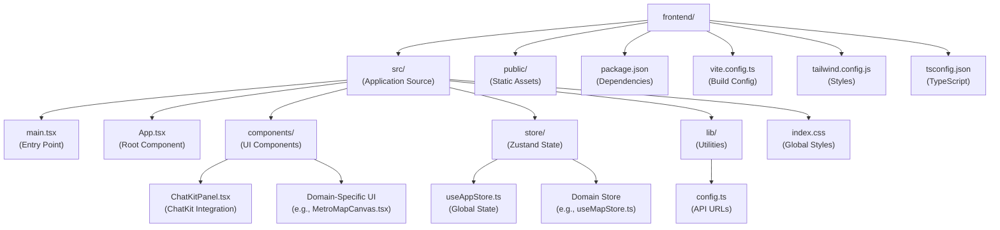

### Frontend Dependencies

All frontends share these core dependencies:

| Package | Version | Purpose |
|---------|---------|---------|
| `@openai/chatkit-react` | ^1.3.0 | ChatKit React SDK |
| `react` | ^19.2.0 | UI framework |
| `react-dom` | ^19.2.0 | React DOM renderer |
| `react-router-dom` | ^6.28.0 | Client-side routing |
| `zustand` | ^5.0.8 | State management |
| `lucide-react` | ^0.544.0 | Icon library |

**Sources:** [examples/metro-map/frontend/package.json:16-27]()

### Frontend Module Organization

The `src/` directory contains all application code organized as follows:

| Directory/File | Purpose | Example Files |
|----------------|---------|---------------|
| `main.tsx` | React application entry point | Renders `<App />` |
| `App.tsx` | Root component | Routing, theme provider, layout |
| `components/` | React components | `ChatKitPanel.tsx`, domain UI components |
| `store/` | Zustand stores | `useAppStore.ts`, domain-specific stores |
| `lib/` | Utilities and configuration | `config.ts` (API URLs, domain keys) |
| `index.css` | Global styles | Tailwind CSS directives |

### Vite Configuration Pattern

Each frontend's `vite.config.ts` configures:
- **Port**: Unique per example (5170-5173)
- **Host**: `0.0.0.0` (allows network access)
- **Proxy Rules**: Routes `/chatkit` and domain endpoints to backend

Example from Metro Map:
- Frontend runs on port 5173
- Proxies `/chatkit` → `http://127.0.0.1:8003`
- Proxies `/map` → `http://127.0.0.1:8003`

This proxy configuration eliminates CORS issues during development by routing API requests through the Vite dev server.

**Sources:** [examples/metro-map/frontend/package.json:1-48](), vite.config.ts files across examples

## Backend Widget System Structure

Backends that use widgets (Cat Lounge, News Guide, Metro Map) follow this pattern in the `widgets/` directory:

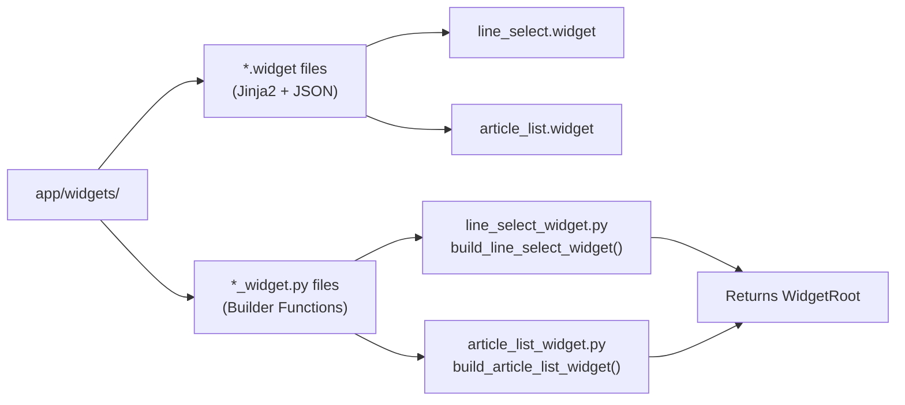

### Widget File Organization

Widget templates use the `.widget` extension and contain JSON structure with Jinja2 templating:

```
app/
└── widgets/
    ├── line_select.widget          # Template file
    ├── line_select_widget.py       # Builder function
    ├── article_list.widget
    └── article_list_widget.py
```

The builder functions follow a consistent pattern:

1. Load template using `WidgetTemplate.from_file()`
2. Accept data as function parameters
3. Call `.build()` with data dictionary
4. Return `WidgetRoot` object

Example builder function structure:
```python
# app/widgets/line_select_widget.py
from chatkit.widgets import WidgetRoot, WidgetTemplate

line_select_widget_template = WidgetTemplate.from_file("line_select.widget")

def build_line_select_widget(lines: list[Line], selected: str | None = None) -> WidgetRoot:
    return line_select_widget_template.build(
        data={"items": lines, "selected": selected}
    )
```

**Sources:** [examples/metro-map/backend/app/widgets/line_select_widget.py:1-22]()

## Frontend State Management Pattern

All frontends use Zustand for state management, split across two store types:

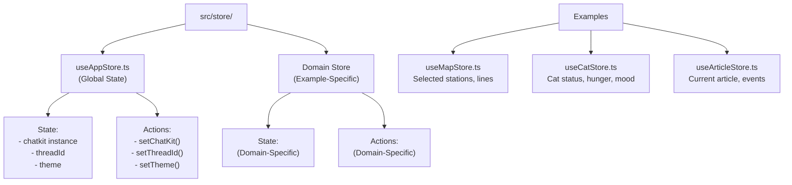

### Global App Store

`useAppStore.ts` manages ChatKit integration and theme:

| State Field | Type | Purpose |
|-------------|------|---------|
| `chatkit` | `ChatKit \| null` | ChatKit instance from `useChatKit()` |
| `threadId` | `string \| null` | Current conversation thread ID |
| `theme` | `'light' \| 'dark'` | UI theme |

### Domain-Specific Stores

Each example implements a domain store for application-specific state:

| Example | Store Name | State Fields |
|---------|-----------|--------------|
| Metro Map | `useMapStore` | `selectedStations`, `highlightedLine`, `routeAnnotations` |
| Cat Lounge | `useCatStore` | `catStatus`, `hunger`, `mood`, `name` |
| News Guide | `useArticleStore` | `currentArticleId`, `searchResults`, `events` |

**Sources:** Frontend store directories across examples

## Configuration Files Overview

Each example contains the same set of configuration files:

### Backend Configuration

| File | Purpose | Key Settings |
|------|---------|--------------|
| `backend/pyproject.toml` | Package definition | Dependencies, Python >=3.11, package metadata |
| `backend/uv.lock` | Locked dependencies | Reproducible builds with exact versions |
| `backend/.env` (local) | Environment variables | `OPENAI_API_KEY` |

### Frontend Configuration

| File | Purpose | Key Settings |
|------|---------|--------------|
| `frontend/package.json` | Package definition | Dependencies, scripts, Node >=18.18 |
| `frontend/vite.config.ts` | Build configuration | Port, proxy rules, allowedHosts |
| `frontend/tsconfig.json` | TypeScript configuration | Compiler options, module resolution |
| `frontend/tailwind.config.js` | Tailwind CSS configuration | Theme, content paths |
| `frontend/src/lib/config.ts` | Runtime configuration | API URLs, domain keys, constants |

**Sources:** [examples/news-guide/backend/pyproject.toml:1-30](), [examples/metro-map/backend/pyproject.toml:1-30](), [examples/metro-map/frontend/package.json:1-48]()

## File Organization Patterns

### Backend Pattern

The backend follows a modular structure where:
- `app/main.py` - Defines FastAPI application and routes
- `app/server.py` - Implements `FactAssistantServer` (ChatKit server)
- `app/tools/` - Contains individual tool implementations (`weather.py`, `facts.py`, `theme.py`)
- `app/storage/` - Implements in-memory data stores (`fact_store.py`, `memory_store.py`)

### Frontend Pattern

The frontend follows a component-based architecture:
- `src/main.tsx` - React application entry point
- `src/App.tsx` - Root component with theme orchestration
- `src/components/` - Reusable UI components (Home, ChatKitPanel, Facts, etc.)
- `src/lib/config.ts` - Centralized configuration
- `src/lib/` - Custom hooks (`useColorScheme`, `useFacts`)

This organization allows for clean separation of concerns and makes both backend and frontend codebases easy to navigate and extend.

**Sources:** [README.md:1-98]()

---

# Page: Getting Started

# Getting Started

<details>
<summary>Relevant source files</summary>

The following files were used as context for generating this wiki page:

- [README.md](README.md)
- [examples/news-guide/backend/pyproject.toml](examples/news-guide/backend/pyproject.toml)
- [examples/news-guide/backend/uv.lock](examples/news-guide/backend/uv.lock)

</details>


This guide covers prerequisites and instructions for running any of the four example applications in the OpenAI ChatKit Advanced Samples repository. Each example demonstrates different ChatKit features through a FastAPI backend paired with a Vite + React frontend.

---

## Prerequisites

Before running any example, ensure the following tools and credentials are available:

### Required Software

| Tool | Minimum Version | Purpose |
|------|----------------|---------|
| Python | 3.11+ | Backend runtime for FastAPI servers |
| Node.js | 18.18+ | Frontend runtime for Vite + React |
| uv | Latest | Python package manager (recommended) |
| npm | 7+ | Node package manager (included with Node.js) |

**Installation**: 
- Python: [python.org/downloads](https://www.python.org/downloads)
- Node.js: [nodejs.org](https://nodejs.org)
- uv: [docs.astral.sh/uv](https://docs.astral.sh/uv/getting-started/installation/)

### Required API Key

| Environment Variable | Purpose | Obtain From |
|---------------------|---------|-------------|
| `OPENAI_API_KEY` | Powers AI agents in backend | [platform.openai.com/api-keys](https://platform.openai.com/api-keys) |

Export the API key before starting any example:

```bash
export OPENAI_API_KEY=sk-proj-...
```

**Sources**: [README.md:14](), [examples/news-guide/backend/pyproject.toml:6]()

---

## Running Examples

Each example can be launched using npm scripts from the repository root or by running commands directly from the example's directory. The `uv` package manager handles dependency installation automatically when using the npm scripts.

### Example Applications and Ports

| Example | Port | Command (from repo root) | Command (from project directory) |
|---------|------|-------------------------|----------------------------------|
| **Cat Lounge** | 5170 | `npm run cat-lounge` | `cd examples/cat-lounge && npm install && npm run start` |
| **Customer Support** | 5171 | `npm run customer-support` | `cd examples/customer-support && npm install && npm start` |
| **News Guide** | 5172 | `npm run news-guide` | `cd examples/news-guide && npm install && npm run start` |
| **Metro Map** | 5173 | `npm run metro-map` | `cd examples/metro-map && npm install && npm run start` |

**Example Architecture**: Each application follows an identical structure with a FastAPI backend (`backend/app/`) and Vite + React frontend (`frontend/src/`). The npm scripts coordinate starting both servers and handle dependency installation via `uv`.

**Sources**: [README.md:18-23]()

### Running from Repository Root (Recommended)

The repository root [package.json]() provides convenience scripts that handle both backend and frontend setup:

```bash
# 1. Export your OpenAI API key
export OPENAI_API_KEY=sk-proj-...

# 2. Run any example (e.g., Metro Map)
npm run metro-map
```

This approach:
- Automatically runs `uv sync` to install Python dependencies
- Automatically runs `npm install` in the frontend directory
- Starts both FastAPI backend and Vite frontend servers
- Opens the application at the appropriate localhost URL

**Sources**: [README.md:14-23]()

### Running from Project Directory (Alternative)

For more control or debugging, navigate to the specific example directory:

```bash
# 1. Export your OpenAI API key
export OPENAI_API_KEY=sk-proj-...

# 2. Navigate to example
cd examples/metro-map

# 3. Install frontend dependencies
npm install

# 4. Start servers
npm run start
```

The [examples/*/package.json]() `start` script executes both backend and frontend commands concurrently using the `concurrently` package.

**Sources**: [README.md:20-23]()

### Application Startup Sequence

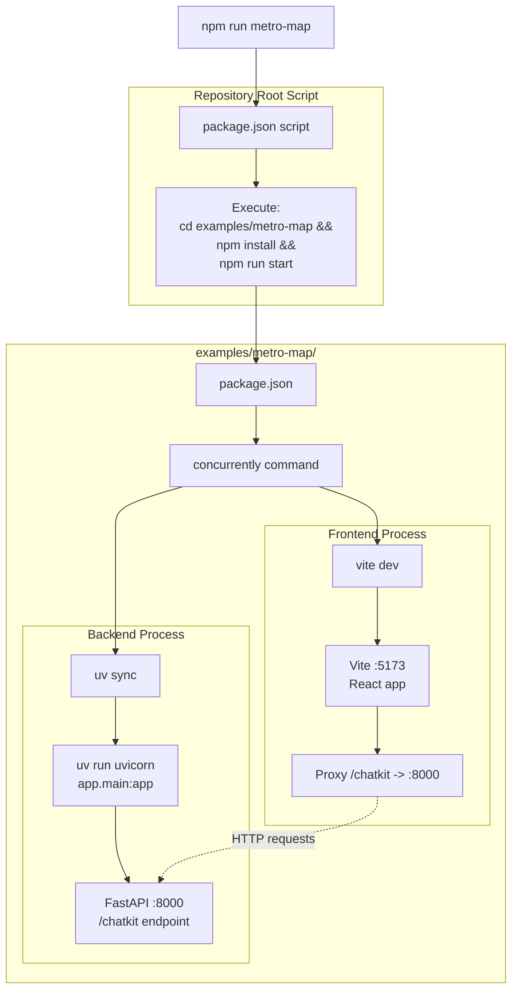

**Sources**: [README.md:18-23]()

### Verifying Successful Startup

When an example starts successfully, you should see:

1. **Terminal Output**: Both backend and frontend processes logging startup messages
2. **Browser Access**: The application opens automatically at the appropriate localhost URL
3. **ChatKit Interface**: The chat panel renders with no initialization errors
4. **Backend Connectivity**: The frontend can communicate with `/chatkit` endpoint

**Example Verification (Metro Map)**:
- URL: `http://localhost:5173`
- Try: "Show me the metro map"
- Expected: Interactive React Flow visualization appears

**Sources**: [README.md:18-23]()

### Common Startup Issues

| Issue | Likely Cause | Solution |
|-------|-------------|----------|
| `OPENAI_API_KEY not found` | API key not exported | Run `export OPENAI_API_KEY=sk-proj-...` before starting |
| `Port already in use` | Previous process still running | Kill existing process or change port |
| `uv command not found` | uv not installed | Install uv from [docs.astral.sh/uv](https://docs.astral.sh/uv) |
| Frontend shows errors | Backend not ready | Wait for backend startup to complete first |

**Sources**: [README.md:14]()

---

## Next Steps

Once the application is running successfully:

- Explore the demo interactions described in [README.md:81-88]()
- Review [Frontend Architecture](#3.2) to understand the React component structure
- Review [Backend Architecture](#3.3) to understand the ChatKit server implementation
- See [Frontend Configuration](#4.1) to customize API URLs and UI constants
- For production deployment, see [Deployment](#7) and [Domain Allowlisting](#7.1)

**Sources**: [README.md:89-97]()

---

# Page: Prerequisites

# Prerequisites

<details>
<summary>Relevant source files</summary>

The following files were used as context for generating this wiki page:

- [examples/metro-map/backend/app/widgets/line_select_widget.py](examples/metro-map/backend/app/widgets/line_select_widget.py)
- [examples/metro-map/backend/pyproject.toml](examples/metro-map/backend/pyproject.toml)
- [examples/metro-map/frontend/package.json](examples/metro-map/frontend/package.json)
- [examples/news-guide/backend/pyproject.toml](examples/news-guide/backend/pyproject.toml)
- [examples/news-guide/backend/uv.lock](examples/news-guide/backend/uv.lock)

</details>


This page documents the system requirements, required software, and configuration needed to run any of the four example applications in this repository. All examples share the same technical prerequisites due to their common architectural patterns.

For installation and running instructions after meeting these prerequisites, see [Running Examples](#2.2). For details about the common technology stack used across examples, see [Technology Stack](#9.1).

---

## System Requirements

All example applications run on the following operating systems with standard hardware:

| Requirement | Specification |
|------------|---------------|
| **Operating System** | Linux, macOS, or Windows (with WSL recommended) |
| **Memory** | Minimum 4GB RAM (8GB recommended for development) |
| **Storage** | 500MB free space per example application |
| **Network** | Internet connection for OpenAI API access |
| **Available Ports** | One port per example (default: 5170-5173) |

**Sources:** Repository structure analysis, README.md

---

## Required Runtime Environments

### Python 3.11 or Higher

All backend services require Python 3.11 or higher due to use of modern Python features and type hints.

**Version Requirement:** `>=3.11`

**Verification Command:**
```bash
python --version
# or
python3 --version
```

**Installation:**
- macOS: `brew install python@3.11` or download from [python.org](https://www.python.org)
- Linux: Use your distribution's package manager or pyenv
- Windows: Download from [python.org](https://www.python.org) or use Microsoft Store

**Sources:** [examples/news-guide/backend/pyproject.toml:6](), [examples/metro-map/backend/pyproject.toml:6]()

### Node.js 18.18 or Higher

All frontend applications require Node.js 18.18 or higher for Vite 7.x compatibility and modern JavaScript features.

**Version Requirement:** `>=18.18`

**Verification Command:**
```bash
node --version
npm --version
```

**Installation:**
- Use [nvm](https://github.com/nvm-sh/nvm) (recommended): `nvm install 18`
- Download from [nodejs.org](https://nodejs.org)
- macOS: `brew install node`

**Sources:** [examples/metro-map/frontend/package.json:12-15]()

---

## Package Managers

### uv (Python - Recommended)

`uv` is the recommended Python package manager for this repository. It provides faster dependency resolution and installation compared to pip.

**Installation:**
```bash
# macOS/Linux
curl -LsSf https://astral.sh/uv/install.sh | sh

# Windows
powershell -c "irm https://astral.sh/uv/install.ps1 | iex"

# Via pip (alternative)
pip install uv
```

**Alternative:** Standard `pip` can be used, but `uv` is optimized for the project's `uv.lock` files.

**Sources:** [examples/news-guide/backend/uv.lock:1-3]()

### npm (Node.js)

`npm` is included with Node.js installation and is used for frontend dependency management.

**Verification:**
```bash
npm --version
# Should be >=9
```

**Sources:** [examples/metro-map/frontend/package.json:14]()

---

## OpenAI API Configuration

### API Key Requirement

All examples require an OpenAI API key to access GPT models through the ChatKit framework. The key must have access to:

- `gpt-4o` or `gpt-4o-mini` models (depending on example configuration)
- Chat Completions API
- Function calling capabilities

### Setting Up the API Key

The `OPENAI_API_KEY` environment variable must be set before running any backend service.

**Obtaining an API Key:**
1. Visit [platform.openai.com](https://platform.openai.com)
2. Navigate to API Keys section
3. Create a new secret key
4. Copy the key (it won't be shown again)

**Configuration Methods:**

```bash
# Method 1: Export in current shell session
export OPENAI_API_KEY='sk-...'

# Method 2: Add to shell profile (~/.bashrc, ~/.zshrc, etc.)
echo 'export OPENAI_API_KEY="sk-..."' >> ~/.bashrc

# Method 3: Use .env file in backend directory
echo 'OPENAI_API_KEY=sk-...' > examples/cat-lounge/backend/.env
```

**Security Note:** Never commit API keys to version control. The `.env` file should be in `.gitignore`.

**Sources:** Repository README, standard OpenAI SDK configuration

---

## Port Availability

Each example application requires one port to be available on your system:

| Example | Default Port | Purpose |
|---------|-------------|---------|
| Cat Lounge | 5170 | Backend API and frontend dev server |
| Customer Support | 5171 | Backend API and frontend dev server |
| News Guide | 5172 | Backend API and frontend dev server |
| Metro Map | 5173 | Backend API and frontend dev server |

**Port Conflict Resolution:**

If a port is already in use, you can modify the port configuration:

- **Backend:** Edit the `uvicorn` command in startup scripts or run directly with `--port` flag
- **Frontend:** Edit `vite.config.ts` or use `vite --port` flag

**Verification:**
```bash
# Check if port is in use (Unix-like systems)
lsof -i :5170

# Windows
netstat -ano | findstr :5170
```

**Sources:** High-level system architecture diagrams

---

## Core Dependencies Overview

The following diagram shows the dependency structure for both backend and frontend components:

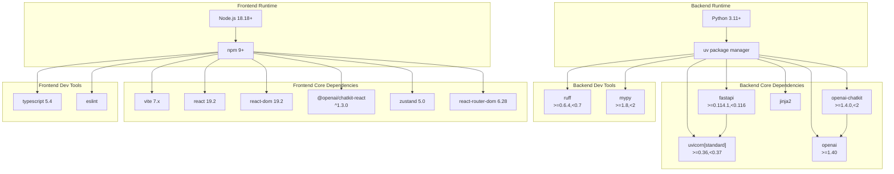

**Sources:** [examples/news-guide/backend/pyproject.toml](), [examples/metro-map/backend/pyproject.toml](), [examples/metro-map/frontend/package.json]()

### Backend Dependencies

| Dependency | Version Constraint | Purpose |
|-----------|-------------------|---------|
| `fastapi` | `>=0.114.1,<0.116` | ASGI web framework for REST APIs and streaming responses |
| `uvicorn[standard]` | `>=0.36,<0.37` | ASGI server with WebSocket and HTTP/2 support |
| `openai` | `>=1.40` | Official OpenAI Python SDK for GPT model access |
| `openai-chatkit` | `>=1.4.0,<2` | ChatKit framework for agent development and streaming |
| `jinja2` | `>=3.1,<4` | Template engine for widget generation |

**Development Dependencies:**
- `ruff` (>=0.6.4,<0.7): Fast Python linter and formatter
- `mypy` (>=1.8,<2): Static type checker

**Sources:** [examples/news-guide/backend/pyproject.toml:7-13](), [examples/metro-map/backend/pyproject.toml:7-13]()

### Frontend Dependencies

| Dependency | Version Constraint | Purpose |
|-----------|-------------------|---------|
| `@openai/chatkit-react` | `^1.3.0` | ChatKit React components and hooks |
| `react` | `^19.2.0` | React library for UI components |
| `react-dom` | `^19.2.0` | React DOM renderer |
| `vite` | `^7.1.9` | Build tool with fast HMR |
| `zustand` | `^5.0.8` | Lightweight state management |
| `react-router-dom` | `^6.28.0` | Client-side routing |
| `typescript` | `^5.4.0` | TypeScript compiler and type system |

**Example-Specific:**
- `reactflow` (^11.11.3): Used only in Metro Map for graph visualization

**Sources:** [examples/metro-map/frontend/package.json:16-27]()

---

## Version Compatibility Matrix

The following table shows tested version combinations:

| Component | Minimum Version | Recommended Version | Maximum Tested Version |
|-----------|----------------|---------------------|----------------------|
| Python | 3.11.0 | 3.11.x | 3.13.x |
| Node.js | 18.18.0 | 20.x LTS | 22.x |
| FastAPI | 0.114.1 | 0.115.x | 0.115.14 |
| openai-chatkit | 1.4.0 | 1.4.0+ | 1.x |
| @openai/chatkit-react | 1.3.0 | 1.3.0+ | 1.3.x |
| React | 19.2.0 | 19.2.0 | 19.2.0 |
| Vite | 7.0.0 | 7.1.9 | 7.x |

**Sources:** [examples/news-guide/backend/uv.lock](), [examples/metro-map/frontend/package.json]()

---

## Verification Checklist

Before proceeding to run examples, verify all prerequisites are met:

**Runtime Environments:**
- [ ] Python 3.11 or higher installed: `python --version`
- [ ] Node.js 18.18 or higher installed: `node --version`
- [ ] npm 9 or higher installed: `npm --version`

**Package Managers:**
- [ ] `uv` installed (recommended): `uv --version`
- [ ] Alternative: `pip` available: `pip --version`

**Configuration:**
- [ ] OpenAI API key obtained from platform.openai.com
- [ ] `OPENAI_API_KEY` environment variable configured
- [ ] Ports 5170-5173 available (or alternative ports chosen)

**Network:**
- [ ] Internet connection available for API access
- [ ] No firewall blocking OpenAI API endpoints

Once all prerequisites are verified, proceed to [Running Examples](#2.2) for installation and startup instructions.

**Sources:** Repository structure, all example pyproject.toml and package.json files

---

# Page: Running Examples

# Running Examples

<details>
<summary>Relevant source files</summary>

The following files were used as context for generating this wiki page:

- [README.md](README.md)

</details>


This document describes how to launch any of the four example applications in the repository. Each example runs as a standalone application with its own FastAPI backend and Vite + React frontend.

Before running examples, ensure prerequisites are met (see [Prerequisites](#2.1)). For environment configuration details, see [Environment Setup](#8.1).

---

## Available Examples

The repository contains four example applications, each demonstrating different ChatKit features:

| Example | Port | Command from Root | Key Features |
|---------|------|-------------------|--------------|
| Cat Lounge | 5170 | `npm run cat-lounge` | Client effects, interactive widgets, thread titles |
| Customer Support | 5171 | `npm run customer-support` | Timeline syncing, itinerary data, domain tools |
| News Guide | 5172 | `npm run news-guide` | Page awareness, @-mentions, tool choice, progress updates |
| Metro Map | 5173 | `npm run metro-map` | Client tools, annotations, entity tags, custom header |

Each example follows the same architectural pattern: a FastAPI backend using the ChatKit Python SDK paired with a Vite + React frontend using `@openai/chatkit-react`.

**Sources:** [README.md:5-23]()

---

## Quick Start from Repository Root

The simplest method to launch any example is to run the automated startup script from the repository root. This approach handles both backend and frontend initialization.

### Prerequisites Check

Before running, ensure:
1. `OPENAI_API_KEY` environment variable is set
2. `uv` package manager is installed
3. Node.js 18.18+ is available

```bash
export OPENAI_API_KEY=sk-proj-...
```

### Launch Commands

From the repository root directory, execute one of the following:

```bash
# Cat Lounge (port 5170)
npm run cat-lounge

# Customer Support (port 5171)
npm run customer-support

# News Guide (port 5172)
npm run news-guide

# Metro Map (port 5173)
npm run metro-map
```

Each command performs the following sequence:
1. Installs frontend dependencies (`npm install` in example directory)
2. Synchronizes backend dependencies (`uv sync`)
3. Starts the FastAPI backend
4. Starts the Vite dev server
5. Opens the example in your default browser

**Sources:** [README.md:12-23]()

---

## Running from Project Directory

For more granular control, you can navigate to an example's directory and run commands directly. This method is useful when working on a single example or when troubleshooting.

### Step-by-Step Instructions

1. Navigate to the example directory:
```bash
cd examples/cat-lounge
# or: cd examples/metro-map
# or: cd examples/news-guide
# or: cd examples/customer-support
```

2. Install dependencies and start:
```bash
npm install
npm run start
```

The `npm run start` command in each example's `package.json` handles both backend and frontend startup concurrently.

### Alternative: Manual Backend and Frontend Startup

For separate control of backend and frontend processes:

**Backend:**
```bash
cd examples/metro-map/backend
uv sync
uv run uvicorn app.main:app --reload
```

**Frontend (in separate terminal):**
```bash
cd examples/metro-map/frontend
npm install
npm run dev
```

Each example's backend exposes a `/chatkit` endpoint and domain-specific REST endpoints. The frontend's Vite configuration proxies requests to the backend.

**Sources:** [README.md:18-23]()

---

## Startup Architecture

Each example application consists of two concurrent processes that communicate via HTTP. The following diagram illustrates the startup sequence and runtime architecture:

**Example Startup Process**

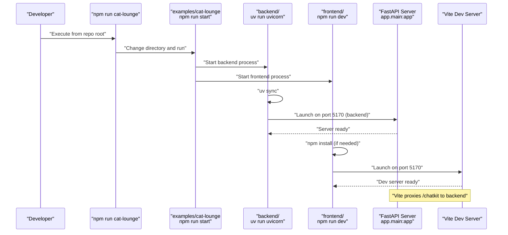

**Port Assignments by Example**

| Example | Frontend Port | Backend Port | Access URL |
|---------|--------------|--------------|------------|
| Cat Lounge | 5170 | Internal* | http://localhost:5170 |
| Customer Support | 5171 | Internal* | http://localhost:5171 |
| News Guide | 5172 | Internal* | http://localhost:5172 |
| Metro Map | 5173 | Internal* | http://localhost:5173 |

*The backend runs on an internal port and is accessed through the Vite dev server's proxy configuration. The frontend `vite.config.ts` file in each example defines the proxy rules for `/chatkit` and any domain-specific endpoints.

**Sources:** [README.md:18-23]()

---

## Common Architecture Pattern

All examples follow an identical structural pattern:

**Runtime Component Diagram**

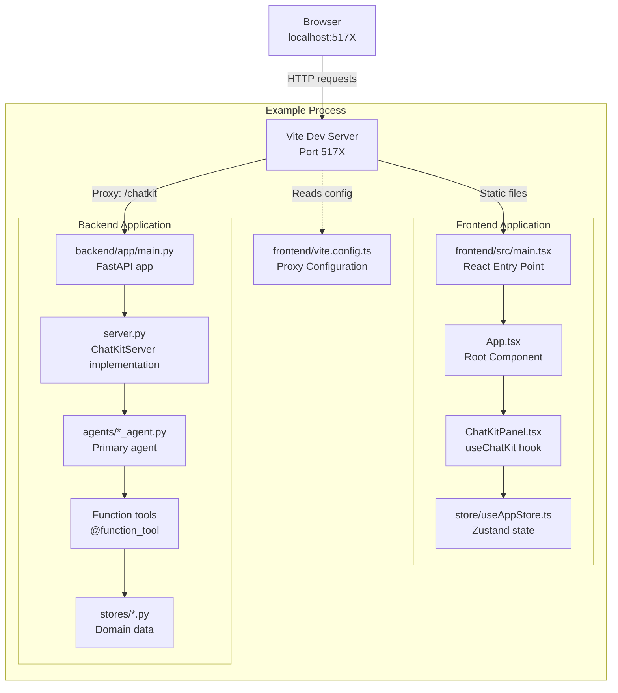

Each example implements:
- **FastAPI backend**: ChatKitServer subclass, agents with function tools, domain stores
- **Vite frontend**: React with ChatKitPanel component, Zustand state management, domain-specific UI
- **Proxy layer**: Vite forwards `/chatkit` and domain endpoints to backend

**Sources:** [README.md:3]()

---

## Verifying Example Startup

After launching an example, verify both frontend and backend are operational:

### Frontend Verification

Open the example's URL in a browser:

- Cat Lounge: http://localhost:5170
- Customer Support: http://localhost:5171
- News Guide: http://localhost:5172
- Metro Map: http://localhost:5173

You should see the React application with a chat interface and domain-specific UI elements.

### Backend Verification

Each example's backend can be verified by checking its domain-specific endpoints. Examples of verification commands:

**Cat Lounge:**
```bash
curl http://localhost:5170/api/cat/status
```

**Metro Map:**
```bash
curl http://localhost:5173/api/map
```

**News Guide:**
```bash
curl http://localhost:5172/api/articles
```

The Vite proxy forwards these requests to the backend, which responds with domain data.

### ChatKit Endpoint Verification

All examples expose a `/chatkit` endpoint for streaming chat responses. This endpoint requires a POST request with proper authentication headers and is typically accessed through the frontend's ChatKit integration.

**Sources:** [README.md:18-23]()

---

## Troubleshooting Startup Issues

### Backend Fails to Start

**Issue:** `HTTPException: ChatKit dependencies are missing`

**Cause:** The `_chatkit_server` instance is `None` in [backend/app/main.py:20-32]().

**Solution:** Ensure ChatKit Python SDK is installed via `uv sync` or `pip install -e .`

### Frontend Cannot Connect to Backend

**Issue:** API requests fail with network errors

**Cause:** Backend is not running or proxy configuration is incorrect

**Solution:**
1. Verify backend is running: `curl http://127.0.0.1:8000/health`
2. Check proxy configuration in [frontend/vite.config.ts:12-20]()
3. Ensure `BACKEND_URL` matches the actual backend address

### Port Already in Use

**Issue:** `Error: listen EADDRINUSE: address already in use`

**Cause:** Another process is using port 8000 or 5170

**Solution:**
1. Find the process: `lsof -i :8000` or `lsof -i :5170`
2. Kill the process or use a different port (see Port Customization above)

**Sources:** [backend/app/main.py:20-32](), [frontend/vite.config.ts:12-20]()

---

## Next Steps

After successfully starting the application:

1. Open `http://127.0.0.1:5170` in a browser
2. Test the chat interface with sample prompts (see [README.md:81-87]())
3. Explore the agent tools: fact recording, weather info, and theme switching
4. Review the frontend architecture in [Frontend Architecture](#3.2)
5. Understand the backend implementation in [Backend Architecture](#3.3)

For production deployment, see [Domain Allowlisting](#7.1) and [Building for Production](#7.3).

**Sources:** [README.md:81-98]()

---

# Page: Common Architecture


---

## Backend Architecture Pattern

All examples implement a `ChatKitServer` subclass that handles streaming chat requests and coordinates between agents, storage, and external services. The backend follows a four-layer architecture.

### Backend Layer Diagram

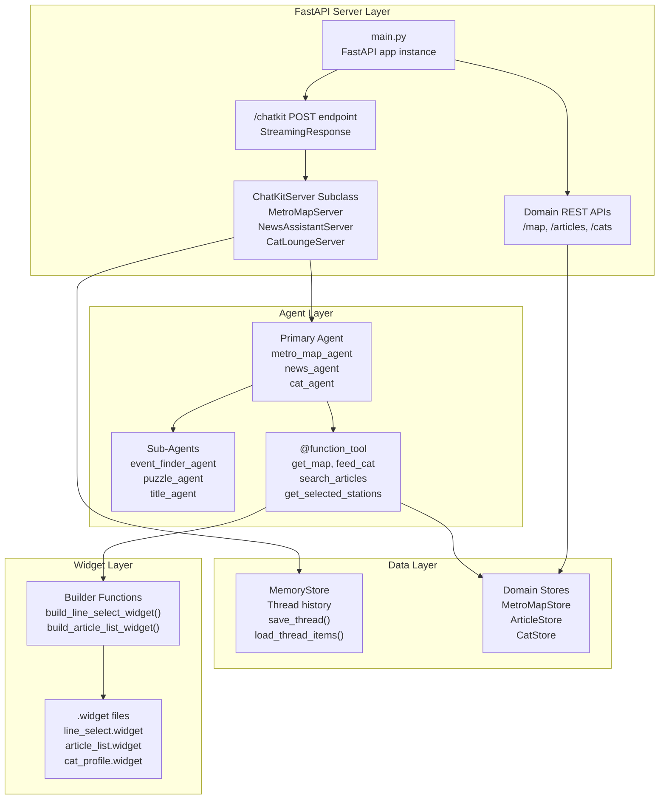

**Sources:** [examples/metro-map/backend/app/server.py:1-150](), [examples/news-guide/backend/app/server.py:1-150](), [examples/cat-lounge/backend/app/cat_agent.py:1-100](), [README.md:27-109]()

### ChatKitServer Implementation Pattern

Each example implements a server class that extends `ChatKitServer`:

| Example | Server Class | Primary Agent | Domain Store |
|---------|-------------|---------------|--------------|
| Cat Lounge | `CatLoungeServer` | `cat_agent` | `CatStore` |
| Customer Support | `CustomerSupportServer` | `support_agent` | `ItineraryStore` |
| News Guide | `NewsAssistantServer` | `news_agent` | `ArticleStore`, `EventStore` |
| Metro Map | `MetroMapServer` | `metro_map_agent` | `MetroMapStore` |

The server class implements two key methods:

- **`respond(thread, item, context)`**: Processes user messages, delegates to agents, and streams events back to the client. Handles agent selection, context building, and widget action routing.

- **`handle_action(thread, action)`** (optional): Processes server-side widget actions without invoking the agent. Used for interactions like expanding event details or updating line selections.

**Sources:** [examples/metro-map/backend/app/server.py:1-150](), [examples/news-guide/backend/app/server.py:1-150]()

### Agent and Tool Pattern

Agents are configured with model, instructions, and function tools:

```python
Agent[CustomAgentContext](
    model="gpt-4o-mini",
    name="Agent Name",
    instructions="System prompt...",
    tools=[tool1, tool2, tool3],
)
```

Tools are decorated with `@function_tool` and receive a `RunContextWrapper[AgentContext]`:

```python
@function_tool
async def get_cat_status(
    ctx: RunContextWrapper[CatAgentContext],
) -> dict[str, Any]:
    """Get current cat status."""
    cat = ctx.context.cat_store.get_cat(ctx.context.thread.id)
    return {"energy": cat.energy, "happiness": cat.happiness}
```

Common tool patterns across examples:
- **Server tools**: Query backend data (`get_map`, `get_cat_status`, `search_articles`)
- **Client tools**: Request frontend state (`get_selected_stations`)
- **Client effects**: Trigger UI updates (`update_cat_status`, `location_select_mode`, `add_station`)
- **Widget rendering**: Stream interactive UI components (`show_line_selector`, `show_article_list`)

**Sources:** [examples/cat-lounge/backend/app/cat_agent.py:1-100](), [examples/metro-map/backend/app/agents/metro_map_agent.py:1-150](), [examples/news-guide/backend/app/agents/news_agent.py:1-150](), [README.md:27-96]()

### Data Storage Pattern

Each example maintains two types of storage:

1. **MemoryStore**: Shared across all examples for thread history. Stores `ThreadItem` objects (user messages, assistant responses, tool calls, widgets).

2. **Domain-Specific Stores**: Custom data stores for application state:
   - `MetroMapStore`: Lines, stations, and user-added stations
   - `CatStore`: Cat status (energy, happiness, cleanliness, name)
   - `ArticleStore` / `EventStore`: News articles and calendar events
   - `ItineraryStore`: Flight bookings and customer data

Domain stores are typically implemented as in-memory Python dictionaries or classes with methods for CRUD operations.

**Sources:** [examples/metro-map/backend/app/data/metro_map_store.py:1-100](), [examples/cat-lounge/backend/app/cat_store.py:1-100](), [examples/news-guide/backend/app/data/article_store.py:1-100]()

---

## Frontend Architecture Pattern

All examples use React with the `@openai/chatkit-react` library and Zustand for state management. The frontend architecture separates chat UI from domain-specific visualizations.

### Frontend Component Structure

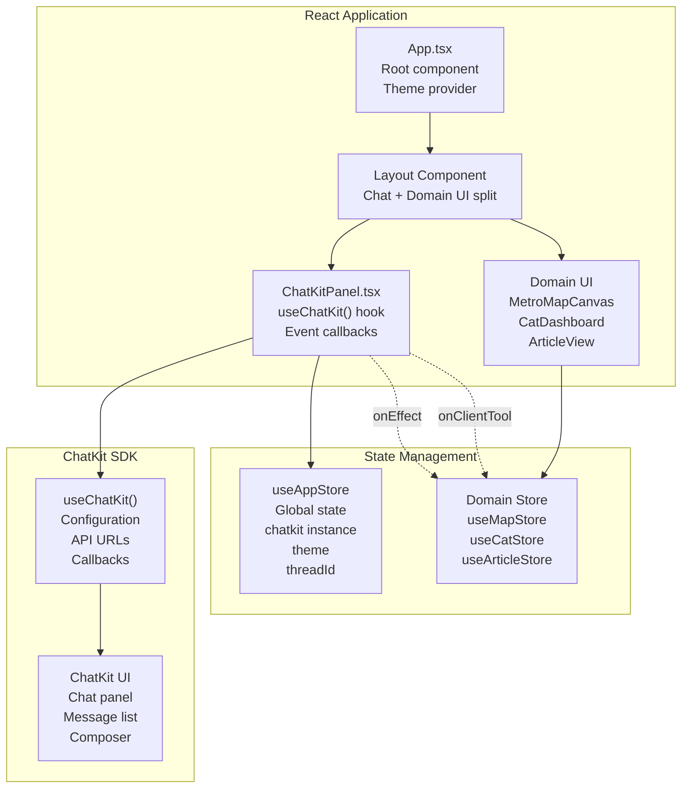

**Sources:** [examples/metro-map/frontend/src/components/ChatKitPanel.tsx:1-150](), [examples/news-guide/frontend/src/components/ChatKitPanel.tsx:1-100](), [examples/cat-lounge/frontend/src/components/ChatKitPanel.tsx:1-100]()

### ChatKitPanel Integration

The `ChatKitPanel` component wraps the ChatKit UI and bridges between the chat system and application-specific functionality. It accepts callbacks and configuration:

| Configuration | Purpose | Examples |
|--------------|---------|----------|
| `api.url` | Backend `/chatkit` endpoint | `http://localhost:8000/chatkit` |
| `api.domainKey` | ChatKit domain authorization | From environment variables |
| `theme` | Color scheme and styling | `{ colorScheme, color, radius }` |
| `startScreen` | Welcome message and prompts | Greeting text + starter questions |
| `composer.tools` | Tool choice menu (News Guide only) | `event_finder`, `puzzle` agents |

**Sources:** [examples/metro-map/frontend/src/components/ChatKitPanel.tsx:1-150](), [examples/news-guide/frontend/src/components/ChatKitPanel.tsx:1-100]()

### Event Callbacks

The `useChatKit` hook accepts callbacks that translate ChatKit events into application state updates:

| Callback | Purpose | Example Usage |
|----------|---------|---------------|
| `onClientTool` | Execute client-side tools | `get_selected_stations` → return selected nodes |
| `onEffect` | Handle client effects | `location_select_mode` → enable station selection |
| `onThreadChange` | React to thread switches | Clear domain state caches |
| `onReady` | ChatKit initialization complete | Store chatkit instance in global state |
| `onResponseStart` / `onResponseEnd` | Response lifecycle | Lock/unlock UI during agent responses |
| `handleWidgetAction` | Widget button clicks | Navigate to article or save selections |
| `onEntityClick` | Entity tag interactions | Pan map to clicked station |
| `onTagSearch` | Entity search in composer | Search stations/articles for @-mentions |

**Sources:** [examples/metro-map/frontend/src/components/ChatKitPanel.tsx:1-150](), [examples/news-guide/frontend/src/components/ChatKitPanel.tsx:1-100](), [README.md:39-131]()

### State Management with Zustand

Each example uses Zustand stores to separate concerns:

**`useAppStore`** (Global State):
- `chatkit`: ChatKit instance reference
- `threadId`: Current conversation thread
- `theme`: Color scheme preference

**Domain-Specific Stores**:
- `useMapStore`: Selected stations, interaction mode, focused station
- `useCatStore`: Cat status, speech bubble text
- `useArticleStore`: Current article ID, search results

Stores expose actions for state updates and are accessed by both `ChatKitPanel` callbacks and domain UI components.

**Sources:** [examples/metro-map/frontend/src/store/useMapStore.ts:1-100](), [examples/cat-lounge/frontend/src/store/useCatStore.ts:1-100]()

---

## Communication Patterns

ChatKit enables four distinct communication patterns between frontend and backend, each serving different interaction needs.

### Pattern Overview

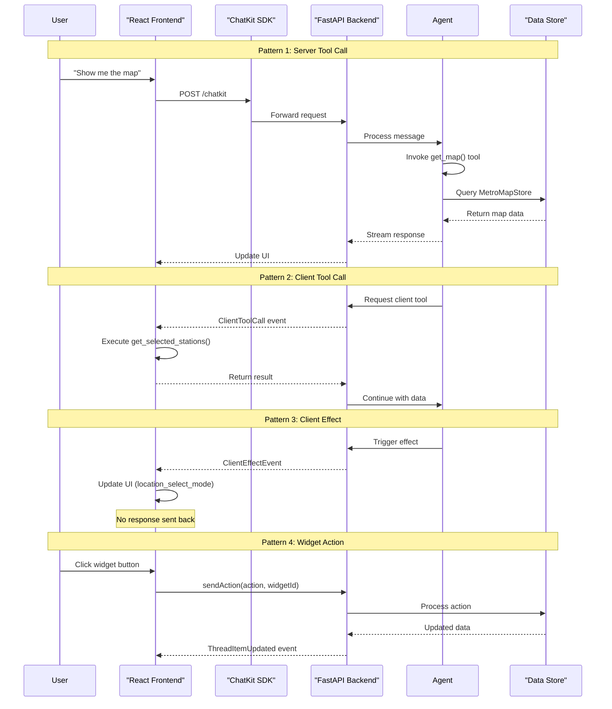

**Sources:** [README.md:27-96](), [examples/metro-map/backend/app/agents/metro_map_agent.py:1-150](), [examples/metro-map/frontend/src/components/ChatKitPanel.tsx:1-150]()

### Server Tool Calls

Server tools allow agents to query backend data stores to ground responses in application state. Tools are synchronous from the agent's perspective and can access domain stores via the agent context.

**Examples across applications:**
- `get_cat_status` (Cat Lounge): Query cat's energy, happiness, and cleanliness
- `get_map` (Metro Map): Retrieve all lines and stations
- `search_articles` (News Guide): Full-text search across articles
- `get_booking` (Customer Support): Lookup flight itinerary

Tools return structured data that the agent incorporates into its response.

**Sources:** [README.md:27-37](), [examples/cat-lounge/backend/app/cat_agent.py:1-100](), [examples/metro-map/backend/app/agents/metro_map_agent.py:1-150](), [examples/news-guide/backend/app/agents/news_agent.py:1-150]()

### Client Tool Calls

Client tools enable agents to request information from the frontend's UI state. The agent execution pauses while waiting for the client's response, creating a synchronous bidirectional flow.

**Metro Map Example:**
- Agent invokes `get_selected_stations` client tool
- Backend streams `ClientToolCall` event to frontend
- Frontend's `onClientTool` callback reads Zustand store
- Frontend returns `{ "station_ids": ["id1", "id2"] }`
- Backend forwards result to agent
- Agent continues execution with client data

This pattern is essential when the source of truth for certain data lives in the frontend (e.g., selected nodes on a canvas).

**Sources:** [README.md:39-42](), [examples/metro-map/backend/app/agents/metro_map_agent.py:1-150](), [examples/metro-map/frontend/src/components/ChatKitPanel.tsx:1-150]()

### Client Effects

Client effects are fire-and-forget events that trigger UI updates without requiring a response back to the server. They enable real-time visual feedback synchronized with agent actions.

**Examples across applications:**
- `update_cat_status` (Cat Lounge): Sync cat's stats in dashboard
- `cat_say` (Cat Lounge): Display speech bubble with text
- `location_select_mode` (Metro Map): Enable station selection mode on canvas
- `add_station` (Metro Map): Focus newly created station

Effects are dispatched during tool execution or agent responses and handled in the `onEffect` callback, which updates Zustand stores or triggers component state changes.

**Sources:** [README.md:44-50](), [examples/cat-lounge/backend/app/cat_agent.py:1-100](), [examples/metro-map/backend/app/agents/metro_map_agent.py:1-150](), [examples/metro-map/frontend/src/components/ChatKitPanel.tsx:1-150]()

### Widget Actions

Widgets can include action definitions that trigger when users interact with buttons or list items. Actions can be handled client-side (for navigation) or server-side (for state persistence).

**Client-Side Actions:**
- `open_article` (News Guide): Navigate to article page
- `cats.select_name` (Cat Lounge): Update local UI immediately

**Server-Side Actions:**
- `line.select` (Metro Map): Save line selection, stream updated widget, inject hidden context
- `view_event_details` (News Guide): Expand event in timeline widget
- `cats.select_name` (Cat Lounge): Also handled server-side to update widget

Actions are sent via `chatkit.sendAction(action, widgetId)`. Server-handled actions trigger the `handle_action()` method in the `ChatKitServer` subclass, which can stream widget updates and hidden context without invoking the agent.

**Sources:** [README.md:76-95](), [examples/metro-map/backend/app/server.py:1-150](), [examples/news-guide/backend/app/server.py:1-150](), [examples/cat-lounge/frontend/src/components/ChatKitPanel.tsx:1-100]()

---

## Widget System

The widget system enables agents to render interactive UI components within the chat stream. Widgets are defined using Jinja2 templates and assembled via builder functions.

### Widget Architecture

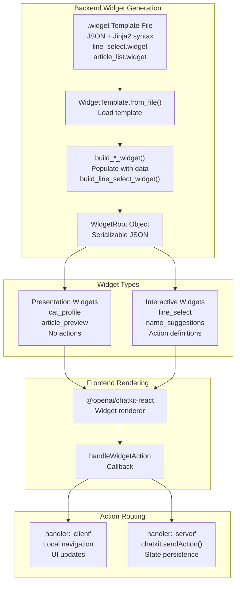

**Sources:** [examples/metro-map/backend/app/widgets/line_select_widget.py:1-22](), [examples/news-guide/backend/app/widgets/article_list_widget.py:1-50](), [examples/cat-lounge/backend/app/profile_card_widget.py:1-50](), [README.md:71-95]()

### Widget Template Structure

Widget templates are `.widget` files containing JSON structure with Jinja2 templating for dynamic content:

```python
# Load template

<details>
<summary>Relevant source files</summary>

The following files were used as context for generating this wiki page:

- [README.md](README.md)
- [examples/metro-map/backend/app/widgets/line_select_widget.py](examples/metro-map/backend/app/widgets/line_select_widget.py)
- [examples/metro-map/backend/pyproject.toml](examples/metro-map/backend/pyproject.toml)
- [examples/metro-map/frontend/package.json](examples/metro-map/frontend/package.json)
- [examples/news-guide/backend/pyproject.toml](examples/news-guide/backend/pyproject.toml)
- [examples/news-guide/backend/uv.lock](examples/news-guide/backend/uv.lock)

</details>


line_select_widget_template = WidgetTemplate.from_file("line_select.widget")

# Build widget with data
def build_line_select_widget(lines: list[Line], selected: str | None = None) -> WidgetRoot:
    return line_select_widget_template.build(
        data={"items": lines, "selected": selected}
    )
```

Templates define:
- Component structure (lists, cards, buttons)
- Data bindings (`{{ item.name }}`)
- Action configurations with `handler` field ("client" or "server")

**Sources:** [examples/metro-map/backend/app/widgets/line_select_widget.py:1-22]()

### Widget Streaming

Agents stream widgets using the `ctx.context.stream_widget()` method within function tools:

```python
@function_tool
async def show_line_selector(ctx: RunContextWrapper[MetroMapAgentContext]) -> dict:
    lines = ctx.context.metro_map_store.get_all_lines()
    widget = build_line_select_widget(lines)
    await ctx.context.stream_widget(widget)
    return {"status": "displayed"}
```

The widget appears inline in the chat stream and remains interactive after the response completes.

**Sources:** [examples/metro-map/backend/app/agents/metro_map_agent.py:1-150](), [examples/news-guide/backend/app/agents/news_agent.py:1-150]()

### Action Handling Patterns

Actions defined in widgets include:
- `name`: Action identifier (e.g., `"line.select"`, `"open_article"`)
- `handler`: "client" or "server"
- `payload`: Data passed when action triggers

**Client-handled actions** are processed in `handleWidgetAction`:
```typescript
const handleWidgetAction = (action: WidgetAction) => {
  if (action.name === "open_article") {
    navigate(`/article/${action.payload.articleId}`);
  }
};
```

**Server-handled actions** call `chatkit.sendAction()`, which routes to `ChatKitServer.handle_action()`. The server can:
- Update widget state without agent invocation
- Stream `ThreadItemUpdated` events with modified widgets
- Inject hidden context for next agent turn

**Sources:** [examples/metro-map/backend/app/server.py:1-150](), [examples/news-guide/backend/app/server.py:1-150](), [examples/metro-map/frontend/src/components/ChatKitPanel.tsx:1-150](), [README.md:87-95]()
# Common Architecture

This document describes the architectural patterns shared across all four example applications in the repository: **Cat Lounge**, **Metro Map**, **News Guide**, and **Customer Support**. Each example follows an identical technical stack and structural organization, demonstrating different ChatKit features while maintaining consistent architectural principles.

For example-specific implementations, see pages 4 (Metro Map), 5 (Cat Lounge), and 6 (News Guide). For detailed ChatKit integration concepts, see page 7.

---

## Technology Stack Overview

All examples use a modern, production-ready stack with tight version constraints to ensure API compatibility:

### Backend Stack

| Technology | Version | Purpose |
|------------|---------|---------|
| Python | 3.11+ | Runtime environment |
| FastAPI | 0.114-0.116 | Async web framework |
| Uvicorn | 0.36 | ASGI server with `[standard]` extras |
| openai | 1.40+ | OpenAI Python SDK |
| openai-chatkit | 1.4.0-2.0 | ChatKit agent framework |
| Jinja2 | 3.1+ | Widget template engine |

### Frontend Stack

| Technology | Version | Purpose |
|------------|---------|---------|
| Node.js | 18.18+ | Runtime environment |
| Vite | 7.x | Build tool and dev server |
| React | 19.2 | UI framework |
| TypeScript | 5.4 | Type system |
| @openai/chatkit-react | ^1.3.0 | ChatKit UI library |
| Zustand | 5.0 | Lightweight state management |
| React Router | 6.28 | Client-side routing |

### Development Tools

- **uv**: Fast Python package manager
- **ruff**: Python linter and formatter
- **mypy**: Static type checker

**Sources:** [examples/news-guide/backend/pyproject.toml:1-30](), [examples/metro-map/backend/pyproject.toml:1-30](), [examples/metro-map/frontend/package.json:1-49](), [README.md:1-132]()

---

## System Architecture Pattern

Each example implements a three-layer architecture: Frontend (React + Vite), Backend (FastAPI + ChatKit), and External Services (OpenAI API). During development, Vite's proxy configuration routes API requests to the backend without CORS issues.

### Common Application Structure

```mermaid
graph TB
    subgraph "Example Application"
        subgraph Frontend["Frontend Layer<br/>(Vite Dev Server)"]
            App["App.tsx<br/>Main component"]
            ChatPanel["ChatKitPanel.tsx<br/>ChatKit integration"]
            DomainUI["Domain UI<br/>MetroMapCanvas<br/>CatDashboard<br/>ArticleView"]
            Store["Zustand Store<br/>useAppStore<br/>useMapStore<br/>useCatStore"]
        end
        
        subgraph Backend["Backend Layer<br/>(FastAPI)"]
            Server["ChatKitServer<br/>MetroMapServer<br/>NewsAssistantServer<br/>CatLoungeServer"]
            Agent["Agent<br/>metro_map_agent<br/>news_agent<br/>cat_agent"]
            Tools["Function Tools<br/>@function_tool<br/>get_map, feed_cat<br/>search_articles"]
            MemStore["MemoryStore<br/>Thread history"]
            DomainStore["Domain Store<br/>MetroMapStore<br/>CatStore<br/>ArticleStore"]
        end
    end
    
    subgraph External["External Services"]
        OpenAI["OpenAI API<br/>gpt-4o-mini"]
    end
    
    App --> ChatPanel
    App --> DomainUI
    ChatPanel --> Store
    DomainUI --> Store
    
    ChatPanel -->|"/chatkit endpoint"| Server
    DomainUI -->|"REST APIs"| Server
    
    Server --> Agent
    Agent --> Tools
    Server --> MemStore
    Tools --> DomainStore
    
    Agent -->|"AI requests"| OpenAI
```

**Sources:** [README.md:1-132](), [examples/metro-map/backend/app/server.py:1-150](), [examples/news-guide/backend/app/server.py:1-150](), [examples/cat-lounge/frontend/src/components/ChatKitPanel.tsx:1-100]()

### Port Allocation

Each example runs on a dedicated port to allow concurrent execution:

| Example | Frontend Port | Backend Port |
|---------|--------------|--------------|
| Cat Lounge | 5170 | 8000 |
| Customer Support | 5171 | 8001 |
| News Guide | 5172 | 8002 |
| Metro Map | 5173 | 8003 |

Frontend development servers proxy `/chatkit` and domain-specific API paths to their respective backend ports.

**Sources:** [README.md:18-23]()


---

## Data Flow

The complete request/response cycle involves multiple layers of processing, from user input through AI agent execution to UI updates.

### Chat Message Flow

```mermaid
sequenceDiagram
    participant User
    participant ChatKitPanel as "ChatKitPanel.tsx<br/>useChatKit hook"
    participant ViteProxy as "vite.config.ts<br/>Proxy /chatkit"
    participant MainPy as "main.py<br/>POST /chatkit"
    participant FactAssistantServer as "FactAssistantServer<br/>respond()"
    participant Agent as "Agent<br/>gpt-4.1-mini"
    participant Tools as "Agent Tools<br/>@function_tool"
    participant OpenAI as "OpenAI API"
    
    User->>ChatKitPanel: "Type message: 'My name is Kaz'"
    ChatKitPanel->>ViteProxy: "POST /chatkit"
    ViteProxy->>MainPy: "Forward to :8000/chatkit"
    
    MainPy->>FactAssistantServer: "respond(thread, item, context)"
    FactAssistantServer->>FactAssistantServer: "_to_agent_input(thread, item)"
    FactAssistantServer->>Agent: "Runner.run_streamed()"
    
    Agent->>OpenAI: "Chat completion request"
    OpenAI-->>Agent: "Streaming response"
    
    Agent->>Agent: "Determine: save_fact needed"
    Agent->>Tools: "save_fact('User name is Kaz')"
    Tools->>Tools: "fact_store.create()"
    Tools->>Tools: "Stream HiddenContextItem"
    Tools->>Tools: "Set ClientToolCall"
    Tools-->>Agent: "Return {fact_id, status}"
    
    Agent-->>FactAssistantServer: "ThreadStreamEvent[]"
    FactAssistantServer-->>MainPy: "Yield events"
    MainPy-->>ViteProxy: "Stream response"
    ViteProxy-->>ChatKitPanel: "Stream to client"
    
    ChatKitPanel->>ChatKitPanel: "onClientTool('record_fact')"
    ChatKitPanel->>ChatKitPanel: "onWidgetAction({type: 'save'})"
    ChatKitPanel-->>User: "Update UI + Facts list"
```

**Sources:** [frontend/src/components/ChatKitPanel.tsx:55-84](), [backend/app/chat.py:235-266](), [backend/app/main.py:1-50]()

### Tool Invocation Flow

When the agent decides to invoke a tool, the following sequence occurs:

1. **Agent Decision**: The AI model determines a tool call is needed based on conversation context
2. **Tool Execution**: The `@function_tool` decorated function executes with `RunContextWrapper[FactAgentContext]`
3. **Side Effects**: Tool may stream events (`HiddenContextItem`, widgets) or modify storage (`fact_store`, `MemoryStore`)
4. **Return Value**: Tool returns structured data or `None` on error
5. **Client Tool Call**: For `switch_theme` and `save_fact`, sets `ctx.context.client_tool_call = ClientToolCall(...)`
6. **Event Streaming**: `stream_agent_response()` yields `ThreadStreamEvent` objects back to client

The `ClientToolCall` mechanism enables the backend to trigger client-side actions without direct HTTP callbacks. The frontend's `onClientTool` handler processes these invocations:

```typescript
onClientTool: async (invocation) => {
  if (invocation.name === "switch_theme") {
    onThemeRequest(invocation.params.theme);
    return { success: true };
  }
  if (invocation.name === "record_fact") {
    onWidgetAction({ type: "save", factId, factText });
    return { success: true };
  }
  return { success: false };
}
```

**Sources:** [backend/app/chat.py:109-208](), [frontend/src/components/ChatKitPanel.tsx:55-84]()

### Thread State Management

The `MemoryStore` maintains thread history for conversation continuity:

1. **Thread Creation**: Automatic on first message to a thread ID
2. **Item Storage**: Each `ThreadItem` (user messages, assistant messages, tool calls) is stored
3. **Retrieval**: `load_thread_items()` provides paginated history access
4. **Context Building**: Agent receives relevant history for each request

The `FactAssistantServer._to_agent_input()` method converts `ThreadItem` objects into agent-compatible input format using the `ThreadItemConverter` if available, otherwise falling back to extracting text from `UserMessageItem` content.

**Sources:** [backend/app/chat.py:289-353](), [backend/app/memory_store.py:1-100]()

---

# Page: Backend Architecture Pattern

# Backend Architecture Pattern

<details>
<summary>Relevant source files</summary>

The following files were used as context for generating this wiki page:

- [examples/metro-map/backend/app/agents/metro_map_agent.py](examples/metro-map/backend/app/agents/metro_map_agent.py)
- [examples/metro-map/backend/app/server.py](examples/metro-map/backend/app/server.py)
- [examples/news-guide/backend/app/server.py](examples/news-guide/backend/app/server.py)

</details>


## Purpose and Scope

This document describes the common backend architecture pattern used across all example applications in this repository. Each example follows a consistent layered structure built on FastAPI and the ChatKit Python SDK, enabling conversational AI with rich UI interactions.

For frontend architectural patterns, see [Frontend Architecture Pattern](#3.2). For details on how backend and frontend communicate, see [Communication Patterns](#3.3). For example-specific agent implementations, see [Metro Map Agent](#4.2), [Cat Agent](#5.2), and [News Agent](#6.2).

---

## Architectural Layers

All backend implementations follow a four-layer architecture that separates concerns between HTTP handling, AI logic, data persistence, and UI generation.

```mermaid
graph TB
    subgraph ServerLayer["Server Layer"]
        FastAPIApp["FastAPI Application"]
        ChatKitImpl["ChatKitServer Implementation<br/>(MetroMapServer, NewsAssistantServer)"]
        EndpointChatkit["/chatkit POST endpoint"]
        EndpointREST["Domain REST endpoints<br/>(/map, /articles, etc.)"]
    end
    
    subgraph AgentLayer["Agent Layer"]
        PrimaryAgent["Primary Agent<br/>(metro_map_agent, news_agent, cat_agent)"]
        SubAgents["Sub-Agents<br/>(event_finder_agent, title_agent, puzzle_agent)"]
        FunctionTools["@function_tool decorated functions<br/>(get_map, search_articles, feed_cat)"]
        Runner["agents.Runner<br/>(run_streamed, run)"]
    end
    
    subgraph DataLayer["Data Layer"]
        MemoryStore["MemoryStore<br/>(thread items, metadata)"]
        DomainStores["Domain Stores<br/>(MetroMapStore, ArticleStore, EventStore, CatStore)"]
    end
    
    subgraph WidgetLayer["Widget Layer"]
        Templates[".widget template files<br/>(JSON + Jinja2)"]
        Builders["build_*_widget functions<br/>(build_line_select_widget, etc.)"]
    end
    
    FastAPIApp --> ChatKitImpl
    FastAPIApp --> EndpointREST
    ChatKitImpl --> EndpointChatkit
    
    EndpointChatkit --> Runner
    Runner --> PrimaryAgent
    PrimaryAgent --> SubAgents
    PrimaryAgent --> FunctionTools
    
    FunctionTools --> MemoryStore
    FunctionTools --> DomainStores
    FunctionTools --> Builders
    
    Builders --> Templates
    EndpointREST --> DomainStores
```

**Sources:**
- [examples/metro-map/backend/app/server.py:1-185]()
- [examples/news-guide/backend/app/server.py:1-227]()
- [examples/metro-map/backend/app/agents/metro_map_agent.py:1-314]()

---

## Server Layer

### ChatKitServer Implementation

Each example implements a subclass of `ChatKitServer` that wires together the conversational interface with domain-specific logic. The implementation provides two required methods: `respond()` for handling user messages and `action()` for processing widget interactions.

**Key Components:**

| Component | Type | Purpose |
|-----------|------|---------|
| `ChatKitServer[RequestContext]` | Base class | Abstract interface for ChatKit integration |
| `MetroMapServer` | Implementation | Metro Map example server |
| `NewsAssistantServer` | Implementation | News Guide example server |
| `MemoryStore` | Storage | Thread history and metadata persistence |
| Domain stores | Storage | Application-specific data (maps, articles, cats) |

**Example Server Structure:**

```mermaid
classDiagram
    class ChatKitServer {
        <<abstract>>
        +respond(thread, item, context) AsyncIterator~ThreadStreamEvent~
        +action(thread, action, sender, context) AsyncIterator~ThreadStreamEvent~
        +to_message_content(input) ResponseInputContentParam
    }
    
    class MetroMapServer {
        -MemoryStore store
        -MetroMapStore metro_map_store
        -MetroMapThreadItemConverter thread_item_converter
        -Agent title_agent
        +respond(thread, item, context)
        +action(thread, action, sender, context)
        -_handle_line_select_action()
        -_maybe_update_thread_title()
    }
    
    class NewsAssistantServer {
        -MemoryStore store
        -ArticleStore article_store
        -EventStore event_store
        -NewsGuideThreadItemConverter thread_item_converter
        -Agent title_agent
        +respond(thread, item, context)
        +action(thread, action, sender, context)
        -_select_agent()
        -_handle_open_article_action()
        -_handle_view_event_details_action()
    }
    
    ChatKitServer <|-- MetroMapServer
    ChatKitServer <|-- NewsAssistantServer
```

**Sources:**
- [examples/metro-map/backend/app/server.py:41-185]()
- [examples/news-guide/backend/app/server.py:42-227]()

### respond() Method Pattern

The `respond()` method orchestrates the agent execution flow. It loads thread history, converts items to agent input format, constructs agent context, and streams the response.

**Standard Flow:**

1. Optionally trigger thread title generation
2. Load recent thread items from `MemoryStore`
3. Convert thread items to agent input format using `ThreadItemConverter`
4. Construct agent-specific context (e.g., `MetroAgentContext`, `NewsAgentContext`)
5. Execute agent using `Runner.run_streamed()`
6. Stream agent response events using `stream_agent_response()`

```mermaid
sequenceDiagram
    participant Client
    participant Server as "ChatKitServer.respond()"
    participant Store as "MemoryStore"
    participant Converter as "ThreadItemConverter"
    participant Runner as "agents.Runner"
    participant Agent
    
    Client->>Server: "POST /chatkit with UserMessageItem"
    Server->>Server: "_maybe_update_thread_title()"
    Server->>Store: "load_thread_items(thread_id, limit=20)"
    Store-->>Server: "items_page.data"
    Server->>Converter: "to_agent_input(items)"
    Converter-->>Server: "input_items"
    Server->>Server: "Construct agent context"
    Server->>Runner: "run_streamed(agent, input_items, context)"
    Runner->>Agent: "Execute agent"
    Agent-->>Runner: "Streamed results"
    Runner-->>Server: "result iterator"
    Server->>Server: "stream_agent_response(context, result)"
    Server-->>Client: "Stream ThreadStreamEvents"
```

**Sources:**
- [examples/metro-map/backend/app/server.py:54-86]()
- [examples/news-guide/backend/app/server.py:56-80]()

### action() Method Pattern

The `action()` method handles user interactions with widgets. Actions are routed based on `action.type`, and handlers can update widgets, inject hidden context, or trigger client effects.

**Action Handling Examples:**

| Example | Action Type | Handler Method | Behavior |
|---------|-------------|----------------|----------|
| Metro Map | `line.select` | `_handle_line_select_action()` | Updates widget, injects `<LINE_SELECTED>` tag, triggers `location_select_mode` effect |
| News Guide | `open_article` | `_handle_open_article_action()` | Sends assistant message prompting for article questions |
| News Guide | `view_event_details` | `_handle_view_event_details_action()` | Updates event list widget to show selected event details |

**Sources:**
- [examples/metro-map/backend/app/server.py:88-159]()
- [examples/news-guide/backend/app/server.py:82-179]()

---

## Agent Layer

### Primary Agents

Each example defines a primary agent that handles the conversational logic. Agents are created using the `Agent` class from the `agents` library, specifying instructions, model, tools, and optional tool use behavior.

**Agent Configuration Pattern:**

```mermaid
graph LR
    AgentDef["Agent Definition"]
    Instructions["INSTRUCTIONS<br/>(system prompt)"]
    Model["model: str<br/>(e.g., 'gpt-4o-mini')"]
    Tools["tools: list<br/>(@function_tool decorated)"]
    ToolBehavior["tool_use_behavior<br/>(StopAtTools, etc.)"]
    
    AgentDef --> Instructions
    AgentDef --> Model
    AgentDef --> Tools
    AgentDef --> ToolBehavior
```

**Example Agent Definitions:**

| Agent | Variable Name | Model | Notable Tools | Tool Behavior |
|-------|--------------|-------|---------------|---------------|
| Metro Map | `metro_map_agent` | `gpt-4o-mini` | `get_map`, `add_station`, `show_line_selector`, `get_selected_stations` | `StopAtTools([plan_route, show_line_selector, get_selected_stations])` |
| News Guide | `news_agent` | `gpt-4o` | `search_articles`, `get_current_page` | Default (continues after tools) |
| Event Finder | `event_finder_agent` | `gpt-4o-mini` | `find_events` | `StopAtTools([find_events])` |

**Sources:**
- [examples/metro-map/backend/app/agents/metro_map_agent.py:286-313]()

### Agent Context

Each agent receives a typed context object that provides access to stores, request context, and streaming methods. Context classes extend `AgentContext` and use Pydantic for validation.

**Context Structure:**

```mermaid
classDiagram
    class AgentContext {
        <<base>>
        +ThreadMetadata thread
        +Stream stream()
        +generate_id() str
        +ClientToolCall client_tool_call
    }
    
    class MetroAgentContext {
        +MemoryStore store
        +MetroMapStore metro
        +RequestContext request_context
    }
    
    class NewsAgentContext {
        +MemoryStore store
        +ArticleStore articles
        +RequestContext request_context
    }
    
    class EventFinderContext {
        +MemoryStore store
        +EventStore events
        +RequestContext request_context
    }
    
    AgentContext <|-- MetroAgentContext
    AgentContext <|-- NewsAgentContext
    AgentContext <|-- EventFinderContext
```

**Sources:**
- [examples/metro-map/backend/app/agents/metro_map_agent.py:77-82]()

### Function Tools

Tools are Python async functions decorated with `@function_tool`. They receive a `RunContextWrapper[AgentContext]` as the first parameter, providing access to the agent context and streaming capabilities.

**Tool Categories:**

| Category | Purpose | Examples |
|----------|---------|----------|
| Data Retrieval | Query domain stores | `get_map()`, `list_stations()`, `search_articles()` |
| State Mutation | Modify application state | `add_station()`, `feed_cat()`, `set_cat_name()` |
| Client Interaction | Request client data | `get_selected_stations()`, `get_current_page()` |
| UI Generation | Output widgets | `show_line_selector()` |
| Response Enhancement | Add annotations | `plan_route()` |

**Function Tool Pattern:**

```python
@function_tool(description_override="Tool description for the model")
async def tool_name(
    ctx: RunContextWrapper[AgentContext],
    param1: str,
    param2: int = 0,
) -> ResultModel:
    # Access context
    store = ctx.context.store
    
    # Stream progress updates
    await ctx.context.stream(ProgressUpdateEvent(text="Processing..."))
    
    # Query data
    data = store.get_data()
    
    # Return structured result
    return ResultModel(data=data)
```

**Sources:**
- [examples/metro-map/backend/app/agents/metro_map_agent.py:110-146]()
- [examples/metro-map/backend/app/agents/metro_map_agent.py:228-265]()

### Client Tool Calls

Tools that need to query frontend state set `ctx.context.client_tool_call` with a `ClientToolCall` object. This triggers a round-trip to the client, suspending agent execution until the client responds.

**Client Tool Example:**

```mermaid
sequenceDiagram
    participant Agent
    participant Tool as "get_selected_stations"
    participant Context as "AgentContext"
    participant Frontend
    
    Agent->>Tool: "Call tool"
    Tool->>Context: "stream(ProgressUpdateEvent)"
    Tool->>Context: "client_tool_call = ClientToolCall(...)"
    Tool-->>Agent: "Return empty result"
    Note over Agent: "Execution pauses"
    Context-->>Frontend: "ClientToolCallEvent"
    Frontend->>Frontend: "Execute onClientTool callback"
    Frontend-->>Context: "Send client tool result"
    Context-->>Agent: "Resume with actual result"
```

**Sources:**
- [examples/metro-map/backend/app/agents/metro_map_agent.py:268-283]()

### StopAtTools Behavior

The `tool_use_behavior` parameter controls when agent execution stops. `StopAtTools` specifies tool names that should terminate the agent's turn, allowing the server to process outputs before continuing the conversation.

**Use Cases:**

- **Widget Tools**: Stop after `show_line_selector()` to display widget without additional text
- **Client Tools**: Stop after `get_selected_stations()` to wait for client response
- **Annotation Tools**: Stop after `plan_route()` to display annotated response

**Sources:**
- [examples/metro-map/backend/app/agents/metro_map_agent.py:306-312]()

---

## Data Layer

### MemoryStore

The `MemoryStore` class manages conversational thread data, including thread metadata and thread items (messages, widgets, context). It provides the storage interface required by `ChatKitServer`.

**Core Methods:**

| Method | Purpose | Returns |
|--------|---------|---------|
| `load_thread_items(thread_id, after, limit, order, context)` | Load paginated thread items | `ThreadItemsPage` |
| `add_thread_item(thread_id, item, context)` | Append item to thread | `None` |
| `save_thread(thread, context)` | Persist thread metadata | `None` |
| `generate_item_id(type, thread, context)` | Create unique item ID | `str` |

**Sources:**
- [examples/metro-map/backend/app/memory_store.py]() (referenced but not provided)

### Domain Stores

Domain stores encapsulate application-specific data. They are passed to agent contexts and accessed by function tools.

**Example Domain Stores:**

| Store Class | Data | Key Methods |
|-------------|------|-------------|
| `MetroMapStore` | Metro lines and stations | `get_map()`, `list_lines()`, `add_station()`, `find_station()` |
| `ArticleStore` | News articles | `search_articles()`, `get_article_content()`, `get_metadata()` |
| `EventStore` | Calendar events | `find_events()`, `get_event()` |
| `CatStore` | Virtual cat state | `get_cat_status()`, `feed_cat()`, `play_with_cat()` |

**Store Initialization Pattern:**

```python
class MetroMapServer(ChatKitServer[RequestContext]):
    def __init__(self) -> None:
        self.store: MemoryStore = MemoryStore()
        super().__init__(self.store)
        
        data_dir = Path(__file__).resolve().parent / "data"
        self.metro_map_store = MetroMapStore(data_dir)
```

**Sources:**
- [examples/metro-map/backend/app/server.py:44-50]()
- [examples/news-guide/backend/app/server.py:45-52]()

---

## Widget Layer

### Widget Templates

Widgets are defined in `.widget` files using JSON structure with Jinja2 templating. Templates enable dynamic content generation while maintaining consistent UI structure.

**Template File Pattern:**

```
backend/app/widgets/
├── widget_name.widget          # JSON template with Jinja2
└── widget_name_widget.py       # Builder function
```

**Sources:**
- Referenced in high-level diagrams

### Widget Builders

Builder functions populate widget templates with data and return `WidgetRoot` objects. These functions are called by tools or server action handlers.

**Builder Function Pattern:**

```python
def build_widget_name(
    data: DataType,
    selected: str | None = None,
) -> WidgetRoot:
    # Load and render template
    template_path = Path(__file__).parent / "widget_name.widget"
    template_content = template_path.read_text()
    rendered = Template(template_content).render(
        data=data,
        selected=selected,
    )
    
    # Parse and return widget
    return WidgetRoot.model_validate_json(rendered)
```

**Widget Output in Tools:**

```python
@function_tool(description_override="Show widget")
async def show_widget(ctx: RunContextWrapper[AgentContext], message: str):
    widget = build_widget_name(ctx.context.store.get_data())
    
    # Output message first
    await ctx.context.stream(ThreadItemDoneEvent(item=AssistantMessageItem(...)))
    
    # Then stream widget
    await ctx.context.stream_widget(widget)
```

**Sources:**
- [examples/metro-map/backend/app/agents/metro_map_agent.py:116-128]()

---

## Request Flow

### Complete Request-Response Flow

This diagram shows the complete flow from an HTTP request through all architectural layers to the streamed response.

```mermaid
sequenceDiagram
    participant Client as "React Frontend"
    participant FastAPI as "FastAPI /chatkit"
    participant Server as "ChatKitServer.respond()"
    participant Store as "MemoryStore"
    participant Runner as "agents.Runner"
    participant Agent as "Primary Agent"
    participant Tool as "@function_tool"
    participant DomainStore as "Domain Store"
    
    Client->>FastAPI: "POST /chatkit<br/>UserMessageItem"
    FastAPI->>Server: "respond(thread, item, context)"
    
    Server->>Store: "load_thread_items()"
    Store-->>Server: "Previous items"
    
    Server->>Server: "Create AgentContext<br/>(stores, request_context)"
    
    Server->>Runner: "run_streamed(agent, input_items, context)"
    
    Runner->>Agent: "Execute with input"
    
    Agent->>Tool: "Call function_tool"
    Tool->>DomainStore: "Query data"
    DomainStore-->>Tool: "Return data"
    Tool->>Server: "stream(ProgressUpdateEvent)"
    Tool-->>Agent: "Return result"
    
    Agent->>Tool: "Call another tool"
    Tool->>Server: "stream_widget(widget)"
    Tool-->>Agent: "Complete"
    
    Note over Agent: "StopAtTools triggers"
    
    Agent-->>Runner: "Final output"
    Runner-->>Server: "Result iterator"
    
    Server->>Server: "stream_agent_response()"
    
    loop "For each event"
        Server->>FastAPI: "Yield ThreadStreamEvent"
        FastAPI->>Client: "Stream SSE"
    end
```

**Sources:**
- [examples/metro-map/backend/app/server.py:54-86]()
- [examples/metro-map/backend/app/agents/metro_map_agent.py:286-313]()

### Action Handling Flow

Widget actions follow a different path through the server's `action()` method.

```mermaid
sequenceDiagram
    participant Client as "React Frontend"
    participant FastAPI as "FastAPI /chatkit"
    participant Server as "ChatKitServer.action()"
    participant Store as "MemoryStore"
    participant DomainStore as "Domain Store"
    
    Client->>FastAPI: "POST /chatkit<br/>Action payload"
    FastAPI->>Server: "action(thread, action, sender, context)"
    
    alt "action.type == 'line.select'"
        Server->>DomainStore: "list_lines()"
        DomainStore-->>Server: "Lines data"
        Server->>Server: "build_line_select_widget(selected=line_id)"
        Server->>FastAPI: "yield ThreadItemReplacedEvent"
        Server->>Store: "add_thread_item(HiddenContextItem)"
        Server->>FastAPI: "yield ThreadItemDoneEvent"
        Server->>FastAPI: "yield ClientEffectEvent"
    else "action.type == 'open_article'"
        Server->>DomainStore: "get_metadata(article_id)"
        DomainStore-->>Server: "Article metadata"
        Server->>FastAPI: "yield ThreadItemDoneEvent<br/>(AssistantMessageItem)"
    else "action.type == 'view_event_details'"
        Server->>DomainStore: "get_event(event_id)"
        DomainStore-->>Server: "Event record"
        Server->>Server: "build_event_list_widget(selected=event_id)"
        Server->>FastAPI: "yield ThreadItemUpdated"
    end
    
    FastAPI->>Client: "Stream SSE"
```

**Sources:**
- [examples/metro-map/backend/app/server.py:88-159]()
- [examples/news-guide/backend/app/server.py:82-179]()

---

## Key Design Patterns

### Separation of Concerns

| Layer | Responsibility | Does NOT Handle |
|-------|----------------|-----------------|
| Server | HTTP routing, ChatKit protocol | AI logic, data queries |
| Agent | Conversational flow, tool selection | HTTP, storage implementation |
| Tools | Data access, side effects | Conversation management |
| Stores | Data persistence, queries | UI generation, streaming |

### Dependency Injection

Agent contexts provide dependency injection, making stores and utilities available to tools without global state:

```python
# Context defines dependencies
class MetroAgentContext(AgentContext):
    store: MemoryStore
    metro: MetroMapStore
    request_context: RequestContext

# Server constructs context
agent_context = MetroAgentContext(
    thread=thread,
    store=self.store,
    metro=self.metro_map_store,
    request_context=context,
)

# Tools access via context
@function_tool
async def get_map(ctx: RunContextWrapper[MetroAgentContext]) -> MapResult:
    return MapResult(map=ctx.context.metro.get_map())
```

**Sources:**
- [examples/metro-map/backend/app/agents/metro_map_agent.py:77-82]()
- [examples/metro-map/backend/app/server.py:75-80]()

### Streaming Events

All agent outputs are streamed to the client in real-time using async generators. This enables progress updates, incremental responses, and rich UI updates during long-running operations.

**Event Types:**
- `ProgressUpdateEvent`: Transient status messages
- `ThreadItemDoneEvent`: Completed messages or widgets
- `ClientEffectEvent`: Fire-and-forget UI updates
- `ThreadItemReplacedEvent`: Widget state updates
- `ThreadItemUpdated`: Partial widget updates

**Sources:**
- [examples/metro-map/backend/app/agents/metro_map_agent.py:137-138]()
- [examples/metro-map/backend/app/agents/metro_map_agent.py:239-246]()

---

# Page: Frontend Architecture Pattern

# Frontend Architecture Pattern

<details>
<summary>Relevant source files</summary>

The following files were used as context for generating this wiki page:

- [examples/metro-map/frontend/package-lock.json](examples/metro-map/frontend/package-lock.json)
- [examples/metro-map/frontend/src/components/ChatKitPanel.tsx](examples/metro-map/frontend/src/components/ChatKitPanel.tsx)
- [examples/metro-map/frontend/src/components/MapPanel.tsx](examples/metro-map/frontend/src/components/MapPanel.tsx)
- [examples/metro-map/frontend/src/components/MetroMapCanvas.tsx](examples/metro-map/frontend/src/components/MetroMapCanvas.tsx)
- [examples/metro-map/frontend/src/lib/config.ts](examples/metro-map/frontend/src/lib/config.ts)
- [examples/metro-map/frontend/src/store/useMapStore.ts](examples/metro-map/frontend/src/store/useMapStore.ts)

</details>


## Purpose and Scope

This page documents the common frontend architecture pattern shared across all example applications in the repository. All examples follow an identical React + TypeScript structure using Vite as the build tool, Zustand for state management, and `@openai/chatkit-react` for chat UI integration.

For backend architecture patterns, see [Backend Architecture Pattern](#3.1). For specific communication patterns between frontend and backend, see [Communication Patterns](#3.3).

---

## Component Hierarchy

All examples follow a three-layer component structure: the root `App` component, the `ChatKitPanel` component for chat integration, and domain-specific UI components for application functionality.

```mermaid
graph TB
    App["App.tsx<br/>Root component"]
    ChatKitPanel["ChatKitPanel.tsx<br/>ChatKit wrapper"]
    DomainPanel["Domain Panel<br/>MapPanel / CatDashboard / ArticleView"]
    ChatKit["ChatKit Component<br/>from @openai/chatkit-react"]
    DomainCanvas["Domain Canvas<br/>MetroMapCanvas / CatProfileView"]
    
    App --> ChatKitPanel
    App --> DomainPanel
    ChatKitPanel --> ChatKit
    DomainPanel --> DomainCanvas
    
    style ChatKitPanel fill:#f9f9f9
    style ChatKit fill:#f0f0f0
```

**Sources**: [examples/metro-map/frontend/src/components/ChatKitPanel.tsx:37-218](), [examples/metro-map/frontend/src/components/MetroMapCanvas.tsx:1-492](), [examples/metro-map/frontend/src/components/MapPanel.tsx:16-279]()

---

## State Management Architecture

State is split into two categories using Zustand: global application state managed by `useAppStore`, and domain-specific state managed by domain stores like `useMapStore`.

```mermaid
graph LR
    subgraph "Global State - useAppStore"
        A1["chatkit: ChatKit instance"]
        A2["scheme: 'light' | 'dark'"]
        A3["threadId: string | null"]
        A4["setChatkit()"]
        A5["setScheme()"]
        A6["setThreadId()"]
    end
    
    subgraph "Domain State - useMapStore"
        M1["map: MetroMap | null"]
        M2["selectedStationIds: string[]"]
        M3["locationSelectLineId: string | null"]
        M4["reactFlow: ReactFlowInstance | null"]
        M5["interactionLocked: boolean"]
        M6["setMap()"]
        M7["focusStation()"]
        M8["lockInteraction()"]
    end
    
    ChatKitPanel["ChatKitPanel"] --> A1
    ChatKitPanel --> A2
    ChatKitPanel --> A3
    ChatKitPanel --> M1
    ChatKitPanel --> M2
    ChatKitPanel --> M3
    
    MapPanel["MapPanel / MetroMapCanvas"] --> M1
    MapPanel --> M2
    MapPanel --> M4
    MapPanel --> M5
```

### Global State Store Pattern

The `useAppStore` maintains state that is shared across the entire application:

| State Field | Type | Purpose |
|-------------|------|---------|
| `chatkit` | `ChatKit \| null` | ChatKit instance for programmatic control |
| `scheme` | `'light' \| 'dark'` | Current theme scheme |
| `threadId` | `string \| null` | Active conversation thread ID |

**Sources**: [examples/metro-map/frontend/src/components/ChatKitPanel.tsx:41-54]()

### Domain State Store Pattern

Domain stores manage application-specific state independent of the chat interface. The `useMapStore` example demonstrates the pattern:

| State Field | Type | Purpose |
|-------------|------|---------|
| `map` | `MetroMap \| null` | Current map data |
| `selectedStationIds` | `string[]` | User-selected stations |
| `locationSelectLineId` | `string \| null` | Line ID when in location selection mode |
| `reactFlow` | `ReactFlowInstance \| null` | ReactFlow instance for map manipulation |
| `interactionLocked` | `boolean` | Locks UI during agent responses |

**Sources**: [examples/metro-map/frontend/src/store/useMapStore.ts:8-85]()

---

## ChatKit Integration Layer

The `ChatKitPanel` component serves as the bridge between the ChatKit UI library and the application. It configures the `useChatKit` hook and implements event callbacks that translate ChatKit events into application state mutations.

### ChatKitPanel Component Structure

```mermaid
graph TB
    Props["ChatKitPanel Props<br/>onChatKitReady, className"]
    Hook["useChatKit Hook<br/>Configuration + Callbacks"]
    Config["Configuration Object<br/>api, header, theme, entities"]
    Callbacks["Event Callbacks<br/>onClientTool, onEffect,<br/>onThreadChange, onReady"]
    Store1["useAppStore<br/>Global State"]
    Store2["useMapStore<br/>Domain State"]
    Render["Return JSX<br/>ChatKit component"]
    
    Props --> Hook
    Hook --> Config
    Hook --> Callbacks
    Callbacks --> Store1
    Callbacks --> Store2
    Hook --> Render
    
    style Hook fill:#f9f9f9
    style Callbacks fill:#f0f0f0
```

**Sources**: [examples/metro-map/frontend/src/components/ChatKitPanel.tsx:37-218]()

### useChatKit Configuration

The `useChatKit` hook accepts a configuration object with the following structure:

```mermaid
graph TB
    Config["useChatKit Configuration"]
    
    Api["api<br/>url: CHATKIT_API_URL<br/>domainKey: CHATKIT_API_DOMAIN_KEY"]
    Header["header<br/>title: {enabled: false}<br/>rightAction: HeaderOption"]
    Theme["theme<br/>density, colorScheme,<br/>color, typography, radius"]
    Start["startScreen<br/>greeting, prompts[]"]
    Composer["composer<br/>placeholder"]
    Entities["entities<br/>onTagSearch, onClick"]
    Actions["threadItemActions<br/>feedback: boolean"]
    
    Config --> Api
    Config --> Header
    Config --> Theme
    Config --> Start
    Config --> Composer
    Config --> Entities
    Config --> Actions
    
    style Config fill:#f9f9f9
```

**Key Configuration Fields**:

| Field | Purpose | Example |
|-------|---------|---------|
| `api.url` | ChatKit backend endpoint | `"/chatkit"` or `CHATKIT_API_URL` |
| `api.domainKey` | Domain allowlist key | `"domain_pk_localhost_dev"` |
| `header.rightAction` | Custom header button | Dark/light mode toggle |
| `theme.colorScheme` | `"light"` or `"dark"` | Synced with `useAppStore.scheme` |
| `startScreen` | Initial prompts and greeting | Dynamic based on selected stations |
| `entities.onTagSearch` | Entity autocomplete function | `searchStations` |

**Sources**: [examples/metro-map/frontend/src/components/ChatKitPanel.tsx:155-211](), [examples/metro-map/frontend/src/lib/config.ts:1-68]()

---

## Event Callback System

ChatKit events are handled through callback functions that bridge the chat system to application state. Each callback receives event data and performs state mutations or triggers domain actions.

### Callback Flow Diagram

```mermaid
sequenceDiagram
    participant ChatKit as "@openai/chatkit-react"
    participant Callback as "Event Callback"
    participant Store as "Zustand Store"
    participant Domain as "Domain Component"
    
    ChatKit->>Callback: onClientTool({name, params})
    Callback->>Store: Read selectedStationIds
    Callback-->>ChatKit: Return {stationIds: [...]}
    
    ChatKit->>Callback: onEffect({name, data})
    Callback->>Store: setLocationSelectLineId()
    Callback->>Store: setMap()
    Note over Callback: Fire-and-forget
    
    ChatKit->>Callback: onThreadChange({threadId})
    Callback->>Store: setThreadId(threadId)
    
    ChatKit->>Callback: onReady()
    Callback->>Store: setChatkit(instance)
    Callback->>Domain: onChatKitReady(instance)
```

**Sources**: [examples/metro-map/frontend/src/components/ChatKitPanel.tsx:119-211]()

### Client Tool Callback - onClientTool

Client tools enable the agent to query frontend state during response generation. The callback executes synchronously and returns data to continue the agent's response.

```mermaid
graph LR
    Agent["Agent calls<br/>get_selected_stations"]
    ChatKit["ChatKit fires<br/>onClientTool"]
    Handler["handleClientTool<br/>function"]
    Store["useMapStore<br/>selectedStationIds"]
    Return["Return<br/>{stationIds: [...]}"]
    
    Agent --> ChatKit
    ChatKit --> Handler
    Handler --> Store
    Store --> Return
    Return --> ChatKit
    ChatKit --> Agent
    
    style Handler fill:#f9f9f9
```

**Implementation**: The `handleClientTool` callback inspects the `name` field and returns the requested data:

```typescript
const handleClientTool = useCallback(
  ({name}: { name: string; params: Record<string, unknown> }) => {
    if (name === "get_selected_stations") {
      return { stationIds: selectedStationIds };
    }
  },
  [selectedStationIds]
);
```

**Sources**: [examples/metro-map/frontend/src/components/ChatKitPanel.tsx:119-128]()

### Client Effect Callback - onEffect

Client effects are fire-and-forget actions that update the UI without requiring server acknowledgment. They enable real-time feedback during agent responses.

```mermaid
graph TD
    Agent["Agent emits<br/>ClientEffectEvent"]
    ChatKit["ChatKit fires<br/>onEffect"]
    Handler["handleClientEffect<br/>function"]
    
    Check1{"name ==<br/>'location_select_mode'?"}
    Check2{"name ==<br/>'add_station'?"}
    
    Action1["setLocationSelectLineId()<br/>Highlight line"]
    Action2["clearLocationSelectMode()<br/>setMap()<br/>focusStation()"]
    
    ChatKit --> Handler
    Handler --> Check1
    Check1 -->|Yes| Action1
    Check1 -->|No| Check2
    Check2 -->|Yes| Action2
    
    style Handler fill:#f9f9f9
```

**Implementation**: The `handleClientEffect` callback uses the `name` field to route to the appropriate state mutation:

```typescript
const handleClientEffect = useCallback(
  ({name, data}: { name: string; data: Record<string, unknown> }) => {
    if (name === "location_select_mode") {
      const lineId = data.lineId as string | undefined;
      if (lineId) {
        setLocationSelectLineId(lineId);
      }
    }
    if (name === "add_station") {
      const stationId = data.stationId as string | undefined;
      const nextMap = data.map as MetroMap | undefined;
      clearLocationSelectMode();
      if (nextMap) {
        setMap(nextMap);
      }
      if (stationId) {
        requestAnimationFrame(() => focusStation(stationId, nextMap));
      }
    }
  },
  [clearLocationSelectMode, focusStation, setLocationSelectLineId, setMap]
);
```

**Sources**: [examples/metro-map/frontend/src/components/ChatKitPanel.tsx:130-153]()

### Thread Change Callback - onThreadChange

Tracks the active conversation thread ID, enabling thread-specific UI states or navigation.

```typescript
onThreadChange: ({ threadId }) => {
  setThreadId(threadId);
}
```

**Sources**: [examples/metro-map/frontend/src/components/ChatKitPanel.tsx:194-196]()

### Ready Callback - onReady

Fires when ChatKit is fully initialized, providing access to the ChatKit instance for programmatic control.

```typescript
onReady: () => {
  onChatKitReady?.(chatkit);
  setChatkit(chatkit);
}
```

**Sources**: [examples/metro-map/frontend/src/components/ChatKitPanel.tsx:200-203]()

### Response Lifecycle Callbacks

Lock UI interactions during agent responses to prevent conflicting state mutations:

```typescript
onResponseStart: () => {
  lockInteraction();
},
onResponseEnd: () => {
  unlockInteraction();
}
```

**Sources**: [examples/metro-map/frontend/src/components/ChatKitPanel.tsx:205-210]()

---

## Entity Tag Integration

Entity tags enable @-mentions of domain objects within chat messages. The frontend provides search and click handlers to integrate entities with domain UI.

### Entity Tag Flow

```mermaid
graph TB
    User["User types @<br/>in composer"]
    Search["onTagSearch callback<br/>searchStations(query)"]
    Entities["stationEntities[]<br/>Built from currentMap"]
    Filter["Filter entities<br/>by query"]
    Results["Return matching<br/>Entity[] to ChatKit"]
    
    Click["User clicks<br/>entity in message"]
    Handler["handleEntityClick<br/>callback"]
    Focus["focusStation(stationId)<br/>Zoom and highlight"]
    
    User --> Search
    Search --> Entities
    Entities --> Filter
    Filter --> Results
    
    Click --> Handler
    Handler --> Focus
    
    style Search fill:#f9f9f9
    style Handler fill:#f9f9f9
```

**Entity Structure**: Entities are built from domain data and include metadata for search and display:

```typescript
const stationEntities = useMemo<Entity[]>(() => {
  if (!currentMap) return [];
  return currentMap.stations.map((station) => {
    return {
      id: station.id,
      title: station.name,
      interactive: true,
      group: "Stations",
      data: {
        type: "station",
        station_id: station.id,
        name: station.name,
      },
    };
  });
}, [currentMap]);
```

**Search Handler**: Filters entities based on user input:

```typescript
const searchStations = useCallback(
  async (query: string) => {
    if (!stationEntities.length) return [];
    const normalized = query.trim().toLowerCase();
    if (!normalized) return stationEntities;
    return stationEntities.filter((entity) => {
      return entity.title.toLowerCase().includes(normalized) ||
             entity.id.toLowerCase().includes(normalized);
    });
  },
  [stationEntities]
);
```

**Click Handler**: Executes domain actions when entities are clicked:

```typescript
const handleEntityClick = useCallback(
  (entity: Entity) => {
    const stationId = (entity.data?.station_id || entity.id || "").trim();
    if (stationId) {
      focusStation(stationId, currentMap ?? undefined);
    }
  },
  [currentMap, focusStation]
);
```

**Sources**: [examples/metro-map/frontend/src/components/ChatKitPanel.tsx:73-117]()

---

## Configuration Patterns

Frontend configuration uses environment variables with fallback defaults, following the pattern shown in the config files.

### Configuration Structure

| Configuration | Environment Variable | Default | Purpose |
|---------------|---------------------|---------|---------|
| `CHATKIT_API_URL` | `VITE_CHATKIT_API_URL` | `"/chatkit"` | ChatKit backend endpoint |
| `CHATKIT_API_DOMAIN_KEY` | `VITE_CHATKIT_API_DOMAIN_KEY` | `"domain_pk_localhost_dev"` | Domain allowlist key |
| `MAP_API_URL` | `VITE_MAP_API_URL` | `"/map"` | Domain API endpoint |

**Configuration Loading Pattern**:

```typescript
export const CHATKIT_API_URL = import.meta.env.VITE_CHATKIT_API_URL ?? "/chatkit";

export const CHATKIT_API_DOMAIN_KEY =
  import.meta.env.VITE_CHATKIT_API_DOMAIN_KEY ?? "domain_pk_localhost_dev";

export const MAP_API_URL = import.meta.env.VITE_MAP_API_URL ?? "/map";
```

**Sources**: [examples/metro-map/frontend/src/lib/config.ts:3-14]()

### Dynamic Configuration Functions

Some configuration values are computed dynamically based on application state:

```typescript
export const getGreeting = (selectedStationIds: string[]) => {
  if (selectedStationIds.length > 1) {
    return "Any questions about the selected stations?";
  }
  return "Welcome to Orbital Transit";
};

export const getStartScreenPrompts = (selectedStationIds: string[]): StartScreenPrompt[] => {
  if (selectedStationIds.length > 1) {
    return [
      {
        label: "Tell me about these stations.",
        prompt: "Tell me about the stations I've selected",
        icon: "map-pin",
      },
      // ...
    ];
  }
  return DEFAULT_START_SCREEN_PROMPTS;
};
```

**Sources**: [examples/metro-map/frontend/src/lib/config.ts:39-66]()

---

## Domain UI Integration

Domain-specific UI components operate independently of ChatKit, communicating through shared Zustand stores and programmatic ChatKit API calls.

### Integration Pattern

```mermaid
graph TB
    DomainUI["Domain UI Component<br/>MetroMapCanvas"]
    Store["Domain Store<br/>useMapStore"]
    ChatKitInst["ChatKit Instance<br/>useAppStore.chatkit"]
    API["Domain API<br/>/map endpoint"]
    
    DomainUI --> Store
    DomainUI -->|"Read chatkit instance"| ChatKitInst
    DomainUI -->|"chatkit.sendUserMessage()"| ChatKitInst
    DomainUI -->|"fetchMetroMap()"| API
    
    Store -->|"State mutations"| DomainUI
    
    style DomainUI fill:#f9f9f9
    style ChatKitInst fill:#f0f0f0
```

**Programmatic Message Sending**: Domain components can send messages on user interaction:

```typescript
const handleNodeClick = useCallback(
  (_: MouseEvent, node: Node) => {
    handleSelectionChange({ nodes: [node] });
    if (!chatkit) return;

    const stationName =
      (node.data as StationNodeData | undefined)?.name ??
      map.stations.find((station) => station.id === node.id)?.name;

    if (!stationName) return;

    chatkit
      .sendUserMessage({ text: `Tell me about ${stationName}` })
      .catch((error) => console.error("Failed to send station prompt.", error));
  },
  [chatkit, handleSelectionChange, map.stations]
);
```

**Sources**: [examples/metro-map/frontend/src/components/MetroMapCanvas.tsx:415-431]()

---

## Technology Stack Summary

| Layer | Technology | Version | Purpose |
|-------|-----------|---------|---------|
| Build Tool | Vite | 7.x | Fast builds and HMR |
| Framework | React | 19.2 | UI framework |
| Language | TypeScript | 5.4 | Type safety |
| State Management | Zustand | 5.0 | Lightweight state |
| ChatKit Integration | `@openai/chatkit-react` | ^1.3.0 | Chat UI library |
| Routing | React Router | 6.28 | Client-side navigation |
| Graph Visualization | ReactFlow | 11.11 | Metro Map example only |

**Sources**: [examples/metro-map/frontend/package-lock.json:1-46]()

---

## Common Patterns Summary

1. **Single ChatKitPanel per App**: Each application has exactly one `ChatKitPanel` component that configures and wraps the ChatKit UI
2. **Two-Store Pattern**: Global state in `useAppStore`, domain state in domain-specific stores
3. **Event Callback Bridge**: ChatKit events are translated to state mutations through callback functions
4. **Programmatic Control**: Domain UI accesses `chatkit` instance for sending messages or controlling threads
5. **Dynamic Configuration**: Start screen prompts and greetings adapt to application state
6. **Entity Integration**: Domain objects become @-mentionable through `entities` configuration
7. **Interaction Locking**: UI interactions disabled during agent responses via `interactionLocked` state

**Sources**: [examples/metro-map/frontend/src/components/ChatKitPanel.tsx:1-219](), [examples/metro-map/frontend/src/store/useMapStore.ts:1-86]()

---

# Page: Communication Patterns

# Communication Patterns

<details>
<summary>Relevant source files</summary>

The following files were used as context for generating this wiki page:

- [README.md](README.md)
- [examples/cat-lounge/README.md](examples/cat-lounge/README.md)
- [examples/cat-lounge/frontend/src/components/ChatKitPanel.tsx](examples/cat-lounge/frontend/src/components/ChatKitPanel.tsx)
- [examples/metro-map/README.md](examples/metro-map/README.md)

</details>


This page documents the four primary communication patterns used across all ChatKit Advanced Samples applications. These patterns define how the frontend, backend agents, and UI state interact to create rich, bidirectional conversational experiences.

The four patterns are:
1. **Server Tool Calls** - Agents query backend data stores to ground responses
2. **Client Tool Calls** - Agents request information from frontend UI state
3. **Client Effects** - Fire-and-forget UI updates triggered by agents
4. **Widget Actions** - User interactions with rendered widgets, handled client-side or server-side

For the overall architecture, see [Backend Architecture Pattern](#3.1) and [Frontend Architecture Pattern](#3.2). For widget-specific details, see [Widget System](#3.4).

## Request Routing

All client requests flow through the Vite development server's proxy configuration before reaching the FastAPI backend. This eliminates CORS issues during local development.

```mermaid
graph LR
    User["User Browser<br/>localhost:5170"]
    Vite["Vite Dev Server<br/>:5170"]
    FastAPI["FastAPI Backend<br/>:8000"]
    
    User -->|"HTTP Request"| Vite
    Vite -->|"/chatkit → :8000"| FastAPI
    Vite -->|"/facts → :8000"| FastAPI
    FastAPI -->|"Response"| Vite
    Vite -->|"Response"| User
```

The proxy rules are configured in `vite.config.ts` to forward `/chatkit` and `/facts` endpoints to the backend target (default: `http://127.0.0.1:8000`).

**Sources:** [frontend/vite.config.ts:12-20]()

## Message Processing Pipeline

When a user sends a message, it flows through multiple processing layers before generating a response. The following diagram shows the complete pipeline from user input to streamed events.

```mermaid
graph TB
    UserInput["User Message Input"]
    ChatKitReact["@openai/chatkit-react<br/>useChatKit hook"]
    HTTPRequest["HTTP POST /chatkit<br/>UserMessageItem"]
    ChatServer["FactAssistantServer<br/>respond()"]
    ThreadItem["ThreadItem Processing<br/>_to_agent_input()"]
    AgentContext["FactAgentContext<br/>thread + store + context"]
    Runner["Runner.run_streamed()<br/>Agents SDK"]
    Agent["Agent[FactAgentContext]<br/>gpt-4.1-mini"]
    OpenAI["OpenAI API<br/>Chat Completions"]
    StreamAgent["stream_agent_response()<br/>ChatKit Agents"]
    EventStream["AsyncIterator[ThreadStreamEvent]"]
    ChatKitUI["ChatKit UI Update"]
    
    UserInput --> ChatKitReact
    ChatKitReact --> HTTPRequest
    HTTPRequest --> ChatServer
    ChatServer --> ThreadItem
    ThreadItem --> AgentContext
    AgentContext --> Runner
    Runner --> Agent
    Agent --> OpenAI
    OpenAI --> Agent
    Agent --> StreamAgent
    StreamAgent --> EventStream
    EventStream --> ChatKitUI
```

The `FactAssistantServer.respond()` method orchestrates this flow:

1. Receives a `UserMessageItem` from the ChatKit frontend
2. Creates a `FactAgentContext` containing thread metadata, memory store, and request context
3. Converts the thread item to agent input format using `_to_agent_input()`
4. Invokes `Runner.run_streamed()` with the agent and input
5. Streams events back to the client via `stream_agent_response()`

**Sources:** [backend/app/chat.py:235-266]()

## Tool Invocation Flows

The agent can invoke three different tools during conversation processing, each with distinct data flow patterns.

### Save Fact Flow

The `save_fact` tool persists user information and emits two types of events: a `HiddenContextItem` for the agent's context and a `ClientToolCall` for frontend state updates.

```mermaid
sequenceDiagram
    participant Agent as "Agent<br/>(gpt-4.1-mini)"
    participant SaveFact as "save_fact<br/>function_tool"
    participant FactStore as "fact_store<br/>In-Memory Storage"
    participant Context as "RunContextWrapper<br/>.context"
    participant Stream as "Event Stream"
    
    Agent->>SaveFact: "invoke(fact='User name is Kaz')"
    SaveFact->>FactStore: "create(text=fact)"
    FactStore-->>SaveFact: "Fact(id, text, saved=False)"
    SaveFact->>FactStore: "mark_saved(id)"
    FactStore-->>SaveFact: "Fact(id, text, saved=True)"
    SaveFact->>Context: "stream(HiddenContextItem)"
    Note over Context: "Content: <FACT_SAVED id='...' threadId='...'>text</FACT_SAVED>"
    SaveFact->>Context: "client_tool_call = ClientToolCall"
    Note over Context: "name: 'record_fact'<br/>arguments: {fact_id, fact_text}"
    SaveFact-->>Agent: "{'fact_id': id, 'status': 'saved'}"
    Context->>Stream: "ThreadItemDoneEvent(HiddenContextItem)"
    Context->>Stream: "ClientToolCallItem"
```

The `HiddenContextItem` includes XML-formatted content that provides context to the AI model in subsequent turns, while the `ClientToolCall` triggers frontend state updates via the `onClientTool` handler.

**Sources:** [backend/app/chat.py:109-128](), [frontend/src/components/ChatKitPanel.tsx:68-81]()

### Switch Theme Flow

The `switch_theme` tool demonstrates pure client-side tool invocations without server-side state changes.

```mermaid
sequenceDiagram
    participant Agent as "Agent<br/>(gpt-4.1-mini)"
    participant SwitchTheme as "switch_theme<br/>function_tool"
    participant Context as "RunContextWrapper<br/>.context"
    participant Frontend as "ChatKitPanel<br/>onClientTool"
    participant Hook as "useColorScheme<br/>Hook"
    
    Agent->>SwitchTheme: "invoke(theme='dark')"
    SwitchTheme->>SwitchTheme: "_normalize_color_scheme()"
    Note over SwitchTheme: "Normalizes to 'light' or 'dark'"
    SwitchTheme->>Context: "client_tool_call = ClientToolCall"
    Note over Context: "name: 'switch_theme'<br/>arguments: {theme: 'dark'}"
    SwitchTheme-->>Agent: "{'theme': 'dark'}"
    Context->>Frontend: "ClientToolCall event"
    Frontend->>Frontend: "Check invocation.name === 'switch_theme'"
    Frontend->>Hook: "onThemeRequest('dark')"
    Hook->>Hook: "Update state + localStorage"
    Frontend-->>Context: "{success: true}"
```

No server-side state is modified. The tool simply validates the theme value and emits a `ClientToolCall` that the frontend handles to update the UI color scheme.

**Sources:** [backend/app/chat.py:131-148](), [frontend/src/components/ChatKitPanel.tsx:56-66]()

### Get Weather Flow

The `get_weather` tool demonstrates widget rendering, combining external API calls with complex UI component streaming.

```mermaid
sequenceDiagram
    participant Agent as "Agent<br/>(gpt-4.1-mini)"
    participant GetWeather as "get_weather<br/>function_tool"
    participant Weather as "retrieve_weather()<br/>External APIs"
    participant Widget as "render_weather_widget()<br/>Widget Builder"
    participant Context as "RunContextWrapper<br/>.context"
    participant Stream as "Event Stream"
    
    Agent->>GetWeather: "invoke(location='San Francisco', unit='celsius')"
    GetWeather->>GetWeather: "normalize_temperature_unit()"
    GetWeather->>Weather: "retrieve_weather(location, unit)"
    Note over Weather: "Calls Nominatim + Open-Meteo APIs"
    Weather-->>GetWeather: "WeatherData(location, temp, forecast, ...)"
    GetWeather->>Widget: "render_weather_widget(data)"
    Widget-->>GetWeather: "Widget(type, data, metadata)"
    GetWeather->>Widget: "weather_widget_copy_text(data)"
    Widget-->>GetWeather: "Copy text summary"
    GetWeather->>Context: "stream_widget(widget, copy_text)"
    Context->>Stream: "Widget ThreadStreamEvent"
    GetWeather-->>Agent: "{location, unit, observed_at}"
```

The widget is streamed as a `ThreadStreamEvent` and rendered inline in the ChatKit UI. The agent receives a summary response containing the location, unit, and observation timestamp.

**Sources:** [backend/app/chat.py:151-208]()

## Event Streaming Architecture

All responses from the backend stream as `ThreadStreamEvent` objects through an asynchronous iterator. This enables real-time UI updates as the agent processes the request.

```mermaid
graph TB
    RunStreamed["Runner.run_streamed()"]
    AgentResult["Agent Execution Result"]
    StreamAgent["stream_agent_response()<br/>chatkit.agents"]
    
    subgraph "Event Types"
        TextDelta["Text Delta Events<br/>Assistant message chunks"]
        ToolCall["Tool Call Events<br/>Function invocations"]
        ToolResult["Tool Result Events<br/>Function outputs"]
        HiddenCtx["HiddenContextItem<br/>Internal context"]
        ClientTool["ClientToolCallItem<br/>Frontend actions"]
        WidgetEvent["Widget Events<br/>Rich UI components"]
    end
    
    HTTPStream["HTTP Response Stream<br/>AsyncIterator"]
    ChatKitReact["@openai/chatkit-react<br/>UI Updates"]
    
    RunStreamed --> AgentResult
    AgentResult --> StreamAgent
    StreamAgent --> TextDelta
    StreamAgent --> ToolCall
    StreamAgent --> ToolResult
    StreamAgent --> HiddenCtx
    StreamAgent --> ClientTool
    StreamAgent --> WidgetEvent
    
    TextDelta --> HTTPStream
    ToolCall --> HTTPStream
    ToolResult --> HTTPStream
    HiddenCtx --> HTTPStream
    ClientTool --> HTTPStream
    WidgetEvent --> HTTPStream
    
    HTTPStream --> ChatKitReact
```

The `stream_agent_response()` function from `chatkit.agents` converts the agent's execution result into a stream of `ThreadStreamEvent` objects. Each event type triggers specific UI behaviors in the ChatKit React component.

**Sources:** [backend/app/chat.py:258-266]()

## Frontend State Synchronization

The frontend maintains two primary state stores that are updated in response to streamed events from the backend.

```mermaid
graph TB
    EventStream["HTTP Event Stream"]
    OnClientTool["onClientTool Handler<br/>ChatKitPanel"]
    OnResponseEnd["onResponseEnd Handler<br/>ChatKitPanel"]
    
    subgraph "State Management"
        ColorScheme["useColorScheme Hook<br/>Theme State"]
        Facts["useFacts Hook<br/>Facts State"]
        ProcessedFacts["processedFacts Ref<br/>Deduplication"]
    end
    
    subgraph "Persistence"
        LocalStorage["localStorage<br/>'colorScheme'"]
        Memory["In-Memory Array<br/>facts[]"]
    end
    
    subgraph "UI Updates"
        ThemeCSS["CSS Class Updates<br/>dark/light"]
        FactsList["Facts List Render<br/>FactCard[]"]
    end
    
    EventStream --> OnClientTool
    EventStream --> OnResponseEnd
    
    OnClientTool -->|"switch_theme"| ColorScheme
    OnClientTool -->|"record_fact"| ProcessedFacts
    ProcessedFacts -->|"if !seen"| Facts
    
    ColorScheme --> LocalStorage
    ColorScheme --> ThemeCSS
    
    Facts --> Memory
    Facts --> FactsList
    
    OnResponseEnd -->|"Clear cache"| ProcessedFacts
```

The `onClientTool` callback processes client-side tool invocations:
- For `switch_theme`: Updates the `useColorScheme` hook, which persists to `localStorage` and updates CSS classes
- For `record_fact`: Checks deduplication via `processedFacts` ref before updating the `useFacts` hook

The `processedFacts` ref prevents duplicate fact additions when the same `ClientToolCall` event is received multiple times during streaming.

**Sources:** [frontend/src/components/ChatKitPanel.tsx:26-94]()

## Thread Item Conversion

The backend converts incoming `ThreadItem` objects into agent-compatible input format through a multi-stage conversion process.

```mermaid
graph TB
    ThreadItem["ThreadItem<br/>(from ChatKit)"]
    Converter["ThreadItemConverter<br/>chatkit.agents"]
    CheckType["_is_tool_completion_item()"]
    
    subgraph "Conversion Attempts"
        Method1["to_input_item()"]
        Method2["convert()"]
        Method3["convert_item()"]
        Method4["convert_thread_item()"]
    end
    
    Fallback["Fallback: _user_message_text()"]
    AgentInput["Agent Input<br/>(str or structured)"]
    
    ThreadItem --> CheckType
    CheckType -->|"is ClientToolCallItem"| Null["Return None"]
    CheckType -->|"else"| Converter
    
    Converter --> Method1
    Method1 -->|"if exists"| AgentInput
    Method1 -->|"else"| Method2
    Method2 -->|"if exists"| AgentInput
    Method2 -->|"else"| Method3
    Method3 -->|"if exists"| AgentInput
    Method3 -->|"else"| Method4
    Method4 -->|"if exists"| AgentInput
    Method4 -->|"else"| Fallback
    
    Fallback --> AgentInput
```

The `_to_agent_input()` method attempts multiple conversion strategies:
1. Tries various method names on the `ThreadItemConverter` instance
2. Intelligently determines method signatures to pass thread metadata when required
3. Falls back to extracting text from `UserMessageItem` content parts
4. Returns `None` for `ClientToolCallItem` types (tool completion acknowledgments)

This flexible approach ensures compatibility with different versions of the ChatKit Python SDK.

**Sources:** [backend/app/chat.py:299-353]()

## Memory Store Integration

Thread history and items are persisted in the `MemoryStore` to maintain conversation context across turns.

```mermaid
graph LR
    Request["HTTP Request<br/>thread_id"]
    ChatServer["FactAssistantServer"]
    MemStore["MemoryStore<br/>self.store"]
    
    subgraph "Storage Operations"
        LoadItems["load_thread_items()<br/>Retrieve history"]
        AddItem["add_thread_item()<br/>Persist new items"]
        ThreadsDict["threads: dict[str, list]<br/>In-memory storage"]
    end
    
    Request --> ChatServer
    ChatServer --> MemStore
    MemStore --> LoadItems
    MemStore --> AddItem
    LoadItems --> ThreadsDict
    AddItem --> ThreadsDict
    
    ThreadsDict --> AgentContext["FactAgentContext<br/>thread + store"]
```

The `FactAssistantServer` initializes a `MemoryStore` instance at construction and passes it to each `FactAgentContext`. The store maintains an in-memory dictionary of thread items, enabling the agent to access conversation history when processing new messages.

**Sources:** [backend/app/chat.py:223-225](), [backend/app/chat.py:241-245]()

## Data Flow Summary

The following table summarizes the different data flow patterns in the application:

| Flow Type | Direction | Components | Data Format | Purpose |
|-----------|-----------|------------|-------------|---------|
| User Message | Frontend → Backend | ChatKit React → Vite → FastAPI → Agent | `UserMessageItem` | Initiate conversation turn |
| Agent Response | Backend → Frontend | Agent → stream_agent_response → HTTP Stream → ChatKit React | `ThreadStreamEvent[]` | Display AI responses |
| Fact Storage | Backend → Backend → Frontend | save_fact → fact_store → HiddenContextItem + ClientToolCall | `Fact` object + events | Persist user information |
| Theme Switch | Backend → Frontend | switch_theme → ClientToolCall → onClientTool | `ClientToolCall` | Update UI color scheme |
| Weather Widget | Backend → External → Frontend | get_weather → Weather APIs → Widget → stream_widget | `Widget` event | Display rich weather UI |
| Thread History | Backend Storage | MemoryStore ↔ ChatServer | `ThreadItem[]` | Maintain conversation context |
| Facts API | Frontend ↔ Backend | HTTP GET/POST /facts | JSON | Direct fact management |

Each flow pattern demonstrates a different aspect of the ChatKit integration: streaming responses, tool invocations, client-side actions, widget rendering, and state persistence.

**Sources:** [backend/app/chat.py:1-376](), [frontend/src/components/ChatKitPanel.tsx:1-102]()

---

# Page: Widget System

# Widget System

<details>
<summary>Relevant source files</summary>

The following files were used as context for generating this wiki page:

- [examples/cat-lounge/backend/app/widgets/cat_name_suggestions.widget](examples/cat-lounge/backend/app/widgets/cat_name_suggestions.widget)
- [examples/cat-lounge/backend/app/widgets/cat_profile.widget](examples/cat-lounge/backend/app/widgets/cat_profile.widget)
- [examples/news-guide/backend/app/widgets/article_list.widget](examples/news-guide/backend/app/widgets/article_list.widget)
- [examples/news-guide/backend/app/widgets/article_list_widget.py](examples/news-guide/backend/app/widgets/article_list_widget.py)
- [examples/news-guide/backend/app/widgets/article_preview.widget](examples/news-guide/backend/app/widgets/article_preview.widget)
- [examples/news-guide/backend/app/widgets/author_preview.widget](examples/news-guide/backend/app/widgets/author_preview.widget)

</details>


The Widget System provides a template-based architecture for rendering interactive and presentational UI components within ChatKit conversations. Widgets are defined using `.widget` template files that combine JSON structure with Jinja2 templating, allowing agents to dynamically generate rich UI elements populated with application data. This system enables both read-only information display and interactive user actions that can be handled either client-side or server-side.

For information about how agents invoke widget creation, see [Server Tools](#7.1). For information about widget action handling in the frontend, see [Widget Actions](#7.4).

---

## Widget Template Architecture

```mermaid
graph TB
    subgraph Backend["Backend Widget Generation"]
        TemplateFile[".widget Template File<br/>JSON + Jinja2 syntax"]
        WidgetTemplate["WidgetTemplate.from_file()"]
        BuilderFunc["build_*_widget() function"]
        PayloadData["Payload dictionary<br/>with template variables"]
        WidgetRoot["WidgetRoot object<br/>Serializable to JSON"]
    end
    
    subgraph TemplateStructure["Template File Structure"]
        Version["version: 1.0"]
        Name["name: widget identifier"]
        Template["template: Jinja2 string"]
        JsonSchema["jsonSchema: validation"]
    end
    
    subgraph Runtime["Runtime Flow"]
        AgentCall["Agent calls builder function"]
        TemplateRender["template.build(payload)"]
        SerializedJSON["Serialized JSON"]
        ChatKitStream["ChatKit stream event"]
    end
    
    TemplateFile --> WidgetTemplate
    TemplateFile --> TemplateStructure
    WidgetTemplate --> BuilderFunc
    PayloadData --> BuilderFunc
    BuilderFunc --> WidgetRoot
    
    AgentCall --> BuilderFunc
    BuilderFunc --> TemplateRender
    TemplateRender --> SerializedJSON
    SerializedJSON --> ChatKitStream
```

**Sources:**
- [examples/news-guide/backend/app/widgets/article_list_widget.py:21-27]()
- [examples/cat-lounge/backend/app/widgets/cat_profile.widget:1-5]()

The widget architecture separates template definition from data population. Templates are loaded at module initialization using `WidgetTemplate.from_file()`, which reads `.widget` files containing the template structure. Builder functions accept domain-specific data, transform it into a payload dictionary matching the template's JSON schema, and call `template.build(payload)` to generate a `WidgetRoot` object. This object serializes to JSON for transmission through the ChatKit stream.

---

## Widget File Format

Widget template files follow a standardized JSON structure:

| Field | Type | Purpose |
|-------|------|---------|
| `version` | string | Template format version (currently "1.0") |
| `name` | string | Human-readable widget identifier |
| `template` | string | Jinja2 template producing JSON widget structure |
| `jsonSchema` | object | JSON Schema validating payload data |
| `outputJsonPreview` | object | Example rendered output for development |
| `encodedWidget` | string | Base64-encoded widget editor state (optional) |

**Sources:**
- [examples/news-guide/backend/app/widgets/article_list.widget:1-52]()
- [examples/cat-lounge/backend/app/widgets/cat_profile.widget:1-35]()

The `template` field contains a Jinja2 string that generates JSON conforming to the ChatKit widget schema. Variables are injected using `{{ variable | tojson }}` syntax to ensure proper JSON escaping. Conditional rendering uses `...` blocks, and iteration uses `...` loops.

---

## Widget Types

```mermaid
graph LR
    subgraph Presentation["Presentation Widgets"]
        ArticleList["article_list<br/>ListViewItem display"]
        ArticlePreview["article_preview<br/>Basic preview card"]
        AuthorPreview["author_preview<br/>Profile display"]
        CatProfile["cat_profile<br/>License card layout"]
    end
    
    subgraph Interactive["Interactive Widgets"]
        NameSuggestions["cat_name_suggestions<br/>ListViewItem with actions"]
        LineSelect["line_select<br/>Button grid actions"]
    end
    
    subgraph Characteristics["Widget Characteristics"]
        ReadOnly["Read-only content<br/>No onClickAction"]
        Actionable["User interactions<br/>onClickAction defined"]
    end
    
    ArticleList --> ReadOnly
    ArticlePreview --> ReadOnly
    AuthorPreview --> ReadOnly
    CatProfile --> ReadOnly
    
    NameSuggestions --> Actionable
    LineSelect --> Actionable
```

**Sources:**
- [examples/news-guide/backend/app/widgets/article_list_widget.py:24-27]()
- [examples/news-guide/backend/app/widgets/article_preview.widget:1-38]()
- [examples/news-guide/backend/app/widgets/author_preview.widget:1-38]()
- [examples/cat-lounge/backend/app/widgets/cat_profile.widget:1-35]()
- [examples/cat-lounge/backend/app/widgets/cat_name_suggestions.widget:1-46]()

### Presentation Widgets

Presentation widgets display information without user interaction. They render using ChatKit's layout primitives (`Row`, `Col`, `Box`, `Text`, `Image`, `Title`) to create structured displays. Examples include:

- **article_list**: Displays multiple articles in a `ListView` with hero images, titles, authors, and dates. Each `ListViewItem` shows a card layout but includes a "View" button with `handler: "client"` for navigation [examples/news-guide/backend/app/widgets/article_list.widget:134-140]()
- **article_preview** / **author_preview**: Compact preview cards showing key metadata in a horizontal layout [examples/news-guide/backend/app/widgets/article_preview.widget:39-103]()
- **cat_profile**: Styled card mimicking a California driver's license with cat details [examples/cat-lounge/backend/app/widgets/cat_profile.widget:35-174]()

### Interactive Widgets

Interactive widgets define `onClickAction` properties on interactive elements (`Button`, `ListViewItem`). Each action specifies:

```javascript
{
  "type": "action.type.identifier",
  "handler": "client" | "server",
  "payload": { /* action-specific data */ }
}
```

**Sources:**
- [examples/cat-lounge/backend/app/widgets/cat_name_suggestions.widget:53-73]()
- [examples/news-guide/backend/app/widgets/article_list.widget:134-140]()

The **cat_name_suggestions** widget demonstrates interactive patterns:
- Each `ListViewItem` has an `onClickAction` for selecting a name [examples/cat-lounge/backend/app/widgets/cat_name_suggestions.widget:53-73]()
- The action includes the selected name and all options in the payload
- A "Suggest more names" button triggers a separate action [examples/cat-lounge/backend/app/widgets/cat_name_suggestions.widget:227-230]()
- Visual feedback changes icons from `dot` to `check` when selected [examples/cat-lounge/backend/app/widgets/cat_name_suggestions.widget:80-84]()

---

## Widget Creation Workflow

```mermaid
sequenceDiagram
    participant Agent as "Agent Function"
    participant Store as "Data Store"
    participant Builder as "build_*_widget()"
    participant Template as "WidgetTemplate"
    participant WidgetRoot as "WidgetRoot Object"
    
    Agent->>Store: Query domain data
    Store-->>Agent: Return data objects
    Agent->>Builder: Call with data
    Builder->>Builder: Transform to payload dict
    Builder->>Template: template.build(payload)
    Template->>Template: Render Jinja2 template
    Template-->>WidgetRoot: Create WidgetRoot
    WidgetRoot-->>Builder: Return instance
    Builder-->>Agent: Return WidgetRoot
    Agent->>Agent: Serialize to JSON
    Agent-->>ChatKit: Stream widget event
```

**Sources:**
- [examples/news-guide/backend/app/widgets/article_list_widget.py:16-37]()

### Template Loading

Templates are loaded at module initialization as module-level variables:

```python
article_list_widget_template = WidgetTemplate.from_file("article_list.widget")
```

The `from_file()` method reads the `.widget` file from the same directory as the Python module.

**Sources:**
- [examples/news-guide/backend/app/widgets/article_list_widget.py:21]()

### Builder Function Pattern

Builder functions follow a consistent pattern:

1. Accept domain-specific objects as parameters
2. Transform objects into a payload dictionary
3. Call `template.build(payload)` to render
4. Return the `WidgetRoot` object

Example from `article_list_widget.py`:

```python
def build_article_list_widget(articles: list[ArticleMetadata]) -> WidgetRoot:
    """Render an article list widget using the .widget template."""
    payload = {"articles": [_serialize_article(article) for article in articles]}
    return article_list_widget_template.build(payload)
```

Helper functions like `_serialize_article()` convert domain objects to dictionaries matching the JSON schema [examples/news-guide/backend/app/widgets/article_list_widget.py:30-37]().

**Sources:**
- [examples/news-guide/backend/app/widgets/article_list_widget.py:24-37]()

---

## Action Handling System

```mermaid
graph TB
    subgraph WidgetDef["Widget Definition"]
        ActionDef["onClickAction object"]
        ActionType["type: action identifier"]
        ActionHandler["handler: client | server"]
        ActionPayload["payload: action data"]
    end
    
    subgraph ClientSide["Client-Side Actions"]
        ClientHandler["handler: client"]
        LocalExec["Execute immediately in frontend"]
        Examples1["Navigation: open_article<br/>UI updates: cats.select_name<br/>State changes: view_event_details"]
    end
    
    subgraph ServerSide["Server-Side Actions"]
        ServerHandler["handler: server"]
        SendAction["chatkit.sendAction()"]
        BackendProcess["Server processes action"]
        StateUpdate["Persist state changes"]
        WidgetUpdate["Return updated widget"]
        Examples2["line.select: save selection<br/>Context injection"]
    end
    
    ActionDef --> ActionType
    ActionDef --> ActionHandler
    ActionDef --> ActionPayload
    
    ActionHandler -->|"client"| ClientSide
    ActionHandler -->|"server"| ServerSide
    
    ClientHandler --> LocalExec
    LocalExec --> Examples1
    
    ServerHandler --> SendAction
    SendAction --> BackendProcess
    BackendProcess --> StateUpdate
    StateUpdate --> WidgetUpdate
    WidgetUpdate --> Examples2
```

**Sources:**
- [examples/cat-lounge/backend/app/widgets/cat_name_suggestions.widget:53-73]()
- [examples/news-guide/backend/app/widgets/article_list.widget:134-140]()

### Client-Side Actions

Client-side actions use `"handler": "client"` and are processed entirely in the frontend without backend communication. Common use cases include:

| Action Type | Widget | Purpose |
|-------------|--------|---------|
| `open_article` | article_list | Navigate to article detail view |
| `cats.select_name` | cat_name_suggestions | Select name and update local state |
| `view_event_details` | event_list | Show event details panel |

The `open_article` action demonstrates client-side navigation:

```json
{
  "type": "open_article",
  "handler": "client",
  "payload": {
    "id": "bench-orientation-debate"
  }
}
```

The frontend's `handleWidgetAction` callback intercepts these actions and executes the appropriate state updates or navigation [examples/news-guide/backend/app/widgets/article_list.widget:134-140]().

**Sources:**
- [examples/news-guide/backend/app/widgets/article_list.widget:134-140]()
- [examples/cat-lounge/backend/app/widgets/cat_name_suggestions.widget:53-73]()

### Server-Side Actions

Server-side actions use `"handler": "server"` and require backend processing. The frontend calls `chatkit.sendAction(action, widgetId)` to send the action to the server. The backend's `respond()` method handles the action by:

1. Extracting action type and payload from the request
2. Processing the action (updating state, querying data)
3. Optionally returning an updated widget via `ThreadItemUpdated` event
4. Optionally injecting hidden context into the conversation

Server-side actions enable state persistence and complex business logic that must remain on the backend. For detailed information about server-side action handling, see [Widget Actions](#7.4).

**Sources:**
- [examples/cat-lounge/backend/app/widgets/cat_name_suggestions.widget:53-73]()

---

## Widget State Management

Interactive widgets often need to maintain state across user interactions. The template system supports stateful widgets through payload variables that control conditional rendering.

### Example: Name Selection State

The `cat_name_suggestions` widget maintains a `selected` field in its payload:

```python
payload = {
    "items": [{"name": "Willow", "reason": "Calm vibes"}, ...],
    "selected": None  # or "Willow" after selection
}
```

The template uses this field to:
- Disable actions when a selection is made: `{{ none | tojson }}...` [examples/cat-lounge/backend/app/widgets/cat_name_suggestions.widget:3]()
- Change icon from `dot` to `check` for the selected item [examples/cat-lounge/backend/app/widgets/cat_name_suggestions.widget:3]()
- Adjust text colors based on selection state [examples/cat-lounge/backend/app/widgets/cat_name_suggestions.widget:3]()
- Disable the "Suggest more names" button [examples/cat-lounge/backend/app/widgets/cat_name_suggestions.widget:239]()

**Sources:**
- [examples/cat-lounge/backend/app/widgets/cat_name_suggestions.widget:1-46]()

---

## Layout Primitives

Widgets are constructed from ChatKit's layout primitive components:

| Primitive | Purpose | Common Properties |
|-----------|---------|-------------------|
| `Basic` | Root container for simple layouts | `children` |
| `Card` | Elevated container with borders | `size`, `padding`, `children` |
| `Box` | Flexible container with styling | `padding`, `border`, `background`, `radius` |
| `Row` | Horizontal flex layout | `gap`, `align`, `justify`, `children` |
| `Col` | Vertical flex layout | `gap`, `align`, `justify`, `flex`, `children` |
| `ListView` | Scrollable list container | `children` (ListViewItem[]) |
| `ListViewItem` | Individual list entry | `key`, `onClickAction`, `children` |
| `Text` | Text display | `value`, `size`, `weight`, `color`, `maxLines` |
| `Title` | Heading text | `value`, `size`, `weight`, `color` |
| `Caption` | Secondary text label | `value` |
| `Image` | Image display | `src`, `alt`, `width`, `height`, `fit`, `position`, `radius` |
| `Icon` | Icon display | `name`, `color`, `size` |
| `Button` | Interactive button | `label`, `onClickAction`, `variant`, `color`, `size`, `pill` |
| `Badge` | Small label indicator | `label`, `color`, `variant` |
| `Spacer` | Flexible spacing element | - |

**Sources:**
- [examples/cat-lounge/backend/app/widgets/cat_profile.widget:35-174]()
- [examples/news-guide/backend/app/widgets/article_list.widget:52-251]()
- [examples/cat-lounge/backend/app/widgets/cat_name_suggestions.widget:47-244]()

### Layout Example

The `cat_profile` widget demonstrates complex layout composition:

```
Card
  ├─ Box (yellow header background)
  │   └─ Row (title + badge)
  │       ├─ Title ("C A L I F O R N I A")
  │       ├─ Spacer
  │       └─ Badge ("meowing license")
  └─ Row (main content)
      ├─ Box (gradient background)
      │   └─ Image (cat photo)
      └─ Col (details)
          ├─ Title (cat name)
          ├─ Row (Age label + value)
          ├─ Row (Color pattern label + value)
          └─ Row (Toy choice label + value)
```

**Sources:**
- [examples/cat-lounge/backend/app/widgets/cat_profile.widget:35-174]()

---

## Integration with ChatKit Stream

Widgets are transmitted to the frontend as part of the ChatKit event stream. Agents include widgets in their responses by returning `WidgetRoot` objects that get serialized to JSON.

The frontend's `@openai/chatkit-react` library automatically renders widgets when they appear in the message stream. The `ChatKitPanel` component configures widget action handling through the `handleWidgetAction` callback, which routes actions based on their `handler` field.

For details on the frontend integration, see [Frontend Architecture Pattern](#3.2). For information about how the server generates and streams widget events, see [Backend Architecture Pattern](#3.1).

**Sources:**
- [examples/news-guide/backend/app/widgets/article_list_widget.py:24-27]()
- [examples/cat-lounge/backend/app/widgets/cat_profile.widget:1-176]()

---

# Page: Example: Metro Map

# Example: Metro Map

<details>
<summary>Relevant source files</summary>

The following files were used as context for generating this wiki page:

- [examples/cat-lounge/README.md](examples/cat-lounge/README.md)
- [examples/cat-lounge/frontend/src/components/ChatKitPanel.tsx](examples/cat-lounge/frontend/src/components/ChatKitPanel.tsx)
- [examples/metro-map/README.md](examples/metro-map/README.md)
- [examples/metro-map/backend/app/widgets/line_select_widget.py](examples/metro-map/backend/app/widgets/line_select_widget.py)
- [examples/metro-map/backend/pyproject.toml](examples/metro-map/backend/pyproject.toml)
- [examples/metro-map/frontend/package.json](examples/metro-map/frontend/package.json)

</details>


**Purpose and Scope**: This document provides comprehensive documentation of the Metro Map example application, the most feature-rich demonstration in the ChatKit Advanced Samples repository. It covers the application's purpose, architecture, agent implementation, frontend components, server handling, and widget system. For general ChatKit integration patterns (client tools, effects, entity tags), see [ChatKit Integration Guide](#7). For architectural patterns shared across all examples, see [Common Architecture](#3).

## Overview

Metro Map is an interactive transit planning assistant that demonstrates ChatKit's advanced features through a visual metro network interface. The application combines natural language conversation with a React Flow canvas, allowing users to query station information, plan routes, add new stations, and interact with the network through both chat and direct canvas manipulation.

**Port**: 5173

**Key Features Demonstrated**:
- **Client Tools**: Bidirectional state queries using `get_selected_stations` to read frontend selection state
- **Client Effects**: Fire-and-forget UI updates via `location_select_mode` for interactive placement
- **Interactive Widgets**: Line selector widget with server-side action handling
- **Entity Tags**: @-mention stations for focused queries with `<STATION_TAG>` markers
- **Annotations**: Route planning responses attach entity sources to keep canvas focused on relevant stations
- **Progress Updates**: Streaming progress events during initial map load
- **Custom Header Actions**: Theme toggle in ChatKit header
- **Context Management**: Hidden context tags like `<LINE_SELECTED>` track interaction state

**Example Prompts**:
```
"Add a new station named Aurora"
"Plan a route from Titan Border to Lyra Verge."
"Tell me about @Cinderia station."
"Tell me about the stations I've selected."
```

**Sources**: [examples/metro-map/README.md:1-28]()

---

## Architecture Overview

The Metro Map application follows the standard FastAPI + React architecture with specialized components for metro network visualization and interaction.

### System Component Diagram

```mermaid
graph TB
    subgraph "Frontend (Port 5173)"
        App["App.tsx<br/>Root component"]
        ChatKitPanel["ChatKitPanel.tsx<br/>ChatKit integration"]
        MetroMapCanvas["MetroMapCanvas.tsx<br/>React Flow visualization"]
        useMapStore["useMapStore.ts<br/>Zustand state: lines, stations,<br/>selectedStations, locationSelectMode"]
    end
    
    subgraph "Backend FastAPI Server"
        Server["MetroMapServer<br/>ChatKitServer implementation"]
        Agent["metro_map_agent<br/>Primary conversational agent"]
        Store["MetroMapStore<br/>In-memory network data"]
        WidgetBuilder["build_line_select_widget()<br/>Widget template renderer"]
    end
    
    subgraph "Server Tools"
        GetMap["get_map()<br/>@function_tool"]
        ListLines["list_lines()<br/>@function_tool"]
        GetStation["get_station(name)<br/>@function_tool"]
        ShowLineSelector["show_line_selector()<br/>@function_tool"]
        AddStation["add_station(name, line_id, position)<br/>@function_tool"]
    end
    
    subgraph "Client-Side Operations"
        ClientTool["get_selected_stations<br/>Client tool"]
        LocationEffect["location_select_mode<br/>Client effect"]
        StationEffect["add_station<br/>Client effect"]
    end
    
    subgraph "Communication Layer"
        ChatKitAPI["/chatkit POST endpoint<br/>Streaming SSE response"]
        MapAPI["/map GET endpoint<br/>REST API for network data"]
    end
    
    App --> ChatKitPanel
    App --> MetroMapCanvas
    ChatKitPanel --> useMapStore
    MetroMapCanvas --> useMapStore
    
    ChatKitPanel --> ChatKitAPI
    MetroMapCanvas --> MapAPI
    
    ChatKitAPI --> Server
    MapAPI --> Store
    
    Server --> Agent
    Agent --> GetMap
    Agent --> ListLines
    Agent --> GetStation
    Agent --> ShowLineSelector
    Agent --> AddStation
    
    GetMap --> Store
    ListLines --> Store
    GetStation --> Store
    ShowLineSelector --> WidgetBuilder
    AddStation --> Store
    
    Agent --> ClientTool
    Agent --> LocationEffect
    Agent --> StationEffect
    
    ClientTool --> useMapStore
    LocationEffect --> useMapStore
    StationEffect --> useMapStore
```

**Analysis**: The architecture separates concerns across three primary layers: the **Frontend** manages visualization and user interaction through React Flow and Zustand state management; the **Backend** handles conversational logic through `metro_map_agent` and maintains network data in `MetroMapStore`; and the **Communication Layer** bridges them via ChatKit streaming protocol and REST endpoints. Server tools query and mutate backend state, while client tools/effects enable the agent to read from or trigger updates in frontend state. Widget builders generate interactive UI components that are rendered in the chat interface.

**Sources**: [examples/metro-map/README.md:18-28](), [examples/metro-map/backend/pyproject.toml:1-30](), [examples/metro-map/frontend/package.json:1-48]()

---

## Station Creation Flow

The station creation workflow is the most complex feature in Metro Map, demonstrating the coordination between server tools, widgets, client effects, and context management.

### Station Creation Sequence

```mermaid
sequenceDiagram
    participant User
    participant Frontend as ChatKitPanel.tsx<br/>& useMapStore
    participant ChatKit as ChatKit Stream
    participant Server as MetroMapServer
    participant Agent as metro_map_agent
    participant Store as MetroMapStore
    participant Widget as build_line_select_widget()
    
    User->>Frontend: "Add a new station named Aurora"
    Frontend->>ChatKit: POST /chatkit (stream)
    ChatKit->>Server: Forward message
    Server->>Agent: Process request
    
    Note over Agent: Recognizes station addition intent
    Agent->>Agent: Call show_line_selector()
    Agent->>Store: Fetch available lines
    Store-->>Agent: Return line list
    Agent->>Widget: build_line_select_widget(lines)
    Widget-->>Agent: WidgetRoot (line.select actions)
    Agent-->>Server: Return widget in response
    Server-->>ChatKit: Stream WidgetEvent
    ChatKit-->>Frontend: Render line selector widget
    Frontend-->>User: Display clickable line options
    
    User->>Frontend: Click "Blue Line"
    Frontend->>ChatKit: sendAction({type: "line.select", payload: {line_id: "blue"}})
    ChatKit->>Server: Action request
    Server->>Server: handleWidgetAction()
    Server->>Server: Inject <LINE_SELECTED>blue</LINE_SELECTED>
    Server->>ChatKit: ThreadItemUpdated (hidden context)
    Server->>Agent: Resume with line context
    
    Agent->>Agent: Call location_select_mode effect
    Agent-->>Server: ClientEffectEvent
    Server-->>ChatKit: Stream effect
    ChatKit-->>Frontend: onEffect("location_select_mode")
    Frontend->>Frontend: Set locationSelectMode = true
    Frontend-->>User: Canvas enters placement mode
    
    User->>Frontend: Click position on Blue Line
    Frontend->>Frontend: Position determined: "end"
    Frontend->>ChatKit: sendUserMessage("Place at end")
    ChatKit->>Server: Continue conversation
    Server->>Agent: Process placement
    
    Agent->>Agent: Call add_station("Aurora", "blue", "end")
    Agent->>Store: Create station in network
    Store-->>Agent: Success
    Agent->>Agent: Trigger add_station client effect
    Agent-->>Server: ClientEffectEvent
    Server-->>ChatKit: Stream effect
    ChatKit-->>Frontend: onEffect("add_station", {station})
    Frontend->>Frontend: Add station to map
    Frontend->>Frontend: Focus new station
    Frontend->>Frontend: Set locationSelectMode = false
    Frontend-->>User: Display updated canvas
```

**Analysis**: Station creation requires seven distinct steps: (1) User initiates with natural language, (2) Agent calls `show_line_selector()` to stream an interactive widget, (3) User clicks a line triggering a server action, (4) Server injects `<LINE_SELECTED>` hidden context and resumes agent, (5) Agent triggers `location_select_mode` client effect to enable UI placement mode, (6) User clicks canvas position and confirms, (7) Agent calls `add_station()` which mutates backend state and triggers `add_station` client effect to update canvas. This pattern demonstrates widget actions for user input, hidden context for state tracking, and client effects for UI coordination.

**Sources**: [examples/metro-map/README.md:23-24]()

---

## Agent Implementation

The `metro_map_agent` is implemented in [backend/app/agents/metro_map_agent.py]() and serves as the primary conversational interface for metro network queries and modifications.

### Agent Tools and Effects

| Tool/Effect Name | Type | Purpose | Parameters |
|------------------|------|---------|------------|
| `get_map` | Server Tool | Fetch complete network topology | None |
| `list_lines` | Server Tool | List all metro lines with metadata | None |
| `list_stations` | Server Tool | List all stations with connections | None |
| `get_line_route` | Server Tool | Get ordered stations for a specific line | `line_id: str` |
| `get_station` | Server Tool | Get detailed station information | `name: str` |
| `show_line_selector` | Server Tool | Stream line selector widget | None |
| `add_station` | Server Tool | Create new station in network | `name: str, line_id: str, position: str` |
| `get_selected_stations` | Client Tool | Query currently selected stations from canvas | None (reads frontend state) |
| `location_select_mode` | Client Effect | Enable/disable placement mode on canvas | `enabled: bool` |
| `add_station` (effect) | Client Effect | Trigger canvas update and focus new station | `station: dict` |

### Agent Instructions Pattern

The agent's system instructions emphasize:
1. **Grounding in data**: Always use lookup tools (`get_map`, `get_station`) before answering questions
2. **Selection awareness**: Call `get_selected_stations` client tool when user references "selected" or "these stations"
3. **Route planning**: Attach entity sources using `@station_name` format for each station in recommended routes
4. **Station creation workflow**: Guide user through line selection → position placement → confirmation
5. **Context awareness**: Recognize `<LINE_SELECTED>` and `<STATION_TAG>` markers in conversation history

### StopAtTools Behavior

The agent uses `StopAtTools` configuration, meaning after calling tools like `show_line_selector`, the agent returns control to the user rather than continuing generation. This ensures the user sees and interacts with widgets before the conversation proceeds.

**Sources**: [examples/metro-map/README.md:18-27]()

---

## Frontend Implementation

The frontend combines ChatKit's conversational UI with a React Flow canvas for metro network visualization.

### Key Frontend Components

```mermaid
graph TB
    subgraph "App.tsx"
        Root["Root Component"]
        ThemeProvider["Theme provider<br/>(dark/light mode)"]
    end
    
    subgraph "ChatKitPanel.tsx"
        UseChatKit["useChatKit hook"]
        Callbacks["Event callbacks:<br/>onClientTool, onEffect,<br/>onThreadChange, onReady,<br/>onTagSearch"]
        HeaderActions["Custom header actions:<br/>Theme toggle"]
    end
    
    subgraph "MetroMapCanvas.tsx"
        ReactFlow["ReactFlow component"]
        StationNodes["Custom station nodes"]
        LineEdges["Line edges with styling"]
        SelectionHandler["Lasso selection handler"]
        ClickHandler["Station click handler"]
    end
    
    subgraph "useMapStore.ts (Zustand)"
        State["State:<br/>lines, stations,<br/>selectedStations,<br/>locationSelectMode,<br/>focusedStation"]
        Actions["Actions:<br/>setLocationSelectMode(),<br/>addStation(), setSelection(),<br/>focusStation()"]
    end
    
    Root --> ThemeProvider
    ThemeProvider --> UseChatKit
    ThemeProvider --> ReactFlow
    
    UseChatKit --> Callbacks
    UseChatKit --> HeaderActions
    
    Callbacks --> Actions
    ReactFlow --> StationNodes
    ReactFlow --> LineEdges
    ReactFlow --> SelectionHandler
    
    SelectionHandler --> Actions
    ClickHandler --> Actions
    
    Actions --> State
```

### Client Tool Handling

The `onClientTool` callback in ChatKitPanel handles the `get_selected_stations` client tool:

```typescript
onClientTool: async ({ name, arguments: args }) => {
  if (name === "get_selected_stations") {
    const selectedStations = useMapStore.getState().selectedStations;
    return { stations: selectedStations };
  }
  throw new Error(`Unknown client tool: ${name}`);
}
```

This enables the agent to query which stations the user has selected on the canvas (via lasso selection) before generating responses.

### Client Effect Handling

The `onEffect` callback handles two effects:

```typescript
onEffect: ({ name, data }) => {
  if (name === "location_select_mode") {
    useMapStore.getState().setLocationSelectMode(data.enabled);
  }
  if (name === "add_station") {
    useMapStore.getState().addStation(data.station);
    useMapStore.getState().focusStation(data.station.id);
  }
}
```

- **`location_select_mode`**: Toggles a UI mode where the canvas highlights insertion points for new stations
- **`add_station`**: Adds the station to the canvas and animates focus to the new node

### Entity Tag Handling

The `onTagSearch` callback enables @-mention functionality for stations:

```typescript
onTagSearch: async ({ query, type }) => {
  if (type === "station") {
    const stations = await fetch("/map").then(r => r.json());
    return stations
      .filter(s => s.name.toLowerCase().includes(query.toLowerCase()))
      .map(s => ({
        id: s.id,
        label: s.name,
        preview: { type: "station", data: s }
      }));
  }
}
```

When users type `@` in the composer, they can search and select stations. The selected tag is converted to `<STATION_TAG id="station_id">Station Name</STATION_TAG>` in the message sent to the agent, and clicking the tag in chat focuses the station on the canvas.

**Sources**: [examples/metro-map/README.md:21-27](), [examples/cat-lounge/frontend/src/components/ChatKitPanel.tsx:1-154]() (similar pattern)

---

## Server Implementation

The backend server is implemented in [backend/app/server.py]() as `MetroMapServer`, extending `ChatKitServer`.

### Server Architecture

```mermaid
graph TB
    subgraph "MetroMapServer"
        Init["__init__()<br/>Initialize MetroMapStore,<br/>MemoryStore"]
        Respond["respond()<br/>Main request handler"]
        HandleAction["handleWidgetAction()<br/>Process widget actions"]
    end
    
    subgraph "Request Processing"
        ParseRequest["Parse ChatKitRequest<br/>Extract headers, body"]
        GetThread["Load thread history<br/>from MemoryStore"]
        InjectContext["Inject custom context<br/>(page awareness, etc)"]
        RunAgent["Run metro_map_agent<br/>with context"]
    end
    
    subgraph "Action Handling"
        ParseAction["Parse action type"]
        LineSelect["line.select:<br/>Inject <LINE_SELECTED>"]
        UpdateWidget["Update widget with<br/>selected state"]
    end
    
    subgraph "Endpoints"
        ChatKitEndpoint["/chatkit POST<br/>Main streaming endpoint"]
        MapEndpoint["/map GET<br/>REST endpoint for network"]
        LinesEndpoint["/lines GET<br/>REST endpoint for line list"]
    end
    
    ChatKitEndpoint --> Respond
    Respond --> ParseRequest
    ParseRequest --> GetThread
    GetThread --> InjectContext
    InjectContext --> RunAgent
    RunAgent --> HandleAction
    
    HandleAction --> ParseAction
    ParseAction --> LineSelect
    LineSelect --> UpdateWidget
    
    MapEndpoint --> Init
    LinesEndpoint --> Init
```

### Widget Action Handling

When users interact with widgets, the server's `handleWidgetAction` method processes the action:

```python
def handleWidgetAction(self, action, widget_id, request):
    if action["type"] == "line.select":
        line_id = action["payload"]["line_id"]
        
        # Inject hidden context marker
        context = f"<LINE_SELECTED>{line_id}</LINE_SELECTED>"
        self.memory_store.append_context(request.thread_id, context)
        
        # Update widget to show selection
        updated_widget = build_line_select_widget(
            self.metro_store.get_lines(),
            selected=line_id
        )
        return ThreadItemUpdated(
            widget_id=widget_id,
            widget=updated_widget
        )
```

This pattern demonstrates:
1. **Hidden context injection**: The `<LINE_SELECTED>` tag is added to thread history but not visible in UI
2. **Widget state update**: The widget is re-rendered with visual selection feedback
3. **Agent resumption**: The agent continues processing with the line choice available in context

### REST Endpoints

Beyond the primary `/chatkit` endpoint, the server exposes domain-specific REST APIs:

| Endpoint | Method | Purpose |
|----------|--------|---------|
| `/chatkit` | POST | Main ChatKit streaming endpoint |
| `/map` | GET | Return complete network topology (stations, lines, connections) |
| `/lines` | GET | Return list of metro lines with metadata |
| `/stations` | GET | Return list of all stations |

These REST endpoints enable the frontend to independently fetch network data for canvas initialization and updates without going through the conversational interface.

**Sources**: [examples/metro-map/README.md:23]()

---

## Widget System

Metro Map uses a template-based widget for line selection during station creation.

### Line Selector Widget

The widget is defined in [backend/app/widgets/line_select.widget]() and built via [backend/app/widgets/line_select_widget.py:1-22]():

```mermaid
graph LR
    subgraph "Widget Definition"
        Template["line_select.widget<br/>JSON + Jinja2 template"]
        Builder["build_line_select_widget()<br/>Python builder function"]
    end
    
    subgraph "Widget Structure"
        ListView["ListView widget"]
        Items["Item per line:<br/>line name, color badge"]
        Actions["line.select action:<br/>payload: {line_id}"]
    end
    
    subgraph "Rendering"
        WidgetRoot["WidgetRoot object<br/>Serialized to JSON"]
        ChatKitUI["@openai/chatkit-react<br/>Widget renderer"]
    end
    
    Template --> Builder
    Builder --> ListView
    ListView --> Items
    Items --> Actions
    Builder --> WidgetRoot
    WidgetRoot --> ChatKitUI
```

### Widget Builder Implementation

[examples/metro-map/backend/app/widgets/line_select_widget.py:1-22]()

```python
line_select_widget_template = WidgetTemplate.from_file("line_select.widget")

def build_line_select_widget(lines: list[Line], selected: str | None = None) -> WidgetRoot:
    """Render a line selector widget from the provided line metadata."""
    return line_select_widget_template.build(
        data={
            "items": lines,
            "selected": selected,
        }
    )
```

The template receives a list of `Line` objects and an optional `selected` line ID. Each line renders as a clickable item with:
- Line name label
- Color badge (using line's color metadata)
- `line.select` action with `line_id` payload

### Widget Lifecycle

1. **Creation**: Agent calls `show_line_selector()` tool, which invokes `build_line_select_widget()` and returns the widget in the response stream
2. **User Interaction**: User clicks a line, triggering `line.select` action
3. **Server Handling**: `MetroMapServer.handleWidgetAction()` processes the action, injects `<LINE_SELECTED>` context, and returns `ThreadItemUpdated` event with widget showing visual selection
4. **Agent Continuation**: Agent resumes with line selection available in context and proceeds to location placement

This pattern demonstrates server-side action handling where the widget action both persists state (in thread context) and provides immediate UI feedback (via widget update).

**Sources**: [examples/metro-map/backend/app/widgets/line_select_widget.py:1-22](), [examples/metro-map/README.md:23]()

---

## Entity Annotations and Route Planning

Metro Map demonstrates entity annotations for route planning responses. When the agent recommends a route between stations, it attaches entity sources to each station mentioned.

### Annotation Pattern

```mermaid
graph LR
    User["User: 'Plan route from<br/>Titan Border to Lyra Verge'"]
    Agent["metro_map_agent<br/>Calculates route"]
    Response["Response with annotations:<br/>Take Blue Line from<br/>@TitanBorder to @Nexus,<br/>transfer to Red Line<br/>to @LyraVerge"]
    Annotations["Entity annotations:<br/>[TitanBorder: station_1],<br/>[Nexus: station_2],<br/>[LyraVerge: station_3]"]
    Canvas["MetroMapCanvas<br/>Auto-focuses on<br/>route stations"]
    
    User --> Agent
    Agent --> Response
    Agent --> Annotations
    Response --> Canvas
    Annotations --> Canvas
```

When entity annotations are present, the ChatKit UI keeps the canvas viewport focused on the referenced stations as the user scrolls through the response. This creates a synchronized experience where the visual map highlights the route being discussed.

**Implementation Pattern**: The agent formats station references using `@station_name` syntax in its response text. ChatKit's annotation system automatically parses these and attaches entity sources, which the frontend's `onAnnotation` callback can use to update canvas focus.

**Sources**: [examples/metro-map/README.md:22]()

---

## Technology Stack

### Backend Dependencies

[examples/metro-map/backend/pyproject.toml:1-30]()

| Package | Version | Purpose |
|---------|---------|---------|
| `fastapi` | 0.114.1 - 0.116 | Web framework for HTTP endpoints |
| `uvicorn[standard]` | 0.36 - 0.37 | ASGI server with WebSocket support |
| `openai` | 1.40+ | OpenAI API client |
| `openai-chatkit` | 1.4.0 - 2.0 | ChatKit agent framework |
| `jinja2` | 3.1 - 4.0 | Widget template rendering |

**Development Tools**: `ruff` (linting/formatting), `mypy` (type checking)

### Frontend Dependencies

[examples/metro-map/frontend/package.json:1-48]()

| Package | Version | Purpose |
|---------|---------|---------|
| `react` | ^19.2.0 | UI framework |
| `@openai/chatkit-react` | ^1.3.0 | ChatKit UI components |
| `reactflow` | ^11.11.3 | Interactive graph visualization |
| `zustand` | ^5.0.8 | Lightweight state management |
| `react-router-dom` | ^6.28.0 | Client-side routing |
| `lucide-react` | ^0.544.0 | Icon library |
| `vite` | ^7.1.9 | Build tool with HMR |
| `typescript` | ^5.4.0 | Type system |

**Unique to Metro Map**: The `reactflow` package (^11.11.3) provides the interactive node-based canvas for metro network visualization, including features like lasso selection, node dragging, and edge routing.

**Sources**: [examples/metro-map/backend/pyproject.toml:1-30](), [examples/metro-map/frontend/package.json:1-48]()

---

## Running Metro Map

### Quickstart

```bash
# From repository root
npm run metro-map

# Or from example directory
cd examples/metro-map
npm install
npm run start
```

### Configuration

**Required Environment Variables**:
- `OPENAI_API_KEY`: OpenAI API key for model access
- `VITE_CHATKIT_API_DOMAIN_KEY`: Set to `domain_pk_local_dev` for local development

**Ports**:
- Frontend: http://localhost:5173
- Backend: Defaults to port configured in backend service

**Sources**: [examples/metro-map/README.md:5-10]()

---

# Page: Metro Map Overview

# Metro Map Overview

<details>
<summary>Relevant source files</summary>

The following files were used as context for generating this wiki page:

- [examples/cat-lounge/README.md](examples/cat-lounge/README.md)
- [examples/cat-lounge/frontend/src/components/ChatKitPanel.tsx](examples/cat-lounge/frontend/src/components/ChatKitPanel.tsx)
- [examples/metro-map/README.md](examples/metro-map/README.md)

</details>


## Purpose and Scope

This page provides an overview of the Metro Map example application, describing its purpose, the ChatKit features it demonstrates, and what makes it unique among the four sample applications. For detailed implementation documentation, see:
- Agent implementation: [Metro Map Agent](#4.2)
- Frontend implementation: [Metro Map Frontend](#4.3)
- Server implementation: [Metro Map Server](#4.4)
- Widget system: [Metro Map Widgets](#4.5)

For architectural patterns shared across all examples, see [Common Architecture](#3).

**Sources:** README.md structure, examples/metro-map/README.md

---

## What is Metro Map?

Metro Map is a chat-driven metro network editor that enables users to explore, extend, and navigate a fictional transit system through natural language conversation. The application combines a React Flow-based interactive canvas with ChatKit's conversational interface, allowing users to:

- View and explore an existing metro network with multiple lines and stations
- Add new stations to specific transit lines through conversation
- Plan routes between stations with visual highlighting
- Query information about stations using @-mention entity tags
- Interact with selected stations on the canvas

The application runs on **port 5173** and represents the most comprehensive demonstration of ChatKit features across all four examples in the repository.

**Sources:** [examples/metro-map/README.md:1-3](), [examples/metro-map/README.md:9]()

---

## Application Components

```mermaid
graph TB
    subgraph "Metro Map Application"
        Frontend["MetroMapCanvas Component<br/>(React Flow visualization)"]
        ChatPanel["ChatKitPanel Component<br/>(Conversational interface)"]
        MapStore["useMapStore<br/>(Zustand state management)"]
    end
    
    subgraph "Backend Services"
        Server["MetroMapServer<br/>(FastAPI + ChatKitServer)"]
        Agent["metro_map_agent<br/>(Primary agent)"]
        DataStore["MetroMapStore<br/>(In-memory network data)"]
    end
    
    subgraph "Data Structures"
        Lines["Line objects<br/>(id, name, color)"]
        Stations["Station objects<br/>(id, name, location, line_id)"]
        Routes["Route objects<br/>(ordered station list)"]
    end
    
    Frontend -->|"User selections"| MapStore
    ChatPanel -->|"onClientTool callbacks"| MapStore
    ChatPanel -->|"onEffect callbacks"| Frontend
    ChatPanel -->|"HTTP requests"| Server
    
    Server --> Agent
    Agent -->|"get_map, list_lines, etc."| DataStore
    DataStore --> Lines
    DataStore --> Stations
    Lines -->|"references"| Routes
    Stations -->|"belongs to"| Lines
    
    Server -->|"GET /map"| Frontend
```

The application follows a client-server architecture where the frontend maintains UI state (`useMapStore`) and visualization logic (`MetroMapCanvas`), while the backend manages network data (`MetroMapStore`) and conversational logic (`metro_map_agent`). The `ChatKitPanel` acts as the bridge, translating ChatKit events into frontend state updates and canvas manipulations.

**Sources:** [examples/metro-map/README.md:20-27](), Diagram 4 (Frontend Architecture Pattern)

---

## Features Demonstrated

Metro Map demonstrates more ChatKit features than any other example in the repository. The following table maps natural language capabilities to the underlying ChatKit mechanisms:

| Feature | ChatKit Mechanism | Code References |
|---------|-------------------|-----------------|
| Network data queries | Server Tools | `get_map`, `list_lines`, `list_stations`, `get_line_route`, `get_station` |
| Selection-aware responses | Client Tools | `get_selected_stations` (agent → frontend query) |
| Station creation workflow | Interactive Widgets | `show_line_selector` widget with `line.select` action |
| Canvas placement mode | Client Effects | `location_select_mode`, `add_station` (fire-and-forget UI updates) |
| Route planning visualization | Entity Annotations | Stations in route tagged with entity sources for highlighting |
| Station @-mentions | Entity Tags | `<STATION_TAG>` content markers in composer |
| Loading feedback | Progress Updates | `ProgressUpdateEvent` during `get_map` execution |
| Theme toggle | Custom Header Actions | Dark/light mode switch in ChatKit header |
| Action state persistence | Server-Side Widget Actions | `<LINE_SELECTED>` hidden context tag |

**Sources:** [examples/metro-map/README.md:18-27]()

---

## Station Creation Flow

The following diagram illustrates the multi-step station creation process, showing how different ChatKit features coordinate to enable a complex user workflow:

```mermaid
sequenceDiagram
    participant User
    participant Agent as "metro_map_agent"
    participant Widget as "line_select widget"
    participant Effect as "location_select_mode<br/>client effect"
    participant Tool as "add_station<br/>server tool"
    participant Canvas as "MetroMapCanvas"
    
    User->>Agent: "Add a new station named Aurora"
    Note over Agent: Calls show_line_selector
    Agent->>Widget: Stream widget with actions
    Widget->>User: Display line selection buttons
    
    User->>Widget: Click line button
    Widget->>Agent: line.select action (server handler)
    Note over Agent: Injects <LINE_SELECTED>
    
    Agent->>Effect: Trigger location_select_mode
    Effect->>Canvas: Enable placement UI
    Canvas->>User: Show "Click to place station" mode
    
    User->>Canvas: Click start/end position
    Canvas->>Agent: Position confirmed
    
    Agent->>Tool: Call add_station with name + line + position
    Tool->>Canvas: Update via client effect + refresh
    Canvas->>User: New station appears, focused
```

This sequence demonstrates:
1. **Server Tools** (`show_line_selector`) streaming interactive widgets
2. **Widget Actions** (`line.select`) handled server-side with hidden context injection
3. **Client Effects** (`location_select_mode`) enabling UI placement mode
4. **Server Tools** (`add_station`) completing the operation with state mutation

**Sources:** [examples/metro-map/README.md:23-24]()

---

## Entity Tag System

Metro Map implements a complete entity tag system for station @-mentions. The flow bridges user input to agent-readable markers:

```mermaid
graph LR
    subgraph "User Input Layer"
        Composer["ChatKit Composer<br/>User types '@'"]
        Search["onTagSearch callback<br/>Frontend handler"]
        Preview["Entity preview popup"]
    end
    
    subgraph "Entity Resolution"
        StationList["Available stations list"]
        StationData["Station metadata<br/>(name, line, id)"]
    end
    
    subgraph "Agent Layer"
        Marker["<STATION_TAG id='...'>"]
        AgentTool["get_station tool<br/>Looks up by id"]
        Response["Grounded response"]
    end
    
    subgraph "Canvas Layer"
        Clickable["Clickable station tag"]
        Focus["Canvas focus on station"]
    end
    
    Composer -->|"@Cinderia"| Search
    Search --> StationList
    StationList --> Preview
    Preview -->|"Select station"| Marker
    
    Marker --> AgentTool
    AgentTool --> StationData
    StationData --> Response
    
    Response --> Clickable
    Clickable -->|"User clicks tag"| Focus
```

The entity tag system enables:
- **Search**: Real-time station name filtering as user types `@`
- **Preview**: Station information popup before insertion
- **Conversion**: Human-readable `@Cinderia` becomes `<STATION_TAG id="cinderia">` for agent
- **Interaction**: Tags in responses are clickable to focus the canvas

**Sources:** [examples/metro-map/README.md:26](), [examples/metro-map/README.md:15]()

---

## What Makes It Unique

Metro Map stands apart from the other examples in several ways:

### Feature Completeness
Metro Map is the **only example that demonstrates all major ChatKit features** in a single application:
- Server Tools (5 tools for network queries)
- Client Tools (`get_selected_stations`)
- Client Effects (`location_select_mode`, `add_station`)
- Interactive Widgets (line selector)
- Entity Tags (station @-mentions)
- Entity Annotations (route planning)
- Progress Updates (map loading)
- Custom Header Actions (theme toggle)

By comparison:
- Cat Lounge focuses on client effects and widgets ([Cat Lounge Overview](#5.1))
- News Guide emphasizes page awareness and tool choice ([News Guide Overview](#6.1))
- Customer Support demonstrates basic patterns

### Technical Complexity
Metro Map uses **ReactFlow** for canvas visualization, making it the only example with complex graph rendering. The bidirectional state synchronization between canvas selections and agent responses demonstrates advanced state coordination.

### Multi-Step Workflows
The station creation flow involves four distinct ChatKit mechanisms working in sequence (widget → action → effect → tool), showcasing how features compose for complex interactions.

### Hidden Context Management
Metro Map demonstrates server-side widget action handling with hidden context injection (`<LINE_SELECTED>`), enabling the agent to maintain workflow state across multiple turns without exposing implementation details to the user.

**Sources:** [examples/metro-map/README.md:18-27](), Diagram 2 (Feature Demonstration Matrix), Diagram 6 (Technology Stack)

---

## Example Prompts

The following prompts demonstrate key features:

| Prompt | Demonstrates |
|--------|-------------|
| `"Add a new station named Aurora"` | Interactive widget workflow, client effects, server tools |
| `"Plan a route from Titan Border to Lyra Verge."` | Entity annotations, route planning algorithm |
| `"Tell me about @Cinderia station."` | Entity tags, station lookup tool |
| `"Tell me about the stations I've selected."` | Client tools querying canvas state |

**Note:** Entity tags require typing `@` manually in the composer; copy-paste will not trigger the entity search popup.

**Sources:** [examples/metro-map/README.md:11-16]()

---

## Next Steps

To understand the implementation details:
- **Agent logic**: See [Metro Map Agent](#4.2) for `metro_map_agent` instructions, tools, and `StopAtTools` behavior
- **Frontend implementation**: See [Metro Map Frontend](#4.3) for `MetroMapCanvas`, state management, and event handlers
- **Server implementation**: See [Metro Map Server](#4.4) for `MetroMapServer` respond method and action handling
- **Widget system**: See [Metro Map Widgets](#4.5) for line selector widget implementation

For general ChatKit concepts demonstrated here:
- [Client Tools](#7.2) for bidirectional queries
- [Client Effects](#7.3) for fire-and-forget UI updates
- [Entity Tags and @-mentions](#7.5) for entity system architecture

**Sources:** Table of contents structure

---

# Page: Metro Map Agent

# Metro Map Agent

<details>
<summary>Relevant source files</summary>

The following files were used as context for generating this wiki page:

- [examples/metro-map/backend/app/agents/metro_map_agent.py](examples/metro-map/backend/app/agents/metro_map_agent.py)

</details>


## Purpose and Scope

This document describes the `metro_map_agent`, the core AI agent powering the Metro Map example application. The agent enables natural language interactions for planning metro routes, adding stations, and exploring the Orbital Transit map. It demonstrates advanced ChatKit patterns including client tools, client effects, widget integration, progress updates, annotations, and controlled tool execution with `StopAtTools`.

For information about the Metro Map server implementation and action handling, see [Metro Map Server](#4.4). For frontend integration and state management, see [Metro Map Frontend](#4.3).

**Sources**: [examples/metro-map/backend/app/agents/metro_map_agent.py:1-314]()

---

## Agent Architecture

The `metro_map_agent` is defined as an `Agent[MetroAgentContext]` instance that orchestrates metro planning operations through a set of function tools. It uses the `StopAtTools` behavior to pause inference after executing specific tools that require user interaction or produce final outputs.

### Agent Definition

```python
metro_map_agent = Agent[MetroAgentContext](
    name="metro_map",
    instructions=INSTRUCTIONS,
    model="gpt-4o-mini",
    tools=[...],
    tool_use_behavior=StopAtTools(
        stop_at_tool_names=[
            plan_route.name,
            show_line_selector.name,
            get_selected_stations.name,
        ]
    ),
)
```

The agent operates with a custom context type (`MetroAgentContext`) that provides access to the `MemoryStore`, `MetroMapStore`, and `RequestContext` needed for managing conversational state and metro map data.

**Diagram: Metro Map Agent Architecture**

```mermaid
graph TB
    Agent["metro_map_agent<br/>(Agent[MetroAgentContext])"]
    
    subgraph Context["MetroAgentContext"]
        Store["store: MemoryStore"]
        Metro["metro: MetroMapStore"]
        ReqCtx["request_context: RequestContext"]
    end
    
    subgraph Tools["Function Tools"]
        ServerTools["Server Tools<br/>get_map<br/>list_lines<br/>list_stations<br/>get_station<br/>add_station"]
        ClientTool["Client Tool<br/>get_selected_stations"]
        WidgetTool["Widget Tool<br/>show_line_selector"]
        AnnotationTool["Annotation Tool<br/>plan_route"]
    end
    
    subgraph Behavior["StopAtTools Behavior"]
        StopList["Stop After:<br/>plan_route<br/>show_line_selector<br/>get_selected_stations"]
    end
    
    Agent --> Context
    Agent --> Tools
    Agent --> Behavior
    
    ServerTools --> Metro
    ServerTools --> Store
    ClientTool --> ReqCtx
    WidgetTool --> Metro
    AnnotationTool --> Metro
```

**Sources**: [examples/metro-map/backend/app/agents/metro_map_agent.py:286-313](), [examples/metro-map/backend/app/agents/metro_map_agent.py:77-81]()

---

## Agent Instructions

The agent's system prompt is defined in the `INSTRUCTIONS` constant and establishes its role as a "concise metro planner helping city planners update the Orbital Transit map."

### Key Behavioral Rules

| Behavior Area | Rules |
|--------------|-------|
| **Response Style** | Short answers, list 2-3 options, highlight lines/interchanges |
| **Map Syncing** | Always call `get_map` before recommending routes or when user mentions a station |
| **Line Selection** | MUST call `show_line_selector` when user wants to add a station without specifying a line |
| **Route Planning** | MUST call `plan_route` with station list and one-sentence description including travel time |
| **Station Citations** | MUST call `cite_stations_for_route` when listing stations in response |
| **Station Descriptions** | Use whimsical, poetic language after adding; omit IDs and coordinates |

### Custom Tag Handling

The agent recognizes two custom XML tags injected into the conversation context:

- **`<LINE_SELECTED>{line_id}</LINE_SELECTED>`**: Injected by the server after user selects a line from the widget. When this appears in the latest message, the agent acknowledges the selection and proceeds with the station addition flow.

- **`<STATION_TAG>...</STATION_TAG>`**: Contains complete station details (id, name, description, coordinates, served lines). The agent uses this data directly without calling `get_station` to resolve tagged stations.

**Sources**: [examples/metro-map/backend/app/agents/metro_map_agent.py:28-74]()

---

## Context and Dependencies

### MetroAgentContext

The `MetroAgentContext` class extends `AgentContext` to provide agent-specific dependencies:

```python
class MetroAgentContext(AgentContext):
    model_config = ConfigDict(arbitrary_types_allowed=True)
    store: Annotated[MemoryStore, Field(exclude=True)]
    metro: Annotated[MetroMapStore, Field(exclude=True)]
    request_context: Annotated[RequestContext, Field(exclude=True)]
```

| Field | Type | Purpose |
|-------|------|---------|
| `store` | `MemoryStore` | Thread history and conversational state management |
| `metro` | `MetroMapStore` | Metro map data operations (lines, stations, mutations) |
| `request_context` | `RequestContext` | Request-scoped data including client tool call state |

All three fields are marked with `Field(exclude=True)` to prevent serialization in tool results, keeping only domain data in the conversation.

**Sources**: [examples/metro-map/backend/app/agents/metro_map_agent.py:77-81]()

---

## Server Tools

The agent provides seven server-side function tools for querying and mutating metro map data. These tools execute on the backend and return typed results to the agent.

**Diagram: Server Tool Flow**

```mermaid
graph LR
    Agent["metro_map_agent"]
    
    subgraph QueryTools["Query Tools"]
        GetMap["get_map()<br/>→ MapResult"]
        ListLines["list_lines()<br/>→ LineListResult"]
        ListStations["list_stations()<br/>→ StationListResult"]
        GetStation["get_station(station_id)<br/>→ StationDetailResult"]
    end
    
    subgraph MutationTools["Mutation Tool"]
        AddStation["add_station(station_name, line_id, append)<br/>→ MapResult<br/>+ ClientEffectEvent"]
    end
    
    Store["MetroMapStore"]
    
    Agent --> QueryTools
    Agent --> MutationTools
    QueryTools --> Store
    MutationTools --> Store
    MutationTools -.->|emits| Effect["ClientEffectEvent<br/>name: add_station"]
```

### Query Tools

#### get_map
Retrieves the complete metro map with all lines and stations. Emits a `ProgressUpdateEvent` before returning.

- **Parameters**: None
- **Returns**: `MapResult` containing the `MetroMap` object
- **Implementation**: [examples/metro-map/backend/app/agents/metro_map_agent.py:131-138]()

#### list_lines
Returns all metro lines with their colors and endpoints.

- **Parameters**: None
- **Returns**: `LineListResult` containing list of `Line` objects
- **Implementation**: [examples/metro-map/backend/app/agents/metro_map_agent.py:141-146]()

#### list_stations
Lists all stations and the lines that serve them.

- **Parameters**: None
- **Returns**: `StationListResult` containing list of `Station` objects
- **Implementation**: [examples/metro-map/backend/app/agents/metro_map_agent.py:149-154]()

#### get_station
Looks up a single station and its served lines.

- **Parameters**: `station_id: str`
- **Returns**: `StationDetailResult` with `station` and `lines` fields
- **Error Handling**: Raises `ValueError` if station not found
- **Implementation**: [examples/metro-map/backend/app/agents/metro_map_agent.py:198-216]()

### Mutation Tool

#### add_station
Adds a new station to the specified line and emits a client effect to update the UI.

- **Parameters**: 
  - `station_name: str` - Name of the station (trimmed and title-cased)
  - `line_id: str` - ID of the line to add to
  - `append: bool = True` - Whether to add at end (True) or beginning (False)
- **Returns**: `MapResult` with updated metro map
- **Side Effects**:
  - Streams `ProgressUpdateEvent` with "Adding station..." message
  - Streams `ClientEffectEvent` with name `"add_station"` and data containing station ID and updated map
- **Error Handling**: Catches exceptions, streams error message, and re-raises
- **Implementation**: [examples/metro-map/backend/app/agents/metro_map_agent.py:219-265]()

**Sources**: [examples/metro-map/backend/app/agents/metro_map_agent.py:110-265]()

---

## Client Tool: get_selected_stations

The `get_selected_stations` tool is a **client tool** that queries the frontend's UI state for currently selected stations. This enables bidirectional data flow where the agent can request information from the client.

**Diagram: Client Tool Call Flow**

```mermaid
sequenceDiagram
    participant Agent as metro_map_agent
    participant Tool as get_selected_stations
    participant Context as MetroAgentContext
    participant Frontend as React Frontend
    
    Agent->>Tool: "Call get_selected_stations()"
    Tool->>Context: "stream(ProgressUpdateEvent)"
    Note over Context: Display: "Fetching selected stations..."
    Tool->>Context: "Set client_tool_call"
    Context->>Context: "ClientToolCall(name='get_selected_stations', arguments={})"
    Tool-->>Agent: "Return SelectedStationsResult(station_ids=[])"
    Note over Agent: Inference pauses (StopAtTools)
    Context-->>Frontend: "Emit client tool request"
    Frontend->>Frontend: "Execute onClientTool callback"
    Frontend-->>Context: "Return {station_ids: ['id1', 'id2']}"
    Context-->>Agent: "Resume with actual station_ids"
```

### Implementation Details

The tool immediately returns an empty result but sets `ctx.context.client_tool_call` to signal that a client-side operation is required:

```python
async def get_selected_stations(
    ctx: RunContextWrapper[MetroAgentContext],
) -> SelectedStationsResult:
    logger.info("[TOOL CALL] get_selected_stations")
    await ctx.context.stream(ProgressUpdateEvent(text="Fetching selected stations from the map..."))
    ctx.context.client_tool_call = ClientToolCall(
        name="get_selected_stations",
        arguments={},
    )
    return SelectedStationsResult(station_ids=[])
```

The `StopAtTools` behavior halts inference after this tool executes. The server then waits for the frontend to provide the actual selected station IDs before resuming agent execution with the real data.

**Sources**: [examples/metro-map/backend/app/agents/metro_map_agent.py:268-283](), [examples/metro-map/backend/app/agents/metro_map_agent.py:306-311]()

---

## Client Effect: add_station

The `add_station` tool demonstrates the **client effect** pattern by emitting a `ClientEffectEvent` after successfully adding a station. This is a fire-and-forget message that updates the frontend UI without requiring acknowledgment.

**Diagram: Client Effect Flow**

```mermaid
sequenceDiagram
    participant Agent as metro_map_agent
    participant Tool as add_station
    participant Store as MetroMapStore
    participant Frontend as React Frontend
    
    Agent->>Tool: "add_station('Saturn Station', 'red-line', True)"
    Tool->>Store: "add_station(name, line_id, append)"
    Store-->>Tool: "(updated_map, new_station)"
    Tool->>Agent: "stream(ClientEffectEvent)"
    Note over Agent: Event data:<br/>name: "add_station"<br/>stationId, map
    Tool-->>Agent: "Return MapResult(map=updated_map)"
    Agent-->>Frontend: "Emit effect via stream"
    Frontend->>Frontend: "onEffect callback:<br/>updateMapState<br/>animateNewStation"
    Note over Frontend: No response sent back
```

### Event Structure

The `ClientEffectEvent` contains:

```python
ClientEffectEvent(
    name="add_station",
    data={
        "stationId": new_station.id,
        "map": updated_map.model_dump(mode="json"),
    },
)
```

- **`name`**: Identifies the effect type for frontend routing
- **`data.stationId`**: ID of the newly created station for highlighting/animation
- **`data.map`**: Complete updated metro map for state synchronization

The frontend's `onEffect` callback processes this event to update the Zustand store and trigger UI animations, but sends no response back to the server. This enables immediate visual feedback while the agent continues processing.

**Sources**: [examples/metro-map/backend/app/agents/metro_map_agent.py:236-247]()

---

## Widget Integration: show_line_selector

The `show_line_selector` tool demonstrates widget integration by generating and streaming a line selector widget to the user. This is invoked when the agent needs the user to choose a metro line before adding a station.

**Diagram: Widget Tool Flow**

```mermaid
graph TB
    Agent["metro_map_agent"]
    Tool["show_line_selector(message)"]
    Builder["build_line_select_widget(lines)"]
    Store["MetroMapStore"]
    Widget["WidgetRoot<br/>line_select.widget"]
    
    Agent -->|"call with prompt"| Tool
    Tool -->|"list_lines()"| Store
    Store -->|"List[Line]"| Builder
    Builder -->|"template + data"| Widget
    Tool -->|"stream message"| ThreadItem["ThreadItemDoneEvent<br/>with message text"]
    Tool -->|"stream_widget"| Widget
    
    ThreadItem -.->|"displayed"| UI["Frontend UI"]
    Widget -.->|"rendered"| UI
```

### Implementation Flow

1. **Prompt Message**: The tool receives a `message` parameter (e.g., "Please choose a line from the list:")
2. **Widget Building**: Calls `build_line_select_widget` with available metro lines
3. **Message Streaming**: Streams a `ThreadItemDoneEvent` containing the prompt message
4. **Widget Streaming**: Streams the widget using `ctx.context.stream_widget(widget)`

```python
async def show_line_selector(ctx: RunContextWrapper[MetroAgentContext], message: str):
    widget = build_line_select_widget(ctx.context.metro.list_lines())
    await ctx.context.stream(
        ThreadItemDoneEvent(
            item=AssistantMessageItem(
                thread_id=ctx.context.thread.id,
                id=ctx.context.generate_id("message"),
                created_at=datetime.now(),
                content=[AssistantMessageContent(text=message)],
            ),
        )
    )
    await ctx.context.stream_widget(widget)
```

### StopAtTools Integration

The `show_line_selector` tool is included in the `StopAtTools` configuration, meaning inference halts after the widget is displayed. When the user clicks a line in the widget, the server handles the action and injects a `<LINE_SELECTED>` tag into the conversation before resuming the agent.

**Sources**: [examples/metro-map/backend/app/agents/metro_map_agent.py:110-128](), [examples/metro-map/backend/app/agents/metro_map_agent.py:306-311]()

---

## Annotation Tool: plan_route

The `plan_route` tool generates route planning responses with entity annotations. Each station in the route becomes an interactive entity with metadata that can be displayed in the UI.

**Diagram: Route Annotation Structure**

```mermaid
graph TB
    Tool["plan_route(route, message)"]
    
    subgraph RouteInput["Input"]
        Stations["List[Station]<br/>['Titan Border', 'Lyra Verge', 'Central Exchange']"]
        Message["message: str<br/>'Take Red then Blue at Central Exchange (10.6 light years)'"]
    end
    
    subgraph Annotation["Entity Annotations"]
        S1["EntitySource<br/>id: station-1<br/>icon: map-pin<br/>title: Titan Border<br/>data: {type, station_id, name}"]
        S2["EntitySource<br/>id: station-2<br/>icon: map-pin<br/>title: Lyra Verge<br/>data: {type, station_id, name}"]
        S3["EntitySource<br/>id: station-3<br/>icon: map-pin<br/>title: Central Exchange<br/>data: {type, station_id, name}"]
    end
    
    Output["ThreadItemDoneEvent<br/>AssistantMessageItem<br/>content[0].annotations"]
    
    Stations --> Tool
    Message --> Tool
    Tool --> S1
    Tool --> S2
    Tool --> S3
    S1 --> Output
    S2 --> Output
    S3 --> Output
```

### Entity Source Structure

Each station in the route is converted to an `EntitySource`:

```python
EntitySource(
    id=station.id,
    icon="map-pin",
    title=station.name,
    description=station.description,
    data={"type": "station", "station_id": station.id, "name": station.name},
)
```

These entity sources are attached as annotations to the message content:

```python
AssistantMessageContent(
    text=message,
    annotations=[Annotation(source=source, index=0) for source in sources],
)
```

The frontend can render these annotations as interactive elements, allowing users to click stations in the route to view details or trigger map navigation.

**Sources**: [examples/metro-map/backend/app/agents/metro_map_agent.py:157-195]()

---

## StopAtTools Behavior

The agent uses `StopAtTools` behavior to pause inference after executing specific tools that produce terminal outputs or require external input. This ensures the agent doesn't continue generating text after displaying a widget or requesting client data.

### Configuration

```python
tool_use_behavior=StopAtTools(
    stop_at_tool_names=[
        plan_route.name,
        show_line_selector.name,
        get_selected_stations.name,
    ]
)
```

### Tool Stopping Behaviors

| Tool | Stop Reason | Next Action |
|------|-------------|-------------|
| `plan_route` | Route with annotations is the final response | User reads route; may start new request |
| `show_line_selector` | Widget requires user interaction | User clicks line; server injects `<LINE_SELECTED>` tag; agent resumes |
| `get_selected_stations` | Client tool requires round-trip | Frontend returns station IDs; agent resumes with data |

**Diagram: StopAtTools Execution Flow**

```mermaid
stateDiagram-v2
    [*] --> AgentThinking: "User message"
    AgentThinking --> ToolExecution: "Invoke tool"
    ToolExecution --> CheckStop: "Tool completes"
    
    CheckStop --> StopInference: "Tool in stop_at_tool_names"
    CheckStop --> AgentThinking: "Tool NOT in stop list"
    
    StopInference --> AwaitUserAction: "plan_route"
    StopInference --> AwaitWidgetAction: "show_line_selector"
    StopInference --> AwaitClientData: "get_selected_stations"
    
    AwaitUserAction --> [*]: "User sends new message"
    AwaitWidgetAction --> ResumeAgent: "User clicks widget"
    AwaitClientData --> ResumeAgent: "Client returns data"
    
    ResumeAgent --> AgentThinking: "Context updated"
```

Without `StopAtTools`, the agent would continue generating text after displaying widgets or requesting client data, leading to incomplete or redundant responses. This behavior ensures clean interaction boundaries between the agent, UI, and user actions.

**Sources**: [examples/metro-map/backend/app/agents/metro_map_agent.py:306-312]()

---

## Result Types

The agent tools use strongly-typed Pydantic models for all return values, ensuring type safety and clear contracts:

| Model | Fields | Used By |
|-------|--------|---------|
| `MapResult` | `map: MetroMap` | `get_map`, `add_station` |
| `LineListResult` | `lines: list[Line]` | `list_lines` |
| `StationListResult` | `stations: list[Station]` | `list_stations` |
| `LineDetailResult` | `line: Line`, `stations: list[Station]` | Not used in current tools |
| `StationDetailResult` | `station: Station`, `lines: list[Line]` | `get_station` |
| `SelectedStationsResult` | `station_ids: list[str]` | `get_selected_stations` |

These models are defined in [examples/metro-map/backend/app/agents/metro_map_agent.py:84-108]() and inherit from Pydantic `BaseModel` for automatic validation and serialization.

**Sources**: [examples/metro-map/backend/app/agents/metro_map_agent.py:84-108]()

---

# Page: Metro Map Frontend

# Metro Map Frontend

<details>
<summary>Relevant source files</summary>

The following files were used as context for generating this wiki page:

- [examples/metro-map/frontend/package-lock.json](examples/metro-map/frontend/package-lock.json)
- [examples/metro-map/frontend/src/components/ChatKitPanel.tsx](examples/metro-map/frontend/src/components/ChatKitPanel.tsx)
- [examples/metro-map/frontend/src/components/MapPanel.tsx](examples/metro-map/frontend/src/components/MapPanel.tsx)
- [examples/metro-map/frontend/src/components/MetroMapCanvas.tsx](examples/metro-map/frontend/src/components/MetroMapCanvas.tsx)
- [examples/metro-map/frontend/src/lib/config.ts](examples/metro-map/frontend/src/lib/config.ts)
- [examples/metro-map/frontend/src/store/useMapStore.ts](examples/metro-map/frontend/src/store/useMapStore.ts)

</details>


## Purpose and Scope

This document covers the React frontend implementation of the Metro Map example application (port 5173). It details the component architecture, Zustand-based state management, ChatKit integration, ReactFlow-powered map visualization, and interactive patterns including station selection, location selection mode, and entity @-mentions.

For backend server implementation, see [4.4](#4.4). For agent implementation and tool definitions, see [4.2](#4.2). For widget system details, see [4.5](#4.5).

---

## Architecture Overview

The Metro Map frontend follows a React + TypeScript architecture with clear separation between conversational UI (ChatKit), domain-specific UI (metro map canvas), and state management (Zustand).

```mermaid
graph TB
    App["App.tsx<br/>Root Component"]
    
    subgraph "UI Layer"
        ChatPanel["ChatKitPanel<br/>ChatKit Integration"]
        MapPanel["MapPanel<br/>Map Container"]
        MapCanvas["MetroMapCanvas<br/>ReactFlow Visualization"]
    end
    
    subgraph "State Layer"
        AppStore["useAppStore<br/>Global State<br/>chatkit, theme, threadId"]
        MapStore["useMapStore<br/>Map State<br/>map, selectedStationIds,<br/>locationSelectLineId,<br/>interactionMode"]
    end
    
    subgraph "ChatKit Integration"
        useChatKitHook["useChatKit<br/>Hook Configuration"]
        Callbacks["Event Callbacks<br/>onClientTool, onEffect,<br/>onEntityClick, onReady"]
    end
    
    subgraph "External APIs"
        ChatKitAPI["/chatkit<br/>ChatKit Backend"]
        MapAPI["/map<br/>Metro Map Data"]
    end
    
    App --> ChatPanel
    App --> MapPanel
    MapPanel --> MapCanvas
    
    ChatPanel --> useChatKitHook
    useChatKitHook --> Callbacks
    ChatPanel --> AppStore
    ChatPanel --> MapStore
    
    MapCanvas --> MapStore
    MapPanel --> MapStore
    
    Callbacks --> MapStore
    useChatKitHook --> ChatKitAPI
    MapPanel --> MapAPI
```

**Sources**: 
- [examples/metro-map/frontend/src/components/ChatKitPanel.tsx:1-219]()
- [examples/metro-map/frontend/src/components/MetroMapCanvas.tsx:1-492]()
- [examples/metro-map/frontend/src/components/MapPanel.tsx:1-280]()
- [examples/metro-map/frontend/src/store/useMapStore.ts:1-86]()

---

## Core Components

### ChatKitPanel

The `ChatKitPanel` component configures and renders the ChatKit UI, handling all bidirectional communication between the conversational interface and the map visualization.

```mermaid
graph LR
    subgraph "ChatKitPanel Component"
        Config["Configuration<br/>api, theme, entities,<br/>startScreen"]
        Callbacks["Event Callbacks<br/>onClientTool<br/>onEffect<br/>onEntityClick<br/>onThreadChange<br/>onReady"]
        ChatKitUI["<ChatKit/><br/>Rendered UI"]
    end
    
    subgraph "State Interactions"
        AppStore["useAppStore<br/>theme, threadId, chatkit"]
        MapStore["useMapStore<br/>map, selectedStationIds,<br/>locationSelectLineId,<br/>lockInteraction"]
    end
    
    subgraph "External Systems"
        Backend["/chatkit API"]
    end
    
    Config --> ChatKitUI
    Callbacks --> MapStore
    Callbacks --> AppStore
    AppStore --> Config
    MapStore --> Config
    ChatKitUI --> Backend
```

#### Key Configuration Elements

The `useChatKit` hook at [examples/metro-map/frontend/src/components/ChatKitPanel.tsx:155-211]() configures:

| Configuration | Purpose | Key Values |
|--------------|---------|------------|
| `api` | Backend connection | `url: CHATKIT_API_URL`, `domainKey: CHATKIT_API_DOMAIN_KEY` |
| `theme` | Visual styling | `colorScheme: theme`, `density: "spacious"`, `radius: "pill"` |
| `header` | Custom actions | `rightAction: headerRightAction` (dark/light mode toggle) |
| `entities` | @-mention system | `onTagSearch: searchStations`, `onClick: handleEntityClick` |
| `startScreen` | Contextual prompts | Dynamic based on `selectedStationIds` |

#### Entity System Implementation

Station entities are built from the current map data at [examples/metro-map/frontend/src/components/ChatKitPanel.tsx:73-88]():

```typescript
const stationEntities = useMemo<Entity[]>(() => {
  if (!currentMap) return [];
  return currentMap.stations.map((station) => {
    return {
      id: station.id,
      title: station.name,
      interactive: true,
      group: "Stations",
      data: {
        type: "station",
        station_id: station.id,
        name: station.name,
      },
    };
  });
}, [currentMap]);
```

The `searchStations` callback at [examples/metro-map/frontend/src/components/ChatKitPanel.tsx:90-105]() filters entities by name or line membership, enabling fuzzy @-mention searching.

**Sources**:
- [examples/metro-map/frontend/src/components/ChatKitPanel.tsx:1-219]()
- [examples/metro-map/frontend/src/lib/config.ts:1-68]()

---

### MetroMapCanvas

The `MetroMapCanvas` component uses ReactFlow to render an interactive metro map with stations as nodes and lines as edges. It supports pan/zoom, station selection, and location selection mode.

```mermaid
graph TB
    subgraph "MetroMapCanvas Component Structure"
        Provider["ReactFlowProvider<br/>Context Wrapper"]
        Contents["MetroMapCanvasContents<br/>Main Logic"]
        ReactFlowComp["ReactFlow Component"]
        StationNode["StationNode<br/>Custom Node Type"]
    end
    
    subgraph "Node Construction"
        buildGraph["buildGraph()<br/>nodes + edges"]
        buildNodes["buildNodes()<br/>Station nodes"]
        buildEdges["buildEdges()<br/>Line edges"]
    end
    
    subgraph "Interaction Handlers"
        onInit["onInit<br/>fitView on load"]
        onNodeClick["onNodeClick<br/>Send station query"]
        onSelectionChange["onSelectionChange<br/>Update selectedStationIds"]
        onPaneClick["onPaneClick<br/>Clear selection"]
    end
    
    Provider --> Contents
    Contents --> ReactFlowComp
    ReactFlowComp --> StationNode
    
    buildGraph --> buildNodes
    buildGraph --> buildEdges
    buildNodes --> ReactFlowComp
    buildEdges --> ReactFlowComp
    
    onInit --> ReactFlowComp
    onNodeClick --> ReactFlowComp
    onSelectionChange --> ReactFlowComp
    onPaneClick --> ReactFlowComp
```

#### Station Node Structure

The `StationNode` component at [examples/metro-map/frontend/src/components/MetroMapCanvas.tsx:164-289]() renders individual stations with:

- **Visual appearance**: Circular node with line color(s), exchange stations show multiple colored dots
- **Hidden ReactFlow handles**: Four directional handles (`target-left`, `source-right`, etc.) for edge connections
- **Location selection arrows**: Appear when `locationSelectLineId` is set, allowing users to choose start/end positions
- **Station label**: Rotated text positioned below the node

#### Graph Construction

The `buildGraph` function at [examples/metro-map/frontend/src/components/MetroMapCanvas.tsx:291-295]() constructs:

- **Nodes** from `map.stations`, positioned using `X_UNIT` and `Y_UNIT` multipliers
- **Edges** from `map.lines`, with dynamic `sourceHandle` and `targetHandle` based on station positions
- **Selection state** mapped from `selectedStationIds`

#### Interaction Modes

Two interaction modes controlled by [examples/metro-map/frontend/src/store/useMapStore.ts:25-26,83-84]():

| Mode | Behavior | Controls |
|------|----------|----------|
| `"select"` | Box selection for multi-select | `selectionOnDrag={true}`, cursor: `crosshair` |
| `"pan"` | Click-and-drag to pan | `panOnDrag={true}`, cursor: `grab` |

Toggled via [examples/metro-map/frontend/src/components/MapPanel.tsx:169-190]() in the top-right UI.

**Sources**:
- [examples/metro-map/frontend/src/components/MetroMapCanvas.tsx:1-492]()
- [examples/metro-map/frontend/src/lib/map.ts]() (type definitions)
- [examples/metro-map/frontend/src/store/useMapStore.ts:1-86]()

---

### MapPanel

The `MapPanel` component wraps the `MetroMapCanvas` and provides UI controls for adding stations and toggling interaction modes.

#### Add Station Modal

Implemented using `react-modal` at [examples/metro-map/frontend/src/components/MapPanel.tsx:194-274](), with:

- **Station name input**: Text field with title-case formatting
- **Line selector**: Dropdown to choose which line the station will join
- **Position calculation**: `computePosition` function places new stations adjacent to the line's last station
- **ID generation**: `nextStationId` ensures unique IDs with collision handling

The `handleAddStation` callback at [examples/metro-map/frontend/src/components/MapPanel.tsx:95-154]():
1. Validates input
2. Constructs new `Station` object
3. Updates `MetroMap` by appending to `stations` array and line's `stations` array
4. Calls `/map` API via `updateMetroMap`
5. Focuses the new station and sends follow-up prompt to ChatKit

**Sources**:
- [examples/metro-map/frontend/src/components/MapPanel.tsx:1-280]()

---

## State Management

### useMapStore

The `useMapStore` Zustand store at [examples/metro-map/frontend/src/store/useMapStore.ts:1-86]() manages all map-specific state:

| State Field | Type | Purpose |
|-------------|------|---------|
| `map` | `MetroMap \| null` | Current metro map data |
| `reactFlow` | `ReactFlowInstance \| null` | ReactFlow API instance |
| `selectedStationIds` | `string[]` | Currently selected stations |
| `locationSelectLineId` | `string \| null` | Active line for location selection mode |
| `interactionLocked` | `boolean` | Disable interactions during agent responses |
| `interactionMode` | `"select" \| "pan"` | Current interaction mode |

#### Key Actions

- **`focusStation(stationId, map?)`** at [examples/metro-map/frontend/src/store/useMapStore.ts:44-59](): Centers and zooms to a station
- **`setLocationSelectLineId(lineId)`** at [examples/metro-map/frontend/src/store/useMapStore.ts:61-66](): Activates location selection mode, clears selection, and calls `fitView`
- **`clearLocationSelectMode()`** at [examples/metro-map/frontend/src/store/useMapStore.ts:67](): Exits location selection mode
- **`lockInteraction()` / `unlockInteraction()`** at [examples/metro-map/frontend/src/store/useMapStore.ts:81-82](): Called during agent streaming

**Sources**:
- [examples/metro-map/frontend/src/store/useMapStore.ts:1-86]()

### useAppStore

Global application state managed by `useAppStore` (not shown in provided files but referenced throughout):

| State Field | Purpose |
|-------------|---------|
| `chatkit` | ChatKit control instance for programmatic message sending |
| `theme` / `scheme` | Dark/light mode (`"dark"` or `"light"`) |
| `threadId` | Current ChatKit thread ID |

**Sources**:
- [examples/metro-map/frontend/src/components/ChatKitPanel.tsx:14,41-54]()

---

## ChatKit Integration

### Event Callback Handlers

The Metro Map frontend implements four key ChatKit callbacks to synchronize map state with conversational interactions:

```mermaid
graph TB
    subgraph "Client Tool Callback"
        ClientToolEvent["onClientTool<br/>{ name, params }"]
        GetSelected["name === 'get_selected_stations'<br/>Return selectedStationIds"]
    end
    
    subgraph "Client Effect Callback"
        EffectEvent["onEffect<br/>{ name, data }"]
        LocationMode["name === 'location_select_mode'<br/>setLocationSelectLineId(lineId)"]
        AddStation["name === 'add_station'<br/>setMap(nextMap)<br/>focusStation(stationId)"]
    end
    
    subgraph "Entity Click Callback"
        EntityClick["onEntityClick<br/>{ entity }"]
        FocusEntity["focusStation(entity.id)"]
    end
    
    subgraph "Lifecycle Callbacks"
        ThreadChange["onThreadChange<br/>setThreadId(threadId)"]
        Ready["onReady<br/>onChatKitReady(chatkit)<br/>setChatkit(chatkit)"]
    end
    
    ClientToolEvent --> GetSelected
    EffectEvent --> LocationMode
    EffectEvent --> AddStation
    EntityClick --> FocusEntity
```

#### onClientTool Handler

Implemented at [examples/metro-map/frontend/src/components/ChatKitPanel.tsx:119-128]():

```typescript
const handleClientTool = useCallback(
  ({name}: { name: string; params: Record<string, unknown> }) => {
    if (name === "get_selected_stations") {
      return { stationIds: selectedStationIds };
    }
  },
  [selectedStationIds]
);
```

This allows the agent to query the current selection state without a server round-trip. See [4.2](#4.2) for how the agent uses this.

#### onEffect Handler

Implemented at [examples/metro-map/frontend/src/components/ChatKitPanel.tsx:130-153]():

**`location_select_mode` effect**: Enters location selection mode for the specified line, triggering UI changes in `StationNode` to show directional arrows at line endpoints.

**`add_station` effect**: Updates the map with the new station data returned from the server, clears location selection mode, and focuses the newly added station.

#### onEntityClick Handler

Implemented at [examples/metro-map/frontend/src/components/ChatKitPanel.tsx:109-117]():

When a user clicks an entity (station) in the ChatKit UI, the map focuses on that station using the `focusStation` action, which centers and zooms to the station's coordinates.

#### Response Lifecycle Callbacks

- **`onResponseStart`** at [examples/metro-map/frontend/src/components/ChatKitPanel.tsx:205-207](): Calls `lockInteraction()` to disable map interactions during agent responses
- **`onResponseEnd`** at [examples/metro-map/frontend/src/components/ChatKitPanel.tsx:208-210](): Calls `unlockInteraction()` to re-enable interactions

**Sources**:
- [examples/metro-map/frontend/src/components/ChatKitPanel.tsx:119-153,205-210]()

---

## Interaction Patterns

### Station Selection

The Metro Map supports multi-station selection via ReactFlow's box selection:

1. **Select mode active**: User drags to create selection box (controlled by `interactionMode === "select"`)
2. **Selection callback**: `onSelectionChange` at [examples/metro-map/frontend/src/components/MetroMapCanvas.tsx:407-413]() updates `selectedStationIds`
3. **Visual feedback**: Selected stations have `selected={true}` in their node data, applying `.StationNode--selected` CSS class
4. **Contextual prompts**: Start screen prompts change based on selection count via `getStartScreenPrompts` at [examples/metro-map/frontend/src/lib/config.ts:46-62]()

#### Direct Node Click

Clicking a station node at [examples/metro-map/frontend/src/components/MetroMapCanvas.tsx:415-431]() both selects it and sends a prompt: `"Tell me about {stationName}"` to ChatKit via `chatkit.sendUserMessage()`.

**Sources**:
- [examples/metro-map/frontend/src/components/MetroMapCanvas.tsx:407-431]()
- [examples/metro-map/frontend/src/lib/config.ts:46-62]()

---

### Location Selection Mode

Location selection mode enables the agent to collect user input for where to add a new station on a line. This mode is triggered by the `location_select_mode` client effect from the backend.

```mermaid
sequenceDiagram
    participant Agent
    participant Backend
    participant ChatKit
    participant Frontend
    participant User
    
    Agent->>Backend: ClientEffect("location_select_mode", lineId)
    Backend->>ChatKit: Stream effect event
    ChatKit->>Frontend: onEffect callback
    Frontend->>Frontend: setLocationSelectLineId(lineId)
    Frontend->>Frontend: fitView() and render arrows
    
    User->>Frontend: Click arrow at line endpoint
    Frontend->>Frontend: setLocationSelectLineId(null)
    Frontend->>ChatKit: sendUserMessage("add to {position} of {line}")
    ChatKit->>Backend: User message
    Backend->>Agent: Process with location context
```

#### Visual Indicators

When `locationSelectLineId` is set:

1. **Station nodes** with [examples/metro-map/frontend/src/components/MetroMapCanvas.tsx:232]() apply `.location-select-mode` class
2. **Line endpoints** are calculated via `resolveLineEndpoints` at [examples/metro-map/frontend/src/components/MetroMapCanvas.tsx:69-93]()
3. **LocationSelectArrow** components at [examples/metro-map/frontend/src/components/MetroMapCanvas.tsx:125-158]() appear at start/end stations, pointing in the direction of extension

#### Arrow Click Handler

The `handleLocationSelection` callback at [examples/metro-map/frontend/src/components/MetroMapCanvas.tsx:214-228]():
1. Clears location selection mode
2. Sends a natural language message: `"I would like to add the station to the {beginning|end} of the {line.name} line"`
3. Agent receives this and processes the add_station flow

**Sources**:
- [examples/metro-map/frontend/src/components/MetroMapCanvas.tsx:125-228]()
- [examples/metro-map/frontend/src/components/ChatKitPanel.tsx:130-137]()

---

### Entity Tags and @-Mentions

The Metro Map implements ChatKit's entity system to allow users to @-mention stations in their messages.

#### Entity Definition

Station entities are constructed at [examples/metro-map/frontend/src/components/ChatKitPanel.tsx:73-88]() with:
- `id`: Station ID (e.g., `"lyra-verge"`)
- `title`: Display name (e.g., `"Lyra Verge"`)
- `interactive: true`: Enables click handling
- `group: "Stations"`: Groups in entity picker
- `data`: Custom metadata including station details

#### Search Implementation

The `searchStations` callback at [examples/metro-map/frontend/src/components/ChatKitPanel.tsx:90-105]() provides fuzzy matching:
- Searches station `title` (name)
- Searches station `id`
- Searches `line_names` (if present in entity data)
- Returns filtered list as user types after `@`

#### Click Behavior

The `handleEntityClick` callback at [examples/metro-map/frontend/src/components/ChatKitPanel.tsx:109-117]() extracts the `station_id` from entity data and calls `focusStation()`, centering the map on the mentioned station.

**Sources**:
- [examples/metro-map/frontend/src/components/ChatKitPanel.tsx:73-117,186-189]()

---

## Configuration and Environment

### Environment Variables

Configuration loaded from [examples/metro-map/frontend/src/lib/config.ts:1-14]():

| Variable | Default | Purpose |
|----------|---------|---------|
| `VITE_CHATKIT_API_URL` | `"/chatkit"` | ChatKit backend endpoint |
| `VITE_CHATKIT_API_DOMAIN_KEY` | `"domain_pk_localhost_dev"` | Domain allowlist key (production requires real key) |
| `VITE_MAP_API_URL` | `"/map"` | Metro map data endpoint |

### Start Screen Configuration

The `getStartScreenPrompts` function at [examples/metro-map/frontend/src/lib/config.ts:46-62]() returns contextual prompts:

- **Multiple stations selected**: Prompts about selected stations, asking for itineraries
- **No selection**: Default prompts for adding stations, planning routes, and getting station/line overviews

Default prompts defined at [examples/metro-map/frontend/src/lib/config.ts:16-37]():
- "Add a station"
- "Plan a route" (Cinderia to Lyra Verge example)
- "Station overview" (Titan Border example)
- "Line overview" (crossing analysis)

### Theme Customization

ChatKit theme configured at [examples/metro-map/frontend/src/components/ChatKitPanel.tsx:161-181]():
- **Color scheme**: Follows global `theme` state (`"dark"` or `"light"`)
- **Surface colors**: Custom dark mode background (`#0d1117`, `#1d222b`)
- **Accent color**: Sky blue (`#0ea5e9`)
- **Typography**: OpenAI Sans font with custom font sources
- **Radius**: `"pill"` shape for rounded corners
- **Density**: `"spacious"` layout

### Header Customization

The `headerRightAction` at [examples/metro-map/frontend/src/components/ChatKitPanel.tsx:56-71]() provides a dark/light mode toggle button, demonstrating ChatKit's custom header action capabilities.

**Sources**:
- [examples/metro-map/frontend/src/lib/config.ts:1-68]()
- [examples/metro-map/frontend/src/components/ChatKitPanel.tsx:56-71,161-181]()

---

## Data Flow Summary

```mermaid
graph LR
    subgraph "User Actions"
        TypeMsg["Type message"]
        ClickStation["Click station"]
        SelectStations["Box select stations"]
        ClickArrow["Click location arrow"]
    end
    
    subgraph "Frontend State"
        ChatKit["ChatKit Control"]
        MapStore["useMapStore"]
    end
    
    subgraph "Backend Processing"
        ChatKitAPI["/chatkit<br/>Agent + Tools"]
        MapAPI["/map<br/>GET/POST"]
    end
    
    subgraph "Agent Actions"
        ClientEffect["Client Effects<br/>location_select_mode<br/>add_station"]
        ClientTool["Client Tools<br/>get_selected_stations"]
    end
    
    TypeMsg --> ChatKit
    ClickStation --> MapStore
    ClickStation --> ChatKit
    SelectStations --> MapStore
    ClickArrow --> ChatKit
    
    ChatKit --> ChatKitAPI
    MapStore --> MapAPI
    
    ChatKitAPI --> ClientEffect
    ChatKitAPI --> ClientTool
    
    ClientEffect --> MapStore
    ClientTool --> MapStore
    ClientTool --> ChatKitAPI
```

**Key data flows**:

1. **User → ChatKit → Agent**: Natural language input processed by agent with access to map data
2. **Agent → ClientEffect → MapStore**: Fire-and-forget UI updates (location mode, map updates)
3. **Agent → ClientTool → MapStore → Agent**: Bidirectional query of current selection state
4. **User → MapStore → ChatKit**: Station clicks generate prompts sent to agent
5. **MapPanel → MapAPI → MapStore**: Direct map modifications (add station button)

**Sources**:
- [examples/metro-map/frontend/src/components/ChatKitPanel.tsx:119-153]()
- [examples/metro-map/frontend/src/components/MetroMapCanvas.tsx:415-431]()
- [examples/metro-map/frontend/src/components/MapPanel.tsx:95-154]()

---

# Page: Metro Map Server

# Metro Map Server

<details>
<summary>Relevant source files</summary>

The following files were used as context for generating this wiki page:

- [examples/metro-map/backend/app/server.py](examples/metro-map/backend/app/server.py)

</details>


## Purpose and Scope

This document describes the `MetroMapServer` class, which implements the ChatKit server interface for the Metro Map example application. This server coordinates between incoming requests, the metro map agent, data stores, and widget interactions. It is responsible for processing user messages, handling widget actions (particularly line selection), and managing thread metadata.

For information about the metro map agent itself, see [Metro Map Agent](#4.2). For frontend integration, see [Metro Map Frontend](#4.3). For widget implementation details, see [Metro Map Widgets](#4.5).

**Sources:** [examples/metro-map/backend/app/server.py:1-185]()

---

## Class Structure and Dependencies

The `MetroMapServer` class extends `ChatKitServer[RequestContext]` and acts as the central coordinator for the Metro Map example. It manages multiple data stores, agents, and converters to process incoming requests and generate appropriate responses.

```mermaid
graph TB
    MetroMapServer["MetroMapServer"]
    ChatKitServer["ChatKitServer[RequestContext]"]
    
    subgraph "Data Layer"
        MemoryStore["MemoryStore<br/>(thread history)"]
        MetroMapStore["MetroMapStore<br/>(metro map data)"]
    end
    
    subgraph "Agent Layer"
        MetroMapAgent["metro_map_agent"]
        TitleAgent["title_agent"]
    end
    
    subgraph "Converters"
        ThreadItemConverter["MetroMapThreadItemConverter<br/>(items to agent input)"]
    end
    
    subgraph "Widget Builders"
        LineSelectWidget["build_line_select_widget()"]
    end
    
    MetroMapServer --|"extends"| ChatKitServer
    MetroMapServer --> MemoryStore
    MetroMapServer --> MetroMapStore
    MetroMapServer --> ThreadItemConverter
    MetroMapServer --> MetroMapAgent
    MetroMapServer --> TitleAgent
    MetroMapServer --> LineSelectWidget
    
    ThreadItemConverter --> MetroMapStore
```

**Sources:** [examples/metro-map/backend/app/server.py:41-51]()

---

## Initialization

The `__init__` method sets up the server's dependencies during instantiation:

| Component | Type | Purpose |
|-----------|------|---------|
| `self.store` | `MemoryStore` | Stores thread history and items |
| `self.metro_map_store` | `MetroMapStore` | Provides access to metro map data |
| `self.thread_item_converter` | `MetroMapThreadItemConverter` | Converts thread items to agent input format |
| `self.title_agent` | `Agent` | Generates thread titles from user messages |

The `MetroMapStore` is initialized with a data directory located at `backend/app/data` relative to the server file. The parent `ChatKitServer` constructor is called with the `MemoryStore` instance.

**Sources:** [examples/metro-map/backend/app/server.py:44-51]()

---

## The `respond` Method

The `respond` method is invoked when a user sends a message. It coordinates thread title updates, loads conversation history, converts items to agent input format, and streams the agent's response.

```mermaid
sequenceDiagram
    participant Client as "Client Request"
    participant Server as "MetroMapServer.respond()"
    participant Store as "MemoryStore"
    participant Converter as "MetroMapThreadItemConverter"
    participant Runner as "Runner.run_streamed()"
    participant Agent as "metro_map_agent"
    participant Stream as "stream_agent_response()"
    
    Client->>Server: "respond(thread, item, context)"
    
    Note over Server: "Start title update task<br/>(async, non-blocking)"
    
    Server->>Store: "load_thread_items(thread.id, limit=20)"
    Store-->>Server: "items_page (reversed)"
    
    Server->>Converter: "to_agent_input(items)"
    Converter-->>Server: "input_items"
    
    Note over Server: "Build MetroAgentContext"
    
    Server->>Runner: "run_streamed(metro_map_agent, input_items, context)"
    Runner->>Agent: "Execute agent"
    Agent-->>Runner: "Agent result stream"
    
    Server->>Stream: "stream_agent_response(context, result)"
    loop "For each event"
        Stream-->>Server: "ThreadStreamEvent"
        Server-->>Client: "yield event"
    end
    
    Note over Server: "Await title update task"
```

### Key Steps

1. **Thread Title Update**: Asynchronously spawns `_maybe_update_thread_title()` using `asyncio.create_task()`. This runs in the background without blocking response generation.

2. **Load History**: Retrieves the last 20 thread items in descending order, then reverses them to chronological order.

3. **Convert Items**: Uses `MetroMapThreadItemConverter.to_agent_input()` to transform thread items into agent-compatible input format.

4. **Build Context**: Creates a `MetroAgentContext` containing:
   - Thread metadata
   - Memory store reference
   - Metro map store reference
   - Request context

5. **Run Agent**: Executes `metro_map_agent` via `Runner.run_streamed()` with the prepared input and context.

6. **Stream Response**: Uses `stream_agent_response()` to convert agent output into `ThreadStreamEvent` objects, which are yielded to the client.

**Sources:** [examples/metro-map/backend/app/server.py:54-86]()

---

## Action Handling

The `action` method handles widget action events. Currently, it only processes the `line.select` action type, which is triggered when a user selects a metro line from the line selector widget.

```mermaid
graph TB
    ActionCall["action(thread, action, sender, context)"]
    CheckType{"action.type == 'line.select'?"}
    CheckPayload{"action.payload != None?"}
    HandleLine["_handle_line_select_action()"]
    ReturnEmpty["return (no-op)"]
    
    ActionCall --> CheckType
    CheckType -->|"Yes"| CheckPayload
    CheckType -->|"No"| ReturnEmpty
    CheckPayload -->|"Yes"| HandleLine
    CheckPayload -->|"No"| ReturnEmpty
```

The method signature receives:
- `thread`: Current thread metadata
- `action`: The action object with `type` and `payload` fields
- `sender`: The widget item that triggered the action (may be `None`)
- `context`: Request context for the operation

If the action type matches `line.select` and a payload is present, the method delegates to `_handle_line_select_action()`. Otherwise, it returns without yielding any events.

**Sources:** [examples/metro-map/backend/app/server.py:88-104]()

---

## Line Selection Flow

The `_handle_line_select_action` method implements a multi-step flow when a user selects a metro line. This demonstrates server-side action handling, widget updates, hidden context injection, and client effect triggering.

```mermaid
sequenceDiagram
    participant User as "User<br/>(clicks line)"
    participant Server as "_handle_line_select_action()"
    participant WidgetBuilder as "build_line_select_widget()"
    participant Store as "MemoryStore"
    participant Client as "Client<br/>(receives events)"
    
    User->>Server: "line.select action<br/>{id: 'red-line'}"
    
    Note over Server: "Extract line_id from payload"
    
    Server->>WidgetBuilder: "build_line_select_widget(lines, selected=line_id)"
    WidgetBuilder-->>Server: "updated_widget (disabled)"
    
    Server->>Client: "ThreadItemReplacedEvent<br/>(update widget)"
    Note over Client: "Widget shows selection,<br/>buttons disabled"
    
    Server->>Store: "add_thread_item(HiddenContextItem)"
    Note over Store: "Content: <LINE_SELECTED>red-line</LINE_SELECTED>"
    
    Server->>Client: "ThreadItemDoneEvent<br/>(assistant message)"
    Note over Client: "Display: 'Would you like to add<br/>the station to the beginning<br/>or end of the line?'"
    
    Server->>Client: "ClientEffectEvent<br/>(location_select_mode)"
    Note over Client: "Frontend enters station<br/>selection mode"
```

### Step-by-Step Process

1. **Extract Line ID**: Retrieves the selected `line_id` from `action.payload["id"]`.

2. **Update Widget**: Calls `build_line_select_widget()` with the selected line ID, which returns an updated widget with:
   - The selected line visually highlighted
   - All buttons disabled to prevent further clicks

3. **Replace Widget Item**: If a `sender` widget exists, yields a `ThreadItemReplacedEvent` to update the widget in the thread.

4. **Inject Hidden Context**: Adds a `HiddenContextItem` to the thread with content:
   ```
   <LINE_SELECTED>{line_id}</LINE_SELECTED>
   ```
   This provides context to the agent in subsequent interactions without displaying it to the user.

5. **Send Assistant Message**: Yields a `ThreadItemDoneEvent` with an `AssistantMessageItem` asking the user to choose where to add the station (beginning or end).

6. **Trigger Client Effect**: Yields a `ClientEffectEvent` named `location_select_mode` with data `{"lineId": line_id}`. This signals the frontend to enter interactive station selection mode on the map canvas.

**Sources:** [examples/metro-map/backend/app/server.py:110-159]()

---

## Thread Title Management

The `_maybe_update_thread_title` method generates a thread title from the first user message using the `title_agent`. This runs asynchronously without blocking the main response flow.

```mermaid
graph TB
    Start["_maybe_update_thread_title()"]
    CheckMessage{"user_message == None?"}
    CheckTitle{"thread.title != None?"}
    ReturnEarly["return (no update needed)"]
    ConvertInput["to_agent_input(user_message)"]
    RunAgent["Runner.run(title_agent, input)"]
    Capitalize["Capitalize first letter,<br/>strip trailing period"]
    SaveThread["thread.title = result<br/>store.save_thread()"]
    
    Start --> CheckMessage
    CheckMessage -->|"Yes"| ReturnEarly
    CheckMessage -->|"No"| CheckTitle
    CheckTitle -->|"Yes"| ReturnEarly
    CheckTitle -->|"No"| ConvertInput
    ConvertInput --> RunAgent
    RunAgent --> Capitalize
    Capitalize --> SaveThread
```

### Behavior

- **Guard Conditions**: Only generates a title if:
  - A user message is provided (`user_message is not None`)
  - The thread does not already have a title (`thread.title is None`)

- **Title Generation**: Runs `title_agent` synchronously via `Runner.run()` with the converted user message as input.

- **Formatting**: The generated title is:
  - Capitalized (first character uppercased)
  - Stripped of trailing periods

- **Persistence**: Updates the `thread.title` field and saves the thread to the memory store.

This method is called via `asyncio.create_task()` in the `respond` method, allowing title generation to happen concurrently with agent response streaming.

**Sources:** [examples/metro-map/backend/app/server.py:161-177]()

---

## Integration with FastAPI

The `create_chatkit_server()` factory function instantiates the `MetroMapServer` for use by the FastAPI application. It returns `None` if imports fail, allowing graceful degradation.

This function is typically called in the main FastAPI application setup (not shown in the provided file) to create the server instance that handles the `/chatkit` endpoint.

**Sources:** [examples/metro-map/backend/app/server.py:180-184]()

---

## File Attachment Handling

The `to_message_content` method is required by the `ChatKitServer` interface but is not implemented in this example. It raises a `RuntimeError` indicating that file attachments are not supported:

```python
async def to_message_content(self, _input: Attachment) -> ResponseInputContentParam:
    raise RuntimeError("File attachments are not supported in this demo.")
```

Applications that need to support file attachments (images, documents, etc.) would implement this method to convert `Attachment` objects into `ResponseInputContentParam` format suitable for the OpenAI API.

**Sources:** [examples/metro-map/backend/app/server.py:106-107]()

---

## Summary of Responsibilities

The `MetroMapServer` class serves as the orchestration layer for the Metro Map example, with these key responsibilities:

| Responsibility | Implementation |
|----------------|----------------|
| Request Routing | Implements `respond()` for user messages, `action()` for widget interactions |
| Agent Execution | Runs `metro_map_agent` via `Runner.run_streamed()` with proper context |
| State Management | Coordinates between `MemoryStore` (threads) and `MetroMapStore` (map data) |
| Widget Updates | Rebuilds and replaces widgets in response to user actions |
| Context Injection | Adds `HiddenContextItem` to provide agent context without user visibility |
| Client Effects | Triggers frontend state changes via `ClientEffectEvent` |
| Thread Metadata | Generates and persists thread titles asynchronously |

This architecture separates HTTP concerns (handled by FastAPI), business logic (agents and tools), and data persistence (stores), creating a maintainable and testable system.

**Sources:** [examples/metro-map/backend/app/server.py:1-185]()

---

# Page: Metro Map Widgets

# Metro Map Widgets

<details>
<summary>Relevant source files</summary>

The following files were used as context for generating this wiki page:

- [examples/metro-map/backend/app/widgets/line_select_widget.py](examples/metro-map/backend/app/widgets/line_select_widget.py)
- [examples/metro-map/backend/pyproject.toml](examples/metro-map/backend/pyproject.toml)
- [examples/metro-map/frontend/package.json](examples/metro-map/frontend/package.json)

</details>


## Purpose and Scope

This page documents the widget system implementation in the Metro Map example, focusing specifically on the **line selector widget** and its integration with the location selection mode. The line selector widget demonstrates interactive widget patterns with server-side action handling.

For general widget architecture concepts shared across all examples, see [Widget System](#3.4). For the Metro Map agent that generates these widgets, see [Metro Map Agent](#4.2). For frontend handling of widget interactions, see [Metro Map Frontend](#4.3).

---

## Overview

The Metro Map example implements a single interactive widget type: the **line selector widget**. This widget allows users to select a metro line when planning routes, and it integrates with the map's location selection mode to enable interactive station selection.

**Key characteristics:**

| Aspect | Implementation |
|--------|----------------|
| Widget Type | Interactive with server-side action handling |
| Template File | `line_select.widget` |
| Builder Function | `build_line_select_widget()` |
| Action Handler | Server (`line.select` action) |
| Integration Point | Location selection mode in `MetroMapCanvas` |
| Data Source | `Line` objects from `MetroMapStore` |

The widget follows the template-based pattern: a `.widget` file defines the UI structure using JSON and Jinja2, while a Python builder function populates it with data from the metro map store.

**Sources:** [examples/metro-map/backend/app/widgets/line_select_widget.py:1-22]()

---

## Widget Template Structure

The line selector widget is defined in a `.widget` template file that combines JSON structure with Jinja2 templating. The template is loaded at module initialization time using `WidgetTemplate.from_file()`.

```mermaid
graph TB
    TemplateFile["line_select.widget<br/>(JSON + Jinja2)"]
    Loader["WidgetTemplate.from_file()"]
    TemplateObj["line_select_widget_template<br/>(WidgetTemplate instance)"]
    
    TemplateFile --> Loader
    Loader --> TemplateObj
    
    subgraph "Template Data Model"
        Items["items: list[Line]<br/>Line metadata and display info"]
        Selected["selected: str | None<br/>Currently selected line ID"]
    end
    
    TemplateObj -.->|"expects"| Items
    TemplateObj -.->|"expects"| Selected
```

**Template loading pattern:**

[examples/metro-map/backend/app/widgets/line_select_widget.py:11]() shows the template initialization:

```python
line_select_widget_template = WidgetTemplate.from_file("line_select.widget")
```

The `WidgetTemplate.from_file()` method resolves the template path relative to the widget module's directory, loading and parsing the `.widget` file into a reusable template object.

**Data model:**

The template expects two data fields:
- **`items`**: A list of `Line` objects containing metro line information (ID, name, color, stations)
- **`selected`**: Optional string indicating which line ID is currently selected

**Sources:** [examples/metro-map/backend/app/widgets/line_select_widget.py:11]()

---

## Widget Building Process

The `build_line_select_widget()` function creates `WidgetRoot` objects by populating the template with runtime data.

```mermaid
graph LR
    Input1["lines: list[Line]"]
    Input2["selected: str | None"]
    Builder["build_line_select_widget()"]
    Template["line_select_widget_template"]
    Data["data dict:<br/>{items, selected}"]
    Output["WidgetRoot<br/>(serializable widget)"]
    
    Input1 --> Builder
    Input2 --> Builder
    Builder --> Data
    Data --> Template
    Template -->|"template.build()"| Output
```

**Function signature:**

[examples/metro-map/backend/app/widgets/line_select_widget.py:14-21]() defines the builder:

```python
def build_line_select_widget(lines: list[Line], selected: str | None = None) -> WidgetRoot:
    """Render a line selector widget from the provided line metadata."""
    return line_select_widget_template.build(
        data={
            "items": lines,
            "selected": selected,
        }
    )
```

**Parameters:**

| Parameter | Type | Purpose |
|-----------|------|---------|
| `lines` | `list[Line]` | Metro lines to display in the selector |
| `selected` | `str \| None` | ID of the currently selected line (optional) |

**Return value:**

Returns a `WidgetRoot` object that can be included in agent responses. The ChatKit framework automatically serializes this to JSON for transmission to the frontend.

**Type imports:**

[examples/metro-map/backend/app/widgets/line_select_widget.py:7-9]() shows the required imports:

```python
from chatkit.widgets import WidgetRoot, WidgetTemplate
from ..data.metro_map_store import Line
```

The `Line` type comes from the domain data model, ensuring type safety between the data store and widget rendering.

**Sources:** [examples/metro-map/backend/app/widgets/line_select_widget.py:5-21]()

---

## Widget Action Flow

The line selector widget defines server-side actions that trigger when users interact with it. The action handling flow connects the frontend widget interaction to backend state updates.

```mermaid
sequenceDiagram
    participant User
    participant ChatKitPanel as "ChatKitPanel<br/>(Frontend)"
    participant ChatKitJS as "@openai/chatkit-react"
    participant Server as "MetroMapServer"
    participant Agent as "metro_map_agent"
    participant Store as "MetroMapStore"
    
    User->>ChatKitPanel: "Click line in widget"
    ChatKitPanel->>ChatKitPanel: "handleWidgetAction()<br/>handler === 'server'"
    ChatKitPanel->>ChatKitJS: "chatkit.sendAction(<br/>action, widgetId)"
    ChatKitJS->>Server: "POST /chatkit<br/>action payload"
    Server->>Server: "MetroMapServer.respond()<br/>action handling"
    Server->>Store: "Update selected line"
    Store-->>Server: "Return line data"
    Server->>Agent: "Call show_line_selector tool"
    Agent-->>Server: "Generate response with<br/>updated widget"
    Server-->>ChatKitJS: "ThreadItemUpdated event"
    ChatKitJS-->>ChatKitPanel: "Widget updates in place"
    ChatKitPanel-->>User: "Display updated widget"
```

**Action handling stages:**

1. **User interaction**: User clicks a line option in the rendered widget
2. **Frontend routing**: `handleWidgetAction` callback inspects the action's `handler` field
3. **Server dispatch**: For `handler: "server"`, the action is sent via `chatkit.sendAction()`
4. **Backend processing**: `MetroMapServer.respond()` receives the action in the request context
5. **State mutation**: Server updates the selected line in `MetroMapStore`
6. **Widget update**: Agent calls `show_line_selector` tool again with the new selection
7. **UI refresh**: `ThreadItemUpdated` event causes the widget to re-render with the updated state

**Action definition in template:**

The `.widget` file defines actions with the following structure:

```json
{
  "action": "line.select",
  "handler": "server",
  "payload": { "line_id": "{{line.id}}" }
}
```

The `handler: "server"` field indicates this action requires backend processing rather than client-side handling.

**Sources:** [examples/metro-map/backend/app/widgets/line_select_widget.py:1-22]()

---

## Integration with Location Selection Mode

The line selector widget is tightly integrated with the Metro Map's location selection mode, enabling a coordinated workflow for route planning.

```mermaid
graph TB
    subgraph "Agent Layer"
        Agent["metro_map_agent"]
        ShowTool["show_line_selector<br/>tool"]
        AddStationTool["add_station<br/>tool"]
    end
    
    subgraph "Widget Layer"
        Builder["build_line_select_widget()"]
        WidgetRoot["WidgetRoot<br/>(line selector)"]
    end
    
    subgraph "Effect Layer"
        Effect["location_select_mode<br/>client effect"]
    end
    
    subgraph "Frontend"
        MapCanvas["MetroMapCanvas"]
        SelectMode["Station selection UI"]
        ChatPanel["ChatKitPanel"]
    end
    
    Agent -->|"calls"| ShowTool
    ShowTool --> Builder
    Builder --> WidgetRoot
    WidgetRoot -->|"displayed in"| ChatPanel
    
    Agent -->|"emits"| Effect
    Effect -->|"triggers"| SelectMode
    SelectMode -->|"updates"| MapCanvas
    
    MapCanvas -->|"user selects station"| AddStationTool
    AddStationTool -->|"updates"| Agent
```

**Workflow sequence:**

1. **Widget display**: Agent calls `show_line_selector` tool, which invokes `build_line_select_widget()` with available lines
2. **Mode activation**: Agent emits `location_select_mode` client effect with line ID
3. **Map interaction**: `MetroMapCanvas` enters selection mode, highlighting stations on the selected line
4. **Station selection**: User clicks a station on the map
5. **State update**: Frontend calls `add_station` tool (client effect) to add the station
6. **Agent continuation**: Agent processes the station addition and continues the conversation

**Coordination mechanism:**

The widget and the location selection mode are coordinated through:
- **Shared line ID**: The widget action payload contains `line_id`, which is also passed to the `location_select_mode` effect
- **State synchronization**: `MetroMapStore` maintains the selected line state used by both the widget and the map canvas
- **Sequential flow**: Widget selection typically precedes mode activation, establishing context for station selection

**Sources:** [examples/metro-map/backend/app/widgets/line_select_widget.py:1-22]()

---

## Dependencies

The line selector widget implementation depends on the ChatKit widget framework and the Metro Map domain model.

```mermaid
graph TB
    Widget["line_select_widget.py"]
    
    subgraph "ChatKit Dependencies"
        WidgetRoot["chatkit.widgets.WidgetRoot"]
        WidgetTemplate["chatkit.widgets.WidgetTemplate"]
        ChatKitPkg["openai-chatkit>=1.4.0,<2"]
    end
    
    subgraph "Domain Dependencies"
        Line["metro_map_store.Line"]
        Store["MetroMapStore"]
    end
    
    subgraph "Template System"
        Jinja["jinja2>=3.1,<4"]
        TemplateFile["line_select.widget"]
    end
    
    Widget --> WidgetRoot
    Widget --> WidgetTemplate
    Widget --> Line
    
    WidgetRoot --> ChatKitPkg
    WidgetTemplate --> ChatKitPkg
    WidgetTemplate --> Jinja
    WidgetTemplate --> TemplateFile
    
    Line --> Store
```

**Backend dependencies:**

[examples/metro-map/backend/pyproject.toml:7-12]() specifies the required packages:

| Package | Version Constraint | Purpose |
|---------|-------------------|---------|
| `openai-chatkit` | `>=1.4.0,<2` | Widget framework (WidgetRoot, WidgetTemplate) |
| `jinja2` | `>=3.1,<4` | Template rendering engine for .widget files |

**Frontend dependencies:**

[examples/metro-map/frontend/package.json:17]() includes the ChatKit React library:

| Package | Version | Purpose |
|---------|---------|---------|
| `@openai/chatkit-react` | `^1.3.0` | Widget rendering and action handling |

The frontend library automatically handles widget rendering based on the JSON structure provided by the backend, requiring no widget-specific code on the frontend side.

**Sources:** [examples/metro-map/backend/pyproject.toml:7-12](), [examples/metro-map/frontend/package.json:17]()

---

## Extension Points

The line selector widget can be extended or customized in several ways:

**Template customization:**

The `.widget` file can be modified to:
- Add additional metadata fields (e.g., line color, station count)
- Include icons or visual indicators
- Support multi-select behavior
- Add filtering or search capabilities

**Builder function enhancement:**

[examples/metro-map/backend/app/widgets/line_select_widget.py:14-21]() can be extended to:
- Filter lines based on user preferences or context
- Pre-select a line based on conversation history
- Include additional computed fields (e.g., line popularity, distance)
- Support pagination for large line lists

**Action handler expansion:**

Additional actions can be defined in the widget template:
- `line.deselect`: Clear the current selection
- `line.info`: Show detailed information about a line
- `line.favorite`: Mark a line as a favorite for quick access

**Integration with other features:**

The widget can be coordinated with:
- Entity tags: Allow @-mentioning lines in chat to trigger widget display
- Annotations: Highlight selected line in response text
- Progress updates: Show loading state while fetching line data

**Sources:** [examples/metro-map/backend/app/widgets/line_select_widget.py:1-22]()

---

# Page: Example: Cat Lounge

# Example: Cat Lounge

<details>
<summary>Relevant source files</summary>

The following files were used as context for generating this wiki page:

- [examples/cat-lounge/README.md](examples/cat-lounge/README.md)
- [examples/cat-lounge/backend/app/cat_agent.py](examples/cat-lounge/backend/app/cat_agent.py)
- [examples/cat-lounge/frontend/src/components/ChatKitPanel.tsx](examples/cat-lounge/frontend/src/components/ChatKitPanel.tsx)
- [examples/metro-map/README.md](examples/metro-map/README.md)

</details>


The Cat Lounge example demonstrates a virtual pet management application that focuses on **client effects** and **interactive widgets** in ChatKit. This example shows how to synchronize backend state with frontend UI through fire-and-forget effects, handle widget actions both client-side and server-side, and maintain per-thread conversational state with hidden context markers.

**Scope**: This page covers the Cat Lounge implementation, including the cat agent, state management patterns, widget architecture, and client effect handling. For the common architectural patterns shared across all examples, see [Common Architecture](#3). For other example applications demonstrating different ChatKit features, see [Metro Map](#4) and [News Guide](#6).

## Architecture Overview

The Cat Lounge follows a state-synchronization pattern where backend mutations trigger client effects to update the UI in real-time. The agent manages a `CatState` object per thread and uses hidden context items to track actions.

```mermaid
graph TB
    subgraph "Frontend Layer"
        UI["App.tsx<br/>Cat Dashboard UI"]
        Panel["ChatKitPanel.tsx<br/>ChatKit Integration"]
        AppStore["useAppStore<br/>Zustand State"]
    end
    
    subgraph "Backend Layer"
        Server["CatLoungeServer<br/>FastAPI"]
        Agent["cat_agent<br/>Cozy Cat Companion"]
        CatStore["CatStore<br/>Per-thread state"]
        MemStore["MemoryStore<br/>Thread history"]
    end
    
    subgraph "Agent Tools"
        ReadTool["get_cat_status<br/>Read state"]
        MutateTool["feed_cat<br/>play_with_cat<br/>clean_cat"]
        NameTool["set_cat_name<br/>Update thread title"]
        WidgetTool["show_cat_profile<br/>suggest_cat_names"]
        EffectTool["speak_as_cat<br/>Client effect"]
    end
    
    UI --> Panel
    Panel --> Server
    Server --> Agent
    
    Agent --> ReadTool
    Agent --> MutateTool
    Agent --> NameTool
    Agent --> WidgetTool
    Agent --> EffectTool
    
    ReadTool --> CatStore
    MutateTool --> CatStore
    NameTool --> CatStore
    NameTool --> MemStore
    
    MutateTool -.->|"ClientEffectEvent<br/>update_cat_status"| Panel
    EffectTool -.->|"ClientEffectEvent<br/>cat_say"| Panel
    Panel -.->|"State updates"| AppStore
    AppStore -.->|"Display"| UI
```

**Sources**: 
- [examples/cat-lounge/backend/app/cat_agent.py:1-397]()
- [examples/cat-lounge/frontend/src/components/ChatKitPanel.tsx:1-154]()
- [examples/cat-lounge/README.md:1-27]()

## Key Features Demonstrated

| Feature | Implementation | Purpose |
|---------|---------------|---------|
| **Client Effects** | `update_cat_status`, `cat_say` | Fire-and-forget UI updates without server acknowledgment |
| **Interactive Widgets** | `suggest_cat_names` with action buttons | Agent-generated content with user interaction |
| **Presentation Widgets** | `show_cat_profile` | Read-only display cards |
| **Hidden Context** | `<FED_CAT>`, `<CAT_NAME_SELECTED>` tags | Track actions without cluttering visible thread |
| **State Mutation** | `feed_cat`, `play_with_cat`, `clean_cat` | Backend state changes synchronized to frontend |
| **Thread Title Updates** | Dynamic title in `set_cat_name` | Conversational context reflected in UI |
| **Mixed Action Handling** | Client-side `cats.more_names`, server-side `cats.select_name` | Demonstrates both action patterns |

**Sources**: 
- [examples/cat-lounge/README.md:19-27]()
- [examples/cat-lounge/backend/app/cat_agent.py:27-68]()

## Agent Instructions and Behavior

The `cat_agent` is configured with detailed instructions that define its personality and tool usage patterns. The agent operates as "Cozy Cat Companion" and manages virtual cat care interactions.

### Agent Configuration

```mermaid
graph LR
    Config["cat_agent<br/>Agent[CatAgentContext]"]
    
    Config --> Model["MODEL: gpt-4.1-mini"]
    Config --> Instructions["INSTRUCTIONS<br/>27-68 lines"]
    Config --> Tools["8 function_tool instances"]
    Config --> Behavior["StopAtTools behavior<br/>stop_at_tool_names"]
    
    Behavior --> StopList["suggest_cat_names<br/>show_cat_profile"]
```

The agent uses `StopAtTools` behavior to prevent repetition after rendering widgets. When `suggest_cat_names` or `show_cat_profile` completes, inference stops immediately rather than generating additional text.

**Sources**: 
- [examples/cat-lounge/backend/app/cat_agent.py:368-396]()
- [examples/cat-lounge/backend/app/cat_agent.py:27-68]()
- [examples/cat-lounge/backend/app/cat_agent.py:70-70]()

### Tool Organization

The agent's tools are organized by function:

| Tool Name | Type | Description | Returns Payload |
|-----------|------|-------------|-----------------|
| `get_cat_status` | Read | Fetch current cat state | ✓ Yes (dict) |
| `feed_cat` | Mutate + Effect | Increase energy, sync UI | ✗ No |
| `play_with_cat` | Mutate + Effect | Increase happiness, sync UI | ✗ No |
| `clean_cat` | Mutate + Effect | Increase cleanliness, sync UI | ✗ No |
| `set_cat_name` | Mutate + Effect | Rename cat, update thread title | ✗ No |
| `show_cat_profile` | Widget | Display profile card | ✗ No |
| `suggest_cat_names` | Widget | Render name suggestions | ✗ No |
| `speak_as_cat` | Effect Only | Show speech bubble in UI | ✗ No |

Tools that mutate state or render widgets typically don't return payloads because the agent is configured to stop after calling them via `StopAtTools`.

**Sources**: 
- [examples/cat-lounge/backend/app/cat_agent.py:372-388]()
- [examples/cat-lounge/backend/app/cat_agent.py:125-136]()

## State Management Pattern

### Backend State Flow

The Cat Lounge uses three helper functions to manage state operations consistently:

```mermaid
graph TB
    Helper1["_get_state(ctx)<br/>Load CatState for thread"]
    Helper2["_update_state(ctx, mutator)<br/>Mutate and persist CatState"]
    Helper3["_sync_status(ctx, state, flash)<br/>Send ClientEffectEvent"]
    
    Helper1 --> CatStore["ctx.context.cats.load()"]
    Helper2 --> Mutate["ctx.context.cats.mutate()"]
    Helper3 --> Stream["ctx.context.stream()<br/>ClientEffectEvent"]
    
    Tool["feed_cat tool"] --> Helper2
    Helper2 --> Helper3
    Helper3 --> Frontend["Frontend onEffect callback"]
```

**Implementation Details**:

1. **`_get_state(ctx)`**: Returns the `CatState` for the current thread by calling `ctx.context.cats.load(thread_id)`. Used by read-only tools like `get_cat_status`.

2. **`_update_state(ctx, mutator)`**: Accepts a mutator function that modifies the `CatState` in-place, then persists changes via `ctx.context.cats.mutate(thread_id, mutator)`. The mutator pattern ensures atomic updates.

3. **`_sync_status(ctx, state, flash)`**: Streams a `ClientEffectEvent` with name `"update_cat_status"` containing the updated state payload and optional flash message.

**Sources**: 
- [examples/cat-lounge/backend/app/cat_agent.py:80-106]()

### Hidden Context Markers

The agent uses `_add_hidden_context()` to inject `HiddenContextItem` entries that track actions without visible output. These tags prevent duplicate actions when the user sends similar messages.

```mermaid
graph LR
    Action["User: Feed the cat"]
    Tool["feed_cat tool"]
    Hidden["HiddenContextItem<br/>&lt;FED_CAT&gt;...&lt;/FED_CAT&gt;"]
    Memory["MemoryStore.add_thread_item()"]
    
    Action --> Tool
    Tool --> Hidden
    Hidden --> Memory
    
    Future["Future context window"] -.->|"Sees tag"| Memory
```

Tag format examples:
- `<FED_CAT>Fed Whiskers tuna</FED_CAT>`
- `<PLAYED_WITH_CAT>Playtime</PLAYED_WITH_CAT>`
- `<CLEANED_CAT>Bath time</CLEANED_CAT>`
- `<CAT_NAME_SELECTED>Whiskers</CAT_NAME_SELECTED>`

**Sources**: 
- [examples/cat-lounge/backend/app/cat_agent.py:109-122]()
- [examples/cat-lounge/backend/app/cat_agent.py:152-153]()
- [examples/cat-lounge/backend/app/cat_agent.py:229-229]()

## Tool Implementation Patterns

### Read-Only Tool: `get_cat_status`

The simplest tool pattern returns data for the agent to use in generating responses:

```mermaid
graph LR
    Agent["Agent needs cat info"]
    Tool["get_cat_status()"]
    Load["_get_state(ctx)"]
    Return["Return state.to_payload()"]
    
    Agent --> Tool
    Tool --> Load
    Load --> Return
    Return --> Agent
```

**Code Structure**:
```python
@function_tool(description_override="...")
async def get_cat_status(ctx: RunContextWrapper[CatAgentContext]) -> dict[str, Any]:
    state = await _get_state(ctx)
    return state.to_payload(ctx.context.thread.id)
```

Returns a dictionary payload that the agent can reference when generating natural language responses about the cat's current state.

**Sources**: 
- [examples/cat-lounge/backend/app/cat_agent.py:125-136]()

### Mutation + Sync Tool: `feed_cat`

State mutation tools follow a consistent pattern: mutate state, add hidden context, sync to frontend.

```mermaid
sequenceDiagram
    participant Agent
    participant Tool as "feed_cat"
    participant Store as "CatStore"
    participant Memory as "MemoryStore"
    participant Frontend
    
    Agent->>Tool: Call with meal="tuna"
    Tool->>Store: mutate(thread_id, lambda s: s.feed())
    Store-->>Tool: Updated CatState
    Tool->>Memory: add_thread_item(HiddenContextItem)
    Tool->>Frontend: ClientEffectEvent(update_cat_status)
    Note over Tool: No return value (StopAtTools)
```

**Code Structure**:
```python
@function_tool(description_override="...")
async def feed_cat(ctx: RunContextWrapper[CatAgentContext], meal: str | None = None):
    state = await _update_state(ctx, lambda s: s.feed())
    flash = f"Fed {state.name} {meal}" if meal else f"{state.name} enjoyed a snack"
    await _add_hidden_context(ctx, f"<FED_CAT>{flash}</FED_CAT>")
    await _sync_status(ctx, state, flash)
    # No return - agent stops after this tool via StopAtTools
```

The `play_with_cat` and `clean_cat` tools follow identical patterns with different state mutations.

**Sources**: 
- [examples/cat-lounge/backend/app/cat_agent.py:139-154]()
- [examples/cat-lounge/backend/app/cat_agent.py:157-172]()
- [examples/cat-lounge/backend/app/cat_agent.py:175-190]()

### Complex State Tool: `set_cat_name`

The `set_cat_name` tool demonstrates multi-layer state management by updating both `CatState` and the thread's title:

```mermaid
graph TB
    Tool["set_cat_name(name)"]
    
    Check["Check if already named"]
    Validate["Clean and validate input"]
    Update["_update_state(lambda s: s.rename())"]
    Title["Update ctx.context.thread.title"]
    Save["store.save_thread()"]
    Hidden["_add_hidden_context()"]
    Sync["_sync_status()"]
    
    Tool --> Check
    Check -->|"Already named"| Early["Stream message & return"]
    Check -->|"Unnamed"| Validate
    Validate --> Update
    Update --> Title
    Title --> Save
    Save --> Hidden
    Hidden --> Sync
```

**Key behaviors**:
- Early exit if cat is already named (prevents renaming)
- Thread title becomes `"{name}'s Lounge"`
- Hidden context tag: `<CAT_NAME_SELECTED>{name}</CAT_NAME_SELECTED>`
- Syncs new state to frontend with flash message

**Sources**: 
- [examples/cat-lounge/backend/app/cat_agent.py:193-235]()
- [examples/cat-lounge/backend/app/cat_agent.py:226-227]()

### Widget Tool: `show_cat_profile`

Widget tools use `ctx.context.stream_widget()` to render UI components with optional copy text:

```mermaid
graph LR
    Tool["show_cat_profile(age, favorite_toy)"]
    Mutate["_update_state(lambda s: s.set_age())"]
    Build["build_profile_card_widget(state, toy)"]
    Stream["ctx.context.stream_widget()"]
    
    Tool --> Mutate
    Mutate --> Build
    Build --> Stream
    Stream --> CopyText["copy_text=profile_widget_copy_text()"]
    
    Stream --> Conditional["If unnamed: prompt for name<br/>Else: suggest activities"]
```

After streaming the widget, the tool sends a follow-up message using `ThreadItemDoneEvent` with different content based on whether the cat is named.

**Sources**: 
- [examples/cat-lounge/backend/app/cat_agent.py:238-286]()

### Effect-Only Tool: `speak_as_cat`

Pure effect tools trigger UI updates without state persistence:

```mermaid
graph LR
    Tool["speak_as_cat(line)"]
    GetState["_get_state(ctx)"]
    Effect["ClientEffectEvent(cat_say)"]
    
    Tool --> GetState
    GetState --> Effect
    Effect --> Data["data: {state, message}"]
    Data --> Frontend["onEffect callback in frontend"]
```

This demonstrates the fire-and-forget pattern—the tool streams an effect but doesn't wait for acknowledgment or return data to the agent.

**Sources**: 
- [examples/cat-lounge/backend/app/cat_agent.py:288-318]()

## Widget System

### Profile Card Widget

The profile card is a **presentation widget** (read-only) that displays the cat's avatar and stats.

```mermaid
graph TB
    Function["build_profile_card_widget(state, favorite_toy)"]
    
    Template["profile_card.widget<br/>Jinja2 template"]
    Context["Template context:<br/>- name<br/>- age<br/>- favorite_toy<br/>- avatar_url<br/>- card_style"]
    Render["render_widget()<br/>Returns WidgetRoot"]
    
    Function --> Template
    Function --> Context
    Template --> Render
    Context --> Render
    
    Render --> Widget["WidgetRoot<br/>Serialized JSON"]
```

**Avatar URL Construction**: The avatar is generated using a deterministic pattern based on the cat's name. Unnamed cats get a placeholder URL.

**Card Styling**: The template conditionally applies styles based on whether the cat has been named (affecting color, pattern visibility, etc.).

**Sources**: 
- [examples/cat-lounge/backend/app/cat_agent.py:254-255]()
- [examples/cat-lounge/backend/app/cat_agent.py:22-22]()

### Name Suggestions Widget

The name suggestions widget is **interactive**, allowing users to select a name or request more suggestions.

```mermaid
graph TB
    Tool["suggest_cat_names(suggestions)"]
    
    Validate["Normalize CatNameSuggestion objects"]
    Message["Stream intro message"]
    Build["build_name_suggestions_widget()"]
    Stream["ctx.context.stream_widget()"]
    
    Tool --> Validate
    Validate --> Message
    Message --> Build
    Build --> Stream
    
    Widget["ListView widget<br/>with action buttons"]
    Actions["Action types:<br/>- cats.select_name (server)<br/>- cats.more_names (client)"]
    
    Stream --> Widget
    Widget --> Actions
```

**Action Handling Split**:

| Action Type | Handler Location | Behavior |
|-------------|-----------------|----------|
| `cats.select_name` | **Server** | Sends action to backend, which updates state and returns `ThreadItemUpdated` event |
| `cats.more_names` | **Client** | Immediately calls `chatkit.sendUserMessage()` with canned text |

**Data Structure**: Each suggestion is a `CatNameSuggestion` object containing:
```python
{
  "name": str,      # e.g., "Whiskers"
  "reason": str     # e.g., "Suits their curious personality"
}
```

**Sources**: 
- [examples/cat-lounge/backend/app/cat_agent.py:321-365]()
- [examples/cat-lounge/backend/app/cat_agent.py:21-21]()

## Frontend Integration

### ChatKitPanel Effect Handling

The `ChatKitPanel` component sets up callbacks to handle client effects streamed from the backend:

```mermaid
graph TB
    Backend["Backend streams<br/>ClientEffectEvent"]
    
    Callback["onEffect callback<br/>in useChatKit()"]
    
    UpdateStatus["update_cat_status handler"]
    CatSay["cat_say handler"]
    
    Backend --> Callback
    Callback --> UpdateStatus
    Callback --> CatSay
    
    UpdateStatus --> Apply["applyUpdate(catState)"]
    UpdateStatus --> Flash["setFlashMessage(flash)"]
    
    CatSay --> Speech["setSpeech({message})"]
    
    Apply --> Store["useAppStore"]
    Flash --> Store
    Speech --> Store
```

**Implementation**:
```typescript
const handleClientEffect = useCallback(({name, data}: {
  name: string;
  data: Record<string, unknown>;
}) => {
  if (name === "update_cat_status") {
    const catState = data.state as CatStatePayload | undefined;
    if (catState) {
      handleStatusUpdate(catState, data.flash as string | undefined);
    }
  }

  if (name === "cat_say") {
    const message = String(data.message ?? "");
    if (message) {
      setSpeech({message});
    }
  }
}, [])
```

The callback pattern enables the frontend to respond to backend effects without blocking agent inference.

**Sources**: 
- [examples/cat-lounge/frontend/src/components/ChatKitPanel.tsx:86-103]()
- [examples/cat-lounge/frontend/src/components/ChatKitPanel.tsx:144-144]()

### Widget Action Handling

The `handleWidgetAction` callback demonstrates the distinction between client-side and server-side action processing:

```mermaid
sequenceDiagram
    participant User
    participant Handler as "handleWidgetAction"
    participant ChatKit
    participant Backend
    participant Store as "useAppStore"
    
    rect rgb(245, 245, 245)
        Note over User,Store: Client-Side Action: cats.more_names
        User->>Handler: Click "More Names"
        Handler->>ChatKit: sendUserMessage({text: "More..."})
        ChatKit->>Backend: POST /chatkit (new message)
        Backend-->>ChatKit: Stream response
    end
    
    rect rgb(240, 240, 240)
        Note over User,Store: Server-Side Action: cats.select_name
        User->>Handler: Click name suggestion
        Handler->>ChatKit: sendCustomAction(action, widgetId)
        ChatKit->>Backend: POST with action payload
        Backend->>Backend: Process action, update CatState
        Backend-->>ChatKit: ThreadItemUpdated event
        Handler->>Store: refresh() - fetch updated state
        Store-->>Handler: Updated CatStatePayload
        Handler->>Store: handleStatusUpdate(data, flash)
    end
```

**Client Action**: The `cats.more_names` action immediately sends a user message, triggering a new agent response cycle. This is the simplest action pattern.

**Server Action**: The `cats.select_name` action requires server processing to persist the name choice. After the server action completes, the frontend explicitly fetches the updated cat state to synchronize the UI.

**Sources**: 
- [examples/cat-lounge/frontend/src/components/ChatKitPanel.tsx:50-84]()

### State Synchronization Flow

```mermaid
graph TB
    Server["Backend CatStore<br/>Source of truth"]
    
    Event1["ClientEffectEvent<br/>update_cat_status"]
    Event2["Server action response"]
    
    Effect["onEffect callback"]
    Action["Widget action handler"]
    
    Apply["applyUpdate(catState)"]
    Refresh["refresh() API call"]
    
    Store["useAppStore<br/>Frontend state"]
    UI["App.tsx<br/>Cat Dashboard"]
    
    Server -.->|"Fire-and-forget"| Event1
    Server -.->|"After action"| Event2
    
    Event1 --> Effect
    Event2 --> Action
    
    Effect --> Apply
    Action --> Refresh
    Refresh --> Apply
    
    Apply --> Store
    Store --> UI
```

The frontend maintains a Zustand store with the cat state, which is updated through two paths:
1. **Push updates** via `ClientEffectEvent` handled by `onEffect`
2. **Pull updates** via REST API after server-side widget actions

This dual-path approach ensures the UI stays synchronized regardless of how state changes are initiated.

**Sources**: 
- [examples/cat-lounge/frontend/src/components/ChatKitPanel.tsx:39-48]()
- [examples/cat-lounge/frontend/src/components/ChatKitPanel.tsx:68-80]()

## Example Interaction Flow

### Complete Feed Interaction

This diagram traces a complete "feed the cat" interaction from user input to UI update:

```mermaid
sequenceDiagram
    participant User
    participant ChatKit as "ChatKit UI"
    participant Panel as "ChatKitPanel"
    participant Backend
    participant Agent as "cat_agent"
    participant CatStore
    participant MemStore as "MemoryStore"
    
    User->>ChatKit: "Feed the cat tuna"
    ChatKit->>Backend: POST /chatkit (stream)
    Backend->>Agent: Process with CatAgentContext
    
    Agent->>Agent: Decide to call feed_cat
    Agent->>CatStore: mutate(thread_id, lambda: s.feed())
    CatStore-->>Agent: Updated CatState
    
    Agent->>MemStore: add_thread_item(HiddenContextItem)
    Note over MemStore: Stores &lt;FED_CAT&gt; tag
    
    Agent->>Backend: ClientEffectEvent(update_cat_status)
    Backend-->>ChatKit: Stream event
    ChatKit->>Panel: onEffect({name: "update_cat_status"})
    Panel->>Panel: applyUpdate(catState)
    Panel->>Panel: setFlashMessage("Fed Whiskers tuna")
    
    Note over Agent: StopAtTools halts inference
    
    Backend-->>ChatKit: Stream complete
    ChatKit-->>User: Display updated UI
```

**Key Points**:
- The hidden context tag prevents duplicate feeds if the user repeats the request
- The agent stops after `feed_cat` due to `StopAtTools` configuration
- The frontend receives the state update without sending a response back
- The flash message appears transiently in the UI

**Sources**: 
- [examples/cat-lounge/backend/app/cat_agent.py:139-154]()
- [examples/cat-lounge/frontend/src/components/ChatKitPanel.tsx:86-103]()

## Configuration and Initialization

### Backend Context

The agent uses a custom `CatAgentContext` that extends `AgentContext` to provide type-safe access to stores:

```python
class CatAgentContext(AgentContext):
    model_config = ConfigDict(arbitrary_types_allowed=True)
    store: Annotated[MemoryStore, Field(exclude=True)]
    cats: Annotated[CatStore, Field(exclude=True)]
    request_context: dict[str, Any]
```

This context is injected into `RunContextWrapper[CatAgentContext]` when tools are executed, providing:
- `ctx.context.store`: Access to thread history via `MemoryStore`
- `ctx.context.cats`: Access to per-thread cat state via `CatStore`
- `ctx.context.thread`: Current thread metadata
- `ctx.context.request_context`: HTTP request context

**Sources**: 
- [examples/cat-lounge/backend/app/cat_agent.py:73-77]()

### Frontend Configuration

The `useChatKit` hook in `ChatKitPanel` configures the ChatKit instance with:

```typescript
{
  api: { url: CHATKIT_API_URL, domainKey: CHATKIT_API_DOMAIN_KEY },
  theme: { density: "spacious", colorScheme: theme, radius: "round" },
  startScreen: { greeting: GREETING, prompts: STARTER_PROMPTS },
  composer: { placeholder: getPlaceholder(cat.name) },
  widgets: { onAction: handleWidgetAction },
  onThreadChange: ({ threadId }) => setThreadId(threadId),
  onEffect: handleClientEffect,
  onReady: () => onChatKitReady(chatkit)
}
```

**Dynamic Placeholder**: The composer placeholder updates based on whether the cat is named, demonstrating reactive configuration.

**Sources**: 
- [examples/cat-lounge/frontend/src/components/ChatKitPanel.tsx:105-145]()

## Summary

The Cat Lounge example demonstrates:

1. **Client Effects** for fire-and-forget UI synchronization (`update_cat_status`, `cat_say`)
2. **State Mutation Pattern** using helper functions (`_get_state`, `_update_state`, `_sync_status`)
3. **Hidden Context Markers** to track actions without visible output
4. **Mixed Widget Actions** with both client-side (immediate) and server-side (persistent) handling
5. **Thread Title Updates** synchronized with state changes
6. **StopAtTools Behavior** to prevent redundant text generation after widget rendering

The architecture maintains a clear separation between backend state (source of truth in `CatStore`) and frontend state (synchronized copy in `useAppStore`), with bidirectional communication through client effects and REST API calls.

**Sources**: 
- [examples/cat-lounge/README.md:1-27]()
- [examples/cat-lounge/backend/app/cat_agent.py:1-397]()
- [examples/cat-lounge/frontend/src/components/ChatKitPanel.tsx:1-154]()

---

# Page: Cat Lounge Overview

# Cat Lounge Overview

<details>
<summary>Relevant source files</summary>

The following files were used as context for generating this wiki page:

- [examples/cat-lounge/README.md](examples/cat-lounge/README.md)
- [examples/cat-lounge/frontend/src/components/ChatKitPanel.tsx](examples/cat-lounge/frontend/src/components/ChatKitPanel.tsx)
- [examples/metro-map/README.md](examples/metro-map/README.md)

</details>


## Purpose and Scope

This document provides an overview of the **Cat Lounge** example application, a virtual cat caretaker demonstration that showcases ChatKit's client effects, widget interactions, and per-thread state management patterns. Cat Lounge is the simplest of the four examples in the repository, making it an ideal starting point for understanding ChatKit's core capabilities.

Cat Lounge demonstrates:
- **Client effects** for fire-and-forget UI updates
- **Interactive widgets** with both client-side and server-side action handling
- **Per-thread state persistence** for maintaining cat status across conversations
- **Hidden context tags** for tracking agent actions without cluttering the UI

For detailed documentation of the cat agent's behavior and tools, see [Cat Agent](#5.2). For widget implementation details, see [Cat Lounge Widgets](#5.3).

**Sources:** [examples/cat-lounge/README.md:1-27]()

---

## Application Overview

Cat Lounge implements a conversational interface where users care for a virtual cat through natural language. Each thread maintains independent cat state (hunger, happiness, cleanliness, name), allowing multiple concurrent cat care sessions. The application runs on **port 5170** and follows the standard FastAPI + Vite/React architecture pattern used across all repository examples.

### Quick Start

```bash
# From repository root
npm run cat-lounge

# Or from example directory
cd examples/cat-lounge
npm install
npm run start

# Navigate to http://localhost:5170
```

The application requires `OPENAI_API_KEY` to be set in the environment.

**Sources:** [examples/cat-lounge/README.md:5-9]()

---

## System Architecture

The following diagram illustrates the Cat Lounge architecture, mapping high-level concepts to specific code entities in the codebase:

```mermaid
graph TB
    subgraph "Frontend (Port 5170)"
        App["App.tsx<br/>Main application shell"]
        ChatKitPanel["ChatKitPanel.tsx<br/>ChatKit integration"]
        CatDashboard["CatDashboard.tsx<br/>Status display"]
        AppStore["useAppStore<br/>(Zustand state)"]
    end
    
    subgraph "ChatKit Integration Layer"
        useChatKit["useChatKit hook"]
        handleWidgetAction["handleWidgetAction<br/>Action routing"]
        handleClientEffect["handleClientEffect<br/>Effect processing"]
    end
    
    subgraph "Backend (FastAPI)"
        Server["CatLoungeServer<br/>ChatKitServer impl"]
        CatAgent["cat_agent<br/>Primary agent"]
        CatStore["CatStore<br/>Per-thread state"]
    end
    
    subgraph "Server Tools"
        get_cat_status["get_cat_status()"]
        feed_cat["feed_cat()"]
        play_with_cat["play_with_cat()"]
        clean_cat["clean_cat()"]
        set_cat_name["set_cat_name()"]
        speak_as_cat["speak_as_cat()"]
    end
    
    subgraph "Client Effects"
        update_cat_status["update_cat_status<br/>Status sync"]
        cat_say["cat_say<br/>Speech bubbles"]
    end
    
    subgraph "Widgets & Actions"
        show_cat_profile["show_cat_profile<br/>Profile widget"]
        suggest_names["Name suggestions<br/>widget"]
        select_name["cats.select_name<br/>(server action)"]
        more_names["cats.more_names<br/>(client action)"]
    end
    
    App --> ChatKitPanel
    App --> CatDashboard
    ChatKitPanel --> useChatKit
    ChatKitPanel --> AppStore
    CatDashboard --> AppStore
    
    useChatKit --> handleWidgetAction
    useChatKit --> handleClientEffect
    
    handleWidgetAction --> select_name
    handleWidgetAction --> more_names
    handleClientEffect --> update_cat_status
    handleClientEffect --> cat_say
    
    ChatKitPanel --> Server
    Server --> CatAgent
    CatAgent --> CatStore
    
    CatAgent --> get_cat_status
    CatAgent --> feed_cat
    CatAgent --> play_with_cat
    CatAgent --> clean_cat
    CatAgent --> set_cat_name
    CatAgent --> speak_as_cat
    
    CatAgent --> show_cat_profile
    CatAgent --> suggest_names
    CatAgent --> update_cat_status
    CatAgent --> cat_say
```

**Key Components:**

| Component | Location | Purpose |
|-----------|----------|---------|
| `App.tsx` | `frontend/src/App.tsx` | Main application shell with quick action buttons |
| `ChatKitPanel.tsx` | `frontend/src/components/ChatKitPanel.tsx` | ChatKit integration and event handling |
| `CatDashboard.tsx` | `frontend/src/components/CatDashboard.tsx` | Real-time cat status visualization |
| `useAppStore` | `frontend/src/store/useAppStore.ts` | Zustand store for cat state and UI state |
| `CatLoungeServer` | `backend/app/server.py` | FastAPI server implementing `ChatKitServer` |
| `cat_agent` | `backend/app/cat_agent.py` | Primary agent with cat care instructions |
| `CatStore` | `backend/app/cat_store.py` | Per-thread cat state persistence |

**Sources:** [examples/cat-lounge/README.md:1-27](), [examples/cat-lounge/frontend/src/components/ChatKitPanel.tsx:1-154]()

---

## Key Features Demonstrated

Cat Lounge focuses on specific ChatKit patterns that showcase client-server interaction:

### Feature Matrix

| Feature | ChatKit Concept | Implementation | Purpose |
|---------|----------------|----------------|---------|
| Cat care actions | Server tools | `feed_cat`, `play_with_cat`, `clean_cat` | State mutation via agent function calls |
| Status queries | Server tools | `get_cat_status` | Grounding agent in current state |
| Name assignment | Server tool | `set_cat_name` | Persistent identity across messages |
| Cat speech | Server tool + Client effect | `speak_as_cat` → `cat_say` | Agent-controlled UI animation |
| Status synchronization | Client effects | `update_cat_status` | Fire-and-forget UI updates after tool calls |
| Profile display | Presentation widget | `show_cat_profile` | Read-only information card |
| Name suggestions | Interactive widget | Name list with `cats.select_name` action | Server-side action handling |
| More names button | Interactive widget | `cats.more_names` action | Client-side action handling |
| Hidden context | Context tags | `<FED_CAT>`, `<PLAYED_WITH_CAT>`, etc. | Agent memory without UI clutter |
| Quick actions | `sendUserMessage` | Canned prompt buttons | Programmatic message sending |

**Sources:** [examples/cat-lounge/README.md:19-26]()

---

## State Management Pattern

Cat Lounge demonstrates a clear separation between server-side persistence and client-side UI state:

```mermaid
sequenceDiagram
    participant User
    participant Frontend as "ChatKitPanel.tsx"
    participant Store as "useAppStore"
    participant Server as "CatLoungeServer"
    participant Agent as "cat_agent"
    participant CatStore as "CatStore"
    
    rect rgb(250, 250, 250)
        Note over User,CatStore: Tool Call Flow (e.g., Feed Cat)
        User->>Frontend: "Feed the cat a treat"
        Frontend->>Server: POST /chatkit (stream)
        Server->>Agent: Process message
        Agent->>CatStore: feed_cat(thread_id, food)
        CatStore-->>Agent: Updated cat state
        Agent->>Agent: Emit update_cat_status effect
        Agent-->>Server: Response + effect
        Server-->>Frontend: Stream events
        Frontend->>Store: handleClientEffect(update_cat_status)
        Store->>Store: applyCatUpdate(state)
        Store-->>Frontend: Re-render CatDashboard
    end
    
    rect rgb(250, 250, 250)
        Note over User,CatStore: Widget Action Flow (Server-Side)
        User->>Frontend: Click name suggestion
        Frontend->>Server: sendCustomAction(cats.select_name)
        Server->>Agent: Handle action
        Agent->>CatStore: set_cat_name(thread_id, name)
        CatStore-->>Agent: Success
        Agent-->>Server: Add <CAT_NAME_SELECTED> tag
        Server-->>Frontend: ThreadItemUpdated event
        Frontend->>Store: refresh() via API
        Store->>Store: Update cat.name
    end
    
    rect rgb(250, 250, 250)
        Note over User,CatStore: Widget Action Flow (Client-Side)
        User->>Frontend: Click "More names"
        Frontend->>Frontend: handleWidgetAction(cats.more_names)
        Frontend->>Frontend: sendUserMessage("More name suggestions")
        Note over Frontend,Server: Standard message flow...
    end
```

**State Synchronization Mechanisms:**

1. **Client Effects:** After each server tool invocation that modifies cat state, the agent emits an `update_cat_status` effect containing the new state. The frontend's `handleClientEffect` callback receives this and updates the Zustand store immediately.

2. **Manual Refresh:** For server-side widget actions like `cats.select_name`, the frontend explicitly calls the `/api/cat/{thread_id}` endpoint after receiving the action response to fetch the updated state.

3. **Hidden Context Tags:** Tags like `<FED_CAT>`, `<PLAYED_WITH_CAT>`, `<CLEANED_CAT>`, and `<CAT_NAME_SELECTED>` are injected into the thread context to help the agent remember recent actions without displaying them to the user.

**Sources:** [examples/cat-lounge/frontend/src/components/ChatKitPanel.tsx:39-103](), [examples/cat-lounge/README.md:24-25]()

---

## Client Effects as Primary Pattern

Cat Lounge is the primary demonstration of **client effects** in the repository. Unlike client tools (which require bidirectional communication) or widget actions (which require user input), client effects are fire-and-forget commands from the server that update the UI immediately.

### Effect Handling Implementation

The `handleClientEffect` callback in `ChatKitPanel.tsx` processes two effect types:

```mermaid
graph LR
    subgraph "Client Effects"
        update_cat_status["update_cat_status<br/>Effect Type"]
        cat_say["cat_say<br/>Effect Type"]
    end
    
    subgraph "Effect Handler"
        handler["handleClientEffect()<br/>lines 86-103"]
    end
    
    subgraph "State Updates"
        applyCatUpdate["applyCatUpdate(state)<br/>Updates hunger, happiness, cleanliness"]
        setSpeech["setSpeech(message)<br/>Displays speech bubble"]
        setFlashMessage["setFlashMessage(text)<br/>Shows notification"]
    end
    
    update_cat_status --> handler
    cat_say --> handler
    
    handler --> applyCatUpdate
    handler --> setSpeech
    handler --> setFlashMessage
```

**Effect Types:**

| Effect Name | Data Payload | Frontend Action | Visual Result |
|-------------|--------------|-----------------|---------------|
| `update_cat_status` | `{state: CatStatePayload, flash?: string}` | Update `useAppStore` cat state | Cat dashboard updates instantly |
| `cat_say` | `{message: string}` | Set speech bubble in store | Speech bubble appears above cat |

The pattern ensures that every tool call that modifies cat state is immediately reflected in the UI without requiring a separate API request or user action.

**Sources:** [examples/cat-lounge/frontend/src/components/ChatKitPanel.tsx:86-103](), [examples/cat-lounge/README.md:24]()

---

## Widget Action Patterns

Cat Lounge demonstrates both **client-side** and **server-side** widget action handling within the same feature (name suggestions):

```mermaid
graph TB
    subgraph "Name Suggestions Widget"
        widget["Name list widget<br/>With action buttons"]
    end
    
    subgraph "Client-Side Action"
        more_btn["More Names Button<br/>type: cats.more_names<br/>handler: client"]
        client_logic["handleWidgetAction<br/>lines 61-64"]
        send_msg["chatkit.sendUserMessage()<br/>'More name suggestions, please'"]
    end
    
    subgraph "Server-Side Action"
        select_btn["Name Selection<br/>type: cats.select_name<br/>handler: server"]
        server_logic["handleWidgetAction<br/>lines 68-80"]
        send_action["chatkit.sendCustomAction()<br/>+ refresh() API call"]
        server_handler["Server action handler<br/>Injects <CAT_NAME_SELECTED>"]
    end
    
    widget --> more_btn
    widget --> select_btn
    
    more_btn --> client_logic
    client_logic --> send_msg
    
    select_btn --> server_logic
    server_logic --> send_action
    send_action --> server_handler
```

### Handling Logic Comparison

**Client-Side (`cats.more_names`):**
- Immediately sends a user message requesting more suggestions
- No server round-trip for the action itself
- Simple, lightweight interaction

**Server-Side (`cats.select_name`):**
- Calls `chatkit.sendCustomAction()` to notify server
- Server updates cat name and injects context tag
- Frontend then calls `refresh()` to fetch updated state
- More complex but enables server-side persistence and context injection

This dual approach demonstrates the flexibility of the widget action system: developers can choose client-side handling for immediate UI feedback or server-side handling when state persistence and context tracking are required.

**Sources:** [examples/cat-lounge/frontend/src/components/ChatKitPanel.tsx:50-84](), [examples/cat-lounge/README.md:22]()

---

## Per-Thread State Isolation

Each ChatKit thread maintains its own independent cat state, allowing multiple concurrent cat care sessions. The `CatStore` backend class uses `thread_id` as the primary key for state retrieval and mutation:

| State Field | Type | Description | Default |
|-------------|------|-------------|---------|
| `name` | `str` | Cat's name | `"the cat"` |
| `hunger` | `int` (0-100) | Hunger level | 50 |
| `happiness` | `int` (0-100) | Happiness level | 50 |
| `cleanliness` | `int` (0-100) | Cleanliness level | 50 |

All server tools receive the current thread ID from the agent context and use it to fetch/update the appropriate cat state. This ensures:
- Users can have multiple cat threads without interference
- Cat state persists across page refreshes (until server restart)
- Each conversation has its own cat personality and history

**Sources:** [examples/cat-lounge/README.md:21]()

---

## Example Prompts

Cat Lounge supports natural language interactions for all cat care actions:

| Prompt | Triggered Feature | Result |
|--------|-------------------|--------|
| `"Feed the cat a tuna treat."` | `feed_cat` tool | Decreases hunger, shows update effect |
| `"The cat looks messy—give them a bath."` | `clean_cat` tool | Increases cleanliness, shows update effect |
| `"What should I name the cat?"` | Name suggestion widget | Displays selectable name list |
| `"Can I see the cat's profile card?"` | `show_cat_profile` tool | Displays profile widget with stats |
| `"Hello, cat! How are you feeling?"` | `speak_as_cat` tool | Cat responds with `cat_say` effect |

The quick action buttons in `App.tsx` also provide one-click access to common interactions, demonstrating programmatic use of `chatkit.sendUserMessage()`.

**Sources:** [examples/cat-lounge/README.md:11-17](), [examples/cat-lounge/README.md:26]()

---

## Comparison to Other Examples

Cat Lounge occupies a specific niche in the repository's example portfolio:

| Example | Complexity | Primary Focus | Cat Lounge Comparison |
|---------|------------|---------------|----------------------|
| **Cat Lounge** | Low | Client effects, widget actions | Baseline reference implementation |
| Metro Map | High | Client tools, entity tags, annotations | Cat Lounge + bidirectional client tools + complex UI |
| News Guide | Medium | Page awareness, tool choice, sub-agents | Cat Lounge + routing logic + external data |
| Customer Support | Medium | Multi-turn workflows, form collection | Cat Lounge + structured data collection |

Cat Lounge is recommended as the **first example to study** because it demonstrates core ChatKit concepts without the complexity of external APIs, multi-agent orchestration, or advanced UI libraries like ReactFlow.

**Sources:** High-level system architecture diagrams (Diagram 2)

---

## Architecture Patterns

Cat Lounge follows the repository's standard architectural patterns:

**Backend:**
- FastAPI server implementing `ChatKitServer` interface
- Single primary agent (`cat_agent`) with no sub-agents
- Function tools decorated with `@function_tool`
- In-memory data store (`CatStore`) for thread state
- Widget templates (`.widget` files) with Jinja2
- Client effect emission after tool calls

**Frontend:**
- Vite + React + TypeScript
- `ChatKitPanel` component wrapping ChatKit UI
- Zustand for state management (`useAppStore`)
- Event callbacks for effects and widget actions
- Domain-specific UI (`CatDashboard`) alongside chat panel

For detailed information on these common patterns, see [Backend Architecture Pattern](#3.1) and [Frontend Architecture Pattern](#3.2).

**Sources:** High-level system architecture diagrams (Diagram 3, Diagram 4)

---

## Next Steps

After understanding the Cat Lounge overview:

- **[Cat Agent](#5.2)**: Detailed documentation of `cat_agent.py`, including all tools, instructions, and state mutation logic
- **[Cat Lounge Widgets](#5.3)**: Widget implementation details for profile cards and name suggestions
- **[Client Effects](#7.3)**: Cross-example documentation of client effect patterns
- **[Widget Actions](#7.4)**: Comprehensive guide to widget action handling strategies

**Sources:** Table of contents structure

---

# Page: Cat Agent

# Cat Agent

<details>
<summary>Relevant source files</summary>

The following files were used as context for generating this wiki page:

- [examples/cat-lounge/backend/app/cat_agent.py](examples/cat-lounge/backend/app/cat_agent.py)

</details>


The **Cat Agent** is the primary AI agent in the Cat Lounge example application. It implements a virtual pet caretaker that helps users manage a cat's wellbeing through conversational interactions. The agent handles state mutations, triggers client effects for real-time UI updates, generates interactive widgets, and maintains thread-level context.

This page documents the agent's implementation, tools, state management patterns, and integration with the Cat Lounge frontend. For the overall Cat Lounge architecture, see [Cat Lounge Overview](#5.1). For widget implementations, see [Cat Lounge Widgets](#5.3).

**Sources**: [examples/cat-lounge/backend/app/cat_agent.py:1-397]()

---

## Agent Configuration

The `cat_agent` instance is configured with specific personality traits, model selection, and tool availability:

| Property | Value | Description |
|----------|-------|-------------|
| **Model** | `gpt-4.1-mini` | Language model used for inference |
| **Name** | `Cozy Cat Companion` | Agent's display name |
| **Instructions** | [cat_agent.py:27-68]() | System prompt defining behavior and tool usage guidelines |
| **Tools** | 8 function tools | See Tool Inventory section below |
| **Tool Use Behavior** | `StopAtTools` | Stops inference after calling `suggest_cat_names` or `show_cat_profile` |

The agent's instructions emphasize:
- Light, imaginative interactions focused on cat wellbeing
- Synchronization of per-thread cat stats (energy, happiness, cleanliness, name, age)
- Mystery cat color pattern revealed only after naming
- Prohibition on renaming once a cat has a name
- Creative narrative details (specific snacks, toys, cleaning methods)

**Sources**: [examples/cat-lounge/backend/app/cat_agent.py:27-68](), [examples/cat-lounge/backend/app/cat_agent.py:368-396]()

---

## Agent Context

### CatAgentContext Class Diagram

```mermaid
classDiagram
    class AgentContext {
        <<base>>
    }
    
    class CatAgentContext {
        +MemoryStore store
        +CatStore cats
        +dict request_context
    }
    
    class MemoryStore {
        +add_thread_item()
        +save_thread()
        +generate_item_id()
    }
    
    class CatStore {
        +load(thread_id) CatState
        +mutate(thread_id, mutator) CatState
    }
    
    AgentContext <|-- CatAgentContext
    CatAgentContext --> MemoryStore
    CatAgentContext --> CatStore
```

The `CatAgentContext` class extends `AgentContext` and provides access to:
- **`store`**: `MemoryStore` instance for managing thread history and hidden context items
- **`cats`**: `CatStore` instance for loading and mutating per-thread cat state
- **`request_context`**: Dictionary containing request-level metadata

The context uses `arbitrary_types_allowed=True` in its Pydantic configuration to support non-serializable store objects, and marks stores with `Field(exclude=True)` to prevent serialization attempts.

**Sources**: [examples/cat-lounge/backend/app/cat_agent.py:73-78]()

---

## Tool Inventory

The Cat Agent provides eight function tools organized by capability:

### Tool Organization by Function Type

```mermaid
graph TB
    subgraph "Read Tools"
        get_cat_status["get_cat_status<br/>Queries current cat state"]
    end
    
    subgraph "State Mutation + Client Effect Tools"
        feed_cat["feed_cat<br/>Replenishes energy"]
        play_with_cat["play_with_cat<br/>Boosts happiness"]
        clean_cat["clean_cat<br/>Improves cleanliness"]
        set_cat_name["set_cat_name<br/>Names cat + updates thread title"]
    end
    
    subgraph "Widget Generation Tools"
        show_cat_profile["show_cat_profile<br/>Profile card widget"]
        suggest_cat_names["suggest_cat_names<br/>Name suggestions widget"]
    end
    
    subgraph "Client Effect Only Tools"
        speak_as_cat["speak_as_cat<br/>Cat speech bubble"]
    end
    
    get_cat_status --> CatStore
    feed_cat --> CatStore
    play_with_cat --> CatStore
    clean_cat --> CatStore
    set_cat_name --> CatStore
    set_cat_name --> MemoryStore
    show_cat_profile --> CatStore
    
    feed_cat --> update_cat_status_effect["ClientEffectEvent:<br/>update_cat_status"]
    play_with_cat --> update_cat_status_effect
    clean_cat --> update_cat_status_effect
    set_cat_name --> update_cat_status_effect
    speak_as_cat --> cat_say_effect["ClientEffectEvent:<br/>cat_say"]
    
    show_cat_profile --> profile_widget["WidgetRoot"]
    suggest_cat_names --> names_widget["WidgetRoot"]
```

**Sources**: [examples/cat-lounge/backend/app/cat_agent.py:372-388]()

---

## State Management Pattern

The Cat Agent uses a consistent pattern for accessing and mutating cat state through helper functions:

### State Access Helpers

| Function | Purpose | Returns |
|----------|---------|---------|
| `_get_state(ctx)` | Loads current cat state for thread | `CatState` |
| `_update_state(ctx, mutator)` | Applies mutation function to state | `CatState` |
| `_sync_status(ctx, state, flash)` | Sends client effect with updated state | `None` |
| `_add_hidden_context(ctx, content)` | Adds hidden XML tag to thread | `None` |

### State Mutation Flow

```mermaid
sequenceDiagram
    participant Tool as "Function Tool<br/>(feed_cat, play_with_cat, etc.)"
    participant Helper as "_update_state"
    participant CatStore
    participant Mutator as "Lambda Mutator<br/>lambda s: s.feed()"
    participant ClientEffect as "ClientEffectEvent"
    participant HiddenContext as "HiddenContextItem"
    
    Tool->>Helper: Call with mutator function
    Helper->>CatStore: cats.mutate(thread_id, mutator)
    CatStore->>Mutator: Execute mutation
    Mutator->>CatStore: Modified state
    CatStore-->>Helper: Return updated CatState
    Helper-->>Tool: Return updated CatState
    Tool->>ClientEffect: _sync_status(state, flash)
    ClientEffect-->>Frontend: update_cat_status event
    Tool->>HiddenContext: _add_hidden_context(tag)
    HiddenContext-->>MemoryStore: Add XML tag to thread
```

The mutation pattern ensures:
1. State changes are atomic through `CatStore.mutate()`
2. UI updates immediately via `update_cat_status` client effect
3. Action history persists in hidden context items (e.g., `<FED_CAT>`, `<PLAYED_WITH_CAT>`)
4. Future agent invocations see hidden tags to avoid duplicate actions

**Sources**: [examples/cat-lounge/backend/app/cat_agent.py:80-123]()

---

## Read Tools

### get_cat_status

**Signature**: `async def get_cat_status(ctx: RunContextWrapper[CatAgentContext]) -> dict[str, Any]`

Retrieves the current cat state and returns it as a dictionary payload for agent inference. The agent must call this before making decisions about cat care actions.

**Return Payload Structure**:
```python
{
    "thread_id": str,
    "name": str,
    "energy": int,
    "happiness": int,
    "cleanliness": int,
    "age": int | None,
    "color_pattern": str | None  # Only revealed after naming
}
```

**Implementation**: [examples/cat-lounge/backend/app/cat_agent.py:125-136]()

**Sources**: [examples/cat-lounge/backend/app/cat_agent.py:125-136]()

---

## State Mutation Tools

These tools modify cat state, emit client effects for UI synchronization, and add hidden context markers.

### feed_cat

**Signature**: `async def feed_cat(ctx: RunContextWrapper[CatAgentContext], meal: str | None = None)`

**Parameters**:
- `meal` (optional): Description of food used (e.g., "tuna treats", "kibble")

**Behavior**:
1. Calls `state.feed()` to increment energy stat
2. Generates flash message: `"Fed {name} {meal}"` or `"{name} enjoyed a snack"`
3. Adds `<FED_CAT>{flash}</FED_CAT>` to hidden context
4. Emits `update_cat_status` client effect with updated state and flash message

**Tool Use Behavior**: Agent continues after this tool call (no return value needed due to `StopAtTools` configuration).

**Sources**: [examples/cat-lounge/backend/app/cat_agent.py:139-154]()

---

### play_with_cat

**Signature**: `async def play_with_cat(ctx: RunContextWrapper[CatAgentContext], activity: str | None = None)`

**Parameters**:
- `activity` (optional): Toy or activity description (e.g., "feather wand", "laser pointer")

**Behavior**:
1. Calls `state.play()` to increment happiness stat
2. Generates flash message with activity description
3. Adds `<PLAYED_WITH_CAT>{flash}</PLAYED_WITH_CAT>` to hidden context
4. Emits `update_cat_status` client effect

**Sources**: [examples/cat-lounge/backend/app/cat_agent.py:157-172]()

---

### clean_cat

**Signature**: `async def clean_cat(ctx: RunContextWrapper[CatAgentContext], method: str | None = None)`

**Parameters**:
- `method` (optional): Cleaning method (e.g., "warm bath", "grooming brush")

**Behavior**:
1. Calls `state.clean()` to increment cleanliness stat
2. Generates flash message with method description
3. Adds `<CLEANED_CAT>{flash}</CLEANED_CAT>` to hidden context
4. Emits `update_cat_status` client effect

**Sources**: [examples/cat-lounge/backend/app/cat_agent.py:175-190]()

---

### set_cat_name

**Signature**: `async def set_cat_name(ctx: RunContextWrapper[CatAgentContext], name: str)`

**Parameters**:
- `name`: Desired cat name (required)

**Behavior**:
1. Validates cat is currently unnamed (name is `"Unnamed Cat"`)
2. If already named, streams an `AssistantMessageItem` and returns early
3. Normalizes name with `.strip().title()`
4. Calls `state.rename(cleaned)` to update cat state
5. Updates thread title to `"{name}'s Lounge"`
6. Saves updated thread via `store.save_thread()`
7. Adds `<CAT_NAME_SELECTED>{name}</CAT_NAME_SELECTED>` to hidden context
8. Emits `update_cat_status` client effect with flash: `"Now called {name}"`

**Thread Title Synchronization**:
```python
ctx.context.thread.title = f"{state.name}'s Lounge"
await ctx.context.store.save_thread(ctx.context.thread, ctx.context.request_context)
```

This tool demonstrates multi-layered state mutation: cat state, thread metadata, and hidden context all update atomically.

**Sources**: [examples/cat-lounge/backend/app/cat_agent.py:193-235]()

---

## Widget Generation Tools

### show_cat_profile

**Signature**: `async def show_cat_profile(ctx: RunContextWrapper[CatAgentContext], age: int | None = None, favorite_toy: str | None = None)`

**Parameters**:
- `age` (optional): Cat age in years to display and persist
- `favorite_toy` (optional): Favorite toy description (e.g., "Ball of yarn", "Stuffed mouse")

**Behavior**:
1. Updates cat state with age if provided: `state.set_age(age)`
2. Calls `build_profile_card_widget(state, favorite_toy)` to generate widget
3. Streams widget with `stream_widget(widget, copy_text=...)`
4. If cat is unnamed, streams follow-up message asking to name the cat
5. If cat is named, streams follow-up message prompting next action

**Copy Text**: Generated by `profile_widget_copy_text(state)` for clipboard functionality.

**Widget Display Conditions**:
- Avatar color pattern only visible if cat has been named
- Age displays if set, otherwise shows placeholder

**Sources**: [examples/cat-lounge/backend/app/cat_agent.py:238-286]()

---

### suggest_cat_names

**Signature**: `async def suggest_cat_names(ctx: RunContextWrapper[CatAgentContext], suggestions: list[CatNameSuggestion])`

**Parameters**:
- `suggestions`: List of name suggestion objects with `name` and `reason` fields

**CatNameSuggestion Schema**:
```python
class CatNameSuggestion:
    name: str      # Short, unique name (1-2 words)
    reason: str    # Explanation why it fits the cat
```

**Behavior**:
1. Validates and normalizes suggestion entries
2. Raises `ValueError` if no valid suggestions provided
3. Streams introductory `AssistantMessageItem`: `"Here are some name suggestions for your cat."`
4. Calls `build_name_suggestions_widget(normalized)` to generate interactive widget
5. Streams widget with copy text containing comma-separated names

**Validation**: Handles both `CatNameSuggestion` instances and raw dictionaries, logging warnings for invalid entries.

**Widget Actions**: Each suggestion button triggers the `cats.select_name` action handled server-side.

**Sources**: [examples/cat-lounge/backend/app/cat_agent.py:321-366]()

---

## Client Effect Tools

### speak_as_cat

**Signature**: `async def speak_as_cat(ctx: RunContextWrapper[CatAgentContext], line: str)`

**Parameters**:
- `line`: Text for the cat to say (e.g., `"meow (I'm hungry)"`)

**Behavior**:
1. Validates line is non-empty
2. Loads current cat state
3. Emits `cat_say` client effect with payload:
   ```python
   {
       "state": state.to_payload(thread_id),
       "message": message
   }
   ```

**Frontend Handling**: The frontend's `onEffect` callback receives this event and displays a speech bubble in the cat dashboard UI.

**Usage Pattern**: Agent instructions specify to use format like `"meow (translation)"` for cat speech.

**Sources**: [examples/cat-lounge/backend/app/cat_agent.py:288-319]()

---

## Tool Use Behavior Configuration

### StopAtTools Pattern

```mermaid
graph LR
    Agent["cat_agent"] -->|tool_use_behavior| StopAtTools
    
    StopAtTools -->|stop_at_tool_names| suggest_cat_names
    StopAtTools -->|stop_at_tool_names| show_cat_profile
    
    suggest_cat_names --> WidgetOutput["Widget Output<br/>Name suggestions with buttons"]
    show_cat_profile --> WidgetOutput2["Widget Output<br/>Profile card with avatar"]
    
    WidgetOutput --> StopInference["Stop Inference<br/>Prevents repetitive text"]
    WidgetOutput2 --> StopInference
```

The agent uses `StopAtTools` to prevent redundant text generation after widget outputs:

```python
tool_use_behavior=StopAtTools(
    stop_at_tool_names=[
        suggest_cat_names.name,
        show_cat_profile.name,
    ]
)
```

**Rationale**: Widget tools already provide rich visual content and contextual messaging. Allowing the agent to continue would result in repetitive descriptions of the widget content.

**Non-Stopped Tools**: State mutation tools (`feed_cat`, `play_with_cat`, etc.) allow the agent to continue, enabling narrative responses like *"You fed Whiskers some tuna treats! Their energy is now at 85%."*

**Sources**: [examples/cat-lounge/backend/app/cat_agent.py:390-395]()

---

## Hidden Context Pattern

### XML Tag Structure

The agent adds hidden context items after state mutations to create an audit trail visible to future invocations:

| Tool | Hidden Context Tag | Purpose |
|------|-------------------|---------|
| `feed_cat` | `<FED_CAT>{description}</FED_CAT>` | Prevent duplicate feeding |
| `play_with_cat` | `<PLAYED_WITH_CAT>{activity}</PLAYED_WITH_CAT>` | Track play sessions |
| `clean_cat` | `<CLEANED_CAT>{method}</CLEANED_CAT>` | Record cleaning events |
| `set_cat_name` | `<CAT_NAME_SELECTED>{name}</CAT_NAME_SELECTED>` | Mark naming completion |

### Hidden Context Implementation

```python
async def _add_hidden_context(ctx: RunContextWrapper[CatAgentContext], content: str) -> None:
    thread = ctx.context.thread
    request_context = ctx.context.request_context
    await ctx.context.store.add_thread_item(
        thread.id,
        HiddenContextItem(
            id=ctx.context.store.generate_item_id("message", thread, request_context),
            thread_id=thread.id,
            created_at=datetime.now(),
            content=content,
        ),
        context=request_context,
    )
```

**Usage Pattern**: Agent instructions reference these tags to guide behavior. For example:
- *"Once an action has been performed, it will be reflected as a `<FED_CAT>`, `<PLAYED_WITH_CAT>`, or `<CLEANED_CAT>` tag in the thread content."*
- *"Do not fire off multiple tool calls for the same action unless the user explicitly asks for it."*

**Sources**: [examples/cat-lounge/backend/app/cat_agent.py:109-123]()

---

## Agent Instructions Analysis

### Key Instruction Patterns

The agent's system prompt ([cat_agent.py:27-68]()) enforces several behavioral patterns:

#### Naming Workflow
1. Mystery element: *"Let the user know that the cat's color pattern will stay a mystery until they officially name it."*
2. First interaction prompt: *"When the user interacts with an unnamed cat, prompt the user to name the cat."*
3. Disambiguation: *"If a user addresses an unnamed cat by a name for the first time, ask the user whether they'd like to name the cat."*
4. Name suggestion trigger: *"If a user indicates they want to name the cat but does not provide a name, call the `suggest_cat_names` tool."*
5. Finality: *"Once a cat is named, it cannot be renamed. Do not invoke the `set_cat_name` tool if the cat has already been named."*

#### Tool Usage Guidelines
- **State synchronization**: *"Always keep the per-thread cat stats... in sync with the tools provided. When you need the latest numbers, call `get_cat_status` before making a plan."*
- **Immediate action**: *"When the user asks you to feed, play with, or clean the cat, immediately call the respective tool."*
- **Creative details**: *"When feeding, mention specific snacks or cat treats... When playing, mention specific toys... When cleaning, mention specific items or methods."*
- **Action deduplication**: *"Once an action has been performed, it will be reflected as a tag in the thread content. Do not fire off multiple tool calls for the same action."*

#### Personality Guidelines
- *"Keep interactions light, imaginative, and focused on the cat's wellbeing."*
- *"Stay in character: talk about caring for the cat, suggest next steps if the stats look unbalanced, and avoid unrelated topics."*

**Sources**: [examples/cat-lounge/backend/app/cat_agent.py:27-68]()

---

## Integration Points

### Data Store Dependencies

```mermaid
graph TB
    cat_agent["cat_agent"] --> CatAgentContext
    
    CatAgentContext --> MemoryStore
    CatAgentContext --> CatStore
    
    MemoryStore --> ThreadStorage["Thread History<br/>Hidden context items<br/>Thread metadata"]
    CatStore --> StateStorage["Per-thread CatState<br/>name, energy, happiness,<br/>cleanliness, age, color_pattern"]
    
    Tools["Function Tools"] --> MemoryStore
    Tools --> CatStore
    
    subgraph "State Operations"
        load["cats.load(thread_id)"]
        mutate["cats.mutate(thread_id, fn)"]
        save["store.save_thread(thread)"]
        addItem["store.add_thread_item(item)"]
    end
    
    CatStore --> load
    CatStore --> mutate
    MemoryStore --> save
    MemoryStore --> addItem
```

### Frontend Communication

The agent communicates with the Cat Lounge frontend through:
1. **Client Effects**: `update_cat_status` and `cat_say` events handled by `onEffect` callback
2. **Widgets**: Profile cards and name suggestion widgets rendered by ChatKit UI
3. **Widget Actions**: Server-handled actions from name suggestion button clicks

**Sources**: [examples/cat-lounge/backend/app/cat_agent.py:73-78](), [examples/cat-lounge/backend/app/cat_agent.py:1-23]()

---

# Page: Cat Lounge Widgets

# Cat Lounge Widgets

<details>
<summary>Relevant source files</summary>

The following files were used as context for generating this wiki page:

- [examples/cat-lounge/backend/app/widgets/cat_name_suggestions.widget](examples/cat-lounge/backend/app/widgets/cat_name_suggestions.widget)
- [examples/cat-lounge/backend/app/widgets/cat_profile.widget](examples/cat-lounge/backend/app/widgets/cat_profile.widget)

</details>


This document describes the two widget implementations in the Cat Lounge example: the cat profile presentation widget and the name suggestions interactive widget. These widgets demonstrate ChatKit's template-based widget system with client-side action handling.

For information about the Cat Agent and its tools, see [Cat Agent](#5.2). For the overall Cat Lounge architecture, see [Cat Lounge Overview](#5.1). For general widget system concepts, see [Widget System](#3.4).

---

## Widget Overview

The Cat Lounge example implements two widgets that showcase different widget interaction patterns:

| Widget | File | Type | Purpose | Actions |
|--------|------|------|---------|---------|
| Cat Profile | `cat_profile.widget` | Presentation | Display cat information (name, age, color pattern, toy) | None (read-only) |
| Name Suggestions | `cat_name_suggestions.widget` | Interactive | Present name options with selection UI | `cats.select_name`, `cats.more_names` |

Both widgets use the `.widget` template format, which combines JSON structure with Jinja2 templating for dynamic content generation. The name suggestions widget demonstrates **client-side action handling**, where user interactions are processed locally without server round-trips.

**Sources:** 
- [examples/cat-lounge/backend/app/widgets/cat_profile.widget:1-176]()
- [examples/cat-lounge/backend/app/widgets/cat_name_suggestions.widget:1-247]()

---

## Widget File Structure

```mermaid
graph TB
    subgraph "Widget Template Files"
        ProfileWidget["cat_profile.widget<br/>(Presentation Widget)"]
        NamesWidget["cat_name_suggestions.widget<br/>(Interactive Widget)"]
    end
    
    subgraph "Widget Template Structure"
        Version["version: 1.0"]
        Name["name: string"]
        Template["template: JSON + Jinja2"]
        Schema["jsonSchema: JSON Schema"]
        Preview["outputJsonPreview"]
    end
    
    subgraph "Profile Widget Data"
        ProfileData["name<br/>image_src<br/>age<br/>color_pattern<br/>favorite_toy"]
    end
    
    subgraph "Names Widget Data"
        NamesData["items: Array<br/>  - name<br/>  - reason<br/>selected: string | null"]
    end
    
    subgraph "Actions (Names Widget Only)"
        SelectAction["cats.select_name<br/>handler: client<br/>payload: {name, options}"]
        MoreAction["cats.more_names<br/>handler: client<br/>payload: {}"]
    end
    
    ProfileWidget --> Version
    ProfileWidget --> Template
    ProfileWidget --> Schema
    ProfileWidget --> ProfileData
    
    NamesWidget --> Version
    NamesWidget --> Template
    NamesWidget --> Schema
    NamesWidget --> NamesData
    NamesWidget --> SelectAction
    NamesWidget --> MoreAction
```

**Diagram: Widget File Organization**

Both widget files follow the same structural pattern defined by the ChatKit widget template format. Each file contains a `version` field, display `name`, Jinja2 `template` string, `jsonSchema` for validation, and an `outputJsonPreview` showing example rendered output.

**Sources:**
- [examples/cat-lounge/backend/app/widgets/cat_profile.widget:1-5]()
- [examples/cat-lounge/backend/app/widgets/cat_name_suggestions.widget:1-5]()

---

## Cat Profile Widget

The cat profile widget is a **presentation widget** that displays read-only cat information styled as a California driver's license. It contains no interactive elements.

### Template Structure

The template renders a card with two main sections:

1. **Header bar** - Yellow background with "CALIFORNIA" title and "meowing license" badge
2. **Content area** - Cat image with gradient background alongside profile details

```mermaid
graph LR
    subgraph "Rendered Components"
        Card["Card (size: sm)"]
        Header["Box (yellow background)"]
        HeaderRow["Row (title + badge)"]
        ContentRow["Row (image + details)"]
        ImageBox["Box (gradient background)<br/>Image (90x110px)"]
        DetailsCol["Col (name + attributes)"]
    end
    
    Card --> Header
    Card --> ContentRow
    Header --> HeaderRow
    HeaderRow --> Title["Title: 'CALIFORNIA'"]
    HeaderRow --> Badge["Badge: 'meowing license'"]
    ContentRow --> ImageBox
    ContentRow --> DetailsCol
    DetailsCol --> NameTitle["Title: {name}"]
    DetailsCol --> AgeRow["Row: Age"]
    DetailsCol --> ColorRow["Row: Color pattern"]
    DetailsCol --> ToyRow["Row: Toy choice"]
```

**Diagram: Cat Profile Widget Component Hierarchy**

**Sources:**
- [examples/cat-lounge/backend/app/widgets/cat_profile.widget:4-4]() (template field)
- [examples/cat-lounge/backend/app/widgets/cat_profile.widget:36-174]() (outputJsonPreview)

### Data Schema

The widget requires five string fields, all marked as required:

| Field | Type | Format | Example |
|-------|------|--------|---------|
| `name` | string | - | "Luna" |
| `image_src` | string | uri | "https://files.catbox.moe/pbkakb.png" |
| `age` | string | - | "2 years" |
| `color_pattern` | string | - | "Calico" |
| `favorite_toy` | string | - | "Feather wand" |

The schema uses `additionalProperties: false` to enforce strict validation. The Jinja2 template accesses these fields using `{{ (name) | tojson }}` syntax to ensure proper JSON escaping.

**Sources:**
- [examples/cat-lounge/backend/app/widgets/cat_profile.widget:5-34]() (jsonSchema)
- [examples/cat-lounge/backend/app/widgets/cat_profile.widget:35-174]() (outputJsonPreview with example values)

---

## Name Suggestions Widget

The name suggestions widget is an **interactive widget** that presents a list of cat name options with visual selection state and client-side action handling. It demonstrates the **client-handled action pattern** where user interactions execute locally without server communication.

### Template Structure

The widget renders a `ListView` with multiple `ListViewItem` components, each representing a name suggestion plus a "Suggest more names" button:

```mermaid
graph TB
    subgraph "Name Suggestions Widget Structure"
        ListView["ListView"]
        Items["For each item in items array"]
        ListItem["ListViewItem<br/>key: {suggestion.name}<br/>onClickAction: cats.select_name"]
        Row["Row (gap: 3, align: center)"]
        Icon["Icon (check/dot)"]
        Col["Col (gap: 1)"]
        NameText["Text (name, semibold)"]
        ReasonText["Text (reason, tertiary)"]
        MoreItem["ListViewItem (key: 'more')"]
        MoreButton["Button<br/>onClickAction: cats.more_names"]
    end
    
    ListView --> Items
    Items --> ListItem
    ListItem --> Row
    Row --> Icon
    Row --> Col
    Col --> NameText
    Col --> ReasonText
    ListView --> MoreItem
    MoreItem --> MoreButton
```

**Diagram: Name Suggestions Widget Layout**

The visual selection state is determined by comparing `selected` to each `suggestion.name`:
- **Selected name**: Green checkmark icon, emphasis text color, no click action
- **Unselected names**: Gray dot icon, normal/tertiary color based on whether any selection exists, click action enabled
- **"More" button**: Disabled when `selected` is not null

**Sources:**
- [examples/cat-lounge/backend/app/widgets/cat_name_suggestions.widget:4-4]() (template field)
- [examples/cat-lounge/backend/app/widgets/cat_name_suggestions.widget:47-244]() (outputJsonPreview)

### Data Schema

The widget schema defines an array of name suggestions and an optional selection state:

```json
{
  "items": [
    {
      "name": "string (minLength: 1, required)",
      "reason": "string (minLength: 1, optional)"
    }
  ],
  "selected": "string | null"
}
```

The `items` array contains name objects with an optional `reason` field for explanation text. The `selected` field tracks the currently chosen name (null when no selection has been made).

**Sources:**
- [examples/cat-lounge/backend/app/widgets/cat_name_suggestions.widget:5-46]() (jsonSchema)

### Action Definitions

The name suggestions widget defines two client-side actions:

#### cats.select_name Action

Triggered when a user clicks a name suggestion item.

| Property | Value |
|----------|-------|
| `type` | `"cats.select_name"` |
| `handler` | `"client"` |
| `payload.name` | Selected name string |
| `payload.options` | Full array of name suggestions (for context) |

This action is conditionally included: when `selected` is not null, the `onClickAction` is set to `null` to disable further clicks.

#### cats.more_names Action

Triggered when the user clicks the "Suggest more names" button.

| Property | Value |
|----------|-------|
| `type` | `"cats.more_names"` |
| `handler` | `"client"` |
| `payload` | `{}` (empty object) |
| `disabled` | `true` when `selected` is not null |

The button is visually disabled but the action is still defined. The client-side handler should check the disabled state before processing.

**Sources:**
- [examples/cat-lounge/backend/app/widgets/cat_name_suggestions.widget:53-73]() (cats.select_name action)
- [examples/cat-lounge/backend/app/widgets/cat_name_suggestions.widget:227-231]() (cats.more_names action)

---

## Client-Side Action Handling Flow

```mermaid
sequenceDiagram
    participant User
    participant Widget as "Name Suggestions Widget"
    participant ChatKit as "@openai/chatkit-react"
    participant Handler as "handleWidgetAction Callback"
    participant Store as "useCatStore (Frontend State)"
    participant Agent as "cat_agent (Backend)"
    
    Note over User,Agent: Selection Flow (Client-Side Handler)
    User->>Widget: Click name suggestion
    Widget->>ChatKit: Dispatch action<br/>{type: "cats.select_name", handler: "client"}
    ChatKit->>Handler: onWidgetAction callback
    Handler->>Handler: Check handler === "client"
    Handler->>Store: Update local state<br/>(mark name as selected)
    Handler->>ChatKit: chatkit.sendMessage()<br/>(optional: send confirmation)
    Note over Handler: No server round-trip for action
    
    Note over User,Agent: More Names Flow (Requests New Suggestions)
    User->>Widget: Click "Suggest more names"
    Widget->>ChatKit: Dispatch action<br/>{type: "cats.more_names", handler: "client"}
    ChatKit->>Handler: onWidgetAction callback
    Handler->>ChatKit: chatkit.sendMessage()<br/>"Suggest more cat names"
    ChatKit->>Agent: Process message
    Agent-->>ChatKit: New widget with different suggestions
    ChatKit-->>Widget: Update widget display
```

**Diagram: Client-Side Action Processing**

Both actions in the name suggestions widget use `"handler": "client"`, meaning the frontend processes them directly without invoking the backend's action handler. This enables immediate UI updates and reduces latency for non-persistent interactions.

The typical client-side action handler pattern:

1. **Receive action**: `handleWidgetAction` callback invoked by ChatKit
2. **Route by handler type**: Check `action.handler === "client"`
3. **Execute local logic**: Update frontend state, perform UI changes
4. **Optional message**: Send conversational message to continue interaction

For server-side actions (like those in Metro Map's line selector), the action would be routed through `chatkit.sendAction()` instead, triggering the backend's `respond` method with `ActionSource` context.

**Sources:**
- [examples/cat-lounge/backend/app/widgets/cat_name_suggestions.widget:53-73]() (select_name action with client handler)
- [examples/cat-lounge/backend/app/widgets/cat_name_suggestions.widget:227-231]() (more_names action with client handler)

---

## Widget Building and Rendering

While the `.widget` template files define the structure, the actual widget building process involves:

1. **Backend builder functions** create `WidgetRoot` objects
2. **Populate template variables** using Jinja2 rendering
3. **Return serialized JSON** to ChatKit for transmission
4. **Frontend rendering** by `@openai/chatkit-react` library

The Cat Lounge example follows the standard widget pattern described in [Widget System](#3.4), where:
- Template files live in `examples/cat-lounge/backend/app/widgets/`
- Builder functions (not shown in provided files) would use these templates
- The agent returns widgets in thread items during conversation
- ChatKit automatically renders them in the UI

The key difference in Cat Lounge widgets is the exclusive use of **client-side action handlers**, enabling lightweight interactions without server state persistence. This contrasts with Metro Map's server-side action handling for state mutation and context injection.

**Sources:**
- [examples/cat-lounge/backend/app/widgets/cat_profile.widget:1-176]()
- [examples/cat-lounge/backend/app/widgets/cat_name_suggestions.widget:1-247]()

---

# Page: Example: News Guide

# Example: News Guide

<details>
<summary>Relevant source files</summary>

The following files were used as context for generating this wiki page:

- [examples/cat-lounge/README.md](examples/cat-lounge/README.md)
- [examples/cat-lounge/frontend/src/components/ChatKitPanel.tsx](examples/cat-lounge/frontend/src/components/ChatKitPanel.tsx)
- [examples/metro-map/README.md](examples/metro-map/README.md)
- [examples/news-guide/backend/app/agents/news_agent.py](examples/news-guide/backend/app/agents/news_agent.py)
- [examples/news-guide/backend/app/main.py](examples/news-guide/backend/app/main.py)

</details>


This document provides comprehensive documentation for the **News Guide** example application, a ChatKit-powered editorial assistant that demonstrates page-aware responses, agent routing, and content discovery patterns. The News Guide helps readers navigate a fictional newsroom ("Foxhollow Dispatch") by searching articles, providing summaries, and delegating specialized requests to sub-agents.

For overview of all examples, see [Examples Overview](#1.1). For common architectural patterns shared across examples, see [Common Architecture](#3). For implementation details of specific subsystems, see [News Guide Overview](#6.1), [News Agent](#6.2), [News Guide Server](#6.3), and [News Guide Widgets](#6.4).

**Sources:** README.md, examples/news-guide/backend/app/agents/news_agent.py, examples/news-guide/backend/app/main.py

---

## Purpose and Scope

The News Guide example demonstrates:

- **Page awareness**: Agent responds contextually based on the article the user is currently viewing, passed via the `article-id` HTTP header
- **Tool choice with agent routing**: Primary agent delegates to specialized sub-agents (`event_finder_agent`, `puzzle_agent`, `title_agent`) based on request type
- **Multi-modal article search**: Search by tags, keywords, exact text, or author
- **Progress updates**: Streaming feedback during search operations
- **Entity tags**: @-mention support for articles and authors with preview widgets
- **Interactive widgets**: Article list and event list widgets with server-side action handlers
- **Context injection**: Hidden tags track user's page state for continuity

The application runs on **port 5172** and features a FastAPI backend with React frontend.

**Sources:** README.md:28-170, examples/news-guide/backend/app/agents/news_agent.py:1-368

---

## Architecture Overview

### System Component Diagram

```mermaid
graph TB
    subgraph "Frontend (Port 5172)"
        UI["ArticleView Component"]
        ChatPanel["ChatKitPanel"]
        AppStore["useAppStore<br/>(Zustand)"]
    end
    
    subgraph "FastAPI Backend"
        ChatEndpoint["/chatkit POST"]
        RestEndpoints["/articles/* REST APIs"]
        Server["NewsAssistantServer"]
    end
    
    subgraph "Agent Layer"
        NewsAgent["news_agent<br/>(Primary)"]
        EventAgent["event_finder_agent"]
        PuzzleAgent["puzzle_agent"]
        TitleAgent["title_agent"]
    end
    
    subgraph "Tools"
        SearchTools["search_articles_by_*<br/>@function_tool"]
        PageTool["get_current_page<br/>@function_tool"]
        WidgetTool["show_article_list_widget<br/>@function_tool"]
    end
    
    subgraph "Data Layer"
        ArticleStore["ArticleStore<br/>(article_store.py)"]
        EventStore["EventStore<br/>(event_store.py)"]
        MemStore["MemoryStore<br/>(memory_store.py)"]
    end
    
    UI -->|"sends message + article-id header"| ChatPanel
    ChatPanel --> ChatEndpoint
    UI --> RestEndpoints
    ChatEndpoint --> Server
    Server --> NewsAgent
    NewsAgent --> SearchTools
    NewsAgent --> PageTool
    NewsAgent --> WidgetTool
    NewsAgent -->|"delegate_to_event_finder"| EventAgent
    NewsAgent -->|"delegate_to_puzzle_keeper"| PuzzleAgent
    SearchTools --> ArticleStore
    PageTool --> ArticleStore
    EventAgent --> EventStore
    RestEndpoints --> ArticleStore
    
    Server --> MemStore
```

**Key Components:**

| Component | File Path | Purpose |
|-----------|-----------|---------|
| `NewsAssistantServer` | [examples/news-guide/backend/app/server.py]() | Implements `ChatKitServer`, routes requests to agents, handles widget actions |
| `news_agent` | [examples/news-guide/backend/app/agents/news_agent.py:334-367]() | Primary agent with search and content tools |
| `event_finder_agent` | [examples/news-guide/backend/app/agents/event_finder_agent.py]() | Specialized agent for event queries |
| `puzzle_agent` | [examples/news-guide/backend/app/agents/puzzle_agent.py]() | Specialized agent for puzzle requests |
| `ArticleStore` | [examples/news-guide/backend/app/data/article_store.py]() | In-memory article database with search methods |
| `EventStore` | [examples/news-guide/backend/app/data/event_store.py]() | In-memory event database |
| `MemoryStore` | [examples/news-guide/backend/app/memory_store.py]() | Thread conversation history |

**Sources:** examples/news-guide/backend/app/agents/news_agent.py, examples/news-guide/backend/app/server.py, examples/news-guide/backend/app/main.py

---

## Page Awareness System

### Request Flow with Article Context

```mermaid
sequenceDiagram
    participant User
    participant UI as "ArticleView UI"
    participant ChatKit as "ChatKitPanel"
    participant Server as "NewsAssistantServer"
    participant Agent as "news_agent"
    participant Store as "ArticleStore"
    
    User->>UI: "Views article 'transit-pass-machine-updated'"
    UI->>UI: "Sets article-id state"
    User->>ChatKit: "Sends message: 'Summarize this article'"
    ChatKit->>Server: "POST /chatkit<br/>Header: article-id=transit-pass-machine-updated"
    Server->>Server: "Creates RequestContext(article_id)"
    Server->>Agent: "Process with context"
    Note over Agent: "Instruction: treat 'this article'<br/>as request for current page"
    Agent->>Agent: "Calls get_current_page() tool"
    Agent->>Store: "get_article(article_id)"
    Store-->>Agent: "ArticleRecord with full content"
    Agent-->>Server: "Summary based on article content"
    Server-->>ChatKit: "Stream response"
    ChatKit-->>User: "Display summary"
```

The page awareness system enables contextual responses by:

1. **Header propagation**: Frontend sends `article-id` header with each ChatKit request [examples/news-guide/backend/app/main.py:39]()
2. **RequestContext**: Server extracts header and creates `RequestContext` object [examples/news-guide/backend/app/main.py:40]()
3. **Context attachment**: `RequestContext` is attached to `NewsAgentContext` and available to all tools [examples/news-guide/backend/app/agents/news_agent.py:89]()
4. **get_current_page tool**: Retrieves full article content using the context's `article_id` [examples/news-guide/backend/app/agents/news_agent.py:242-256]()
5. **Agent instructions**: Agent is instructed to interpret "this article" as the current page [examples/news-guide/backend/app/agents/news_agent.py:40-42]()

The `RequestContext` class:

```python
# Simplified structure from request_context.py
class RequestContext:
    request: Request
    article_id: str | None  # Extracted from article-id header
```

**Sources:** examples/news-guide/backend/app/main.py:34-46, examples/news-guide/backend/app/agents/news_agent.py:237-256, examples/news-guide/backend/app/request_context.py

---

## Agent Routing and Tool Choice

### Agent Delegation Pattern

```mermaid
graph TB
    UserRequest["User Request"]
    NewsAgent["news_agent<br/>(Primary)"]
    
    subgraph "Routing Logic"
        Instructions["Agent Instructions<br/>(lines 27-79)"]
        ToolChoice["StopAtTools Behavior<br/>(lines 360-366)"]
    end
    
    subgraph "Specialized Agents"
        EventAgent["event_finder_agent<br/>(delegate_to_event_finder)"]
        PuzzleAgent["puzzle_agent<br/>(delegate_to_puzzle_keeper)"]
        TitleAgent["title_agent<br/>(for thread titles)"]
    end
    
    subgraph "Primary Agent Tools"
        SearchByTags["search_articles_by_tags"]
        SearchByKeywords["search_articles_by_keywords"]
        SearchByText["search_articles_by_exact_text"]
        SearchByAuthor["search_articles_by_author"]
        GetArticle["get_article_by_id"]
        GetPage["get_current_page"]
        ShowWidget["show_article_list_widget"]
    end
    
    UserRequest --> NewsAgent
    NewsAgent --> Instructions
    NewsAgent --> ToolChoice
    
    Instructions -->|"asks about events"| EventAgent
    Instructions -->|"wants puzzle"| PuzzleAgent
    Instructions -->|"needs thread title"| TitleAgent
    
    Instructions -->|"mentions tags"| SearchByTags
    Instructions -->|"general search"| SearchByKeywords
    Instructions -->|"quotes phrase"| SearchByText
    Instructions -->|"mentions author"| SearchByAuthor
    Instructions -->|"references article id"| GetArticle
    Instructions -->|"says 'this article'"| GetPage
    
    SearchByTags --> ShowWidget
    SearchByKeywords --> ShowWidget
    SearchByText --> ShowWidget
    SearchByAuthor --> ShowWidget
    ShowWidget --> ToolChoice
```

The agent routing system uses two mechanisms:

**1. Instruction-based delegation** [examples/news-guide/backend/app/agents/news_agent.py:67-70]():
- Agent instructions specify when to delegate: "If the reader explicitly asks about events...call `delegate_to_event_finder`"
- Sub-agents are registered as tools using `.as_tool()` method [examples/news-guide/backend/app/agents/news_agent.py:350-357]()

**2. StopAtTools behavior** [examples/news-guide/backend/app/agents/news_agent.py:360-366]():
```python
tool_use_behavior=StopAtTools(
    stop_at_tool_names=[
        show_article_list_widget.name,
        "delegate_to_event_finder",
        "delegate_to_puzzle_keeper",
    ]
)
```
This prevents the agent from continuing after showing widgets or delegating, avoiding repetitive content.

**Sources:** examples/news-guide/backend/app/agents/news_agent.py:27-79, examples/news-guide/backend/app/agents/news_agent.py:334-367

---

## Search Tool Inventory

### Search Tool Decision Tree

```mermaid
graph LR
    UserQuery["User Query"]
    
    ListTags["list_available_tags_and_keywords<br/>(lines 169-174)"]
    SearchTags["search_articles_by_tags<br/>(lines 128-140)"]
    SearchKeywords["search_articles_by_keywords<br/>(lines 183-195)"]
    SearchText["search_articles_by_exact_text<br/>(lines 204-215)"]
    SearchAuthor["search_articles_by_author<br/>(lines 149-161)"]
    GetArticle["get_article_by_id<br/>(lines 224-234)"]
    GetPage["get_current_page<br/>(lines 242-256)"]
    
    UserQuery -->|"needs tag/keyword reference"| ListTags
    UserQuery -->|"mentions tags/sections"| SearchTags
    UserQuery -->|"general topic/keyword"| SearchKeywords
    UserQuery -->|"quotes exact phrase"| SearchText
    UserQuery -->|"mentions author name"| SearchAuthor
    UserQuery -->|"has ARTICLE_REFERENCE tag"| GetArticle
    UserQuery -->|"says 'this article/page'"| GetPage
    
    ListTags -.->|"informs"| SearchKeywords
    ListTags -.->|"informs"| SearchTags
```

### Tool Function Signatures

| Tool | Parameters | Return Type | Purpose |
|------|------------|-------------|---------|
| `list_available_tags_and_keywords` | None | `TagsAndKeywords` | Lists all unique tags and keywords in the archive |
| `search_articles_by_tags` | `tags: List[str]` | `ArticleSearchResult` | Filters articles by tag membership |
| `search_articles_by_keywords` | `keywords: List[str]` | `ArticleSearchResult` | Searches metadata (title, tags, keywords) |
| `search_articles_by_exact_text` | `text: str` | `ArticleSearchResult` | Full-text search in article content |
| `search_articles_by_author` | `author: str` | `AuthorSearchResult` | Finds articles by author name |
| `get_article_by_id` | `article_id: str` | `ArticleRecordResult` | Fetches full article by ID |
| `get_current_page` | None | `CurrentPageResult` | Loads article user is currently viewing |

All search tools emit `ProgressUpdateEvent` before fetching data [examples/news-guide/backend/app/agents/news_agent.py:137-138, 158, 173, 192, 212, 229, 251-253]().

**Search Strategy** (from agent instructions, [examples/news-guide/backend/app/agents/news_agent.py:55-66]()):
1. Call `list_available_tags_and_keywords` to get available options
2. Fuzzy match user's phrasing to actual tags/keywords (case-insensitive, partial matches OK)
3. Use `search_articles_by_tags` only when user explicitly references tags/sections
4. Default to `search_articles_by_keywords` for general searches
5. Use `search_articles_by_exact_text` when user quotes a phrase

**Sources:** examples/news-guide/backend/app/agents/news_agent.py:122-256, examples/news-guide/backend/app/agents/news_agent.py:334-367

---

## Widget System

### Article List Widget Flow

```mermaid
sequenceDiagram
    participant Agent as "news_agent"
    participant WidgetTool as "show_article_list_widget"
    participant Builder as "build_article_list_widget"
    participant Template as "article_list.widget"
    participant ChatKit
    participant User
    
    Agent->>Agent: "Searches and finds articles"
    Agent->>WidgetTool: "show_article_list_widget(articles, message)"
    WidgetTool->>WidgetTool: "Streams ThreadItemDoneEvent<br/>with message text"
    WidgetTool->>Builder: "build_article_list_widget(articles)"
    Builder->>Template: "Render with Jinja2"
    Template-->>Builder: "WidgetRoot JSON"
    Builder-->>WidgetTool: "Widget object"
    WidgetTool->>WidgetTool: "ctx.context.stream_widget()"
    WidgetTool-->>ChatKit: "Stream widget + copy_text"
    ChatKit-->>User: "Display article list"
    User->>ChatKit: "Clicks article"
    ChatKit->>ChatKit: "handleWidgetAction<br/>(client-side navigation)"
```

The `show_article_list_widget` tool follows a two-step pattern [examples/news-guide/backend/app/agents/news_agent.py:266-292]():

1. **Text message**: Streams a `ThreadItemDoneEvent` with the explanatory message
2. **Widget**: Streams the widget using `stream_widget()` with article titles as `copy_text`

Widget structure from [examples/news-guide/backend/app/widgets/article_list.widget]():
- Type: `Widgets.ListView`
- Items: One per article with title, subtitle, tags, URL
- Actions: Client-side `open_article` action for navigation

**StopAtTools Effect**: After calling `show_article_list_widget`, the agent stops execution to prevent repeating content [examples/news-guide/backend/app/agents/news_agent.py:360-366]().

**Sources:** examples/news-guide/backend/app/agents/news_agent.py:259-292, examples/news-guide/backend/app/widgets/article_list.widget

---

## Entity Tag System

### Entity Tag Architecture

```mermaid
graph TB
    subgraph "Frontend"
        Composer["ChatKit Composer"]
        TagAPI["GET /articles/tags"]
    end
    
    subgraph "Tag Response Data"
        Articles["Article Tags<br/>{entity, preview}"]
        Authors["Author Tags<br/>{entity, preview}"]
    end
    
    subgraph "Entity Processing"
        Preview["Preview Widget<br/>(on hover/click)"]
        Transform["Tag Transformation<br/>@ -> REFERENCE tags"]
    end
    
    subgraph "Agent Context"
        ArticleRef["&lt;ARTICLE_REFERENCE&gt;{id}&lt;/ARTICLE_REFERENCE&gt;"]
        AuthorRef["&lt;AUTHOR_REFERENCE&gt;{name}&lt;/AUTHOR_REFERENCE&gt;"]
    end
    
    subgraph "Agent Tools"
        GetById["get_article_by_id"]
        SearchAuthor["search_articles_by_author"]
    end
    
    Composer -->|"onTagSearch"| TagAPI
    TagAPI --> Articles
    TagAPI --> Authors
    Articles --> Preview
    Authors --> Preview
    Articles --> Transform
    Authors --> Transform
    Transform --> ArticleRef
    Transform --> AuthorRef
    
    ArticleRef --> GetById
    AuthorRef --> SearchAuthor
```

The entity tag system enables @-mentions of articles and authors:

**1. Tag Registration** [examples/news-guide/backend/app/main.py:72-127]():
- `/articles/tags` endpoint returns all articles and authors as entity tags
- Each tag includes:
  - `entity`: Metadata (title, id, icon, group, data)
  - `preview`: Preview widget (rendered when hovering/clicking)

**2. Preview Widgets**:
- Article preview: `build_article_preview_widget` [examples/news-guide/backend/app/widgets/preview_widgets.py]()
- Author preview: `build_author_preview_widget` [examples/news-guide/backend/app/widgets/preview_widgets.py]()

**3. Tag Transformation**:
- Frontend converts @-mentions to `<ARTICLE_REFERENCE>` or `<AUTHOR_REFERENCE>` tags before sending to agent
- Agent instructions specify how to handle these tags [examples/news-guide/backend/app/agents/news_agent.py:72-76]():
  - `<ARTICLE_REFERENCE>`: Call `get_article_by_id` with the id
  - `<AUTHOR_REFERENCE>`: Call `search_articles_by_author` with the author

**Entity Structure Example**:
```json
{
  "entity": {
    "title": "Transit Pass Machine Updated",
    "id": "transit-pass-machine-updated",
    "icon": "document",
    "interactive": true,
    "group": "Articles",
    "data": {
      "article_id": "transit-pass-machine-updated",
      "url": "/article/transit-pass-machine-updated"
    }
  },
  "preview": { /* WidgetRoot */ }
}
```

**Sources:** examples/news-guide/backend/app/main.py:72-127, examples/news-guide/backend/app/agents/news_agent.py:72-76, examples/news-guide/backend/app/widgets/preview_widgets.py

---

## Progress Updates

Progress updates provide real-time feedback during long-running operations. Each search tool emits a `ProgressUpdateEvent` before executing:

```python
await ctx.context.stream(ProgressUpdateEvent(text=f"Searching for tags: {tag_label}"))
```

**Progress Update Examples**:

| Tool | Progress Message | Code Reference |
|------|------------------|----------------|
| `search_articles_by_tags` | "Searching for tags: {tags}" | [examples/news-guide/backend/app/agents/news_agent.py:137]() |
| `search_articles_by_author` | "Looking for articles by {name}..." | [examples/news-guide/backend/app/agents/news_agent.py:158]() |
| `list_available_tags_and_keywords` | "Referencing available tags and keywords..." | [examples/news-guide/backend/app/agents/news_agent.py:173]() |
| `search_articles_by_keywords` | "Searching for keywords: {keywords}" | [examples/news-guide/backend/app/agents/news_agent.py:192]() |
| `search_articles_by_exact_text` | "Scanning articles for: {text}" | [examples/news-guide/backend/app/agents/news_agent.py:212]() |
| `get_article_by_id` | "Loading article..." | [examples/news-guide/backend/app/agents/news_agent.py:229]() |
| `get_current_page` | "Page contents retrieved" / "Full article retrieved" | [examples/news-guide/backend/app/agents/news_agent.py:251-253]() |

The `ProgressUpdateEvent` is imported from `chatkit.types` [examples/news-guide/backend/app/agents/news_agent.py:12]() and streamed using `ctx.context.stream()`.

**Sources:** examples/news-guide/backend/app/agents/news_agent.py:122-256

---

## REST API Endpoints

The News Guide server exposes domain-specific REST endpoints alongside the ChatKit endpoint:

| Endpoint | Method | Purpose | Response |
|----------|--------|---------|----------|
| `/chatkit` | POST | ChatKit streaming endpoint | Server-sent events |
| `/articles/featured` | GET | Lists featured articles | `{"articles": [...]}` |
| `/articles/tags` | GET | Entity tag registry | `{"tags": [...]}` |
| `/articles/{article_id}` | GET | Full article content | `{"article": {...}}` |

**Featured Articles** [examples/news-guide/backend/app/main.py:49-65]():
- Hardcoded list of featured article IDs
- Returns metadata for each article
- Used to populate the featured page view

**Tags Endpoint** [examples/news-guide/backend/app/main.py:72-127]():
- Returns all articles and authors as entity tags
- Each entry includes entity metadata and preview widget
- Powers @-mention search and preview functionality

**Article Endpoint** [examples/news-guide/backend/app/main.py:130-141]():
- Fetches full article content by ID
- Returns 404 if article not found
- Used by frontend to display article content

**Sources:** examples/news-guide/backend/app/main.py:34-141

---

## Data Models

### Key Data Structures

```mermaid
graph TB
    subgraph "Agent Context"
        NewsAgentContext["NewsAgentContext<br/>(AgentContext)"]
        Store["store: MemoryStore"]
        Articles["articles: ArticleStore"]
        ReqCtx["request_context: RequestContext"]
    end
    
    subgraph "Article Models"
        ArticleMeta["ArticleMetadata<br/>(title, subtitle, author, tags, etc.)"]
        ArticleRecord["ArticleRecord<br/>(metadata + content markdown)"]
    end
    
    subgraph "Search Results"
        ArticleSearchResult["ArticleSearchResult<br/>{articles: list[ArticleMetadata]}"]
        AuthorSearchResult["AuthorSearchResult<br/>{author, articles}"]
        CurrentPageResult["CurrentPageResult<br/>{page, articles, article_id}"]
        ArticleRecordResult["ArticleRecordResult<br/>{article: ArticleRecord}"]
        TagsAndKeywords["TagsAndKeywords<br/>{tags, keywords}"]
    end
    
    NewsAgentContext --> Store
    NewsAgentContext --> Articles
    NewsAgentContext --> ReqCtx
    
    Articles -.-> ArticleMeta
    Articles -.-> ArticleRecord
    
    ArticleSearchResult --> ArticleMeta
    AuthorSearchResult --> ArticleMeta
    CurrentPageResult --> ArticleRecord
    ArticleRecordResult --> ArticleRecord
```

**NewsAgentContext** [examples/news-guide/backend/app/agents/news_agent.py:85-90]():
```python
class NewsAgentContext(AgentContext):
    store: MemoryStore           # Thread conversation history
    articles: ArticleStore       # Article database
    request_context: RequestContext  # Current request (with article_id)
```

**ArticleMetadata**: Lightweight article information (title, subtitle, author, date, tags, keywords, URL) used in search results.

**ArticleRecord**: Full article with metadata + markdown content. Used when agent needs to read article text.

**Search Result Models** [examples/news-guide/backend/app/agents/news_agent.py:95-117]():
- Structured return types for tool calls
- Enable type-safe data passing between tools and agent
- Pydantic models ensure validation

**Sources:** examples/news-guide/backend/app/agents/news_agent.py:85-117, examples/news-guide/backend/app/data/article_store.py

---

## Example Interaction Flow

### Complete Request-Response Cycle

```mermaid
sequenceDiagram
    participant User
    participant UI as "ArticleView<br/>(viewing article-123)"
    participant ChatKit
    participant Server as "NewsAssistantServer"
    participant Agent as "news_agent"
    participant Store as "ArticleStore"
    
    User->>ChatKit: "Tell me about @Roxanne_Park"
    Note over ChatKit: "Transforms to:<br/>&lt;AUTHOR_REFERENCE&gt;roxanne-park&lt;/AUTHOR_REFERENCE&gt;"
    ChatKit->>Server: "POST /chatkit<br/>Header: article-id=article-123"
    Server->>Server: "Create RequestContext(article_id='article-123')"
    Server->>Agent: "Process message with context"
    
    Note over Agent: "Sees AUTHOR_REFERENCE tag<br/>in instructions"
    Agent->>Agent: "Call search_articles_by_author('roxanne-park')"
    Agent->>Server: "Stream ProgressUpdateEvent"
    Server-->>ChatKit: "Looking for articles by Roxanne Park..."
    ChatKit-->>User: "Show progress"
    
    Agent->>Store: "search_metadata_by_author('roxanne-park')"
    Store-->>Agent: "List[ArticleMetadata]"
    Agent->>Agent: "Format response with titles"
    Agent-->>Server: "Response stream"
    Server-->>ChatKit: "Text response"
    ChatKit-->>User: "Display response"
```

This flow demonstrates:
1. **Entity tag transformation**: @-mention converted to `<AUTHOR_REFERENCE>` tag
2. **Page context**: `article-id` header attached to request
3. **Instruction-based tool selection**: Agent recognizes author reference and calls appropriate tool
4. **Progress feedback**: User sees search status before results
5. **Structured results**: Tool returns typed data structure

**Sources:** examples/news-guide/backend/app/main.py:34-46, examples/news-guide/backend/app/agents/news_agent.py:149-161

---

## Configuration

### Environment Variables

| Variable | Purpose | Required |
|----------|---------|----------|
| `OPENAI_API_KEY` | OpenAI API authentication | Yes |
| `VITE_CHATKIT_API_DOMAIN_KEY` | Domain key for local development | Local only |

### Constants

From [examples/news-guide/backend/app/agents/news_agent.py:81-82]():
```python
MODEL = "gpt-4.1-mini"
FEATURED_PAGE_ID = "featured"
```

From [examples/news-guide/backend/app/main.py:49-54]():
```python
FEATURED_ARTICLE_IDS = [
    "unscheduled-parade-formation",
    "community-fridge-apple-pies",
    "missed-connection-reunion",
    "transit-pass-machine-updated",
]
```

**Sources:** examples/news-guide/backend/app/agents/news_agent.py:81-82, examples/news-guide/backend/app/main.py:49-54

---

## Running the Example

From repository root:
```bash
npm run news-guide
```

Or from example directory:
```bash
cd examples/news-guide
npm install
npm run start
```

Navigate to http://localhost:5172

**Example Prompts**:
- "Show me articles about parks"
- "What's happening this weekend?" (delegates to event_finder_agent)
- "Summarize this article" (uses get_current_page)
- "@Transit Pass Machine Updated" (@-mention to reference specific article)
- "Show me articles by @Roxanne Park" (@-mention author)
- "I need a puzzle" (delegates to puzzle_agent)

**Sources:** README.md, examples/news-guide/README.md

---

# Page: News Guide Overview

# News Guide Overview

<details>
<summary>Relevant source files</summary>

The following files were used as context for generating this wiki page:

- [examples/cat-lounge/README.md](examples/cat-lounge/README.md)
- [examples/cat-lounge/frontend/src/components/ChatKitPanel.tsx](examples/cat-lounge/frontend/src/components/ChatKitPanel.tsx)
- [examples/metro-map/README.md](examples/metro-map/README.md)

</details>


This document introduces the News Guide example application, an editorial assistant that demonstrates ChatKit's page-aware conversation capabilities, agent routing via tool choice, and article/event discovery features. For detailed information about the news agent implementation, see [News Agent](#6.2). For server-side handling and REST endpoints, see [News Guide Server](#6.3). For widget implementations, see [News Guide Widgets](#6.4).

---

## Purpose and Application Domain

News Guide is a conversational interface for an editorial news platform. It simulates an assistant that helps editors and readers discover articles, track events, search content, and understand authorship relationships. The application demonstrates how ChatKit can provide context-aware responses based on the user's current page location and intelligently route requests to specialized sub-agents.

The example runs on **port 5172** and showcases advanced ChatKit patterns including page awareness, tool choice for agent delegation, progress updates during searches, and rich entity tagging for articles and authors.

**Sources:** High-level system architecture diagrams (Diagram 1, Diagram 2)

---

## Key Features Demonstrated

News Guide highlights the following ChatKit capabilities:

| Feature | Implementation | Purpose |
|---------|---------------|---------|
| **Page Awareness** | `article-id` HTTP header | Agent provides contextual responses based on current article being viewed |
| **Tool Choice** | Agent routing configuration | Main agent delegates to specialized sub-agents (event finder, puzzle solver, title generator) |
| **Progress Updates** | `ProgressUpdateEvent` streaming | Real-time feedback during article search operations |
| **Entity Tags** | `@-mention` for articles/authors | Rich entity preview and conversion to model-readable markers |
| **Server Tools** | `search_articles`, `get_current_page` | Backend functions for content discovery and context retrieval |
| **Interactive Widgets** | Article lists, event calendars | Server-side action handling for navigation and detail views |
| **Thread Titles** | `title_agent` sub-agent | Dynamic thread naming based on conversation content |

**Sources:** High-level system architecture diagrams (Diagram 2, Diagram 5)

---

## Architecture Overview

The News Guide follows the standard ChatKit example pattern with domain-specific extensions for editorial workflows.

```mermaid
graph TB
    subgraph "Frontend Layer"
        ArticleView["ArticleView Component<br/>(Domain UI)"]
        ChatPanel["ChatKitPanel Component<br/>(ChatKit Integration)"]
        AppStore["useAppStore<br/>(Zustand State)"]
    end
    
    subgraph "Backend Layer"
        Server["NewsAssistantServer<br/>(ChatKitServer)"]
        NewsAgent["news_agent<br/>(Primary Agent)"]
        SubAgents["Sub-Agents<br/>event_finder_agent<br/>puzzle_agent<br/>title_agent"]
    end
    
    subgraph "Data Layer"
        ArticleStore["ArticleStore<br/>(Article Data)"]
        EventStore["EventStore<br/>(Event Data)"]
        MemoryStore["MemoryStore<br/>(Thread History)"]
    end
    
    subgraph "Tool Layer"
        SearchTool["search_articles<br/>(@function_tool)"]
        PageTool["get_current_page<br/>(@function_tool)"]
        Widgets["Widget Builders<br/>article_list.widget<br/>event_list.widget"]
    end
    
    ChatPanel --> Server
    ArticleView --> AppStore
    ChatPanel --> AppStore
    
    Server --> NewsAgent
    NewsAgent --> SubAgents
    NewsAgent --> SearchTool
    NewsAgent --> PageTool
    NewsAgent --> Widgets
    
    SearchTool --> ArticleStore
    PageTool --> ArticleStore
    SubAgents --> EventStore
    NewsAgent --> MemoryStore
    
    ArticleView -.->|"REST API /articles"| ArticleStore
```

**Diagram: News Guide Component Architecture**

The architecture separates concerns into four layers:

1. **Frontend Layer**: `ChatKitPanel` handles conversational UI while `ArticleView` displays article content. State management via `useAppStore`.
2. **Backend Layer**: `NewsAssistantServer` implements the ChatKit interface, routing requests to `news_agent` which delegates to specialized sub-agents using tool choice.
3. **Data Layer**: Domain stores (`ArticleStore`, `EventStore`) manage content data, while `MemoryStore` maintains conversation history.
4. **Tool Layer**: Function tools decorated with `@function_tool` provide search and context retrieval. Widget builders generate interactive UI components.

**Sources:** High-level system architecture diagrams (Diagram 3, Diagram 4)

---

## Domain Model

News Guide operates on three primary entity types:

```mermaid
erDiagram
    Article ||--o{ Author : "written by"
    Article ||--o{ Tag : "tagged with"
    Event ||--o{ Article : "references"
    
    Article {
        string id
        string title
        string content
        datetime published_date
        string status
    }
    
    Author {
        string id
        string name
        string bio
    }
    
    Event {
        string id
        string title
        datetime event_date
        string description
    }
    
    Tag {
        string name
        string category
    }
```

**Diagram: News Guide Domain Model**

- **Articles**: Core content items with title, body, publication metadata
- **Authors**: Writers with biographical information
- **Events**: Calendar items that may reference articles
- **Tags**: Categorization and discovery metadata

Entity tags in the composer allow users to @-mention articles and authors, which are converted to model-readable markers like `<ARTICLE id="...">` for context injection.

**Sources:** High-level system architecture diagrams (Diagram 2)

---

## Agent Routing and Tool Choice

News Guide's primary innovation is its use of **tool choice** to delegate specialized tasks to sub-agents:

```mermaid
graph LR
    User["User Message"]
    NewsAgent["news_agent<br/>(Router)"]
    
    subgraph "Specialized Sub-Agents"
        EventFinder["event_finder_agent<br/>(Calendar queries)"]
        PuzzleSolver["puzzle_agent<br/>(Puzzle solving)"]
        TitleGen["title_agent<br/>(Thread naming)"]
    end
    
    User --> NewsAgent
    NewsAgent -->|"Tool: find_events"| EventFinder
    NewsAgent -->|"Tool: solve_puzzle"| PuzzleSolver
    NewsAgent -->|"Auto-invoked"| TitleGen
    
    EventFinder --> Response["Formatted Response"]
    PuzzleSolver --> Response
    TitleGen --> ThreadTitle["Updated Thread Title"]
```

**Diagram: Agent Routing via Tool Choice**

The `news_agent` acts as a router, exposing tools that internally delegate to specialized agents. When a user asks about events, the agent invokes the `find_events` tool which activates `event_finder_agent`. This pattern keeps agent instructions focused while maintaining composability.

**Sources:** High-level system architecture diagrams (Diagram 2)

---

## Page Awareness

A distinguishing feature of News Guide is its **context-aware responses** based on the current article being viewed:

```mermaid
sequenceDiagram
    participant Browser
    participant Frontend as React Frontend
    participant Backend as NewsAssistantServer
    participant Agent as news_agent
    participant Store as ArticleStore
    
    Browser->>Frontend: User views article X
    Frontend->>Frontend: Set article-id header
    
    Browser->>Frontend: User asks "Summarize this"
    Frontend->>Backend: POST /chatkit<br/>Header: article-id: X
    Backend->>Agent: Process with headers
    Agent->>Agent: Call get_current_page()
    Agent->>Store: Fetch article X metadata
    Store-->>Agent: Return article details
    Agent-->>Backend: Response mentioning article X
    Backend-->>Frontend: Stream response
```

**Diagram: Page Awareness Flow**

The frontend sets an `article-id` HTTP header when the user navigates to an article. The backend's `get_current_page` tool extracts this header and retrieves the corresponding article, allowing the agent to provide contextual answers without requiring the user to explicitly mention the article.

**Sources:** High-level system architecture diagrams (Diagram 2)

---

## Quick Start

To run News Guide locally:

```bash
# From repository root
export OPENAI_API_KEY=sk-...
npm run news-guide

# Or from the example directory
cd examples/news-guide
npm install
npm run start
```

The application launches on `http://localhost:5172` with both frontend and backend services.

**Sources:** High-level system architecture diagrams (Diagram 1)

---

## Example Interactions

News Guide supports the following interaction patterns:

| User Action | System Response | Features Demonstrated |
|-------------|-----------------|----------------------|
| "Search for articles about AI" | Progress update → Article list widget | Progress updates, widget rendering, search tools |
| "Tell me about @TechDaily" | Author preview with entity tag | Entity tags, author metadata |
| View article + "What's this about?" | Context-aware summary | Page awareness via `get_current_page` |
| "Find upcoming tech events" | Event list widget | Sub-agent delegation via tool choice |
| Click article in widget | Navigate to article view | Server-side widget action handling |
| "Show me event details" | Event detail widget | Widget actions (`view_event_details`) |

**Sources:** High-level system architecture diagrams (Diagram 2, Diagram 5)

---

## What Makes News Guide Unique

Compared to other examples in the repository:

| Aspect | News Guide Approach | Contrast with Other Examples |
|--------|---------------------|------------------------------|
| **Agent Architecture** | Router pattern with sub-agent delegation | Cat Lounge/Metro Map use single primary agent |
| **Context Source** | HTTP headers provide page state | Metro Map uses client tools for UI state |
| **Search UX** | Progress updates during async operations | Other examples have synchronous tool calls |
| **Entity System** | Bidirectional (search + preview + injection) | Metro Map has entity tags but simpler model |
| **Widget Actions** | All server-side for context injection | Cat Lounge mixes client/server handling |
| **Thread Naming** | Dedicated sub-agent generates titles | Cat Lounge uses inline logic |

News Guide demonstrates **production-ready patterns** for content platforms where conversation context depends on navigation state and where specialized AI capabilities (search, event discovery, puzzle solving) benefit from modular agent design.

**Sources:** High-level system architecture diagrams (Diagram 2, Diagram 5), README.md feature comparison

---

# Page: News Agent

# News Agent

<details>
<summary>Relevant source files</summary>

The following files were used as context for generating this wiki page:

- [examples/news-guide/backend/app/agents/news_agent.py](examples/news-guide/backend/app/agents/news_agent.py)
- [examples/news-guide/backend/app/main.py](examples/news-guide/backend/app/main.py)

</details>


## Purpose

This document covers the `news_agent` implementation in the News Guide example, which serves as the primary conversational agent for the Foxhollow Dispatch editorial assistant. The agent helps readers discover news articles through natural language queries, manages page-aware responses, and delegates specialized requests to sub-agents.

For information about the News Guide server implementation and agent selection logic, see [News Guide Server](#6.3). For documentation of the widgets used by this agent, see [News Guide Widgets](#6.4).

## Agent Configuration

The `news_agent` is defined in [examples/news-guide/backend/app/agents/news_agent.py:334-367]() and configured with GPT-4.1-mini as its language model. The agent is instantiated as:

```python
news_agent = Agent[NewsAgentContext](
    model="gpt-4.1-mini",
    name="Foxhollow Dispatch News Guide",
    instructions=INSTRUCTIONS,
    tools=[...],
    tool_use_behavior=StopAtTools(...)
)
```

### Agent Context

The agent operates with a specialized `NewsAgentContext` that provides access to three key resources:

| Context Field | Type | Purpose |
|--------------|------|---------|
| `store` | `MemoryStore` | Thread history and conversational state |
| `articles` | `ArticleStore` | Article database for search and retrieval |
| `request_context` | `RequestContext` | Current page ID from HTTP headers |

**Sources:** [examples/news-guide/backend/app/agents/news_agent.py:85-90]()

### Instructions and Behavior

The agent follows comprehensive instructions [examples/news-guide/backend/app/agents/news_agent.py:27-79]() that define its personality and operational guidelines:

- **Service-forward approach**: Prioritizes clarity and quick discovery
- **Metadata-first**: Always consults latest article data before recommendations
- **Default recommendations**: Suggests 2 articles unless explicitly asked otherwise
- **Page awareness**: Interprets "this article" or "this page" as the currently open article
- **Formatting**: Italicizes titles, uses blockquotes for excerpts, adds generous paragraph breaks
- **Tool selection logic**: Detailed rules for choosing between search tools based on user intent

**Sources:** [examples/news-guide/backend/app/agents/news_agent.py:27-79]()

## Page Awareness System

The News Agent demonstrates ChatKit's page awareness pattern, allowing it to reference the specific article the user currently has open in the frontend UI.

### Page Awareness Flow

```mermaid
sequenceDiagram
    participant User
    participant Frontend as "Frontend App"
    participant FastAPI as "FastAPI /chatkit"
    participant Server as "NewsAssistantServer"
    participant Agent as "news_agent"
    participant Tool as "get_current_page"
    participant Store as "ArticleStore"

    User->>Frontend: "Summarize this article"
    Frontend->>FastAPI: POST /chatkit<br/>Header: article-id=transit-pass-machine-updated
    FastAPI->>FastAPI: Extract article-id header
    FastAPI->>Server: process(payload, RequestContext(article_id))
    Server->>Agent: Run with NewsAgentContext
    Note over Agent: Detects "this article" reference
    Agent->>Tool: get_current_page()
    Tool->>Tool: ctx.context.request_context.article_id
    Tool->>Store: get_article(article_id)
    Store-->>Tool: ArticleRecord with full content
    Tool->>Agent: ProgressUpdateEvent("Full article retrieved")
    Tool-->>Agent: CurrentPageResult(page="article", articles=[...])
    Agent-->>User: "The transit pass machine article discusses..."
```

**Sources:** [examples/news-guide/backend/app/agents/news_agent.py:237-257](), [examples/news-guide/backend/app/main.py:34-47]()

### RequestContext and article-id Header

The frontend sends the current article ID via the `article-id` HTTP header [examples/news-guide/backend/app/main.py:39](). This is captured in a `RequestContext` object that flows through the agent execution:

```python
article_id = request.headers.get("article-id")
context = RequestContext(request=request, article_id=article_id)
result = await server.process(payload, context)
```

The `get_current_page` tool retrieves this ID from the context [examples/news-guide/backend/app/agents/news_agent.py:245]():

```python
article_id = ctx.context.request_context.article_id
if not article_id:
    raise ValueError("No article id is available in the current request context.")
```

**Sources:** [examples/news-guide/backend/app/main.py:34-46](), [examples/news-guide/backend/app/agents/news_agent.py:242-257]()

### Featured Page Handling

When `article_id` is `"featured"`, the tool loads multiple featured articles rather than a single article [examples/news-guide/backend/app/agents/news_agent.py:319-323](). This supports the homepage scenario where multiple featured articles are displayed.

**Sources:** [examples/news-guide/backend/app/agents/news_agent.py:298-329]()

## Search Tool Suite

The agent provides five distinct search tools, each optimized for different query patterns. The agent's instructions include explicit logic for selecting the appropriate tool based on user intent.

### Tool Architecture

```mermaid
graph TB
    UserQuery["User Query"]
    
    subgraph "Tool Selection Logic"
        Analyze["Analyze Query Intent"]
        TagCheck{"Explicit tag<br/>reference?"}
        ExactMatch{"Quote or exact<br/>phrase?"}
        AuthorMention{"Author<br/>mentioned?"}
        KeywordSearch["Use search_articles_by_keywords"]
    end
    
    subgraph "Search Tools"
        TagTool["search_articles_by_tags<br/>List[str] tags"]
        KeywordTool["search_articles_by_keywords<br/>List[str] keywords"]
        ExactTool["search_articles_by_exact_text<br/>str text"]
        AuthorTool["search_articles_by_author<br/>str author"]
        ListTool["list_available_tags_and_keywords<br/>No params"]
    end
    
    subgraph "ArticleStore"
        TagMethod["list_metadata_for_tags()"]
        KeywordMethod["search_metadata_by_keywords()"]
        ExactMethod["search_content_by_exact_text()"]
        AuthorMethod["search_metadata_by_author()"]
        ListMethod["list_available_tags_and_keywords()"]
    end
    
    UserQuery-->Analyze
    Analyze-->TagCheck
    TagCheck-->|Yes|TagTool
    TagCheck-->|No|ExactMatch
    ExactMatch-->|Yes|ExactTool
    ExactMatch-->|No|AuthorMention
    AuthorMention-->|Yes|AuthorTool
    AuthorMention-->|No|KeywordSearch
    KeywordSearch-->KeywordTool
    
    TagTool-->TagMethod
    KeywordTool-->KeywordMethod
    ExactTool-->ExactMethod
    AuthorTool-->AuthorMethod
    ListTool-->ListMethod
    
    TagMethod-->Result["ArticleSearchResult"]
    KeywordMethod-->Result
    ExactMethod-->Result
    AuthorMethod-->Result
    ListMethod-->TagsKeywords["TagsAndKeywords"]
```

**Sources:** [examples/news-guide/backend/app/agents/news_agent.py:122-216](), [examples/news-guide/backend/app/agents/news_agent.py:55-70]()

### Search Tool Descriptions

| Tool | Parameters | Use Case | Progress Message |
|------|-----------|----------|------------------|
| `list_available_tags_and_keywords` | None | List all searchable tags/keywords before matching | "Referencing available tags and keywords..." |
| `search_articles_by_tags` | `List[str] tags` | User explicitly references tags/sections | "Searching for tags: {tags}" |
| `search_articles_by_keywords` | `List[str] keywords` | **Default** metadata search for most queries | "Searching for keywords: {keywords}" |
| `search_articles_by_exact_text` | `str text` | User quotes a phrase or wants exact content match | "Scanning articles for: {text}" |
| `search_articles_by_author` | `str author` | User mentions or tags an author | "Looking for articles by {author}..." |
| `get_article_by_id` | `str article_id` | Fetch specific article by ID | "Loading article..." |

**Sources:** [examples/news-guide/backend/app/agents/news_agent.py:122-235]()

### Progress Updates During Search

All search tools emit `ProgressUpdateEvent` messages to provide real-time feedback during searches. For example [examples/news-guide/backend/app/agents/news_agent.py:137]():

```python
await ctx.context.stream(ProgressUpdateEvent(text=f"Searching for tags: {tag_label}"))
```

This creates streaming UI feedback that displays while the search executes, improving perceived responsiveness for potentially slow operations.

**Sources:** [examples/news-guide/backend/app/agents/news_agent.py:137](), [examples/news-guide/backend/app/agents/news_agent.py:158](), [examples/news-guide/backend/app/agents/news_agent.py:192]()

### Return Types

Search tools return structured results rather than plain text:

```python
class ArticleSearchResult(BaseModel):
    articles: list[ArticleMetadata]

class AuthorSearchResult(BaseModel):
    author: str
    articles: list[ArticleMetadata]

class TagsAndKeywords(BaseModel):
    tags: list[str]
    keywords: list[str]
```

These structured results allow the model to process search results uniformly and maintain type safety throughout the agent execution.

**Sources:** [examples/news-guide/backend/app/agents/news_agent.py:95-107]()

## Sub-Agent Delegation

The News Agent delegates specialized requests to two sub-agents using the `as_tool()` pattern, which wraps a complete agent as a callable tool within the parent agent's tool set.

### Delegation Architecture

```mermaid
graph TB
    User["User Request"]
    
    subgraph "news_agent (Primary)"
        NewsTools["News Search Tools<br/>search_articles_*<br/>get_current_page"]
        EventTool["delegate_to_event_finder<br/>(Tool Wrapper)"]
        PuzzleTool["delegate_to_puzzle_keeper<br/>(Tool Wrapper)"]
        StopBehavior["StopAtTools Behavior"]
    end
    
    subgraph "event_finder_agent"
        EventAgent["Event-specific agent"]
        EventTools["Event search tools<br/>search_events_*"]
    end
    
    subgraph "puzzle_agent"
        PuzzleAgent["Puzzle-specific agent"]
        PuzzleTools["Puzzle generation tools"]
    end
    
    User-->NewsTools
    User-->EventTool
    User-->PuzzleTool
    
    EventTool-->EventAgent
    EventAgent-->EventTools
    
    PuzzleTool-->PuzzleAgent
    PuzzleAgent-->PuzzleTools
    
    EventTool-->StopBehavior
    PuzzleTool-->StopBehavior
    
    NewsTools-->Continue["Continue in news_agent"]
    StopBehavior-->Stop["Stop agent execution"]
```

**Sources:** [examples/news-guide/backend/app/agents/news_agent.py:350-357](), [examples/news-guide/backend/app/agents/news_agent.py:360-366]()

### Tool Wrapper Configuration

Sub-agents are wrapped as tools using the `as_tool()` method [examples/news-guide/backend/app/agents/news_agent.py:350-357]():

```python
event_finder_agent.as_tool(
    tool_name="delegate_to_event_finder",
    tool_description="Delegate event-specific requests to the Foxhollow Event Finder agent.",
)

puzzle_agent.as_tool(
    tool_name="delegate_to_puzzle_keeper",
    tool_description="Delegate coffee break puzzle requests to the Foxhollow Puzzle Keeper agent.",
)
```

This pattern allows the News Agent to hand off complete conversational control to specialized agents while maintaining a unified chat experience.

**Sources:** [examples/news-guide/backend/app/agents/news_agent.py:350-357]()

### Delegation Triggers

The agent's instructions specify when to delegate [examples/news-guide/backend/app/agents/news_agent.py:67-70]():

- **Event Finder**: "If the reader explicitly asks about events, happenings, or things to do"
- **Puzzle Keeper**: "If the reader wants a Foxhollow-flavored puzzle, coffee-break brain teaser, or mentions the puzzle tool"

**Sources:** [examples/news-guide/backend/app/agents/news_agent.py:67-70]()

## Widget Integration and StopAtTools

The agent uses the `show_article_list_widget` tool to present search results in a structured, interactive format. This tool is paired with `StopAtTools` behavior to prevent redundant content generation.

### Widget Display Flow

```mermaid
sequenceDiagram
    participant Agent as "news_agent"
    participant WidgetTool as "show_article_list_widget"
    participant Stream as "Event Stream"
    participant Builder as "build_article_list_widget"
    participant StopBehavior as "StopAtTools"
    
    Agent->>WidgetTool: Call with articles + message
    WidgetTool->>Stream: ThreadItemDoneEvent<br/>(Message with explanation)
    WidgetTool->>Builder: build_article_list_widget(articles)
    Builder-->>WidgetTool: WidgetRoot object
    WidgetTool->>Stream: Widget event<br/>(Interactive article list)
    WidgetTool-->>Agent: Tool result
    Agent->>StopBehavior: Check stop_at_tool_names
    Note over StopBehavior: "show_article_list_widget" in list
    StopBehavior->>Agent: HALT execution
    Note over Agent: Prevents follow-up text<br/>that would duplicate widget content
```

**Sources:** [examples/news-guide/backend/app/agents/news_agent.py:266-292](), [examples/news-guide/backend/app/agents/news_agent.py:360-366]()

### StopAtTools Configuration

The agent halts execution after calling specific tools [examples/news-guide/backend/app/agents/news_agent.py:360-366]():

```python
tool_use_behavior=StopAtTools(
    stop_at_tool_names=[
        show_article_list_widget.name,
        "delegate_to_event_finder",
        "delegate_to_puzzle_keeper",
    ]
)
```

This prevents the agent from generating additional text after showing the widget, which would be redundant since the widget itself presents the search results visually. The same behavior applies to delegation tools, transferring control cleanly to sub-agents.

**Sources:** [examples/news-guide/backend/app/agents/news_agent.py:360-366]()

### Widget Display Implementation

The `show_article_list_widget` tool [examples/news-guide/backend/app/agents/news_agent.py:266-292]():

1. Validates that articles list is non-empty
2. Streams a `ThreadItemDoneEvent` with the explanatory message
3. Builds the widget using `build_article_list_widget(articles)`
4. Streams the widget with `stream_widget()`, using article titles as copy text

**Sources:** [examples/news-guide/backend/app/agents/news_agent.py:266-292]()

## Custom Entity Tags

The agent handles custom XML-style tags that appear in the conversation context when users @-mention articles or authors in the chat interface.

### Entity Tag Processing

```mermaid
graph LR
    subgraph "Frontend"
        UserMention["User types @article or @author"]
        EntityTag["Entity tag injected:<br/>&lt;ARTICLE_REFERENCE&gt;id&lt;/ARTICLE_REFERENCE&gt;<br/>&lt;AUTHOR_REFERENCE&gt;name&lt;/AUTHOR_REFERENCE&gt;"]
    end
    
    subgraph "news_agent Instructions"
        TagDetection["Agent detects tag in context"]
        ArticleRef{"&lt;ARTICLE_REFERENCE&gt;?"}
        AuthorRef{"&lt;AUTHOR_REFERENCE&gt;?"}
    end
    
    subgraph "Tool Calls"
        GetArticle["get_article_by_id(article_id)"]
        SearchAuthor["search_articles_by_author(author)"]
    end
    
    UserMention-->EntityTag
    EntityTag-->TagDetection
    TagDetection-->ArticleRef
    TagDetection-->AuthorRef
    ArticleRef-->|Yes|GetArticle
    AuthorRef-->|Yes|SearchAuthor
    GetArticle-->Response["Reference tagged article<br/>in response"]
    SearchAuthor-->Response
```

**Sources:** [examples/news-guide/backend/app/agents/news_agent.py:72-76]()

### Tag Handler Instructions

The agent's instructions provide explicit guidance for handling entity tags [examples/news-guide/backend/app/agents/news_agent.py:72-76]():

```
Custom tags:
 - When you see an <ARTICLE_REFERENCE>{article_id}</ARTICLE_REFERENCE> tag in the context, 
   call `get_article_by_id` with that id before citing details so your answer can reference 
   the tagged article accurately.
 - When you see an <AUTHOR_REFERENCE>{author}</AUTHOR_REFERENCE> tag in the context, or the 
   reader names an author, call `search_articles_by_author` with that author before 
   recommending pieces so you feature their work first.
```

This pattern enables seamless integration between the frontend's entity tagging system and the agent's tool calls, ensuring that @-mentions in the chat are resolved to actual article data or author searches.

**Sources:** [examples/news-guide/backend/app/agents/news_agent.py:72-76]()

---

**Summary**: The `news_agent` serves as the primary conversational interface for the News Guide example, demonstrating page awareness through `get_current_page`, comprehensive search capabilities with progress updates, clean sub-agent delegation via the `as_tool()` pattern, and careful response control through `StopAtTools` behavior.

---

# Page: News Guide Server

# News Guide Server

<details>
<summary>Relevant source files</summary>

The following files were used as context for generating this wiki page:

- [examples/news-guide/backend/app/server.py](examples/news-guide/backend/app/server.py)

</details>


## Purpose and Scope

This document describes the `NewsAssistantServer` implementation, which is the ChatKit server backend for the News Guide example application. The server orchestrates agent selection, handles widget actions, manages thread titles, and streams AI responses to the frontend.

For information about the News Guide agents themselves, see [News Agent](#6.2). For widget implementations, see [News Guide Widgets](#6.4). For general backend architecture patterns, see [Backend Architecture Pattern](#3.1).

---

## Server Architecture Overview

The `NewsAssistantServer` class extends `ChatKitServer` and serves as the central orchestration layer for the News Guide application.

```mermaid
graph TB
    Server["NewsAssistantServer"]
    
    subgraph "Initialization Components"
        MemStore["MemoryStore<br/>(thread history)"]
        ArticleStore["ArticleStore<br/>(article data)"]
        EventStore["EventStore<br/>(event data)"]
        Converter["NewsGuideThreadItemConverter<br/>(format conversion)"]
        TitleAgent["title_agent<br/>(thread naming)"]
    end
    
    subgraph "Request Methods"
        Respond["respond()<br/>(main chat flow)"]
        Action["action()<br/>(widget actions)"]
        ToMessageContent["to_message_content()<br/>(attachments - not supported)"]
    end
    
    subgraph "Agent Selection"
        SelectAgent["_select_agent()"]
        ResolveToolChoice["_resolve_tool_choice()"]
    end
    
    subgraph "Action Handlers"
        OpenArticle["_handle_open_article_action()"]
        ViewEvent["_handle_view_event_details_action()"]
    end
    
    subgraph "Thread Management"
        UpdateTitle["_maybe_update_thread_title()"]
    end
    
    subgraph "Agents"
        NewsAgent["news_agent"]
        EventFinder["event_finder_agent"]
        PuzzleAgent["puzzle_agent"]
    end
    
    Server --> MemStore
    Server --> ArticleStore
    Server --> EventStore
    Server --> Converter
    Server --> TitleAgent
    
    Server --> Respond
    Server --> Action
    Server --> ToMessageContent
    
    Respond --> SelectAgent
    Respond --> UpdateTitle
    SelectAgent --> ResolveToolChoice
    SelectAgent --> NewsAgent
    SelectAgent --> EventFinder
    SelectAgent --> PuzzleAgent
    
    Action --> OpenArticle
    Action --> ViewEvent
    
    UpdateTitle --> TitleAgent
```

**Sources:** [examples/news-guide/backend/app/server.py:42-227]()

---

## Initialization and Dependencies

The `NewsAssistantServer` constructor initializes multiple data stores and supporting components:

| Component | Type | Purpose |
|-----------|------|---------|
| `self.store` | `MemoryStore` | Stores conversation thread history and items |
| `self.article_store` | `ArticleStore` | Provides access to article metadata and content |
| `self.event_store` | `EventStore` | Provides access to event records |
| `self.thread_item_converter` | `NewsGuideThreadItemConverter` | Converts between ChatKit items and agent input formats |
| `self.title_agent` | `Agent` | Specialized agent for generating thread titles |

The initialization occurs in the constructor and creates the data stores from a shared `data` directory:

```python
def __init__(self) -> None:
    self.store: MemoryStore = MemoryStore()
    super().__init__(self.store)

    data_dir = Path(__file__).resolve().parent / "data"
    self.article_store = ArticleStore(data_dir)
    self.event_store = EventStore(data_dir)
    self.thread_item_converter = NewsGuideThreadItemConverter()
    self.title_agent = title_agent
```

**Sources:** [examples/news-guide/backend/app/server.py:45-53]()

---

## Request Handling Flow

The `respond` method implements the main conversation loop, orchestrating agent selection, response streaming, and thread title updates.

```mermaid
sequenceDiagram
    participant Frontend
    participant Server as "NewsAssistantServer"
    participant Store as "MemoryStore"
    participant Converter as "NewsGuideThreadItemConverter"
    participant SelectAgent as "_select_agent()"
    participant Agent as "Selected Agent"
    participant TitleTask as "Title Update Task"
    
    Frontend->>Server: "respond(thread, item, context)"
    Server->>TitleTask: "asyncio.create_task(_maybe_update_thread_title())"
    Note over TitleTask: "Runs concurrently"
    
    Server->>Store: "load_thread_items(thread.id, limit=20)"
    Store-->>Server: "items_page (20 most recent)"
    Server->>Server: "reverse items to chronological order"
    
    Server->>Converter: "to_agent_input(items)"
    Converter-->>Server: "input_items"
    
    Server->>SelectAgent: "_select_agent(thread, item, context)"
    SelectAgent-->>Server: "agent, agent_context"
    
    Server->>Agent: "Runner.run_streamed(agent, input_items, context)"
    loop "Stream events"
        Agent-->>Server: "ThreadStreamEvent"
        Server-->>Frontend: "yield event"
    end
    
    Server->>TitleTask: "await updating_thread_title"
    Note over TitleTask: "Wait for title update completion"
```

The method performs the following steps:

1. **Concurrent Title Update**: Spawns an async task to update the thread title if needed
2. **Load History**: Retrieves the last 20 thread items in descending order, then reverses them to chronological
3. **Format Conversion**: Converts ChatKit thread items to agent-compatible input format
4. **Agent Selection**: Chooses the appropriate agent based on tool choice hints
5. **Stream Response**: Runs the agent in streaming mode and yields events
6. **Await Title Update**: Ensures the title update task completes before returning

**Sources:** [examples/news-guide/backend/app/server.py:56-80]()

---

## Agent Selection and Tool Choice

The server dynamically routes requests to different specialized agents based on the `tool_choice` inference option in the user message.

```mermaid
graph TB
    UserMessage["UserMessageItem"]
    ResolveToolChoice["_resolve_tool_choice()"]
    SelectAgent["_select_agent()"]
    
    subgraph "Tool Choice Resolution"
        CheckItem["Check item exists"]
        CheckOptions["Check inference_options"]
        ExtractId["Extract tool_choice.id"]
    end
    
    subgraph "Agent Selection"
        CheckEventFinder{"tool_choice == 'event_finder'?"}
        CheckPuzzle{"tool_choice == 'puzzle'?"}
        DefaultNews["Default to news_agent"]
    end
    
    subgraph "Context Creation"
        EventContext["EventFinderContext<br/>(store, event_store)"]
        PuzzleContext["PuzzleAgentContext<br/>(store)"]
        NewsContext["NewsAgentContext<br/>(store, article_store)"]
    end
    
    subgraph "Agent Return"
        EventAgent["event_finder_agent"]
        PuzzleAgentOut["puzzle_agent"]
        NewsAgentOut["news_agent"]
    end
    
    UserMessage --> ResolveToolChoice
    ResolveToolChoice --> CheckItem
    CheckItem --> CheckOptions
    CheckOptions --> ExtractId
    
    ExtractId --> SelectAgent
    SelectAgent --> CheckEventFinder
    
    CheckEventFinder -->|Yes| EventContext
    CheckEventFinder -->|No| CheckPuzzle
    
    CheckPuzzle -->|Yes| PuzzleContext
    CheckPuzzle -->|No| NewsContext
    
    EventContext --> EventAgent
    PuzzleContext --> PuzzleAgentOut
    NewsContext --> NewsAgentOut
```

### Tool Choice Resolution

The `_resolve_tool_choice` method extracts the tool choice ID from the user message:

```python
def _resolve_tool_choice(self, item: UserMessageItem | None) -> str | None:
    if not item or not item.inference_options:
        return None
    tool_choice = item.inference_options.tool_choice
    if tool_choice and isinstance(tool_choice.id, str):
        return tool_choice.id
    return None
```

### Agent Selection Logic

The `_select_agent` method maps tool choice IDs to specific agents and their contexts:

| Tool Choice | Agent | Context Type | Data Sources |
|-------------|-------|--------------|--------------|
| `"event_finder"` | `event_finder_agent` | `EventFinderContext` | `store`, `event_store` |
| `"puzzle"` | `puzzle_agent` | `PuzzleAgentContext` | `store` |
| `None` or other | `news_agent` | `NewsAgentContext` | `store`, `article_store` |

Each context includes the thread metadata, memory store, and relevant domain-specific stores. The `request_context` is always passed through for request-scoped data like page awareness headers.

**Sources:** [examples/news-guide/backend/app/server.py:181-221]()

---

## Widget Action Handling

The `action` method processes widget interactions from the frontend. The News Guide server handles two action types:

```mermaid
graph TB
    ActionMethod["action(thread, action, sender, context)"]
    
    CheckType{"action.type?"}
    
    subgraph "open_article Handler"
        ExtractArticleId["Extract article_id from payload"]
        GetMetadata["article_store.get_metadata(article_id)"]
        BuildMessage["Build 'Want a summary?' message"]
        YieldDoneEvent["Yield ThreadItemDoneEvent"]
    end
    
    subgraph "view_event_details Handler"
        ExtractEventId["Extract selected_event_id, event_ids, is_selected"]
        CheckAlreadySelected{"is_selected?"}
        LoadEventRecords["Load EventRecord objects"]
        RebuildWidget["build_event_list_widget() with selection"]
        YieldItemUpdated["Yield ThreadItemUpdated"]
    end
    
    ActionMethod --> CheckType
    
    CheckType -->|"open_article"| ExtractArticleId
    ExtractArticleId --> GetMetadata
    GetMetadata --> BuildMessage
    BuildMessage --> YieldDoneEvent
    
    CheckType -->|"view_event_details"| ExtractEventId
    ExtractEventId --> CheckAlreadySelected
    CheckAlreadySelected -->|No| LoadEventRecords
    LoadEventRecords --> RebuildWidget
    RebuildWidget --> YieldItemUpdated
    CheckAlreadySelected -->|Yes| Return["Return (no-op)"]
    
    CheckType -->|Other| Return
```

### open_article Action

When a user clicks "Open in new tab" or similar actions on an article widget, the server injects a contextual message into the thread:

1. Extracts `article_id` from `action.payload`
2. Retrieves article metadata to get the title
3. Creates an `AssistantMessageItem` with a contextual prompt
4. Yields `ThreadItemDoneEvent` to add the message to the thread

This pattern allows widget actions to seamlessly continue the conversation with implicit context.

**Sources:** [examples/news-guide/backend/app/server.py:118-142]()

### view_event_details Action

When a user clicks on an event in the event list widget, the server updates the widget to show the selected event:

1. Extracts `selected_event_id`, `event_ids`, and `is_selected` from `action.payload`
2. Short-circuits if the event is already selected (no-op)
3. Loads all `EventRecord` objects for the event IDs
4. Rebuilds the event list widget with `selected_event_id` highlighted
5. Yields `ThreadItemUpdated` to replace the widget in-place

This demonstrates in-place widget updates without creating new thread items.

**Sources:** [examples/news-guide/backend/app/server.py:144-179]()

---

## Thread Title Management

The server automatically generates thread titles using a specialized `title_agent` when a thread receives its first user message.

```mermaid
sequenceDiagram
    participant Respond as "respond() method"
    participant TitleTask as "_maybe_update_thread_title()"
    participant Check as "Title Check"
    participant Runner
    participant TitleAgent as "title_agent"
    participant Thread
    
    Respond->>TitleTask: "asyncio.create_task()"
    Note over TitleTask: "Runs concurrently with main flow"
    
    TitleTask->>Check: "Check user_message and thread.title"
    
    alt "user_message is None OR thread.title already set"
        Check-->>TitleTask: "Return early (no-op)"
    else "Need to generate title"
        TitleTask->>Runner: "run(title_agent, user_message)"
        Runner->>TitleAgent: "Process message"
        TitleAgent-->>Runner: "final_output (title string)"
        Runner-->>TitleTask: "model_result"
        
        TitleTask->>TitleTask: "Capitalize first letter"
        TitleTask->>TitleTask: "Strip trailing period"
        TitleTask->>Thread: "thread.title = processed_result"
    end
```

The title generation logic:

1. **Guards**: Returns early if `user_message` is `None` or `thread.title` is already set
2. **Agent Execution**: Runs `title_agent` with the user message converted to agent input format
3. **Post-processing**: Capitalizes the first letter and strips trailing periods
4. **Assignment**: Sets `thread.title` directly on the `ThreadMetadata` object

This task runs concurrently with the main agent response flow and completes before the `respond` method returns, ensuring the title is available for subsequent requests.

**Sources:** [examples/news-guide/backend/app/server.py:104-116]()

---

## Server Factory Function

The module exports a factory function for creating server instances:

```python
def create_chatkit_server() -> NewsAssistantServer | None:
    """Return a configured ChatKit server instance if dependencies are available."""
    return NewsAssistantServer()
```

This function is called by the FastAPI application setup to instantiate the server. The return type allows for `None` to signal dependency unavailability, though the current implementation always returns an instance.

**Sources:** [examples/news-guide/backend/app/server.py:224-226]()

---

## Unsupported Features

The `to_message_content` method is required by the `ChatKitServer` interface but not supported in the News Guide example:

```python
async def to_message_content(self, _input: Attachment) -> ResponseInputContentParam:
    raise RuntimeError("File attachments are not supported in this demo.")
```

This explicitly rejects file attachment handling, as the News Guide focuses on text-based article searches and event finding.

**Sources:** [examples/news-guide/backend/app/server.py:100-101]()

---

## Request Context Integration

Throughout the server implementation, the `RequestContext` object flows through all method calls. This context carries request-scoped information such as:

- **Page Awareness**: The current `article-id` header for page-specific responses (see [News Agent](#6.2))
- **Authentication**: Potential user identity or session data
- **Request Metadata**: Timestamps, request IDs, etc.

The context is created by the FastAPI layer and passed to all ChatKit server methods, enabling agents and tools to access request-specific information without global state.

**Sources:** [examples/news-guide/backend/app/server.py:56-213]()

---

# Page: News Guide Widgets

# News Guide Widgets

<details>
<summary>Relevant source files</summary>

The following files were used as context for generating this wiki page:

- [examples/news-guide/backend/app/widgets/article_list.widget](examples/news-guide/backend/app/widgets/article_list.widget)
- [examples/news-guide/backend/app/widgets/article_list_widget.py](examples/news-guide/backend/app/widgets/article_list_widget.py)
- [examples/news-guide/backend/app/widgets/article_preview.widget](examples/news-guide/backend/app/widgets/article_preview.widget)
- [examples/news-guide/backend/app/widgets/author_preview.widget](examples/news-guide/backend/app/widgets/author_preview.widget)
- [examples/news-guide/backend/app/widgets/event_list_widget.py](examples/news-guide/backend/app/widgets/event_list_widget.py)

</details>


This document covers the four widget types implemented in the News Guide example application: article lists, event lists, article previews, and author previews. These widgets demonstrate presentation-based UI components with client-side action handling for navigation. For information about widget actions and server-side handling, see [Widget Actions](#7.4). For the overall News Guide architecture, see [News Guide Overview](#6.1).

## Widget Types Overview

The News Guide example implements four distinct widget types, each serving a specific role in the editorial assistant interface.

```mermaid
graph TB
    subgraph "Widget Builder Functions"
        ArticleListBuilder["build_article_list_widget()"]
        EventListBuilder["build_event_list_widget()"]
        ArticlePreviewBuilder["article_preview.widget template"]
        AuthorPreviewBuilder["author_preview.widget template"]
    end
    
    subgraph "Widget Templates"
        ArticleListTemplate["article_list.widget"]
        EventListTemplate["event_list.widget"]
        ArticlePreviewTemplate["article_preview.widget"]
        AuthorPreviewTemplate["author_preview.widget"]
    end
    
    subgraph "Use Cases"
        SearchResults["Search Results Display"]
        EventTimeline["Event Calendar Timeline"]
        EntityPreviews["Entity Tag Previews"]
    end
    
    ArticleListBuilder --> ArticleListTemplate
    EventListBuilder --> EventListTemplate
    
    ArticleListTemplate --> SearchResults
    EventListTemplate --> EventTimeline
    ArticlePreviewTemplate --> EntityPreviews
    AuthorPreviewTemplate --> EntityPreviews
    
    ArticleListBuilder -.->|"Client actions: open_article"| SearchResults
    EventListBuilder -.->|"Client actions: view_event_details"| EventTimeline
```

**Sources:** [examples/news-guide/backend/app/widgets/article_list_widget.py:1-38](), [examples/news-guide/backend/app/widgets/event_list_widget.py:1-91]()

| Widget Type | Builder Function | Template File | Interactive | Primary Use |
|-------------|-----------------|---------------|-------------|-------------|
| Article List | `build_article_list_widget()` | `article_list.widget` | Yes | Display search results with view actions |
| Event List | `build_event_list_widget()` | `event_list.widget` | Yes | Show events grouped by date with detail actions |
| Article Preview | Direct template | `article_preview.widget` | No | Entity tag preview for @-mentioned articles |
| Author Preview | Direct template | `author_preview.widget` | No | Entity tag preview for @-mentioned authors |

## Article List Widget

The article list widget displays search results in a card-based layout with hero images, metadata, and view buttons.

### Widget Structure

```mermaid
graph LR
    subgraph "article_list_widget.py"
        BuildFunc["build_article_list_widget()"]
        SerializeFunc["_serialize_article()"]
        FormatFunc["_format_date()"]
    end
    
    subgraph "Data Flow"
        Input["list[ArticleMetadata]"]
        SerializedData["dict with articles array"]
        TemplateEngine["WidgetTemplate.build()"]
        Output["WidgetRoot JSON"]
    end
    
    Input --> BuildFunc
    BuildFunc --> SerializeFunc
    SerializeFunc --> FormatFunc
    SerializeFunc --> SerializedData
    SerializedData --> TemplateEngine
    TemplateEngine --> Output
    
    subgraph "Template Components"
        ListView["ListView container"]
        ListViewItem["ListViewItem per article"]
        BoxLayout["Box with border"]
        ImageComponent["Image 160x200px"]
        TextComponents["Title, author, date Text"]
        ButtonComponent["View Button with action"]
    end
    
    Output --> ListView
    ListView --> ListViewItem
    ListViewItem --> BoxLayout
    BoxLayout --> ImageComponent
    BoxLayout --> TextComponents
    BoxLayout --> ButtonComponent
```

**Sources:** [examples/news-guide/backend/app/widgets/article_list_widget.py:24-37]()

### Article Data Serialization

The `build_article_list_widget()` function transforms `ArticleMetadata` objects into widget-compatible dictionaries:

[examples/news-guide/backend/app/widgets/article_list_widget.py:24-27]()

Each article is serialized with:
- `id`: Article identifier for action payloads
- `title`: Article headline
- `author`: Author name prefixed with "by "
- `heroImageUrl`: Image URL for 160x200px display
- `date`: Formatted date string (e.g., "Feb 4, 2025")

The date formatting uses `_format_date()` to convert `datetime` objects to human-readable strings:

[examples/news-guide/backend/app/widgets/article_list_widget.py:16-18]()

**Sources:** [examples/news-guide/backend/app/widgets/article_list_widget.py:16-37]()

### Template Structure

The `article_list.widget` template defines a `ListView` with nested layout components. The template uses Jinja2 syntax to iterate over articles:

[examples/news-guide/backend/app/widgets/article_list.widget:1-5]()

Key template features:
- **ListView container**: Wraps all article cards
- **ListViewItem**: Each article gets a unique `key` for React rendering
- **Box layout**: 300-450px width with gray border
- **Row layout**: Horizontal arrangement of image and content
- **Image**: 160x200px hero image with cover fit
- **Column layout**: Metadata and button stack
- **View Button**: Ghost variant with chevron icon and `open_article` action

**Sources:** [examples/news-guide/backend/app/widgets/article_list.widget:1-253]()

### Client-Side Action

Each article card includes a "View" button with a client-side action:

```json
{
  "type": "open_article",
  "handler": "client",
  "payload": {
    "id": "article-id"
  }
}
```

The `handler: "client"` indicates this action is processed by the frontend's `handleWidgetAction` callback, typically triggering navigation to the article view without server round-trip.

**Sources:** [examples/news-guide/backend/app/widgets/article_list.widget:134-140]()

## Event List Widget

The event list widget displays upcoming events grouped by date in a timeline format with category-based visual styling.

### Event Data Model and Grouping

```mermaid
graph TB
    subgraph "event_list_widget.py Functions"
        BuildFunc["build_event_list_widget()"]
        CoerceFunc["_coerce_event()"]
        SerializeFunc["_serialize_event()"]
        FormatDate["_format_date()"]
        FormatTime["_format_time()"]
        FormatLocation["_format_location()"]
    end
    
    subgraph "Data Processing Pipeline"
        InputEvents["Iterable[EventLike]"]
        CoercedEvents["list[EventRecord]"]
        SortedEvents["Sorted by date"]
        GroupedEvents["Grouped by date"]
        SerializedGroups["List of date groups"]
    end
    
    InputEvents --> CoerceFunc
    CoerceFunc --> CoercedEvents
    CoercedEvents --> SortedEvents
    SortedEvents --> GroupedEvents
    GroupedEvents --> SerializeFunc
    SerializeFunc --> FormatDate
    SerializeFunc --> FormatTime
    SerializeFunc --> FormatLocation
    SerializeFunc --> SerializedGroups
    
    subgraph "Category Color Mapping"
        CategoryMap["CATEGORY_COLORS dict"]
        Community["community: purple-400"]
        Civics["civics: blue-400"]
        Arts["arts: pink-400"]
        Outdoors["outdoors: green-400"]
        Music["music: orange-400"]
        Family["family: yellow-400"]
        Food["food: red-400"]
        Fitness["fitness: teal-400"]
        Default["default: gray-400"]
    end
    
    CategoryMap --> SerializeFunc
```

**Sources:** [examples/news-guide/backend/app/widgets/event_list_widget.py:32-53]()

The `build_event_list_widget()` function performs event grouping and serialization:

[examples/news-guide/backend/app/widgets/event_list_widget.py:32-53]()

**Processing steps:**
1. Coerce input events to `EventRecord` objects
2. Sort events chronologically by date
3. Group events by date using `itertools.groupby`
4. Serialize each group with formatted date labels
5. Track event IDs for selection state

**Sources:** [examples/news-guide/backend/app/widgets/event_list_widget.py:32-60]()

### Event Serialization

Each event is serialized with category-based color coding:

[examples/news-guide/backend/app/widgets/event_list_widget.py:62-74]()

The category colors are mapped using a predefined dictionary:

[examples/news-guide/backend/app/widgets/event_list_widget.py:15-25]()

Serialized event fields:
- `id`: Event identifier
- `title`: Event name
- `location`: Venue information
- `timeLabel`: Formatted time (e.g., "2:30 PM")
- `dateLabel`: Formatted date (e.g., "Monday, Feb 5")
- `color`: Tailwind color class based on category
- `details`: Event description

**Sources:** [examples/news-guide/backend/app/widgets/event_list_widget.py:15-74]()

### Date and Time Formatting

The widget uses specialized formatting functions for human-readable displays:

**Date formatting:**
[examples/news-guide/backend/app/widgets/event_list_widget.py:77-80]()

Produces strings like "Monday, Feb 5" combining weekday and abbreviated month.

**Time formatting:**
[examples/news-guide/backend/app/widgets/event_list_widget.py:83-86]()

Produces strings like "2:30 PM" with leading zeros stripped from hours.

**Sources:** [examples/news-guide/backend/app/widgets/event_list_widget.py:77-90]()

### Selected Event State

The event list widget supports highlighting a selected event:

[examples/news-guide/backend/app/widgets/event_list_widget.py:32-53]()

The `selected_event_id` parameter enables visual indication of the currently active event, useful when displaying event details alongside the list.

**Sources:** [examples/news-guide/backend/app/widgets/event_list_widget.py:32-35]()

## Article and Author Preview Widgets

The preview widgets provide compact displays for entity tag hover previews when users @-mention articles or authors in chat.

### Article Preview Widget Structure

```mermaid
graph TB
    subgraph "article_preview.widget Template"
        Basic["Basic container"]
        Row["Row layout gap=3"]
        ImageBox["Box with border"]
        Image["Image 98x98px"]
        ContentCol["Col layout gap=1"]
        Title["Title component"]
        MetaRow["Row with author + date"]
    end
    
    subgraph "Required Fields"
        ID["id: string"]
        TitleField["title: string"]
        Author["author: string"]
        HeroImage["heroImageUrl: uri"]
        Date["date: string"]
    end
    
    Basic --> Row
    Row --> ImageBox
    Row --> ContentCol
    ImageBox --> Image
    ContentCol --> Title
    ContentCol --> MetaRow
    
    ID --> Basic
    TitleField --> Title
    Author --> MetaRow
    HeroImage --> Image
    Date --> MetaRow
```

**Sources:** [examples/news-guide/backend/app/widgets/article_preview.widget:1-104]()

The article preview widget displays:
- Hero image in a bordered 98x98px box
- Article title as a small title component
- Author name prefixed with "by "
- Publication date
- Dot separator icon between author and date

Template structure from [examples/news-guide/backend/app/widgets/article_preview.widget:4]():

The widget uses a horizontal row layout with the image on the left and text content on the right. This compact format fits within entity tag preview popovers.

**Sources:** [examples/news-guide/backend/app/widgets/article_preview.widget:1-104]()

### Author Preview Widget Structure

The author preview widget displays journalist information with optional article count:

```mermaid
graph TB
    subgraph "author_preview.widget Template"
        Basic["Basic container"]
        Row["Row layout gap=3"]
        ImageBox["Box with border"]
        Image["Image 98x98px"]
        ContentCol["Col layout gap=1"]
        NameTitle["Title with name"]
        BioText["Text with bio"]
        ArticleCount["Optional article count"]
    end
    
    subgraph "Required Fields"
        Slug["slug: string"]
        Name["name: string"]
        ImageURL["image: uri"]
        Bio["bio: string"]
    end
    
    subgraph "Optional Fields"
        Count["articleCount: integer"]
    end
    
    Basic --> Row
    Row --> ImageBox
    Row --> ContentCol
    ImageBox --> Image
    ContentCol --> NameTitle
    ContentCol --> BioText
    ContentCol --> ArticleCount
    
    Slug --> Basic
    Name --> NameTitle
    ImageURL --> Image
    Bio --> BioText
    Count --> ArticleCount
```

**Sources:** [examples/news-guide/backend/app/widgets/author_preview.widget:1-94]()

Template structure from [examples/news-guide/backend/app/widgets/author_preview.widget:4]():

The author preview includes:
- Profile image (98x98px with border)
- Author name as small title
- Bio text
- Optional article count (e.g., "2 articles in the archive")

The article count field is optional, indicated by the conditional rendering in the template. When present, it displays with proper singular/plural handling.

**Sources:** [examples/news-guide/backend/app/widgets/author_preview.widget:1-94]()

## Widget Template System

All News Guide widgets use the ChatKit template-based widget system with Jinja2 templating.

### Template Loading Pattern

```mermaid
graph LR
    subgraph "Template Loading"
        WidgetFile[".widget file"]
        TemplateClass["WidgetTemplate.from_file()"]
        TemplateInstance["WidgetTemplate instance"]
    end
    
    subgraph "Builder Function"
        PayloadData["Payload dict"]
        BuildMethod["template.build(payload)"]
        WidgetRootOutput["WidgetRoot object"]
    end
    
    subgraph "Serialization"
        WidgetRootOutput2["WidgetRoot"]
        JSON["JSON for transmission"]
        Frontend["@openai/chatkit-react"]
    end
    
    WidgetFile --> TemplateClass
    TemplateClass --> TemplateInstance
    TemplateInstance --> BuildMethod
    PayloadData --> BuildMethod
    BuildMethod --> WidgetRootOutput
    
    WidgetRootOutput --> WidgetRootOutput2
    WidgetRootOutput2 --> JSON
    JSON --> Frontend
```

**Sources:** [examples/news-guide/backend/app/widgets/article_list_widget.py:21](), [examples/news-guide/backend/app/widgets/event_list_widget.py:29]()

### Template File Format

Widget template files (`.widget`) contain:
- `version`: Template format version ("1.0")
- `name`: Human-readable widget name
- `template`: Jinja2 template string (JSON structure)
- `jsonSchema`: JSON Schema for payload validation
- `outputJsonPreview`: Example rendered output
- `encodedWidget`: Base64-encoded widget definition

Example schema structure from article list widget:

[examples/news-guide/backend/app/widgets/article_list.widget:5-50]()

The `jsonSchema` section defines required fields and their types, enabling validation of payload data before template rendering.

**Sources:** [examples/news-guide/backend/app/widgets/article_list.widget:1-253]()

### Template Instantiation

Builder functions load templates once at module level:

[examples/news-guide/backend/app/widgets/article_list_widget.py:21]()

[examples/news-guide/backend/app/widgets/event_list_widget.py:29]()

This pattern avoids repeated file I/O by loading templates at import time. The template instance is then reused for all widget builds.

**Sources:** [examples/news-guide/backend/app/widgets/article_list_widget.py:21](), [examples/news-guide/backend/app/widgets/event_list_widget.py:29]()

### Payload Building

Builder functions construct payload dictionaries matching the template's JSON schema:

**Article List Example:**
[examples/news-guide/backend/app/widgets/article_list_widget.py:26-27]()

**Event List Example:**
[examples/news-guide/backend/app/widgets/event_list_widget.py:47-51]()

The payload dictionary keys must match the template's `jsonSchema` requirements. Builder functions handle:
- Data type conversions (datetime to string)
- Field formatting (date/time display)
- Optional field handling (null checks)
- Array construction (lists of items)

**Sources:** [examples/news-guide/backend/app/widgets/article_list_widget.py:24-27](), [examples/news-guide/backend/app/widgets/event_list_widget.py:47-53]()

## Action Handling in News Guide Widgets

The article list and event list widgets include interactive buttons with client-side action handlers.

### Client-Side Action Flow

```mermaid
sequenceDiagram
    participant User
    participant Widget as "Widget Button"
    participant ChatKit as "@openai/chatkit-react"
    participant Handler as "handleWidgetAction callback"
    participant Frontend as "Frontend Navigation"
    
    User->>Widget: Click "View" or "Details" button
    Widget->>ChatKit: Dispatch action event
    ChatKit->>Handler: Call with action + widgetId
    Handler->>Handler: Check action.handler === "client"
    Handler->>Frontend: Navigate to article/event view
    Frontend->>Frontend: Update URL and display content
    
    Note over Handler,Frontend: No server round-trip
```

**Sources:** [examples/news-guide/backend/app/widgets/article_list.widget:134-140]()

### Action Types

| Action Type | Handler | Payload | Purpose |
|------------|---------|---------|---------|
| `open_article` | `client` | `{ id: string }` | Navigate to article detail view |
| `view_event_details` | `client` | Event data | Display event detail panel |

**Article List Action Example:**
[examples/news-guide/backend/app/widgets/article_list.widget:134-140]()

The action structure includes:
- `type`: Action identifier
- `handler`: "client" for frontend handling
- `payload`: Data for the action (article ID)

### Client-Side Handler Implementation

Frontend callback processes client actions without server involvement:

```typescript
// Simplified example from ChatKitPanel
const handleWidgetAction = (action: any, widgetId: string) => {
  if (action.handler === "client") {
    if (action.type === "open_article") {
      navigate(`/articles/${action.payload.id}`);
    }
    // No chatkit.sendAction() call
  } else if (action.handler === "server") {
    chatkit.sendAction(action, widgetId);
  }
};
```

Client-handled actions enable immediate UI responses without network latency, ideal for navigation and state changes that don't require server-side processing.

**Sources:** [examples/news-guide/backend/app/widgets/article_list.widget:134-140]()

### Widget Action vs Server Action Pattern

News Guide widgets exclusively use **client-side actions** for navigation, while other examples (Cat Lounge, Metro Map) use **server-side actions** for state persistence. This design choice reflects different use cases:

- **Client actions (News Guide)**: Read-only navigation, no state mutation, immediate response
- **Server actions (other examples)**: State persistence, context injection, widget updates

For server-side action handling patterns, see [Widget Actions](#7.4).

**Sources:** [examples/news-guide/backend/app/widgets/article_list.widget:134-140]()

---

# Page: ChatKit Integration Guide

# ChatKit Integration Guide

<details>
<summary>Relevant source files</summary>

The following files were used as context for generating this wiki page:

- [README.md](README.md)
- [examples/cat-lounge/README.md](examples/cat-lounge/README.md)
- [examples/cat-lounge/frontend/src/components/ChatKitPanel.tsx](examples/cat-lounge/frontend/src/components/ChatKitPanel.tsx)
- [examples/metro-map/README.md](examples/metro-map/README.md)

</details>


This document provides a comprehensive guide to integrating OpenAI ChatKit in full-stack applications, as demonstrated by the four example applications in this repository. It covers the core integration patterns, communication flows, and architectural decisions that enable bidirectional interaction between AI agents and user interfaces.

**Scope**: This page focuses on how ChatKit SDK components integrate with application code to enable AI-powered conversational interfaces. For detailed implementation guidance on specific features, see:
- Server tools: [Server Tools](#7.1)
- Client tools: [Client Tools](#7.2)
- Client effects: [Client Effects](#7.3)
- Widget actions: [Widget Actions](#7.4)
- Entity tags: [Entity Tags and @-mentions](#7.5)
- Thread management: [Thread Management](#7.6)
- Progress updates and annotations: [Progress Updates and Annotations](#7.7)

For architecture patterns common across all examples, see [Common Architecture](#3). For example-specific implementations, see [Metro Map](#4), [Cat Lounge](#5), and [News Guide](#6).

---

## ChatKit SDK Components

ChatKit integration requires two SDK packages that work in tandem:

### Backend: ChatKit Python SDK

The backend uses the `openai-chatkit` Python package (versions 1.4.0-2.0) which provides:

- **`ChatKitServer`** base class for implementing custom servers
- **`@function_tool`** decorator for defining agent tools
- **`Agent`** class for creating conversational AI agents
- **Event types** for streaming responses (ProgressUpdateEvent, ClientEffectEvent, etc.)
- **`WidgetRoot`** for building interactive UI components

All backend implementations inherit from `ChatKitServer` and implement the `respond` method to handle incoming chat requests.

### Frontend: ChatKit.js React Library

The frontend uses `@openai/chatkit-react` (version ^1.3.0) which provides:

- **`useChatKit`** hook for initializing and configuring the ChatKit client
- **`ChatKit`** React component for rendering the chat interface
- **Event callbacks** (onClientTool, onEffect, onAction, onThreadChange, onReady, onError)
- **Control API** for programmatic interaction (sendUserMessage, sendAction)

**Sources**: 
- [README.md:1-4]()
- All pyproject.toml files
- All package.json files

---

## Backend Integration Architecture

```mermaid
graph TB
    subgraph "FastAPI Layer"
        FastAPI["FastAPI Application"]
        ChatKitEndpoint["/chatkit POST Endpoint<br/>StreamingResponse"]
        RestEndpoints["Domain REST Endpoints<br/>/map, /articles, /cat"]
    end
    
    subgraph "ChatKit Server Layer"
        ServerImpl["ChatKitServer Implementation<br/>MetroMapServer<br/>NewsAssistantServer<br/>CatChatKitServer"]
        RespondMethod["respond() method<br/>Routes to agents"]
        ActionHandler["handle_action() method<br/>Processes widget actions"]
    end
    
    subgraph "Agent Layer"
        PrimaryAgent["Primary Agent<br/>metro_map_agent<br/>news_agent<br/>cat_agent"]
        SubAgents["Sub-Agents<br/>title_agent<br/>event_finder_agent<br/>puzzle_agent"]
        FunctionTools["@function_tool decorated<br/>get_map, feed_cat,<br/>search_articles"]
    end
    
    subgraph "Domain Layer"
        MemoryStore["MemoryStore<br/>Thread history & context"]
        DomainStores["Domain-Specific Stores<br/>MetroMapStore<br/>ArticleStore<br/>CatStore"]
    end
    
    FastAPI --> ChatKitEndpoint
    FastAPI --> RestEndpoints
    ChatKitEndpoint --> ServerImpl
    ServerImpl --> RespondMethod
    ServerImpl --> ActionHandler
    RespondMethod --> PrimaryAgent
    PrimaryAgent --> SubAgents
    PrimaryAgent --> FunctionTools
    FunctionTools --> MemoryStore
    FunctionTools --> DomainStores
    RestEndpoints --> DomainStores
```

**Backend Integration Flow**:

1. **FastAPI routes** `/chatkit` requests to the ChatKitServer implementation
2. **ChatKitServer.respond()** method processes chat requests and routes to appropriate agents
3. **Agents** use `@function_tool` decorated functions to access application data
4. **Tools** query MemoryStore for conversation history and domain stores for application state
5. **Streaming responses** return events (text, widgets, effects) to the client

**Key Code Entities**:
- `ChatKitServer` base class implementations in `server.py` files
- `respond(request, context)` method signature in all server implementations
- `handle_action(action, thread_id, widget_item_id)` for widget interactions
- Agent instances created with `Agent.from_model()` factory method

**Sources**:
- [README.md:3-11]()
- All backend/app/server.py files across examples
- All backend/app/agents/*_agent.py files

---

## Frontend Integration Architecture

```mermaid
graph TB
    subgraph "React Component Tree"
        App["App Component"]
        ChatKitPanel["ChatKitPanel Component"]
        ChatKitComponent["ChatKit UI Component"]
        DomainUI["Domain-Specific UI<br/>MetroMapCanvas<br/>CatDashboard<br/>ArticleView"]
    end
    
    subgraph "ChatKit Integration"
        UseChatKit["useChatKit() hook"]
        Config["Configuration object<br/>api, theme, startScreen,<br/>composer, widgets"]
        Callbacks["Event Callbacks<br/>onClientTool<br/>onEffect<br/>onThreadChange<br/>onReady<br/>onError"]
        Control["Control API<br/>chatkit.control<br/>sendUserMessage()<br/>sendAction()"]
    end
    
    subgraph "State Management"
        AppStore["useAppStore<br/>Global state:<br/>threadId, theme"]
        DomainStore["Domain Stores<br/>useMapStore<br/>useCatStore<br/>useArticleStore"]
    end
    
    subgraph "Backend Communication"
        ChatKitAPI["/chatkit endpoint<br/>Streaming SSE"]
        DomainAPI["Domain REST APIs<br/>/map, /articles, /cat"]
    end
    
    App --> ChatKitPanel
    App --> DomainUI
    ChatKitPanel --> UseChatKit
    UseChatKit --> Config
    UseChatKit --> Callbacks
    UseChatKit --> Control
    ChatKitPanel --> ChatKitComponent
    Control --> ChatKitComponent
    
    ChatKitPanel --> AppStore
    DomainUI --> DomainStore
    Callbacks --> DomainStore
    
    UseChatKit --> ChatKitAPI
    DomainUI --> DomainAPI
```

**Frontend Integration Flow**:

1. **ChatKitPanel component** initializes ChatKit using the `useChatKit` hook
2. **Configuration object** sets API URL, theme, and enables callbacks
3. **Event callbacks** handle server events and update application state
4. **Control API** enables programmatic interaction with ChatKit
5. **State updates** propagate to domain-specific UI components

**Key Code Entities**:
- `useChatKit()` hook initialization in ChatKitPanel.tsx files
- `chatkit.control` object for programmatic control
- Callback functions: `onClientTool`, `onEffect`, `onAction` (via widgets.onAction)
- `chatkit.sendUserMessage()` and `chatkit.sendAction()` methods

**Sources**:
- [examples/cat-lounge/frontend/src/components/ChatKitPanel.tsx:1-153]()
- All frontend/src/components/ChatKitPanel.tsx files across examples
- All frontend/src/store/*.ts files

---

## Communication Patterns Overview

ChatKit enables four distinct communication patterns between frontend and backend:

| Pattern | Direction | Purpose | Response Required | Example Use Case |
|---------|-----------|---------|-------------------|------------------|
| **Server Tools** | Frontend → Backend | Query application data for agent inference | Synchronous (agent waits) | `get_cat_status`, `get_map`, `search_articles` |
| **Client Tools** | Backend → Frontend → Backend | Query UI state during agent execution | Synchronous (agent waits) | `get_selected_stations` |
| **Client Effects** | Backend → Frontend | Update UI state without agent blocking | Fire-and-forget | `update_cat_status`, `location_select_mode`, `add_station` |
| **Widget Actions** | User → Frontend → Backend | Process user interactions with widgets | Optional response | `line.select`, `cats.select_name`, `view_event_details` |

### Pattern Comparison Diagram

```mermaid
sequenceDiagram
    participant U as "User"
    participant FE as "Frontend<br/>(ChatKitPanel)"
    participant CK as "ChatKit<br/>Stream"
    participant BE as "Backend<br/>(ChatKitServer)"
    participant AG as "Agent"
    
    rect rgb(245, 245, 245)
        Note over U,AG: Server Tool Pattern
        U->>FE: "What's the cat's status?"
        FE->>CK: POST /chatkit
        CK->>BE: Stream request
        BE->>AG: respond()
        AG->>AG: Calls get_cat_status<br/>@function_tool
        AG->>BE: Returns state
        BE->>CK: Stream response
        CK->>FE: Display in UI
    end
    
    rect rgb(245, 245, 245)
        Note over U,AG: Client Tool Pattern
        U->>FE: "Tell me about selected stations"
        FE->>CK: POST /chatkit
        CK->>BE: Stream request
        BE->>AG: respond()
        AG->>BE: Request client tool
        BE->>CK: ClientToolEvent
        CK->>FE: onClientTool callback
        FE->>FE: Execute get_selected_stations()
        FE->>CK: Return result
        CK->>BE: Forward result
        BE->>AG: Continue with data
        AG->>BE: Complete response
        BE->>CK: Stream response
    end
    
    rect rgb(245, 245, 245)
        Note over U,AG: Client Effect Pattern
        AG->>BE: Trigger client effect
        BE->>CK: ClientEffectEvent
        CK->>FE: onEffect callback
        FE->>FE: Update UI state<br/>(no acknowledgment)
        Note over FE: UI updated immediately
    end
    
    rect rgb(245, 245, 245)
        Note over U,AG: Widget Action Pattern
        U->>FE: Click widget button
        FE->>CK: sendAction()
        CK->>BE: Action request
        BE->>BE: handle_action()
        BE->>CK: Updated widget +<br/>hidden context
        CK->>FE: Update display
    end
```

**Sources**:
- [README.md:27-95]()

---

## Feature Demonstration Matrix

Each example application demonstrates specific ChatKit integration patterns:

### Cat Lounge Features

| Feature | Code Location | Purpose |
|---------|---------------|---------|
| **Server Tools** | [cat_agent.py]() | `get_cat_status`, `feed_cat`, `play_with_cat`, `clean_cat` |
| **Client Effects** | [cat_agent.py](), [ChatKitPanel.tsx:86-103]() | `update_cat_status`, `cat_say` for UI sync |
| **Presentation Widgets** | [profile_card_widget.py]() | `show_cat_profile` displays cat stats |
| **Interactive Widgets** | [name_suggestions_widget.py]() | Name selection with client actions |
| **Client-Handled Actions** | [ChatKitPanel.tsx:50-84]() | `cats.select_name`, `cats.more_names` |
| **Server-Handled Actions** | [server.py]() | `cats.select_name` updates name and widget |
| **Thread Titles** | [cat_agent.py]() | `set_cat_name` updates thread title |
| **Quick Actions** | [App.tsx]() | `sendUserMessage()` for canned prompts |

### Metro Map Features

| Feature | Code Location | Purpose |
|---------|---------------|---------|
| **Server Tools** | [metro_map_agent.py]() | `get_map`, `list_lines`, `get_station`, `plan_route` |
| **Client Tools** | [metro_map_agent.py](), [ChatKitPanel.tsx]() | `get_selected_stations` queries UI state |
| **Client Effects** | [server.py](), [ChatKitPanel.tsx]() | `location_select_mode`, `add_station` |
| **Interactive Widgets** | [line_select_widget.py]() | Line picker with `line.select` action |
| **Server-Handled Actions** | [server.py]() | `line.select` adds hidden context |
| **Entity Tags** | [ChatKitPanel.tsx](), [thread_item_converter.py]() | @-mention stations with `<STATION_TAG>` |
| **Annotations** | [metro_map_agent.py]() | Entity sources on route planning responses |
| **Progress Updates** | [metro_map_agent.py]() | During `get_map` and `get_selected_stations` |
| **Response Lifecycle** | [ChatKitPanel.tsx]() | `onResponseStart`, `onResponseEnd` lock canvas |
| **Custom Header** | [ChatKitPanel.tsx]() | Theme toggle action in header |
| **Thread Titles** | [title_agent.py]() | Dynamic title generation on first turn |

### News Guide Features

| Feature | Code Location | Purpose |
|---------|---------------|---------|
| **Server Tools** | [news_agent.py]() | `search_articles`, `get_article_by_id`, `get_current_page` |
| **Page Awareness** | [ChatKitPanel.tsx](), [main.py]() | `article-id` header for context |
| **Tool Choice** | [ChatKitPanel.tsx](), [server.py]() | Composer menu routes to specialized agents |
| **Progress Updates** | [news_agent.py](), [event_finder_agent.py]() | Search and scan feedback |
| **Interactive Widgets** | [article_list_widget.py](), [event_list_widget.py]() | Article/event lists with actions |
| **Client-Handled Actions** | [ChatKitPanel.tsx]() | `open_article` for navigation |
| **Server-Handled Actions** | [server.py]() | `view_event_details` expands inline |
| **Entity Tags** | [ChatKitPanel.tsx](), [thread_item_converter.py]() | @-mention articles/authors |
| **Thread Titles** | [title_agent.py]() | Newsroom-friendly title generation |

**Sources**:
- [README.md:28-132]()
- [examples/metro-map/README.md:18-28]()
- [examples/cat-lounge/README.md:19-27]()

---

## Integration Configuration

### Backend Configuration

Backend servers inherit from `ChatKitServer` and implement required methods:

```python
# Common pattern across all examples
class MyServer(ChatKitServer):
    def respond(self, request: Request, context: RequestContext):
        # Route to appropriate agent
        # Return streaming response
        pass
    
    async def handle_action(self, action, thread_id, widget_item_id):
        # Process widget actions
        # Return updated widgets and/or hidden context
        pass
```

**Key Configuration Points**:
- FastAPI endpoint at `/chatkit` returns `StreamingResponse`
- Domain-specific REST endpoints for frontend data fetching
- CORS configuration for local development
- Environment variable `OPENAI_API_KEY` for AI model access

**Server Implementation Locations**:
- [examples/metro-map/backend/app/server.py]()
- [examples/cat-lounge/backend/app/server.py]()
- [examples/news-guide/backend/app/server.py]()

### Frontend Configuration

Frontend integration uses `useChatKit` hook with configuration object:

| Configuration Key | Purpose | Example Values |
|-------------------|---------|----------------|
| `api.url` | ChatKit endpoint URL | `"http://localhost:5170/chatkit"` |
| `api.domainKey` | Domain key for authentication | `"domain_pk_local_dev"` |
| `theme` | Visual styling | `{ colorScheme: "dark" \| "light" }` |
| `startScreen` | Initial UI state | `{ greeting, prompts }` |
| `composer` | Input configuration | `{ placeholder, tools }` |
| `widgets.onAction` | Widget action handler | Callback function |
| `onClientTool` | Client tool handler | Callback function |
| `onEffect` | Client effect handler | Callback function |
| `onThreadChange` | Thread ID updates | Callback function |
| `onReady` | Initialization complete | Callback function |
| `onError` | Error handling | Callback function |

**Frontend Configuration Locations**:
- [examples/cat-lounge/frontend/src/components/ChatKitPanel.tsx:105-145]()
- All frontend/src/components/ChatKitPanel.tsx files
- All frontend/src/lib/config.ts files

**Sources**:
- [examples/cat-lounge/frontend/src/components/ChatKitPanel.tsx:1-153]()
- All backend/app/server.py files
- All backend/app/main.py files

---

## Event-Driven Integration Model

ChatKit uses an event-driven model where the backend streams events and the frontend responds via callbacks:

```mermaid
graph LR
    subgraph "Backend Events"
        TextEvent["TextEvent<br/>Message chunks"]
        WidgetEvent["WidgetEvent<br/>UI components"]
        ClientToolEvent["ClientToolEvent<br/>UI state requests"]
        ClientEffectEvent["ClientEffectEvent<br/>UI updates"]
        ProgressEvent["ProgressUpdateEvent<br/>Status feedback"]
        ThreadItemEvent["ThreadItemUpdated<br/>Widget updates"]
    end
    
    subgraph "Frontend Callbacks"
        OnMessage["Default handler<br/>Display in chat"]
        OnAction["widgets.onAction<br/>handleWidgetAction()"]
        OnClientTool["onClientTool<br/>Execute & return result"]
        OnEffect["onEffect<br/>Update UI state"]
        OnProgress["Default handler<br/>Show progress"]
        OnUpdate["Default handler<br/>Update widget"]
    end
    
    TextEvent --> OnMessage
    WidgetEvent --> OnMessage
    ClientToolEvent --> OnClientTool
    ClientEffectEvent --> OnEffect
    ProgressEvent --> OnProgress
    ThreadItemEvent --> OnUpdate
    
    OnAction -.->|User clicks| WidgetEvent
```

**Event Types to Code Mapping**:

| Backend Event | Frontend Handler | Code Reference |
|---------------|------------------|----------------|
| Text streaming | Auto-handled by ChatKit | Default behavior |
| `WidgetEvent` | Auto-displayed in thread | Created by widget builders |
| `ClientToolEvent` | `onClientTool(tool, params)` | [ChatKitPanel.tsx:onClientTool]() |
| `ClientEffectEvent` | `onEffect(name, data)` | [ChatKitPanel.tsx:86-103]() |
| `ProgressUpdateEvent` | Auto-displayed progress | Created by agents |
| User widget click | `widgets.onAction(action, widgetItem)` | [ChatKitPanel.tsx:50-84]() |

**Sources**:
- [README.md:27-95]()
- [examples/cat-lounge/frontend/src/components/ChatKitPanel.tsx:86-145]()

---

## Programmatic Control API

The `useChatKit` hook returns a control object for programmatic interaction:

### Core Control Methods

| Method | Signature | Purpose | Example Usage |
|--------|-----------|---------|---------------|
| `sendUserMessage` | `(message: {text: string})` | Send message as user | Quick actions, automated flows |
| `sendAction` | `(action, widgetItemId)` | Send widget action to server | Server-handled widget actions |
| `sendCustomAction` | Alias for `sendAction` | Same as above | Legacy compatibility |

**Usage Examples**:

```typescript
// Send canned message (Cat Lounge quick actions)
chatkit.sendUserMessage({ text: "Feed the cat" });

// Send server action from client handler (Cat Lounge name selection)
await chatkit.sendCustomAction(action, widgetItem.id);
```

**Control API Locations**:
- [examples/cat-lounge/frontend/src/components/ChatKitPanel.tsx:62-74]()
- [examples/cat-lounge/frontend/src/App.tsx]() for quick actions

**Sources**:
- [examples/cat-lounge/frontend/src/components/ChatKitPanel.tsx:50-84]()
- [README.md:26]()

---

## Summary

ChatKit integration follows a consistent pattern across all examples:

1. **Backend** inherits from `ChatKitServer`, implements `respond()` and optionally `handle_action()`
2. **Frontend** uses `useChatKit()` hook with configuration object and event callbacks
3. **Communication** flows through four patterns: server tools, client tools, client effects, widget actions
4. **Events** stream from backend to frontend via SSE, frontend responds via callbacks
5. **State** managed separately in domain-specific stores, synchronized via callbacks

For detailed implementation of each feature, see the child pages:
- [Server Tools](#7.1) - `@function_tool` decorator and agent tools
- [Client Tools](#7.2) - Bidirectional UI state queries
- [Client Effects](#7.3) - Fire-and-forget UI updates
- [Widget Actions](#7.4) - Interactive component handling
- [Entity Tags and @-mentions](#7.5) - Structured entity references
- [Thread Management](#7.6) - Thread lifecycle and titles
- [Progress Updates and Annotations](#7.7) - Status feedback and entity sources

**Sources**:
- [README.md:1-132]()
- [examples/metro-map/README.md:1-28]()
- [examples/cat-lounge/README.md:1-27]()
- [examples/cat-lounge/frontend/src/components/ChatKitPanel.tsx:1-153]()

---

# Page: Server Tools

# Server Tools

<details>
<summary>Relevant source files</summary>

The following files were used as context for generating this wiki page:

- [README.md](README.md)
- [examples/cat-lounge/backend/app/cat_agent.py](examples/cat-lounge/backend/app/cat_agent.py)
- [examples/metro-map/backend/app/agents/metro_map_agent.py](examples/metro-map/backend/app/agents/metro_map_agent.py)

</details>


Server tools are backend functions that agents call during inference to retrieve application data, mutate state, or trigger UI updates. They are defined using the `@function_tool` decorator from the ChatKit Python SDK and execute on the server within the agent's runtime context.

**Scope**: This document covers synchronous server-side function tools. For client-side tools that query frontend state, see [Client Tools](#7.2). For fire-and-forget UI updates, see [Client Effects](#7.3). For user-triggered widget interactions, see [Widget Actions](#7.4).

---

## Function Tool Decorator

The `@function_tool` decorator converts Python async functions into tools that agents can invoke. The decorator inspects function signatures to generate JSON Schema descriptions that are passed to the model.

```python
from agents import function_tool, RunContextWrapper

@function_tool(
    description_override=(
        "Read the cat's current stats before deciding what to do next. No parameters."
    )
)
async def get_cat_status(
    ctx: RunContextWrapper[CatAgentContext],
) -> dict[str, Any]:
    state = await _get_state(ctx)
    return state.to_payload(ctx.context.thread.id)
```

**Key characteristics**:
- `description_override` provides model-facing documentation
- All tools receive a `RunContextWrapper[AgentContext]` parameter
- Return values must be JSON-serializable (typically Pydantic models or primitives)
- Tools can be async and perform I/O operations

**Sources**: [examples/cat-lounge/backend/app/cat_agent.py:125-137]()

---

## Tool Registration and Agent Configuration

Tools are registered with agents during initialization and included in the model's system prompt:

```mermaid
graph TB
    Decorator["@function_tool decorator"]
    ToolFunc["Async function definition"]
    ToolObject["Tool object with schema"]
    AgentTools["Agent tools list"]
    ModelPrompt["Model receives tool schemas"]
    
    Decorator --> ToolFunc
    ToolFunc --> ToolObject
    ToolObject --> AgentTools
    AgentTools --> ModelPrompt
    
    Agent["Agent[MetroAgentContext]"]
    StopBehavior["StopAtTools config"]
    
    AgentTools --> Agent
    StopBehavior --> Agent
    
    subgraph "examples/metro-map/backend/app/agents/metro_map_agent.py"
        Decorator
        ToolFunc
        ToolObject
        Agent
    end
```

**Tool registration example**:

[examples/metro-map/backend/app/agents/metro_map_agent.py:286-313]()

The `Agent` constructor receives a `tools` list containing decorated function objects. The agent framework serializes each tool's signature and `description_override` into the model's system prompt.

**Sources**: [examples/metro-map/backend/app/agents/metro_map_agent.py:286-313](), [examples/cat-lounge/backend/app/cat_agent.py:368-396]()

---

## Tool Context and AgentContext

Every tool receives a `RunContextWrapper[AgentContext]` parameter that provides access to application state, thread metadata, and streaming primitives.

### AgentContext Subclasses

Each example defines a custom `AgentContext` subclass to inject domain-specific dependencies:

| Application | Context Class | Injected Dependencies |
|-------------|---------------|----------------------|
| Metro Map | `MetroAgentContext` | `store: MemoryStore`, `metro: MetroMapStore`, `request_context: RequestContext` |
| Cat Lounge | `CatAgentContext` | `store: MemoryStore`, `cats: CatStore`, `request_context: dict[str, Any]` |
| News Guide | `NewsAgentContext` | `store: MemoryStore`, `articles: ArticleStore`, `events: EventStore`, `request_context: RequestContext` |

**Example context definition**:

[examples/metro-map/backend/app/agents/metro_map_agent.py:77-82]()

```python
class MetroAgentContext(AgentContext):
    model_config = ConfigDict(arbitrary_types_allowed=True)
    store: Annotated[MemoryStore, Field(exclude=True)]
    metro: Annotated[MetroMapStore, Field(exclude=True)]
    request_context: Annotated[RequestContext, Field(exclude=True)]
```

The `Field(exclude=True)` annotation prevents these fields from being serialized into the model input.

### Accessing Context in Tools

Tools access dependencies through the context wrapper:

```mermaid
graph LR
    ToolFunc["Tool function"]
    Wrapper["ctx: RunContextWrapper"]
    Context["ctx.context: AgentContext"]
    
    subgraph "Thread & Stream"
        Thread["ctx.context.thread"]
        Stream["ctx.context.stream()"]
        StreamWidget["ctx.context.stream_widget()"]
        GenerateId["ctx.context.generate_id()"]
    end
    
    subgraph "Domain State"
        Store["ctx.context.store"]
        Metro["ctx.context.metro"]
        Cats["ctx.context.cats"]
    end
    
    subgraph "Request Context"
        ReqCtx["ctx.context.request_context"]
    end
    
    ToolFunc --> Wrapper
    Wrapper --> Context
    Context --> Thread
    Context --> Stream
    Context --> StreamWidget
    Context --> GenerateId
    Context --> Store
    Context --> Metro
    Context --> Cats
    Context --> ReqCtx
```

**Common context usage patterns**:

- **Thread ID**: `ctx.context.thread.id`
- **Thread metadata**: `ctx.context.thread.title`
- **Streaming events**: `await ctx.context.stream(event)`
- **Streaming widgets**: `await ctx.context.stream_widget(widget)`
- **ID generation**: `ctx.context.generate_id("message")`
- **Data stores**: `ctx.context.metro.get_map()`, `ctx.context.cats.load(thread_id)`

**Sources**: [examples/metro-map/backend/app/agents/metro_map_agent.py:77-82](), [examples/cat-lounge/backend/app/cat_agent.py:73-78]()

---

## Tool Return Values

Tools return data that the model uses to ground its response. Return types must be JSON-serializable.

### Structured Return Types

Tools typically return Pydantic models for type safety:

```mermaid
graph TB
    subgraph "Metro Map Tool Returns"
        MapResult["MapResult<br/>map: MetroMap"]
        LineListResult["LineListResult<br/>lines: list[Line]"]
        StationListResult["StationListResult<br/>stations: list[Station]"]
        StationDetailResult["StationDetailResult<br/>station: Station<br/>lines: list[Line]"]
    end
    
    subgraph "Cat Lounge Tool Returns"
        DictReturn["dict[str, Any]<br/>get_cat_status returns"]
        NoReturn["None<br/>feed_cat, play_with_cat<br/>clean_cat return"]
    end
    
    Model["Model receives<br/>serialized return value"]
    
    MapResult --> Model
    LineListResult --> Model
    StationListResult --> Model
    StationDetailResult --> Model
    DictReturn --> Model
    NoReturn --> Model
```

**Example return type definitions**:

[examples/metro-map/backend/app/agents/metro_map_agent.py:84-108]()

```python
class MapResult(BaseModel):
    map: MetroMap

class StationDetailResult(BaseModel):
    station: Station
    lines: list[Line]
```

**Tool returning structured data**:

[examples/metro-map/backend/app/agents/metro_map_agent.py:131-138]()

The model receives the serialized JSON of the return value and uses it to formulate responses.

### Tools Without Return Values

Tools that produce widgets or trigger client effects often return `None` or empty results:

[examples/cat-lounge/backend/app/cat_agent.py:145-154]()

These tools are configured to stop agent inference (see `StopAtTools` behavior below).

**Sources**: [examples/metro-map/backend/app/agents/metro_map_agent.py:84-108](), [examples/metro-map/backend/app/agents/metro_map_agent.py:131-138](), [examples/cat-lounge/backend/app/cat_agent.py:145-154]()

---

## Tool Categories and Execution Patterns

Server tools fall into four primary categories based on their behavior:

### 1. Data Retrieval Tools

Query application state without side effects:

| Application | Tool Name | Purpose | Return Type |
|-------------|-----------|---------|-------------|
| Metro Map | `get_map` | Load current metro network | `MapResult` |
| Metro Map | `list_lines` | List all metro lines | `LineListResult` |
| Metro Map | `list_stations` | List all stations | `StationListResult` |
| Cat Lounge | `get_cat_status` | Fetch cat stats | `dict[str, Any]` |
| News Guide | `get_article_by_id` | Retrieve article content | Article data |
| News Guide | `search_articles_by_tags` | Search by taxonomy | Article list |

**Example implementation**:

[examples/metro-map/backend/app/agents/metro_map_agent.py:131-138]()

```python
@function_tool(description_override=("Load the latest metro map with lines and stations. No parameters."))
async def get_map(ctx: RunContextWrapper[MetroAgentContext]) -> MapResult:
    logger.info("[TOOL CALL] get_map")
    metro_map = ctx.context.metro.get_map()
    await ctx.context.stream(ProgressUpdateEvent(text="Retrieving the latest metro map..."))
    return MapResult(map=metro_map)
```

**Sources**: [examples/metro-map/backend/app/agents/metro_map_agent.py:131-138](), [examples/cat-lounge/backend/app/cat_agent.py:125-137](), [README.md:28-38]()

### 2. State Mutation Tools

Modify application state and optionally trigger UI synchronization:

```mermaid
sequenceDiagram
    participant Agent
    participant Tool as "State Mutation Tool<br/>(feed_cat, add_station)"
    participant Store as "Data Store<br/>(CatStore, MetroMapStore)"
    participant Stream as "Event Stream"
    participant Frontend
    
    Agent->>Tool: Call with parameters
    Tool->>Store: Mutate state
    Store-->>Tool: Updated state
    Tool->>Stream: ClientEffectEvent
    Stream-->>Frontend: UI sync event
    Tool->>Tool: Add hidden context
    Tool-->>Agent: Return updated state<br/>(or None)
```

**Cat Lounge state mutation example**:

[examples/cat-lounge/backend/app/cat_agent.py:145-154]()

```python
@function_tool(description_override=("Feed the cat to replenish energy and keep moods stable.\n- `meal`: Meal or snack description to include in the update."))
async def feed_cat(ctx: RunContextWrapper[CatAgentContext], meal: str | None = None):
    logger.info("[TOOL CALL] feed_cat")
    state = await _update_state(ctx, lambda s: s.feed())
    flash = f"Fed {state.name} {meal}" if meal else f"{state.name} enjoyed a snack"
    await _add_hidden_context(ctx, f"<FED_CAT>{flash}</FED_CAT>")
    await _sync_status(ctx, state, flash)
```

The tool mutates state, adds hidden context to the thread, and streams a `ClientEffectEvent` to sync frontend state.

**Metro Map state mutation example**:

[examples/metro-map/backend/app/agents/metro_map_agent.py:228-265]()

The `add_station` tool updates the metro map, streams a `ClientEffectEvent` to highlight the new station on the canvas, and returns the updated map for the agent.

**Sources**: [examples/cat-lounge/backend/app/cat_agent.py:145-154](), [examples/metro-map/backend/app/agents/metro_map_agent.py:228-265]()

### 3. Widget-Generating Tools

Stream interactive UI components into the conversation:

```mermaid
graph TB
    ToolCall["Tool invocation<br/>show_line_selector,<br/>suggest_cat_names"]
    Builder["Widget builder function<br/>build_line_select_widget()"]
    WidgetObj["WidgetRoot object"]
    StreamWidget["ctx.context.stream_widget()"]
    ChatKit["ChatKit renders widget<br/>in conversation"]
    
    ToolCall --> Builder
    Builder --> WidgetObj
    WidgetObj --> StreamWidget
    StreamWidget --> ChatKit
    
    subgraph "Widget Template System"
        Template[".widget template file<br/>Jinja2 + JSON"]
        Builder
    end
    
    Template --> Builder
```

**Metro Map widget tool**:

[examples/metro-map/backend/app/agents/metro_map_agent.py:110-128]()

```python
@function_tool(description_override=("Show a clickable widget listing metro lines.\n- `message`: Text shown above the widget to prompt the user."))
async def show_line_selector(ctx: RunContextWrapper[MetroAgentContext], message: str):
    widget = build_line_select_widget(ctx.context.metro.list_lines())
    await ctx.context.stream(ThreadItemDoneEvent(item=AssistantMessageItem(...)))
    await ctx.context.stream_widget(widget)
```

The tool streams a text message followed by the widget. For more on widget architecture, see [Widget System](#3.4).

**Sources**: [examples/metro-map/backend/app/agents/metro_map_agent.py:110-128](), [examples/cat-lounge/backend/app/cat_agent.py:327-365]()

### 4. Response Enhancement Tools

Generate assistant messages with annotations, entity sources, or progress updates:

**Route planning with annotations**:

[examples/metro-map/backend/app/agents/metro_map_agent.py:164-195]()

The `plan_route` tool creates an assistant message with `Annotation` objects containing `EntitySource` data for each station. These render as interactive citations in the UI.

**Progress updates during long operations**:

[examples/metro-map/backend/app/agents/metro_map_agent.py:136-137]()

```python
await ctx.context.stream(ProgressUpdateEvent(text="Retrieving the latest metro map..."))
```

The `ProgressUpdateEvent` displays a temporary status message while the tool executes. For more details, see [Progress Updates and Annotations](#7.7).

**Sources**: [examples/metro-map/backend/app/agents/metro_map_agent.py:164-195](), [examples/metro-map/backend/app/agents/metro_map_agent.py:136-137](), [README.md:59-64]()

---

## StopAtTools Behavior

Some tools should halt agent inference after execution to prevent redundant model responses:

```mermaid
graph LR
    Agent["Agent inference"]
    ToolCall["Tool call"]
    StopCheck{"Tool in<br/>stop_at_tool_names?"}
    Continue["Agent continues<br/>generating response"]
    Stop["Inference stops"]
    
    Agent --> ToolCall
    ToolCall --> StopCheck
    StopCheck -->|No| Continue
    StopCheck -->|Yes| Stop
    
    subgraph "Typical stop_at tools"
        WidgetTools["Widget-generating tools<br/>show_line_selector,<br/>suggest_cat_names"]
        ClientTools["Client tool calls<br/>get_selected_stations"]
        EffectTools["Response tools<br/>plan_route"]
    end
```

**Metro Map StopAtTools configuration**:

[examples/metro-map/backend/app/agents/metro_map_agent.py:306-312]()

```python
tool_use_behavior=StopAtTools(
    stop_at_tool_names=[
        plan_route.name,
        show_line_selector.name,
        get_selected_stations.name,
    ]
)
```

**When to stop**:
- **Widget tools**: The widget is the response; no additional text needed
- **Client tools**: Must wait for client to return data before continuing
- **Effect tools**: The effect (like a route annotation) is the complete response

**Cat Lounge StopAtTools configuration**:

[examples/cat-lounge/backend/app/cat_agent.py:390-395]()

Tools like `feed_cat` are *not* in the stop list because the agent should describe the action outcome after mutating state.

**Sources**: [examples/metro-map/backend/app/agents/metro_map_agent.py:306-312](), [examples/cat-lounge/backend/app/cat_agent.py:390-395]()

---

## Complete Tool Examples by Application

### Metro Map Tools

```mermaid
graph TB
    subgraph "Data Retrieval"
        GetMap["get_map<br/>Load full metro network"]
        ListLines["list_lines<br/>List all lines"]
        ListStations["list_stations<br/>List all stations"]
        GetStation["get_station<br/>Get station details"]
    end
    
    subgraph "State Mutation"
        AddStation["add_station<br/>Add station to line<br/>Streams ClientEffectEvent"]
    end
    
    subgraph "UI Generation"
        ShowSelector["show_line_selector<br/>Render line picker widget"]
        PlanRoute["plan_route<br/>Show route with annotations"]
    end
    
    subgraph "Client Interaction"
        GetSelected["get_selected_stations<br/>Query frontend selection<br/>CLIENT TOOL"]
    end
    
    Agent["metro_map_agent"]
    
    Agent --> GetMap
    Agent --> ListLines
    Agent --> ListStations
    Agent --> GetStation
    Agent --> AddStation
    Agent --> ShowSelector
    Agent --> PlanRoute
    Agent --> GetSelected
```

| Tool | Parameters | Return Type | Behavior |
|------|-----------|-------------|----------|
| `get_map` | None | `MapResult` | Loads full metro network from `MetroMapStore` |
| `list_lines` | None | `LineListResult` | Lists all lines with colors and endpoints |
| `list_stations` | None | `StationListResult` | Lists all stations and their served lines |
| `get_station` | `station_id: str` | `StationDetailResult` | Retrieves single station with line info |
| `add_station` | `station_name: str`<br/>`line_id: str`<br/>`append: bool` | `MapResult` | Adds station to metro map, streams `ClientEffectEvent` |
| `show_line_selector` | `message: str` | None | Streams widget with line selection UI |
| `plan_route` | `route: list[Station]`<br/>`message: str` | None | Streams message with entity annotations |
| `get_selected_stations` | None | `SelectedStationsResult` | **Client tool**: queries frontend for selection |

**Sources**: [examples/metro-map/backend/app/agents/metro_map_agent.py:110-313](), [README.md:34-38]()

### Cat Lounge Tools

```mermaid
graph TB
    subgraph "State Query"
        GetStatus["get_cat_status<br/>Fetch current stats"]
    end
    
    subgraph "State Mutation + Effects"
        Feed["feed_cat<br/>Increase energy<br/>Stream update_cat_status"]
        Play["play_with_cat<br/>Increase happiness<br/>Stream update_cat_status"]
        Clean["clean_cat<br/>Increase cleanliness<br/>Stream update_cat_status"]
        SetName["set_cat_name<br/>Rename cat, update thread<br/>Stream update_cat_status"]
    end
    
    subgraph "UI Generation"
        ShowProfile["show_cat_profile<br/>Render profile widget"]
        SuggestNames["suggest_cat_names<br/>Render name picker widget"]
    end
    
    subgraph "Client Effects"
        Speak["speak_as_cat<br/>Stream cat_say effect"]
    end
    
    Agent["cat_agent"]
    
    Agent --> GetStatus
    Agent --> Feed
    Agent --> Play
    Agent --> Clean
    Agent --> SetName
    Agent --> ShowProfile
    Agent --> SuggestNames
    Agent --> Speak
```

| Tool | Parameters | Return Type | Behavior |
|------|-----------|-------------|----------|
| `get_cat_status` | None | `dict[str, Any]` | Retrieves current cat stats from `CatStore` |
| `feed_cat` | `meal: str \| None` | None | Mutates cat energy, streams `update_cat_status` effect |
| `play_with_cat` | `activity: str \| None` | None | Mutates cat happiness, streams `update_cat_status` effect |
| `clean_cat` | `method: str \| None` | None | Mutates cat cleanliness, streams `update_cat_status` effect |
| `set_cat_name` | `name: str` | None | Renames cat, updates thread title, streams effect |
| `show_cat_profile` | `age: int \| None`<br/>`favorite_toy: str \| None` | None | Streams profile card widget |
| `suggest_cat_names` | `suggestions: list[CatNameSuggestion]` | None | Streams name picker widget with options |
| `speak_as_cat` | `line: str` | None | Streams `cat_say` client effect to show speech bubble |

**Sources**: [examples/cat-lounge/backend/app/cat_agent.py:125-396](), [README.md:29-30]()

### News Guide Tools

Based on README documentation:

| Tool | Purpose | Example Use Case |
|------|---------|------------------|
| `get_article_by_id` | Fetch full article content | Resolve @-mentioned articles or tagged references |
| `search_articles_by_tags` | Search by taxonomy tags | "Find articles about technology" |
| `search_articles_by_keywords` | Search by keyword terms | "Find articles mentioning 'election'" |
| `search_articles_by_exact_text` | Search by exact phrase | "Find articles with 'climate change'" |
| `list_available_tags_and_keywords` | List searchable terms | Help agent understand available taxonomy |
| `get_current_page` | Load article from request context | "Summarize this article" (page-aware) |
| `show_article_list_widget` | Render search results widget | Display article results with "View" buttons |

**Progress updates**: News Guide tools stream `ProgressUpdateEvent` during searches to keep users informed of retrieval progress.

**Sources**: [README.md:31-33](), [README.md:54-62]()

---

## Tool Implementation Pattern Summary

All server tools follow a consistent pattern:

1. **Decorator**: `@function_tool(description_override=...)`
2. **Context parameter**: `ctx: RunContextWrapper[CustomAgentContext]`
3. **Data access**: `ctx.context.store`, `ctx.context.metro`, etc.
4. **Optional streaming**: `await ctx.context.stream(ProgressUpdateEvent(...))`
5. **Return value**: Pydantic model or None for agent consumption
6. **Registration**: Add to `Agent(tools=[...])` list
7. **Stop behavior**: Configure `tool_use_behavior=StopAtTools(...)` if needed

**Example template**:

```python
@function_tool(description_override="Tool description for the model")
async def my_tool(
    ctx: RunContextWrapper[MyAgentContext],
    param1: str,
    param2: int | None = None,
) -> MyResultType:
    # Access application state
    data = ctx.context.my_store.query(param1)
    
    # Optional progress indicator
    await ctx.context.stream(ProgressUpdateEvent(text="Processing..."))
    
    # Return structured data for agent
    return MyResultType(result=data)
```

**Sources**: [examples/metro-map/backend/app/agents/metro_map_agent.py:110-313](), [examples/cat-lounge/backend/app/cat_agent.py:125-396]()

---

# Page: Client Tools

# Client Tools

<details>
<summary>Relevant source files</summary>

The following files were used as context for generating this wiki page:

- [README.md](README.md)
- [examples/metro-map/backend/app/agents/metro_map_agent.py](examples/metro-map/backend/app/agents/metro_map_agent.py)
- [examples/metro-map/frontend/src/components/ChatKitPanel.tsx](examples/metro-map/frontend/src/components/ChatKitPanel.tsx)

</details>


Client tools enable agents to query UI state that exists only in the frontend. Unlike server tools that query backend data stores, client tools request information from the browser, creating a round-trip communication pattern where the agent waits for the frontend to return data before continuing its response.

For information about server-side function tools, see [Server Tools](#7.1). For fire-and-forget UI updates that don't require a response, see [Client Effects](#7.3).

---

## Overview

Client tools solve the problem of grounding agent responses in client-side application state. When an agent needs information that only the frontend knows—such as which items are currently selected, what viewport is visible, or what filters are applied—it can invoke a client tool to fetch that data synchronously.

The key distinction from server tools:

| Aspect | Server Tools | Client Tools |
|--------|--------------|--------------|
| **Execution location** | Backend process | Frontend browser |
| **Data source** | Backend stores, databases, APIs | UI state, DOM, browser state |
| **Communication** | Synchronous function call | Round-trip server→client→server |
| **Agent behavior** | Continues immediately | Waits for client response |
| **Declaration** | `@function_tool` decorator | `ClientToolCall` object |

**Sources:** [examples/metro-map/backend/app/agents/metro_map_agent.py:268-283](), [examples/metro-map/frontend/src/components/ChatKitPanel.tsx:119-128](), [README.md:39-42]()

---

## Client Tool Architecture

```mermaid
graph TB
    subgraph "Backend Layer"
        Agent["Agent<br/>(metro_map_agent)"]
        ToolFunc["@function_tool<br/>(get_selected_stations)"]
        Context["RunContextWrapper<br/>ctx.context"]
        CTCall["ClientToolCall<br/>name, arguments"]
    end
    
    subgraph "ChatKit Transport"
        ServerEvent["ClientToolCallEvent<br/>(streaming to frontend)"]
        ClientResponse["Client Tool Response<br/>(streaming to backend)"]
    end
    
    subgraph "Frontend Layer"
        Config["useChatKit<br/>configuration"]
        Callback["onClientTool<br/>callback handler"]
        Store["Zustand Store<br/>(useMapStore)"]
        UIState["UI State<br/>(selectedStationIds)"]
    end
    
    Agent --> ToolFunc
    ToolFunc --> Context
    Context --> CTCall
    CTCall --> ServerEvent
    ServerEvent --> Config
    Config --> Callback
    Callback --> Store
    Store --> UIState
    UIState --> Callback
    Callback --> ClientResponse
    ClientResponse --> ToolFunc
    ToolFunc --> Agent
    
    style CTCall fill:#f9f9f9
    style Callback fill:#f9f9f9
    style ServerEvent fill:#e8e8e8
    style ClientResponse fill:#e8e8e8
```

**Diagram: Client Tool Request-Response Flow**

The backend agent invokes a function tool that sets a `ClientToolCall` object on the context. This triggers a streaming event to the frontend, which is routed to the `onClientTool` callback. The callback queries local state (typically from Zustand stores) and returns data, which streams back to the backend to resume agent execution.

**Sources:** [examples/metro-map/backend/app/agents/metro_map_agent.py:8,268-283](), [examples/metro-map/frontend/src/components/ChatKitPanel.tsx:155-211]()

---

## Backend Implementation

### Defining a Client Tool

Client tools are declared as regular function tools using the `@function_tool` decorator. The critical difference is that instead of returning actual data, they set `ctx.context.client_tool_call` to trigger a frontend request:

```python
from chatkit.agents import ClientToolCall

@function_tool(
    description_override=(
        "Fetch the ids of the currently selected stations from the client UI. No parameters."
    )
)
async def get_selected_stations(
    ctx: RunContextWrapper[MetroAgentContext],
) -> SelectedStationsResult:
    logger.info("[TOOL CALL] get_selected_stations")
    await ctx.context.stream(ProgressUpdateEvent(text="Fetching selected stations from the map..."))
    ctx.context.client_tool_call = ClientToolCall(
        name="get_selected_stations",
        arguments={},
    )
    return SelectedStationsResult(station_ids=[])
```

**Key implementation details:**

| Element | Purpose |
|---------|---------|
| `ClientToolCall(name, arguments)` | Specifies the tool name and parameters for the frontend |
| `ctx.context.client_tool_call` | Assignment triggers the client request event |
| Return value (`station_ids=[]`) | Placeholder; actual data comes from client response |
| `ProgressUpdateEvent` | Optional UI feedback during the wait |

**Sources:** [examples/metro-map/backend/app/agents/metro_map_agent.py:268-283]()

### ClientToolCall Configuration

The `ClientToolCall` object accepts two parameters:

```python
ClientToolCall(
    name="get_selected_stations",  # Must match frontend handler
    arguments={},                   # Optional parameters for frontend
)
```

The `name` field is used by the frontend's `onClientTool` callback to route the request. The `arguments` dictionary can pass parameters if the frontend needs additional context (e.g., filtering criteria, viewport bounds).

**Sources:** [examples/metro-map/backend/app/agents/metro_map_agent.py:279-282]()

### Progress Updates During Client Tools

Since client tools require a round-trip, they may take noticeable time. Streaming a `ProgressUpdateEvent` before setting `client_tool_call` provides user feedback:

```python
await ctx.context.stream(ProgressUpdateEvent(text="Fetching selected stations from the map..."))
ctx.context.client_tool_call = ClientToolCall(...)
```

This progress message displays in the ChatKit UI while the system waits for the frontend response.

**Sources:** [examples/metro-map/backend/app/agents/metro_map_agent.py:278-282](), [README.md:63-64]()

---

## Frontend Implementation

### onClientTool Callback

The `useChatKit` hook accepts an `onClientTool` callback that receives client tool requests:

```typescript
const handleClientTool = useCallback(
  ({name, params}: { name: string; params: Record<string, unknown> }) => {
    if (name === "get_selected_stations") {
      return { stationIds: selectedStationIds };
    }
  },
  [selectedStationIds]
);

const chatkit = useChatKit({
  // ... other config
  onClientTool: handleClientTool,
});
```

**Parameters:**

| Field | Type | Description |
|-------|------|-------------|
| `name` | `string` | Tool name from `ClientToolCall.name` |
| `params` | `Record<string, unknown>` | Arguments from `ClientToolCall.arguments` |

**Return value:** The callback must return a serializable object that will be sent back to the backend and become the function tool's actual return value.

**Sources:** [examples/metro-map/frontend/src/components/ChatKitPanel.tsx:119-128,193]()

### Accessing UI State

Client tool handlers typically query Zustand stores or component state:

```typescript
const handleClientTool = useCallback(
  ({name}: { name: string; params: Record<string, unknown> }) => {
    if (name === "get_selected_stations") {
      return { stationIds: selectedStationIds };  // From useMapStore
    }
  },
  [selectedStationIds]
);
```

The `useCallback` dependency array ensures the handler always sees current state values.

**Sources:** [examples/metro-map/frontend/src/components/ChatKitPanel.tsx:46,119-128]()

### Handler Routing Pattern

When multiple client tools exist, use a switch-case or if-else chain to route by `name`:

```typescript
const handleClientTool = useCallback(
  ({name, params}: { name: string; params: Record<string, unknown> }) => {
    if (name === "get_selected_stations") {
      return { stationIds: selectedStationIds };
    }
    if (name === "get_viewport_bounds") {
      return { bounds: currentViewport };
    }
    // Return undefined or throw for unknown tools
  },
  [selectedStationIds, currentViewport]
);
```

**Sources:** [examples/metro-map/frontend/src/components/ChatKitPanel.tsx:119-128]()

---

## Communication Flow

```mermaid
sequenceDiagram
    participant Agent as metro_map_agent
    participant Backend as MetroMapServer
    participant Stream as ChatKit Stream
    participant Frontend as ChatKitPanel
    participant Store as useMapStore
    
    Agent->>Agent: "Execute get_selected_stations()"
    Agent->>Stream: "ProgressUpdateEvent<br/>('Fetching selected stations...')"
    Stream-->>Frontend: "Display progress indicator"
    Agent->>Backend: "ctx.context.client_tool_call =<br/>ClientToolCall(name='get_selected_stations')"
    Backend->>Stream: "ClientToolCallEvent"
    Stream->>Frontend: "onClientTool callback"
    Frontend->>Store: "Query selectedStationIds"
    Store-->>Frontend: "['station-1', 'station-3']"
    Frontend->>Stream: "Return {stationIds: [...]}"
    Stream->>Backend: "Client tool response"
    Backend->>Agent: "Resume with<br/>SelectedStationsResult(station_ids=[...])"
    Agent->>Agent: "Continue generating response<br/>using selected station data"
```

**Diagram: Client Tool Round-Trip Sequence**

The agent initiates the request by setting `client_tool_call`, which streams to the frontend. The frontend queries its Zustand store and returns data, which streams back to resume agent execution. The entire round-trip is synchronous from the agent's perspective—it waits for the frontend response before continuing.

**Sources:** [examples/metro-map/backend/app/agents/metro_map_agent.py:273-283](), [examples/metro-map/frontend/src/components/ChatKitPanel.tsx:119-128]()

---

## Complete Example: get_selected_stations

The Metro Map application demonstrates client tools by allowing the agent to query which stations the user has selected on the canvas.

### Backend Declaration

[examples/metro-map/backend/app/agents/metro_map_agent.py:268-283]()

```python
class SelectedStationsResult(BaseModel):
    station_ids: list[str]

@function_tool(
    description_override=(
        "Fetch the ids of the currently selected stations from the client UI. No parameters."
    )
)
async def get_selected_stations(
    ctx: RunContextWrapper[MetroAgentContext],
) -> SelectedStationsResult:
    logger.info("[TOOL CALL] get_selected_stations")
    await ctx.context.stream(ProgressUpdateEvent(text="Fetching selected stations from the map..."))
    ctx.context.client_tool_call = ClientToolCall(
        name="get_selected_stations",
        arguments={},
    )
    return SelectedStationsResult(station_ids=[])
```

The function returns a placeholder `SelectedStationsResult` with an empty list. The actual `station_ids` are populated from the frontend response.

**Sources:** [examples/metro-map/backend/app/agents/metro_map_agent.py:106-108,268-283]()

### Agent Registration

[examples/metro-map/backend/app/agents/metro_map_agent.py:286-313]()

```python
metro_map_agent = Agent[MetroAgentContext](
    name="metro_map",
    instructions=INSTRUCTIONS,
    model="gpt-4o-mini",
    tools=[
        # ... other tools
        get_selected_stations,
    ],
    tool_use_behavior=StopAtTools(
        stop_at_tool_names=[
            # ... other stop-at tools
            get_selected_stations.name,
        ]
    ),
)
```

The tool is registered with `StopAtTools` behavior because the agent should stop generating after requesting client data, allowing the response to resume once data arrives.

**Sources:** [examples/metro-map/backend/app/agents/metro_map_agent.py:286-313]()

### Agent Instructions

[examples/metro-map/backend/app/agents/metro_map_agent.py:73-74]()

The agent instructions document the tool:

```
When the user mentions "selected stations" or asks about the current selection, 
call `get_selected_stations` to fetch the station ids from the client.
```

This guides the agent to invoke the client tool when user messages reference selections.

**Sources:** [examples/metro-map/backend/app/agents/metro_map_agent.py:28-74]()

### Frontend Handler

[examples/metro-map/frontend/src/components/ChatKitPanel.tsx:119-128]()

```typescript
const handleClientTool = useCallback(
  ({name}: { name: string; params: Record<string, unknown> }) => {
    if (name === "get_selected_stations") {
      return { stationIds: selectedStationIds };
    }
  },
  [selectedStationIds]
);
```

The handler queries `selectedStationIds` from the `useMapStore` Zustand store (line 46) and returns it in the expected format.

**Sources:** [examples/metro-map/frontend/src/components/ChatKitPanel.tsx:46,119-128]()

### Store State

[examples/metro-map/frontend/src/store/useMapStore.ts]()

The `useMapStore` maintains `selectedStationIds` as an array of station ID strings, updated when users click stations on the canvas. This state is the source of truth for the client tool.

**Sources:** [examples/metro-map/frontend/src/store/useMapStore.ts]()

---

## Best Practices

### When to Use Client Tools

**Use client tools when:**
- Data exists only in browser state (selections, viewport, filters)
- State is ephemeral and not persisted to backend
- Real-time UI state affects agent logic (e.g., "analyze these selected items")

**Use server tools when:**
- Data is persisted in backend stores or databases
- Multiple clients need consistent data access
- Data requires backend computation or authorization

**Sources:** [README.md:39-42](), [examples/metro-map/backend/app/agents/metro_map_agent.py:73-74]()

### Naming Conventions

Match the `ClientToolCall.name` exactly to the frontend handler routing:

```python
# Backend
ctx.context.client_tool_call = ClientToolCall(name="get_selected_stations", ...)

# Frontend
if (name === "get_selected_stations") { ... }
```

Use descriptive, action-oriented names like `get_*`, `query_*`, `fetch_*` to clarify intent.

**Sources:** [examples/metro-map/backend/app/agents/metro_map_agent.py:279-282](), [examples/metro-map/frontend/src/components/ChatKitPanel.tsx:123]()

### Return Value Typing

Define Pydantic models for return values on both sides to ensure type safety:

```python
# Backend
class SelectedStationsResult(BaseModel):
    station_ids: list[str]

# Frontend return value must match
return { stationIds: selectedStationIds };
```

Note the casing difference: Python uses `snake_case`, TypeScript uses `camelCase`. The ChatKit framework handles serialization.

**Sources:** [examples/metro-map/backend/app/agents/metro_map_agent.py:106-108](), [examples/metro-map/frontend/src/components/ChatKitPanel.tsx:124]()

### Error Handling

If the frontend cannot fulfill a client tool request, return an error indicator:

```typescript
if (name === "get_selected_stations") {
  if (selectedStationIds.length === 0) {
    return { stationIds: [], error: "No stations selected" };
  }
  return { stationIds: selectedStationIds };
}
```

The agent can check the error field and respond appropriately.

**Sources:** [examples/metro-map/frontend/src/components/ChatKitPanel.tsx:119-128]()

### Progress Feedback

Always emit a progress update before setting `client_tool_call` to inform users of the delay:

```python
await ctx.context.stream(ProgressUpdateEvent(text="Fetching..."))
ctx.context.client_tool_call = ClientToolCall(...)
```

Without this, the UI may appear frozen during the round-trip.

**Sources:** [examples/metro-map/backend/app/agents/metro_map_agent.py:278-279](), [README.md:63-64]()

### StopAtTools Behavior

Register client tools with `StopAtTools` to prevent the agent from continuing before receiving data:

```python
tool_use_behavior=StopAtTools(
    stop_at_tool_names=[get_selected_stations.name]
)
```

This ensures the agent waits for the frontend response rather than hallucinating data.

**Sources:** [examples/metro-map/backend/app/agents/metro_map_agent.py:306-312]()

---

# Page: Client Effects

# Client Effects

<details>
<summary>Relevant source files</summary>

The following files were used as context for generating this wiki page:

- [README.md](README.md)
- [examples/cat-lounge/README.md](examples/cat-lounge/README.md)
- [examples/cat-lounge/frontend/src/components/ChatKitPanel.tsx](examples/cat-lounge/frontend/src/components/ChatKitPanel.tsx)
- [examples/metro-map/README.md](examples/metro-map/README.md)
- [examples/metro-map/frontend/src/components/ChatKitPanel.tsx](examples/metro-map/frontend/src/components/ChatKitPanel.tsx)

</details>


This document describes client effects, a fire-and-forget communication pattern that allows the backend to trigger UI updates without waiting for acknowledgment. Client effects are one-way actions streamed from the server to update client-side state, display notifications, or change UI modes during agent responses.

For information about client tools (which require a response), see [Client Tools](#7.2). For information about widget actions, see [Widget Actions](#7.4).

---

## Overview

Client effects provide a mechanism for the backend to update the frontend UI in real-time without blocking the agent's response flow. Unlike client tools, which request information from the client and wait for a result, client effects are **fire-and-forget**: the server streams an effect event, the client handles it, and no response is sent back.

### Key Characteristics

| Aspect | Description |
|--------|-------------|
| **Direction** | Server → Client (one-way) |
| **Response** | None (fire-and-forget) |
| **Timing** | Streamed during agent response or action handling |
| **Purpose** | Update UI state, trigger animations, change modes |
| **Handler** | `onEffect` callback in `useChatKit` configuration |

Client effects are ideal for:
- Synchronizing UI state with backend changes (e.g., updating cat status after feeding)
- Changing UI modes (e.g., entering station placement mode)
- Focusing or highlighting UI elements (e.g., panning to a newly created station)
- Displaying transient notifications or speech bubbles

**Sources**: [README.md:44-50](), [examples/metro-map/frontend/src/components/ChatKitPanel.tsx:130-153](), [examples/cat-lounge/frontend/src/components/ChatKitPanel.tsx:86-103]()

---

## Client Effect Flow

```mermaid
sequenceDiagram
    participant Agent as "Agent/Server"
    participant Stream as "ChatKit Stream"
    participant Frontend as "Frontend"
    participant UI as "UI State/Components"
    
    Agent->>Stream: "Emit ClientEffectEvent"
    Note over Agent,Stream: effect name + data payload
    Stream->>Frontend: "Stream event to client"
    Frontend->>Frontend: "onEffect callback invoked"
    Frontend->>UI: "Update state/trigger action"
    Note over Frontend,UI: No response sent back
    Agent->>Agent: "Continue processing"
    Note over Agent: Does not wait for client
```

**Diagram: Client Effect Communication Flow**

The server emits a `ClientEffectEvent` containing an effect name and data payload. The frontend's `onEffect` callback receives the event, performs local actions (state updates, UI changes), and the server continues without waiting.

**Sources**: [README.md:44-50](), [examples/metro-map/README.md:24]()

---

## Backend: Emitting Client Effects

### From Agent Tools

Agents can emit client effects using the `trigger_effect` method or by yielding `ClientEffectEvent` objects during tool execution.

```mermaid
graph LR
    Agent["Agent Tool Execution"]
    Effect["ClientEffectEvent"]
    Stream["Event Stream"]
    
    Agent -->|"yield or trigger_effect()"| Effect
    Effect -->|"Streamed to client"| Stream
```

**Diagram: Agent Emitting Client Effects**

#### Cat Lounge: Status Update Effect

In Cat Lounge, server tools emit `update_cat_status` effects after modifying cat state:

[examples/cat-lounge/backend/app/cat_agent.py]() (specific lines not visible in provided files, but pattern shown in README.md)

The `feed_cat`, `play_with_cat`, and `clean_cat` tools mutate the cat's stats and then trigger an `update_cat_status` effect with the updated state, causing the frontend to refresh the displayed stats and animations.

#### Metro Map: Add Station Effect

In Metro Map, the agent emits an `add_station` effect after creating a new station:

[examples/metro-map/backend/app/agents/metro_map_agent.py]() (referenced in README.md:50)

This effect carries the updated map data and the new station's ID, allowing the frontend to immediately render the new station and focus the canvas on it.

**Sources**: [README.md:46-50](), [examples/cat-lounge/README.md:24](), [examples/metro-map/README.md:23-24]()

### From Server Action Handlers

Client effects can also be emitted during server-side widget action handling:

#### Metro Map: Location Select Mode

When a user selects a line in the line selector widget, the server action handler emits a `location_select_mode` effect:

[examples/metro-map/backend/app/server.py]() (referenced in README.md:49)

This effect switches the canvas into placement mode, allowing the user to choose where to insert the new station (start or end of the selected line).

**Sources**: [README.md:49](), [examples/metro-map/README.md:24]()

---

## Frontend: Handling Client Effects

### The onEffect Callback

The frontend handles client effects through the `onEffect` callback configured in the `useChatKit` hook. This callback receives an object with:
- `name`: The effect name (string)
- `data`: The effect payload (Record<string, unknown>)

```mermaid
graph TB
    useChatKit["useChatKit Hook"]
    onEffect["onEffect Callback"]
    Handler["Effect Handler Function"]
    StateA["State Update A"]
    StateB["State Update B"]
    StateC["State Update C"]
    
    useChatKit -->|"Configure"| onEffect
    onEffect -->|"Invoke with {name, data}"| Handler
    Handler -->|"if name === 'effect_a'"| StateA
    Handler -->|"if name === 'effect_b'"| StateB
    Handler -->|"if name === 'effect_c'"| StateC
```

**Diagram: Frontend Effect Handler Pattern**

The `onEffect` callback typically uses a switch or if-else pattern to route different effect names to appropriate handlers.

**Sources**: [examples/metro-map/frontend/src/components/ChatKitPanel.tsx:204](), [examples/cat-lounge/frontend/src/components/ChatKitPanel.tsx:144]()

### Cat Lounge Implementation

[examples/cat-lounge/frontend/src/components/ChatKitPanel.tsx:86-103]()

```typescript
const handleClientEffect = useCallback(({name, data}: {
  name: string;
  data: Record<string, unknown>;
}) => {
    if (name === "update_cat_status") {
      const catState = data.state as CatStatePayload | undefined;
      if (catState) {
        handleStatusUpdate(catState, data.flash as string | undefined);
      }
    }

    if (name === "cat_say") {
      const message = String(data.message ?? "");
      if (message) {
        setSpeech({message});
      }
    }
  }, [])
```

The Cat Lounge handles two client effects:
- **`update_cat_status`**: Updates the cat's energy, happiness, and cleanliness stats in the UI state
- **`cat_say`**: Displays a speech bubble with the cat's message

Both effects update local Zustand store state without sending any response back to the server.

**Sources**: [examples/cat-lounge/frontend/src/components/ChatKitPanel.tsx:86-103](), [README.md:46-47]()

### Metro Map Implementation

[examples/metro-map/frontend/src/components/ChatKitPanel.tsx:130-153]()

```typescript
const handleClientEffect = useCallback(
  ({name, data}: { name: string; data: Record<string, unknown> }) => {
    if (name === "location_select_mode") {
      const lineId = data.lineId as string | undefined;
      if (lineId) {
        setLocationSelectLineId(lineId);
      }
    }
    if (name === "add_station") {
      const stationId = data.stationId as string | undefined;
      const nextMap = data.map as MetroMap | undefined;
      clearLocationSelectMode();

      if (nextMap) {
        setMap(nextMap);
      }

      if (stationId) {
        requestAnimationFrame(() => focusStation(stationId, nextMap));
      }
    }
  },
  [clearLocationSelectMode, focusStation, setLocationSelectLineId, setMap]
);
```

The Metro Map handles two client effects:
- **`location_select_mode`**: Sets the active line ID for station placement, changing the canvas UI mode
- **`add_station`**: Updates the map data, clears placement mode, and focuses the camera on the newly added station

The `add_station` effect demonstrates a common pattern: combining state updates with focus/navigation actions using `requestAnimationFrame` to ensure DOM updates complete before focusing.

**Sources**: [examples/metro-map/frontend/src/components/ChatKitPanel.tsx:130-153](), [README.md:48-50]()

---

## Client Effect Patterns

### State Synchronization Pattern

```mermaid
graph LR
    ServerTool["Server Tool Mutates State"]
    EmitEffect["Emit Client Effect"]
    FrontendReceives["onEffect Callback"]
    UpdateStore["Update Zustand Store"]
    ReactRender["React Re-renders"]
    
    ServerTool --> EmitEffect
    EmitEffect --> FrontendReceives
    FrontendReceives --> UpdateStore
    UpdateStore --> ReactRender
```

**Diagram: State Synchronization via Client Effects**

Used when server tools modify backend state that must be reflected in the UI. Examples:
- **Cat Lounge**: `update_cat_status` keeps cat stats synchronized after feeding, playing, or cleaning
- **Metro Map**: `add_station` updates the metro map data structure after the agent creates a new station

**Sources**: [examples/cat-lounge/frontend/src/components/ChatKitPanel.tsx:86-103](), [examples/metro-map/frontend/src/components/ChatKitPanel.tsx:138-150]()

### UI Mode Change Pattern

```mermaid
graph LR
    ActionHandler["Server Action Handler"]
    EmitMode["Emit Mode Effect"]
    FrontendReceives["onEffect Callback"]
    SetMode["Set UI Mode Flag"]
    ConditionalRender["Conditional UI Rendering"]
    
    ActionHandler --> EmitMode
    EmitMode --> FrontendReceives
    FrontendReceives --> SetMode
    SetMode --> ConditionalRender
```

**Diagram: UI Mode Change via Client Effects**

Used when the UI needs to enter a special interaction mode. Examples:
- **Metro Map**: `location_select_mode` switches the canvas into station placement mode after line selection

This pattern enables server-driven UI state machines where the backend orchestrates when the frontend enters/exits specific modes.

**Sources**: [examples/metro-map/frontend/src/components/ChatKitPanel.tsx:132-137](), [README.md:49]()

### Focus/Navigation Pattern

```mermaid
graph LR
    ServerAction["Server Creates/Updates Entity"]
    EmitFocus["Emit Effect with Entity ID"]
    FrontendReceives["onEffect Callback"]
    ExtractID["Extract Entity ID from Data"]
    FocusUI["Call Focus Function"]
    AnimateView["Animate Camera/Scroll"]
    
    ServerAction --> EmitFocus
    EmitFocus --> FrontendReceives
    FrontendReceives --> ExtractID
    ExtractID --> FocusUI
    FocusUI --> AnimateView
```

**Diagram: Focus Action via Client Effects**

Used when creating or updating entities that should be immediately visible. Examples:
- **Metro Map**: `add_station` includes the new station's ID, triggering a camera pan to that station

The Metro Map implementation uses `requestAnimationFrame` to ensure the new station is rendered before focusing:

[examples/metro-map/frontend/src/components/ChatKitPanel.tsx:147-149]()

This pattern ensures users see the result of their actions immediately, improving perceived responsiveness.

**Sources**: [examples/metro-map/frontend/src/components/ChatKitPanel.tsx:138-150](), [examples/metro-map/README.md:23-24]()

---

## Configuration Reference

### Backend Effect Emission

| Method | Context | Description |
|--------|---------|-------------|
| `yield ClientEffectEvent(...)` | Agent tool | Yield effect event during tool execution |
| `trigger_effect(name, data)` | Agent context | Call method to emit effect |
| Stream `ClientEffectEvent` | Action handler | Emit during widget action handling |

### Frontend Effect Handling

| Configuration Key | Type | Description |
|------------------|------|-------------|
| `onEffect` | `({name, data}) => void` | Callback invoked when client effect received |

Example configuration:

[examples/metro-map/frontend/src/components/ChatKitPanel.tsx:155-211]()

```typescript
const chatkit = useChatKit({
  api: { url: CHATKIT_API_URL, domainKey: CHATKIT_API_DOMAIN_KEY },
  onEffect: handleClientEffect,
  // ... other config
});
```

**Sources**: [examples/metro-map/frontend/src/components/ChatKitPanel.tsx:155-211](), [examples/cat-lounge/frontend/src/components/ChatKitPanel.tsx:105-146]()

---

## Summary of Client Effects by Example

### Cat Lounge

| Effect Name | Purpose | Data Fields | Handler Action |
|------------|---------|-------------|----------------|
| `update_cat_status` | Sync cat stats | `state: CatStatePayload`, `flash?: string` | Update cat store, optionally show flash message |
| `cat_say` | Display speech bubble | `message: string` | Set speech state for bubble display |

**Sources**: [examples/cat-lounge/frontend/src/components/ChatKitPanel.tsx:86-103](), [README.md:46-47]()

### Metro Map

| Effect Name | Purpose | Data Fields | Handler Action |
|------------|---------|-------------|----------------|
| `location_select_mode` | Enter station placement mode | `lineId: string` | Set active line ID for placement UI |
| `add_station` | Update map and focus new station | `stationId: string`, `map: MetroMap` | Update map data, clear mode, focus station |

**Sources**: [examples/metro-map/frontend/src/components/ChatKitPanel.tsx:130-153](), [README.md:48-50]()

---

# Page: Widget Actions

# Widget Actions

<details>
<summary>Relevant source files</summary>

The following files were used as context for generating this wiki page:

- [README.md](README.md)
- [examples/cat-lounge/README.md](examples/cat-lounge/README.md)
- [examples/cat-lounge/backend/app/widgets/cat_name_suggestions.widget](examples/cat-lounge/backend/app/widgets/cat_name_suggestions.widget)
- [examples/cat-lounge/backend/app/widgets/cat_profile.widget](examples/cat-lounge/backend/app/widgets/cat_profile.widget)
- [examples/cat-lounge/frontend/src/components/ChatKitPanel.tsx](examples/cat-lounge/frontend/src/components/ChatKitPanel.tsx)
- [examples/metro-map/README.md](examples/metro-map/README.md)

</details>


Widget actions enable user interactions with widgets rendered in the chat thread. Actions can be handled either client-side for immediate UI updates (such as navigation or sending messages) or server-side for state persistence and widget updates. This page explains how actions are defined in widget templates, routed through the frontend callback system, and processed by the backend.

For information about widget template creation and structure, see [Creating Widgets](#8.4). For server tools that stream widgets, see [Server Tools](#7.1).

---

## Action Definition in Widget Templates

Widget actions are defined in the `.widget` template files as part of interactive elements like buttons or list items. Each action specifies a `type`, `handler`, and `payload`.

**Action Structure:**

| Field | Type | Description |
|-------|------|-------------|
| `type` | `string` | Unique identifier for the action (e.g., `"cats.select_name"`, `"line.select"`) |
| `handler` | `"client"` \| `"server"` | Determines whether the action is handled client-side or server-side |
| `payload` | `object` | Data passed to the action handler |

**Example from Cat Name Suggestions Widget:**

[examples/cat-lounge/backend/app/widgets/cat_name_suggestions.widget:53-73]() defines a client-handled action for name selection:

```json
{
  "type": "cats.select_name",
  "handler": "client",
  "payload": {
    "name": "Willow",
    "options": [...]
  }
}
```

The `onClickAction` field is populated by Jinja2 templating. When `selected` is `null`, the action is enabled; when a name is selected, `onClickAction` is set to `null` to disable further clicks.

**Example from Cat Name Suggestions - "More Names" Button:**

[examples/cat-lounge/backend/app/widgets/cat_name_suggestions.widget:227-231]() defines another client-handled action:

```json
{
  "type": "cats.more_names",
  "handler": "client",
  "payload": {}
}
```

**Sources:** [examples/cat-lounge/backend/app/widgets/cat_name_suggestions.widget:1-246](), [README.md:76-86]()

---

## Frontend Action Handling Flow

When a user clicks an interactive widget element, the action flows through the ChatKit frontend system to the application's callback handler.

```mermaid
graph TB
    User["User clicks widget button"]
    ChatKit["@openai/chatkit-react<br/>Widget Renderer"]
    Callback["handleWidgetAction callback"]
    ClientHandler["Client-side handler logic"]
    ServerCall["chatkit.sendCustomAction()"]
    Backend["Backend respond() method"]
    
    User --> ChatKit
    ChatKit --> Callback
    Callback --> ClientHandler
    Callback --> ServerCall
    ServerCall --> Backend
    
    ClientHandler -.->|"Example: sendUserMessage()"| ChatKit
    Backend -.->|"ThreadItemUpdated event"| ChatKit
```

**Diagram: Widget Action Dispatch Flow**

**Sources:** [examples/cat-lounge/frontend/src/components/ChatKitPanel.tsx:50-84](), [README.md:76-96]()

---

## Client-Side Action Handling

Client-side actions (marked with `"handler": "client"`) are processed in the `handleWidgetAction` callback without a round-trip to the server. This enables immediate UI updates, navigation, or message sending.

**The handleWidgetAction Callback:**

[examples/cat-lounge/frontend/src/components/ChatKitPanel.tsx:50-84]() implements the callback:

```typescript
const handleWidgetAction = useCallback(
  async (
    action: { type: string; payload?: Record<string, unknown> },
    widgetItem: { id: string; widget: Widgets.Card | Widgets.ListView }
  ) => {
    const chatkit = chatkitRef.current;
    if (!chatkit) {
      return;
    }
    // Client-side handling example
    if (action.type === "cats.more_names") {
      await chatkit.sendUserMessage({ text: "More name suggestions, please" });
      return;
    }
    // Server-side handling example (see next section)
    if (action.type === "cats.select_name") {
      await chatkit.sendCustomAction(action, widgetItem.id);
      // ... additional client-side logic
    }
  },
  [...]
);
```

**Registering the Callback:**

[examples/cat-lounge/frontend/src/components/ChatKitPanel.tsx:133-135]() registers the callback in the `useChatKit` configuration:

```typescript
widgets: {
  onAction: handleWidgetAction,
}
```

**Common Client-Side Action Patterns:**

| Pattern | Description | Example |
|---------|-------------|---------|
| Send message | Use `chatkit.sendUserMessage()` | `cats.more_names` sends "More name suggestions, please" |
| Navigate | Update URL or client state | `open_article` navigates to article page |
| Update UI | Modify local state | Toggle selection, show/hide panels |

**Sources:** [examples/cat-lounge/frontend/src/components/ChatKitPanel.tsx:50-84](), [examples/cat-lounge/frontend/src/components/ChatKitPanel.tsx:133-135](), [README.md:79-80]()

---

## Server-Side Action Handling

Server-side actions (marked with `"handler": "server"` or invoked via `chatkit.sendCustomAction()`) are sent to the backend for processing. The server can:
- Update application state
- Stream updated widgets
- Add hidden context to the thread
- Trigger client effects

**Sending Server Actions from Frontend:**

[examples/cat-lounge/frontend/src/components/ChatKitPanel.tsx:68-80]() shows invoking a server action:

```typescript
if (action.type === "cats.select_name") {
  if (!activeThread) {
    console.warn("Ignoring name selection without an active thread.");
    return;
  }
  // Send the server action.
  await chatkit.sendCustomAction(action, widgetItem.id);
  // Then fetch the latest cat status so that we can reflect the update client-side.
  const data = await refresh();
  if (data) {
    handleStatusUpdate(data, `Now called ${data.name}`);
  }
  return;
}
```

**Backend Action Processing:**

Server-side actions are processed in the `ChatKitServer.respond()` method by checking for `request.action` and `request.widget_id`. The backend can:

1. **Update state** based on action payload
2. **Stream updated widget** via `ThreadItemUpdatedEvent`
3. **Add hidden context** to the thread
4. **Trigger client effects** for UI synchronization

**Action Processing Pattern:**

```mermaid
graph TB
    Frontend["Frontend: chatkit.sendCustomAction()"]
    Server["Backend: respond() method"]
    CheckAction["Check request.action exists"]
    ProcessAction["Process action.type"]
    UpdateState["Update application state"]
    StreamWidget["Stream ThreadItemUpdatedEvent<br/>with updated widget"]
    AddContext["Add hidden context item"]
    TriggerEffect["Stream ClientEffectEvent"]
    
    Frontend -->|"POST /chatkit"| Server
    Server --> CheckAction
    CheckAction -->|"action present"| ProcessAction
    ProcessAction --> UpdateState
    UpdateState --> StreamWidget
    UpdateState --> AddContext
    UpdateState --> TriggerEffect
```

**Diagram: Server-Side Action Processing**

**Sources:** [README.md:87-96]()

---

## Example: Cat Lounge Name Selection

The Cat Lounge example demonstrates both client-side and server-side handling of the same action type.

**Widget Definition:**

[examples/cat-lounge/backend/app/widgets/cat_name_suggestions.widget:53-73]() defines selectable list items with the `cats.select_name` action.

**Client-Side Handling:**

[examples/cat-lounge/frontend/src/components/ChatKitPanel.tsx:68-80]() handles the action by:
1. Calling `chatkit.sendCustomAction()` to invoke server-side processing
2. Fetching updated cat state via `refresh()`
3. Updating local UI state with `handleStatusUpdate()`

**Server-Side Handling:**

[README.md:89-91]() describes the server processing:
- The action is handled in [examples/cat-lounge/backend/app/server.py]()
- Updates cat name in the data store
- Streams back an updated version of the name suggestions widget
- The updated widget shows the selected name with a checkmark icon

**Action Flow Diagram:**

```mermaid
sequenceDiagram
    participant User
    participant Widget as "Name Suggestions Widget"
    participant Callback as "handleWidgetAction"
    participant ChatKit as "chatkit.sendCustomAction()"
    participant Server as "CatLoungeServer.respond()"
    participant Store as "CatStore"
    
    User->>Widget: Click "Willow"
    Widget->>Callback: action: {type: "cats.select_name", payload: {name: "Willow"}}
    Callback->>ChatKit: sendCustomAction(action, widgetId)
    ChatKit->>Server: POST /chatkit with action
    Server->>Store: Update cat name to "Willow"
    Store-->>Server: Updated state
    Server-->>ChatKit: ThreadItemUpdatedEvent (updated widget)
    ChatKit-->>Widget: Re-render with selected="Willow"
    Callback->>Server: GET /cat-state
    Server-->>Callback: {name: "Willow", ...}
    Callback->>Widget: Update local state + flash message
```

**Diagram: Cat Name Selection Flow**

**Sources:** [examples/cat-lounge/frontend/src/components/ChatKitPanel.tsx:68-80](), [examples/cat-lounge/backend/app/widgets/cat_name_suggestions.widget:53-73](), [README.md:89-91]()

---

## Example: News Guide Article Actions

The News Guide demonstrates both client-side navigation and server-side widget expansion.

**Client-Side Action: open_article**

[README.md:81-82]() describes article list widgets with "View" buttons that dispatch `open_article` actions for client-side navigation:
- Widget: [examples/news-guide/backend/app/widgets/article_list_widget.py]()
- Action type: `open_article`
- Handler: `client`
- Behavior: Navigate to article page in the application

**Server-Side Action: view_event_details**

[README.md:83-84](), [README.md:92-93]() describe event timeline widgets with `view_event_details` buttons:
- Widget: [examples/news-guide/backend/app/widgets/event_list_widget.py]()
- Action type: `view_event_details`
- Handler: `server`
- Behavior: Server updates widget with expanded event descriptions without model invocation

**Action Type Comparison:**

| Action | Handler | Purpose | Implementation |
|--------|---------|---------|----------------|
| `open_article` | client | Navigate to article page | URL update or state change |
| `view_event_details` | server | Expand event in widget | Update widget JSON, stream `ThreadItemUpdatedEvent` |

**Sources:** [README.md:81-84](), [README.md:92-93]()

---

## Example: Metro Map Line Selection

The Metro Map demonstrates server-side actions that trigger multiple side effects.

**Widget and Action Definition:**

[README.md:84-86]() describes the line selector widget:
- Tool: `show_line_selector` in [examples/metro-map/backend/app/agents/metro_map_agent.py]()
- Widget: [examples/metro-map/backend/app/widgets/line_select_widget.py]()
- Action type: `line.select`
- Handler: `server`

**Server-Side Processing:**

[README.md:94-95]() details the `line.select` action handling in [examples/metro-map/backend/app/server.py]():

1. **Stream updated widget** - Visually confirms selection
2. **Add hidden context** - Inject `<LINE_SELECTED>` tag into thread
3. **Stream assistant message** - Ask user where to add the station (start or end of line)
4. **Trigger client effect** - `location_select_mode` to enable canvas placement UI

**Multi-Step Action Flow:**

```mermaid
sequenceDiagram
    participant User
    participant Frontend as "ChatKitPanel"
    participant Server as "MetroMapServer.respond()"
    participant Store as "MetroMapStore"
    participant Agent as "metro_map_agent"
    
    User->>Frontend: Click line "Crimson Corridor"
    Frontend->>Server: sendAction({type: "line.select", payload: {lineId: "..."}})
    Server->>Store: Get line details
    Store-->>Server: Line data
    Server-->>Frontend: ThreadItemUpdatedEvent (updated widget)
    Note over Frontend: Widget shows selected line
    Server->>Server: Add HiddenContextItem("<LINE_SELECTED>Crimson Corridor</LINE_SELECTED>")
    Server-->>Frontend: AssistantMessageEvent ("Where should I add the station?")
    Server-->>Frontend: ClientEffectEvent {name: "location_select_mode", data: {lineId: "..."}}
    Note over Frontend: Canvas enters placement mode
```

**Diagram: Metro Map Line Selection Multi-Step Flow**

**Sources:** [README.md:84-86](), [README.md:94-95]()

---

## Action Handler Decision Matrix

When implementing widget actions, choose the handler type based on the following criteria:

| Requirement | Handler Type | Rationale |
|-------------|--------------|-----------|
| Immediate UI feedback | `client` | No network latency |
| Navigate to different page | `client` | Client-side routing |
| Send a message on user's behalf | `client` | Use `chatkit.sendUserMessage()` |
| Update backend state | `server` | State persistence required |
| Modify widget content | `server` | Server streams `ThreadItemUpdatedEvent` |
| Add context to thread | `server` | Hidden context items require server |
| Trigger subsequent agent response | `server` | Agent invocation requires server |
| Coordinate multiple side effects | `server` | Orchestration logic on backend |

**Hybrid Pattern:**

Some actions, like `cats.select_name`, use both handlers:
1. Client calls `chatkit.sendCustomAction()` to invoke server
2. Server updates state and widget
3. Client fetches updated state via REST API for local UI sync

**Sources:** [examples/cat-lounge/frontend/src/components/ChatKitPanel.tsx:68-80](), [README.md:76-96]()

---

## Integration with useChatKit Hook

The `handleWidgetAction` callback is configured during ChatKit initialization:

[examples/cat-lounge/frontend/src/components/ChatKitPanel.tsx:105-145]() shows the complete integration:

```typescript
const chatkit = useChatKit({
  api: { url: CHATKIT_API_URL, domainKey: CHATKIT_API_DOMAIN_KEY },
  widgets: {
    onAction: handleWidgetAction,
  },
  // ... other configuration
});
```

**Key ChatKit Methods for Actions:**

| Method | Purpose | Usage |
|--------|---------|-------|
| `chatkit.sendUserMessage({text})` | Send user message | Client-side action triggers new message |
| `chatkit.sendCustomAction(action, widgetId)` | Invoke server action | Forward action to backend |
| `chatkit.sendAction(...)` | Alternative action method | Similar to `sendCustomAction` |

**Sources:** [examples/cat-lounge/frontend/src/components/ChatKitPanel.tsx:105-145](), [examples/cat-lounge/frontend/src/components/ChatKitPanel.tsx:133-135]()

---

## Summary

Widget actions provide a flexible interaction model for ChatKit applications:

- **Actions are defined** in `.widget` template files with `type`, `handler`, and `payload` fields
- **Client-side actions** (`"handler": "client"`) enable immediate UI updates without server round-trips
- **Server-side actions** (`"handler": "server"`) enable state persistence, widget updates, and hidden context injection
- **The handleWidgetAction callback** routes actions to appropriate handlers
- **Hybrid patterns** combine client and server handling for complex workflows

Examples across Cat Lounge, News Guide, and Metro Map demonstrate various action patterns from simple message sending to multi-step orchestration with client effects and hidden context.

**Sources:** [README.md:76-96](), [examples/cat-lounge/frontend/src/components/ChatKitPanel.tsx:50-84](), [examples/cat-lounge/backend/app/widgets/cat_name_suggestions.widget:1-246]()

---

# Page: Entity Tags and @-mentions

# Entity Tags and @-mentions

<details>
<summary>Relevant source files</summary>

The following files were used as context for generating this wiki page:

- [README.md](README.md)
- [examples/metro-map/frontend/src/components/ChatKitPanel.tsx](examples/metro-map/frontend/src/components/ChatKitPanel.tsx)

</details>


This document explains the entity tag system in ChatKit, which enables users to @-mention domain-specific objects (stations, articles, authors) in the composer. It covers entity configuration, search implementation, click handling, preview display, and conversion to model-readable markers that agents can process.

For information about annotations that appear in assistant responses, see [Progress Updates and Annotations](#7.7). For widget-based entity selection, see [Widget Actions](#7.4).

---

## Overview

The entity tag system provides autocomplete @-mention functionality in the ChatKit composer, allowing users to reference domain objects directly in their messages. When a user types `@`, the system triggers entity search, displays matching results with previews, and converts selected entities into markers that agents can understand and process.

The flow involves three main phases:
1. **Entity Search**: User types `@` → frontend searches entities → displays results
2. **Entity Selection**: User selects entity → tag inserted in composer → preview shown on hover
3. **Entity Conversion**: Message sent → backend converts tags to model-readable markers → agent processes

**Sources**: [README.md:111-120]()

---

## Entity Tag Data Flow

```mermaid
sequenceDiagram
    participant User
    participant Composer as "ChatKit Composer"
    participant onTagSearch as "onTagSearch Callback"
    participant EntityStore as "Frontend Entity Store"
    participant Backend as "Backend Server"
    participant Converter as "ThreadItemConverter"
    participant Agent
    
    rect rgb(250, 250, 250)
        Note over User,EntityStore: Phase 1: Entity Search
        User->>Composer: Types "@station"
        Composer->>onTagSearch: searchStations("station")
        onTagSearch->>EntityStore: Filter entities by query
        EntityStore-->>onTagSearch: Matching entities
        onTagSearch-->>Composer: Entity[] results
        Composer-->>User: Display dropdown
    end
    
    rect rgb(245, 245, 245)
        Note over User,Composer: Phase 2: Entity Selection
        User->>Composer: Selects entity from list
        Composer->>Composer: Insert entity tag
        Note over Composer: Stores entity.data in tag
        User->>Composer: Hover over tag
        Composer-->>User: Show entity preview
    end
    
    rect rgb(240, 240, 240)
        Note over User,Agent: Phase 3: Entity Conversion & Processing
        User->>Composer: Send message
        Composer->>Backend: UserMessage with entity tags
        Backend->>Converter: convert_user_message(message)
        Converter->>Converter: Replace tags with markers<br/>e.g., <STATION_TAG>...</STATION_TAG>
        Converter-->>Backend: Converted message text
        Backend->>Agent: Process with markers
        Agent->>Agent: Extract entity data from markers
        Note over Agent: Use entity data in response
    end
```

**Sources**: [README.md:111-120](), [examples/metro-map/frontend/src/components/ChatKitPanel.tsx:73-189]()

---

## Entity Configuration

Entities are configured via the `entities` option in `useChatKit`. Each entity object represents a domain object that can be @-mentioned.

### Entity Object Structure

| Field | Type | Description |
|-------|------|-------------|
| `id` | `string` | Unique identifier for the entity |
| `title` | `string` | Display name shown in search results and tags |
| `interactive` | `boolean` | Whether clicking the entity triggers `onClick` |
| `group` | `string` | Category label (e.g., "Stations", "Articles") |
| `data` | `object` | Custom data passed to backend in conversion |

### Configuration Options

| Option | Type | Description |
|--------|------|-------------|
| `onTagSearch` | `(query: string) => Promise<Entity[]>` | Callback for searching entities |
| `onClick` | `(entity: Entity) => void` | Optional callback when entity is clicked |

**Sources**: [examples/metro-map/frontend/src/components/ChatKitPanel.tsx:186-189]()

---

## Implementation Pattern

```mermaid
graph TB
    subgraph "Frontend Entity Setup"
        MapStore["useMapStore<br/>currentMap.stations[]"]
        StationEntities["stationEntities<br/>useMemo()"]
        SearchCallback["searchStations()<br/>useCallback()"]
        ClickCallback["handleEntityClick()<br/>useCallback()"]
    end
    
    subgraph "ChatKit Configuration"
        UseChatKit["useChatKit()"]
        EntitiesConfig["entities: {<br/>  onTagSearch,<br/>  onClick<br/>}"]
    end
    
    subgraph "Entity Search Flow"
        UserTypes["User types '@'"]
        TriggerSearch["ChatKit triggers<br/>onTagSearch(query)"]
        FilterResults["Filter stationEntities<br/>by query"]
        ReturnResults["Return Entity[]"]
    end
    
    subgraph "Entity Click Flow"
        UserClicks["User clicks entity"]
        TriggerClick["ChatKit triggers<br/>onClick(entity)"]
        ExtractId["Extract entity.data.station_id"]
        FocusStation["focusStation(stationId)"]
    end
    
    MapStore --> StationEntities
    StationEntities --> SearchCallback
    StationEntities --> ClickCallback
    
    SearchCallback --> EntitiesConfig
    ClickCallback --> EntitiesConfig
    EntitiesConfig --> UseChatKit
    
    UserTypes --> TriggerSearch
    TriggerSearch --> SearchCallback
    SearchCallback --> FilterResults
    FilterResults --> ReturnResults
    
    UserClicks --> TriggerClick
    TriggerClick --> ClickCallback
    ClickCallback --> ExtractId
    ExtractId --> FocusStation
```

**Sources**: [examples/metro-map/frontend/src/components/ChatKitPanel.tsx:73-189]()

---

## Metro Map Example: Station Entities

The Metro Map example demonstrates entity tags for station @-mentions with canvas focusing.

### Entity Creation

Entities are derived from the metro map's station data:

[examples/metro-map/frontend/src/components/ChatKitPanel.tsx:73-88]()

```typescript
const stationEntities = useMemo<Entity[]>(() => {
  if (!currentMap) return [];
  return currentMap.stations.map((station) => {
    return {
      id: station.id,
      title: station.name,
      interactive: true,
      group: "Stations",
      data: {
        type: "station",
        station_id: station.id,
        name: station.name,
      },
    };
  });
}, [currentMap]);
```

**Key Points**:
- `id` and `station_id` match the station's canonical ID
- `title` displays the human-readable station name
- `interactive: true` enables click handling
- `data` contains metadata passed to backend during conversion
- `group: "Stations"` categorizes all station entities together

### Entity Search Implementation

Search filters entities by query against multiple fields:

[examples/metro-map/frontend/src/components/ChatKitPanel.tsx:90-105]()

```typescript
const searchStations = useCallback(
  async (query: string) => {
    if (!stationEntities.length) return [];
    const normalized = query.trim().toLowerCase();
    if (!normalized) return stationEntities;  // Empty query returns all
    return stationEntities.filter((entity) => {
      const lineNames = entity.data?.line_names?.toLowerCase() ?? "";
      return (
        entity.title.toLowerCase().includes(normalized) ||
        entity.id.toLowerCase().includes(normalized) ||
        lineNames.includes(normalized)
      );
    });
  },
  [stationEntities]
);
```

**Search Strategy**:
- Returns all entities when query is empty
- Searches across `title` (station name), `id`, and custom `line_names`
- Case-insensitive substring matching
- Async signature allows for API-based search in other implementations

### Entity Click Handler

Clicking a station entity focuses it on the canvas:

[examples/metro-map/frontend/src/components/ChatKitPanel.tsx:109-117]()

```typescript
const handleEntityClick = useCallback(
  (entity: Entity) => {
    const stationId = (entity.data?.station_id || entity.id || "").trim();
    if (stationId) {
      focusStation(stationId, currentMap ?? undefined);
    }
  },
  [currentMap, focusStation]
);
```

**Behavior**:
- Extracts `station_id` from `entity.data`
- Calls `focusStation()` to pan/zoom canvas to the station
- Provides immediate visual feedback when entity is clicked

### ChatKit Configuration

[examples/metro-map/frontend/src/components/ChatKitPanel.tsx:186-189]()

```typescript
entities: {
  onTagSearch: searchStations,
  onClick: handleEntityClick,
}
```

**Sources**: [examples/metro-map/frontend/src/components/ChatKitPanel.tsx:73-189]()

---

## News Guide Example: Article and Author Entities

The News Guide example demonstrates entity tags for articles and authors with REST API-based search and previews.

### Multi-Type Entity System

```mermaid
graph LR
    subgraph "Entity Types"
        ArticleEntity["Article Entity<br/>{<br/>  type: 'article',<br/>  article_id: string,<br/>  title: string,<br/>  summary: string<br/>}"]
        AuthorEntity["Author Entity<br/>{<br/>  type: 'author',<br/>  author_id: string,<br/>  name: string,<br/>  bio: string<br/>}"]
    end
    
    subgraph "Search Endpoint"
        TagsAPI["/articles/tags<br/>GET"]
        QueryParam["?query=string"]
    end
    
    subgraph "Preview System"
        HoverEvent["User hovers tag"]
        PreviewWidget["ChatKit displays<br/>entity preview"]
        PreviewData["Uses entity.data<br/>for preview content"]
    end
    
    ArticleEntity --> TagsAPI
    AuthorEntity --> TagsAPI
    QueryParam --> TagsAPI
    
    TagsAPI --> HoverEvent
    HoverEvent --> PreviewWidget
    PreviewWidget --> PreviewData
```

**Key Differences from Metro Map**:
- Multiple entity types in one system (articles + authors)
- Backend API endpoint (`/articles/tags`) provides search results
- Entity previews show rich metadata (summary, bio)
- Click handling navigates to article/author pages

**Sources**: [README.md:113-115]()

---

## Entity Conversion to Model-Readable Markers

When a message containing entity tags is sent to the backend, the tags are converted into structured markers that agents can parse and process.

### Conversion Architecture

```mermaid
graph TB
    subgraph "Frontend Message"
        UserMessage["UserMessage<br/>content with entity tags"]
        EntityData["Entity tag stores:<br/>entity.data object"]
    end
    
    subgraph "Backend Conversion"
        ThreadItemConverter["ThreadItemConverter<br/>convert_user_message()"]
        ExtractTags["Extract entity tags<br/>from message content"]
        BuildMarkers["Build XML-like markers<br/>from entity.data"]
        ReplaceText["Replace tags with<br/>markers in text"]
    end
    
    subgraph "Agent Processing"
        ConvertedText["Message with markers:<br/>'Plan route from<br/><STATION_TAG>...'"]
        AgentInstructions["Agent instructions:<br/>Parse markers,<br/>extract data"]
        ToolCall["Call tools with<br/>extracted IDs"]
    end
    
    UserMessage --> ThreadItemConverter
    EntityData --> ThreadItemConverter
    ThreadItemConverter --> ExtractTags
    ExtractTags --> BuildMarkers
    BuildMarkers --> ReplaceText
    ReplaceText --> ConvertedText
    ConvertedText --> AgentInstructions
    AgentInstructions --> ToolCall
```

**Sources**: [README.md:115-119]()

---

## Metro Map: Station Tag Conversion

Metro Map converts station tags into `<STATION_TAG>` markers with embedded line metadata.

### Conversion Implementation

The conversion happens in the backend before the message reaches the agent:

[README.md:118-119]()

**Conversion Process**:
1. Frontend sends message with station entity tags
2. `ThreadItemConverter` extracts entity tags from message
3. For each station tag, builds `<STATION_TAG>` block with:
   - Station ID
   - Station name
   - Associated line information
4. Replaces entity tag with marker in message text
5. Agent receives message with inline station data

### Example Conversion

| Original User Message | Converted Message to Agent |
|-----------------------|----------------------------|
| `"How do I get from @Central_Station to @Park_Plaza?"` | `"How do I get from <STATION_TAG id='central' lines='Red,Blue'>Central Station</STATION_TAG> to <STATION_TAG id='park_plaza' lines='Green'>Park Plaza</STATION_TAG>?"` |

### Agent Processing

The agent's instructions explain how to parse these markers:

**Benefits**:
- Agent can extract station IDs without additional tool calls
- Line metadata enables route planning without lookups
- Reduces latency by embedding context in the message
- Agent can validate station references before responding

**Sources**: [README.md:118-119]()

---

## News Guide: Article and Author Reference Conversion

News Guide converts article and author tags into distinct marker types that trigger agent tool calls.

### Marker Types

```mermaid
graph TB
    subgraph "Article Tag Conversion"
        ArticleTag["@article_slug"]
        ArticleMarker["<ARTICLE_REFERENCE<br/>  id='article-123'<br/>  slug='article_slug'<br/>>"]
        GetArticle["Agent calls<br/>get_article_by_id(id)"]
    end
    
    subgraph "Author Tag Conversion"
        AuthorTag["@author_name"]
        AuthorMarker["<AUTHOR_REFERENCE<br/>  id='author-456'<br/>  name='Author Name'<br/>>"]
        AgentProcess["Agent references<br/>author in response"]
    end
    
    ArticleTag --> ArticleMarker
    ArticleMarker --> GetArticle
    
    AuthorTag --> AuthorMarker
    AuthorMarker --> AgentProcess
```

### Article Reference Flow

[README.md:115-116]()

**Process**:
1. User types `@article_title` in composer
2. Frontend searches articles via `/articles/tags` endpoint
3. User selects article, tag inserted with `entity.data` containing article ID
4. Message sent to backend with entity tag
5. `ThreadItemConverter` converts to `<ARTICLE_REFERENCE>` marker
6. Agent parses marker, extracts article ID
7. Agent instructions prompt call to `get_article_by_id()` tool
8. Tool fetches full article content
9. Agent cites article details in response

### Conversion Code Location

The conversion logic is centralized in dedicated converter modules:

- **News Guide**: [examples/news-guide/backend/app/thread_item_converter.py]()
- **Metro Map**: [examples/metro-map/backend/app/thread_item_converter.py]()

**Sources**: [README.md:115-116]()

---

## Entity Preview System

ChatKit automatically displays hover previews for entity tags based on the data provided in the `entity.data` object.

### Preview Data Structure

| Entity Type | Preview Fields | Source |
|-------------|----------------|--------|
| Station | `name`, `station_id`, line information | `entity.data` from `stationEntities` |
| Article | `title`, `summary`, `article_id` | `/articles/tags` API response |
| Author | `name`, `bio`, `author_id` | `/articles/tags` API response |

### Preview Behavior

```mermaid
stateDiagram-v2
    [*] --> TagInMessage: Entity tag in composer
    TagInMessage --> ShowPreview: User hovers tag
    ShowPreview --> HidePreview: User moves mouse away
    HidePreview --> TagInMessage
    ShowPreview --> TriggerClick: User clicks tag (if interactive)
    TriggerClick --> onClick: Execute onClick callback
    onClick --> [*]
```

**Preview Features**:
- Hover displays without network request (data from entity object)
- Click behavior independent of preview display
- Preview content determined by entity type in `entity.data`
- ChatKit handles preview rendering automatically

**Sources**: [README.md:114]()

---

## Implementation Checklist

To implement entity tags in a ChatKit application:

### Frontend Setup

- [ ] **Create entity objects** from domain data
  - Define `id`, `title`, `group`, and `data` fields
  - Store entities in React state (e.g., `useMemo`)
  
- [ ] **Implement search callback**
  - Create `onTagSearch` function
  - Filter entities by query
  - Return `Promise<Entity[]>`
  
- [ ] **Implement click handler** (optional)
  - Create `onClick` function
  - Extract data from `entity.data`
  - Perform UI action (focus, navigate, etc.)
  
- [ ] **Configure ChatKit**
  - Pass `onTagSearch` to `entities.onTagSearch`
  - Pass `onClick` to `entities.onClick`

### Backend Setup

- [ ] **Create ThreadItemConverter**
  - Implement `convert_user_message()` method
  - Extract entity tags from message content
  - Build model-readable markers
  
- [ ] **Define marker format**
  - Choose XML-like syntax (e.g., `<STATION_TAG>`)
  - Include relevant metadata in marker attributes
  - Document marker format in agent instructions
  
- [ ] **Update agent instructions**
  - Explain marker syntax to agent
  - Prompt agent to extract IDs from markers
  - Specify when to call tools vs. use inline data
  
- [ ] **Apply conversion in server**
  - Call converter before passing messages to agent
  - Ensure conversion happens for all user messages

### Testing

- [ ] **Search behavior**
  - Empty query returns all entities
  - Query filters results correctly
  - Case-insensitive matching works
  
- [ ] **Tag insertion**
  - Entity tag appears in composer
  - Preview shows on hover
  - Click triggers callback (if interactive)
  
- [ ] **Marker conversion**
  - Tags converted to markers in backend
  - Agent receives markers in message
  - Agent extracts and uses entity data correctly

**Sources**: [examples/metro-map/frontend/src/components/ChatKitPanel.tsx:73-189](), [README.md:115-119]()

---

## Advanced Patterns

### API-Based Entity Search

For large datasets or dynamic content, implement server-side entity search:

```typescript
const searchArticles = useCallback(async (query: string) => {
  const response = await fetch(`/articles/tags?query=${encodeURIComponent(query)}`);
  const data = await response.json();
  return data.entities; // Array of Entity objects
}, []);
```

**Benefits**:
- No need to load all entities into frontend memory
- Can implement complex search logic (fuzzy matching, relevance scoring)
- Fresh results from database on each query

### Conditional Entity Availability

Enable/disable entity tags based on application state:

```typescript
const stationEntities = useMemo<Entity[]>(() => {
  // Only show entities when map is loaded
  if (!currentMap) return [];
  
  // Filter based on user permissions, context, etc.
  return currentMap.stations
    .filter(station => station.isAccessible)
    .map(station => ({ /* ... */ }));
}, [currentMap]);
```

### Entity Groups for Organization

Use groups to categorize entities in search results:

```typescript
{
  id: "station_001",
  title: "Central Station",
  group: "Stations",  // Groups all stations together
  // ...
}

{
  id: "article_123",
  title: "Breaking News Article",
  group: "Articles",  // Separates from authors
  // ...
}
```

**Sources**: [examples/metro-map/frontend/src/components/ChatKitPanel.tsx:73-88]()

---

# Page: Thread Management

# Thread Management

<details>
<summary>Relevant source files</summary>

The following files were used as context for generating this wiki page:

- [README.md](README.md)
- [examples/cat-lounge/backend/app/cat_agent.py](examples/cat-lounge/backend/app/cat_agent.py)

</details>


This page explains thread management in ChatKit applications, including thread lifecycle, thread titles, and dynamic title updates. It covers how threads are created, persisted, and updated both from backend tools and frontend callbacks.

For information about server tools and client effects that operate within threads, see [Server Tools](#7.1) and [Client Effects](#7.3). For widget actions that may affect thread state, see [Widget Actions](#7.4).

---

## Thread Concept

A thread represents a conversation session in ChatKit. Each thread has:

| Property | Type | Description |
|----------|------|-------------|
| `id` | string | Unique identifier for the thread |
| `title` | string | Display title shown in the UI |
| `created_at` | datetime | When the thread was created |
| `updated_at` | datetime | Last modification timestamp |
| Items | list | Sequence of messages, widgets, and context |

Threads are persisted in a `MemoryStore` and can be retrieved, updated, and saved throughout the application lifecycle. The thread object is accessible to agents via the `AgentContext` at `ctx.context.thread`.

**Sources:** [examples/cat-lounge/backend/app/cat_agent.py:73-78](), README.md feature index

---

## Thread Titles

### Default Titles

When a thread is first created without an explicit title, it typically defaults to a generic value or remains empty. Applications can set initial titles either:
- During first message processing
- Via a dedicated title generation agent
- Through explicit user action

### Setting Titles from Tools

Backend tools can directly modify the thread title by accessing `ctx.context.thread.title` and then persisting the thread to storage.

**Example: Cat Lounge Name-Based Title**

The `set_cat_name` tool updates the thread title when a cat is named:

```
Thread Title Update Flow (Cat Lounge)
```

```mermaid
sequenceDiagram
    participant User
    participant Agent as cat_agent
    participant Tool as set_cat_name
    participant Store as MemoryStore
    participant Thread as ctx.context.thread

    User->>Agent: "Name my cat Whiskers"
    Agent->>Tool: set_cat_name(name="Whiskers")
    Tool->>Thread: thread.title = "Whiskers's Lounge"
    Tool->>Store: save_thread(thread, context)
    Store-->>Tool: Thread persisted
    Tool-->>Agent: Tool execution complete
    Agent-->>User: "Your cat is now named Whiskers!"
```

The implementation at [examples/cat-lounge/backend/app/cat_agent.py:199-234]() shows:

```python
async def set_cat_name(
    ctx: RunContextWrapper[CatAgentContext],
    name: str,
):
    # ... validation and state update ...
    
    # Update thread title
    ctx.context.thread.title = f"{state.name}'s Lounge"
    
    # Persist to storage
    await ctx.context.store.save_thread(
        ctx.context.thread, 
        ctx.context.request_context
    )
```

**Sources:** [examples/cat-lounge/backend/app/cat_agent.py:199-234](), [README.md:104-105]()

---

## Dynamic Title Generation with Sub-Agents

Both News Guide and Metro Map use dedicated title generation agents that run on the first user message to create contextually appropriate titles.

### Title Agent Pattern

```
Title Agent Architecture
```

```mermaid
graph TB
    Request[/"User Message Request"/]
    Server["Server.respond()"]
    TitleCheck{"Thread has<br/>title?"}
    TitleAgent["title_agent"]
    MainAgent["Primary Agent<br/>(news_agent or metro_map_agent)"]
    Store["MemoryStore"]
    
    Request --> Server
    Server --> TitleCheck
    TitleCheck -->|No| TitleAgent
    TitleCheck -->|Yes| MainAgent
    TitleAgent --> Store
    Store -.->|"thread.title set"| MainAgent
    MainAgent --> Store
    
    style TitleAgent fill:#f9f9f9
    style MainAgent fill:#f9f9f9
```

The server checks if the thread already has a title. If not, it invokes the title agent before proceeding to the main agent.

**Sources:** [README.md:106-109]()

---

## Title Agent Implementation Examples

### News Guide Title Agent

The News Guide uses a `title_agent` to generate newsroom-appropriate titles:

| Configuration | Value |
|---------------|-------|
| Model | GPT-4o-mini or similar |
| Purpose | Generate concise editorial titles |
| Trigger | First user message when `thread.title` is empty |
| Style | Short, newsroom-friendly, no quotation marks |

The title agent receives the first user message as context and generates a brief title that reflects the conversation topic.

**Sources:** [README.md:106-107]()

### Metro Map Title Agent

The Metro Map application similarly uses a dedicated title agent:

| Configuration | Value |
|---------------|-------|
| Model | GPT-4o-mini or similar |
| Purpose | Generate brief metro-planning titles |
| Trigger | First turn when no title exists |
| Style | Short, descriptive of routing intent |

**Sources:** [README.md:108-109]()

---

## Thread Persistence Flow

```
Thread Save Flow
```

```mermaid
sequenceDiagram
    participant Agent
    participant Context as AgentContext
    participant Thread as Thread Object
    participant Store as MemoryStore
    
    Note over Agent,Store: Modification Phase
    Agent->>Thread: thread.title = "New Title"
    Agent->>Context: ctx.context.thread (modified)
    
    Note over Agent,Store: Persistence Phase
    Agent->>Store: save_thread(thread, request_context)
    Store->>Store: Serialize thread data
    Store->>Store: Write to storage
    Store-->>Agent: Save complete
    
    Note over Agent,Store: Retrieval Phase
    Agent->>Store: get_thread(thread_id)
    Store-->>Agent: Return thread object
```

The `MemoryStore` provides methods for thread lifecycle management:

| Method | Purpose |
|--------|---------|
| `get_thread(thread_id)` | Retrieve existing thread |
| `save_thread(thread, context)` | Persist thread modifications |
| `add_thread_item(thread_id, item, context)` | Add message/widget to thread |
| `generate_item_id(item_type, thread, context)` | Create unique item ID |

**Sources:** [examples/cat-lounge/backend/app/cat_agent.py:113-123]()

---

## Frontend Thread Change Handling

### onThreadChange Callback

The frontend receives thread updates through the `onThreadChange` callback in the ChatKit configuration. This callback fires when:
- A new thread is created
- The thread title changes
- Thread metadata is updated

**Callback Signature:**

```typescript
onThreadChange?: (thread: Thread) => void
```

### Usage Pattern

Frontend applications typically use `onThreadChange` to:
1. Update the application state with the new thread ID
2. Display the updated title in the UI
3. Trigger navigation or UI updates based on thread state

**Example: Storing Thread ID**

```
Frontend Thread State Management
```

```mermaid
graph LR
    ChatKit["useChatKit Hook"]
    Callback["onThreadChange"]
    AppStore["useAppStore"]
    UI["UI Components"]
    
    ChatKit -->|"thread object"| Callback
    Callback -->|"setThreadId(thread.id)"| AppStore
    AppStore -->|"state.threadId"| UI
    
    style Callback fill:#f9f9f9
```

Applications store the thread ID in their state management (e.g., Zustand store) so that:
- The current thread can be referenced throughout the app
- UI can display thread-specific information
- Thread-scoped API calls include the correct thread ID

**Sources:** High-level diagram analysis (Frontend Architecture Pattern)

---

## Thread Context in Widget Actions

When widget actions are handled server-side, they receive the full thread context. This enables actions to:

- Access current thread title
- Read existing thread items
- Modify thread metadata
- Add hidden context items

### Hidden Context Items

Tools often add hidden context to threads to track state changes without displaying them to users:

```
Hidden Context Flow
```

```mermaid
sequenceDiagram
    participant Tool as Function Tool
    participant Store as MemoryStore
    participant Thread
    
    Tool->>Store: generate_item_id("message", thread, context)
    Store-->>Tool: item_id
    Tool->>Tool: Create HiddenContextItem
    Note over Tool: content = "<TAG>action details</TAG>"
    Tool->>Store: add_thread_item(thread_id, item, context)
    Store->>Thread: Append to items list
    Thread-->>Store: Item added
    Store-->>Tool: Complete
```

**Example from Cat Lounge:**

[examples/cat-lounge/backend/app/cat_agent.py:109-123]() shows hidden context addition:

```python
async def _add_hidden_context(ctx: RunContextWrapper[CatAgentContext], content: str) -> None:
    thread = ctx.context.thread
    await ctx.context.store.add_thread_item(
        thread.id,
        HiddenContextItem(
            id=ctx.context.store.generate_item_id(
                "message", 
                thread, 
                ctx.context.request_context
            ),
            thread_id=thread.id,
            created_at=datetime.now(),
            content=content,  # e.g., "<CAT_NAME_SELECTED>Whiskers</CAT_NAME_SELECTED>"
        ),
        context=ctx.context.request_context,
    )
```

These hidden items allow agents to track actions (like feeding, naming, or selecting) without cluttering the visible conversation.

**Sources:** [examples/cat-lounge/backend/app/cat_agent.py:109-123](), [examples/cat-lounge/backend/app/cat_agent.py:152](), [examples/cat-lounge/backend/app/cat_agent.py:170](), [examples/cat-lounge/backend/app/cat_agent.py:188](), [examples/cat-lounge/backend/app/cat_agent.py:229]()

---

## Thread Title Update Examples Summary

| Application | Method | Trigger | Title Format | Implementation |
|-------------|--------|---------|--------------|----------------|
| **Cat Lounge** | Direct tool modification | `set_cat_name` tool execution | `"{name}'s Lounge"` | [cat_agent.py:226]() |
| **News Guide** | Sub-agent generation | First user message if no title | Newsroom-friendly summary | title_agent |
| **Metro Map** | Sub-agent generation | First turn if no title | Metro-planning description | title_agent |

All methods require:
1. Access to `ctx.context.thread`
2. Setting `thread.title` property
3. Calling `ctx.context.store.save_thread()` to persist

**Sources:** [README.md:102-109]()

---

## Complete Thread Update Example

The following sequence shows the complete flow of a thread title update in Cat Lounge:

```
Complete Cat Naming Flow
```

```mermaid
sequenceDiagram
    participant User
    participant Frontend
    participant ChatKit as ChatKit API
    participant Server as FastAPI Server
    participant Agent as cat_agent
    participant Tool as set_cat_name
    participant Store as MemoryStore
    
    User->>Frontend: Types "Name my cat Whiskers"
    Frontend->>ChatKit: POST /chatkit (stream)
    ChatKit->>Server: Forward request
    Server->>Agent: Run with context
    Agent->>Tool: set_cat_name(name="Whiskers")
    
    Note over Tool: Update cat state
    Tool->>Tool: state.rename("Whiskers")
    
    Note over Tool: Update thread title
    Tool->>Tool: thread.title = "Whiskers's Lounge"
    
    Note over Tool: Persist thread
    Tool->>Store: save_thread(thread, context)
    
    Note over Tool: Add hidden context
    Tool->>Store: add_thread_item(HiddenContextItem)
    
    Note over Tool: Sync UI via client effect
    Tool->>Server: ClientEffectEvent("update_cat_status")
    
    Server-->>ChatKit: Stream response
    ChatKit-->>Frontend: Events streamed
    Frontend->>Frontend: onThreadChange(thread)
    Frontend->>Frontend: onEffect("update_cat_status")
    Frontend-->>User: UI updated with title & state
```

This demonstrates how thread management integrates with:
- State updates (cat renaming)
- Title modification
- Persistence
- Hidden context tracking
- Client effects for UI synchronization

**Sources:** [examples/cat-lounge/backend/app/cat_agent.py:199-234](), [examples/cat-lounge/backend/app/cat_agent.py:93-106]()

---

# Page: Progress Updates and Annotations

# Progress Updates and Annotations

<details>
<summary>Relevant source files</summary>

The following files were used as context for generating this wiki page:

- [README.md](README.md)
- [examples/news-guide/backend/app/agents/news_agent.py](examples/news-guide/backend/app/agents/news_agent.py)
- [examples/news-guide/backend/app/main.py](examples/news-guide/backend/app/main.py)

</details>


This page documents two mechanisms for enhancing user experience during agent interactions: **progress updates** that provide real-time feedback during long-running operations, and **annotations** that attach contextual entity references to assistant messages.

For information about other streaming events and callbacks, see [Communication Patterns](#3.3). For entity tags in user input, see [Entity Tags and @-mentions](#7.5).

---

## Overview

Progress updates and annotations address different aspects of the conversational experience:

| Feature | Purpose | Direction | User Visibility |
|---------|---------|-----------|-----------------|
| Progress Updates | Provide feedback during long operations | Backend → Frontend | Status messages in UI |
| Annotations | Attach entity references to responses | Backend → Frontend | Clickable entity chips |

Both are streamed from the backend using the ChatKit event system and rendered by the frontend's ChatKit UI components.

**Sources:** [README.md:58-64](), [README.md:97-100]()

---

## Progress Updates

### Purpose and Use Cases

Progress updates stream `ProgressUpdateEvent` messages during tool execution to inform users that work is in progress. They prevent perceived UI freezes during operations like:

- Searching large datasets
- Loading article content
- Retrieving map information
- Waiting for client tool responses

Without progress updates, users see no feedback between submitting a query and receiving results, which can create uncertainty during multi-second operations.

**Sources:** [README.md:58-64]()

### Streaming Progress Events

Progress events are streamed using `ctx.context.stream()` within function tools. The event contains a single `text` field displayed in the ChatKit UI.

```mermaid
sequenceDiagram
    participant Agent
    participant Tool as "@function_tool"
    participant Stream as "ctx.context.stream()"
    participant Frontend as "ChatKit UI"
    participant User
    
    User->>Agent: "Search for articles about parks"
    Agent->>Tool: "search_articles_by_keywords(['parks'])"
    Tool->>Stream: "ProgressUpdateEvent(text='Searching for keywords: parks')"
    Stream->>Frontend: "Stream event"
    Frontend->>User: "Display: 'Searching for keywords: parks'"
    Tool->>Tool: "Execute search logic"
    Tool-->>Agent: "Return ArticleSearchResult"
```

**Sources:** [examples/news-guide/backend/app/agents/news_agent.py:12](), [examples/news-guide/backend/app/agents/news_agent.py:137]()

### Implementation Pattern

The typical pattern for streaming progress updates:

1. Import `ProgressUpdateEvent` from `chatkit.types`
2. Call `await ctx.context.stream(ProgressUpdateEvent(text="Status message"))` before long-running operations
3. Continue with tool logic after streaming

**News Guide Search Tools**

The News Guide demonstrates comprehensive progress feedback across all search tools:

| Tool Function | Progress Message Pattern | Example |
|---------------|-------------------------|---------|
| `search_articles_by_tags` | `"Searching for tags: {tag_label}"` | "Searching for tags: parks, events" |
| `search_articles_by_author` | `"Looking for articles by {display_name}..."` | "Looking for articles by Jamie Chen..." |
| `list_available_tags_and_keywords` | `"Referencing available tags and keywords..."` | Static message |
| `search_articles_by_keywords` | `"Searching for keywords: {formatted}"` | "Searching for keywords: transit, buses" |
| `search_articles_by_exact_text` | `"Scanning articles for: {trimmed}"` | "Scanning articles for: community fridge" |
| `get_article_by_id` | `"Loading article..."` | Static message |
| `get_current_page` | `"Page contents retrieved"` or `"Full article retrieved"` | Context-dependent |

**Sources:** [examples/news-guide/backend/app/agents/news_agent.py:136-137](), [examples/news-guide/backend/app/agents/news_agent.py:158](), [examples/news-guide/backend/app/agents/news_agent.py:173](), [examples/news-guide/backend/app/agents/news_agent.py:192](), [examples/news-guide/backend/app/agents/news_agent.py:212](), [examples/news-guide/backend/app/agents/news_agent.py:229](), [examples/news-guide/backend/app/agents/news_agent.py:251-253]()

### Code Example: Search Tool with Progress

The `search_articles_by_keywords` tool demonstrates the pattern:

```python
@function_tool(
    description_override=(
        "Search newsroom articles by keywords within their metadata (title, tags, keywords, etc.).\n"
        "- `keywords`: List of keywords to match against metadata."
    )
)
async def search_articles_by_keywords(
    ctx: RunContextWrapper[NewsAgentContext],
    keywords: List[str],
) -> ArticleSearchResult:
    cleaned = [keyword.strip().lower() for keyword in keywords if keyword and keyword.strip()]
    logger.info("[TOOL CALL] search_articles_by_keywords %s", cleaned)
    if not cleaned:
        raise ValueError("Please provide at least one non-empty keyword to search for.")
    formatted = ", ".join(cleaned)
    
    # Stream progress update before executing search
    await ctx.context.stream(ProgressUpdateEvent(text=f"Searching for keywords: {formatted}"))
    
    # Execute the actual search operation
    records = ctx.context.articles.search_metadata_by_keywords(cleaned)
    articles = [ArticleMetadata.model_validate(record) for record in records]
    return ArticleSearchResult(articles=articles)
```

**Key implementation details:**

- Progress event is streamed **before** the expensive operation (`search_metadata_by_keywords`)
- The message includes specific details (keyword list) for user clarity
- No await/response needed after streaming—it's fire-and-forget
- The tool continues execution immediately after streaming

**Sources:** [examples/news-guide/backend/app/agents/news_agent.py:177-195]()

### Metro Map Progress Updates

The Metro Map example demonstrates progress updates in two distinct scenarios:

**Scenario 1: Server-Side Data Retrieval**

The `get_map` tool streams progress while loading map data:

```
await ctx.context.stream(ProgressUpdateEvent(text="Retrieving map information..."))
```

**Scenario 2: Client Tool Wait State**

The `get_selected_stations` tool streams progress while waiting for the client tool response:

```
await ctx.context.stream(ProgressUpdateEvent(text="Checking selected stations..."))
```

This second pattern is particularly important because client tool calls require a round-trip to the frontend, which can take perceptible time.

**Sources:** [README.md:63-64]()

---

## Annotations

### Purpose and Entity Sources

Annotations attach structured entity references to assistant messages, creating clickable elements that link responses to specific domain objects. In the Metro Map example, route planning responses include annotations for each station in the suggested route.

When users click an annotation, the frontend can:

- Navigate to the entity
- Highlight it in the UI
- Pan visualizations to focus on it
- Display additional context

**Sources:** [README.md:97-100]()

### Route Planning Example

```mermaid
graph TB
    subgraph "Backend: plan_route Tool"
        A["plan_route(from_station, to_station)"]
        B["Calculate route path"]
        C["Build AssistantMessageItem"]
        D["Add EntitySource for each station"]
        E["Stream ThreadItemDoneEvent"]
    end
    
    subgraph "Frontend: Entity Click Handler"
        F["User clicks station annotation"]
        G["Extract station_id from entity.data"]
        H["reactFlowInstance.fitView()"]
        I["Pan canvas to station"]
    end
    
    subgraph "Visual Result"
        J["Station highlighted on map"]
        K["Canvas centered on station"]
    end
    
    A --> B
    B --> C
    C --> D
    D --> E
    E --> F
    F --> G
    G --> H
    H --> I
    I --> J
    I --> K
    
    style A fill:#f9f9f9
    style E fill:#f9f9f9
    style F fill:#e8f4f8
    style I fill:#e8f4f8
```

**Sources:** [README.md:99-100]()

### Backend Implementation

Annotations are created by attaching `EntitySource` objects to `AssistantMessageItem.entity_sources`. Each entity source requires:

| Field | Type | Purpose |
|-------|------|---------|
| `entity` | `Entity` | Defines the entity's identity, type, and display properties |
| `entity.id` | `str` | Unique identifier (e.g., station ID) |
| `entity.title` | `str` | Display text for the annotation chip |
| `entity.icon` | `str` | Icon identifier for visual representation |
| `entity.data` | `dict` | Arbitrary data passed to click handlers |

**Metro Map Route Annotations**

When the `plan_route` tool generates a route, it creates entity sources for each station:

```python
# Pseudo-code illustrating annotation pattern
entity_sources = []
for station in route_stations:
    entity_sources.append(
        EntitySource(
            entity=Entity(
                id=station.id,
                title=station.name,
                icon="location-pin",
                data={
                    "station_id": station.id,
                    "type": "station"
                }
            )
        )
    )

# Attach to assistant message
message = AssistantMessageItem(
    thread_id=ctx.context.thread.id,
    id=ctx.context.generate_id("message"),
    created_at=datetime.now(),
    content=[AssistantMessageContent(text=route_description)],
    entity_sources=entity_sources
)
```

**Sources:** [README.md:99-100]()

### Frontend Handling

The ChatKit UI automatically renders annotations as interactive chips below the message content. The frontend registers an entity click handler to process user interactions:

**Metro Map Entity Click Handler**

```typescript
// In ChatKitPanel.tsx
const handleEntityClick = (entity: Entity) => {
  if (entity.data?.station_id) {
    const stationId = entity.data.station_id as string;
    
    // Pan React Flow canvas to the station
    if (reactFlowInstance) {
      const node = nodes.find(n => n.id === stationId);
      if (node) {
        reactFlowInstance.fitView({
          nodes: [node],
          duration: 800,
          padding: 0.5
        });
      }
    }
  }
};
```

The handler extracts the `station_id` from the entity's data payload and uses React Flow's `fitView` method to smoothly pan and zoom the canvas to focus on the clicked station.

**Sources:** [README.md:100]()

### Integration Flow

```mermaid
sequenceDiagram
    participant User
    participant Agent as "metro_map_agent"
    participant Backend as "MetroMapServer"
    participant ChatKit as "ChatKit Stream"
    participant Frontend as "ChatKitPanel"
    participant Canvas as "React Flow Canvas"
    
    User->>Agent: "How do I get from Union to Harbor?"
    Agent->>Agent: "Execute plan_route tool"
    Agent->>Backend: "Build message with entity_sources"
    Note over Backend: "EntitySource for Union<br/>EntitySource for Central<br/>EntitySource for Harbor"
    Backend->>ChatKit: "Stream ThreadItemDoneEvent"
    ChatKit->>Frontend: "Render message with annotations"
    Frontend->>User: "Display route text + station chips"
    User->>Frontend: "Click 'Central' annotation"
    Frontend->>Canvas: "fitView({ nodes: [Central] })"
    Canvas->>User: "Pan and focus on Central station"
```

**Sources:** [README.md:99-100]()

---

## Comparison with Related Features

Progress updates and annotations complement other ChatKit features but serve distinct purposes:

| Feature | Timing | User Action | Backend Response |
|---------|--------|-------------|------------------|
| Progress Updates | During tool execution | None (passive feedback) | No response expected |
| Annotations | After message completion | Click annotation chip | Navigate/highlight entity |
| Client Effects | During agent streaming | None (automatic UI update) | No response expected |
| Widget Actions | After widget render | Click widget button | May trigger server action |
| Entity Tags | During message composition | Type @-mention | Search and preview entities |

**Key distinctions:**

- **Progress Updates** provide transient status during operations, not requiring user interaction
- **Annotations** create persistent, interactive references that remain clickable after the response completes
- **Client Effects** ([see #7.3](#7.3)) immediately update UI state without user action
- **Widget Actions** ([see #7.4](#7.4)) respond to explicit user clicks within widget components
- **Entity Tags** ([see #7.5](#7.5)) enable @-mentions in user input, while annotations attach entities to assistant output

**Sources:** [README.md:44-100]()

---

## Best Practices

### Progress Updates

1. **Stream before expensive operations** - Emit progress events immediately before long-running logic, not after
2. **Be specific** - Include relevant details (e.g., "Searching for keywords: parks, events" not "Searching...")
3. **Use consistent language** - Maintain similar phrasing across related tools
4. **Avoid excessive updates** - One update per tool invocation is typically sufficient
5. **Keep messages concise** - Progress text appears in a compact UI space

### Annotations

1. **Attach to relevant messages** - Only annotate messages that reference specific domain entities
2. **Include complete entity data** - Populate the `entity.data` field with all information needed for click handling
3. **Use descriptive titles** - Entity titles should clearly identify what clicking will do
4. **Match icons to entity types** - Use consistent icons for the same entity type across the application
5. **Test click handlers** - Ensure frontend handlers gracefully handle missing or invalid entity data

**Sources:** [examples/news-guide/backend/app/agents/news_agent.py:136-256](), [README.md:99-100]()

---

# Page: Development Guide

# Development Guide

<details>
<summary>Relevant source files</summary>

The following files were used as context for generating this wiki page:

- [README.md](README.md)
- [examples/news-guide/backend/pyproject.toml](examples/news-guide/backend/pyproject.toml)
- [examples/news-guide/backend/uv.lock](examples/news-guide/backend/uv.lock)

</details>


This document covers development practices, tooling, and workflows for building and extending the ChatKit Advanced Samples repository. It provides guidance on setting up the development environment, working with the common architecture patterns, adding new functionality to the examples, and maintaining code quality across the codebase.

## Development Environment Overview

The repository contains four example applications, each following an identical architectural pattern: a FastAPI backend paired with a Vite + React frontend. Each example demonstrates different ChatKit features while maintaining consistent development practices and tooling.

### Technology Stack

| Component | Technology | Version | Package Manager |
|-----------|-----------|---------|-----------------|
| Backend | Python + FastAPI | 3.11+ | `uv` |
| Frontend | Node.js + React + Vite | 18.18+ | `npm` |
| Backend Framework | ChatKit Python SDK | 1.4.0-2.0 | `uv` |
| Frontend Library | @openai/chatkit-react | ^1.3.0 | `npm` |
| Type Checking | TypeScript / mypy | 5.4 / 1.8+ | - |
| Linting | ESLint / Ruff | - / 0.6.4+ | - |
| Formatting | Prettier / Ruff | - / 0.6.4+ | - |

**Example Applications**

| Example | Port | Key Features |
|---------|------|--------------|
| Cat Lounge | 5170 | Client effects, widgets with actions, thread titles |
| Customer Support | 5171 | Timeline syncing, domain-specific tools |
| News Guide | 5172 | Page awareness, entity tags, tool choice, progress updates |
| Metro Map | 5173 | Client tools, annotations, custom headers, ReactFlow integration |

Sources: [README.md:1-24](), [examples/news-guide/backend/pyproject.toml:6-12]()

**Development Server Architecture**

```mermaid
graph TB
    Dev["Developer"]
    
    subgraph "Example: Cat Lounge (Port 5170)"
        Backend1["Backend Process<br/>uvicorn app.main:app<br/>--reload --port 8170"]
        Frontend1["Frontend Process<br/>vite dev server<br/>port 5170"]
        Proxy1["Vite Proxy<br/>/chatkit → :8170<br/>/cats → :8170"]
    end
    
    subgraph "Example: Metro Map (Port 5173)"
        Backend2["Backend Process<br/>uvicorn app.main:app<br/>--reload --port 8173"]
        Frontend2["Frontend Process<br/>vite dev server<br/>port 5173"]
        Proxy2["Vite Proxy<br/>/chatkit → :8173<br/>/map → :8173"]
    end
    
    Dev --> Backend1
    Dev --> Frontend1
    Frontend1 --> Proxy1
    Proxy1 --> Backend1
    
    Dev --> Backend2
    Dev --> Frontend2
    Frontend2 --> Proxy2
    Proxy2 --> Backend2
```

**Diagram: Development Server Architecture**

Each example runs two concurrent processes: a FastAPI backend and a Vite frontend development server. The frontend proxies API requests to the backend, eliminating CORS issues during local development. Backend ports follow the pattern `817X` where `X` matches the frontend port's last digit (e.g., frontend 5170 → backend 8170).

Sources: [README.md:18-23](), Diagram 1 and Diagram 4 from system architecture

## Environment Setup

### Prerequisites

Before starting development, ensure the following tools are installed:

| Tool | Minimum Version | Installation | Verification |
|------|----------------|--------------|--------------|
| Python | 3.11+ | python.org | `python --version` |
| Node.js | 18.18+ | nodejs.org | `node --version` |
| npm | 8.0+ | Included with Node | `npm --version` |
| uv | Latest | `pip install uv` | `uv --version` |

### Setting Up an Example

Choose any of the four examples to work with. The setup process is identical for all:

```bash
# Clone the repository
git clone https://github.com/openai/openai-chatkit-advanced-samples.git
cd openai-chatkit-advanced-samples

# Set required environment variable
export OPENAI_API_KEY="sk-..."

# Option 1: Launch from repository root
npm run cat-lounge       # Launches Cat Lounge on port 5170
npm run customer-support # Launches Customer Support on port 5171
npm run news-guide       # Launches News Guide on port 5172
npm run metro-map        # Launches Metro Map on port 5173

# Option 2: Launch from example directory
cd examples/cat-lounge
npm install
npm run start           # Runs both backend and frontend concurrently
```

The root-level launch commands automatically:
1. Install backend dependencies with `uv sync`
2. Install frontend dependencies with `npm install`
3. Start the backend with `uvicorn --reload`
4. Start the frontend with `vite dev`
5. Open the browser to the appropriate port

Sources: [README.md:12-23]()

### Manual Development Server Launch

For more control during development, start the backend and frontend separately:

**Backend (Terminal 1)**
```bash
cd examples/cat-lounge/backend
export OPENAI_API_KEY="sk-..."
uv sync                          # Install dependencies
uv run uvicorn app.main:app --reload --port 8170
```

**Frontend (Terminal 2)**
```bash
cd examples/cat-lounge/frontend
npm install                      # Install dependencies
npm run dev                      # Start Vite dev server on port 5170
```

The backend `--reload` flag enables automatic restart when Python files change. The frontend Vite server provides Hot Module Replacement (HMR) for instant React component updates.

Sources: Repository structure, Diagram 3 from system architecture

## Code Structure

### Repository Organization

```
openai-chatkit-advanced-samples/
├── examples/
│   ├── cat-lounge/
│   │   ├── backend/
│   │   │   ├── app/
│   │   │   │   ├── main.py          # FastAPI app entry
│   │   │   │   ├── server.py        # CatLoungeServer implementation
│   │   │   │   ├── cat_agent.py     # Primary agent with tools
│   │   │   │   ├── cat_store.py     # Domain data store (CatStore)
│   │   │   │   ├── profile_card_widget.py  # Widget builder
│   │   │   │   └── name_suggestions_widget.py
│   │   │   └── pyproject.toml       # Dependencies (uv)
│   │   └── frontend/
│   │       ├── src/
│   │       │   ├── main.tsx         # React entry point
│   │       │   ├── App.tsx          # Root component
│   │       │   ├── components/
│   │       │   │   ├── ChatKitPanel.tsx  # ChatKit integration
│   │       │   │   └── CatDashboard.tsx  # Domain UI
│   │       │   ├── store/
│   │       │   │   ├── useAppStore.ts    # Global state (Zustand)
│   │       │   │   └── useCatStore.ts    # Cat state
│   │       │   └── lib/
│   │       │       └── config.ts    # API URLs, theme config
│   │       ├── vite.config.ts       # Proxy configuration
│   │       ├── package.json         # Dependencies (npm)
│   │       └── tsconfig.json        # TypeScript config
│   ├── metro-map/                   # Similar structure
│   ├── news-guide/                  # Similar structure
│   └── customer-support/            # Similar structure
├── README.md                        # Repository overview
└── package.json                     # Root-level launch scripts
```

Sources: Repository structure, Diagram 2 from system architecture

### Common Backend Patterns

All examples follow the same backend architecture pattern:

**Backend Layer Structure**

```mermaid
graph TB
    main["app/main.py<br/>FastAPI app creation"]
    server["app/server.py<br/>ChatKitServer subclass"]
    agent["app/*_agent.py<br/>Primary agent + tools"]
    store["app/*_store.py<br/>Domain data storage"]
    widgets["app/*_widget.py<br/>Widget builders"]
    
    main --> server
    server --> agent
    agent --> store
    agent --> widgets
    
    server -.->|"handle actions"| widgets
```

**Diagram: Backend Layer Dependencies**

| File Pattern | Purpose | Example |
|--------------|---------|---------|
| `app/main.py` | FastAPI application entry point, creates app and mounts `ChatKitServer` | [examples/cat-lounge/backend/app/main.py]() |
| `app/server.py` | `ChatKitServer` implementation, handles `respond()` and widget actions | [examples/metro-map/backend/app/server.py]() |
| `app/*_agent.py` | Primary agent definition with `@function_tool` decorated methods | [examples/cat-lounge/backend/app/cat_agent.py](), [examples/metro-map/backend/app/agents/metro_map_agent.py]() |
| `app/*_store.py` | Domain-specific data storage (in-memory classes like `CatStore`, `MetroMapStore`) | [examples/cat-lounge/backend/app/cat_store.py]() |
| `app/*_widget.py` | Widget builder functions that return `WidgetRoot` objects | [examples/cat-lounge/backend/app/profile_card_widget.py]() |
| `app/widgets/*.widget` | Jinja2 widget templates (JSON with templating) | [examples/news-guide/backend/app/widgets/article_list.widget]() |

Sources: Diagram 3 from system architecture, [README.md:28-109]()

### Common Frontend Patterns

All examples follow the same frontend architecture pattern:

**Frontend Component Structure**

```mermaid
graph TB
    main["src/main.tsx<br/>React entry, renders App"]
    app["src/App.tsx<br/>Theme + ChatKitPanel + Domain UI"]
    panel["src/components/ChatKitPanel.tsx<br/>useChatKit() hook + callbacks"]
    domain["src/components/*Dashboard.tsx<br/>Domain-specific visualization"]
    appStore["src/store/useAppStore.ts<br/>Global state (Zustand)"]
    domainStore["src/store/use*Store.ts<br/>Domain state (Zustand)"]
    config["src/lib/config.ts<br/>API URLs, domain key"]
    
    main --> app
    app --> panel
    app --> domain
    panel --> appStore
    panel --> domainStore
    panel --> config
    domain --> domainStore
```

**Diagram: Frontend Component Dependencies**

| File Pattern | Purpose | Example |
|--------------|---------|---------|
| `src/main.tsx` | React application entry point, renders root `<App />` | [examples/cat-lounge/frontend/src/main.tsx]() |
| `src/App.tsx` | Root component, manages theme and layout | [examples/cat-lounge/frontend/src/App.tsx]() |
| `src/components/ChatKitPanel.tsx` | ChatKit integration with `useChatKit()` hook and event callbacks | [examples/metro-map/frontend/src/components/ChatKitPanel.tsx]() |
| `src/components/*Dashboard.tsx` | Domain-specific UI (e.g., `CatDashboard`, `MetroMapCanvas`) | Domain-specific |
| `src/store/useAppStore.ts` | Global Zustand store (theme, chatkit instance, thread ID) | [examples/metro-map/frontend/src/store/useAppStore.ts]() |
| `src/store/use*Store.ts` | Domain-specific Zustand store (e.g., `useCatStore`, `useMapStore`) | [examples/metro-map/frontend/src/store/useMapStore.ts]() |
| `src/lib/config.ts` | Configuration constants (API URLs, domain key, theme settings) | Domain-specific |
| `vite.config.ts` | Vite configuration including proxy rules | Each example |

Sources: Diagram 4 from system architecture, [README.md:28-109]()

## Adding New Tools

ChatKit tools are Python functions decorated with `@function_tool` that the agent can invoke during conversation. Adding a new tool follows this pattern:

### Server Tool Implementation

Server tools execute on the backend and can access application state, databases, or external APIs.

**Example: Adding a Tool to Cat Lounge**

```python
# examples/cat-lounge/backend/app/cat_agent.py

from openai_agents.agents import function_tool
from openai_chatkit import AgentContext

@function_tool
def get_cat_status(context: AgentContext) -> dict:
    """Get current status of the cat including energy, happiness, and cleanliness."""
    store = context.ctx["cat_store"]
    cat = store.get_cat()
    return {
        "name": cat.name,
        "energy": cat.energy,
        "happiness": cat.happiness,
        "cleanliness": cat.cleanliness
    }
```

**Tool Definition Pattern**

```mermaid
graph LR
    decorator["@function_tool<br/>decorator"]
    func["def tool_name(context)"]
    docstring["Docstring<br/>(used for agent instructions)"]
    ctx["context.ctx<br/>access to stores"]
    return["return dict/str<br/>(sent to agent)"]
    
    decorator --> func
    func --> docstring
    func --> ctx
    func --> return
```

**Diagram: Tool Implementation Pattern**

| Component | Purpose | Notes |
|-----------|---------|-------|
| `@function_tool` | Registers function as agent tool | Required decorator from `openai_agents` |
| `context: AgentContext` | Provides access to stores and metadata | Pass via `context.ctx["key"]` |
| Docstring | Describes tool purpose for agent | Agent reads this to decide when to use tool |
| Return value | Data sent back to agent | Can be dict, string, or primitive types |

Sources: [examples/cat-lounge/backend/app/cat_agent.py](), [README.md:28-37]()

### Accessing Context in Tools

Tools access application state through `context.ctx`, which is a dictionary populated when the `ChatKitServer` creates agent context:

**Context Dictionary Pattern (from Server)**

```python
# examples/cat-lounge/backend/app/server.py

async def respond(self, request: ChatKitRequest):
    context = {
        "cat_store": self.cat_store,      # Domain store
        "thread_id": request.thread_id,   # Current thread
        "memory": self.memory_store        # Conversation history
    }
    
    response = await cat_agent.run(
        request.messages,
        context=context,
        ...
    )
```

Tools then access these via `context.ctx["cat_store"]`.

Sources: [examples/cat-lounge/backend/app/server.py](), Diagram 3 from system architecture

### Client Tools

Client tools execute in the frontend and return results to the agent. They're useful for querying UI state.

**Example: Client Tool in Metro Map**

```python
# Backend declares the tool
@function_tool
def get_selected_stations(context: AgentContext) -> list[str]:
    """Get the list of stations currently selected on the map."""
    return []  # Placeholder, actual execution happens client-side
```

```typescript
// Frontend handles execution
// examples/metro-map/frontend/src/components/ChatKitPanel.tsx

const handleClientTool = useCallback(async (toolCall: ClientToolCall) => {
  if (toolCall.name === 'get_selected_stations') {
    const selectedStations = useMapStore.getState().selectedStations;
    return { stations: selectedStations.map(s => s.name) };
  }
}, []);

const chatkit = useChatKit({
  onClientTool: handleClientTool,
  // ...
});
```

Client tools require coordination between backend declaration and frontend implementation via the `onClientTool` callback.

Sources: [README.md:39-42](), [examples/metro-map/frontend/src/components/ChatKitPanel.tsx]()

## Creating Widgets

Widgets are interactive UI components rendered inside the chat interface. They're defined using Jinja2 templates on the backend and automatically rendered by the ChatKit frontend library.

### Widget Template Structure

Widgets are defined in `.widget` files using JSON with Jinja2 templating:

**Example: Cat Profile Widget Template**

```json
{
  "title": "{{ cat.name }}'s Status",
  "sections": [
    {
      "rows": [
        {
          "label": "Energy",
          "value": "{{ cat.energy }}/100"
        },
        {
          "label": "Happiness",
          "value": "{{ cat.happiness }}/100"
        }
      ]
    }
  ]
}
```

### Widget Builder Functions

Builder functions populate widget templates with data and return `WidgetRoot` objects:

```python
# examples/cat-lounge/backend/app/profile_card_widget.py

from openai_chatkit import WidgetRoot
from pathlib import Path

def build_cat_profile_widget(cat: Cat) -> WidgetRoot:
    """Build a widget displaying cat status."""
    template_path = Path(__file__).parent / "profile_card.widget"
    return WidgetRoot.from_template(
        template_path,
        cat=cat
    )
```

**Widget Creation Flow**

```mermaid
sequenceDiagram
    participant Agent as "cat_agent.py"
    participant Builder as "profile_card_widget.py<br/>build_cat_profile_widget()"
    participant Template as "profile_card.widget<br/>Jinja2 template"
    participant ChatKit as "ChatKit Response<br/>WidgetRoot serialization"
    participant Frontend as "Frontend<br/>@openai/chatkit-react"
    
    Agent->>Builder: build_cat_profile_widget(cat)
    Builder->>Template: Read template file
    Template-->>Builder: Template string
    Builder->>Builder: Render template with data
    Builder-->>Agent: Return WidgetRoot
    Agent->>ChatKit: Include widget in response
    ChatKit->>Frontend: Stream widget JSON
    Frontend->>Frontend: Render widget UI
```

**Diagram: Widget Build and Render Flow**

Sources: [examples/cat-lounge/backend/app/profile_card_widget.py](), Diagram 7 from system architecture

### Interactive Widgets with Actions

Widgets can include action definitions that trigger when users interact with them:

```python
# Widget with action buttons
def build_name_suggestions_widget(suggestions: list[str]) -> WidgetRoot:
    return WidgetRoot.from_template(
        template_path,
        suggestions=suggestions,
        actions=[
            {
                "id": "cats.select_name",
                "handler": "server",  # or "client"
                "label": "Select"
            }
        ]
    )
```

**Action Handling (Server-Side)**

```python
# examples/cat-lounge/backend/app/server.py

async def respond(self, request: ChatKitRequest):
    if request.action:
        if request.action.name == "cats.select_name":
            selected_name = request.action.payload["name"]
            self.cat_store.get_cat().name = selected_name
            # Return updated widget
            return await self.update_widget(...)
```

**Action Handling (Client-Side)**

```typescript
// examples/cat-lounge/frontend/src/components/ChatKitPanel.tsx

const handleWidgetAction = useCallback((action: WidgetAction) => {
  if (action.name === 'cats.select_name') {
    // Handle locally for immediate UI feedback
    navigate(`/cat/${action.payload.name}`);
    // Optionally also send to server
    chatkit.sendAction(action);
  }
}, []);
```

Actions can be handled client-side (for navigation or immediate UI updates) or server-side (for state persistence and agent updates).

Sources: [README.md:76-95](), [examples/cat-lounge/backend/app/server.py](), Diagram 7 from system architecture

### Widget Types

| Widget Type | Purpose | Action Handler | Example |
|-------------|---------|----------------|---------|
| Presentation | Display information without interaction | N/A | Cat profile card, article preview |
| Interactive (Client) | User actions handled in frontend | `client` | Navigation buttons, UI toggles |
| Interactive (Server) | User actions trigger backend updates | `server` | Name selection, data submission |

Sources: Diagram 7 from system architecture

## Development Best Practices

### Type Safety

Both frontend and backend enforce strict type checking:

**Backend (Python)**
- All functions should have type annotations
- The `mypy` checker runs with `--ignore-missing-imports`
- Type checking is enforced in CI at [.github/workflows/ci.yml:55-57]()

**Frontend (TypeScript)**
- `strict` mode enabled in [frontend/tsconfig.json]()
- ESLint uses type-aware rules via `projectService: true` at [frontend/eslint.config.js:15]()
- No `any` types should be used without justification

### Code Formatting

**Backend**: Ruff handles both linting and formatting. Format violations fail CI at [.github/workflows/ci.yml:47-53](). Run `ruff format app` to auto-fix formatting issues.

**Frontend**: ESLint handles linting. Prettier configuration is implicit through Vite's defaults.

### Component Organization

React components follow this pattern in [frontend/src/components/]():
- Each major feature gets its own component file
- Shared hooks go in [frontend/src/hooks/]()
- Configuration is centralized in [frontend/src/config.ts]()
- The root component [frontend/src/App.tsx]() handles theme orchestration

### Hot Reload Behavior

**Backend**: Full server restart when files in `app/` change. Active API connections are dropped.

**Frontend**: Hot Module Replacement (HMR) preserves React state when components change. CSS updates don't reset state. Adding new files requires manual browser refresh.

Sources: [frontend/src/main.tsx:11-14](), [frontend/src/App.tsx]()

## Multi-Project Support

The repository contains multiple example projects beyond the main demo:

```
├── backend/                              # Main demo backend
├── frontend/                             # Main demo frontend
├── examples/
│   ├── customer-support/
│   │   ├── backend/
│   │   └── frontend/
│   ├── knowledge-assistant/
│   │   ├── backend/
│   │   └── frontend/
│   └── marketing-assets/
│       ├── backend/
│       └── frontend/
```

The CI pipeline at [.github/workflows/ci.yml:11-21]() uses matrix builds to test all projects simultaneously:

```yaml
matrix:
  project:
    - backend
    - examples/customer-support/backend
    - examples/knowledge-assistant/backend
    - examples/marketing-assets/backend
```

Each project is tested independently with the same quality checks. This ensures consistency across all examples in the repository.

Sources: [.github/workflows/ci.yml:11-21](), [.github/workflows/ci.yml:64-69]()

## Common Development Issues

### Proxy Not Working

If API requests fail during local development, verify:
1. Backend is running on port 8000
2. Frontend is running on port 5170
3. Vite proxy configuration in [frontend/vite.config.ts]() includes the correct target
4. No other services are using these ports

### Type Errors

**Backend**: If `mypy` reports errors about missing imports, verify dependencies are installed with `uv sync`.

**Frontend**: If TypeScript errors appear, ensure `npm install` has been run and [frontend/tsconfig.json]() includes the correct paths.

### ChatKit Domain Key Issues

In local development, any placeholder domain key works. The actual validation only applies in production. See [Domain Allowlisting](#7.1) for production setup.

Sources: [frontend/vite.config.ts](), Diagram 6 from system architecture

---

# Page: Environment Setup

# Environment Setup

<details>
<summary>Relevant source files</summary>

The following files were used as context for generating this wiki page:

- [README.md](README.md)
- [examples/news-guide/backend/pyproject.toml](examples/news-guide/backend/pyproject.toml)
- [examples/news-guide/backend/uv.lock](examples/news-guide/backend/uv.lock)

</details>


This page provides detailed instructions for configuring a development environment to run and modify the ChatKit example applications. It covers prerequisite software installation, dependency management, API key configuration, and development tool setup.

For instructions on running the examples after setup, see [Running Examples](#2.2).

---

## Overview

Setting up the development environment requires installing runtime environments (Python 3.11+ and Node.js 18.18+), package managers (`uv` for Python, `npm` for Node.js), and configuring OpenAI API credentials. Each example application consists of independent backend and frontend projects with their own dependency trees.

```mermaid
graph TB
    subgraph "System Prerequisites"
        Python["Python 3.11+"]
        Node["Node.js 18.18+"]
        UV["uv package manager"]
        Git["Git"]
    end
    
    subgraph "API Configuration"
        APIKey["OPENAI_API_KEY<br/>environment variable"]
    end
    
    subgraph "Backend Dependencies"
        PyDeps["Python packages<br/>fastapi, uvicorn<br/>openai, openai-chatkit<br/>jinja2"]
    end
    
    subgraph "Frontend Dependencies"
        NodeDeps["Node packages<br/>vite, react<br/>@openai/chatkit-react<br/>zustand"]
    end
    
    Python --> UV
    UV --> PyDeps
    Node --> NodeDeps
    APIKey --> PyDeps
    
    style Python fill:#f9f9f9
    style Node fill:#f9f9f9
    style UV fill:#f9f9f9
    style APIKey fill:#ffe1e1
```

**Sources:** [README.md:12-23](), [examples/news-guide/backend/pyproject.toml:1-30]()

---

## System Requirements

The examples require specific minimum versions of Python and Node.js, along with sufficient system resources for concurrent backend and frontend processes.

| Requirement | Minimum Version | Purpose |
|-------------|----------------|---------|
| Python | 3.11 | Backend runtime (FastAPI, ChatKit Python SDK) |
| Node.js | 18.18 | Frontend build tool (Vite) and runtime |
| `uv` | Latest | Python package manager (faster than pip) |
| OpenAI API Key | N/A | Required for LLM inference |
| RAM | 4GB+ recommended | Concurrent Python/Node processes |
| Disk Space | 500MB+ | Dependencies and example data |

**Sources:** [README.md:14-15](), [examples/news-guide/backend/pyproject.toml:6]()

---

## Installing Prerequisites

### Python 3.11+

Install Python 3.11 or later using your platform's package manager:

**macOS (Homebrew):**
```bash
brew install python@3.11
```

**Ubuntu/Debian:**
```bash
sudo apt update
sudo apt install python3.11 python3.11-venv
```

**Windows:**
Download the installer from [python.org](https://www.python.org/downloads/) and ensure "Add Python to PATH" is checked during installation.

Verify installation:
```bash
python3 --version  # Should show 3.11.x or higher
```

### Node.js 18.18+

Install Node.js 18.18 or later:

**macOS (Homebrew):**
```bash
brew install node@18
```

**Ubuntu/Debian:**
```bash
curl -fsSL https://deb.nodesource.com/setup_18.x | sudo -E bash -
sudo apt install -y nodejs
```

**Windows:**
Download the LTS installer from [nodejs.org](https://nodejs.org/).

Verify installation:
```bash
node --version  # Should show v18.18.x or higher
npm --version   # npm is bundled with Node.js
```

### uv Package Manager

The repository uses `uv` for fast Python dependency management. Install via the official installer:

**macOS/Linux:**
```bash
curl -LsSf https://astral.sh/uv/install.sh | sh
```

**Windows (PowerShell):**
```powershell
powershell -c "irm https://astral.sh/uv/install.ps1 | iex"
```

Verify installation:
```bash
uv --version
```

The `uv` tool manages Python environments and dependencies defined in [pyproject.toml:1-30]() and locks them in [examples/news-guide/backend/uv.lock:1-100]().

**Sources:** [README.md:15]()

---

## OpenAI API Key Configuration

All examples require an OpenAI API key to function. The key is read from the `OPENAI_API_KEY` environment variable by the backend server.

```mermaid
graph LR
    EnvVar["OPENAI_API_KEY<br/>environment variable"]
    Backend["FastAPI backend<br/>openai.OpenAI client"]
    Agents["ChatKit agents<br/>gpt-4o, gpt-4o-mini"]
    OpenAI["OpenAI API"]
    
    EnvVar --> Backend
    Backend --> Agents
    Agents --> OpenAI
    
    style EnvVar fill:#ffe1e1
```

### Obtaining an API Key

1. Create an account at [platform.openai.com](https://platform.openai.com/)
2. Navigate to **API Keys** in your account settings
3. Click **Create new secret key**
4. Copy the key (it will only be shown once)

### Setting the Environment Variable

**Temporary (Current Shell Session):**

**macOS/Linux:**
```bash
export OPENAI_API_KEY='sk-proj-...'
```

**Windows (PowerShell):**
```powershell
$env:OPENAI_API_KEY='sk-proj-...'
```

**Windows (Command Prompt):**
```cmd
set OPENAI_API_KEY=sk-proj-...
```

**Persistent (All Shell Sessions):**

**macOS/Linux (bash):**
Add to `~/.bashrc` or `~/.bash_profile`:
```bash
export OPENAI_API_KEY='sk-proj-...'
```
Then reload:
```bash
source ~/.bashrc
```

**macOS/Linux (zsh):**
Add to `~/.zshrc`:
```bash
export OPENAI_API_KEY='sk-proj-...'
```
Then reload:
```bash
source ~/.zshrc
```

**Windows (System Environment Variables):**
1. Open **System Properties** → **Advanced** → **Environment Variables**
2. Under **User variables**, click **New**
3. Variable name: `OPENAI_API_KEY`
4. Variable value: `sk-proj-...`
5. Click **OK** and restart your terminal

### Verifying the Configuration

Check that the variable is set:
```bash
# macOS/Linux
echo $OPENAI_API_KEY

# Windows PowerShell
echo $env:OPENAI_API_KEY

# Windows Command Prompt
echo %OPENAI_API_KEY%
```

**Security Note:** Never commit API keys to version control. Add `.env` files to `.gitignore` if using environment file managers.

**Sources:** [README.md:14]()

---

## Backend Dependency Installation

Each example's backend is an independent Python project with dependencies managed by `uv`. The dependency specifications are in [pyproject.toml:6-13](), and exact versions are locked in [uv.lock:1-100]().

### Core Backend Dependencies

```mermaid
graph TB
    subgraph "Core Dependencies"
        FastAPI["fastapi>=0.114.1,<0.116<br/>Web framework"]
        Uvicorn["uvicorn[standard]>=0.36,<0.37<br/>ASGI server"]
        OpenAI["openai>=1.40<br/>OpenAI Python SDK"]
        ChatKit["openai-chatkit>=1.4.0,<2<br/>ChatKit framework"]
        Jinja2["jinja2<br/>Template engine"]
    end
    
    subgraph "Development Dependencies"
        Ruff["ruff>=0.6.4,<0.7<br/>Linter/formatter"]
        MyPy["mypy>=1.8,<2<br/>Type checker"]
    end
    
    FastAPI --> Uvicorn
    ChatKit --> OpenAI
    ChatKit --> Jinja2
```

**Sources:** [examples/news-guide/backend/pyproject.toml:7-13](), [examples/news-guide/backend/pyproject.toml:16-18]()

### Installation Process

Navigate to an example's backend directory:
```bash
cd examples/cat-lounge/backend
# or examples/customer-support/backend
# or examples/metro-map/backend
# or examples/news-guide/backend
```

Install dependencies using `uv`:
```bash
uv sync
```

This command:
1. Creates a virtual environment in `.venv/`
2. Installs packages from [uv.lock:100-564]() for reproducible builds
3. Installs the local package in editable mode

**Development Dependencies:**

To install development tools (linters, type checkers):
```bash
uv sync --extra dev
```

This installs `ruff` for linting/formatting and `mypy` for static type checking, as specified in [pyproject.toml:16-18]().

### Activating the Virtual Environment

**macOS/Linux:**
```bash
source .venv/bin/activate
```

**Windows:**
```cmd
.venv\Scripts\activate
```

Verify activation by checking the Python path:
```bash
which python  # Should point to .venv/bin/python
```

### Verifying Backend Setup

Test that dependencies are installed correctly:
```bash
# Check FastAPI version
python -c "import fastapi; print(fastapi.__version__)"

# Check ChatKit version
python -c "import openai_chatkit; print(openai_chatkit.__version__)"

# Check OpenAI client
python -c "import openai; print(openai.__version__)"
```

**Sources:** [README.md:15](), [examples/news-guide/backend/pyproject.toml:1-30](), [examples/news-guide/backend/uv.lock:100-564]()

---

## Frontend Dependency Installation

Each example's frontend is a Vite + React application with dependencies managed by `npm`. The frontend can be developed independently of the backend.

### Core Frontend Dependencies

```mermaid
graph TB
    subgraph "Build & Runtime"
        Vite["vite@7.x<br/>Build tool & dev server"]
        React["react@19.2<br/>UI framework"]
        ReactDOM["react-dom@19.2<br/>DOM rendering"]
    end
    
    subgraph "ChatKit Integration"
        ChatKitReact["@openai/chatkit-react@^1.3.0<br/>Chat UI components"]
    end
    
    subgraph "State & Routing"
        Zustand["zustand@5.0<br/>State management"]
        ReactRouter["react-router-dom@6.28<br/>Client routing"]
    end
    
    subgraph "TypeScript"
        TS["typescript@5.4<br/>Type system"]
    end
    
    React --> ReactDOM
    ReactDOM --> Vite
    ChatKitReact --> React
    Zustand --> React
    ReactRouter --> React
    TS --> Vite
```

**Sources:** Package.json files in each example's frontend directory

### Installation Process

Navigate to an example's frontend directory:
```bash
cd examples/cat-lounge/frontend
# or examples/customer-support/frontend
# or examples/metro-map/frontend
# or examples/news-guide/frontend
```

Install dependencies:
```bash
npm install
```

This reads `package.json` and installs all dependencies into `node_modules/`.

### Verifying Frontend Setup

Check that core dependencies are installed:
```bash
# List installed packages
npm list --depth=0

# Verify specific packages
npm list @openai/chatkit-react
npm list vite
npm list react
```

### TypeScript Configuration

Each frontend includes TypeScript for type safety. The configuration is in `tsconfig.json` and `tsconfig.app.json`. No additional setup is required beyond `npm install`.

**Sources:** README.md structure, package.json patterns across examples

---

## Development Tools Setup

### Code Editor Configuration

**Visual Studio Code (Recommended):**

Install recommended extensions:
- **Python** (ms-python.python) - Python language support
- **Pylance** (ms-python.vscode-pylance) - Fast Python language server
- **Ruff** (charliermarsh.ruff) - Python linting/formatting
- **ESLint** (dbaeumer.vscode-eslint) - JavaScript/TypeScript linting
- **Prettier** (esbenp.prettier-vscode) - Code formatting

Create `.vscode/settings.json` in the repository root:
```json
{
  "python.defaultInterpreterPath": "${workspaceFolder}/examples/cat-lounge/backend/.venv/bin/python",
  "python.linting.enabled": true,
  "python.linting.mypyEnabled": true,
  "python.formatting.provider": "none",
  "[python]": {
    "editor.defaultFormatter": "charliermarsh.ruff",
    "editor.formatOnSave": true,
    "editor.codeActionsOnSave": {
      "source.organizeImports": true
    }
  },
  "[typescript]": {
    "editor.defaultFormatter": "esbenp.prettier-vscode",
    "editor.formatOnSave": true
  }
}
```

### Linting and Type Checking

**Backend (Python):**

Run `ruff` for linting and formatting:
```bash
cd examples/cat-lounge/backend
uv run ruff check .          # Lint
uv run ruff format .         # Format
uv run mypy app              # Type check
```

Configuration is in [pyproject.toml:25-29]():
- Line length: 100 characters
- Import sorting enabled
- Type checking with `mypy`

**Frontend (TypeScript):**

TypeScript type checking happens automatically during development:
```bash
cd examples/cat-lounge/frontend
npm run dev  # Vite performs type checking in watch mode
```

Build to verify types:
```bash
npm run build  # Fails if type errors exist
```

**Sources:** [examples/news-guide/backend/pyproject.toml:25-29]()

---

## Verification Checklist

After completing the setup, verify that all components work together by running an example application.

```mermaid
graph TB
    CheckPython["1. Check Python version<br/>python3 --version >= 3.11"]
    CheckNode["2. Check Node version<br/>node --version >= 18.18"]
    CheckUV["3. Check uv installed<br/>uv --version"]
    CheckAPI["4. Check API key set<br/>echo $OPENAI_API_KEY"]
    InstallBackend["5. Install backend deps<br/>cd backend && uv sync"]
    InstallFrontend["6. Install frontend deps<br/>cd frontend && npm install"]
    StartExample["7. Start example<br/>npm run start from root"]
    VerifyUI["8. Open browser<br/>http://localhost:517X"]
    
    CheckPython --> CheckNode
    CheckNode --> CheckUV
    CheckUV --> CheckAPI
    CheckAPI --> InstallBackend
    InstallBackend --> InstallFrontend
    InstallFrontend --> StartExample
    StartExample --> VerifyUI
    
    style CheckAPI fill:#ffe1e1
    style VerifyUI fill:#e1ffe1
```

### Step-by-Step Verification

**1. Verify Python:**
```bash
python3 --version
# Expected: Python 3.11.x or higher
```

**2. Verify Node.js:**
```bash
node --version
# Expected: v18.18.x or higher
```

**3. Verify uv:**
```bash
uv --version
# Expected: uv x.x.x
```

**4. Verify API key:**
```bash
echo $OPENAI_API_KEY
# Expected: sk-proj-... (your actual key)
```

**5. Install backend dependencies:**
```bash
cd examples/cat-lounge/backend
uv sync
# Expected: Dependencies installed successfully
```

**6. Install frontend dependencies:**
```bash
cd ../frontend
npm install
# Expected: node_modules/ created
```

**7. Run the example:**
```bash
cd ../..  # Back to repository root
npm run cat-lounge
# Expected: Backend and frontend start in parallel
```

**8. Open the application:**
Navigate to http://localhost:5170 in your browser.
- Cat Lounge: port 5170
- Customer Support: port 5171
- News Guide: port 5172
- Metro Map: port 5173

You should see the chat interface load and be able to send messages.

**Sources:** [README.md:12-23]()

---

## Troubleshooting Common Issues

| Issue | Cause | Solution |
|-------|-------|----------|
| `OPENAI_API_KEY not set` error | Environment variable not configured | Follow [API Key Configuration](#openai-api-key-configuration) |
| `Python version 3.11 required` | Older Python version | Install Python 3.11+ and update `PATH` |
| `uv: command not found` | `uv` not installed or not in PATH | Reinstall `uv` and verify shell configuration |
| `Module not found` errors (Python) | Dependencies not installed | Run `uv sync` in backend directory |
| `Cannot find module` errors (Node) | Dependencies not installed | Run `npm install` in frontend directory |
| `Port already in use` | Another service using 5170-5173 | Stop conflicting service or modify port in config |
| Backend starts but frontend fails | Node version too old | Install Node.js 18.18+ |
| Type errors in IDE | Wrong Python interpreter selected | Point IDE to `.venv/bin/python` |
| `ruff: command not found` | Dev dependencies not installed | Run `uv sync --extra dev` |

### Getting Additional Help

If issues persist after following troubleshooting steps:
1. Check that all prerequisite versions meet minimum requirements
2. Verify the `OPENAI_API_KEY` is valid and has available quota
3. Review backend logs for specific error messages
4. Ensure no firewall rules block localhost connections

**Sources:** [README.md:12-23](), common development environment issues

---

## Next Steps

After completing environment setup:
- **Run Examples:** See [Running Examples](#2.2) for detailed instructions on launching each application
- **Understand Code Structure:** See [Code Structure](#8.2) to navigate the codebase
- **Add Features:** See [Adding New Tools](#8.3) to extend agent capabilities
- **Create Widgets:** See [Creating Widgets](#8.4) to build custom UI components

**Sources:** Table of contents structure

---

# Page: Code Structure

# Code Structure

<details>
<summary>Relevant source files</summary>

The following files were used as context for generating this wiki page:

- [examples/metro-map/backend/app/agents/metro_map_agent.py](examples/metro-map/backend/app/agents/metro_map_agent.py)
- [examples/metro-map/frontend/src/components/MetroMapCanvas.tsx](examples/metro-map/frontend/src/components/MetroMapCanvas.tsx)
- [examples/metro-map/frontend/src/store/useMapStore.ts](examples/metro-map/frontend/src/store/useMapStore.ts)

</details>


This page documents the common code organization patterns used across all example applications in the repository. It explains the directory layout, file naming conventions, and the typical structure of agent files, widget files, store files, and React components. For instructions on setting up your development environment, see [Environment Setup](#8.1). For guides on extending the codebase, see [Adding New Tools](#8.3) and [Creating Widgets](#8.4).

## Backend Directory Structure

All example applications follow a consistent backend directory structure under `examples/{example-name}/backend/`:

```
backend/
├── app/
│   ├── __init__.py
│   ├── server.py              # FastAPI server + ChatKitServer implementation
│   ├── request_context.py     # RequestContext dataclass
│   ├── memory_store.py        # MemoryStore for thread history
│   ├── agents/                # Agent definitions
│   │   ├── __init__.py
│   │   └── {agent_name}.py    # Individual agent files
│   ├── widgets/               # Widget templates and builders
│   │   ├── {widget_name}.widget
│   │   └── {widget_name}.py
│   └── data/                  # Domain-specific data stores
│       ├── __init__.py
│       └── {domain}_store.py
├── pyproject.toml             # Poetry/uv dependencies
└── uv.lock
```

### Backend Directory Structure Diagram

```mermaid
graph TB
    subgraph "backend/app/"
        ServerPy["server.py<br/>- MetroMapServer<br/>- NewsAssistantServer<br/>- CatLoungeServer<br/>- respond()"]
        ReqCtx["request_context.py<br/>- RequestContext"]
        MemStore["memory_store.py<br/>- MemoryStore<br/>- get_thread_history()"]
        
        subgraph "agents/"
            AgentFiles["metro_map_agent.py<br/>news_agent.py<br/>cat_agent.py<br/>- metro_map_agent<br/>- news_agent<br/>- cat_agent"]
            SubAgents["event_finder_agent.py<br/>puzzle_agent.py<br/>title_agent.py"]
        end
        
        subgraph "widgets/"
            WidgetTemplates[".widget files<br/>- line_select.widget<br/>- article_list.widget<br/>- cat_profile.widget"]
            WidgetBuilders["builder functions<br/>- build_line_select_widget()<br/>- build_article_list_widget()<br/>- build_cat_profile_widget()"]
        end
        
        subgraph "data/"
            DataStores["metro_map_store.py<br/>article_store.py<br/>cat_store.py<br/>- MetroMapStore<br/>- ArticleStore<br/>- CatStore"]
        end
    end
    
    ServerPy --> AgentFiles
    ServerPy --> MemStore
    ServerPy --> ReqCtx
    AgentFiles --> SubAgents
    AgentFiles --> WidgetBuilders
    AgentFiles --> DataStores
    WidgetBuilders --> WidgetTemplates
```

**Sources**: 
- [examples/metro-map/backend/app/server.py]()
- [examples/metro-map/backend/app/agents/metro_map_agent.py:1-314]()
- [examples/newsguide/backend/app/server.py]()
- [examples/cat-lounge/backend/app/server.py]()

## Frontend Directory Structure

All example applications follow a consistent frontend directory structure under `examples/{example-name}/frontend/`:

```
frontend/
├── src/
│   ├── main.tsx               # React app entry point
│   ├── App.tsx                # Root component
│   ├── components/            # React components
│   │   ├── ChatKitPanel.tsx   # ChatKit integration wrapper
│   │   └── {DomainUI}.tsx     # Domain-specific UI components
│   ├── store/                 # Zustand state management
│   │   ├── useAppStore.ts     # Global app state
│   │   └── use{Domain}Store.ts # Domain-specific state
│   ├── lib/                   # Utility functions and types
│   │   └── {domain}.ts
│   └── index.css
├── package.json
├── tsconfig.json
└── vite.config.ts
```

### Frontend Directory Structure Diagram

```mermaid
graph TB
    subgraph "frontend/src/"
        MainTsx["main.tsx<br/>- React entry"]
        AppTsx["App.tsx<br/>- Root component"]
        
        subgraph "components/"
            ChatPanel["ChatKitPanel.tsx<br/>- useChatKit hook<br/>- onClientTool callback<br/>- onEffect callback<br/>- handleWidgetAction()"]
            DomainUI["MetroMapCanvas.tsx<br/>ArticleView.tsx<br/>CatDashboard.tsx<br/>- Domain-specific visualization"]
        end
        
        subgraph "store/"
            AppStore["useAppStore.ts<br/>- chatkit instance<br/>- threadId<br/>- theme"]
            DomainStore["useMapStore.ts<br/>useCatStore.ts<br/>useArticleStore.ts<br/>- Domain state<br/>- setMap(), setLocationSelectLineId()"]
        end
        
        subgraph "lib/"
            LibFiles["map.ts<br/>cat.ts<br/>- Type definitions<br/>- Utility functions"]
        end
    end
    
    MainTsx --> AppTsx
    AppTsx --> ChatPanel
    AppTsx --> DomainUI
    ChatPanel --> AppStore
    DomainUI --> DomainStore
    DomainUI --> LibFiles
    ChatPanel --> DomainStore
```

**Sources**:
- [examples/metro-map/frontend/src/components/ChatKitPanel.tsx]()
- [examples/metro-map/frontend/src/store/useMapStore.ts:1-86]()
- [examples/metro-map/frontend/src/components/MetroMapCanvas.tsx:1-492]()
- [examples/cat-lounge/frontend/src/components/ChatKitPanel.tsx]()

## Agent File Structure

Agent files define the conversational AI logic and are located in `backend/app/agents/`. Each agent file follows a consistent pattern:

| Component | Purpose | Example |
|-----------|---------|---------|
| **Instructions** | Multi-line string defining agent behavior | `INSTRUCTIONS = """You are a concise metro planner..."""` |
| **AgentContext** | Pydantic model extending `AgentContext` with domain stores | `class MetroAgentContext(AgentContext)` |
| **Result Models** | Pydantic models for tool return values | `class MapResult(BaseModel)`, `class StationListResult(BaseModel)` |
| **Tool Functions** | Functions decorated with `@function_tool` | `async def get_map(ctx)`, `async def add_station(ctx, ...)` |
| **Agent Instance** | `Agent[Context]` configuration with tools and behavior | `metro_map_agent = Agent[MetroAgentContext](...)` |

### Agent File Structure Diagram

```mermaid
graph TB
    subgraph "Agent File Pattern"
        Instructions["INSTRUCTIONS<br/>Multi-line string<br/>- Agent behavior rules<br/>- Tool usage guidelines<br/>- Custom tag documentation"]
        
        Context["AgentContext Subclass<br/>class MetroAgentContext(AgentContext):<br/>- store: MemoryStore<br/>- metro: MetroMapStore<br/>- request_context: RequestContext"]
        
        ResultModels["Result Models<br/>class MapResult(BaseModel)<br/>class LineListResult(BaseModel)<br/>- Pydantic models for tool outputs"]
        
        Tools["Function Tools<br/>@function_tool<br/>async def get_map(ctx)<br/>async def add_station(ctx, name, line_id)<br/>async def get_selected_stations(ctx)"]
        
        AgentInstance["Agent Instance<br/>metro_map_agent = Agent[MetroAgentContext]<br/>- name: str<br/>- instructions: str<br/>- model: str<br/>- tools: list<br/>- tool_use_behavior: StopAtTools"]
    end
    
    Instructions --> AgentInstance
    Context --> Tools
    ResultModels --> Tools
    Tools --> AgentInstance
```

**Sources**:
- [examples/metro-map/backend/app/agents/metro_map_agent.py:28-313]()
- [examples/newsguide/backend/app/agents/news_agent.py]()
- [examples/cat-lounge/backend/app/cat_agent.py]()

### Agent Context Pattern

The `AgentContext` subclass provides tools with access to domain stores and services:

```python
class MetroAgentContext(AgentContext):
    model_config = ConfigDict(arbitrary_types_allowed=True)
    store: Annotated[MemoryStore, Field(exclude=True)]
    metro: Annotated[MetroMapStore, Field(exclude=True)]
    request_context: Annotated[RequestContext, Field(exclude=True)]
```

Each context field uses `Annotated` with `Field(exclude=True)` to prevent serialization while maintaining type safety. Tools access these through the `ctx.context` parameter:

```python
@function_tool(description_override="Load the latest metro map...")
async def get_map(ctx: RunContextWrapper[MetroAgentContext]) -> MapResult:
    metro_map = ctx.context.metro.get_map()
    await ctx.context.stream(ProgressUpdateEvent(text="Retrieving..."))
    return MapResult(map=metro_map)
```

**Sources**:
- [examples/metro-map/backend/app/agents/metro_map_agent.py:77-82]()
- [examples/metro-map/backend/app/agents/metro_map_agent.py:110-138]()

### Tool Use Behavior Configuration

Agents use `StopAtTools` to pause after specific tool calls, particularly for client tools, widget displays, and effects:

```python
metro_map_agent = Agent[MetroAgentContext](
    # ... other config ...
    tool_use_behavior=StopAtTools(
        stop_at_tool_names=[
            plan_route.name,              # Stops after annotations
            show_line_selector.name,      # Stops after widget display
            get_selected_stations.name,   # Stops after client tool request
        ]
    ),
)
```

This pattern ensures the agent waits for user interaction or client-side data before continuing inference.

**Sources**:
- [examples/metro-map/backend/app/agents/metro_map_agent.py:286-313]()

## Widget File Structure

Widget files are organized in `backend/app/widgets/` and consist of two parts:

### Widget Template Files (`.widget`)

Template files use JSON with Jinja2 templating for dynamic content generation:

```
widgets/
├── line_select.widget         # JSON template with Jinja2 expressions
└── line_select_widget.py      # Builder function
```

The `.widget` file contains the widget JSON structure with Jinja2 placeholders:

```json
{
  "kind": "vertical-stack",
  "children": [
    
    {
      "kind": "text",
      "text": "{{ line.name }}",
      "action": {
        "type": "line.select",
        "handler": "server",
        "data": { "lineId": "{{ line.id }}" }
      }
    }
    ,
    
  ]
}
```

### Widget Builder Functions

Builder functions in the corresponding `.py` file populate templates with data and return `WidgetRoot` objects:

```python
def build_line_select_widget(lines: list[Line]) -> WidgetRoot:
    template = get_widget_template("line_select")
    content = template.render(lines=lines)
    return WidgetRoot.model_validate_json(content)
```

**Sources**:
- [examples/metro-map/backend/app/widgets/line_select_widget.py]()
- [examples/newsguide/backend/app/widgets/article_list.widget]()
- [examples/cat-lounge/backend/app/profile_card_widget.py]()

## Data Store Structure

Domain stores are located in `backend/app/data/` and encapsulate domain-specific business logic:

| Component | Purpose | Example |
|-----------|---------|---------|
| **Domain Models** | Pydantic models for domain entities | `class Station(BaseModel)`, `class Line(BaseModel)`, `class MetroMap(BaseModel)` |
| **Store Class** | Singleton or stateful class managing domain data | `class MetroMapStore`, `class ArticleStore`, `class CatStore` |
| **Query Methods** | Methods to retrieve domain data | `get_map()`, `find_station(id)`, `list_lines()` |
| **Mutation Methods** | Methods to modify domain state | `add_station(name, line_id, append)`, `update_cat_mood(delta)` |

### Data Store Pattern Example

```python
class MetroMapStore:
    def __init__(self):
        self._map: MetroMap = self._initialize_map()
    
    def get_map(self) -> MetroMap:
        """Retrieve the complete metro map."""
        return self._map
    
    def find_station(self, station_id: str) -> Station | None:
        """Look up a station by ID."""
        return next((s for s in self._map.stations if s.id == station_id), None)
    
    def add_station(self, name: str, line_id: str, append: bool) -> tuple[MetroMap, Station]:
        """Add a new station to a line."""
        # ... mutation logic ...
        return self._map, new_station
```

**Sources**:
- [examples/metro-map/backend/app/data/metro_map_store.py]()
- [examples/newsguide/backend/app/data/article_store.py]()
- [examples/cat-lounge/backend/app/data/cat_store.py]()

## Server Implementation Structure

The `server.py` file in each example implements the `ChatKitServer` interface and orchestrates the backend:

### Server Implementation Pattern

```mermaid
graph TB
    subgraph "server.py Structure"
        ServerClass["Server Class<br/>class MetroMapServer(ChatKitServer)<br/>class NewsAssistantServer(ChatKitServer)"]
        
        InitMethod["__init__(self)<br/>- Initialize stores<br/>- self.memory = MemoryStore()<br/>- self.metro = MetroMapStore()"]
        
        RespondMethod["respond(self, request)<br/>- Build AgentContext<br/>- Call agent.run_sync()<br/>- Handle action responses"]
        
        ActionHandlers["Action Handlers<br/>- handle_line_select_action()<br/>- handle_name_select_action()<br/>- Return context messages"]
        
        RestEndpoints["REST Endpoints (optional)<br/>@app.get('/map')<br/>@app.get('/articles')<br/>- Domain data access"]
        
        AppSetup["FastAPI Setup<br/>app = FastAPI()<br/>server = MetroMapServer()<br/>ChatKitServer.add_routes(app, server)"]
    end
    
    ServerClass --> InitMethod
    ServerClass --> RespondMethod
    RespondMethod --> ActionHandlers
    AppSetup --> ServerClass
    AppSetup --> RestEndpoints
```

**Sources**:
- [examples/metro-map/backend/app/server.py]()
- [examples/newsguide/backend/app/server.py]()

### Action Handling Pattern

Server-side widget actions are handled through dedicated methods that return context messages:

```python
async def respond(self, request: ChatCompletionRequest) -> AsyncGenerator[ServerStreamEvent, None]:
    # Handle widget actions
    action = request.action
    if action:
        context = await self._handle_action(action, request)
        if context:
            request.context.append(context)
    
    # Build agent context and run
    agent_context = MetroAgentContext(
        store=self.memory,
        metro=self.metro,
        request_context=RequestContext(thread_id=request.thread_id),
        # ... other fields ...
    )
    
    async for event in agent.run_async(request, agent_context):
        yield event

async def _handle_action(self, action: ActionRequest, request: ChatCompletionRequest):
    if action.type == "line.select":
        line_id = action.data.get("lineId")
        line = self.metro.find_line(line_id)
        return UserMessageContent(text=f"<LINE_SELECTED>{line_id}</LINE_SELECTED>")
```

The returned context is appended to the request before agent processing, allowing the agent to respond to the user's action.

**Sources**:
- [examples/metro-map/backend/app/server.py]()

## Frontend Component Structure

### ChatKitPanel Component

The `ChatKitPanel.tsx` component is present in all examples and serves as the integration point between ChatKit and the application:

```typescript
export function ChatKitPanel() {
  const { chatkit, setChatKit } = useAppStore();
  const { setMap, setLocationSelectLineId, focusStation } = useMapStore();
  
  const config = useChatKit({
    baseURL: API_URL,
    authToken: API_AUTH_TOKEN,
    domainKey: DOMAIN_KEY,
    
    // Client tool handler
    onClientTool: async (toolCall) => {
      if (toolCall.name === "get_selected_stations") {
        const ids = useMapStore.getState().selectedStationIds;
        return { station_ids: ids };
      }
    },
    
    // Client effect handler
    onEffect: async (effect) => {
      if (effect.name === "location_select_mode") {
        setLocationSelectLineId(effect.data.lineId);
      } else if (effect.name === "add_station") {
        const map = effect.data.map;
        setMap(map);
        focusStation(effect.data.stationId, map);
      }
    },
    
    // Widget action handler
    handleWidgetAction: async (action, widgetId) => {
      if (action.handler === "client") {
        // Handle locally (e.g., navigation)
      } else {
        // Send to server
        return chatkit?.sendAction(action, widgetId);
      }
    },
    
    onReady: (instance) => setChatKit(instance),
    onThreadChange: (threadId) => { /* ... */ },
  });
  
  return <ChatKitUI {...config} />;
}
```

**Sources**:
- [examples/metro-map/frontend/src/components/ChatKitPanel.tsx]()
- [examples/cat-lounge/frontend/src/components/ChatKitPanel.tsx]()

### Domain UI Components

Domain-specific UI components (like `MetroMapCanvas.tsx`, `CatDashboard.tsx`, `ArticleView.tsx`) handle visualization and direct user interactions with domain data:

```typescript
export function MetroMapCanvas({ map }: { map: MetroMap }) {
  const { selectedStationIds, setSelectedStationIds } = useMapStore();
  const { chatkit } = useAppStore();
  
  const handleNodeClick = (node: Node) => {
    setSelectedStationIds([node.id]);
    chatkit?.sendUserMessage({ 
      text: `Tell me about ${node.data.name}` 
    });
  };
  
  return (
    <ReactFlow
      nodes={buildNodes(map, selectedStationIds)}
      edges={buildEdges(map)}
      onNodeClick={handleNodeClick}
      // ... other props ...
    />
  );
}
```

**Sources**:
- [examples/metro-map/frontend/src/components/MetroMapCanvas.tsx:372-492]()
- [examples/cat-lounge/frontend/src/components/CatDashboard.tsx]()

## Frontend Store Structure

Zustand stores manage application state and are split between global and domain-specific concerns:

### Store Type Breakdown

| Store File | Purpose | Key State | Key Actions |
|------------|---------|-----------|-------------|
| `useAppStore.ts` | Global application state | `chatkit`, `threadId`, `theme` | `setChatKit()`, `setThreadId()`, `setTheme()` |
| `useMapStore.ts` | Metro map state | `map`, `selectedStationIds`, `locationSelectLineId` | `setMap()`, `focusStation()`, `setLocationSelectLineId()` |
| `useCatStore.ts` | Cat lounge state | `cat`, `isFeeding`, `isPlaying` | `updateCat()`, `setIsFeeding()`, `setIsPlaying()` |
| `useArticleStore.ts` | News guide state | `currentArticleId`, `currentPage` | `setCurrentArticleId()`, `setCurrentPage()` |

### Zustand Store Pattern

```typescript
type MapState = {
  // State
  map: MetroMap | null;
  selectedStationIds: string[];
  locationSelectLineId: string | null;
  interactionMode: "select" | "pan";
  
  // Actions
  setMap: (map: MetroMap | null) => void;
  setSelectedStationIds: (ids: string[]) => void;
  setLocationSelectLineId: (lineId: string | null) => void;
  focusStation: (stationId: string, map?: MetroMap) => void;
  clearLocationSelectMode: () => void;
};

export const useMapStore = create<MapState>((set, get) => ({
  // Initial state
  map: null,
  selectedStationIds: [],
  locationSelectLineId: null,
  interactionMode: "select",
  
  // Action implementations
  setMap: (map) => set({ map }),
  setSelectedStationIds: (ids) => set({ selectedStationIds: ids }),
  focusStation: (stationId, currentMap) => {
    const map = currentMap ?? get().map;
    const station = map?.stations.find(s => s.id === stationId);
    if (station) {
      set({ selectedStationIds: [stationId] });
      // Trigger ReactFlow focus logic...
    }
  },
}));
```

**Sources**:
- [examples/metro-map/frontend/src/store/useMapStore.ts:6-86]()
- [examples/cat-lounge/frontend/src/store/useCatStore.ts]()

## File Naming Conventions

The repository follows consistent naming conventions across all examples:

| File Type | Convention | Examples |
|-----------|------------|----------|
| **Agent Files** | `{domain}_agent.py` | `metro_map_agent.py`, `news_agent.py`, `cat_agent.py` |
| **Sub-Agent Files** | `{purpose}_agent.py` | `event_finder_agent.py`, `title_agent.py`, `puzzle_agent.py` |
| **Widget Templates** | `{widget_name}.widget` | `line_select.widget`, `article_list.widget`, `cat_profile.widget` |
| **Widget Builders** | `{widget_name}_widget.py` | `line_select_widget.py`, `article_list_widget.py` |
| **Data Stores** | `{domain}_store.py` | `metro_map_store.py`, `article_store.py`, `cat_store.py` |
| **React Components** | `{ComponentName}.tsx` | `MetroMapCanvas.tsx`, `ChatKitPanel.tsx`, `CatDashboard.tsx` |
| **Zustand Stores** | `use{Domain}Store.ts` | `useMapStore.ts`, `useCatStore.ts`, `useArticleStore.ts` |
| **Lib Files** | `{domain}.ts` | `map.ts`, `cat.ts`, `article.ts` |

**Sources**:
- All example directories in `examples/`

## Cross-Cutting Patterns

### Memory Management

All examples use `MemoryStore` to maintain thread history:

```python
class MemoryStore:
    def __init__(self):
        self._threads: dict[str, list[ThreadItem]] = {}
    
    def get_thread_history(self, thread_id: str) -> list[ThreadItem]:
        return self._threads.get(thread_id, [])
    
    def append_thread_item(self, thread_id: str, item: ThreadItem):
        if thread_id not in self._threads:
            self._threads[thread_id] = []
        self._threads[thread_id].append(item)
```

The `MemoryStore` is initialized in the server and passed to the `AgentContext` for each request.

**Sources**:
- [examples/metro-map/backend/app/memory_store.py]()
- [examples/newsguide/backend/app/memory_store.py]()

### Request Context

The `RequestContext` dataclass tracks per-request metadata:

```python
@dataclass
class RequestContext:
    thread_id: str
    # Additional fields for request-scoped data
```

This pattern separates request-specific state from persistent stores.

**Sources**:
- [examples/metro-map/backend/app/request_context.py]()

### Configuration Files

Each example includes standard configuration files:

| File | Purpose |
|------|---------|
| `pyproject.toml` | Python dependencies and project metadata |
| `uv.lock` | Locked dependency versions for reproducibility |
| `package.json` | Node.js dependencies and scripts |
| `tsconfig.json` | TypeScript compiler configuration |
| `vite.config.ts` | Vite build tool configuration |

**Sources**:
- All example `pyproject.toml` and `package.json` files

---

# Page: Adding New Tools

# Adding New Tools

<details>
<summary>Relevant source files</summary>

The following files were used as context for generating this wiki page:

- [examples/cat-lounge/backend/app/cat_agent.py](examples/cat-lounge/backend/app/cat_agent.py)
- [examples/metro-map/backend/app/agents/metro_map_agent.py](examples/metro-map/backend/app/agents/metro_map_agent.py)

</details>


This page provides a practical guide for adding new function tools to ChatKit agents in the example applications. Tools are Python functions decorated with `@function_tool` that agents can invoke to query data, mutate state, output widgets, or trigger client effects.

For information about how tools fit into the overall agent architecture, see [Backend Architecture Pattern](#3.1). For guidance on creating widgets that tools can output, see [Creating Widgets](#8.4). For detailed explanations of tool communication patterns, see [Communication Patterns](#3.3).

## Tool Anatomy

Function tools in ChatKit follow a consistent structure across all examples. Each tool is a Python async function decorated with `@function_tool`, accepting a typed context wrapper as its first parameter.

```mermaid
graph TB
    Decorator["@function_tool decorator<br/>from agents import function_tool"]
    Function["async def tool_function()"]
    Context["ctx: RunContextWrapper[CustomAgentContext]"]
    Parameters["Additional parameters<br/>typed with Python type hints"]
    ReturnValue["Return value<br/>Pydantic model or None"]
    
    Decorator --> Function
    Function --> Context
    Function --> Parameters
    Function --> ReturnValue
    
    Context --> AgentContext["AgentContext subclass<br/>MetroAgentContext, CatAgentContext"]
    AgentContext --> Stores["Data stores<br/>metro, cats, store"]
    AgentContext --> ThreadData["Thread context<br/>thread.id, request_context"]
    
    ReturnValue --> DataReturn["Data return<br/>MapResult, StationListResult"]
    ReturnValue --> NoReturn["No return<br/>widget/effect tools"]
```

**Sources:**
- [examples/metro-map/backend/app/agents/metro_map_agent.py:110-313]()
- [examples/cat-lounge/backend/app/cat_agent.py:125-366]()

## Function Tool Decorator

The `@function_tool` decorator converts a regular Python function into a tool that agents can invoke. The decorator supports a `description_override` parameter that provides the agent with explicit instructions on when and how to use the tool.

| Decorator Parameter | Purpose | Example |
|-------------------|---------|---------|
| `description_override` | Provides tool usage instructions to the agent | `"Load the latest metro map with lines and stations. No parameters."` |

**Example from Metro Map:**

```python
@function_tool(
    description_override=("Load the latest metro map with lines and stations. No parameters.")
)
async def get_map(ctx: RunContextWrapper[MetroAgentContext]) -> MapResult:
    logger.info("[TOOL CALL] get_map")
    metro_map = ctx.context.metro.get_map()
    await ctx.context.stream(ProgressUpdateEvent(text="Retrieving the latest metro map..."))
    return MapResult(map=metro_map)
```

The `description_override` field becomes part of the tool schema sent to the model, guiding the agent's decision-making about when to invoke the tool.

**Sources:**
- [examples/metro-map/backend/app/agents/metro_map_agent.py:131-138]()
- [examples/cat-lounge/backend/app/cat_agent.py:125-136]()

## Context Access Pattern

All tools receive a `RunContextWrapper[CustomAgentContext]` as their first parameter. This wrapper provides access to domain stores, memory stores, streaming capabilities, and thread metadata.

```mermaid
graph LR
    Tool["Tool function"]
    Wrapper["RunContextWrapper[T]"]
    Context["ctx.context<br/>CustomAgentContext"]
    
    Tool --> Wrapper
    Wrapper --> Context
    
    Context --> Store["ctx.context.store<br/>MemoryStore"]
    Context --> Domain["ctx.context.metro<br/>ctx.context.cats<br/>Domain stores"]
    Context --> Thread["ctx.context.thread<br/>Thread metadata"]
    Context --> Stream["ctx.context.stream()<br/>Event streaming"]
    Context --> Widget["ctx.context.stream_widget()<br/>Widget output"]
    Context --> GenID["ctx.context.generate_id()<br/>ID generation"]
    Context --> ReqCtx["ctx.context.request_context<br/>Request metadata"]
```

### Custom AgentContext Classes

Each example defines its own `AgentContext` subclass to inject domain-specific dependencies:

**Metro Map Context:**
```python
class MetroAgentContext(AgentContext):
    model_config = ConfigDict(arbitrary_types_allowed=True)
    store: Annotated[MemoryStore, Field(exclude=True)]
    metro: Annotated[MetroMapStore, Field(exclude=True)]
    request_context: Annotated[RequestContext, Field(exclude=True)]
```

**Cat Lounge Context:**
```python
class CatAgentContext(AgentContext):
    model_config = ConfigDict(arbitrary_types_allowed=True)
    store: Annotated[MemoryStore, Field(exclude=True)]
    cats: Annotated[CatStore, Field(exclude=True)]
    request_context: dict[str, Any]
```

The `Field(exclude=True)` annotation prevents these fields from being serialized when the context is logged or transmitted.

**Sources:**
- [examples/metro-map/backend/app/agents/metro_map_agent.py:77-81]()
- [examples/cat-lounge/backend/app/cat_agent.py:73-77]()

## Tool Patterns

The examples demonstrate five distinct tool patterns, each serving a different purpose in the conversational flow.

### Pattern 1: Data Retrieval Tools

Data retrieval tools query backend stores and return structured results to the agent for reasoning. These tools always return a Pydantic model.

```mermaid
graph LR
    Agent["Agent invokes tool"]
    Tool["Data retrieval tool"]
    Store["Data store<br/>MetroMapStore, CatStore"]
    Return["Return Pydantic model<br/>MapResult, StationListResult"]
    
    Agent --> Tool
    Tool --> Store
    Store --> Return
    Return --> Agent
```

| Tool Name | Context Type | Return Type | Purpose |
|-----------|-------------|-------------|---------|
| `get_map` | `MetroAgentContext` | `MapResult` | Loads current metro map state |
| `list_lines` | `MetroAgentContext` | `LineListResult` | Returns all metro lines |
| `get_cat_status` | `CatAgentContext` | `dict[str, Any]` | Fetches current cat stats |
| `get_station` | `MetroAgentContext` | `StationDetailResult` | Queries single station details |

**Example Implementation:**

```python
@function_tool(
    description_override=("List all metro lines with their colors and endpoints. No parameters.")
)
async def list_lines(ctx: RunContextWrapper[MetroAgentContext]) -> LineListResult:
    logger.info("[TOOL CALL] list_lines")
    return LineListResult(lines=ctx.context.metro.list_lines())
```

**Sources:**
- [examples/metro-map/backend/app/agents/metro_map_agent.py:141-146]()
- [examples/cat-lounge/backend/app/cat_agent.py:125-136]()

### Pattern 2: State Mutation Tools

State mutation tools modify backend state and typically trigger client effects to synchronize the UI. These tools do not return values; they use `ClientEffectEvent` to update the frontend.

```mermaid
graph LR
    Agent["Agent invokes tool"]
    Tool["State mutation tool"]
    Mutate["Mutate store state<br/>add_station(), feed()"]
    Effect["Stream ClientEffectEvent<br/>add_station, update_cat_status"]
    Client["Frontend effect handler<br/>onEffect callback"]
    
    Agent --> Tool
    Tool --> Mutate
    Mutate --> Effect
    Effect --> Client
```

**Example from Cat Lounge:**

```python
@function_tool(
    description_override=(
        "Feed the cat to replenish energy and keep moods stable.\n"
        "- `meal`: Meal or snack description to include in the update."
    )
)
async def feed_cat(
    ctx: RunContextWrapper[CatAgentContext],
    meal: str | None = None,
):
    logger.info("[TOOL CALL] feed_cat")
    state = await _update_state(ctx, lambda s: s.feed())
    flash = f"Fed {state.name} {meal}" if meal else f"{state.name} enjoyed a snack"
    await _add_hidden_context(ctx, f"<FED_CAT>{flash}</FED_CAT>")
    await _sync_status(ctx, state, flash)
```

The `_sync_status` helper streams a `ClientEffectEvent`:

```python
async def _sync_status(
    ctx: RunContextWrapper[CatAgentContext],
    state: CatState,
    flash: str | None = None,
) -> None:
    await ctx.context.stream(
        ClientEffectEvent(
            name="update_cat_status",
            data={
                "state": state.to_payload(ctx.context.thread.id),
                "flash": flash,
            },
        )
    )
```

**Sources:**
- [examples/cat-lounge/backend/app/cat_agent.py:139-154]()
- [examples/cat-lounge/backend/app/cat_agent.py:93-106]()
- [examples/metro-map/backend/app/agents/metro_map_agent.py:219-265]()

### Pattern 3: Widget Output Tools

Widget output tools render interactive or presentational widgets in the chat thread. These tools call `ctx.context.stream_widget()` and typically do not return values.

```mermaid
graph LR
    Agent["Agent invokes tool"]
    Tool["Widget output tool"]
    Builder["Widget builder<br/>build_line_select_widget()"]
    Stream["ctx.context.stream_widget()"]
    Frontend["ChatKit renders widget<br/>@openai/chatkit-react"]
    
    Agent --> Tool
    Tool --> Builder
    Builder --> Stream
    Stream --> Frontend
```

**Example from Metro Map:**

```python
@function_tool(
    description_override=(
        "Show a clickable widget listing metro lines.\n"
        "- `message`: Text shown above the widget to prompt the user."
    )
)
async def show_line_selector(ctx: RunContextWrapper[MetroAgentContext], message: str):
    widget = build_line_select_widget(ctx.context.metro.list_lines())
    await ctx.context.stream(
        ThreadItemDoneEvent(
            item=AssistantMessageItem(
                thread_id=ctx.context.thread.id,
                id=ctx.context.generate_id("message"),
                created_at=datetime.now(),
                content=[AssistantMessageContent(text=message)],
            ),
        )
    )
    await ctx.context.stream_widget(widget)
```

**Sources:**
- [examples/metro-map/backend/app/agents/metro_map_agent.py:110-128]()
- [examples/cat-lounge/backend/app/cat_agent.py:238-286]()

### Pattern 4: Client Tool Call Tools

Client tool call tools request information from the frontend's local state. These tools set `ctx.context.client_tool_call` and return a placeholder value that will be replaced by the client's response.

```mermaid
graph LR
    Agent["Agent invokes tool"]
    Tool["Client tool call tool"]
    SetCall["ctx.context.client_tool_call<br/>= ClientToolCall()"]
    Frontend["Frontend onClientTool<br/>callback executes"]
    Return["Frontend returns result"]
    Continue["Agent continues with<br/>actual result"]
    
    Agent --> Tool
    Tool --> SetCall
    SetCall --> Frontend
    Frontend --> Return
    Return --> Continue
```

**Example from Metro Map:**

```python
@function_tool(
    description_override=(
        "Fetch the ids of the currently selected stations from the client UI. No parameters."
    )
)
async def get_selected_stations(
    ctx: RunContextWrapper[MetroAgentContext],
) -> SelectedStationsResult:
    logger.info("[TOOL CALL] get_selected_stations")
    await ctx.context.stream(ProgressUpdateEvent(text="Fetching selected stations from the map..."))
    ctx.context.client_tool_call = ClientToolCall(
        name="get_selected_stations",
        arguments={},
    )
    return SelectedStationsResult(station_ids=[])
```

The returned `station_ids=[]` is a placeholder. The actual station IDs are provided by the frontend's `onClientTool` callback.

**Sources:**
- [examples/metro-map/backend/app/agents/metro_map_agent.py:268-283]()

### Pattern 5: Annotation Tools

Annotation tools stream messages with entity annotations, allowing the agent to reference external data sources with rich previews.

```python
@function_tool(
    description_override=(
        "Show the user the planned route.\n"
        "- `route`: Ordered list of stations in the journey.\n"
        "- `message`: One-sentence description of the itinerary."
    )
)
async def plan_route(
    ctx: RunContextWrapper[MetroAgentContext],
    route: list[Station],
    message: str,
):
    logger.info("[TOOL CALL] plan_route %s", route)
    sources = [
        EntitySource(
            id=station.id,
            icon="map-pin",
            title=station.name,
            description=station.description,
            data={"type": "station", "station_id": station.id, "name": station.name},
        )
        for station in route
    ]

    await ctx.context.stream(
        ThreadItemDoneEvent(
            item=AssistantMessageItem(
                thread_id=ctx.context.thread.id,
                id=ctx.context.generate_id("message"),
                created_at=datetime.now(),
                content=[
                    AssistantMessageContent(
                        text=message,
                        annotations=[Annotation(source=source, index=0) for source in sources],
                    )
                ],
            )
        )
    )
```

**Sources:**
- [examples/metro-map/backend/app/agents/metro_map_agent.py:157-195]()

## Registering Tools with Agents

After defining tools, register them in the `Agent` constructor's `tools` list. The order in the list does not affect agent behavior, but grouping by purpose improves readability.

### Metro Map Agent Registration

```python
metro_map_agent = Agent[MetroAgentContext](
    name="metro_map",
    instructions=INSTRUCTIONS,
    model="gpt-4o-mini",
    tools=[
        # Retrieve map data
        get_map,
        list_lines,
        list_stations,
        get_station,
        # Response with entity sources
        plan_route,
        # Respond with a widget
        show_line_selector,
        # Update the metro map
        add_station,
        # Request client selection
        get_selected_stations,
    ],
    tool_use_behavior=StopAtTools(
        stop_at_tool_names=[
            plan_route.name,
            show_line_selector.name,
            get_selected_stations.name,
        ]
    ),
)
```

### Cat Lounge Agent Registration

```python
cat_agent = Agent[CatAgentContext](
    model=MODEL,
    name="Cozy Cat Companion",
    instructions=INSTRUCTIONS,
    tools=[
        # Fetches data used by the agent to run inference.
        get_cat_status,
        # Produces a simple widget output.
        show_cat_profile,
        # Invokes a client effect to make the cat speak.
        speak_as_cat,
        # Mutates state then invokes a client effect to sync client state.
        feed_cat,
        play_with_cat,
        clean_cat,
        # Mutates both cat state and thread state then invokes a client effect
        # to sync client state.
        set_cat_name,
        # Outputs interactive widget output with partially agent-generated content.
        suggest_cat_names,
    ],
    tool_use_behavior=StopAtTools(
        stop_at_tool_names=[
            suggest_cat_names.name,
            show_cat_profile.name,
        ]
    ),
)
```

**Sources:**
- [examples/metro-map/backend/app/agents/metro_map_agent.py:286-313]()
- [examples/cat-lounge/backend/app/cat_agent.py:368-396]()

## StopAtTools Configuration

The `tool_use_behavior` parameter controls whether the agent continues inference after calling specific tools. Tools that output widgets, trigger client effects, or request client information should typically halt inference to prevent the agent from generating redundant text.

```mermaid
graph TB
    ToolCall["Agent calls tool"]
    InList{"Tool in<br/>stop_at_tool_names?"}
    Stop["Stop inference<br/>Return control"]
    Continue["Continue inference<br/>Process tool result"]
    
    ToolCall --> InList
    InList -->|Yes| Stop
    InList -->|No| Continue
```

| Use Case | Should Stop? | Reason |
|----------|-------------|--------|
| Widget output tool | Yes | Widget provides visual response; text would be redundant |
| Client effect tool | Yes | Effect updates UI immediately; no response needed |
| Client tool call | Yes | Must wait for client response before continuing |
| Data retrieval tool | No | Agent needs data to formulate response |
| Annotation tool | Yes | Annotated message is complete response |

**Example:**

```python
tool_use_behavior=StopAtTools(
    stop_at_tool_names=[
        plan_route.name,           # Outputs annotated message
        show_line_selector.name,   # Outputs widget
        get_selected_stations.name, # Waits for client response
    ]
)
```

**Sources:**
- [examples/metro-map/backend/app/agents/metro_map_agent.py:305-312]()
- [examples/cat-lounge/backend/app/cat_agent.py:389-395]()

## Tool Implementation Checklist

When adding a new tool, follow this checklist:

### 1. Define Tool Function
- [ ] Use `async def` for the function signature
- [ ] Add `@function_tool` decorator with `description_override`
- [ ] First parameter: `ctx: RunContextWrapper[YourAgentContext]`
- [ ] Additional parameters: Use Python type hints
- [ ] Add docstring for developer reference (not sent to model)

### 2. Implement Tool Logic
- [ ] Access domain stores via `ctx.context.your_store`
- [ ] Log tool invocations: `logger.info("[TOOL CALL] tool_name")`
- [ ] Stream progress updates if operation is long-running
- [ ] Return Pydantic model for data retrieval tools
- [ ] Return `None` for effect/widget tools

### 3. Handle Side Effects
- [ ] Use `ClientEffectEvent` for UI updates
- [ ] Use `ctx.context.stream_widget()` for widget output
- [ ] Use `HiddenContextItem` to inject context for future turns
- [ ] Set `ctx.context.client_tool_call` for client queries

### 4. Register with Agent
- [ ] Add tool to agent's `tools` list
- [ ] Add tool name to `stop_at_tool_names` if appropriate
- [ ] Update agent instructions to reference the new tool
- [ ] Document expected parameters in instructions

### 5. Frontend Integration (if needed)
- [ ] Add `onEffect` handler for new client effects
- [ ] Add `onClientTool` handler for new client tools
- [ ] Update frontend state management
- [ ] Test bidirectional communication flow

**Sources:**
- [examples/metro-map/backend/app/agents/metro_map_agent.py:1-313]()
- [examples/cat-lounge/backend/app/cat_agent.py:1-396]()

## Example: Adding a Custom Tool

Here's a complete example of adding a new tool to the Metro Map agent that finds the shortest route between two stations:

```python
class RouteResult(BaseModel):
    stations: list[Station]
    total_stops: int
    lines_used: list[str]

@function_tool(
    description_override=(
        "Find shortest route between two stations.\n"
        "- `from_station_id`: Starting station ID.\n"
        "- `to_station_id`: Destination station ID."
    )
)
async def find_shortest_route(
    ctx: RunContextWrapper[MetroAgentContext],
    from_station_id: str,
    to_station_id: str,
) -> RouteResult:
    logger.info("[TOOL CALL] find_shortest_route %s -> %s", from_station_id, to_station_id)
    
    # Access domain store
    metro_map = ctx.context.metro.get_map()
    
    # Stream progress update
    await ctx.context.stream(
        ProgressUpdateEvent(text=f"Finding route from {from_station_id} to {to_station_id}...")
    )
    
    # Compute route (implementation details omitted)
    route = compute_shortest_path(metro_map, from_station_id, to_station_id)
    
    return RouteResult(
        stations=route.stations,
        total_stops=len(route.stations),
        lines_used=route.line_ids,
    )

# Register with agent
metro_map_agent = Agent[MetroAgentContext](
    # ... other parameters ...
    tools=[
        get_map,
        list_lines,
        find_shortest_route,  # Add new tool here
        # ... other tools ...
    ],
    # find_shortest_route returns data, so don't add to stop_at_tool_names
)
```

Update the agent instructions to reference the new tool:

```python
INSTRUCTIONS = """
    ...
    When the user asks for the shortest route between two stations,
    call `find_shortest_route` with the station IDs.
    ...
"""
```

**Sources:**
- [examples/metro-map/backend/app/agents/metro_map_agent.py:286-313]()

---

# Page: Creating Widgets

# Creating Widgets

<details>
<summary>Relevant source files</summary>

The following files were used as context for generating this wiki page:

- [examples/cat-lounge/backend/app/widgets/cat_name_suggestions.widget](examples/cat-lounge/backend/app/widgets/cat_name_suggestions.widget)
- [examples/cat-lounge/backend/app/widgets/cat_profile.widget](examples/cat-lounge/backend/app/widgets/cat_profile.widget)
- [examples/news-guide/backend/app/widgets/article_list_widget.py](examples/news-guide/backend/app/widgets/article_list_widget.py)

</details>


This guide covers the process of creating widget templates and builder functions for ChatKit applications. Widgets are structured UI components that agents can render in the chat interface to display rich, formatted information. For information about how agents call builder functions and return widgets, see [Adding New Tools](#8.3). For information about handling user interactions with widgets, see [Widget Actions](#7.4).

---

## Widget System Overview

The widget system follows a template-based architecture where `.widget` files define the structure and layout, and Python builder functions populate them with data.

```mermaid
graph LR
    WidgetFile[".widget Template File<br/>(JSON + Jinja2)"]
    Builder["Builder Function<br/>build_*_widget()"]
    Template["WidgetTemplate<br/>from chatkit.widgets"]
    Root["WidgetRoot<br/>Serialized to JSON"]
    Agent["Agent Function Tool"]
    ChatKit["ChatKit Frontend<br/>Renders widget"]
    
    WidgetFile -->|"WidgetTemplate.from_file()"| Template
    Template -->|"template.build(data)"| Root
    Builder --> Template
    Builder --> Root
    Agent -->|"Calls"| Builder
    Builder -->|"Returns"| Root
    Root -->|"Sent via"| ChatKit
```

**Sources**: 
- [examples/news-guide/backend/app/widgets/article_list_widget.py:1-38]()
- Diagram 7 from high-level architecture

---

## Widget Template File Structure

Widget templates are `.widget` files containing a JSON object with three key fields: `version`, `name`, and `template`. The `template` field contains a JSON-serialized widget structure with Jinja2 placeholders.

### Basic Structure

```json
{
  "version": "1.0",
  "name": "Widget Display Name",
  "template": "{...JSON with Jinja2 placeholders...}",
  "jsonSchema": {
    "$schema": "https://json-schema.org/draft/2020-12/schema",
    "type": "object",
    "properties": { ... },
    "required": [ ... ]
  }
}
```

| Field | Purpose |
|-------|---------|
| `version` | Template format version (currently "1.0") |
| `name` | Human-readable widget name for development |
| `template` | Escaped JSON string containing widget structure with Jinja2 syntax |
| `jsonSchema` | JSON Schema defining required data structure for template rendering |

The `template` field is a JSON-escaped string that will be processed as Jinja2 template, then parsed as JSON. Jinja2 placeholders like `{{ (variable) | tojson }}` are replaced with actual values during rendering.

**Sources**: 
- [examples/cat-lounge/backend/app/widgets/cat_profile.widget:1-6]()
- [examples/cat-lounge/backend/app/widgets/cat_name_suggestions.widget:1-6]()

---

## Creating Builder Functions

Builder functions instantiate widget templates with runtime data and return `WidgetRoot` objects that can be sent to the ChatKit frontend.

### Basic Builder Pattern

```mermaid
graph TB
    subgraph "Builder Function Pattern"
        LoadTemplate["1. Load Template<br/>WidgetTemplate.from_file()"]
        PrepareData["2. Prepare Payload<br/>Serialize domain objects"]
        BuildRoot["3. Build Widget<br/>template.build(payload)"]
        ReturnRoot["4. Return WidgetRoot<br/>Agent includes in response"]
    end
    
    LoadTemplate --> PrepareData
    PrepareData --> BuildRoot
    BuildRoot --> ReturnRoot
```

### Example: Article List Builder

The article list widget demonstrates the standard pattern:

```python
# Step 1: Load template (module-level)
article_list_widget_template = WidgetTemplate.from_file("article_list.widget")

# Step 2-4: Builder function
def build_article_list_widget(articles: list[ArticleMetadata]) -> WidgetRoot:
    payload = {"articles": [_serialize_article(article) for article in articles]}
    return article_list_widget_template.build(payload)
```

Key components:
- **Template Loading**: `WidgetTemplate.from_file()` loads the `.widget` file at module initialization
- **Data Serialization**: Helper functions convert domain objects to dictionaries matching the JSON schema
- **Template Building**: `template.build(payload)` applies data to Jinja2 placeholders and returns a `WidgetRoot`

**Sources**: 
- [examples/news-guide/backend/app/widgets/article_list_widget.py:21-27]()

### Data Serialization Helpers

Builder functions typically include helper functions to transform domain objects into the format expected by templates:

```python
def _serialize_article(article: ArticleMetadata) -> dict[str, Any]:
    return {
        "id": article.id,
        "title": article.title,
        "author": article.author,
        "heroImageUrl": article.heroImageUrl,
        "date": _format_date(article.date),  # Transform dates, etc.
    }
```

These helpers ensure:
- Type conversions (e.g., `datetime` to formatted strings)
- Field name mapping (e.g., `hero_image_url` → `heroImageUrl`)
- Consistent data structure across widget instances

**Sources**: 
- [examples/news-guide/backend/app/widgets/article_list_widget.py:30-37]()
- [examples/news-guide/backend/app/widgets/article_list_widget.py:16-18]()

---

## Template Syntax and Jinja2 Usage

Widget templates use Jinja2 syntax for dynamic content. All expressions must output valid JSON, so the `tojson` filter is essential.

### Variable Substitution

```jinja
"value": {{ (variable_name) | tojson }}
```

The `tojson` filter ensures proper JSON escaping for strings, booleans, nulls, and nested objects.

### Conditional Rendering

```jinja
"color": "success""gray-300"
```

Conditionals control styling, visibility, and component properties.

### List Iteration

The cat name suggestions widget demonstrates list iteration with comma management:

```jinja


,{"type": "ListViewItem", "key": {{ (suggestion.name) | tojson }}, ...}


{{- (_c[1:] if _c and _c[0] == ',' else _c) -}}
```

This pattern:
1. Accumulates list items with leading commas in `_c`
2. Strips the first comma after accumulation
3. Outputs clean JSON array

**Sources**: 
- [examples/cat-lounge/backend/app/widgets/cat_name_suggestions.widget:4]() (template field showing iteration)
- [examples/cat-lounge/backend/app/widgets/cat_profile.widget:4]() (simpler variable substitution example)

---

## Widget Types

Widgets are categorized as **presentation widgets** (read-only display) or **interactive widgets** (user actions).

```mermaid
graph TB
    subgraph "Presentation Widget"
        PW["cat_profile.widget<br/>article_preview.widget"]
        PW_Props["No onClickAction<br/>No Button components"]
    end
    
    subgraph "Interactive Widget"
        IW["cat_name_suggestions.widget<br/>line_select.widget"]
        IW_Props["Has onClickAction<br/>Button/ListViewItem actions"]
        ActionType{"Action Handler"}
        Client["handler: 'client'<br/>Local UI update"]
        Server["handler: 'server'<br/>Backend processing"]
    end
    
    PW --> PW_Props
    IW --> IW_Props
    IW_Props --> ActionType
    ActionType --> Client
    ActionType --> Server
```

### Presentation Widgets

Display-only widgets show formatted information without user interaction:

- **cat_profile.widget**: Displays cat attributes in a card layout
- **article_preview.widget**: Shows article metadata with hero image
- **author_preview.widget**: Renders author information

Presentation widgets contain only display components like `Text`, `Title`, `Image`, `Badge`, and layout containers.

**Sources**: 
- [examples/cat-lounge/backend/app/widgets/cat_profile.widget:1-175]()

### Interactive Widgets

Interactive widgets include `onClickAction` properties that trigger client-side or server-side handlers:

```json
{
  "type": "ListViewItem",
  "onClickAction": {
    "type": "cats.select_name",
    "handler": "client",
    "payload": {
      "name": "Willow",
      "options": [...]
    }
  }
}
```

Action properties:
- **type**: Action identifier (e.g., `"cats.select_name"`, `"line.select"`)
- **handler**: `"client"` for frontend handling, `"server"` for backend processing
- **payload**: Action-specific data

**Sources**: 
- [examples/cat-lounge/backend/app/widgets/cat_name_suggestions.widget:52-73]()

---

## Widget Component Library

ChatKit provides a component library for building widget layouts. Components are defined in the `template` field using type-based JSON structures.

### Core Layout Components

| Component | Purpose | Key Properties |
|-----------|---------|----------------|
| `Card` | Container with border/shadow | `size`, `padding`, `radius` |
| `Box` | Generic container | `background`, `padding`, `radius`, `align`, `justify` |
| `Row` | Horizontal layout | `gap`, `align`, `padding` |
| `Col` | Vertical layout | `gap`, `flex`, `padding` |
| `Spacer` | Flexible spacing | Automatically fills available space |

### Content Components

| Component | Purpose | Key Properties |
|-----------|---------|----------------|
| `Title` | Large heading text | `value`, `size`, `weight`, `color` |
| `Text` | Body text | `value`, `size`, `weight`, `color`, `textAlign` |
| `Caption` | Secondary text | `value`, `color` |
| `Image` | Image display | `src`, `width`, `height`, `radius`, `position` |
| `Badge` | Status indicator | `label`, `color`, `variant` |
| `Icon` | Icon display | `name`, `color`, `size` |

### Interactive Components

| Component | Purpose | Key Properties |
|-----------|---------|----------------|
| `Button` | Clickable button | `label`, `onClickAction`, `variant`, `color`, `disabled` |
| `ListView` | Scrollable list | `children` (array of ListViewItem) |
| `ListViewItem` | List row | `key`, `onClickAction`, `children` |

### Example Component Usage

The cat profile widget demonstrates nested layout components:

```json
{
  "type": "Card",
  "size": "sm",
  "padding": 0,
  "children": [
    {
      "type": "Box",
      "padding": {"x": 4, "y": 2},
      "background": {"light": "yellow-50", "dark": "yellow-900"},
      "children": [...]
    },
    {
      "type": "Row",
      "gap": 4,
      "align": "start",
      "children": [
        {"type": "Image", "src": "...", "width": 90, "height": 110},
        {"type": "Col", "gap": 2, "children": [...]}
      ]
    }
  ]
}
```

**Sources**: 
- [examples/cat-lounge/backend/app/widgets/cat_profile.widget:36-173]() (outputJsonPreview showing component structure)

---

## Complete Widget Creation Workflow

```mermaid
sequenceDiagram
    participant Dev as "Developer"
    participant WidgetFile as ".widget File"
    participant Builder as "Builder Function"
    participant Agent as "Agent Tool"
    participant ChatKit as "ChatKit"
    
    Dev->>WidgetFile: 1. Create template with<br/>JSON structure + Jinja2
    Dev->>WidgetFile: 2. Define jsonSchema<br/>for payload validation
    Dev->>Builder: 3. Create builder function<br/>with WidgetTemplate.from_file()
    Dev->>Builder: 4. Add serialization helpers
    Dev->>Agent: 5. Call builder in @function_tool
    
    Note over Agent,ChatKit: Runtime Execution
    
    Agent->>Builder: 6. Invoke with domain data
    Builder->>WidgetFile: 7. Load template (cached)
    Builder->>Builder: 8. Serialize data to payload
    Builder->>Builder: 9. template.build(payload)
    Builder-->>Agent: 10. Return WidgetRoot
    Agent-->>ChatKit: 11. Include in response
    ChatKit->>ChatKit: 12. Render widget UI
```

### Step-by-Step Process

1. **Create Template File**: Define widget structure in `.widget` file with Jinja2 placeholders
2. **Define Schema**: Add `jsonSchema` to validate payload structure
3. **Load Template**: Use `WidgetTemplate.from_file("widget_name.widget")` at module level
4. **Create Builder**: Write function that accepts domain objects and returns `WidgetRoot`
5. **Add Serialization**: Implement helpers to convert domain objects to JSON-compatible dicts
6. **Use in Agent**: Call builder function from `@function_tool` decorated agent tools
7. **Test Rendering**: Verify widget displays correctly in ChatKit frontend

### File Organization

Widgets are typically organized by domain:

```
backend/app/widgets/
├── cat_profile.widget
├── cat_profile_widget.py
├── cat_name_suggestions.widget
├── cat_name_suggestions_widget.py
├── article_list.widget
└── article_list_widget.py
```

Each widget has:
- **`.widget` file**: Template definition
- **`_widget.py` file**: Builder function and template loading

**Sources**: 
- [examples/news-guide/backend/app/widgets/article_list_widget.py:1-38]()
- Repository structure from Diagram 1

---

## Best Practices

### Template Design

- **Use consistent naming**: Match `jsonSchema` property names to payload keys exactly
- **Apply tojson filter**: Always use `{{ (variable) | tojson }}` to prevent JSON syntax errors
- **Handle nulls explicitly**: Use conditionals to render appropriate content when fields are null
- **Keep templates focused**: Create separate widgets for distinct UI patterns rather than one complex template

### Builder Functions

- **Load templates once**: Use module-level `WidgetTemplate.from_file()` to avoid repeated file I/O
- **Validate inputs**: Builder functions should accept typed parameters (e.g., `list[ArticleMetadata]`)
- **Separate concerns**: Use helper functions for serialization logic
- **Return WidgetRoot**: Agents expect `WidgetRoot` objects, not dictionaries

### Interactive Widgets

- **Choose handler carefully**: Use `"client"` for immediate UI updates, `"server"` for persistence
- **Include context in payload**: Server actions may need IDs or state information for processing
- **Disable when appropriate**: Set `disabled: true` on actions that shouldn't be clickable in certain states

**Sources**: 
- [examples/news-guide/backend/app/widgets/article_list_widget.py:21-27]()
- [examples/cat-lounge/backend/app/widgets/cat_name_suggestions.widget:52-73]()

---

# Page: Reference

# Reference

<details>
<summary>Relevant source files</summary>

The following files were used as context for generating this wiki page:

- [examples/metro-map/backend/app/widgets/line_select_widget.py](examples/metro-map/backend/app/widgets/line_select_widget.py)
- [examples/metro-map/backend/pyproject.toml](examples/metro-map/backend/pyproject.toml)
- [examples/metro-map/frontend/package.json](examples/metro-map/frontend/package.json)
- [examples/news-guide/backend/pyproject.toml](examples/news-guide/backend/pyproject.toml)
- [examples/news-guide/backend/uv.lock](examples/news-guide/backend/uv.lock)

</details>


This page provides comprehensive reference documentation for the OpenAI ChatKit Advanced Samples repository, including the complete technology stack with version requirements, configuration options, and API endpoints. This information is essential for developers working with or extending the example applications.

For architectural patterns and integration details, see [Common Architecture](#3). For development setup instructions, see [Environment Setup](#8.1).

---

## Technology Stack

The repository uses modern, production-ready technologies across both backend and frontend layers. All dependencies have specific version constraints to ensure compatibility and stability.

### Runtime Requirements

| Component | Version | Purpose |
|-----------|---------|---------|
| Python | ≥3.11 | Backend runtime |
| Node.js | ≥18.18 | Frontend build and runtime |
| npm | ≥9 | Package management |

**Sources**: [examples/metro-map/frontend/package.json:12-15]()

### Backend Stack

#### Core Dependencies

| Package | Version | Purpose |
|---------|---------|---------|
| `fastapi` | ≥0.114.1, <0.116 | Web framework and routing |
| `uvicorn[standard]` | ≥0.36, <0.37 | ASGI server with websocket support |
| `openai` | ≥1.40 | OpenAI API client |
| `openai-chatkit` | ≥1.4.0, <2 | ChatKit agent framework |
| `jinja2` | ≥3.1, <4 | Template engine for widgets |

**Sources**: [examples/metro-map/backend/pyproject.toml:7-12](), [examples/news-guide/backend/pyproject.toml:7-12]()

#### Supporting Libraries

The backend includes several supporting packages installed transitively:

| Package | Version | Purpose |
|---------|---------|---------|
| `pydantic` | Latest compatible | Data validation |
| `starlette` | Via FastAPI | ASGI framework base |
| `httpcore` | 1.0.9 | HTTP client core |
| `httpx` | 0.28.1 | Async HTTP client |
| `httpx-sse` | 0.4.1 | Server-sent events support |
| `anyio` | 4.11.0 | Async I/O abstraction |
| `certifi` | 2025.10.5 | SSL certificate bundle |
| `h11` | 0.16.0 | HTTP/1.1 protocol implementation |
| `httptools` | 0.6.4 | Fast HTTP parsing |

**Sources**: [examples/news-guide/backend/uv.lock:1-259]()

#### Development Tools

| Package | Version | Purpose |
|---------|---------|---------|
| `ruff` | ≥0.6.4, <0.7 | Fast linter and formatter |
| `mypy` | ≥1.8, <2 | Static type checker |

**Sources**: [examples/metro-map/backend/pyproject.toml:16-19]()

### Frontend Stack

#### Core Dependencies

| Package | Version | Purpose |
|---------|---------|---------|
| `vite` | ^7.1.9 | Build tool and dev server |
| `react` | ^19.2.0 | UI framework |
| `react-dom` | ^19.2.0 | React DOM renderer |
| `typescript` | ^5.4.0 | Type system |
| `@openai/chatkit-react` | ^1.3.0 | ChatKit UI components |

**Sources**: [examples/metro-map/frontend/package.json:16-27]()

#### State Management and Routing

| Package | Version | Purpose |
|---------|---------|---------|
| `zustand` | ^5.0.8 | Lightweight state management |
| `react-router-dom` | ^6.28.0 | Client-side routing |

**Sources**: [examples/metro-map/frontend/package.json:16-27]()

#### UI and Visualization

| Package | Version | Purpose | Used By |
|---------|---------|---------|---------|
| `reactflow` | ^11.11.3 | Graph visualization | Metro Map only |
| `lucide-react` | ^0.544.0 | Icon library | All examples |
| `react-markdown` | ^9.0.1 | Markdown rendering | All examples |
| `remark-gfm` | ^4.0.0 | GitHub-flavored markdown | All examples |
| `react-modal` | ^3.16.3 | Modal dialogs | Various |
| `clsx` | ^2.1.1 | Conditional classnames | All examples |

**Sources**: [examples/metro-map/frontend/package.json:16-27]()

#### Development Tools

| Package | Version | Purpose |
|---------|---------|---------|
| `@vitejs/plugin-react-swc` | ^3.5.0 | Fast React refresh |
| `eslint` | ^8.57.1 | Code linting |
| `@typescript-eslint/*` | ^7.18.0 | TypeScript ESLint support |
| `tailwindcss` | ^3.4.13 | CSS framework |
| `autoprefixer` | ^10.4.20 | CSS vendor prefixing |
| `postcss` | ^8.4.47 | CSS processing |

**Sources**: [examples/metro-map/frontend/package.json:29-47]()

### Dependency Version Strategy

```mermaid
graph TB
    subgraph "Version Constraints Strategy"
        Critical["Critical Dependencies<br/>Tight constraints"]
        Compatible["Compatible Dependencies<br/>Caret ranges"]
        Transitive["Transitive Dependencies<br/>Locked versions"]
    end
    
    subgraph "Critical (Exact Ranges)"
        ChatKitPy["openai-chatkit<br/>≥1.4.0, <2"]
        FastAPI["fastapi<br/>≥0.114.1, <0.116"]
        OpenAI["openai<br/>≥1.40"]
        Uvicorn["uvicorn<br/>≥0.36, <0.37"]
    end
    
    subgraph "Compatible (Caret)"
        ChatKitJS["@openai/chatkit-react<br/>^1.3.0"]
        React["react<br/>^19.2.0"]
        Vite["vite<br/>^7.1.9"]
        Zustand["zustand<br/>^5.0.8"]
    end
    
    subgraph "Locked (uv.lock)"
        HTTPCore["httpcore<br/>1.0.9"]
        HTTPX["httpx<br/>0.28.1"]
        Jinja2["jinja2<br/>3.1.6"]
    end
    
    Critical --> ChatKitPy
    Critical --> FastAPI
    Critical --> OpenAI
    Critical --> Uvicorn
    
    Compatible --> ChatKitJS
    Compatible --> React
    Compatible --> Vite
    Compatible --> Zustand
    
    Transitive --> HTTPCore
    Transitive --> HTTPX
    Transitive --> Jinja2
```

The version strategy ensures API stability for ChatKit integration while allowing flexibility for supporting libraries. Backend dependencies are locked via `uv.lock` for reproducible builds.

**Sources**: [examples/metro-map/backend/pyproject.toml:7-12](), [examples/news-guide/backend/uv.lock:1-259]()

---

## Configuration Options

All example applications share common configuration patterns for environment variables, port assignments, and API endpoints.

### Environment Variables

| Variable | Required | Default | Purpose |
|----------|----------|---------|---------|
| `OPENAI_API_KEY` | Yes | None | OpenAI API authentication |
| `PORT` | No | Example-specific | HTTP server port |
| `HOST` | No | `0.0.0.0` | Server bind address |
| `RELOAD` | No | `false` | Enable auto-reload (dev) |

The `OPENAI_API_KEY` must be set before running any example application. It can be configured via:
- Environment variable export
- `.env` file in project root
- Shell configuration file

**Example Configuration**:
```bash
export OPENAI_API_KEY="sk-..."
```

### Port Assignments

Each example application runs on a dedicated port to allow running multiple examples simultaneously:

| Example | Default Port | Backend URL | Frontend URL |
|---------|--------------|-------------|--------------|
| Cat Lounge | 5170 | `http://localhost:5170` | `http://localhost:5170` |
| Customer Support | 5171 | `http://localhost:5171` | `http://localhost:5171` |
| News Guide | 5172 | `http://localhost:5172` | `http://localhost:5172` |
| Metro Map | 5173 | `http://localhost:5173` | `http://localhost:5173` |

The backend and frontend share the same port in production mode. In development mode, Vite typically proxies requests to the backend.

### Frontend Configuration

#### ChatKit Configuration

The frontend configures the ChatKit client via the `useChatKit` hook:

```typescript
const chatkit = useChatKit({
  api: {
    url: '/chatkit',  // ChatKit streaming endpoint
  },
  domain: {
    key: 'example-domain-key',  // Domain identifier
  },
  theme: theme,  // 'light' or 'dark'
  callbacks: {
    onClientTool,      // Handle client tool requests
    onEffect,          // Handle client effects
    onWidgetAction,    // Handle widget actions
    onThreadChange,    // Track thread lifecycle
    onReady,          // Initialization complete
  }
});
```

#### Domain Keys

Each example uses a unique domain key to identify its ChatKit domain:

| Example | Domain Key |
|---------|------------|
| Cat Lounge | `cat-lounge` |
| Customer Support | `customer-support` |
| News Guide | `news-guide` |
| Metro Map | `metro-map` |

The domain key is used in API requests and thread management.

### Backend Configuration

#### ChatKitServer Configuration

Backend servers implement the `ChatKitServer` protocol from `openai_chatkit`:

```python
class ExampleServer(ChatKitServer):
    async def respond(
        self,
        request: IncomingRequest,
        response: OutgoingResponse,
    ) -> None:
        # Handle ChatKit requests
        pass
```

Key configuration points:
- **Model**: Typically `gpt-4` or `gpt-4-turbo`
- **Temperature**: Usually 0.7-1.0
- **Max Tokens**: 4096 or higher
- **Tools**: Registered via `@function_tool` decorator
- **Memory**: Thread history stored in `MemoryStore`

**Sources**: Based on common patterns across all example server implementations

#### Widget Template Configuration

Widget templates use Jinja2 and are loaded from `.widget` files:

```python
from chatkit.widgets import WidgetTemplate

template = WidgetTemplate.from_file("widget_name.widget")
```

Template files are located in `backend/app/widgets/` directories and combine JSON structure with Jinja2 templating.

**Sources**: [examples/metro-map/backend/app/widgets/line_select_widget.py:11]()

---

## API Endpoints

Each example application exposes both ChatKit-specific endpoints and domain-specific REST APIs.

### ChatKit Streaming Endpoint

All examples implement the standard ChatKit streaming endpoint:

#### `POST /chatkit`

Primary endpoint for ChatKit communication. Handles streaming responses with server-sent events.

**Request Headers**:
```
Content-Type: application/json
```

**Request Body**:
```json
{
  "thread_id": "thread-uuid",
  "input": "User message",
  "context": {
    "page": "current-page-id",
    "custom_headers": {}
  }
}
```

**Response**:
- Content-Type: `text/event-stream`
- Streams ChatKit events (messages, tool calls, widgets, etc.)

**Event Types**:
- `AgentTextChunk`: Streaming text content
- `ToolCallStartEvent`: Tool execution begins
- `ToolCallEndEvent`: Tool execution completes
- `ClientToolCallEvent`: Client tool request
- `ClientEffectEvent`: Fire-and-forget UI update
- `WidgetEvent`: Widget rendering
- `ThreadItemUpdatedEvent`: Widget or content update
- `ProgressUpdateEvent`: Search/operation progress

```mermaid
sequenceDiagram
    participant Frontend
    participant Backend
    participant ChatKit
    participant Agent
    
    Frontend->>Backend: "POST /chatkit<br/>{thread_id, input, context}"
    Backend->>ChatKit: "Initialize request"
    ChatKit->>Agent: "Process with tools"
    loop Streaming Events
        Agent-->>ChatKit: "Generate events"
        ChatKit-->>Backend: "SSE stream"
        Backend-->>Frontend: "text/event-stream"
    end
    Agent->>ChatKit: "Complete"
    ChatKit-->>Backend: "Final events"
    Backend-->>Frontend: "Close stream"
```

**Sources**: Based on common ChatKit server implementations across all examples

### Domain-Specific Endpoints

#### Cat Lounge Endpoints

| Method | Endpoint | Purpose | Response |
|--------|----------|---------|----------|
| GET | `/api/cat` | Get current cat state | `{name, status, mood, hunger, energy}` |
| GET | `/health` | Health check | `{"status": "ok"}` |

#### Customer Support Endpoints

| Method | Endpoint | Purpose | Response |
|--------|----------|---------|----------|
| GET | `/api/tickets` | List support tickets | Array of ticket objects |
| GET | `/api/tickets/{id}` | Get ticket details | Single ticket object |
| GET | `/health` | Health check | `{"status": "ok"}` |

#### News Guide Endpoints

| Method | Endpoint | Purpose | Response |
|--------|----------|---------|----------|
| GET | `/api/articles` | List all articles | Array of article objects |
| GET | `/api/articles/{id}` | Get article details | Single article object |
| GET | `/api/events` | List events | Array of event objects |
| GET | `/api/authors/{id}` | Get author details | Author object with articles |
| GET | `/health` | Health check | `{"status": "ok"}` |

#### Metro Map Endpoints

| Method | Endpoint | Purpose | Response |
|--------|----------|---------|----------|
| GET | `/api/map` | Get complete metro map | `{stations, lines, connections}` |
| GET | `/api/lines` | List all metro lines | Array of line objects |
| GET | `/api/lines/{id}` | Get line details | Single line object |
| GET | `/health` | Health check | `{"status": "ok"}` |

### Endpoint Architecture

```mermaid
graph TB
    subgraph "Frontend Client"
        ChatKitUI["ChatKit UI<br/>@openai/chatkit-react"]
        DomainUI["Domain UI<br/>Custom Components"]
    end
    
    subgraph "API Layer"
        ChatKitEndpoint["/chatkit<br/>POST<br/>text/event-stream"]
        DomainEndpoints["/api/*<br/>GET/POST<br/>application/json"]
        HealthEndpoint["/health<br/>GET<br/>application/json"]
    end
    
    subgraph "Backend Services"
        ChatKitServer["ChatKitServer<br/>respond()"]
        Agents["Agent Layer<br/>function_tool"]
        Stores["Data Stores<br/>Domain State"]
    end
    
    ChatKitUI-->|"POST<br/>streaming"| ChatKitEndpoint
    DomainUI-->|"GET<br/>JSON"| DomainEndpoints
    
    ChatKitEndpoint-->ChatKitServer
    ChatKitServer-->Agents
    Agents-->Stores
    
    DomainEndpoints-->Stores
    HealthEndpoint-->Stores
```

**Key Characteristics**:
- **ChatKit Endpoint**: Always streaming (SSE), bidirectional with client tools
- **Domain Endpoints**: RESTful JSON, read-only for frontend data queries
- **Health Endpoint**: Simple status check for monitoring
- **Separation**: Conversational logic via ChatKit, data access via REST

**Sources**: Common patterns across all example implementations

### Widget Action Handling

Widget actions can be processed server-side or client-side:

#### Server-Side Actions

Sent via `chatkit.sendAction(actionType, widgetId, payload)`:

```typescript
handleWidgetAction = (actionType: string, widgetId: string, payload: any) => {
  if (handler === 'server') {
    chatkit.sendAction(actionType, widgetId, payload);
  } else {
    // Handle client-side
  }
};
```

Server receives action via the `/chatkit` endpoint as part of the streaming protocol. The action is processed by the `ChatKitServer.handle_action()` method, which can:
- Update widget state via `ThreadItemUpdatedEvent`
- Inject hidden context into thread
- Trigger agent processing with new context

#### Client-Side Actions

Handled directly in the frontend:

```typescript
handleWidgetAction = (actionType: string, widgetId: string, payload: any) => {
  if (handler === 'client') {
    // Update local state immediately
    appStore.updateState(payload);
  }
};
```

No backend round-trip required for immediate UI updates like navigation or filtering.

**Sources**: Based on widget action patterns across all examples

---

## Configuration Patterns

### Development Mode

Development mode enables hot reloading and detailed logging:

**Backend**:
```bash
cd examples/example-name/backend
uv run uvicorn app.server:app --reload --host 0.0.0.0 --port 5170
```

**Frontend**:
```bash
cd examples/example-name/frontend
npm run dev
```

Vite dev server typically runs on port 5173 and proxies `/chatkit` and `/api` requests to the backend.

### Production Mode

Production builds optimize for performance:

**Backend**:
```bash
cd examples/example-name/backend
uv run uvicorn app.server:app --host 0.0.0.0 --port 5170
```

**Frontend**:
```bash
cd examples/example-name/frontend
npm run build
npm run preview
```

Built assets can be served by the backend or a separate static file server.

### Environment File Template

`.env` file structure for local development:

```bash
# Required
OPENAI_API_KEY=sk-...

# Optional
PORT=5170
HOST=0.0.0.0
RELOAD=true

# Logging
LOG_LEVEL=INFO
```

**Sources**: Common configuration patterns across all examples

---

# Page: Technology Stack

# Technology Stack

<details>
<summary>Relevant source files</summary>

The following files were used as context for generating this wiki page:

- [examples/metro-map/backend/app/widgets/line_select_widget.py](examples/metro-map/backend/app/widgets/line_select_widget.py)
- [examples/metro-map/backend/pyproject.toml](examples/metro-map/backend/pyproject.toml)
- [examples/metro-map/frontend/package.json](examples/metro-map/frontend/package.json)
- [examples/news-guide/backend/pyproject.toml](examples/news-guide/backend/pyproject.toml)
- [examples/news-guide/backend/uv.lock](examples/news-guide/backend/uv.lock)

</details>


This page documents the complete technology stack used across all example applications in the OpenAI ChatKit Advanced Samples repository. Each example follows an identical architectural pattern using a modern Python backend with FastAPI and a React frontend with Vite, integrated through the ChatKit SDK.

For environment setup instructions, see [Environment Setup](#8.1). For configuration options, see [Configuration Options](#9.2).

---

## Runtime Environments

### Python Runtime

All backend applications require **Python 3.11 or higher**. This minimum version enables use of modern Python features including:
- Enhanced type hints and generic syntax
- Performance improvements in the interpreter
- Better error messages and debugging support

**Version specification:** [examples/metro-map/backend/pyproject.toml:6](), [examples/news-guide/backend/pyproject.toml:6]()

```toml
requires-python = ">=3.11"
```

**Sources:** [examples/metro-map/backend/pyproject.toml:6](), [examples/news-guide/backend/pyproject.toml:6](), [examples/news-guide/backend/uv.lock:3]()

### Node.js Runtime

All frontend applications require **Node.js 18.18 or higher** and **npm 9 or higher**. This ensures compatibility with:
- ECMAScript modules (ESM)
- Modern JavaScript features
- Vite's build optimization pipeline

**Version specification:** [examples/metro-map/frontend/package.json:12-15]()

```json
"engines": {
  "node": ">=18.18",
  "npm": ">=9"
}
```

**Sources:** [examples/metro-map/frontend/package.json:12-15]()

---

## Backend Technology Stack

### Web Framework

**FastAPI 0.114.1 - 0.115.x** serves as the web framework for all backend applications. FastAPI provides:
- High-performance async request handling via ASGI
- Automatic OpenAPI documentation generation
- Built-in request validation using Pydantic
- Native support for WebSocket and streaming responses

**Version constraint:** [examples/metro-map/backend/pyproject.toml:8](), [examples/news-guide/backend/pyproject.toml:8]()

```toml
"fastapi>=0.114.1,<0.116"
```

All examples implement the `ChatKitServer` interface and expose a `/chatkit` endpoint that handles streaming agent responses. See [Backend Architecture Pattern](#3.1) for implementation details.

**Sources:** [examples/metro-map/backend/pyproject.toml:8](), [examples/news-guide/backend/pyproject.toml:8](), [examples/news-guide/backend/uv.lock:160-171]()

### ASGI Server

**Uvicorn 0.36.x** with standard extras provides the production-grade ASGI server. The `[standard]` extra includes:
- `httptools` - Fast HTTP parsing
- `uvloop` - High-performance event loop
- `websockets` - WebSocket protocol support
- `watchfiles` - File watching for development hot reload

**Version constraint:** [examples/metro-map/backend/pyproject.toml:9](), [examples/news-guide/backend/pyproject.toml:9]()

```toml
"uvicorn[standard]>=0.36,<0.37"
```

**Sources:** [examples/metro-map/backend/pyproject.toml:9](), [examples/news-guide/backend/pyproject.toml:9](), [examples/news-guide/backend/uv.lock:208-236]()

### AI Integration

**OpenAI Python SDK 1.40+** provides the client library for interacting with OpenAI's API. This includes:
- Chat completions with streaming support
- Function calling / tool invocation
- Structured output parsing
- Error handling and retry logic

**Version constraint:** [examples/metro-map/backend/pyproject.toml:10](), [examples/news-guide/backend/pyproject.toml:10]()

```toml
"openai>=1.40"
```

**OpenAI ChatKit 1.4.0 - 1.x** is the server-side framework that abstracts agent development. It provides:
- `ChatKitServer` base class for implementing streaming endpoints
- `@function_tool` decorator for defining agent tools
- Agent instruction management and context handling
- Client effect and widget event emission
- Integration with OpenAI's structured output API

**Version constraint:** [examples/metro-map/backend/pyproject.toml:11](), [examples/news-guide/backend/pyproject.toml:11]()

```toml
"openai-chatkit>=1.4.0,<2"
```

See [Server Tools](#7.1) for usage examples of the `@function_tool` decorator.

**Sources:** [examples/metro-map/backend/pyproject.toml:10-11](), [examples/news-guide/backend/pyproject.toml:10-11](), [examples/news-guide/backend/uv.lock:100-127]()

### Template Engine

**Jinja2 3.1.x** powers the widget template system. Widget files use the `.widget` extension and combine JSON structure with Jinja2 templating for dynamic content generation.

**Version constraint:** [examples/metro-map/backend/pyproject.toml:12]()

```toml
"jinja2>=3.1,<4"
```

Example widget template usage in [examples/metro-map/backend/app/widgets/line_select_widget.py:11]():

```python
line_select_widget_template = WidgetTemplate.from_file("line_select.widget")
```

See [Widget System](#3.4) for complete documentation of the template-based widget architecture.

**Sources:** [examples/metro-map/backend/pyproject.toml:12](), [examples/metro-map/backend/app/widgets/line_select_widget.py:11]()

### Backend Development Tools

| Tool | Version | Purpose |
|------|---------|---------|
| `uv` | latest | Fast Python package installer and resolver, replacement for pip/pip-tools |
| `ruff` | 0.6.4 - 0.6.x | High-performance Python linter and code formatter, replacement for flake8/black |
| `mypy` | 1.8 - 1.x | Static type checker for Python type hints |

**Version constraints:** [examples/metro-map/backend/pyproject.toml:16-19](), [examples/news-guide/backend/pyproject.toml:16-19]()

```toml
[project.optional-dependencies]
dev = [
    "ruff>=0.6.4,<0.7",
    "mypy>=1.8,<2",
]
```

The `uv` tool is used for dependency management instead of traditional pip, providing:
- Faster dependency resolution and installation
- Deterministic lock file generation
- Integrated virtual environment management

**Sources:** [examples/metro-map/backend/pyproject.toml:15-19](), [examples/news-guide/backend/pyproject.toml:15-19]()

---

## Frontend Technology Stack

### Build Tool and Dev Server

**Vite 7.x** serves as the build tool and development server for all frontend applications. Vite provides:
- Lightning-fast hot module replacement (HMR) during development
- Optimized production builds with code splitting
- Native ESM support
- Plugin-based architecture for framework integration

**Version constraint:** [examples/metro-map/frontend/package.json:46]()

```json
"vite": "^7.1.9"
```

The Vite configuration uses the React SWC plugin for fast transpilation:

**Version constraint:** [examples/metro-map/frontend/package.json:36]()

```json
"@vitejs/plugin-react-swc": "^3.5.0"
```

**Sources:** [examples/metro-map/frontend/package.json:36](), [examples/metro-map/frontend/package.json:46]()

### UI Framework

**React 19.2.x** is the core UI framework. All examples use React with functional components and hooks. React 19 provides:
- Concurrent rendering for improved responsiveness
- Automatic batching of state updates
- Enhanced server-side rendering capabilities

**Version constraint:** [examples/metro-map/frontend/package.json:20-21]()

```json
"react": "^19.2.0",
"react-dom": "^19.2.0"
```

**Sources:** [examples/metro-map/frontend/package.json:20-21]()

### Type System

**TypeScript 5.4.x** provides static type checking for all frontend code. This version includes:
- Improved type inference
- Better error messages
- Support for modern JavaScript features

**Version constraint:** [examples/metro-map/frontend/package.json:45]()

```json
"typescript": "^5.4.0"
```

**Sources:** [examples/metro-map/frontend/package.json:45]()

### ChatKit Integration

**@openai/chatkit-react 1.3.x** is the React SDK for ChatKit. This library provides:
- `ChatKitPanel` component for chat UI rendering
- `useChatKit` hook for configuration and event handling
- Automatic widget rendering and action handling
- Real-time streaming event processing
- Thread management and persistence

**Version constraint:** [examples/metro-map/frontend/package.json:17]()

```json
"@openai/chatkit-react": "^1.3.0"
```

The ChatKit SDK integrates with backend agents through WebSocket streaming. See [ChatKitPanel](#3.2) for implementation patterns.

**Sources:** [examples/metro-map/frontend/package.json:17]()

### State Management

**Zustand 5.0.x** provides lightweight state management. Zustand is used across all examples for:
- Global application state (theme, active thread ID)
- Domain-specific state (selected stations, cat status, article filters)
- ChatKit instance reference storage

**Version constraint:** [examples/metro-map/frontend/package.json:27]()

```json
"zustand": "^5.0.8"
```

Zustand's minimal API and TypeScript support make it ideal for the relatively simple state requirements of these example applications.

**Sources:** [examples/metro-map/frontend/package.json:27]()

### Routing

**React Router 6.28.x** handles client-side routing in examples that require navigation (News Guide, Metro Map). Features used include:
- Declarative route configuration
- URL parameter parsing
- Programmatic navigation
- Route-based code splitting

**Version constraint:** [examples/metro-map/frontend/package.json:24]()

```json
"react-router-dom": "^6.28.0"
```

**Sources:** [examples/metro-map/frontend/package.json:24]()

### Specialized Libraries

**ReactFlow 11.11.x** is used exclusively in the Metro Map example for interactive graph visualization. It provides:
- Node and edge rendering
- Pan and zoom controls
- Interactive node selection
- Custom node types for station representation

**Version constraint:** [examples/metro-map/frontend/package.json:25]()

```json
"reactflow": "^11.11.3"
```

This library is not present in other examples, demonstrating how each example can include domain-specific dependencies as needed.

**Sources:** [examples/metro-map/frontend/package.json:25]()

### Frontend Development Tools

| Tool | Version | Purpose |
|------|---------|---------|
| ESLint | 8.57.x | JavaScript/TypeScript linting |
| @typescript-eslint/parser | 7.18.x | TypeScript parser for ESLint |
| @typescript-eslint/eslint-plugin | 7.18.x | TypeScript-specific lint rules |
| eslint-plugin-react-hooks | 4.6.x | React Hooks lint rules |
| eslint-plugin-react-refresh | 0.4.x | React Fast Refresh lint rules |
| Tailwind CSS | 3.4.x | Utility-first CSS framework |
| PostCSS | 8.4.x | CSS transformation tool |
| Autoprefixer | 10.4.x | CSS vendor prefix automation |

**Sources:** [examples/metro-map/frontend/package.json:29-44]()

---

## Technology Stack Overview

### Backend Stack Diagram

```mermaid
graph TB
    subgraph Runtime["Runtime Environment"]
        Python["Python 3.11+"]
    end
    
    subgraph WebFramework["Web Framework Layer"]
        FastAPI["FastAPI 0.114-0.115"]
        Uvicorn["Uvicorn 0.36 with standard extras"]
        Starlette["Starlette (FastAPI dependency)"]
    end
    
    subgraph AILayer["AI Integration Layer"]
        OpenAI["openai 1.40+"]
        ChatKit["openai-chatkit 1.4.0-1.x"]
    end
    
    subgraph TemplateEngine["Template Engine"]
        Jinja2["Jinja2 3.1.x"]
    end
    
    subgraph DevTools["Development Tools"]
        UV["uv - Package manager"]
        Ruff["ruff 0.6.4+ - Linter/Formatter"]
        Mypy["mypy 1.8+ - Type checker"]
    end
    
    Python --> FastAPI
    Python --> OpenAI
    Python --> ChatKit
    Python --> Jinja2
    
    FastAPI --> Starlette
    FastAPI --> Uvicorn
    
    ChatKit --> OpenAI
    
    UV -.->|"manages dependencies"| Python
    Ruff -.->|"checks code quality"| Python
    Mypy -.->|"validates types"| Python
```

**Sources:** [examples/metro-map/backend/pyproject.toml:6-12](), [examples/news-guide/backend/pyproject.toml:6-12]()

### Frontend Stack Diagram

```mermaid
graph TB
    subgraph Runtime["Runtime Environment"]
        Node["Node.js 18.18+<br/>npm 9+"]
    end
    
    subgraph BuildTools["Build & Dev Tools"]
        Vite["Vite 7.x"]
        ViteReact["@vitejs/plugin-react-swc 3.5"]
        TypeScript["TypeScript 5.4"]
    end
    
    subgraph UIFramework["UI Framework"]
        React["React 19.2"]
        ReactDOM["react-dom 19.2"]
    end
    
    subgraph ChatKitSDK["ChatKit SDK"]
        ChatKitReact["@openai/chatkit-react 1.3.x"]
    end
    
    subgraph StateAndRouting["State & Routing"]
        Zustand["Zustand 5.0"]
        ReactRouter["react-router-dom 6.28"]
    end
    
    subgraph Visualization["Visualization (Metro Map only)"]
        ReactFlow["ReactFlow 11.11"]
    end
    
    subgraph Styling["Styling"]
        Tailwind["Tailwind CSS 3.4"]
        PostCSS["PostCSS 8.4"]
    end
    
    Node --> Vite
    Node --> TypeScript
    
    Vite --> ViteReact
    ViteReact --> React
    
    React --> ReactDOM
    React --> ChatKitReact
    React --> Zustand
    React --> ReactRouter
    React --> ReactFlow
    
    Tailwind --> PostCSS
```

**Sources:** [examples/metro-map/frontend/package.json:12-27]()

---

## Dependency Management

### Backend: uv Package Manager

The backend uses **uv** as the modern Python package manager, replacing traditional pip and pip-tools. The `uv` tool provides:
- **10-100x faster** dependency resolution and installation compared to pip
- Deterministic lock file generation in `uv.lock`
- Integrated virtual environment management
- Cross-platform compatibility

**Lock file structure:** [examples/news-guide/backend/uv.lock:1-3]()

```
version = 1
revision = 3
requires-python = ">=3.11"
```

Each package entry includes:
- Package name and version
- Source registry URL
- SHA256 hash for integrity verification
- Dependency specifications with version constraints

**Installation workflow:**

```bash
# Synchronize environment from lock file
uv sync

# Add a new dependency
uv add package-name

# Add a development dependency
uv add --dev package-name

# Update lock file
uv lock
```

See [Environment Setup](#8.1) for complete installation instructions.

**Sources:** [examples/news-guide/backend/uv.lock:1-127](), [examples/metro-map/backend/pyproject.toml:1-30]()

### Frontend: npm Package Manager

The frontend uses **npm** for dependency management. The `package.json` file defines version constraints using semantic versioning:
- `^` prefix allows compatible updates (e.g., `^19.2.0` matches any 19.x.x version)
- Exact versions ensure reproducibility in production

**Version constraints:** [examples/metro-map/frontend/package.json:12-15]()

```json
"engines": {
  "node": ">=18.18",
  "npm": ">=9"
}
```

**Installation workflow:**

```bash
# Install all dependencies
npm install

# Install for CI/CD (uses lock file exactly)
npm ci

# Add a new dependency
npm install package-name

# Add a development dependency
npm install --save-dev package-name
```

The `package-lock.json` file (generated automatically) contains exact resolved versions for reproducible builds.

**Sources:** [examples/metro-map/frontend/package.json:6-15]()

---

## Dependency Version Matrix

### Frontend Compatibility Matrix

| React | TypeScript | Vite | Node.js | ChatKit React |
|-------|------------|------|---------|---------------|
| 19.2.0 | 5.4.0 | 7.1.9 | ≥18.18 | ^0 |

**Sources:** [frontend/package.json:12-21]()

### Backend Compatibility Matrix

| Python | FastAPI | OpenAI | ChatKit | Uvicorn |
|--------|---------|--------|---------|---------|
| ≥3.11 | 0.114.1-0.115.x | ≥1.40 | 0.0.2 | 0.36.x |

**Sources:** [backend/uv.lock:3](), [backend/uv.lock:118-128]()

---

## Critical Dependency Notes

### ChatKit SDK Versions

Both frontend and backend must use compatible ChatKit SDK versions:
- **Frontend:** `@openai/chatkit-react@^0` [frontend/package.json:17]()
- **Backend:** `openai-chatkit@0.0.2` [backend/uv.lock:467-478]()

The ChatKit SDK handles:
- Authentication via domain keys
- Real-time streaming events
- Tool invocation protocols
- Widget rendering

For ChatKit integration details, see [ChatKit Server](#5.2) and [ChatKitPanel](#4.2.1).

### Security-Critical Dependencies

The following packages handle security-sensitive operations:

**Frontend:**
- None with direct security implications (authentication handled server-side)

**Backend:**
- `certifi@2025.10.5` - SSL/TLS certificate validation [backend/uv.lock:38-44]()
- `httpx@0.28.1` - Secure HTTP communication [backend/uv.lock:239-251]()
- `openai@1.109.1` - API key handling [backend/uv.lock:429-445]()

**Sources:** [backend/uv.lock:38-44](), [backend/uv.lock:239-251](), [backend/uv.lock:429-445]()

### Type Safety Dependencies

**Frontend:**
- `typescript@5.4.0` - Type checking [frontend/package.json:39]()
- `@types/react@19.2.0` - React type definitions [frontend/package.json:25]()
- `@types/react-dom@19.2.0` - React DOM type definitions [frontend/package.json:26]()
- `@types/node@24.5.2` - Node.js type definitions [frontend/package.json:24]()

**Backend:**
- `mypy@1.18.2` - Static type checker [backend/uv.lock:382-416]()
- `pydantic@2.11.10` - Runtime type validation [backend/uv.lock:490-502]()

**Sources:** [frontend/package.json:24-26](), [frontend/package.json:39](), [backend/uv.lock:382-416](), [backend/uv.lock:490-502]()

---

## Dependency Installation Commands

### Frontend Setup

```bash
# Install all dependencies
npm install

# Install for CI/CD (uses lock file exactly)
npm ci

# Add a new dependency
npm install <package-name>

# Add a dev dependency
npm install --save-dev <package-name>

# Update dependencies within constraints
npm update
```

### Backend Setup

```bash
# Sync dependencies from lock file
uv sync

# Install with dev dependencies
uv sync --all-extras

# Add a new dependency
uv add <package-name>

# Add a dev dependency
uv add --dev <package-name>

# Update lock file
uv lock
```

For complete setup instructions including environment variables, see [Installation](#2.2) and [Environment Setup](#6.1).

**Sources:** [frontend/package.json:6-11](), [backend/uv.lock:1-3]()

---

# Page: Configuration Options

# Configuration Options

<details>
<summary>Relevant source files</summary>

The following files were used as context for generating this wiki page:

- [README.md](README.md)
- [examples/metro-map/frontend/package-lock.json](examples/metro-map/frontend/package-lock.json)
- [examples/metro-map/frontend/src/components/MapPanel.tsx](examples/metro-map/frontend/src/components/MapPanel.tsx)
- [examples/metro-map/frontend/src/lib/config.ts](examples/metro-map/frontend/src/lib/config.ts)

</details>


This page documents environment variables, API URLs, domain keys, and other configuration options used across all example applications in the repository. Each example follows similar configuration patterns but may have application-specific values.

For information about the technology stack and dependency versions, see [Technology Stack](#9.1). For API endpoint implementation details, see [API Endpoints](#9.3).

---

## Overview

All examples require configuration for:
- **OpenAI API authentication** (backend)
- **ChatKit domain keys** (frontend)
- **API endpoint URLs** (frontend)
- **Port assignments** (both)
- **Application-specific endpoints** (frontend)

Configuration values are set through environment variables and have fallback defaults suitable for local development.

---

## Backend Configuration

### Required Environment Variables

| Variable | Required | Description | Default | Used In |
|----------|----------|-------------|---------|---------|
| `OPENAI_API_KEY` | Yes | OpenAI API key for model access | None | All examples |

**Sources**: [README.md:14]()

### Setting the API Key

The `OPENAI_API_KEY` must be exported before running any example:

```bash
export OPENAI_API_KEY="sk-..."
```

All backend servers read this variable at startup. Without it, the application will fail to initialize the OpenAI client.

**Sources**: [README.md:14]()

### Server Ports

Each example runs on a dedicated port to allow simultaneous execution:

```mermaid
graph LR
    subgraph "Port Assignments"
        CL["Cat Lounge<br/>Port 5170"]
        CS["Customer Support<br/>Port 5171"]
        NG["News Guide<br/>Port 5172"]
        MM["Metro Map<br/>Port 5173"]
    end
    
    Dev["Developer Machine<br/>localhost"] --> CL
    Dev --> CS
    Dev --> NG
    Dev --> MM
```

**Port Assignment Table**:

| Example | Port | URL |
|---------|------|-----|
| Cat Lounge | 5170 | http://localhost:5170 |
| Customer Support | 5171 | http://localhost:5171 |
| News Guide | 5172 | http://localhost:5172 |
| Metro Map | 5173 | http://localhost:5173 |

These ports are configured in each example's `package.json` scripts and cannot be changed without modifying the startup commands.

**Sources**: [README.md:18-23]()

---

## Frontend Configuration

### Environment Variables

Frontend configuration uses Vite's environment variable system with the `VITE_` prefix. Variables are read from `.env` files or system environment.

```mermaid
graph TB
    subgraph "Frontend Configuration Flow"
        EnvFile[".env file<br/>VITE_* variables"]
        ImportMeta["import.meta.env<br/>Runtime access"]
        Config["config.ts<br/>Exported constants"]
        Components["React Components<br/>useChatKit, API calls"]
    end
    
    EnvFile --> ImportMeta
    ImportMeta --> Config
    Config --> Components
```

**Sources**: [examples/metro-map/frontend/src/lib/config.ts:1-14]()

### ChatKit Configuration Variables

| Variable | Description | Default | Production Requirement |
|----------|-------------|---------|----------------------|
| `VITE_CHATKIT_API_URL` | Backend ChatKit endpoint | `"/chatkit"` | Must point to deployed backend |
| `VITE_CHATKIT_API_DOMAIN_KEY` | Domain security key | `"domain_pk_localhost_dev"` | Must be registered domain key |

**Example Configuration (Metro Map)**:

```typescript
export const CHATKIT_API_URL = 
  import.meta.env.VITE_CHATKIT_API_URL ?? "/chatkit";

export const CHATKIT_API_DOMAIN_KEY =
  import.meta.env.VITE_CHATKIT_API_DOMAIN_KEY ?? "domain_pk_localhost_dev";
```

**Sources**: [examples/metro-map/frontend/src/lib/config.ts:3-12]()

### Domain-Specific API Variables

Each example exposes domain-specific REST APIs that require configuration:

| Example | Variable | Default | Purpose |
|---------|----------|---------|---------|
| Metro Map | `VITE_MAP_API_URL` | `"/map"` | Metro map data endpoint |
| News Guide | `VITE_ARTICLES_API_URL` | `"/articles"` | Article search endpoint |
| Cat Lounge | `VITE_CAT_API_URL` | `"/cat"` | Cat state endpoint |

**Metro Map Example**:

```typescript
export const MAP_API_URL = import.meta.env.VITE_MAP_API_URL ?? "/map";
```

**Sources**: [examples/metro-map/frontend/src/lib/config.ts:14]()

---

## Domain Key Configuration

### Development vs Production

```mermaid
graph TB
    subgraph "Development Environment"
        DevKey["domain_pk_localhost_dev"]
        DevDomain["localhost:5170-5173"]
    end
    
    subgraph "Production Environment"
        ProdReg["OpenAI Platform<br/>Domain Allowlist"]
        ProdKey["domain_pk_production_xyz"]
        ProdDomain["app.example.com"]
    end
    
    DevKey --> DevDomain
    ProdReg --> ProdKey
    ProdKey --> ProdDomain
    
    style ProdReg fill:#f9f9f9
```

### Domain Allowlist Registration

For production deployments:

1. Register your domain at: https://platform.openai.com/settings/organization/security/domain-allowlist
2. Receive a domain key (e.g., `domain_pk_prod_abc123`)
3. Set `VITE_CHATKIT_API_DOMAIN_KEY` to the registered key
4. Deploy with the production domain

**Development Note**: The placeholder key `"domain_pk_localhost_dev"` is sufficient for local development on `localhost`.

**Sources**: [examples/metro-map/frontend/src/lib/config.ts:6-12]()

---

## Configuration File Locations

```mermaid
graph TB
    subgraph "Backend Configuration"
        PyProject["pyproject.toml<br/>Dependencies & Python version"]
        UvLock["uv.lock<br/>Locked dependency versions"]
        BackendEnv[".env (optional)<br/>OPENAI_API_KEY"]
    end
    
    subgraph "Frontend Configuration"
        PackageJson["package.json<br/>Dependencies & scripts"]
        PackageLock["package-lock.json<br/>Locked dependency versions"]
        ConfigTs["src/lib/config.ts<br/>Runtime configuration"]
        FrontendEnv[".env (optional)<br/>VITE_* variables"]
    end
    
    subgraph "Example Structure"
        ExampleRoot["examples/{name}/"]
        Backend["backend/"]
        Frontend["frontend/"]
    end
    
    ExampleRoot --> Backend
    ExampleRoot --> Frontend
    Backend --> PyProject
    Backend --> UvLock
    Backend --> BackendEnv
    Frontend --> PackageJson
    Frontend --> PackageLock
    Frontend --> ConfigTs
    Frontend --> FrontendEnv
```

### Backend Configuration Files

| File | Purpose | Example Path |
|------|---------|--------------|
| `pyproject.toml` | Python dependencies, version constraints | `examples/metro-map/backend/pyproject.toml` |
| `uv.lock` | Locked dependency versions | `examples/metro-map/backend/uv.lock` |
| `.env` (optional) | Environment variables | `examples/metro-map/backend/.env` |

### Frontend Configuration Files

| File | Purpose | Example Path |
|------|---------|--------------|
| `package.json` | Node dependencies, npm scripts | `examples/metro-map/frontend/package.json` |
| `package-lock.json` | Locked dependency versions | `examples/metro-map/frontend/package-lock.json` |
| `src/lib/config.ts` | Runtime configuration constants | `examples/metro-map/frontend/src/lib/config.ts` |
| `.env` (optional) | Vite environment variables | `examples/metro-map/frontend/.env` |

**Sources**: [examples/metro-map/frontend/package-lock.json:1-10](), [examples/metro-map/frontend/src/lib/config.ts:1-14]()

---

## Application-Specific Configuration

### Metro Map Configuration

```typescript
// examples/metro-map/frontend/src/lib/config.ts
export const CHATKIT_API_URL = import.meta.env.VITE_CHATKIT_API_URL ?? "/chatkit";
export const CHATKIT_API_DOMAIN_KEY = 
  import.meta.env.VITE_CHATKIT_API_DOMAIN_KEY ?? "domain_pk_localhost_dev";
export const MAP_API_URL = import.meta.env.VITE_MAP_API_URL ?? "/map";
```

**Dynamic UI Configuration**:

The Metro Map also configures dynamic UI elements based on application state:

```typescript
export const getGreeting = (selectedStationIds: string[]) => {
  if (selectedStationIds.length > 1) {
    return "Any questions about the selected stations?";
  }
  return "Welcome to Orbital Transit";
};

export const getStartScreenPrompts = (selectedStationIds: string[]): StartScreenPrompt[] => {
  if (selectedStationIds.length > 1) {
    return [
      {
        label: "Tell me about these stations.",
        prompt: "Tell me about the stations I've selected",
        icon: "map-pin",
      },
      // ...
    ];
  }
  return DEFAULT_START_SCREEN_PROMPTS;
};
```

**Sources**: [examples/metro-map/frontend/src/lib/config.ts:39-66]()

---

## Configuration Pattern

All examples follow this configuration pattern:

```mermaid
sequenceDiagram
    participant Dev as Developer
    participant Env as Environment/.env
    participant ConfigTs as config.ts
    participant Component as React Component
    participant Backend as FastAPI Backend
    
    Dev->>Env: Set VITE_CHATKIT_API_URL
    Dev->>Env: Set VITE_CHATKIT_API_DOMAIN_KEY
    Dev->>Env: Set OPENAI_API_KEY
    
    Note over Env,ConfigTs: Build time
    Env->>ConfigTs: import.meta.env.VITE_*
    
    Note over ConfigTs,Component: Runtime
    Component->>ConfigTs: Import constants
    Component->>Backend: API calls using configured URLs
    
    Backend->>Backend: Read OPENAI_API_KEY from process.env
```

### Pattern Steps

1. **Environment Setup**: Developer sets environment variables
2. **Build Time**: Vite injects `VITE_*` variables into `import.meta.env`
3. **Configuration Module**: `config.ts` exports constants with fallback defaults
4. **Component Usage**: React components import and use configuration constants
5. **API Communication**: Components call configured endpoints
6. **Backend Access**: FastAPI server reads `OPENAI_API_KEY` from environment

**Sources**: [examples/metro-map/frontend/src/lib/config.ts:1-14](), [README.md:14]()

---

## Running with Custom Configuration

### Local Development (Default Configuration)

```bash
# Set API key only
export OPENAI_API_KEY="sk-..."

# Run from repository root
npm run metro-map
```

### Custom Port or API URL

```bash
# Set environment variables
export OPENAI_API_KEY="sk-..."
export VITE_CHATKIT_API_URL="https://api.example.com/chatkit"
export VITE_CHATKIT_API_DOMAIN_KEY="domain_pk_prod_xyz"
export VITE_MAP_API_URL="https://api.example.com/map"

# Run example
cd examples/metro-map
npm install
npm run start
```

### Production Deployment

```bash
# Backend environment
export OPENAI_API_KEY="sk-prod-..."

# Frontend build environment
export VITE_CHATKIT_API_URL="https://api.production.com/chatkit"
export VITE_CHATKIT_API_DOMAIN_KEY="domain_pk_prod_registered"
export VITE_MAP_API_URL="https://api.production.com/map"

# Build frontend
cd examples/metro-map/frontend
npm run build

# Start backend
cd ../backend
uv run uvicorn app.main:app --host 0.0.0.0 --port 8000
```

**Sources**: [README.md:14-23]()

---

## Configuration Constants Table

### Common Configuration Values

| Constant | Type | Location | Purpose |
|----------|------|----------|---------|
| `CHATKIT_API_URL` | `string` | `config.ts` | ChatKit backend endpoint |
| `CHATKIT_API_DOMAIN_KEY` | `string` | `config.ts` | Security domain key |
| `DEFAULT_START_SCREEN_PROMPTS` | `StartScreenPrompt[]` | `config.ts` | Initial prompt suggestions |

### Metro Map Specific

| Constant | Type | Location | Purpose |
|----------|------|----------|---------|
| `MAP_API_URL` | `string` | `config.ts` | Metro map data endpoint |
| `getGreeting` | `function` | `config.ts` | Dynamic greeting based on state |
| `getStartScreenPrompts` | `function` | `config.ts` | Dynamic prompts based on selection |
| `getPlaceholder` | `function` | `config.ts` | Input placeholder text |

**Sources**: [examples/metro-map/frontend/src/lib/config.ts:3-67]()

---

## Security Considerations

### API Key Protection

- **Never commit** `OPENAI_API_KEY` to version control
- Use `.env` files and add them to `.gitignore`
- Rotate keys regularly for production deployments
- Use separate keys for development and production

### Domain Key Validation

- Domain keys bind frontend to specific domains
- Register production domains before deployment
- Test with production domain key in staging environment
- Monitor domain allowlist in OpenAI Platform settings

**Sources**: [examples/metro-map/frontend/src/lib/config.ts:6-12](), [README.md:14]()

---

## Troubleshooting

### Common Configuration Issues

| Issue | Symptom | Solution |
|-------|---------|----------|
| Missing API key | Backend fails to start | Set `OPENAI_API_KEY` environment variable |
| Wrong domain key | Frontend shows security error | Register domain and use correct `VITE_CHATKIT_API_DOMAIN_KEY` |
| API URL mismatch | Network errors in browser | Verify `VITE_CHATKIT_API_URL` points to running backend |
| Port conflict | Port already in use | Change port or stop conflicting service |

### Verification Steps

1. **Check environment variables are set**:
   ```bash
   echo $OPENAI_API_KEY
   echo $VITE_CHATKIT_API_DOMAIN_KEY
   ```

2. **Verify backend is running**:
   ```bash
   curl http://localhost:5173/chatkit
   ```

3. **Check frontend configuration in browser console**:
   ```javascript
   // In browser dev tools
   console.log(import.meta.env.VITE_CHATKIT_API_URL);
   ```

**Sources**: [README.md:14-23](), [examples/metro-map/frontend/src/lib/config.ts:3-14]()

---

# Page: API Endpoints

# API Endpoints

<details>
<summary>Relevant source files</summary>

The following files were used as context for generating this wiki page:

- [examples/news-guide/backend/app/agents/news_agent.py](examples/news-guide/backend/app/agents/news_agent.py)
- [examples/news-guide/backend/app/main.py](examples/news-guide/backend/app/main.py)
- [examples/news-guide/backend/app/server.py](examples/news-guide/backend/app/server.py)

</details>


This document provides a reference for all HTTP endpoints exposed by the example applications in this repository. Each example application follows a common architecture pattern with a shared ChatKit streaming endpoint and application-specific REST endpoints for domain data.

## Endpoint Overview

All example applications expose the following endpoint categories:

| Category | Endpoints | Purpose |
|----------|-----------|---------|
| **ChatKit Protocol** | `POST /chatkit` | Stream conversational AI responses via Server-Sent Events (SSE) |
| **Domain REST APIs** | Various GET/POST endpoints | Retrieve and manipulate application-specific data (articles, maps, cats, etc.) |

### Example Application Endpoints

| Example | Port | ChatKit Endpoint | Domain-Specific Endpoints |
|---------|------|------------------|---------------------------|
| **Cat Lounge** | 5170 | `POST /chatkit` | Cat state management endpoints |
| **Customer Support** | 5171 | `POST /chatkit` | Support ticket and customer endpoints |
| **News Guide** | 5172 | `POST /chatkit` | `GET /articles/featured`<br/>`GET /articles/tags`<br/>`GET /articles/{article_id}` |
| **Metro Map** | 5173 | `POST /chatkit` | `GET /map` (transit system data) |

**Sources:** [examples/news-guide/backend/app/main.py](), Repository README

## Common Endpoint Architecture

All example applications follow the same FastAPI routing pattern. The following diagram shows how the News Guide example structures its endpoints:

**Diagram: News Guide Endpoint Architecture**

```mermaid
graph TB
    subgraph "FastAPI Application"
        App["FastAPI()<br/>app"]
        
        ChatKitRoute["POST /chatkit<br/>chatkit_endpoint()"]
        FeaturedRoute["GET /articles/featured<br/>list_featured_articles()"]
        TagsRoute["GET /articles/tags<br/>list_article_tags()"]
        ArticleRoute["GET /articles/{article_id}<br/>read_article()"]
    end
    
    subgraph "Dependencies"
        Dependency["get_chatkit_server()<br/>Depends"]
    end
    
    subgraph "Backend Services"
        ChatKitServer["NewsAssistantServer<br/>_chatkit_server"]
        ArticleStore["ArticleStore<br/>article_store"]
        EventStore["EventStore<br/>event_store"]
    end
    
    App --> ChatKitRoute
    App --> FeaturedRoute
    App --> TagsRoute
    App --> ArticleRoute
    
    ChatKitRoute --> Dependency
    FeaturedRoute --> Dependency
    TagsRoute --> Dependency
    ArticleRoute --> Dependency
    
    Dependency --> ChatKitServer
    
    ChatKitServer -->|"process()"| StreamingResult["StreamingResult<br/>SSE Stream"]
    ChatKitServer --> ArticleStore
    ChatKitServer --> EventStore
    
    FeaturedRoute --> ArticleStore
    TagsRoute --> ArticleStore
    ArticleRoute --> ArticleStore
```

**Sources:** [examples/news-guide/backend/app/main.py:17-141](), [examples/news-guide/backend/app/server.py:42-53]()

## ChatKit Endpoint (Common)

### POST `/chatkit`

All example applications expose a `POST /chatkit` endpoint for ChatKit conversation processing. This endpoint receives chat messages, processes them through the application's AI agent(s), and streams back response events using Server-Sent Events (SSE).

#### Handler Function Pattern

Each example implements a `chatkit_endpoint` handler function. Here is the News Guide implementation at [examples/news-guide/backend/app/main.py:34-46]():

```python
@app.post("/chatkit")
async def chatkit_endpoint(
    request: Request, server: NewsAssistantServer = Depends(get_chatkit_server)
) -> Response:
    payload = await request.body()
    article_id = request.headers.get("article-id")
    context = RequestContext(request=request, article_id=article_id)
    result = await server.process(payload, context)
    if isinstance(result, StreamingResult):
        return StreamingResponse(result, media_type="text/event-stream")
    if hasattr(result, "json"):
        return Response(content=result.json, media_type="application/json")
    return JSONResponse(result)
```

#### Request Context

Each example can extract custom headers or request metadata to build an application-specific context object. For example:

| Example | Context Class | Custom Headers/Metadata |
|---------|---------------|-------------------------|
| **News Guide** | `RequestContext` | `article-id` header (current page context) |
| **Metro Map** | `RequestContext` | Transit system state |
| **Cat Lounge** | `RequestContext` | Cat ID or session state |

The context is passed to `server.process(payload, context)` at [examples/news-guide/backend/app/main.py:41]() and becomes available to agent tools via the `AgentContext` object.

#### Response Format

| Response Type | Media Type | Condition |
|---------------|------------|-----------|
| `StreamingResponse` | `text/event-stream` | When `result` is a `StreamingResult` (most common) |
| `Response` | `application/json` | When `result` has a `json` attribute |
| `JSONResponse` | `application/json` | Default fallback |

The streaming response emits Server-Sent Events (SSE) containing `ThreadStreamEvent` objects such as:
- `ThreadItemDoneEvent` (complete message or widget)
- `ThreadItemUpdated` (widget updates)
- `ProgressUpdateEvent` (search progress feedback)
- Client tool calls and client effects

#### Dependency Injection

All examples use FastAPI's dependency injection to retrieve the ChatKit server singleton via a `get_chatkit_server()` function. Example from News Guide at [examples/news-guide/backend/app/main.py:22-31]():

```python
def get_chatkit_server() -> NewsAssistantServer:
    if _chatkit_server is None:
        raise HTTPException(
            status_code=status.HTTP_503_SERVICE_UNAVAILABLE,
            detail=(
                "ChatKit dependencies are missing. Install the ChatKit Python "
                "package to enable the conversational endpoint."
            ),
        )
    return _chatkit_server
```

This dependency returns HTTP 503 if the server fails to initialize.

**Diagram: ChatKit Endpoint Request Flow**

```mermaid
sequenceDiagram
    participant Client as "React Frontend"
    participant Endpoint as "chatkit_endpoint()"
    participant Dependency as "get_chatkit_server()"
    participant Server as "ChatKitServer<br/>(NewsAssistantServer, etc.)"
    participant Agent as "Agent<br/>(news_agent, etc.)"
    participant Stream as "StreamingResult"
    
    Client->>Endpoint: "POST /chatkit<br/>{payload, headers}"
    Endpoint->>Dependency: "Retrieve server instance"
    
    alt Server not initialized
        Dependency-->>Endpoint: "HTTPException 503"
        Endpoint-->>Client: "503 Service Unavailable"
    else Server ready
        Dependency-->>Endpoint: "Server instance"
        Endpoint->>Endpoint: "Extract context from headers"
        Endpoint->>Server: "process(payload, context)"
        Server->>Agent: "respond() or action()"
        Agent->>Agent: "Execute tools, generate response"
        Agent-->>Server: "AsyncIterator[ThreadStreamEvent]"
        Server-->>Endpoint: "StreamingResult"
        Endpoint-->>Client: "StreamingResponse<br/>text/event-stream"
        
        loop Stream events
            Stream-->>Client: "ThreadItemDoneEvent"
            Stream-->>Client: "ThreadItemUpdated"
            Stream-->>Client: "ProgressUpdateEvent"
        end
    end
```

**Sources:** [examples/news-guide/backend/app/main.py:22-46](), [examples/news-guide/backend/app/server.py:56-80]()

## News Guide Domain Endpoints

The News Guide example exposes three REST endpoints for article and entity tag data. These endpoints are defined in [examples/news-guide/backend/app/main.py:57-141]().

### GET `/articles/featured`

Returns a curated list of featured articles for the homepage.

#### Handler Function

Implemented at [examples/news-guide/backend/app/main.py:57-65]():

```python
@app.get("/articles/featured")
async def list_featured_articles(
    server: NewsAssistantServer = Depends(get_chatkit_server),
) -> dict[str, Any]:
    return {
        "articles": [
            server.article_store.get_metadata(article_id) for article_id in FEATURED_ARTICLE_IDS
        ]
    }
```

The featured article IDs are hard-coded at [examples/news-guide/backend/app/main.py:49-54]():

```python
FEATURED_ARTICLE_IDS = [
    "unscheduled-parade-formation",
    "community-fridge-apple-pies",
    "missed-connection-reunion",
    "transit-pass-machine-updated",
]
```

#### Response Structure

```json
{
  "articles": [
    {
      "id": "unscheduled-parade-formation",
      "title": "Unscheduled Parade Formation...",
      "subtitle": "...",
      "author": "...",
      "tags": [...],
      "url": "/articles/unscheduled-parade-formation"
    }
  ]
}
```

Each article metadata object is retrieved via `ArticleStore.get_metadata(article_id)`.

**Sources:** [examples/news-guide/backend/app/main.py:49-65]()

### GET `/articles/tags`

Returns all article and author entity tags for the `@-mention` system. This endpoint powers entity tag search and preview in the frontend.

#### Handler Function

Implemented at [examples/news-guide/backend/app/main.py:71-127](). The function builds two types of entity tags:

1. **Article tags**: Each article becomes a searchable tag with a preview widget
2. **Author tags**: Each author becomes a searchable tag with author statistics

```python
@app.get("/articles/tags")
async def list_article_tags(
    server: NewsAssistantServer = Depends(get_chatkit_server),
) -> dict[str, Any]:
    # ... helper functions _build_article_tag() and _build_author_tag() ...
    
    articles = [_build_article_tag(entry) for entry in server.article_store.list_metadata()]
    authors = [_build_author_tag(entry) for entry in server.article_store.list_authors()]
    
    return {"tags": articles + authors}
```

#### Response Structure

```json
{
  "tags": [
    {
      "entity": {
        "title": "Unscheduled Parade Formation...",
        "id": "unscheduled-parade-formation",
        "icon": "document",
        "interactive": true,
        "group": "Articles",
        "data": {
          "article_id": "unscheduled-parade-formation",
          "url": "/articles/unscheduled-parade-formation"
        }
      },
      "preview": { /* WidgetRoot object */ }
    },
    {
      "entity": {
        "title": "Jamie Rivers",
        "id": "author:jamie-rivers",
        "icon": "profile-card",
        "interactive": true,
        "group": "Authors",
        "data": {
          "author": "Jamie Rivers",
          "author_id": "jamie-rivers",
          "type": "author"
        }
      },
      "preview": { /* WidgetRoot object */ }
    }
  ]
}
```

The preview widgets are built using `build_article_preview_widget()` and `build_author_preview_widget()` from [examples/news-guide/backend/app/widgets/preview_widgets.py]().

**Sources:** [examples/news-guide/backend/app/main.py:71-127]()

### GET `/articles/{article_id}`

Fetches the full markdown content and metadata for a specific article.

#### Handler Function

Implemented at [examples/news-guide/backend/app/main.py:130-141]():

```python
@app.get("/articles/{article_id}")
async def read_article(
    article_id: str,
    server: NewsAssistantServer = Depends(get_chatkit_server),
) -> dict[str, Any]:
    article = server.article_store.get_article(article_id)
    if not article:
        raise HTTPException(
            status_code=status.HTTP_404_NOT_FOUND,
            detail=f"Article '{article_id}' not found.",
        )
    return {"article": article}
```

#### Path Parameters

| Parameter | Type | Description |
|-----------|------|-------------|
| `article_id` | `str` | Unique article identifier (e.g., `"unscheduled-parade-formation"`) |

#### Response Structure

**Success (200):**
```json
{
  "article": {
    "id": "unscheduled-parade-formation",
    "title": "...",
    "subtitle": "...",
    "author": "...",
    "content": "# Article Title\n\nMarkdown content...",
    "tags": [...],
    "keywords": [...]
  }
}
```

**Error (404):**
```json
{
  "detail": "Article 'invalid-id' not found."
}
```

**Sources:** [examples/news-guide/backend/app/main.py:130-141]()

### News Guide Endpoint Data Flow

**Diagram: News Guide Domain Endpoint Interactions**

```mermaid
sequenceDiagram
    participant Client as "React Frontend"
    participant FeaturedEP as "list_featured_articles()"
    participant TagsEP as "list_article_tags()"
    participant ArticleEP as "read_article(article_id)"
    participant Server as "NewsAssistantServer"
    participant ArticleStore as "ArticleStore"
    
    Note over Client,ArticleStore: Featured Articles Request
    Client->>FeaturedEP: "GET /articles/featured"
    FeaturedEP->>Server: "Access article_store"
    Server->>ArticleStore: "get_metadata(id) for each featured ID"
    ArticleStore-->>Server: "ArticleMetadata list"
    Server-->>FeaturedEP: "Metadata objects"
    FeaturedEP-->>Client: "{articles: [...]}"
    
    Note over Client,ArticleStore: Entity Tags Request
    Client->>TagsEP: "GET /articles/tags"
    TagsEP->>Server: "Access article_store"
    Server->>ArticleStore: "list_metadata(), list_authors()"
    ArticleStore-->>Server: "All articles and authors"
    Server-->>TagsEP: "Raw data"
    TagsEP->>TagsEP: "Build entity tags with previews"
    TagsEP-->>Client: "{tags: [...]}"
    
    Note over Client,ArticleStore: Single Article Request
    Client->>ArticleEP: "GET /articles/unscheduled-parade-formation"
    ArticleEP->>Server: "Access article_store"
    Server->>ArticleStore: "get_article('unscheduled-parade-formation')"
    ArticleStore-->>Server: "ArticleRecord with content"
    Server-->>ArticleEP: "Full article"
    ArticleEP-->>Client: "{article: {...}}"
```

**Sources:** [examples/news-guide/backend/app/main.py:57-141](), [examples/news-guide/backend/app/data/article_store.py]()

## Metro Map Domain Endpoints

The Metro Map example provides endpoints for retrieving transit system data. While specific endpoint implementations are not shown in the provided files, based on the architecture patterns and the `MetroMapStore` referenced in the server, the Metro Map application likely exposes:

### GET `/map`

Retrieves the complete transit map data structure including stations, lines, and connections.

#### Expected Response Structure

Based on the `MetroMapStore` usage in agents and the frontend's need for map data:

```json
{
  "stations": [
    {
      "id": "central-station",
      "name": "Central Station",
      "lines": ["red-line", "blue-line"],
      "coordinates": { "lat": 40.7128, "lng": -74.0060 }
    }
  ],
  "lines": [
    {
      "id": "red-line",
      "name": "Red Line",
      "color": "#FF0000",
      "stations": ["central-station", "north-plaza", ...]
    }
  ]
}
```

This endpoint is called by the frontend on initial load to populate the `MetroMapCanvas` visualization.

**Sources:** Architecture diagrams (Diagram 1, Diagram 3), [examples/metromap/backend/app/agents/metro_map_agent.py]() (references to MetroMapStore)

## Cat Lounge Domain Endpoints

The Cat Lounge example likely provides endpoints for cat state management, following similar patterns to the other examples. Expected endpoints include:

### GET `/cats` or GET `/cat`

Retrieves the current cat state (hunger, happiness, name, etc.) for display in the `CatDashboard` component.

### POST `/cats/action`

Handles cat interactions that may not go through the ChatKit streaming interface (e.g., direct UI button clicks).

**Note:** Specific endpoint implementations are not available in the provided files.

**Sources:** Architecture patterns from other examples, [examples/cat-lounge/backend/app/cat_agent.py]() (references to CatStore)

## Customer Support Domain Endpoints

The Customer Support example likely provides endpoints for ticket and customer management. Expected endpoints follow the pattern:

### GET `/tickets` or GET `/customers`

Retrieves support tickets or customer data for display in the support interface.

**Note:** Specific endpoint implementations are not available in the provided files.

**Sources:** Repository structure and common architectural patterns

## Error Handling

All example applications use FastAPI's `HTTPException` for error responses. Common error patterns are consistent across examples:

| Status Code | Condition | Example |
|-------------|-----------|---------|
| 404 Not Found | Resource doesn't exist | Article ID not found in News Guide |
| 503 Service Unavailable | ChatKit server not initialized | Dependency missing during startup |

### 404 Not Found Example

When a requested resource doesn't exist, endpoints raise an `HTTPException`:

From News Guide at [examples/news-guide/backend/app/main.py:137-140]():

```python
if not article:
    raise HTTPException(
        status_code=status.HTTP_404_NOT_FOUND,
        detail=f"Article '{article_id}' not found.",
    )
```

Response:
```json
{
  "detail": "Article 'invalid-id' not found."
}
```

### 503 Service Unavailable Example

When ChatKit dependencies are missing, the `get_chatkit_server()` dependency raises an error:

From News Guide at [examples/news-guide/backend/app/main.py:24-30]():

```python
if _chatkit_server is None:
    raise HTTPException(
        status_code=status.HTTP_503_SERVICE_UNAVAILABLE,
        detail=(
            "ChatKit dependencies are missing. Install the ChatKit Python "
            "package to enable the conversational endpoint."
        ),
    )
```

Response:
```json
{
  "detail": "ChatKit dependencies are missing. Install the ChatKit Python package to enable the conversational endpoint."
}
```

**Sources:** [examples/news-guide/backend/app/main.py:22-31](), [examples/news-guide/backend/app/main.py:137-140]()

## Fact Data Model

Facts stored and returned by the endpoints use the `Fact` dataclass defined at [backend/app/facts.py:21-37]():

### Fact Attributes

| Field | Type | Description | Default |
|-------|------|-------------|---------|
| `text` | `str` | The fact content | Required |
| `status` | `FactStatus` | Lifecycle state (PENDING/SAVED/DISCARDED) | `PENDING` |
| `id` | `str` | Unique identifier with `fact_` prefix | Generated via UUID |
| `created_at` | `datetime` | Creation timestamp | `datetime.utcnow()` |

### Fact Status Enum

The `FactStatus` enum at [backend/app/facts.py:13-18]() defines three states:

```
class FactStatus(str, Enum):
    PENDING = "pending"
    SAVED = "saved"
    DISCARDED = "discarded"
```

### Serialization

The `Fact.as_dict()` method at [backend/app/facts.py:30-37]() serializes facts for API responses:

```
def as_dict(self) -> dict[str, str]:
    return {
        "id": self.id,
        "text": self.text,
        "status": self.status.value,
        "createdAt": self.created_at.isoformat(),
    }
```

Note that the timestamp field is serialized as `createdAt` (camelCase) for frontend compatibility.

**Sources:** [backend/app/facts.py:13-37]()

## Thread Safety

All facts endpoints use the global `fact_store` singleton at [backend/app/facts.py:92-93](). The `FactStore` class implements thread-safe operations using an `asyncio.Lock` at [backend/app/facts.py:46]():

```
self._lock = asyncio.Lock()
```

All public methods (`create`, `mark_saved`, `discard`, `list_saved`) acquire this lock using `async with self._lock:` before modifying or reading the internal `_facts` dictionary and `_order` list. This ensures concurrent requests to facts endpoints cannot cause race conditions.

**Sources:** [backend/app/facts.py:40-90]()