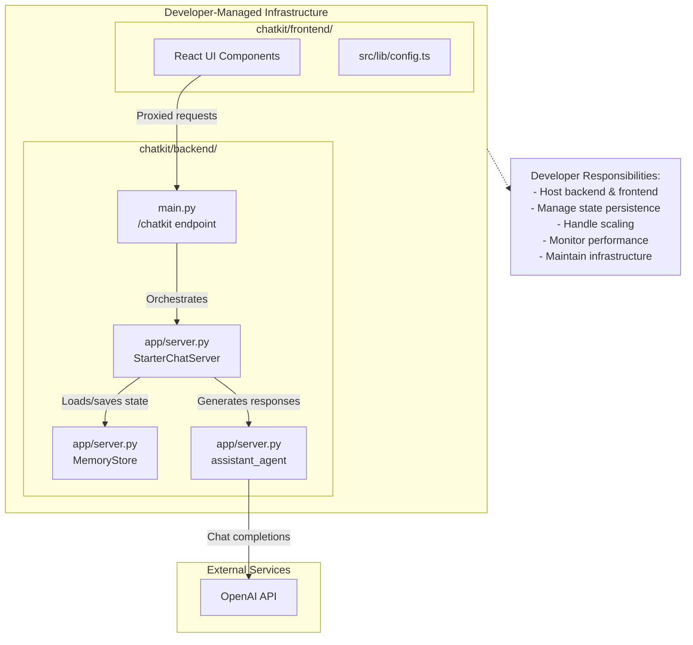
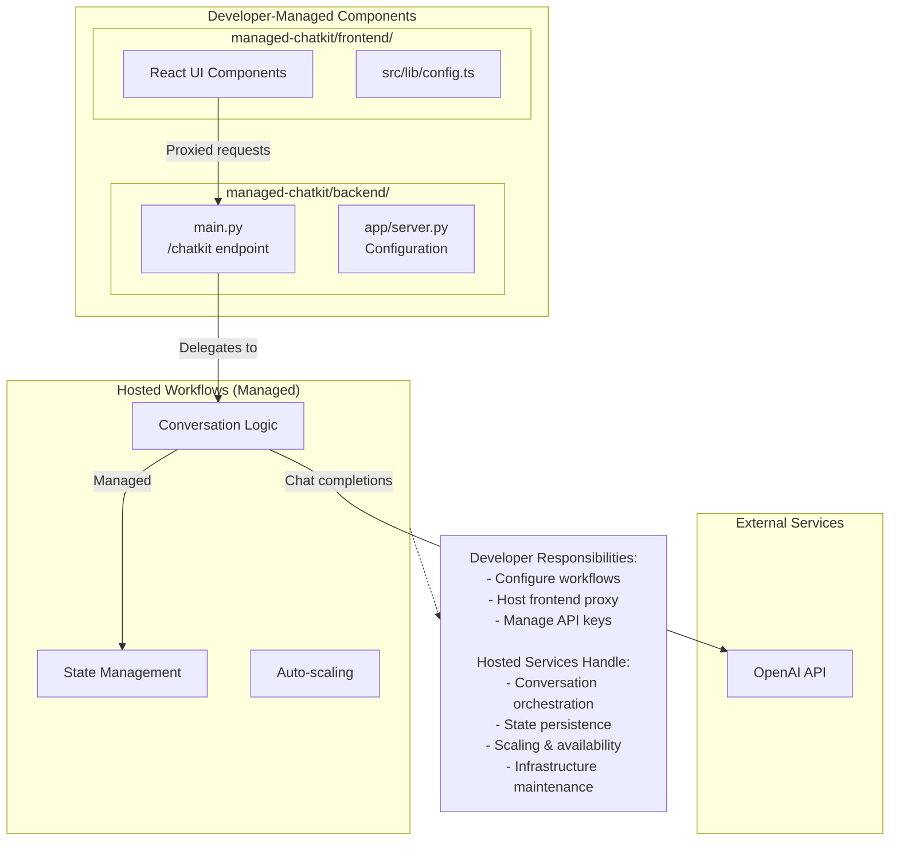
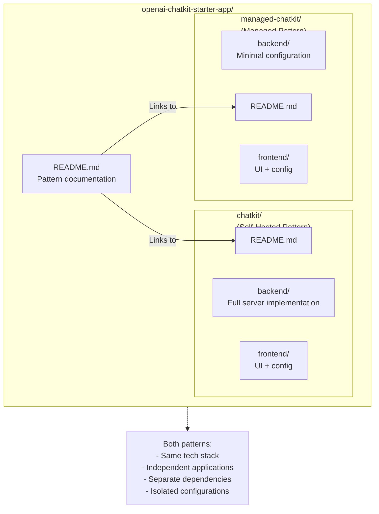
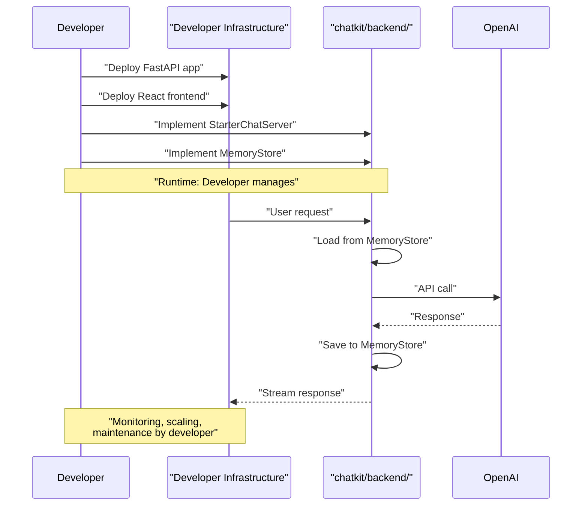
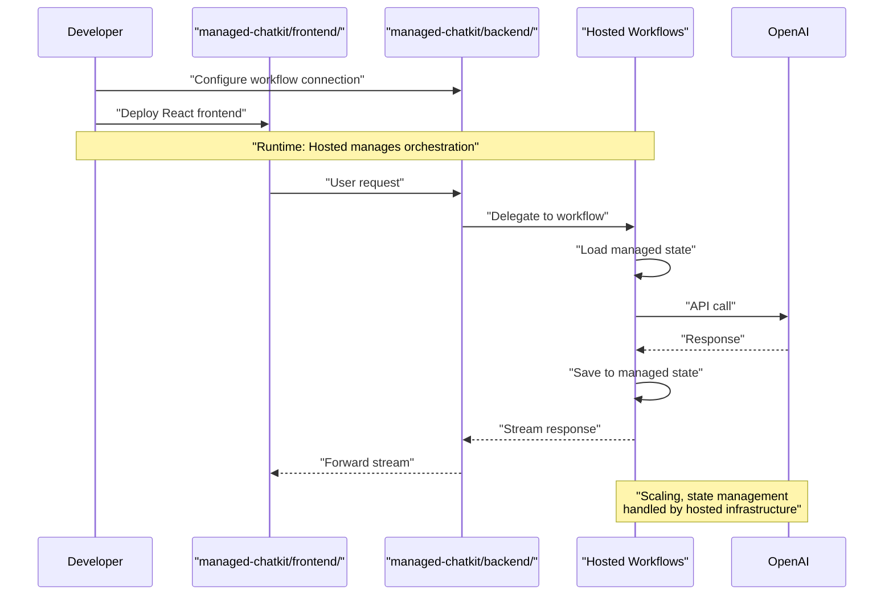
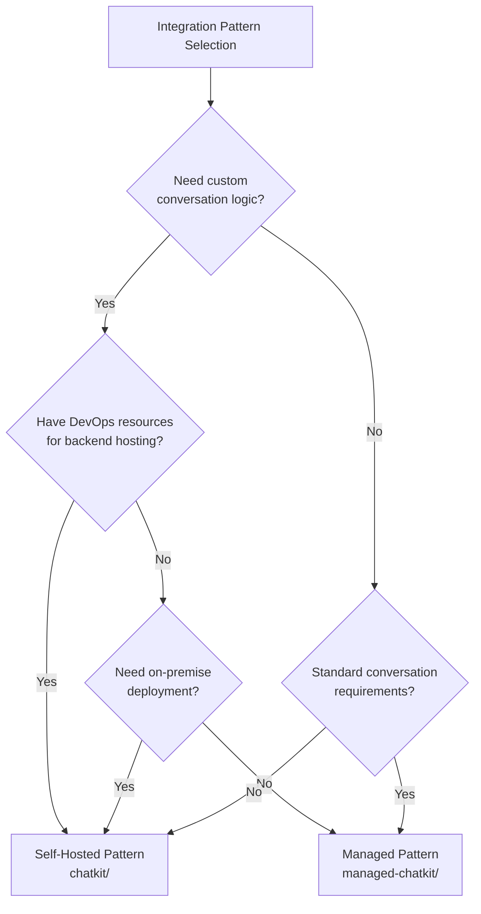

<!-- source: DeepWiki mcp.deepwiki.com · repo openai/openai-chatkit-starter-app · page 1.1 Two Integration Patterns · fetched 2026-10-26 -->

# Two Integration Patterns

Relevant source files

The following files were used as context for generating this wiki page:

- [README.md](README.md)

## Purpose and Scope

This document explains the two integration patterns provided in the OpenAI ChatKit Starter repository: **self-hosted ChatKit** and **managed ChatKit**. It clarifies the architectural and operational differences between these patterns to help developers choose the appropriate approach for their use case.

For detailed architecture of the self-hosted implementation, see [Architecture Overview](#3.1). For managed ChatKit specifics, see [Overview & Hosted Workflows](#4.1). For choosing between patterns based on infrastructure requirements, see [Deployment Considerations](#8).

---

## Overview

The repository provides two independent starter applications that demonstrate different operational models for integrating ChatKit:

| Pattern | Directory | Description |
|---------|-----------|-------------|
| Self-Hosted | `chatkit/` | Complete application where developers manage all infrastructure, logic, and state |
| Managed | `managed-chatkit/` | Integration using hosted workflows to reduce operational complexity |

Both patterns share the same technology stack (FastAPI backend + Vite/React frontend) but differ fundamentally in where the conversational logic executes and who manages the infrastructure.

**Sources:** [README.md:1-9]()

---

## Pattern Comparison

### Self-Hosted ChatKit Pattern

**Characteristics:**

- **Full Control**: Developers implement and manage the entire `StarterChatServer` class, including conversation orchestration, state management via `MemoryStore`, and agent configuration
- **Local State**: Thread history and metadata stored in developer-managed storage (default: in-memory via `MemoryStore`)
- **Direct API Integration**: Backend directly calls OpenAI API through `openai-chatkit` library
- **Infrastructure Ownership**: Requires hosting FastAPI backend and serving React frontend
- **Customization**: Complete access to modify server logic, storage layer, and agent behavior

**Sources:** [README.md:7](), Diagram 2 from system architecture, Diagram 6 from system architecture

---

### Managed ChatKit Pattern

**Characteristics:**

- **Reduced Operational Burden**: Hosted workflows manage conversation orchestration, eliminating need for custom server implementation
- **Managed State**: Thread history and state handled by hosted infrastructure, not developer-managed storage
- **Simplified Backend**: Backend primarily acts as configuration point and proxy, not full orchestrator
- **Automatic Scaling**: Hosted workflows handle traffic spikes and resource allocation
- **Limited Customization**: Workflow behavior configured rather than directly implemented

**Sources:** [README.md:8](), Diagram 1 from system architecture, Diagram 6 from system architecture

---

## Code Structure Mapping

### Directory Organization

The two patterns exist as completely independent applications within the repository. Each has its own:

- Backend directory with `main.py` entrypoint and `pyproject.toml`
- Frontend directory with `vite.config.ts` and `package.json`
- Environment configuration (`.env.local`)
- README with pattern-specific instructions

**Sources:** [README.md:3-8](), Diagram 1 from system architecture, Diagram 3 from system architecture

---

## Key Architectural Differences

| Aspect | Self-Hosted (`chatkit/`) | Managed (`managed-chatkit/`) |
|--------|--------------------------|------------------------------|
| **Server Logic** | Full `StarterChatServer` implementation in `backend/app/server.py` | Minimal configuration, workflow logic hosted externally |
| **State Storage** | Developer implements storage (default: `MemoryStore` class) | Managed by hosted infrastructure |
| **Conversation Orchestration** | `StarterChatServer.respond()` method orchestrates flow | Hosted workflow orchestrates flow |
| **Agent Definition** | Local `assistant_agent` configuration in `backend/app/server.py` | Workflow-configured agent |
| **Scaling** | Developer manages uvicorn workers and infrastructure | Automatic via hosted services |
| **Deployment Complexity** | Higher - requires hosting both backend and frontend | Lower - primarily frontend hosting |
| **Customization Level** | High - direct code access to all components | Medium - configuration-based customization |

**Sources:** Diagram 2 from system architecture, Diagram 6 from system architecture

---

## Operational Model Comparison

### Self-Hosted Operational Flow

**Sources:** Diagram 2 from system architecture, Diagram 4 from system architecture

---

### Managed Operational Flow

**Sources:** [README.md:8](), Diagram 6 from system architecture

---

## Choosing Between Patterns

### Use Self-Hosted When:

- **Full Control Required**: Need to customize conversation logic, state management, or agent behavior beyond configuration
- **On-Premise Deployment**: Security or compliance requires running all infrastructure internally
- **Custom Storage**: Need to integrate with specific database systems or state management approaches
- **Learning Implementation**: Want to understand complete ChatKit integration architecture
- **Complex Workflows**: Building sophisticated multi-agent or multi-step conversation flows

**Key Trade-off**: Higher operational complexity in exchange for maximum flexibility.

---

### Use Managed When:

- **Rapid Deployment**: Need to launch quickly without infrastructure setup
- **Reduced Maintenance**: Want to minimize operational burden and focus on frontend experience
- **Automatic Scaling**: Expect variable traffic patterns and need automatic resource management
- **Standard Use Cases**: Conversation requirements fit within workflow configuration options
- **Team Constraints**: Limited DevOps resources for managing backend infrastructure

**Key Trade-off**: Configuration-based customization in exchange for simplified operations.

**Sources:** Diagram 6 from system architecture

---

## Pattern Selection Decision Tree

**Sources:** Diagram 6 from system architecture

---

## Common Elements

Despite operational differences, both patterns share:

- **Technology Stack**: FastAPI (backend), Vite + React (frontend), TypeScript
- **Environment Configuration**: Both use `.env.local` for `OPENAI_API_KEY` and `VITE_*` variables
- **Development Workflow**: Both use `npm run dev` to start concurrent backend and frontend servers
- **OpenAI Integration**: Both ultimately interact with OpenAI API for chat completions
- **Frontend Structure**: Nearly identical React UI components and configuration files

The patterns diverge at the **backend orchestration layer**: self-hosted implements full server logic locally, while managed delegates to hosted workflows.

**Sources:** [README.md:3-8](), Diagram 3 from system architecture, Diagram 5 from system architecture

---

## Next Steps

After selecting a pattern:

- **Self-Hosted**: Continue to [Architecture Overview](#3.1) for complete implementation details
- **Managed**: See [Overview & Hosted Workflows](#4.1) for workflow configuration
- **Setup**: Both patterns start with [Installation & Prerequisites](#2.1)
- **Configuration**: See [Environment Configuration](#2.2) for required variables

**Sources:** [README.md:5-8]()

---

