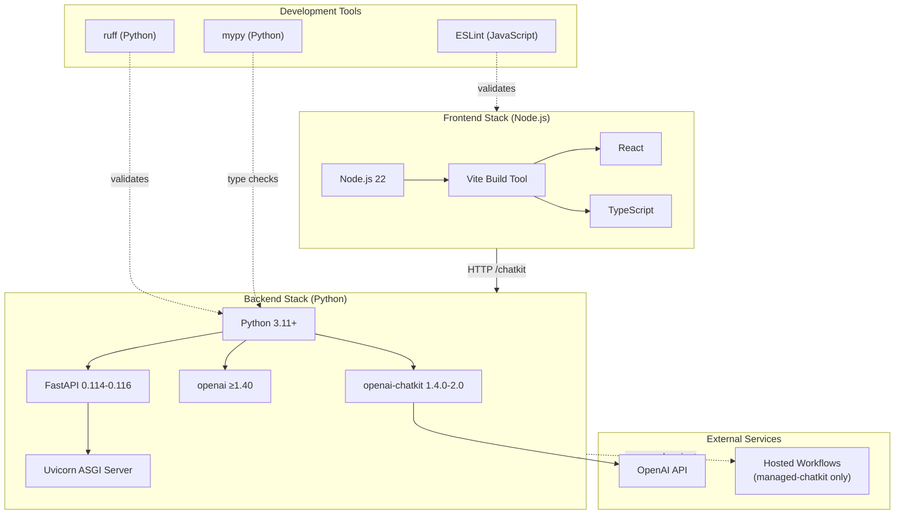
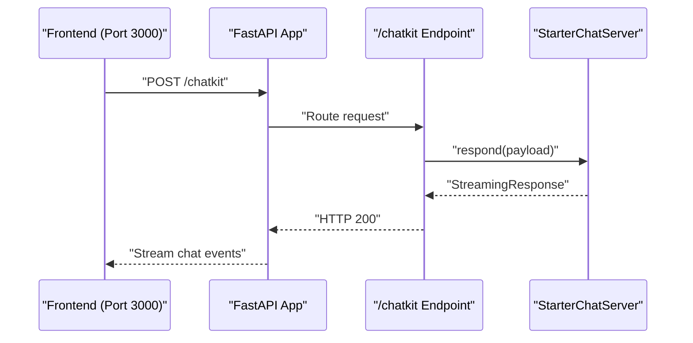
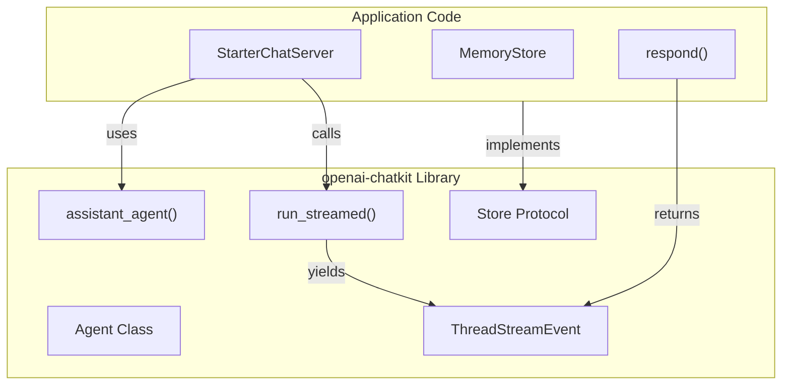
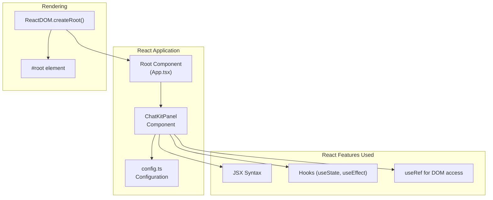
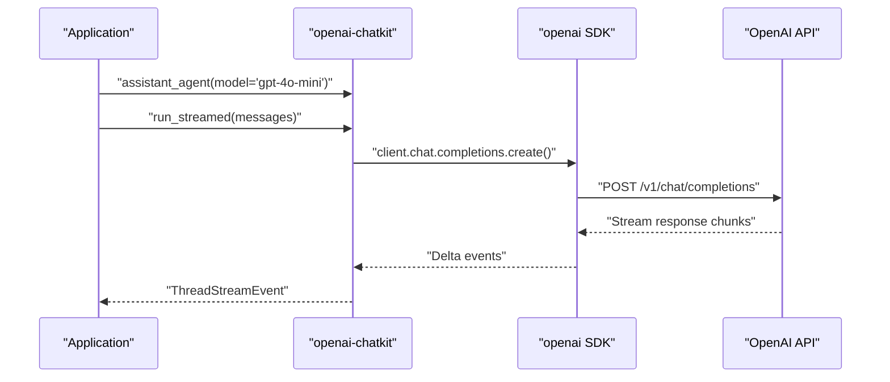
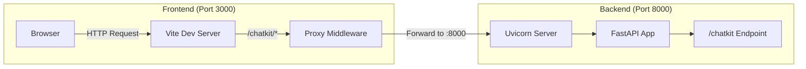
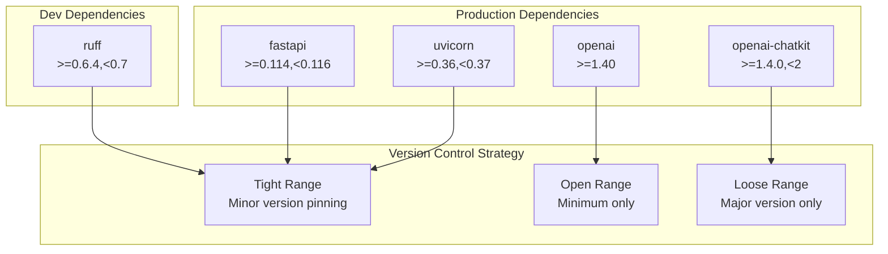

<!-- source: DeepWiki mcp.deepwiki.com · repo openai/openai-chatkit-starter-app · page 1.2 Key Technologies · fetched 2026-10-26 -->

# Key Technologies

<details>
<summary>Relevant source files</summary>

The following files were used as context for generating this wiki page:

- [README.md](README.md)
- [chatkit/.env.example](chatkit/.env.example)
- [chatkit/.gitignore](chatkit/.gitignore)
- [chatkit/README.md](chatkit/README.md)
- [chatkit/backend/.gitignore](chatkit/backend/.gitignore)
- [chatkit/backend/app/__init__.py](chatkit/backend/app/__init__.py)
- [chatkit/backend/pyproject.toml](chatkit/backend/pyproject.toml)

</details>


This page documents the technology stack shared by both starter applications in this repository. Both `chatkit/` (self-hosted) and `managed-chatkit/` (managed) use identical technology stacks, differing only in their integration with OpenAI services. The architecture follows a standard separation between backend (Python/FastAPI) and frontend (Node.js/Vite/React).

For information on how these dependencies are managed and installed, see section 5 (Dependencies & Package Management). For CI/CD validation of these technologies, see section 6 (CI/CD Pipeline).

## Technology Stack Overview

Both starter applications consist of two independent technology stacks that communicate via HTTP:

| Layer | Technology | Version Requirement | Purpose |
|-------|-----------|---------------------|---------|
| **Backend Runtime** | Python | ≥3.11 | Server-side execution environment |
| **Backend Framework** | FastAPI | 0.114-0.116 | HTTP API server with async support |
| **Backend Server** | Uvicorn | ≥0.36, <0.37 | ASGI application server |
| **OpenAI SDK** | openai | ≥1.40 | OpenAI API client |
| **ChatKit Library** | openai-chatkit | 1.4.0-2.0 | ChatKit server integration |
| **Frontend Runtime** | Node.js | 22 | JavaScript execution environment |
| **Frontend Build Tool** | Vite | Latest | Fast development server and bundler |
| **Frontend Framework** | React | Latest | UI component library |
| **Frontend Language** | TypeScript | Latest | Type-safe JavaScript development |

**Sources**: [chatkit/backend/pyproject.toml:5-11](), [chatkit/README.md:3-4](), [README.md:1-8]()

## Technology Architecture

### Full Stack Architecture Diagram



**Sources**: [chatkit/backend/pyproject.toml:5-16](), [chatkit/README.md:3-16]()

### Technology Layer Mapping

```mermaid
graph LR
    subgraph User["User Browser"]
        UI["React UI Components"]
    end
    
    subgraph Dev["Development Layer"]
        ViteServer["vite dev server<br/>Port 3000"]
    end
    
    subgraph Backend["Backend Layer"]
        ASGI["uvicorn server<br/>Port 8000"]
        FastAPIApp["FastAPI app"]
        Server["StarterChatServer"]
    end
    
    subgraph Integration["Integration Layer"]
        ChatKitLib["openai-chatkit library"]
        OpenAISDK["openai SDK"]
    end
    
    subgraph External["External Services"]
        API["OpenAI API"]
    end
    
    UI -->|"HTTP Proxy"| ViteServer
    ViteServer -->|"/chatkit"| ASGI
    ASGI --> FastAPIApp
    FastAPIApp --> Server
    Server --> ChatKitLib
    ChatKitLib --> OpenAISDK
    OpenAISDK --> API
```



**Sources**: [chatkit/backend/app/main.py:1-50](), [chatkit/README.md:13-16]()

## Backend Technologies

### Python 3.11+

Python serves as the backend runtime environment. The minimum required version is 3.11, specified in the project configuration.

**Version Requirement**: `requires-python = ">=3.11"`

Python 3.11 provides:
- Performance improvements over 3.10 (up to 25% faster)
- Enhanced error messages with precise location information
- Type hinting improvements used throughout the codebase
- Async/await syntax used by FastAPI and the ChatKit library

**Sources**: [chatkit/backend/pyproject.toml:5]()

### FastAPI 0.114-0.116

FastAPI is the core web framework providing the HTTP API server. It handles request routing, request/response serialization, and middleware integration.

**Version Requirement**: `fastapi>=0.114,<0.116`

#### FastAPI Application Structure

The FastAPI application in `chatkit/backend/app/main.py` provides:

| Component | Implementation | Purpose |
|-----------|----------------|---------|
| Main app instance | `app = FastAPI()` | Core application object |
| CORS middleware | `CORSMiddleware` | Cross-origin request handling for frontend |
| POST endpoint | `/chatkit` | Receives chat requests from frontend |
| Health check | Root route | Application status verification |

#### Request Processing Model



**Sources**: [chatkit/backend/app/main.py:1-50](), [chatkit/backend/pyproject.toml:7]()

### Uvicorn ASGI Server

Uvicorn is the production-grade ASGI server that runs the FastAPI application. It provides:

**Version Requirement**: `uvicorn[standard]>=0.36,<0.37`

#### Server Configuration

The `[standard]` extra includes:
- **httptools**: High-performance HTTP parser
- **websockets**: WebSocket protocol support
- **uvloop** (on Unix): Fast asyncio event loop
- **watchfiles**: File change detection for development

#### Development Server Launch

The application starts via: `uvicorn app.main:app --host 127.0.0.1 --port 8000 --reload`

| Flag | Value | Purpose |
|------|-------|---------|
| `--host` | `127.0.0.1` | Bind to localhost only (development) |
| `--port` | `8000` | Listen on port 8000 |
| `--reload` | enabled | Auto-restart on code changes |

**Sources**: [chatkit/backend/pyproject.toml:8](), [chatkit/README.md:15-16]()

### OpenAI Python SDK

The OpenAI SDK provides the client library for interacting with OpenAI's APIs.

**Version Requirement**: `openai>=1.40`

#### SDK Integration Points

The SDK is used by the `openai-chatkit` library to:
- Create chat completions via the Chat Completions API
- Stream response chunks in real-time
- Handle authentication with API keys
- Manage model configuration (e.g., `gpt-4o-mini`)

The SDK version `1.40+` ensures compatibility with:
- Streaming responses (`stream=True`)
- Assistant API features
- Chat completion with tools/functions

**Sources**: [chatkit/backend/pyproject.toml:9]()

### openai-chatkit Library

The `openai-chatkit` library is the core integration package that provides the ChatKit server implementation.

**Version Requirement**: `openai-chatkit>=1.4.0,<2`

#### ChatKit Core Components



#### Library Features Used

| Feature | Implementation File | Purpose |
|---------|-------------------|---------|
| `Store` protocol | `backend/app/store.py` | Thread and message persistence interface |
| `assistant_agent()` | `backend/app/server.py` | Pre-configured AI agent factory |
| `run_streamed()` | `backend/app/server.py` | Streaming response generation |
| `ThreadStreamEvent` | `backend/app/server.py` | Event types for streaming |
| `simple_to_agent_input()` | `backend/app/server.py` | Message format conversion |

**Sources**: [chatkit/backend/pyproject.toml:10](), [chatkit/backend/app/server.py:1-100]()

## Frontend Technologies

### Node.js 22

Node.js 22 is the required JavaScript runtime environment for the frontend build toolchain and development server.

**Version Requirement**: Node.js 22

Node.js 22 provides:
- ES modules support used by Vite
- Native fetch API used by frontend code
- Performance improvements for build times
- Compatibility with latest npm packages

**Sources**: [chatkit/README.md:1-11]()

### Vite Build Tool

Vite is the frontend build tool and development server, replacing traditional bundlers like webpack.

#### Vite Features Used

| Feature | Implementation | Purpose |
|---------|----------------|---------|
| Dev Server | `vite dev` | Fast hot module replacement |
| Proxy | `/chatkit` → `http://127.0.0.1:8000` | Route API requests to backend |
| React Plugin | `@vitejs/plugin-react` | JSX transformation and Fast Refresh |
| TypeScript | Native support | Type checking during development |
| Production Build | `vite build` | Optimized production bundle |

#### Development Server Configuration

The Vite dev server runs on port 3000 with proxy configuration:

```typescript
proxy: {
  '/chatkit': {
    target: 'http://127.0.0.1:8000',
    changeOrigin: true
  }
}
```

This allows frontend code to make requests to `/chatkit` which are automatically forwarded to the FastAPI backend.

**Sources**: [chatkit/README.md:13-16](), [chatkit/frontend/vite.config.ts:1-20]()

### React

React provides the UI component library and virtual DOM implementation for the frontend.

#### React Architecture in Application



#### React Components

The application uses React for:
- **ChatKitPanel** component: Main chat interface wrapper
- **Component lifecycle**: `useEffect` for initialization
- **DOM integration**: `useRef` to mount ChatKit library
- **Configuration**: Props-based component configuration

**Sources**: [chatkit/frontend/src/components/ChatKitPanel.tsx:1-50](), [chatkit/frontend/src/App.tsx:1-20]()

### TypeScript

TypeScript provides static type checking for the frontend codebase.

#### TypeScript Configuration

The `tsconfig.json` configures:

| Setting | Value | Purpose |
|---------|-------|---------|
| `target` | `ES2020` | Modern JavaScript features |
| `jsx` | `react-jsx` | React 17+ JSX transform |
| `strict` | `true` | Strict type checking enabled |
| `module` | `ESNext` | ES modules system |
| `moduleResolution` | `bundler` | Vite-compatible resolution |

#### Type Safety Benefits

TypeScript provides:
- Compile-time error detection
- IDE autocomplete and IntelliSense
- Type-safe configuration objects
- Interface definitions for API responses

**Sources**: [chatkit/frontend/tsconfig.json:1-30]()

## Development Tools

### Ruff (Python)

Ruff is the Python linter and code formatter used for backend code quality.

**Version Requirement**: `ruff>=0.6.4,<0.7` (dev dependency)

#### Ruff Capabilities

Ruff combines multiple Python tools into one:
- **Linter**: Replaces Flake8, pylint, pycodestyle
- **Formatter**: Replaces Black
- **Import sorter**: Replaces isort
- **Performance**: 10-100x faster than traditional tools

#### CI Integration

The CI pipeline runs two Ruff checks:

```bash
ruff check .          # Lint for code quality issues
ruff format --check . # Verify code formatting
```

**Sources**: [chatkit/backend/pyproject.toml:14-16](), [.github/workflows/ci.yml:30-40]()

### mypy (Python)

mypy is the static type checker for Python, ensuring type safety in the backend codebase.

#### Type Checking Benefits

mypy validates:
- Function parameter types
- Return value types
- Variable assignments
- Protocol implementations (e.g., `Store` protocol)

#### CI Integration

The CI pipeline runs: `mypy . --strict`

The `--strict` flag enables:
- Disallow untyped function definitions
- Disallow incomplete type definitions
- Require explicit return types
- Strict optional checking

**Sources**: [.github/workflows/ci.yml:40-50]()

### ESLint (JavaScript)

ESLint validates JavaScript and TypeScript code in the frontend.

#### ESLint Configuration

The frontend uses:
- **eslint.config.js**: ESLint 9 flat config format
- **TypeScript ESLint**: Type-aware linting rules
- **React Rules**: React-specific best practices

#### CI Integration

The CI pipeline runs: `npm run lint`

This checks for:
- Unused variables
- Missing dependencies in React hooks
- TypeScript type errors
- Code style violations

**Sources**: [.github/workflows/ci.yml:60-70](), [chatkit/frontend/eslint.config.js:1-20]()

## OpenAI Integration

### OpenAI API

Both starter applications integrate with the OpenAI API for conversational AI capabilities.

#### API Authentication

The backend requires the `OPENAI_API_KEY` environment variable:

```bash
export OPENAI_API_KEY=sk-proj-...
```

This key authenticates all requests to OpenAI's API endpoints.

#### API Usage Pattern



#### Model Configuration

The default model is `gpt-4o-mini`, configured in the agent:

```python
assistant_agent(
    model="gpt-4o-mini",
    instructions="You are a helpful assistant."
)
```

**Sources**: [chatkit/README.md:20](), [chatkit/backend/app/server.py:1-50](), [chatkit/.env.example:1-3]()

### Domain Keys

Domain keys authenticate frontend requests to the ChatKit API.

**Environment Variables**:
- `VITE_CHATKIT_API_DOMAIN_KEY`: Frontend domain authentication key
- Default: `domain_pk_localhost_dev` (development)
- Production: Register domain key in OpenAI dashboard

Domain keys:
- Restrict which domains can make ChatKit API calls
- Prevent unauthorized usage
- Track usage by domain

**Sources**: [chatkit/README.md:22-26](), [chatkit/.env.example:3]()

## Technology Communication Flow

### Backend-Frontend Integration

The frontend and backend communicate via HTTP:



#### Development Proxy Configuration

In development, the Vite proxy forwards `/chatkit` requests:

| Setting | Value | Purpose |
|---------|-------|---------|
| Proxy path | `/chatkit` | Intercept these requests |
| Target | `http://127.0.0.1:8000` | Forward to FastAPI backend |
| Change origin | `true` | Rewrite host header |

This allows the frontend at `localhost:3000` to call the backend at `localhost:8000` without CORS issues.

**Sources**: [chatkit/README.md:15-16](), [chatkit/frontend/vite.config.ts:1-20]()

## Environment Variables

### Backend Environment Variables

| Variable | Required | Default | Purpose |
|----------|----------|---------|---------|
| `OPENAI_API_KEY` | Yes | - | OpenAI API authentication |

The backend reads this from the shell environment or `.env.local` file at the repository root.

**Sources**: [chatkit/README.md:20](), [chatkit/.env.example:1]()

### Frontend Environment Variables

| Variable | Required | Default | Purpose |
|----------|----------|---------|---------|
| `VITE_CHATKIT_API_URL` | No | `/chatkit` | Backend API endpoint URL |
| `VITE_CHATKIT_API_DOMAIN_KEY` | No | `domain_pk_localhost_dev` | Domain authentication key |

Frontend variables must be prefixed with `VITE_` to be exposed to client-side code.

**Sources**: [chatkit/README.md:21-22](), [chatkit/.env.example:2-3]()

### Environment File Structure

The `.env.local` file at the repository root contains:

```bash
OPENAI_API_KEY=sk-proj-...
VITE_CHATKIT_API_URL=/chatkit
VITE_CHATKIT_API_DOMAIN_KEY=domain_pk_localhost_dev
```

This file is:
- Ignored by git (`.gitignore`)
- Loaded by both backend and frontend during development
- Referenced by Vite for `VITE_*` variables
- Read by Python's `os.environ` for backend variables

**Sources**: [chatkit/.env.example:1-3](), [chatkit/.gitignore:1-4]()

## Dependency Version Strategy

### Backend Dependency Versioning

Python dependencies use PEP 440 version specifiers:

| Package | Specifier | Accepts | Rationale |
|---------|-----------|---------|-----------|
| `fastapi` | `>=0.114,<0.116` | 0.114.x - 0.115.x | Pin to known compatible minors |
| `uvicorn` | `>=0.36,<0.37` | 0.36.x only | Server stability critical |
| `openai` | `>=1.40` | 1.40.0+ | Accept new API features |
| `openai-chatkit` | `>=1.4.0,<2` | 1.4.0 - 1.x.x | Major version stability |
| `ruff` | `>=0.6.4,<0.7` | 0.6.4+ | Development tool flexibility |

#### Version Strategy Diagram



**Sources**: [chatkit/backend/pyproject.toml:6-16]()

### Frontend Dependency Versioning

Frontend dependencies use npm semantic versioning:

- **Vite**: Latest stable version (managed by npm)
- **React**: Latest stable version (managed by npm)
- **TypeScript**: Latest stable version (managed by npm)
- **ESLint**: Latest stable version (managed by npm)

The frontend uses `npm install` to fetch latest compatible versions within major version constraints.

**Sources**: [chatkit/frontend/package.json:1-30]()

## Technology Integration Summary

The five core technologies integrate as follows:

1. **Next.js** orchestrates the application, managing routing, server/client boundaries, and build process
2. **React 19** provides the component model and rendering engine
3. **TypeScript** enforces type safety across the entire codebase
4. **ChatKit** supplies the chat interface and OpenAI integration
5. **Tailwind CSS** handles styling through utility classes and CSS variables

Each technology's configuration file serves as the integration point:
- [next.config.ts:1-12]() - Next.js framework configuration
- [tsconfig.json:1-27]() - TypeScript compiler options
- [package.json:1-32]() - Dependency manifest and version locking

---

