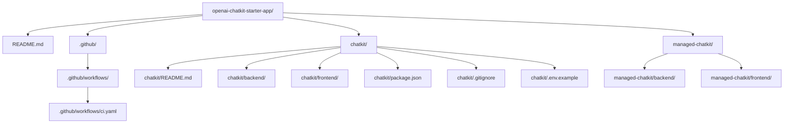
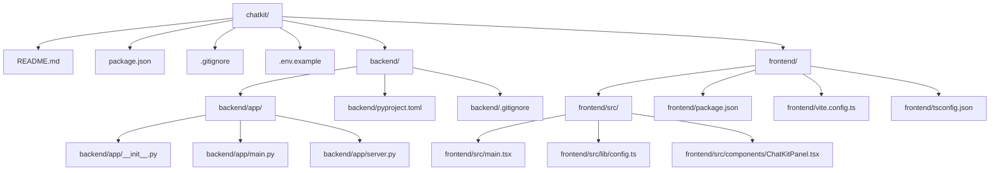
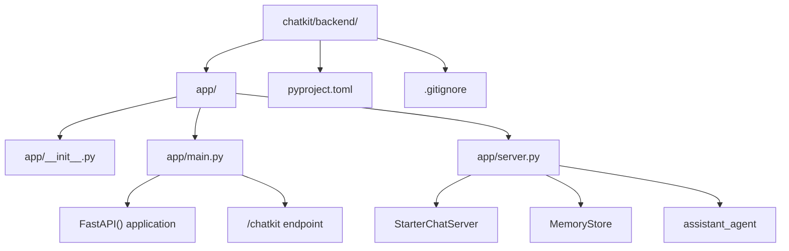
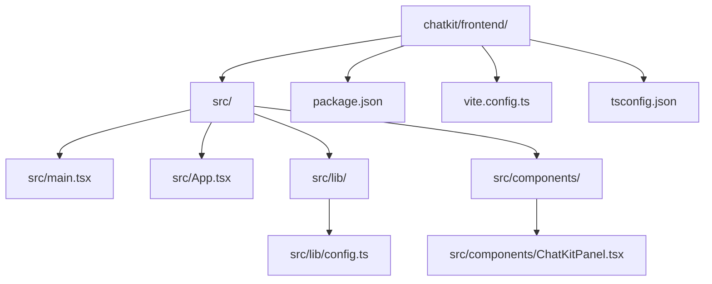
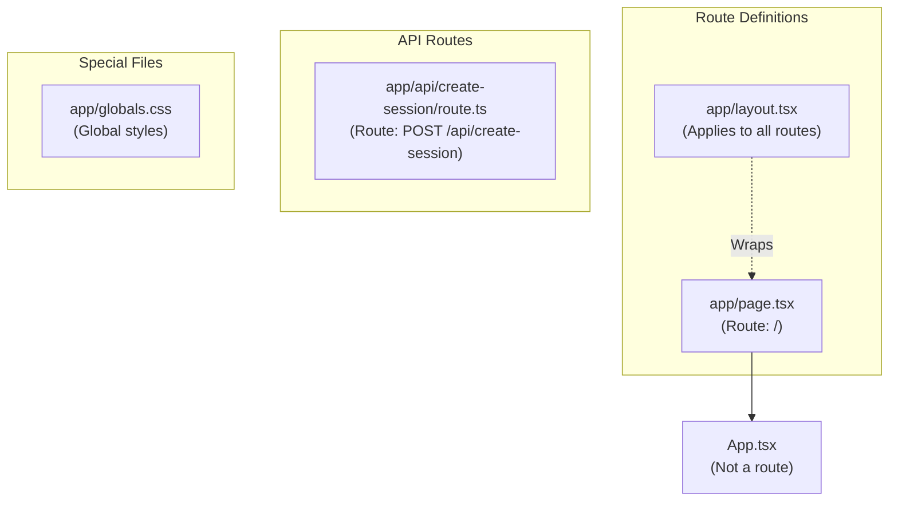

<!-- source: DeepWiki mcp.deepwiki.com · repo openai/openai-chatkit-starter-app · page 1.3 Repository Structure · fetched 2026-10-26 -->

# Repository Structure

<details>
<summary>Relevant source files</summary>

The following files were used as context for generating this wiki page:

- [README.md](README.md)
- [chatkit/.env.example](chatkit/.env.example)
- [chatkit/.gitignore](chatkit/.gitignore)
- [chatkit/README.md](chatkit/README.md)
- [chatkit/backend/.gitignore](chatkit/backend/.gitignore)
- [chatkit/backend/app/__init__.py](chatkit/backend/app/__init__.py)

</details>


This document describes the directory layout and organization of the OpenAI ChatKit Starter repository. The repository contains two independent starter applications demonstrating different ChatKit integration patterns: self-hosted and managed.

For details on specific technologies used, see [Key Technologies (1.2)](#1.2). For information on integration patterns, see [Two Integration Patterns (1.1)](#1.1).

---

## Purpose and Scope

The repository is organized into two top-level application directories, each containing a complete full-stack application with independent backend (FastAPI + Python) and frontend (Vite + React) implementations. Each application demonstrates a different ChatKit integration approach while following identical architectural patterns. Understanding this structure is essential for choosing the right integration pattern and navigating the codebase.

---

## High-Level Repository Structure



**Sources:** [README.md:1-9](), [chatkit/README.md:1-33]()

---

## Top-Level Organization

The repository root contains two independent application directories and shared documentation:

| Directory/File | Purpose | Details |
|----------------|---------|---------|
| `README.md` | Root documentation | Describes both starter applications and links to their READMEs |
| `.github/workflows/` | CI/CD configuration | Contains `ci.yaml` for automated testing |
| `chatkit/` | Self-hosted integration | Complete application with backend, frontend, and configuration |
| `managed-chatkit/` | Managed integration | Complete application using hosted workflows |

**Sources:** [README.md:1-9]()

---

## `chatkit/` Directory Structure

The self-hosted ChatKit integration is organized as a full-stack application with independent backend and frontend implementations.

### Directory Layout



**Sources:** [chatkit/README.md:1-33](), [chatkit/.gitignore:1-4](), [chatkit/backend/.gitignore:1-10]()

### Root-Level Configuration (`chatkit/`)

| File | Purpose |
|------|---------|
| `README.md` | Application-specific documentation, setup instructions |
| `package.json` | Root package configuration, defines `npm run dev` command |
| `.gitignore` | Excludes `node_modules/` and `.env*` files (except `.env.example`) |
| `.env.example` | Template showing required environment variables |

The root `package.json` defines the `dev` script that launches both backend and frontend concurrently using `concurrently` package.

**Sources:** [chatkit/README.md:1-33](), [chatkit/.gitignore:1-4](), [chatkit/.env.example:1-3]()

### Backend Structure (`chatkit/backend/`)

The FastAPI backend is organized as a Python package:



| File/Directory | Purpose | Key Contents |
|----------------|---------|--------------|
| `app/__init__.py` | Package marker | Minimal docstring |
| `app/main.py` | FastAPI entrypoint | Defines `FastAPI()` app, `/chatkit` endpoint, CORS config |
| `app/server.py` | ChatKit server logic | `StarterChatServer`, `MemoryStore`, `assistant_agent` |
| `pyproject.toml` | Python dependencies | FastAPI, uvicorn, openai, openai-chatkit |
| `.gitignore` | Python-specific ignores | `__pycache__/`, `.venv/`, `.env`, `.ruff_cache/` |

**Sources:** [chatkit/backend/.gitignore:1-10](), [chatkit/backend/app/__init__.py:1-2](), [chatkit/README.md:15-16]()

### Frontend Structure (`chatkit/frontend/`)

The Vite + React frontend follows a standard single-page application structure:



| File/Directory | Purpose | Key Contents |
|----------------|---------|--------------|
| `src/main.tsx` | Application entrypoint | Renders React app into DOM |
| `src/App.tsx` | Root React component | Application container |
| `src/lib/config.ts` | Configuration constants | API URL, domain key, UI settings |
| `src/components/ChatKitPanel.tsx` | Chat interface component | Main UI integration point |
| `package.json` | Frontend dependencies | React, Vite, TypeScript, ESLint |
| `vite.config.ts` | Vite build configuration | Dev server proxy to `/chatkit` |
| `tsconfig.json` | TypeScript configuration | Compiler options |

**Sources:** [chatkit/README.md:15-16, 30-32]()

---

## `managed-chatkit/` Directory Structure

The managed ChatKit integration follows an identical structure to `chatkit/` but uses hosted workflows instead of self-hosted server logic. The directory organization mirrors `chatkit/`:

```
managed-chatkit/
├── backend/
│   ├── app/
│   │   ├── __init__.py
│   │   ├── main.py
│   │   └── (managed workflow integration)
│   ├── pyproject.toml
│   └── .gitignore
└── frontend/
    ├── src/
    │   ├── main.tsx
    │   ├── App.tsx
    │   ├── lib/config.ts
    │   └── components/ChatKitPanel.tsx
    ├── package.json
    ├── vite.config.ts
    └── tsconfig.json
```

The key difference is in the backend implementation, which integrates with hosted workflows rather than implementing `StarterChatServer` and `MemoryStore` locally. See [Managed ChatKit (4)](#4) for details on architectural differences.

**Sources:** [README.md:8-9]()

---

## Root-Level Configuration Files

The repository root contains configuration files that control build, development, and deployment behavior.

### Development & Build Configuration

| File | Purpose | Referenced By |
|------|---------|---------------|
| `package.json` | Defines dependencies, scripts, and project metadata | npm, CI workflow |
| `package-lock.json` | Locks exact dependency versions for reproducible installs | npm ci |
| `tsconfig.json` | TypeScript compiler configuration | TypeScript compiler, Next.js |
| `next.config.ts` | Next.js framework configuration | Next.js build system |
| `postcss.config.mjs` | PostCSS plugin configuration for CSS processing | Next.js build system |
| `tailwind.config.ts` | Tailwind CSS framework configuration | PostCSS, build system |
| `.eslintrc.json` | ESLint code quality rules | ESLint, CI workflow |

**Sources:** Architecture diagrams (Diagram 2, Diagram 5)

### Environment & Version Control

| File | Purpose | Tracked in Git |
|------|---------|----------------|
| `.env.example` | Template for environment variables | Yes |
| `.env.local` | Actual environment variables with secrets | No (in .gitignore) |
| `.gitignore` | Specifies intentionally untracked files | Yes |

The `.env.example` file ([.env.example:1-3]()) provides a template showing required environment variables without exposing actual secrets. Developers copy this to `.env.local` and fill in real values:

```
OPENAI_API_KEY=sk-...
NEXT_PUBLIC_CHATKIT_WORKFLOW_ID=wflow_...
```

The `.gitignore` file ([.gitignore:34-35]()) explicitly excludes all `.env*` files except `.env.example`, ensuring secrets remain local.

**Sources:** [.gitignore:33-35](), [README.md:21-35](), Architecture diagrams (Diagram 6)

---

## Build Outputs & Generated Directories

The following directories are generated during development or build processes and are excluded from version control:

| Directory | Purpose | When Generated | Gitignored |
|-----------|---------|----------------|------------|
| `node_modules/` | Installed npm packages | `npm install` or `npm ci` | Yes ([.gitignore:4]()) |
| `.next/` | Next.js build output and cache | `npm run dev` or `npm run build` | Yes ([.gitignore:17]()) |
| `out/` | Static export output (if configured) | `npm run build` with output: 'export' | Yes ([.gitignore:18]()) |
| `coverage/` | Test coverage reports | `npm run test` (if configured) | Yes ([.gitignore:14]()) |

**Sources:** [.gitignore:3-21](), [README.md:17-19, 47-50]()

---

## File Organization Patterns

### Next.js App Router Conventions

The project follows Next.js App Router file naming conventions:



**Key conventions:**
- `page.tsx` - Defines a route at that directory level
- `layout.tsx` - Defines a layout that wraps all child routes
- `route.ts` in `api/` - Defines API endpoint handlers (GET, POST, etc.)
- Other `.tsx` files - Regular components, not routes

**Sources:** [app/page.tsx:1-6](), Next.js documentation

### Component Organization

Components are organized by function rather than type:

- **Primary components** (`ChatKitPanel`, `ErrorOverlay`) are in `components/`
- **Page-specific components** (`App`) are co-located with their pages in `app/`
- **Shared hooks** are in `hooks/`
- **Configuration** is in `lib/`

This structure keeps related code together while maintaining clear separation of concerns.

**Sources:** [README.md:44, 55-56](), Architecture diagrams (Diagram 3)

---

## Summary: Directory Purpose Mapping

| Directory | Primary Purpose | Key Consumers |
|-----------|----------------|---------------|
| `app/` | Routing, layouts, pages, API endpoints | Next.js App Router |
| `components/` | Reusable UI components | Pages, other components |
| `hooks/` | Custom React hooks for stateful logic | Components |
| `lib/` | Configuration, utilities, constants | All application code |
| `public/` | Static assets served at root path | HTML, CSS, components |

This organization supports the application's architecture by clearly separating routing concerns, reusable components, custom hooks, configuration, and static assets. The structure is designed for a small-to-medium application and can be extended by adding subdirectories within each major category as the codebase grows.

**Sources:** [README.md:1-61](), [.gitignore:1-43](), Architecture diagrams (all)

---

