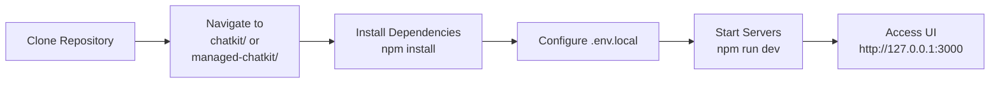
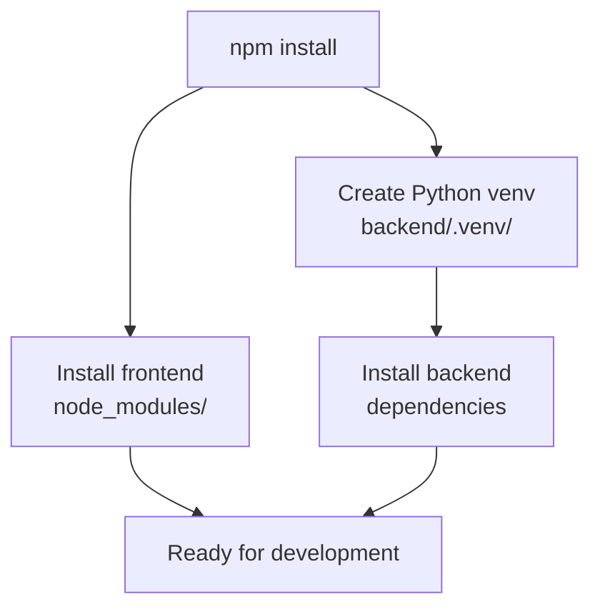
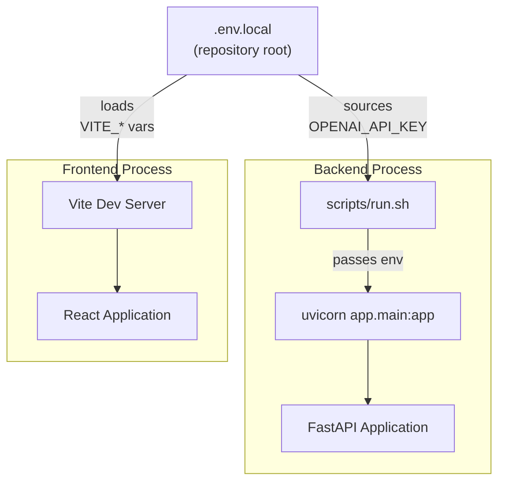
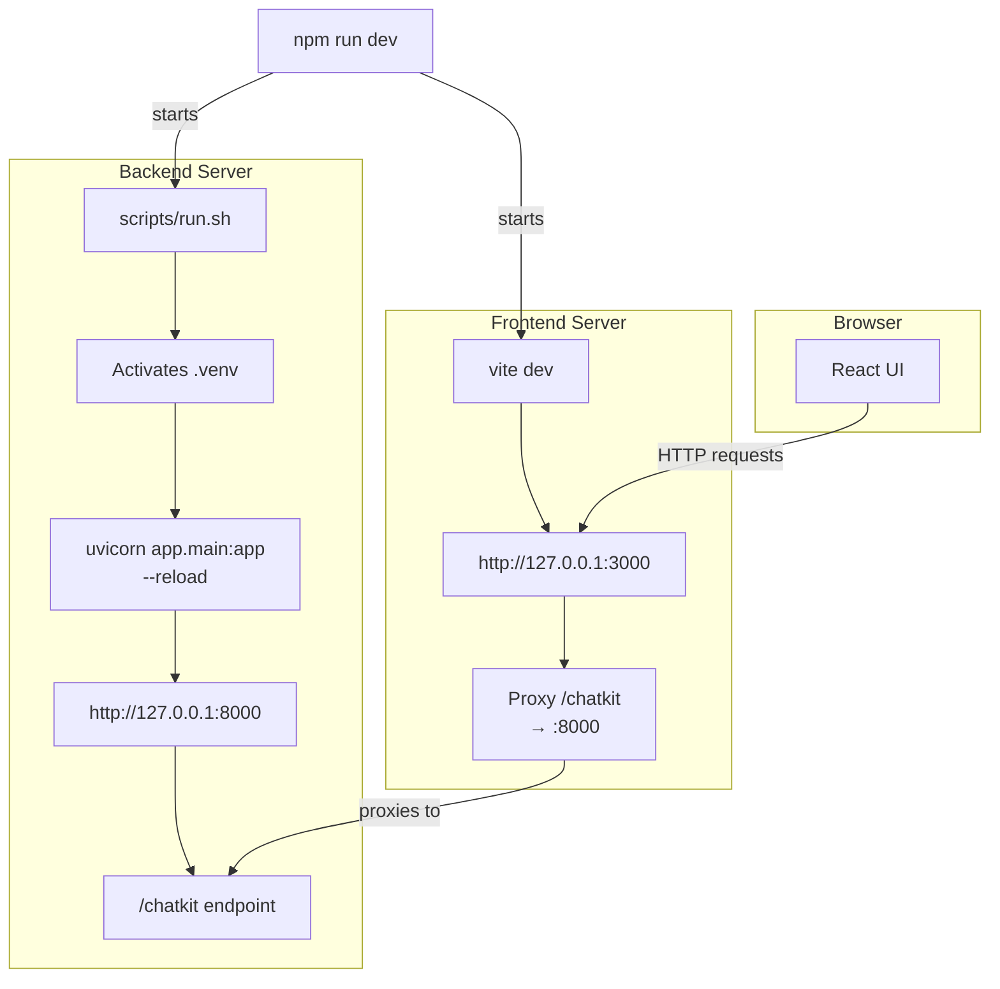
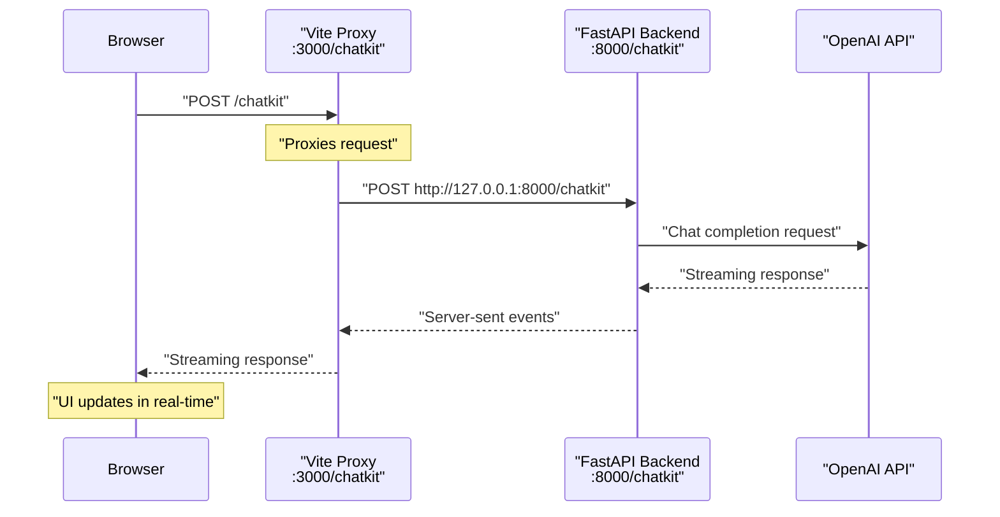

<!-- source: DeepWiki mcp.deepwiki.com · repo openai/openai-chatkit-starter-app · page 2 Getting Started · fetched 2026-10-26 -->

# Getting Started

<details>
<summary>Relevant source files</summary>

The following files were used as context for generating this wiki page:

- [chatkit/.env.example](chatkit/.env.example)
- [chatkit/.gitignore](chatkit/.gitignore)
- [chatkit/README.md](chatkit/README.md)
- [chatkit/backend/.gitignore](chatkit/backend/.gitignore)
- [chatkit/backend/app/__init__.py](chatkit/backend/app/__init__.py)
- [chatkit/backend/scripts/run.sh](chatkit/backend/scripts/run.sh)

</details>


This document provides step-by-step instructions for setting up and running either of the two ChatKit starter applications included in this repository. It covers prerequisite software, dependency installation, environment configuration, and starting the development servers.

For an overview of the two integration patterns (self-hosted vs. managed), see [Two Integration Patterns](#1.1). For detailed architecture and implementation documentation, see [Self-Hosted ChatKit](#3) or [Managed ChatKit](#4).

## Overview

Both starter applications (`chatkit/` and `managed-chatkit/`) follow identical setup procedures. The process involves installing dependencies, configuring environment variables, and starting concurrent development servers for the backend and frontend.

**Setup Workflow**



Sources: [chatkit/README.md:1-33]()

---

## Prerequisites

The following software must be installed on your system before proceeding:

| Requirement | Version | Purpose |
|-------------|---------|---------|
| Python | 3.11 or higher | Backend FastAPI server execution |
| Node.js | 22 | Frontend Vite build and development server |
| npm | Included with Node.js | Package management for frontend and orchestration |
| Git | Any recent version | Repository cloning |
| OpenAI API Key | N/A | Authentication with OpenAI services |

**Verification Commands**

```bash
# Check Python version
python --version  # Should output Python 3.11.x or higher

# Check Node.js version
node --version    # Should output v22.x.x

# Check npm version
npm --version     # Should output 10.x.x or higher
```

Sources: [chatkit/README.md:18-26](), [chatkit/backend/scripts/run.sh:14]()

---

## Choosing a Starter Application

The repository contains two independent starter applications:

| Directory | Integration Pattern | Use Case |
|-----------|-------------------|----------|
| `chatkit/` | Self-hosted | Full control over infrastructure, all logic runs locally |
| `managed-chatkit/` | Managed workflows | Reduced operational complexity, uses hosted workflows |

For detailed comparison of these patterns, see [Two Integration Patterns](#1.1).

**All subsequent instructions apply to both applications unless explicitly noted.**

Sources: [chatkit/README.md:1-4]()

---

## Installation

### 1. Clone the Repository

```bash
git clone https://github.com/openai/openai-chatkit-starter-app.git
cd openai-chatkit-starter-app
```

### 2. Navigate to Target Application

Choose either:

```bash
cd chatkit/          # For self-hosted integration
```

or

```bash
cd managed-chatkit/  # For managed integration
```

### 3. Install Dependencies

From the chosen application directory, run:

```bash
npm install
```

This command performs the following operations:

**Dependency Installation Flow**



The `npm install` command:
1. Installs frontend dependencies specified in `package.json` into `node_modules/`
2. Creates a Python virtual environment at `backend/.venv/`
3. Installs backend dependencies from `backend/pyproject.toml` including `fastapi`, `uvicorn`, `openai`, and `openai-chatkit`

Sources: [chatkit/README.md:8-10](), [chatkit/backend/scripts/run.sh:12-20]()

---

## Environment Configuration

### Required Environment Variables

Three environment variables control the application's behavior:

| Variable | Required | Default Value | Purpose |
|----------|----------|---------------|---------|
| `OPENAI_API_KEY` | **Yes** | None | Authenticates requests to OpenAI API |
| `VITE_CHATKIT_API_URL` | No | `/chatkit` | Frontend proxy endpoint to backend |
| `VITE_CHATKIT_API_DOMAIN_KEY` | No | `domain_pk_localhost_dev` | Domain authentication key for ChatKit |

### Configuration File: `.env.local`

Create a `.env.local` file at the **repository root** (not inside `chatkit/` or `managed-chatkit/`):

```bash
# From repository root
touch .env.local
```

Add the following content:

```bash
OPENAI_API_KEY=sk-proj-your-actual-key-here
VITE_CHATKIT_API_URL=/chatkit
VITE_CHATKIT_API_DOMAIN_KEY=domain_pk_localhost_dev
```

**Environment Variable Loading**



### Environment Variable Details

**`OPENAI_API_KEY`**

Obtain an API key from the [OpenAI Platform dashboard](https://platform.openai.com/api-keys). The key must have access to chat completion models (e.g., `gpt-4o-mini`).

The backend loading mechanism checks for this variable in the following order:
1. Shell environment (`export OPENAI_API_KEY=...`)
2. `.env.local` file at repository root

See [chatkit/backend/scripts/run.sh:24-36]() for the loading implementation.

**`VITE_CHATKIT_API_URL`**

Defaults to `/chatkit`, which uses the Vite dev server's proxy to forward requests to the FastAPI backend at `http://127.0.0.1:8000/chatkit`. For production deployments, set this to the full URL of your deployed backend.

**`VITE_CHATKIT_API_DOMAIN_KEY`**

Defaults to `domain_pk_localhost_dev` for local development. For production deployments, register a domain key in the OpenAI dashboard and update this value.

### Example Configuration File

```bash
# .env.local example
OPENAI_API_KEY=sk-proj-abcd1234efgh5678ijkl9012mnop3456qrst7890uvwx
VITE_CHATKIT_API_URL=/chatkit
VITE_CHATKIT_API_DOMAIN_KEY=domain_pk_localhost_dev
```

Sources: [chatkit/README.md:18-26](), [chatkit/.env.example:1-3](), [chatkit/backend/scripts/run.sh:22-36]()

---

## Running the Application

### Start Development Servers

From the application directory (`chatkit/` or `managed-chatkit/`), run:

```bash
npm run dev
```

This single command starts both the backend and frontend concurrently.

**Development Server Architecture**



### What Happens During Startup

1. **Backend initialization** [chatkit/backend/scripts/run.sh:1-40]():
   - Creates Python virtual environment at `backend/.venv/` if not present
   - Activates virtual environment
   - Installs backend dependencies in editable mode
   - Loads `OPENAI_API_KEY` from `.env.local` if not in shell environment
   - Starts `uvicorn` server on `127.0.0.1:8000` with hot-reload enabled

2. **Frontend initialization**:
   - Starts Vite development server on `127.0.0.1:3000`
   - Configures proxy to forward `/chatkit` requests to backend
   - Enables hot-module replacement for React components

### Verification

Once both servers start successfully, you should see output similar to:

```
Starting ChatKit backend on http://127.0.0.1:8000 ...
INFO:     Uvicorn running on http://127.0.0.1:8000 (Press CTRL+C to quit)
INFO:     Started reloader process [12345]

VITE v5.x.x  ready in 234 ms
➜  Local:   http://127.0.0.1:3000/
➜  Network: use --host to expose
```

### Accessing the Application

Open a web browser and navigate to:

```
http://127.0.0.1:3000
```

The ChatKit UI should load, allowing you to start a conversation with the AI assistant.

**Request Flow During Operation**



Sources: [chatkit/README.md:13-16](), [chatkit/backend/scripts/run.sh:38-39]()

---

## Troubleshooting Common Issues

### Backend Fails to Start

**Symptom**: Error message `Set OPENAI_API_KEY in your environment or in .env.local`

**Solution**: Ensure `.env.local` exists at the repository root with a valid `OPENAI_API_KEY`.

**Verification**:
```bash
# From repository root
cat .env.local | grep OPENAI_API_KEY
```

### Port Already in Use

**Symptom**: `Address already in use` error for port 8000 or 3000

**Solution**: Stop the conflicting process or change the port:

```bash
# Find process using port 8000
lsof -i :8000

# Kill the process (replace PID with actual process ID)
kill -9 <PID>
```

### Python Version Mismatch

**Symptom**: `Python 3.11 or higher is required`

**Solution**: Install Python 3.11+ and ensure it's in your PATH:

```bash
python --version  # Verify version
```

If using multiple Python versions, you may need to explicitly use `python3.11` or configure a version manager like `pyenv`.

### Dependencies Not Installing

**Symptom**: `npm install` fails or backend dependencies missing

**Solution**: 
1. Clear `node_modules/` and retry:
   ```bash
   rm -rf node_modules/
   npm install
   ```

2. Clear Python virtual environment and retry:
   ```bash
   rm -rf backend/.venv/
   npm install
   ```

Sources: [chatkit/backend/scripts/run.sh:33-36](), [chatkit/.gitignore:1-4](), [chatkit/backend/.gitignore:1-9]()

---

## Next Steps

After successfully running the application:

1. **Explore the architecture**: See [Self-Hosted ChatKit](#3) or [Managed ChatKit](#4) for detailed implementation documentation

2. **Customize the application**: See [Customization Guide](#3.5) for guidance on:
   - Replacing `MemoryStore` with persistent storage
   - Modifying UI configuration in [frontend/src/lib/config.ts]()
   - Adjusting layout in [frontend/src/components/ChatKitPanel.tsx]()

3. **Understand the request flow**: See [Request Flow & Data Model](#3.4) for a detailed trace of how messages are processed

4. **Prepare for deployment**: See [Deployment Considerations](#8) for production environment guidance

Sources: [chatkit/README.md:28-32]()

---

