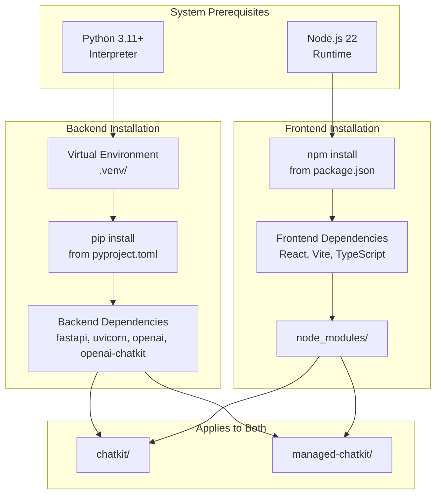
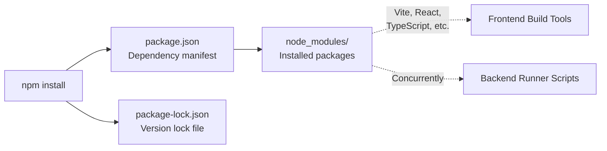
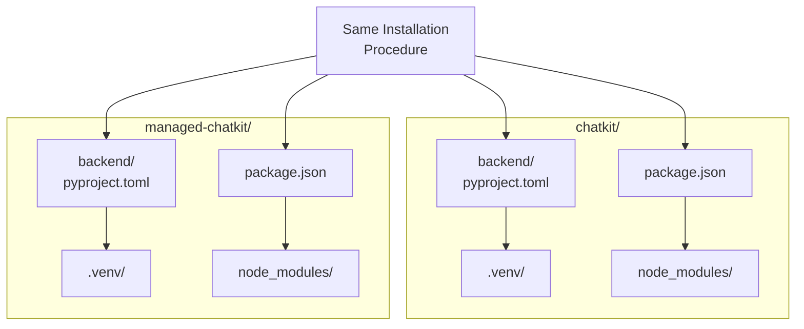

<!-- source: DeepWiki mcp.deepwiki.com · repo openai/openai-chatkit-starter-app · page 2.1 Installation & Prerequisites · fetched 2026-10-26 -->

# Installation & Prerequisites

<details>
<summary>Relevant source files</summary>

The following files were used as context for generating this wiki page:

- [chatkit/.env.example](chatkit/.env.example)
- [chatkit/.gitignore](chatkit/.gitignore)
- [chatkit/README.md](chatkit/README.md)
- [chatkit/backend/.gitignore](chatkit/backend/.gitignore)
- [chatkit/backend/app/__init__.py](chatkit/backend/app/__init__.py)
- [chatkit/backend/pyproject.toml](chatkit/backend/pyproject.toml)

</details>


This page describes the system requirements and installation steps for running either ChatKit starter application (`chatkit/` or `managed-chatkit/`). Both applications share identical prerequisites and installation procedures. This document covers software installation only; for environment configuration, see [Environment Configuration](#2.2), and for instructions on running the applications, see [Running the Application](#2.3).

## Purpose and Scope

This page provides:
- System requirements (Python and Node.js versions)
- Step-by-step installation instructions for backend and frontend dependencies
- Verification procedures to confirm successful installation

This document does **not** cover environment variable configuration, API key setup, or starting the development servers, which are addressed in subsequent sections.

---

## System Requirements

Both starter applications require the following software to be installed on your development machine:

| Component | Minimum Version | Purpose |
|-----------|----------------|---------|
| **Python** | 3.11 or higher | Backend FastAPI server and ChatKit integration |
| **Node.js** | 22 | Frontend build tooling (Vite) and package management |
| **npm** | Included with Node.js | JavaScript package manager |
| **pip** | Included with Python | Python package manager |

### Operating System Compatibility

The starter applications are platform-independent and run on:
- **Linux** (all distributions)
- **macOS** (Intel and Apple Silicon)
- **Windows** (with standard Python and Node.js installations)

**Sources:** High-level architecture diagrams, [chatkit/backend/pyproject.toml:5]()

---

## Installation Architecture Overview



**Installation Flow**: Both applications require separate backend and frontend dependency installation. The backend uses Python's virtual environment pattern with pip, while the frontend uses Node.js with npm.

**Sources:** [chatkit/README.md:6-16](), [chatkit/backend/pyproject.toml:1-21](), high-level architecture diagrams

---

## Backend Installation

The backend is a Python application using FastAPI. Installation requires creating an isolated virtual environment and installing dependencies specified in `pyproject.toml`.

### Step 1: Navigate to Backend Directory

For the self-hosted variant:
```bash
cd chatkit/backend
```

For the managed variant:
```bash
cd managed-chatkit/backend
```

### Step 2: Create Python Virtual Environment

Create an isolated Python environment to avoid conflicts with system packages:

```bash
python -m venv .venv
```

This creates a `.venv/` directory containing the isolated Python installation.

### Step 3: Activate Virtual Environment

**Linux/macOS:**
```bash
source .venv/bin/activate
```

**Windows (Command Prompt):**
```cmd
.venv\Scripts\activate.bat
```

**Windows (PowerShell):**
```powershell
.venv\Scripts\Activate.ps1
```

### Step 4: Install Backend Dependencies

With the virtual environment activated, install all required packages:

```bash
pip install -e .
```

This installs the dependencies declared in [chatkit/backend/pyproject.toml:6-11]():
- `fastapi>=0.114,<0.116` - Web framework for the API server
- `uvicorn[standard]>=0.36,<0.37` - ASGI server for running FastAPI
- `openai>=1.40` - OpenAI Python SDK for API integration
- `openai-chatkit>=1.4.0,<2` - ChatKit server library

### Step 5: Install Development Tools (Optional)

For code quality checks and type validation:

```bash
pip install -e ".[dev]"
```

This installs additional tools defined in [chatkit/backend/pyproject.toml:13-16]():
- `ruff>=0.6.4,<0.7` - Python linter and formatter

### Backend Installation Verification

Verify the installation by checking that Python can import core modules:

```bash
python -c "import fastapi, uvicorn, openai, openai_chatkit; print('Backend dependencies installed successfully')"
```

Expected output: `Backend dependencies installed successfully`

**Sources:** [chatkit/backend/pyproject.toml:1-21](), [chatkit/backend/.gitignore:4]()

---

## Frontend Installation

The frontend is a React application built with Vite. Installation uses npm to download all JavaScript dependencies.

### Step 1: Navigate to Project Root

Return to the project root directory (either `chatkit/` or `managed-chatkit/`):

```bash
cd ..  # From backend directory
```

Or navigate directly:
```bash
cd chatkit/
```

### Step 2: Install Node.js Dependencies

Install all frontend and backend orchestration dependencies:

```bash
npm install
```

This command:
1. Reads `package.json` from the project root
2. Downloads dependencies into `node_modules/`
3. Creates or updates `package-lock.json` for reproducible builds
4. Installs both production and development dependencies

### Dependency Installation Flow



**Package Installation**: The `npm install` command reads dependency specifications and installs all required packages, including the frontend build toolchain (Vite, React, TypeScript) and development utilities (ESLint, concurrently).

**Sources:** [chatkit/README.md:9-10](), [chatkit/.gitignore:1]()

### Frontend Installation Verification

Verify that npm successfully installed dependencies:

```bash
npm list --depth=0
```

Expected output includes packages like:
- `vite@...`
- `react@...`
- `typescript@...`
- `eslint@...`

Alternatively, verify the `node_modules/` directory exists:

```bash
ls node_modules/
```

**Sources:** [chatkit/README.md:9-10]()

---

## Installation for Both Variants

Both starter applications (`chatkit/` and `managed-chatkit/`) follow identical installation procedures. The directory structure and dependency specifications are parallel:



**Parallel Structure**: Both variants maintain identical dependency management patterns. Run the same installation commands in either `chatkit/` or `managed-chatkit/` directories.

**Sources:** High-level architecture diagrams, repository structure

---

## Complete Installation Summary

The following table summarizes the complete installation process for a single starter application:

| Step | Command | Directory | Result |
|------|---------|-----------|--------|
| 1 | `cd chatkit/backend` | Project root | Navigate to backend |
| 2 | `python -m venv .venv` | `chatkit/backend/` | Create virtual environment |
| 3 | `source .venv/bin/activate` | `chatkit/backend/` | Activate virtual environment |
| 4 | `pip install -e .` | `chatkit/backend/` | Install Python dependencies |
| 5 | `cd ..` | `chatkit/backend/` | Return to project root |
| 6 | `npm install` | `chatkit/` | Install Node.js dependencies |

After these steps, the application is ready for environment configuration (see [Environment Configuration](#2.2)) and execution (see [Running the Application](#2.3)).

**Sources:** [chatkit/README.md:8-16](), [chatkit/backend/pyproject.toml:1-21]()

---

## Dependency Files and .gitignore Patterns

Both applications exclude generated artifacts from version control:

### Backend .gitignore

[chatkit/backend/.gitignore:1-9]() excludes:
- `__pycache__/` - Python bytecode cache
- `*.py[cod]` - Compiled Python files
- `.venv/` - Virtual environment directory
- `.ruff_cache/` - Ruff linter cache
- `.pytest_cache/` - Test framework cache

### Root .gitignore

[chatkit/.gitignore:1-3]() excludes:
- `node_modules/` - Installed npm packages
- `.env*` - Environment configuration files (except `.env.example`)

These patterns ensure that installation artifacts remain local and are not committed to the repository.

**Sources:** [chatkit/backend/.gitignore:1-9](), [chatkit/.gitignore:1-3]()

---

## Next Steps

After completing installation:

1. **Configure Environment Variables**: Set up `OPENAI_API_KEY` and optional configuration in `.env.local`. See [Environment Configuration](#2.2) for details.

2. **Run the Application**: Start both backend and frontend development servers. See [Running the Application](#2.3) for instructions.

3. **Explore Dependencies**: For detailed information about all installed packages, see [Backend Dependencies](#5.1) and [Frontend Dependencies](#5.2).

**Sources:** [chatkit/README.md:18-26](), table of contents

---

