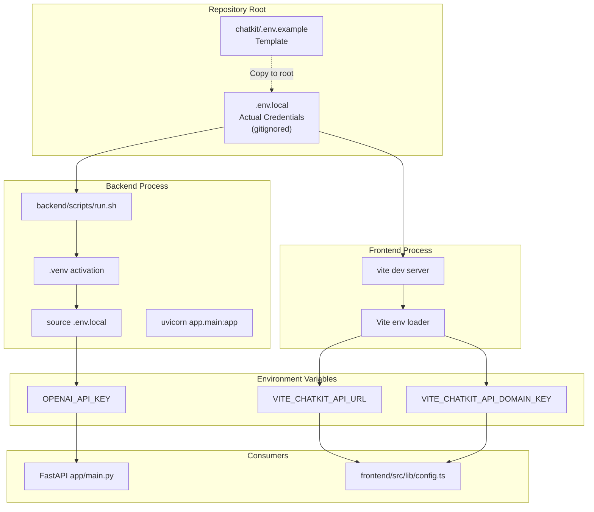
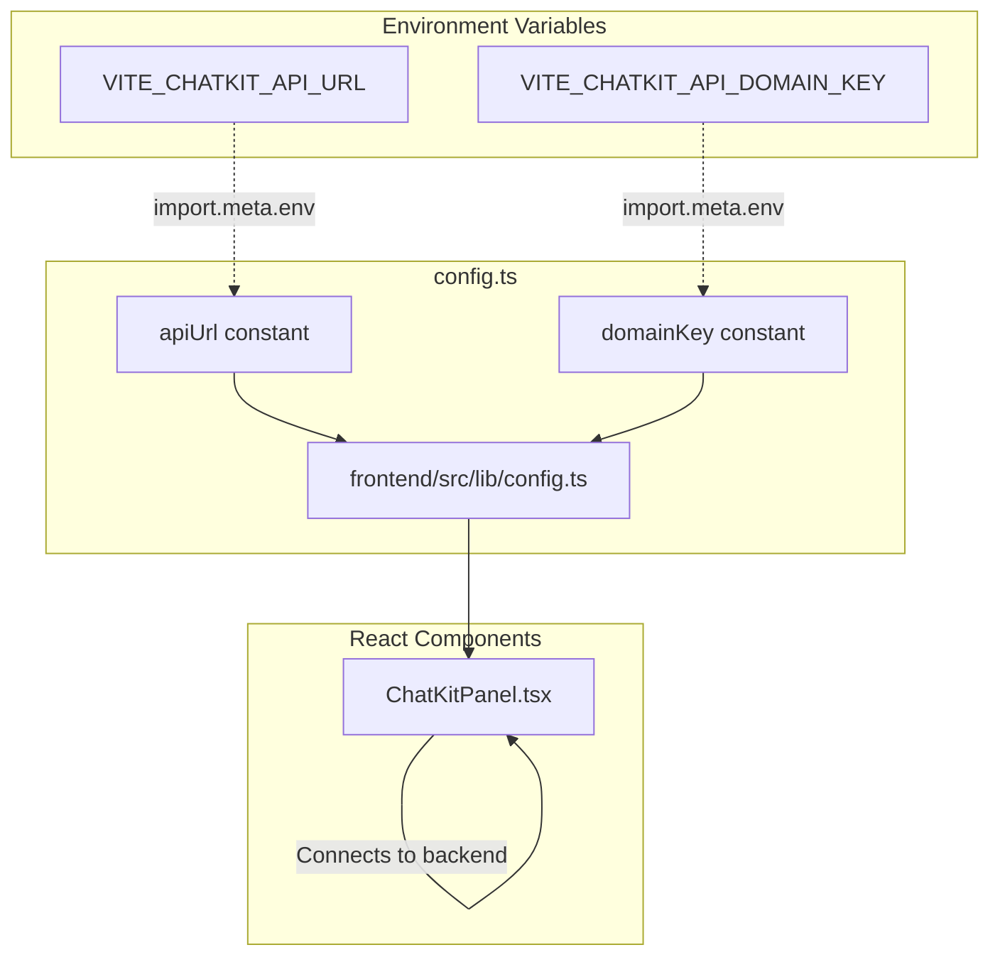
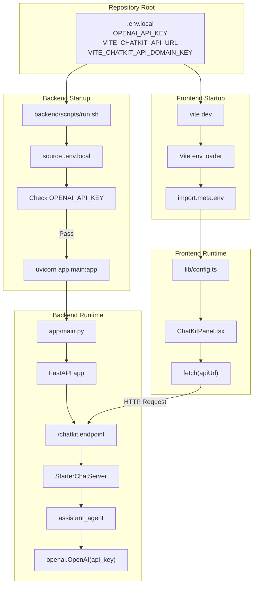
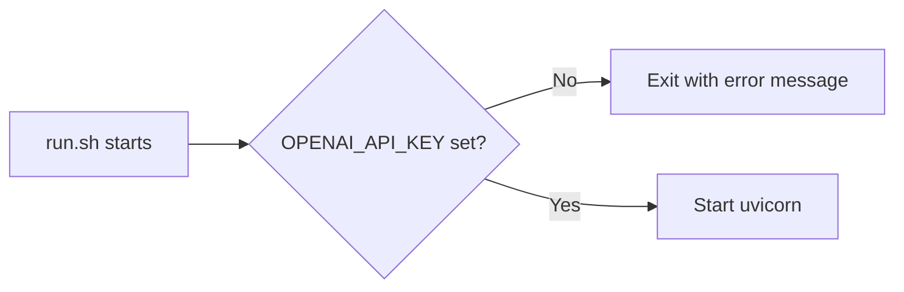

<!-- source: DeepWiki mcp.deepwiki.com · repo openai/openai-chatkit-starter-app · page 2.2 Environment Configuration · fetched 2026-10-26 -->

# Environment Configuration

<details>
<summary>Relevant source files</summary>

The following files were used as context for generating this wiki page:

- [chatkit/.env.example](chatkit/.env.example)
- [chatkit/.gitignore](chatkit/.gitignore)
- [chatkit/README.md](chatkit/README.md)
- [chatkit/backend/.gitignore](chatkit/backend/.gitignore)
- [chatkit/backend/app/__init__.py](chatkit/backend/app/__init__.py)
- [chatkit/backend/scripts/run.sh](chatkit/backend/scripts/run.sh)

</details>


This page explains the environment configuration required for both ChatKit starter applications (`chatkit/` and `managed-chatkit/`). Both applications share the same configuration approach, using environment variables stored in `.env.local` at the repository root for API credentials and connection settings.

For information about installing dependencies, see [Installation & Prerequisites](#2.1). For information about running the configured application, see [Running the Application](#2.3).

## Overview of Configuration System

Both starter applications use a unified environment variable configuration system:

1. **Environment Variables**: API credentials and connection settings stored in `.env.local` at the repository root (not version controlled)
2. **Frontend Configuration**: Optional UI customization in `frontend/src/lib/config.ts` (version controlled)

Environment variables are split by consumer:
- Backend (Python/FastAPI): `OPENAI_API_KEY`
- Frontend (Vite/React): Variables prefixed with `VITE_`

The repository root `.env.local` file is automatically loaded by both backend and frontend during development:
- Backend: Loaded by [chatkit/backend/scripts/run.sh:24-31]()
- Frontend: Automatically loaded by Vite's environment variable system

Sources: [chatkit/README.md:18-26](), [chatkit/.env.example:1-3](), [chatkit/backend/scripts/run.sh:22-31]()

## Environment Variables Setup

### Creating the Configuration File

Each starter application directory contains a `.env.example` template. To configure either application, create `.env.local` at the **repository root**:

```bash
# From repository root
cp chatkit/.env.example .env.local
```

The `.env.local` file is excluded from version control via [chatkit/.gitignore:2]() to prevent credential leakage. You must manually populate this file with your actual values.

**Environment Variable Loading Flow**



Sources: [chatkit/README.md:24-25](), [chatkit/.env.example:1-3](), [chatkit/backend/scripts/run.sh:24-31]()

### Required Environment Variables

| Variable | Consumer | Purpose | Example Format |
|----------|----------|---------|----------------|
| `OPENAI_API_KEY` | Backend (Python/FastAPI) | Authenticates with OpenAI API for chat completions | `sk-proj-...` |

#### OPENAI_API_KEY

This variable contains your OpenAI API key for accessing the OpenAI API. It is used by the FastAPI backend to authenticate chat completion requests.

**Security characteristics:**
- Never exposed to client-side code
- Required for backend to start successfully
- Validated by [chatkit/backend/scripts/run.sh:33-36]() before starting `uvicorn`

**Obtaining the key:**
1. Visit https://platform.openai.com/api-keys
2. Create a new API key
3. Copy the key starting with `sk-proj-`
4. Add to `.env.local` at repository root

**Backend loading mechanism:**

The backend startup script [chatkit/backend/scripts/run.sh:24-31]() loads environment variables from `.env.local`:

```bash
ENV_FILE="$PROJECT_ROOT/../.env.local"
if [ -z "${OPENAI_API_KEY:-}" ] && [ -f "$ENV_FILE" ]; then
  echo "Sourcing OPENAI_API_KEY from $ENV_FILE"
  set -a
  . "$ENV_FILE"
  set +a
fi
```

If `OPENAI_API_KEY` is not set, the script exits with an error message.

Sources: [chatkit/README.md:20](), [chatkit/.env.example:1](), [chatkit/backend/scripts/run.sh:24-36]()

### Optional Environment Variables

| Variable | Consumer | Default Value | Purpose |
|----------|----------|---------------|---------|
| `VITE_CHATKIT_API_URL` | Frontend (Vite/React) | `/chatkit` | Backend API endpoint URL |
| `VITE_CHATKIT_API_DOMAIN_KEY` | Frontend (Vite/React) | `domain_pk_localhost_dev` | Domain key for ChatKit authentication |

#### VITE_CHATKIT_API_URL

Specifies the URL where the frontend should send ChatKit API requests. The `VITE_` prefix makes this variable accessible to client-side Vite/React code.

**Default behavior:**
- If not set, defaults to `/chatkit` in [chatkit/frontend/src/lib/config.ts]()
- During development, Vite's proxy forwards `/chatkit` to the backend on `http://127.0.0.1:8000`
- For production deployment, set to the full backend URL (e.g., `https://api.example.com/chatkit`)

**Example configurations:**

| Environment | Value | Description |
|-------------|-------|-------------|
| Local development | `/chatkit` or omitted | Uses Vite proxy to backend |
| Production | `https://api.example.com/chatkit` | Direct backend URL |
| Custom port | `http://localhost:9000/chatkit` | Backend on non-standard port |

#### VITE_CHATKIT_API_DOMAIN_KEY

Identifies the domain for ChatKit authentication. This key is used by the ChatKit frontend library to validate requests.

**Default behavior:**
- If not set, defaults to `domain_pk_localhost_dev` in [chatkit/frontend/src/lib/config.ts]()
- The default value `domain_pk_localhost_dev` is suitable for local development only

**Production deployment:**
1. Register your production domain in the OpenAI dashboard
2. Obtain a production domain key (format: `domain_pk_...`)
3. Set `VITE_CHATKIT_API_DOMAIN_KEY` to the production key

Sources: [chatkit/README.md:21-26](), [chatkit/.env.example:2-3]()

## Frontend Configuration File

The `frontend/src/lib/config.ts` file in each starter application provides frontend configuration for connection settings and UI customization. Unlike environment variables, these files are version-controlled and represent customization points.

**Frontend Configuration Module**



Sources: [chatkit/frontend/src/lib/config.ts](), [chatkit/README.md:30-31]()

### Configuration Points

The `config.ts` file reads environment variables via Vite's `import.meta.env` object and provides default values:

| Configuration | Environment Variable | Default | Purpose |
|---------------|---------------------|---------|---------|
| `apiUrl` | `VITE_CHATKIT_API_URL` | `/chatkit` | Backend endpoint URL |
| `domainKey` | `VITE_CHATKIT_API_DOMAIN_KEY` | `domain_pk_localhost_dev` | ChatKit domain key |

**Customization points** (as documented in [chatkit/README.md:29-32]()):

1. **Connection settings**: Modify `apiUrl` and `domainKey` in [chatkit/frontend/src/lib/config.ts]()
2. **Layout structure**: Adjust UI layout in [chatkit/frontend/src/components/ChatKitPanel.tsx]()

These configuration points allow developers to customize the frontend behavior without modifying core application logic.

Sources: [chatkit/README.md:29-32](), [chatkit/frontend/src/lib/config.ts]()

## Configuration Consumption Flow

The following diagram shows how configuration values flow from `.env.local` to both backend and frontend components during application startup and runtime.

**End-to-End Configuration Flow**



Sources: [chatkit/backend/scripts/run.sh:24-39](), [chatkit/frontend/src/lib/config.ts]()

## Configuration Validation

Both starter applications perform validation at startup and runtime:

### Backend Validation

The backend startup script [chatkit/backend/scripts/run.sh:33-36]() validates `OPENAI_API_KEY` before starting the server:

```bash
if [ -z "${OPENAI_API_KEY:-}" ]; then
  echo "Set OPENAI_API_KEY in your environment or in .env.local before running this script."
  exit 1
fi
```

**Validation sequence:**



### Frontend Validation

The frontend performs minimal validation. If `VITE_CHATKIT_API_URL` or `VITE_CHATKIT_API_DOMAIN_KEY` are not set, the application uses default values from [chatkit/frontend/src/lib/config.ts]().

**Missing configuration symptoms:**

| Missing Variable | Startup Behavior | Runtime Behavior |
|-----------------|------------------|------------------|
| `OPENAI_API_KEY` | Backend script exits with error message | N/A (blocked at startup) |
| `VITE_CHATKIT_API_URL` | Uses default `/chatkit` | May fail if backend not proxied |
| `VITE_CHATKIT_API_DOMAIN_KEY` | Uses default `domain_pk_localhost_dev` | Works for local development only |

Sources: [chatkit/backend/scripts/run.sh:33-36](), [chatkit/frontend/src/lib/config.ts]()

## Configuration Reference Table

| Variable | Source | Type | Default | Required | Consumer |
|----------|--------|------|---------|----------|----------|
| `OPENAI_API_KEY` | `.env.local` | Backend | None | Yes | Python backend, OpenAI SDK |
| `VITE_CHATKIT_API_URL` | `.env.local` | Frontend | `/chatkit` | No | `frontend/src/lib/config.ts` |
| `VITE_CHATKIT_API_DOMAIN_KEY` | `.env.local` | Frontend | `domain_pk_localhost_dev` | No | `frontend/src/lib/config.ts` |

**File locations:**
- `.env.local`: Repository root (gitignored)
- `.env.example`: [chatkit/.env.example:1-3]()
- Configuration module: [chatkit/frontend/src/lib/config.ts]()
- Backend loader: [chatkit/backend/scripts/run.sh:24-31]()

Sources: [chatkit/.env.example:1-3](), [chatkit/README.md:20-26](), [chatkit/backend/scripts/run.sh:24-36]()

## Next Steps

After completing configuration:
1. Verify `.env.local` contains valid values for all required variables
2. (Optional) Customize `lib/config.ts` constants for your use case
3. Proceed to [Running the Application](#2.3) to start the development server

For information about how these configuration values are consumed by the backend API, see [Session Creation Endpoint](#7.1). For details on how the frontend uses configuration, see [ChatKitPanel Component](#6).

---

