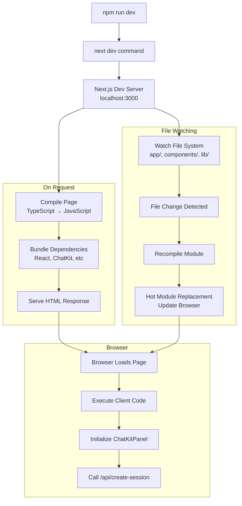
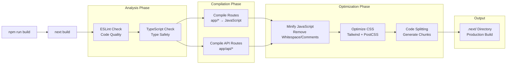
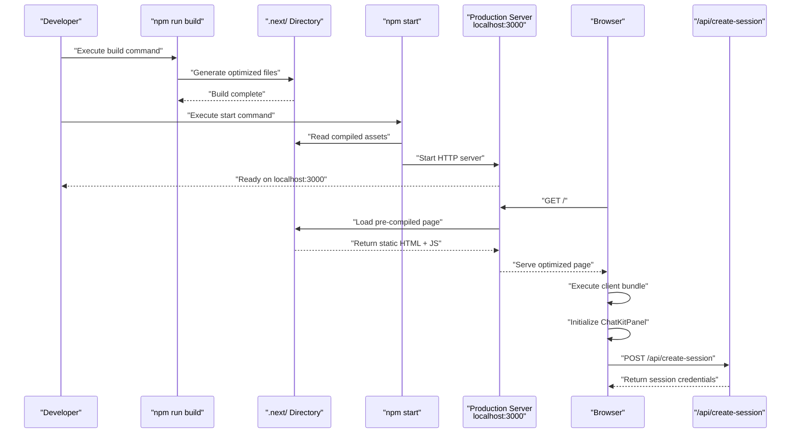
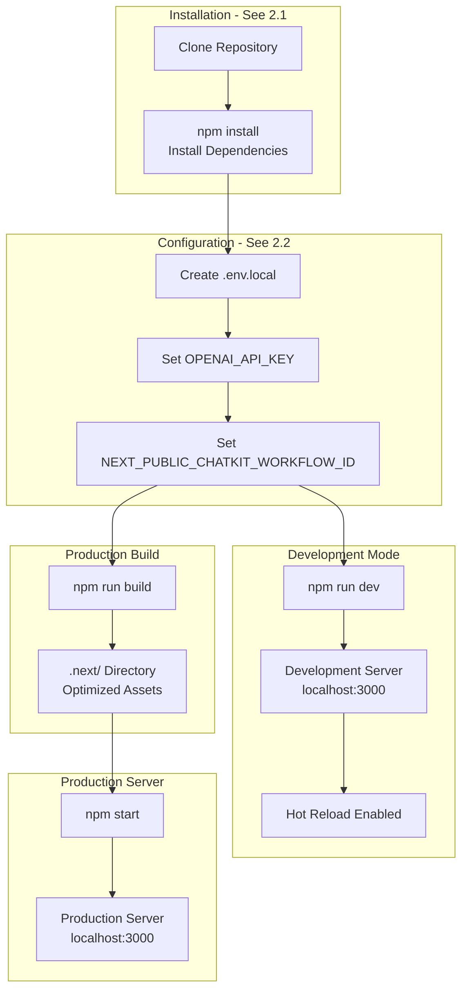

<!-- source: DeepWiki mcp.deepwiki.com · repo openai/openai-chatkit-starter-app · page 2.3 Running the Application · fetched 2026-10-26 -->

# Running the Application

<details>
<summary>Relevant source files</summary>

The following files were used as context for generating this wiki page:

- [chatkit/.env.example](chatkit/.env.example)
- [chatkit/.gitignore](chatkit/.gitignore)
- [chatkit/README.md](chatkit/README.md)
- [chatkit/backend/.gitignore](chatkit/backend/.gitignore)
- [chatkit/backend/app/__init__.py](chatkit/backend/app/__init__.py)
- [chatkit/backend/scripts/run.sh](chatkit/backend/scripts/run.sh)

</details>


This document describes the commands for running the ChatKit Starter App in development and production modes. It covers the npm scripts defined in `package.json`, their underlying Next.js commands, and the expected behavior of each execution mode. For installation instructions, see [Installation](#2.1). For environment configuration, see [Configuration](#2.2).

## Command Overview

The application provides three primary npm scripts for running the application in different modes:

| Command | Script Definition | Purpose | Mode |
|---------|------------------|---------|------|
| `npm run dev` | `next dev` | Start development server with hot reload | Development |
| `npm run build` | `next build` | Create optimized production build | Build |
| `npm start` | `next start` | Serve production build | Production |

Sources: [package.json:5-9]()

## Development Mode

### Starting the Development Server

The development server is started using:

```bash
npm run dev
```

This executes the `next dev` command [package.json:6](), which starts the Next.js development server with the following characteristics:

**Server Behavior:**
- Listens on `http://localhost:3000` by default
- Enables Fast Refresh for instant feedback on code changes
- Compiles pages on-demand as they are requested
- Provides detailed error overlays in the browser for compilation and runtime errors
- Automatically recompiles when files in `app/`, `components/`, `hooks/`, or `lib/` are modified

**What Gets Loaded:**
1. **RootLayout** [app/layout.tsx]() - Loads the ChatKit script from OpenAI's CDN
2. **Home Page** [app/page.tsx]() - Renders the main App component
3. **App Component** [app/App.tsx]() - Initializes theme management and ChatKitPanel
4. **API Routes** [app/api/create-session/route.ts]() - Backend endpoint for session creation

**Development-Specific Features:**
- Source maps enabled for debugging
- Verbose error messages and stack traces
- TypeScript type checking runs alongside compilation
- ESLint warnings displayed in terminal and browser

### Development Server Flow



Sources: [package.json:6](), [README.md:39-43]()

### Expected Development Output

When the development server starts successfully, you will see output similar to:

```
  ▲ Next.js 15.5.4
  - Local:        http://localhost:3000
  - Ready in 1.2s
```

The terminal will display compilation logs as you navigate the application and modify files. Each page request triggers on-demand compilation of that route.

Sources: [package.json:6](), [README.md:42]()

## Production Build

### Creating an Optimized Build

The production build is created using:

```bash
npm run build
```

This executes the `next build` command [package.json:7](), which performs a full static analysis and optimization of the application.

**Build Process Steps:**

1. **Linting** - Runs ESLint checks on all TypeScript/JavaScript files
2. **Type Checking** - Validates TypeScript types across the entire codebase
3. **Compilation** - Compiles all pages and API routes ahead of time
4. **Optimization** - Minifies JavaScript, optimizes CSS, generates static assets
5. **Code Splitting** - Separates code into optimized chunks for efficient loading
6. **Static Generation** - Pre-renders static pages where possible

**Build Outputs:**

The build process generates the `.next/` directory containing:

```
.next/
├── cache/              # Build cache for incremental builds
├── server/             # Server-side code and API routes
│   ├── app/           # Compiled app routes
│   └── chunks/        # Server-side code chunks
├── static/            # Static assets with content hashes
│   ├── chunks/        # JavaScript bundles
│   └── css/           # Optimized CSS files
└── BUILD_ID           # Unique identifier for this build
```

### Production Build Pipeline



Sources: [package.json:7](), [README.md:47-50]()

**Build Configuration:**

The build process is configured by:
- **next.config.ts** [next.config.ts:3-10]() - Webpack customizations and module resolution
- **tsconfig.json** - TypeScript compiler options and path aliases
- **postcss.config.mjs** - CSS processing pipeline with Tailwind
- **package.json** - Dependencies that influence build output

Sources: [next.config.ts:1-13]()

### Build Verification

After a successful build, the output displays:

```
Route (app)                              Size     First Load JS
┌ ○ /                                    5.2 kB          95 kB
└ ○ /api/create-session                  0 B             0 B

○  (Static)  prerendered as static content
```

This summary shows:
- **Route** - Each application route
- **Size** - Route-specific JavaScript size
- **First Load JS** - Total JavaScript loaded on first visit (includes shared chunks)
- **○** - Static indicator (pre-rendered at build time)

Sources: [package.json:7](), [README.md:47-50]()

## Production Server

### Starting the Production Server

After building, start the production server using:

```bash
npm start
```

This executes the `next start` command [package.json:8](), which serves the optimized production build created by `npm run build`.

**Production Server Characteristics:**

- Serves pre-compiled, optimized code from `.next/` directory
- No hot reload or file watching
- Minimal runtime overhead
- Suitable for deployment to production environments
- Requires a successful `npm run build` to have run first

**Production vs. Development:**

| Feature | Development (`npm run dev`) | Production (`npm start`) |
|---------|---------------------------|------------------------|
| Compilation | On-demand, per request | Pre-compiled during build |
| Speed | Slower first load, fast subsequent | Fast first load |
| Error Messages | Detailed stack traces | Minimized, user-friendly |
| Source Maps | Enabled | Disabled by default |
| File Watching | Yes, with hot reload | No |
| Build Required | No | Yes (`npm run build`) |

Sources: [package.json:8](), [README.md:49-50]()

### Production Execution Flow



Sources: [package.json:7-8](), [README.md:47-50]()

## Complete Application Lifecycle

### From Development to Production



Sources: [package.json:5-9](), [README.md:11-50]()

## Common Usage Patterns

### Local Development Workflow

1. **Initial Setup** (once):
   ```bash
   npm install
   cp .env.example .env.local
   # Edit .env.local with your credentials
   ```

2. **Daily Development**:
   ```bash
   npm run dev
   # Visit http://localhost:3000
   # Edit code, changes reflect immediately
   ```

3. **Pre-deployment Testing**:
   ```bash
   npm run build  # Verify production build succeeds
   npm start      # Test production server locally
   ```

Sources: [README.md:15-50](), [package.json:5-9]()

### Port Configuration

By default, all commands serve on port 3000. To use a different port:

```bash
# Development
PORT=3001 npm run dev

# Production
PORT=3001 npm start
```

Sources: [README.md:42]()

## Error Scenarios

### Build Failures

If `npm run build` fails, common causes include:

1. **TypeScript Errors** - Type checking failures in `.tsx` or `.ts` files
2. **ESLint Violations** - Code quality issues flagged by linting rules
3. **Missing Environment Variables** - Required NEXT_PUBLIC_* variables not set during build
4. **Dependency Issues** - Incompatible or missing packages in `node_modules/`

**Resolution**: Check the build output for specific error messages and file locations.

### Production Server Failures

If `npm start` fails with "Could not find a production build":

**Cause**: The `.next/` directory does not exist or is incomplete.

**Resolution**: Run `npm run build` before `npm start`.

Sources: [package.json:7-8]()

## Next.js Command Reference

Each npm script maps directly to a Next.js CLI command:

| npm Script | Next.js Command | Configuration File |
|-----------|----------------|-------------------|
| `npm run dev` | `next dev` | next.config.ts |
| `npm run build` | `next build` | next.config.ts |
| `npm start` | `next start` | next.config.ts |
| `npm run lint` | `eslint` | eslint.config.mjs |

The `next` CLI reads configuration from [next.config.ts:1-13](), which customizes webpack behavior and module resolution.

Sources: [package.json:5-10](), [next.config.ts:1-13]()

---

