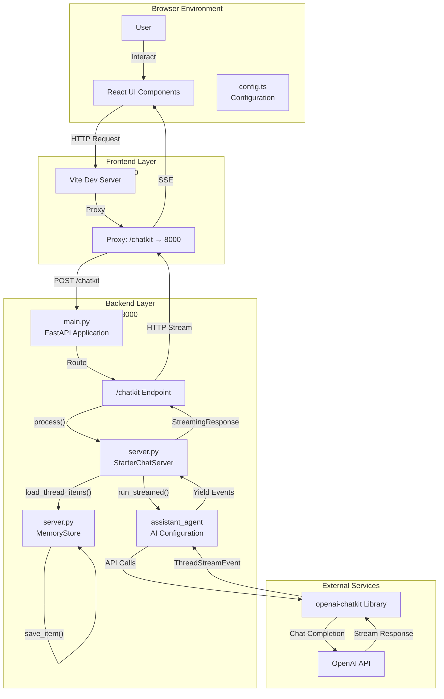
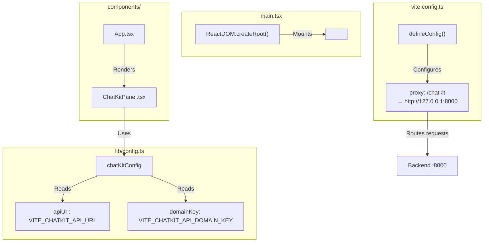
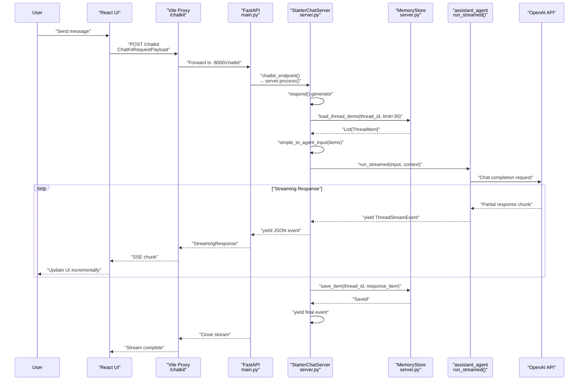

<!-- source: DeepWiki mcp.deepwiki.com · repo openai/openai-chatkit-starter-app · page 3 Self-Hosted ChatKit (chatkit/) · fetched 2026-10-26 -->

# Self-Hosted ChatKit (chatkit/)

<details>
<summary>Relevant source files</summary>

The following files were used as context for generating this wiki page:

- [README.md](README.md)
- [chatkit/.env.example](chatkit/.env.example)
- [chatkit/.gitignore](chatkit/.gitignore)
- [chatkit/README.md](chatkit/README.md)
- [chatkit/backend/.gitignore](chatkit/backend/.gitignore)
- [chatkit/backend/app/__init__.py](chatkit/backend/app/__init__.py)

</details>


This document covers the self-hosted ChatKit starter application, a reference implementation demonstrating how to build a conversational AI interface with full control over infrastructure and backend logic. The self-hosted approach requires developers to manage their own backend server, storage, and AI agent configuration.

For information about the managed integration pattern that uses hosted workflows, see [Managed ChatKit (managed-chatkit/)](#4).

**Sources:** [README.md:1-9](), [chatkit/README.md:1-33]()

---

## Purpose and Scope

The `chatkit/` directory contains a complete starter application consisting of:

- A **FastAPI backend** (`backend/`) that processes chat requests and orchestrates OpenAI API interactions
- A **Vite + React frontend** (`frontend/`) that provides the user interface
- An **in-memory storage system** for conversation history
- Integration with the `openai-chatkit` Python library for AI agent capabilities

This implementation is designed for developers who want full control over their ChatKit deployment, including the ability to customize business logic, storage mechanisms, and deployment infrastructure. The application demonstrates core concepts like streaming responses, conversation history management, and agent configuration.

**Sources:** [chatkit/README.md:1-4]()

---

## Architecture Overview

The self-hosted ChatKit application follows a client-server architecture with clear separation between the presentation layer (React frontend) and business logic layer (FastAPI backend).

### High-Level Architecture



**Sources:** [chatkit/README.md:13-16]()

---

## Directory Structure

The `chatkit/` directory is organized into distinct backend and frontend subsystems:

| Path | Description |
|------|-------------|
| `backend/` | FastAPI application and Python business logic |
| `backend/app/` | Python package containing application code |
| `backend/app/main.py` | FastAPI entrypoint and `/chatkit` endpoint |
| `backend/app/server.py` | `StarterChatServer` and `MemoryStore` implementations |
| `backend/pyproject.toml` | Python dependencies and tooling configuration |
| `frontend/` | Vite + React application |
| `frontend/src/` | React source code |
| `frontend/src/lib/config.ts` | ChatKit connection configuration |
| `frontend/src/components/ChatKitPanel.tsx` | Main UI component |
| `frontend/package.json` | Node.js dependencies and scripts |
| `frontend/vite.config.ts` | Vite build configuration with proxy setup |
| `package.json` | Root-level scripts for concurrent dev server execution |
| `.env.example` | Example environment variable configuration |

**Sources:** [chatkit/README.md:1-33](), [chatkit/.gitignore:1-4](), [chatkit/backend/.gitignore:1-9]()

---

## Backend Implementation

The backend is a FastAPI application that serves as the orchestration layer between the frontend and OpenAI's API. It manages conversation state, processes requests, and streams responses back to the client.

### Component Architecture

```mermaid
graph TB
    subgraph FastAPI["main.py - FastAPI Application"]
        App["app = FastAPI()"]
        CORSMiddleware["CORSMiddleware<br/>allow_origins=['*']"]
        ChatEndpoint["@app.post('/chatkit')<br/>def chatkit_endpoint()"]
    end
    
    subgraph Server["server.py - StarterChatServer"]
        ServerClass["class StarterChatServer"]
        ProcessMethod["def process()<br/>→ StreamingResponse"]
        RespondMethod["def respond()<br/>→ Generator"]
        Store["self.store: Store"]
        Agent["self.assistant_agent"]
    end
    
    subgraph Storage["server.py - MemoryStore"]
        MemoryClass["class MemoryStore"]
        ThreadsDict["threads: Dict[str, List]"]
        MetaDict["thread_metadata: Dict[str, ThreadMetadata]"]
        LoadMethod["def load_thread_items()<br/>→ List[ThreadItem]"]
        SaveMethod["def save_item()"]
        ListMethod["def list_thread_metadata()<br/>→ List[ThreadMetadata]"]
    end
    
    subgraph Agent["Agent Configuration"]
        AssistantAgent["assistant_agent = Agent()"]
        Instructions["instructions: str"]
        Model["model: 'gpt-4o-mini'"]
        Context["context: Dict"]
    end
    
    ChatEndpoint -->|"Instantiate"| ServerClass
    ProcessMethod -->|"Calls"| RespondMethod
    RespondMethod -->|"load_thread_items()"| LoadMethod
    RespondMethod -->|"save_item()"| SaveMethod
    RespondMethod -->|"run_streamed()"| AssistantAgent
    ServerClass -->|"Has"| Store
    ServerClass -->|"Has"| Agent
    MemoryClass -->|"Stores"| ThreadsDict
    MemoryClass -->|"Stores"| MetaDict
```



**Sources:** [chatkit/README.md:13-16](), [chatkit/backend/app/__init__.py:1-2]()

### FastAPI Entrypoint

The `main.py` file defines the FastAPI application and configures the `/chatkit` endpoint:

- **Application Setup**: Creates a FastAPI instance with CORS middleware configured to allow all origins
- **Single Endpoint**: Exposes `POST /chatkit` which accepts ChatKit request payloads
- **Server Instantiation**: Creates a `StarterChatServer` instance for each request
- **Streaming Response**: Returns a `StreamingResponse` that yields server-sent events

The endpoint signature follows the pattern: `chatkit_endpoint(payload: ChatKitRequestPayload, context: Annotated[..., Depends(auth_context)])`.

**Sources:** [chatkit/README.md:3-4](), [chatkit/README.md:15-16]()

### StarterChatServer

The `StarterChatServer` class (defined in `backend/app/server.py`) orchestrates the conversation flow:

**Key Methods:**
- `process(payload, context)` - Main entry point that validates requests and returns a streaming response
- `respond(payload, context)` - Generator function that:
  1. Loads conversation history using `store.load_thread_items(thread_id, limit=30)`
  2. Converts items to agent input format using `simple_to_agent_input()`
  3. Executes the AI agent with `assistant_agent.run_streamed(input, context)`
  4. Yields `ThreadStreamEvent` objects as JSON strings
  5. Saves the final response using `store.save_item()`

**Agent Configuration:**
The server initializes an `assistant_agent` with:
- Model: `"gpt-4o-mini"`
- Instructions: Default assistant behavior
- Streaming enabled for real-time responses

**Sources:** [chatkit/README.md:32]()

### MemoryStore

The `MemoryStore` class provides in-memory conversation storage with the following data structures:

**Internal State:**
```python
threads: Dict[str, List[ThreadItem]]  # thread_id → list of conversation items
thread_metadata: Dict[str, ThreadMetadata]  # thread_id → metadata
```

**Core Methods:**

| Method | Purpose | Parameters |
|--------|---------|------------|
| `load_thread_items()` | Retrieve conversation history | `thread_id`, `limit` (default: 30), `order` |
| `save_item()` | Persist a single conversation item | `thread_id`, `item: ThreadItem` |
| `list_thread_metadata()` | Get metadata for all threads | `order`, `limit`, `offset` |

**Pagination Logic:**
The store implements limit-based pagination. When `load_thread_items()` is called with `limit=30`, it returns the 30 most recent items in the specified order (ascending or descending).

**Production Note:**
The in-memory implementation is not suitable for production. Replace with a persistent database (PostgreSQL, MongoDB, etc.) by implementing the same interface.

**Sources:** [chatkit/README.md:32]()

---

## Frontend Implementation

The frontend is a single-page application built with Vite, React, and TypeScript that provides the user interface for the ChatKit conversation experience.

### Frontend Architecture



**Sources:** [chatkit/README.md:15-16](), [chatkit/README.md:30-31]()

### Configuration

The `frontend/src/lib/config.ts` file exports the `chatKitConfig` object that controls ChatKit connection settings:

**Environment Variables:**
- `VITE_CHATKIT_API_URL` - Backend API endpoint (defaults to `/chatkit`)
- `VITE_CHATKIT_API_DOMAIN_KEY` - Domain authentication key (defaults to `domain_pk_localhost_dev`)

**Development vs Production:**
In development, the Vite proxy routes `/chatkit` requests to `http://127.0.0.1:8000`. In production, set `VITE_CHATKIT_API_URL` to the full backend URL and `VITE_CHATKIT_API_DOMAIN_KEY` to a registered production domain key from the OpenAI dashboard.

**Sources:** [chatkit/README.md:18-26](), [chatkit/README.md:30](), [chatkit/.env.example:1-3]()

### UI Components

The primary UI component is `ChatKitPanel.tsx`, which provides the layout structure for the chat interface. This component can be customized to adjust:
- Layout dimensions and positioning
- Visual styling and theming
- Additional UI elements or controls

The component integrates with the ChatKit SDK using the configuration from `config.ts`.

**Sources:** [chatkit/README.md:31]()

---

## Request Flow and Data Model

The following diagram traces a complete request through the system, from user interaction to OpenAI response, showing the actual methods and data structures involved.

### Complete Request Sequence



**Sources:** [chatkit/README.md:13-16]()

### Data Structures

**ChatKitRequestPayload:**
- Contains the user's message, thread context, and request metadata
- Passed from frontend to backend via the `/chatkit` endpoint

**ThreadItem:**
- Represents a single message in the conversation history
- Stored in `MemoryStore.threads` dictionary
- Includes content, role, timestamp, and metadata

**ThreadStreamEvent:**
- Event object yielded during streaming responses
- Contains partial or complete response data
- Serialized to JSON and sent via Server-Sent Events (SSE)

**ThreadMetadata:**
- Stored in `MemoryStore.thread_metadata` dictionary
- Contains thread-level information (creation time, last updated, etc.)

**Sources:** [chatkit/README.md:32]()

---

## Environment Configuration

The application requires specific environment variables to function correctly:

### Required Variables

| Variable | Location | Purpose | Default |
|----------|----------|---------|---------|
| `OPENAI_API_KEY` | Backend | Authenticate with OpenAI API | None (required) |
| `VITE_CHATKIT_API_URL` | Frontend | Backend endpoint URL | `/chatkit` |
| `VITE_CHATKIT_API_DOMAIN_KEY` | Frontend | Domain authentication key | `domain_pk_localhost_dev` |

### Configuration Files

Create a `.env.local` file at the repository root (or in the `chatkit/` directory) with the following format:

```
OPENAI_API_KEY=sk-proj-...
VITE_CHATKIT_API_URL=/chatkit
VITE_CHATKIT_API_DOMAIN_KEY=domain_pk_localhost_dev
```

**Development vs Production:**
- **Development:** Use default values with the Vite proxy handling `/chatkit` routing
- **Production:** Set `VITE_CHATKIT_API_URL` to the full backend URL (e.g., `https://api.example.com/chatkit`) and register a production domain key in the OpenAI dashboard

**Sources:** [chatkit/README.md:18-26](), [chatkit/.env.example:1-3]()

---

## Running the Application

The starter provides a streamlined development workflow using npm scripts:

```bash
npm install    # Install dependencies for both frontend and backend
npm run dev    # Start both servers concurrently
```

### What `npm run dev` Does

1. **Backend Server:** Starts `uvicorn` on `http://127.0.0.1:8000`
   - Serves the FastAPI application from `backend/app/main.py`
   - Exposes the `/chatkit` endpoint
   
2. **Frontend Server:** Starts Vite dev server on `http://127.0.0.1:3000`
   - Serves the React application
   - Configures proxy to forward `/chatkit` requests to port 8000

3. **Access:** Navigate to `http://127.0.0.1:3000` in your browser

The concurrent execution is managed by the root-level `package.json` which coordinates both backend and frontend processes.

**Sources:** [chatkit/README.md:8-16]()

---

## Key Features

### Streaming Responses

The application implements real-time streaming using Server-Sent Events (SSE):

- The `assistant_agent.run_streamed()` method yields partial responses as they're generated
- Each chunk is wrapped in a `ThreadStreamEvent` and sent immediately to the client
- The React frontend updates the UI incrementally as chunks arrive
- This provides a responsive user experience without waiting for complete responses

### Conversation History

The system maintains conversation context by:

1. Loading the 30 most recent messages via `store.load_thread_items(thread_id, limit=30)`
2. Converting them to agent input format with `simple_to_agent_input()`
3. Including this context in the OpenAI API request
4. Persisting new responses with `store.save_item()`

This ensures the AI agent has sufficient context to provide relevant, coherent responses.

### Agent Configuration

The `assistant_agent` is configured with:
- **Model:** `gpt-4o-mini` - A cost-effective, fast model suitable for most chat applications
- **Instructions:** Defines the agent's behavior and personality
- **Context:** Runtime context passed with each request for dynamic behavior

**Sources:** [chatkit/README.md:13-16](), [chatkit/README.md:32]()

---

## Customization Points

The starter application is designed to be customized for specific use cases:

### 1. Persistent Storage

**Location:** [backend/app/server.py]()

The `MemoryStore` implementation is suitable only for development and testing. For production deployments:

1. Create a new class implementing the same interface as `MemoryStore`
2. Add persistence using PostgreSQL, MongoDB, Redis, or another database
3. Implement the required methods: `load_thread_items()`, `save_item()`, `list_thread_metadata()`
4. Replace the `MemoryStore` instantiation in `StarterChatServer`

**Example:**
```python
# Replace:
store = MemoryStore()

# With:
store = PostgresStore(connection_string=os.environ["DATABASE_URL"])
```

### 2. UI Configuration

**Location:** [frontend/src/lib/config.ts]()

Modify the `chatKitConfig` object to change:
- API endpoint URLs
- Domain keys
- Authentication settings
- ChatKit SDK options

### 3. Layout Structure

**Location:** [frontend/src/components/ChatKitPanel.tsx]()

Customize the UI layout by modifying:
- Component structure and hierarchy
- Styling and theming
- Additional UI controls or features
- Integration with other components

### 4. Agent Behavior

**Location:** [backend/app/server.py]()

Modify the `assistant_agent` configuration to change:
- Model selection (e.g., `gpt-4`, `gpt-4-turbo`)
- System instructions and personality
- Temperature and other sampling parameters
- Context preparation logic

### 5. CORS Configuration

**Location:** [backend/app/main.py]()

The default CORS middleware allows all origins (`allow_origins=["*"]`). For production, restrict this to specific domains:

```python
app.add_middleware(
    CORSMiddleware,
    allow_origins=["https://yourdomain.com"],
    allow_credentials=True,
    allow_methods=["*"],
    allow_headers=["*"],
)
```

**Sources:** [chatkit/README.md:29-32]()

---

## Development Tools

The backend includes development tooling for code quality:

### Python Tooling

- **ruff:** Fast Python linter and formatter
  - Configuration in [backend/pyproject.toml]()
  - Run via CI/CD pipeline
  
- **mypy:** Static type checker
  - Ensures type safety across the codebase
  - Configuration in [backend/pyproject.toml]()

### Ignored Files

The `.gitignore` files exclude:
- Python bytecode (`__pycache__/`, `*.pyc`)
- Virtual environments (`.venv/`)
- Environment files (`.env`)
- Build artifacts and caches

**Sources:** [chatkit/backend/.gitignore:1-9](), [chatkit/.gitignore:1-4]()

---

## Integration with External Services

### OpenAI API

The backend communicates with OpenAI's API through the `openai-chatkit` library:

1. **Authentication:** Uses `OPENAI_API_KEY` from environment variables
2. **Chat Completion:** Sends conversation context and receives streaming responses
3. **Model:** Defaults to `gpt-4o-mini` but can be configured to any OpenAI model

### ChatKit Library

The `openai-chatkit` Python package provides:
- Agent abstraction for managing AI conversations
- Streaming utilities for real-time responses
- Thread management and event handling
- Integration with OpenAI's chat completion API

**Sources:** [chatkit/README.md:3-4](), [chatkit/.env.example:1-3]()

---

## Summary

The self-hosted ChatKit starter application provides a complete, production-ready foundation for building conversational AI applications with full control over infrastructure:

**Key Components:**
- FastAPI backend with streaming support
- React frontend with Vite build tooling
- In-memory storage (replaceable with persistent storage)
- OpenAI API integration via `openai-chatkit` library

**Ideal For:**
- Developers who need full control over backend logic
- Applications requiring custom storage or business logic
- Deployments where infrastructure management is acceptable
- Use cases with specific security or compliance requirements

For a simpler deployment model with reduced operational overhead, consider the managed ChatKit integration documented in [Managed ChatKit (managed-chatkit/)](#4).

**Sources:** [README.md:1-9](), [chatkit/README.md:1-33]()

---

