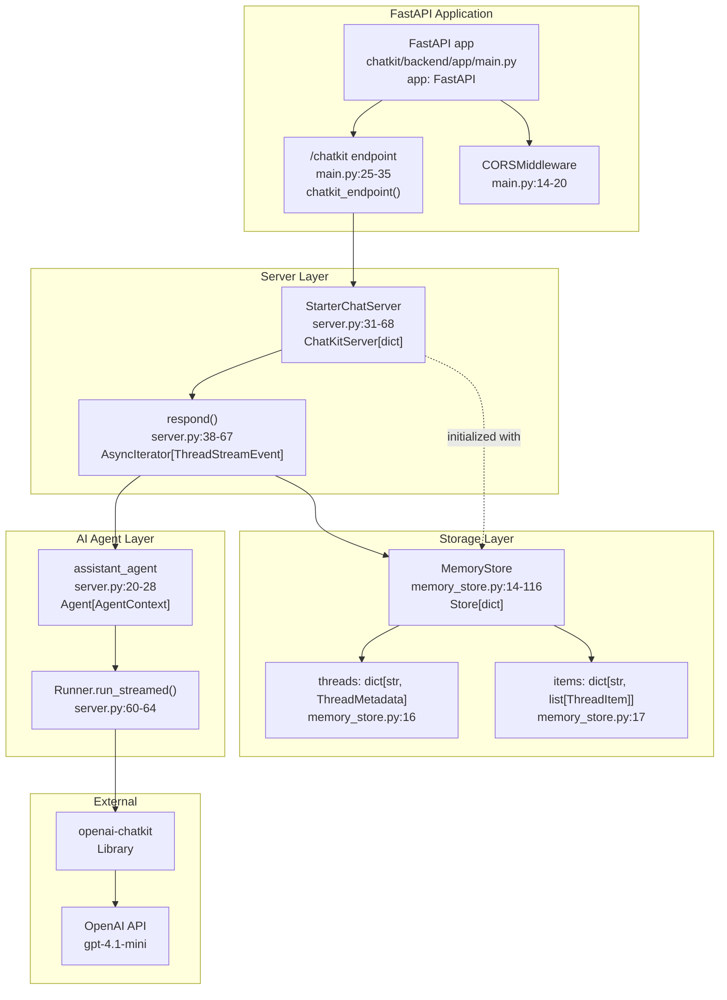
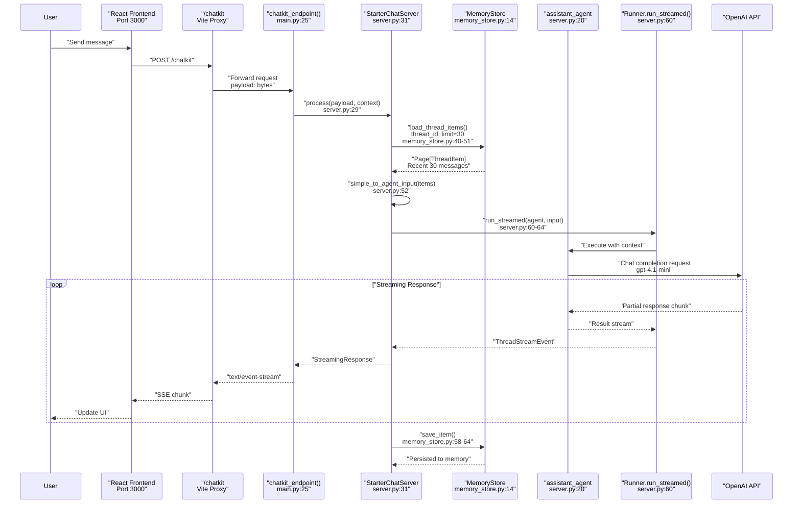

<!-- source: DeepWiki mcp.deepwiki.com · repo openai/openai-chatkit-starter-app · page 3.1 Architecture Overview · fetched 2026-10-26 -->

# Architecture Overview

Relevant source files

The following files were used as context for generating this wiki page:

- [chatkit/backend/app/main.py](chatkit/backend/app/main.py)
- [chatkit/backend/app/memory_store.py](chatkit/backend/app/memory_store.py)
- [chatkit/backend/app/server.py](chatkit/backend/app/server.py)

## Purpose and Scope

This document provides a high-level architectural overview of the self-hosted ChatKit starter application located in the `chatkit/` directory. It describes the core components, their relationships, and the flow of requests through the system.

The self-hosted architecture consists of two independent applications that communicate over HTTP:
- **Backend**: FastAPI application serving the `/chatkit` endpoint (port 8000)
- **Frontend**: Vite + React application providing the user interface (port 3000)

For detailed information about specific components:
- FastAPI entrypoint and endpoint configuration: see page 3.2.1
- StarterChatServer implementation: see page 3.2.2
- MemoryStore data persistence: see page 3.2.3
- AI agent configuration: see page 3.2.4
- Frontend implementation: see page 3.3
- Complete request flow and data model: see page 3.4

## Technology Stack

The self-hosted ChatKit implementation uses the following core technologies:

| Layer | Technology | Purpose |
|-------|-----------|---------|
| **Backend Framework** | FastAPI 0.114-0.116 | High-performance async web framework |
| **Backend Server** | Uvicorn | ASGI server for running FastAPI |
| **Backend Language** | Python 3.11+ | Primary backend language |
| **ChatKit Library** | openai-chatkit 1.4.0-2.0 | OpenAI's ChatKit server SDK |
| **OpenAI SDK** | openai ≥1.40 | OpenAI API client library |
| **Frontend Framework** | React | UI component framework |
| **Frontend Build Tool** | Vite | Fast development and build tooling |
| **Frontend Language** | TypeScript | Type-safe JavaScript |
| **Data Storage** | In-Memory (MemoryStore) | Development/demo storage implementation |

**Sources:** [chatkit/backend/app/main.py:1-36](), [chatkit/backend/app/server.py:1-68](), [chatkit/backend/app/memory_store.py:1-116]()

## Component Architecture

### Backend Components

**Backend Component Details:**

| Component | File Location | Responsibility |
|-----------|--------------|----------------|
| `FastAPI app` | [chatkit/backend/app/main.py:12]() | Application entrypoint, middleware configuration |
| `chatkit_endpoint()` | [chatkit/backend/app/main.py:25-35]() | HTTP handler for `/chatkit` POST requests |
| `StarterChatServer` | [chatkit/backend/app/server.py:31-68]() | Orchestrates chat responses, inherits from `ChatKitServer[dict]` |
| `MemoryStore` | [chatkit/backend/app/memory_store.py:14-116]() | In-memory data persistence, implements `Store[dict]` interface |
| `assistant_agent` | [chatkit/backend/app/server.py:20-28]() | AI agent configuration with model and instructions |

**Sources:** [chatkit/backend/app/main.py:1-36](), [chatkit/backend/app/server.py:1-68](), [chatkit/backend/app/memory_store.py:1-116]()

### Frontend Components

The frontend is a Vite + React application that communicates with the backend via the `/chatkit` endpoint. Key configuration points include:

| Configuration | Location | Purpose |
|--------------|----------|---------|
| `config.ts` | `chatkit/frontend/src/lib/config.ts` | Connection settings and API URL |
| `ChatKitPanel.tsx` | `chatkit/frontend/src/components/ChatKitPanel.tsx` | Main chat UI component |

The frontend proxies all ChatKit requests to `http://localhost:8000/chatkit` during development. See page 3.3 for detailed frontend architecture.

**Sources:** Based on high-level system architecture diagrams

## Request Flow

### Complete Request Lifecycle

**Request Flow Details:**

1. **Request Initiation** - User sends a message through the React frontend, which is proxied to the FastAPI backend at `http://localhost:8000/chatkit`

2. **Endpoint Processing** [chatkit/backend/app/main.py:25-35]() - The `chatkit_endpoint()` function:
   - Receives the raw request payload
   - Calls `chatkit_server.process(payload, {"request": request})`
   - Returns either a `StreamingResponse` or `JSONResponse`

3. **Server Orchestration** [chatkit/backend/app/server.py:38-67]() - The `respond()` method:
   - Loads the most recent 30 thread items using `load_thread_items(limit=MAX_RECENT_ITEMS)` [chatkit/backend/app/server.py:44-50]()
   - Reverses the items to chronological order [chatkit/backend/app/server.py:51]()
   - Converts items to agent-compatible format [chatkit/backend/app/server.py:52]()
   - Prepares `AgentContext` with thread, store, and request context [chatkit/backend/app/server.py:54-58]()

4. **AI Generation** [chatkit/backend/app/server.py:60-64]() - The system:
   - Executes `Runner.run_streamed()` with the `assistant_agent`
   - Streams results through `stream_agent_response()`
   - Yields `ThreadStreamEvent` objects back to the client

5. **Response Streaming** - Events stream back through the call stack as Server-Sent Events (SSE), updating the UI in real-time

**Sources:** [chatkit/backend/app/main.py:25-35](), [chatkit/backend/app/server.py:38-67](), [chatkit/backend/app/memory_store.py:40-51]()

## Data Storage Architecture

### MemoryStore Implementation

```mermaid
graph TB
    subgraph "MemoryStore Class"
        CLASS["MemoryStore<br/>memory_store.py:14<br/>Store[dict]"]
        THREADS_DICT["threads: dict[str, ThreadMetadata]<br/>memory_store.py:16"]
        ITEMS_DICT["items: dict[str, list[ThreadItem]]<br/>memory_store.py:17<br/>defaultdict(list)"]
    end
    
    subgraph "Thread Operations"
        LOAD_THREAD["load_thread()<br/>memory_store.py:19-22"]
        SAVE_THREAD["save_thread()<br/>memory_store.py:24-25"]
        DELETE_THREAD["delete_thread()<br/>memory_store.py:74-76"]
        LOAD_THREADS["load_threads()<br/>memory_store.py:27-38<br/>Returns Page[ThreadMetadata]"]
    end
    
    subgraph "Item Operations"
        LOAD_ITEMS["load_thread_items()<br/>memory_store.py:40-51<br/>Returns Page[ThreadItem]"]
        ADD_ITEM["add_thread_item()<br/>memory_store.py:53-56"]
        SAVE_ITEM["save_item()<br/>memory_store.py:58-64"]
        LOAD_ITEM["load_item()<br/>memory_store.py:66-72"]
        DELETE_ITEM["delete_thread_item()<br/>memory_store.py:78-83"]
    end
    
    subgraph "Pagination"
        PAGINATE["_paginate()<br/>memory_store.py:85-104<br/>Handles sorting & cursors"]
    end
    
    CLASS --> THREADS_DICT
    CLASS --> ITEMS_DICT
    
    LOAD_THREAD --> THREADS_DICT
    SAVE_THREAD --> THREADS_DICT
    DELETE_THREAD --> THREADS_DICT
    DELETE_THREAD --> ITEMS_DICT
    LOAD_THREADS --> THREADS_DICT
    LOAD_THREADS --> PAGINATE
    
    LOAD_ITEMS --> ITEMS_DICT
    LOAD_ITEMS --> PAGINATE
    ADD_ITEM --> ITEMS_DICT
    SAVE_ITEM --> ITEMS_DICT
    LOAD_ITEM --> ITEMS_DICT
    DELETE_ITEM --> ITEMS_DICT
```

**Storage Structure:**

The `MemoryStore` class [chatkit/backend/app/memory_store.py:14-116]() provides in-memory data persistence using two primary dictionaries:

| Data Structure | Type | Purpose |
|---------------|------|---------|
| `threads` | `dict[str, ThreadMetadata]` | Stores thread metadata indexed by thread ID |
| `items` | `dict[str, list[ThreadItem]]` | Stores message items for each thread, using `defaultdict(list)` |

**Key Operations:**

- **Thread Management** - `load_thread()`, `save_thread()`, `delete_thread()` operations for thread metadata
- **Item Management** - `load_thread_items()`, `add_thread_item()`, `save_item()` operations for messages
- **Pagination** - The `_paginate()` helper [chatkit/backend/app/memory_store.py:85-104]() handles cursor-based pagination with sorting
- **Context Limit** - `load_thread_items()` is called with `limit=30` [chatkit/backend/app/server.py:47]() to load recent conversation history

**Production Considerations:**

The `MemoryStore` is suitable only for development and demonstration. Production implementations should replace it with persistent storage such as PostgreSQL, MongoDB, or Redis. The `Store[dict]` interface from `openai-chatkit` provides the contract that must be implemented.

**Note:** Attachment operations [chatkit/backend/app/memory_store.py:108-115]() raise `NotImplementedError` as they are not implemented in this starter.

**Sources:** [chatkit/backend/app/memory_store.py:1-116](), [chatkit/backend/app/server.py:44-50]()

## Rendering Strategy

The application uses a **hybrid rendering approach**:

| Component | Rendering Mode | Rationale |
|-----------|---------------|-----------|
| `RootLayout` | Server Component | Static HTML structure, metadata |
| `page.tsx` | Server Component | Minimal routing logic, no state |
| `App` | Client Component | Requires React hooks and event handlers |
| `ChatKitPanel` | Client Component | Interactive chat interface with state |

This strategy optimizes for:
- **Performance**: Server Components reduce JavaScript bundle size
- **Security**: Server-side API key handling prevents credential exposure
- **Interactivity**: Client Components enable real-time chat features
- **SEO**: Server-rendered HTML improves search engine indexing

The `"use client"` directive at [app/App.tsx:1]() marks the boundary where interactivity begins. All components above this boundary in the tree are Server Components by default.

**Sources:** [app/layout.tsx:1-27](), [app/page.tsx:1-6](), [app/App.tsx:1-35]()

---

