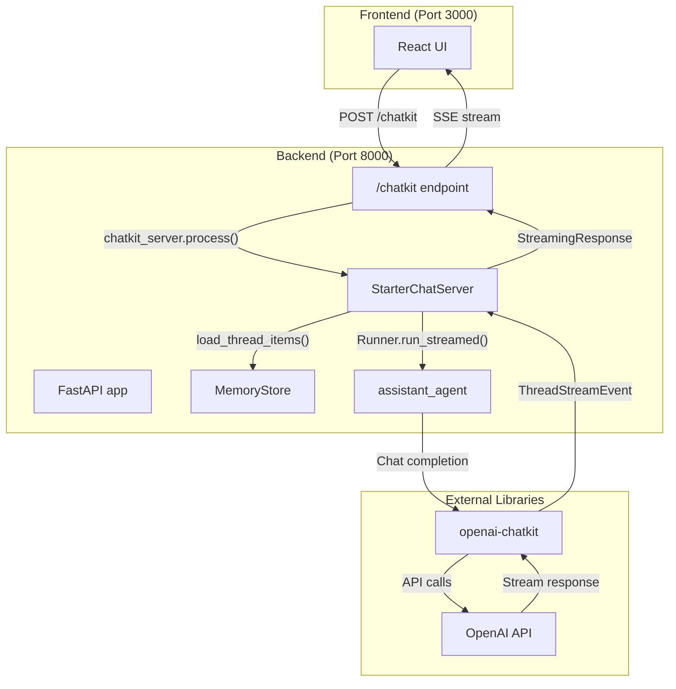
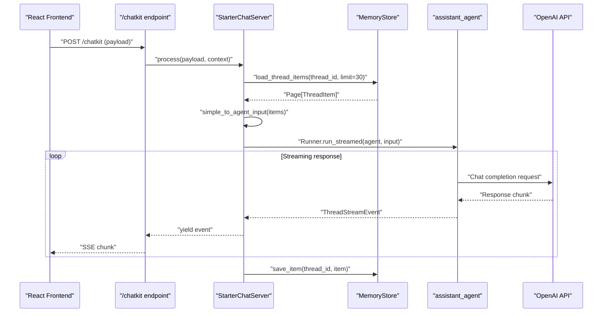
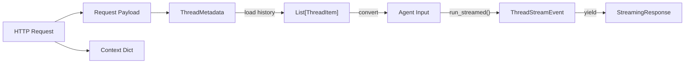
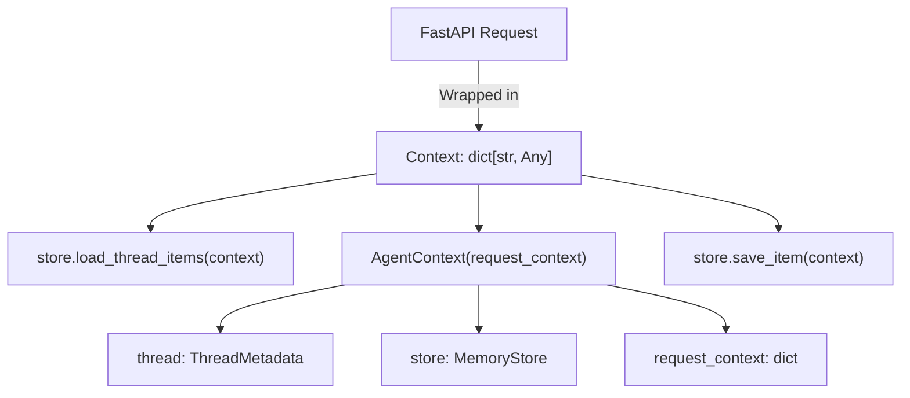
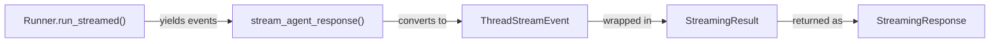
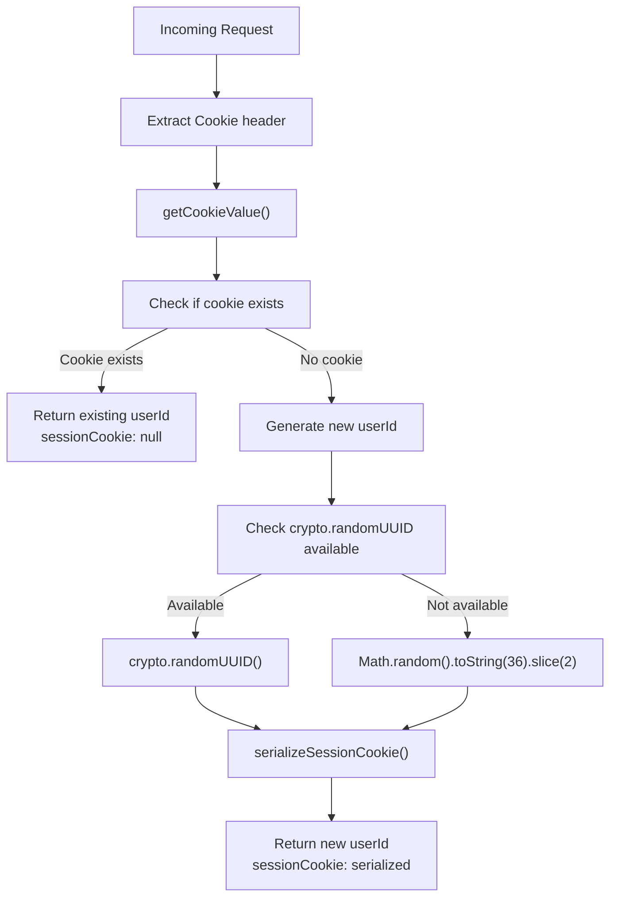
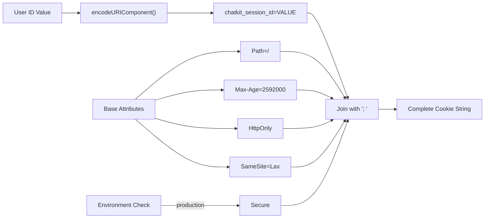

<!-- source: DeepWiki mcp.deepwiki.com · repo openai/openai-chatkit-starter-app · page 3.2 Backend Implementation · fetched 2026-10-26 -->

# Backend Implementation

<details>
<summary>Relevant source files</summary>

The following files were used as context for generating this wiki page:

- [chatkit/backend/app/main.py](chatkit/backend/app/main.py)
- [chatkit/backend/app/memory_store.py](chatkit/backend/app/memory_store.py)
- [chatkit/backend/app/server.py](chatkit/backend/app/server.py)
- [chatkit/backend/pyproject.toml](chatkit/backend/pyproject.toml)

</details>


This document covers the backend implementation of the self-hosted ChatKit starter application. The backend is built with FastAPI and serves as the orchestration layer that processes chat requests, manages conversation state, and integrates with OpenAI's API through the `openai-chatkit` library.

For detailed documentation of specific components, see:
- Page 3.2.1 for the FastAPI entrypoint
- Page 3.2.2 for `StarterChatServer` implementation
- Page 3.2.3 for `MemoryStore` implementation
- Page 3.2.4 for AI agent integration

## Overview

The backend consists of three primary Python modules that work together to provide chat functionality:

### Architecture



**Sources:** [chatkit/backend/app/main.py:1-36](), [chatkit/backend/app/server.py:1-68](), [chatkit/backend/app/memory_store.py:1-116]()

### Key Components

The backend implementation consists of three core modules:

| Module | Primary Class/Object | Purpose |
|--------|---------------------|---------|
| `main.py` | `app` (FastAPI) | HTTP server and `/chatkit` endpoint |
| `server.py` | `StarterChatServer` | Request orchestration and response streaming |
| `memory_store.py` | `MemoryStore` | In-memory conversation persistence |
| `server.py` | `assistant_agent` | AI assistant configuration |

**Sources:** [chatkit/backend/app/main.py:12](), [chatkit/backend/app/server.py:31](), [chatkit/backend/app/memory_store.py:14](), [chatkit/backend/app/server.py:20-28]()

### Technology Stack

The backend uses the following dependencies:

| Dependency | Version Constraint | Purpose |
|-----------|-------------------|---------|
| `fastapi` | `>=0.114,<0.116` | ASGI web framework |
| `uvicorn[standard]` | `>=0.36,<0.37` | ASGI server |
| `openai` | `>=1.40` | OpenAI SDK |
| `openai-chatkit` | `>=1.4.0,<2` | ChatKit server framework |

**Sources:** [chatkit/backend/pyproject.toml:6-11]()

## Component Interactions

The backend components interact in a layered architecture:

### Request Processing Flow



**Sources:** [chatkit/backend/app/main.py:25-35](), [chatkit/backend/app/server.py:38-67](), [chatkit/backend/app/memory_store.py:40-65]()

### Data Flow Diagram



**Sources:** [chatkit/backend/app/server.py:38-67](), [chatkit/backend/app/memory_store.py:40-51]()

## Core Components

### FastAPI Application

The `app` object in [chatkit/backend/app/main.py:12]() is the ASGI application that serves the backend. It includes:

- CORS middleware configuration for cross-origin requests
- A single POST endpoint at `/chatkit`
- Integration with `StarterChatServer` for request processing

See page 3.2.1 for detailed documentation of the FastAPI entrypoint.

**Sources:** [chatkit/backend/app/main.py:1-36]()

### StarterChatServer

The `StarterChatServer` class extends `ChatKitServer` and implements the core chat logic:

- Maintains a `MemoryStore` instance for conversation persistence
- Implements the `respond()` method to handle chat interactions
- Loads recent conversation history (up to 30 items)
- Orchestrates AI agent execution and streams responses

See page 3.2.2 for detailed documentation of `StarterChatServer`.

**Sources:** [chatkit/backend/app/server.py:31-68]()

### MemoryStore

The `MemoryStore` class implements the ChatKit `Store` interface using in-memory dictionaries:

- Stores thread metadata and thread items
- Provides pagination support for loading history
- Not suitable for production (data lost on restart)
- Should be replaced with persistent storage for production use

See page 3.2.3 for detailed documentation of `MemoryStore`.

**Sources:** [chatkit/backend/app/memory_store.py:14-116]()

### AI Assistant Agent

The `assistant_agent` object is configured with:

- Model: `gpt-4.1-mini`
- Name: "Starter Assistant"
- Instructions for concise, helpful responses

See page 3.2.4 for detailed documentation of AI agent integration.

**Sources:** [chatkit/backend/app/server.py:20-28]()

## Data Structures

The backend works with several key data structures from the `openai-chatkit` library:

### Thread Structures

| Type | Purpose | Key Fields |
|------|---------|-----------|
| `ThreadMetadata` | Thread information | `id`, `created_at`, custom metadata |
| `ThreadItem` | Individual messages | `id`, `role`, `content`, `created_at` |
| `UserMessageItem` | User-authored message | Subtype of `ThreadItem` |
| `Page[T]` | Paginated results | `data`, `has_more`, `after` |

**Sources:** [chatkit/backend/app/memory_store.py:11](), [chatkit/backend/app/server.py:10]()

### Context Objects

The backend uses context dictionaries to pass request-specific information:



The `AgentContext` type provides the agent with access to:
- Current thread metadata
- Store instance for persistence
- Original request context

**Sources:** [chatkit/backend/app/server.py:54-58](), [chatkit/backend/app/main.py:29]()

## Configuration Constants

The backend defines several configuration constants:

| Constant | Value | Purpose | Location |
|----------|-------|---------|----------|
| `MAX_RECENT_ITEMS` | `30` | History items loaded per request | [chatkit/backend/app/server.py:16]() |
| `MODEL` | `"gpt-4.1-mini"` | OpenAI model for assistant | [chatkit/backend/app/server.py:17]() |

These constants control conversation history size and AI model selection.

**Sources:** [chatkit/backend/app/server.py:16-17]()

## Streaming Response Mechanism

The backend uses Server-Sent Events (SSE) to stream AI responses:

### Streaming Flow



The streaming mechanism:
1. `Runner.run_streamed()` executes the agent and yields partial results
2. `stream_agent_response()` converts agent output to `ThreadStreamEvent` objects
3. Each event is yielded back through the response chain
4. FastAPI's `StreamingResponse` sends events as SSE to the client

**Sources:** [chatkit/backend/app/server.py:60-67](), [chatkit/backend/app/main.py:31-32]()

### Response Types

The `/chatkit` endpoint returns one of two response types:

| Type | Condition | Content-Type |
|------|-----------|--------------|
| `StreamingResponse` | When streaming events | `text/event-stream` |
| `Response` or `JSONResponse` | For non-streaming responses | `application/json` |

**Sources:** [chatkit/backend/app/main.py:31-35]()

## User Session Management

### Cookie-Based User Identification

The backend uses HTTP cookies to maintain persistent user identification across multiple session creation requests.

### Cookie Configuration

| Constant | Value | Purpose |
|----------|-------|---------|
| `SESSION_COOKIE_NAME` | `"chatkit_session_id"` | Cookie identifier |
| `SESSION_COOKIE_MAX_AGE` | `60 * 60 * 24 * 30` (30 days) | Cookie lifetime in seconds |

**Sources:** [app/api/create-session/route.ts:12-13]()

### User ID Resolution Process



The `resolveUserId` function:
1. Attempts to retrieve an existing user ID from cookies
2. If no cookie exists, generates a new user ID using `crypto.randomUUID()` (or a fallback)
3. Returns both the user ID and an optional cookie string for setting in the response

**Sources:** [app/api/create-session/route.ts:133-150]()

### Cookie Parsing

The `getCookieValue` function parses cookie headers:

```typescript
function getCookieValue(cookieHeader: string | null, name: string): string | null {
  if (!cookieHeader) {
    return null;
  }

  const cookies = cookieHeader.split(";");
  for (const cookie of cookies) {
    const [rawName, ...rest] = cookie.split("=");
    if (!rawName || rest.length === 0) { continue; }
    if (rawName.trim() === name) { return rest.join("=").trim(); }
  }
  return null;
}
```

This function:
- Splits the Cookie header by semicolons
- Iterates through each cookie
- Returns the value when the name matches
- Handles edge cases like missing values or malformed cookies

**Sources:** [app/api/create-session/route.ts:152-164]()

### Cookie Serialization

The `serializeSessionCookie` function creates secure cookie strings:



Cookie attributes:

| Attribute | Value | Purpose |
|-----------|-------|---------|
| Name | `chatkit_session_id` | Cookie identifier |
| Value | URL-encoded user ID | User identification |
| `Path` | `/` | Available across entire domain |
| `Max-Age` | `2592000` (30 days) | Long-lived session |
| `HttpOnly` | Set | Prevents JavaScript access (XSS protection) |
| `SameSite` | `Lax` | CSRF protection |
| `Secure` | Production only | HTTPS-only transmission |

**Sources:** [app/api/create-session/route.ts:166-179]()

### Response Cookie Handling

The `buildJsonResponse` function conditionally includes the Set-Cookie header:

```typescript
function buildJsonResponse(
  payload: unknown,
  status: number,
  headers: Record<string, string>,
  sessionCookie: string | null
): Response {
  const responseHeaders = new Headers(headers);

  if (sessionCookie) {
    responseHeaders.append("Set-Cookie", sessionCookie);
  }

  return new Response(JSON.stringify(payload), {
    status,
    headers: responseHeaders,
  });
}
```

This ensures:
- New users receive a Set-Cookie header to persist their ID
- Existing users do not receive redundant cookie updates
- All responses maintain consistent JSON formatting

**Sources:** [app/api/create-session/route.ts:181-197]()

### Security Considerations

The cookie implementation includes several security features:

1. **HttpOnly Flag**: Prevents client-side JavaScript from accessing the cookie, mitigating XSS attacks
2. **SameSite=Lax**: Provides CSRF protection while allowing top-level navigation
3. **Secure Flag (Production)**: Ensures cookies are only transmitted over HTTPS in production environments
4. **Long Expiration**: 30-day lifetime balances user convenience with security
5. **Server-Side Generation**: User IDs are generated server-side, not client-controlled

**Sources:** [app/api/create-session/route.ts:166-179]()

---

