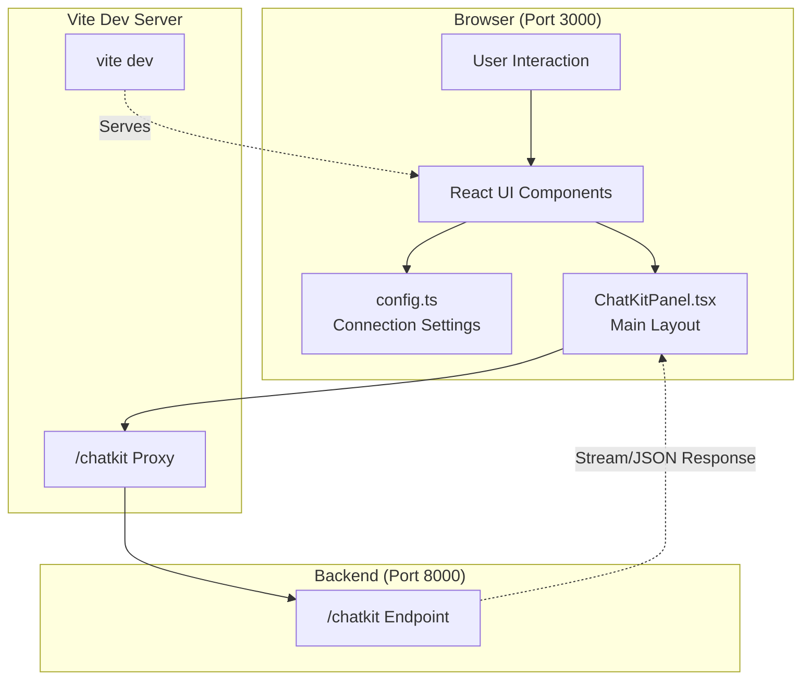
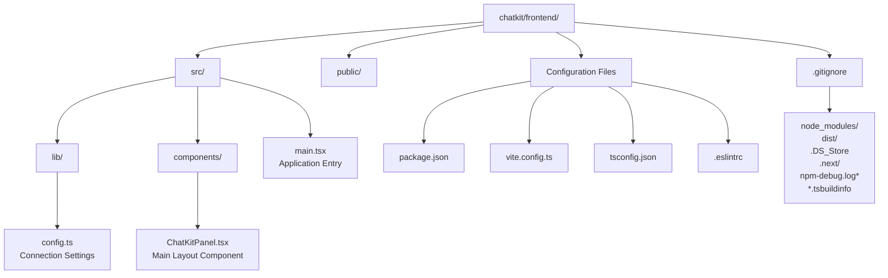
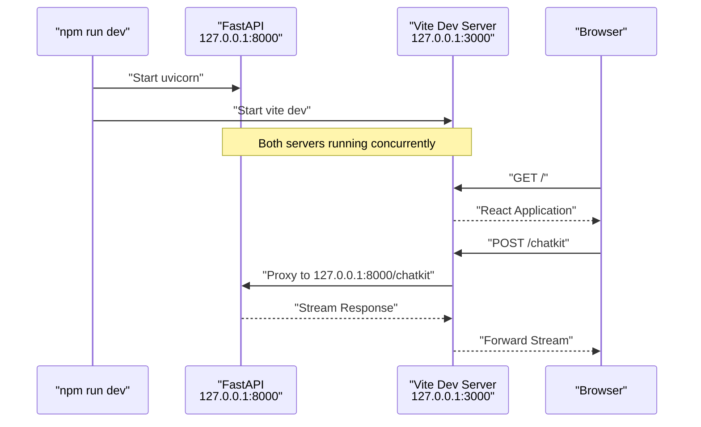
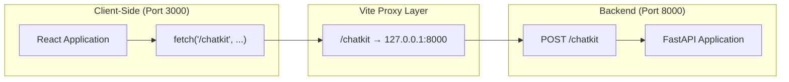
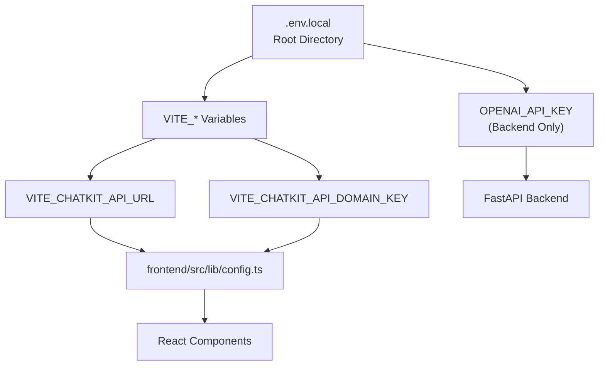
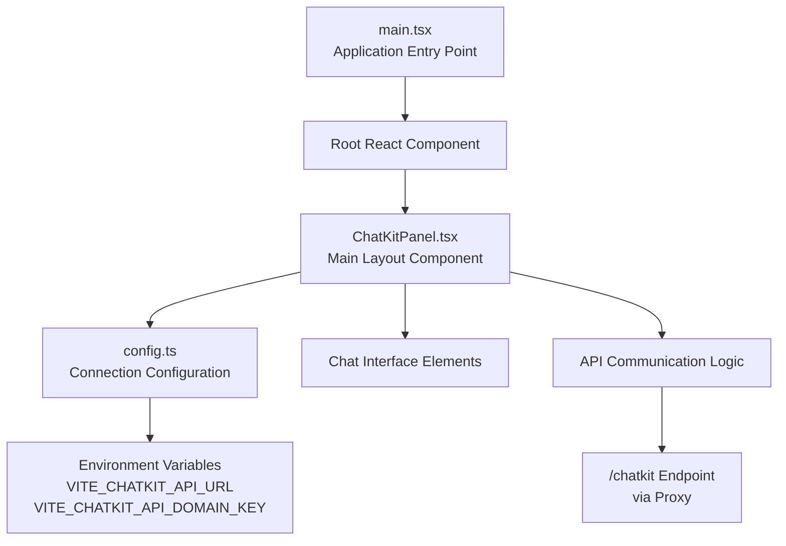
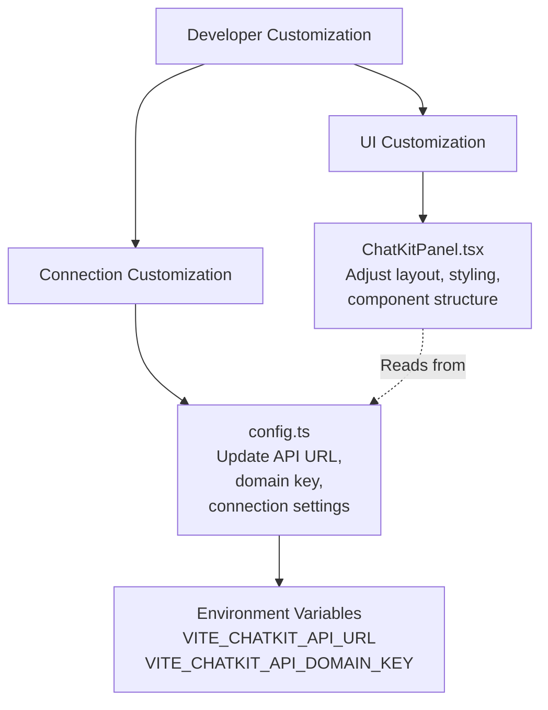
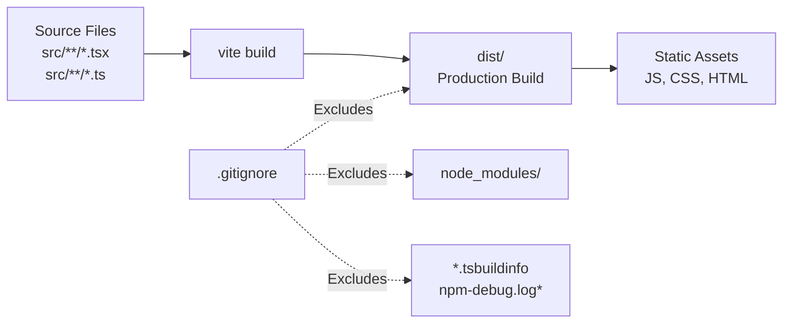

<!-- source: DeepWiki mcp.deepwiki.com · repo openai/openai-chatkit-starter-app · page 3.3 Frontend Implementation · fetched 2026-10-26 -->

# Frontend Implementation

Relevant source files

The following files were used as context for generating this wiki page:

- [chatkit/.env.example](chatkit/.env.example)
- [chatkit/.gitignore](chatkit/.gitignore)
- [chatkit/README.md](chatkit/README.md)
- [chatkit/backend/.gitignore](chatkit/backend/.gitignore)
- [chatkit/backend/app/__init__.py](chatkit/backend/app/__init__.py)
- [chatkit/frontend/.gitignore](chatkit/frontend/.gitignore)

This page documents the frontend implementation of the self-hosted ChatKit starter application located in the `chatkit/frontend/` directory. The frontend is a single-page application built with Vite, React, and TypeScript that provides a chat interface for interacting with the ChatKit backend.

For detailed information about backend components that the frontend communicates with, see [Backend Implementation](#3.2). For specifics about the technology stack and build configuration, see [Technology Stack](#3.3.1). For configuration and customization options, see [Configuration & Customization](#3.3.2).

**Sources:** [chatkit/README.md:1-33]()

---

## Purpose and Architecture

The frontend serves as the user-facing chat interface that communicates with the FastAPI backend through a proxied `/chatkit` endpoint. The application runs on `127.0.0.1:3000` during development and uses Vite's dev server to proxy backend requests.

**Diagram: Frontend Request Flow Architecture**

The frontend follows a standard React application pattern where user interactions trigger API calls through the Vite proxy, which forwards requests to the backend without requiring CORS configuration during development.

**Sources:** [chatkit/README.md:13-16]()

---

## Directory Structure

The frontend code is organized in the `chatkit/frontend/` directory with a standard Vite + React project layout:

**Diagram: Frontend Directory Structure**

The directory structure separates concerns:
- `src/lib/` contains configuration and utility modules
- `src/components/` contains React components
- Configuration files at the root manage build, type checking, and linting
- The `.gitignore` file excludes build artifacts and dependencies

**Sources:** [chatkit/README.md:30-32](), [chatkit/frontend/.gitignore:1-8]()

---

## Development Server and Build System

The frontend uses Vite as its build tool and development server. Starting the application with `npm run dev` launches both the backend and frontend servers concurrently:

| Server | Port | Purpose |
|--------|------|---------|
| FastAPI Backend | `127.0.0.1:8000` | Handles chat requests and OpenAI integration |
| Vite Frontend | `127.0.0.1:3000` | Serves React application and proxies `/chatkit` requests |

**Diagram: Development Server Startup and Request Flow**

The Vite development server provides hot module replacement (HMR) for rapid development iteration, while the proxy configuration eliminates the need for CORS configuration during local development.

**Sources:** [chatkit/README.md:8-16]()

---

## Proxy Configuration

The frontend communicates with the backend through a proxy at the `/chatkit` path. This proxy is configured in the Vite development server and ensures that API requests are seamlessly forwarded to the FastAPI backend.

**Diagram: Proxy Request Forwarding**

The proxy configuration allows the frontend to make requests to a relative path (`/chatkit`) rather than hardcoding the backend URL, which simplifies deployment configuration.

**Sources:** [chatkit/README.md:15-16]()

---

## Environment Variables

The frontend uses Vite's environment variable system, which requires all client-side variables to be prefixed with `VITE_`. Two environment variables control the frontend's connection to the backend:

| Variable | Default Value | Purpose |
|----------|---------------|---------|
| `VITE_CHATKIT_API_URL` | `/chatkit` | API endpoint URL for ChatKit requests |
| `VITE_CHATKIT_API_DOMAIN_KEY` | `domain_pk_localhost_dev` | Domain key for authentication/validation |

**Diagram: Environment Variable Flow**

Environment variables are loaded from `.env.local` at the repository root. The `VITE_` prefixed variables are made available to the frontend code through Vite's `import.meta.env` object and are typically accessed through the `config.ts` module.

For production deployments, `VITE_CHATKIT_API_DOMAIN_KEY` must be set to a registered domain key obtained from the OpenAI dashboard.

**Sources:** [chatkit/README.md:18-26](), [chatkit/.env.example:1-3]()

---

## Component Architecture

The frontend implements a component-based architecture using React. The main layout component is `ChatKitPanel.tsx`, which provides the overall chat interface structure.

**Diagram: React Component Hierarchy**

The component architecture separates concerns:
- **Configuration Layer** (`config.ts`): Centralizes connection settings and environment variable access
- **Layout Layer** (`ChatKitPanel.tsx`): Provides the main UI structure and layout
- **API Communication**: Handles HTTP requests to the `/chatkit` endpoint

**Sources:** [chatkit/README.md:29-32]()

---

## Customization Points

The frontend provides clear customization points for developers to adapt the application to their needs:

| File | Purpose | Customization Examples |
|------|---------|------------------------|
| `frontend/src/lib/config.ts` | Connection settings | API URL, domain key, timeout values |
| `frontend/src/components/ChatKitPanel.tsx` | Layout structure | UI components, styling, chat panel layout |

**Diagram: Frontend Customization Points**

Common customization scenarios include:
- Modifying the chat interface layout in `ChatKitPanel.tsx`
- Adjusting API connection settings in `config.ts`
- Updating environment variables for different deployment environments
- Adding additional UI components or modifying existing ones

**Sources:** [chatkit/README.md:28-32]()

---

## Build and Deployment

The frontend build process is managed by Vite and configured through `package.json` and `vite.config.ts`. Build artifacts are excluded from version control:

**Diagram: Build Process and Ignored Artifacts**

The `.gitignore` file ensures that build artifacts, dependencies, and temporary files are not committed to version control:
- `node_modules/` - NPM dependencies
- `dist/` - Production build output
- `.DS_Store` - macOS system files
- `*.tsbuildinfo` - TypeScript incremental build cache
- `npm-debug.log*` - NPM error logs

**Sources:** [chatkit/frontend/.gitignore:1-8]()

---

## Integration with Backend

The frontend integrates with the backend through the `/chatkit` endpoint, which is documented in detail in the Backend Implementation section. The frontend is responsible for:

1. **Configuration Management**: Loading and providing connection settings from environment variables
2. **Request Formatting**: Preparing chat requests in the format expected by the backend
3. **Response Handling**: Processing streaming responses from the ChatKit server
4. **UI Updates**: Rendering chat messages and updating the interface in real-time

For details about the backend endpoint structure and expected request/response formats, see [FastAPI Entrypoint](#3.2.1). For the complete request flow through both frontend and backend, see [Request Flow & Data Model](#3.4).

**Sources:** [chatkit/README.md:1-33]()

---

