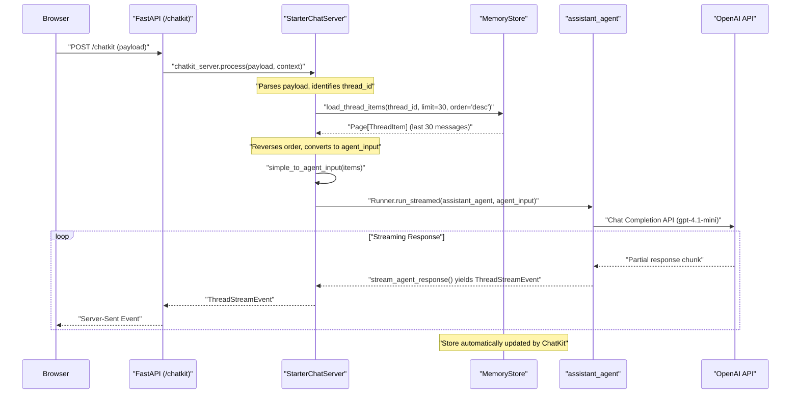
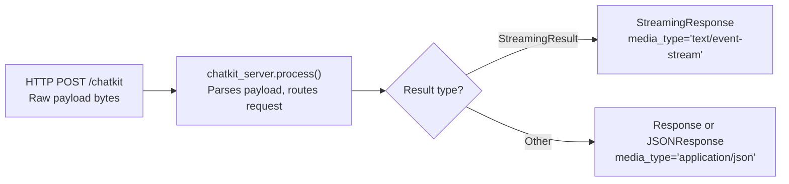
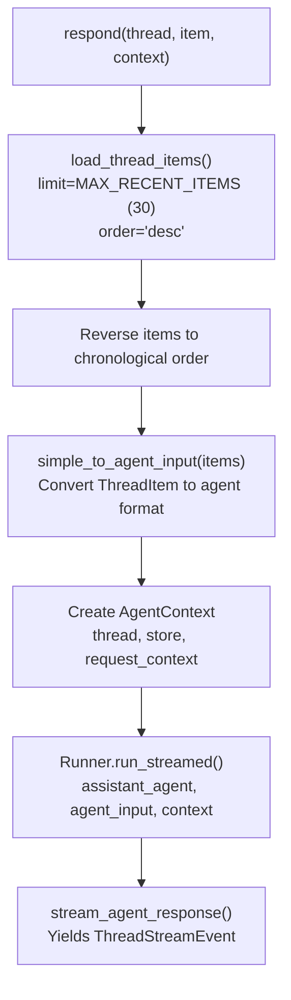
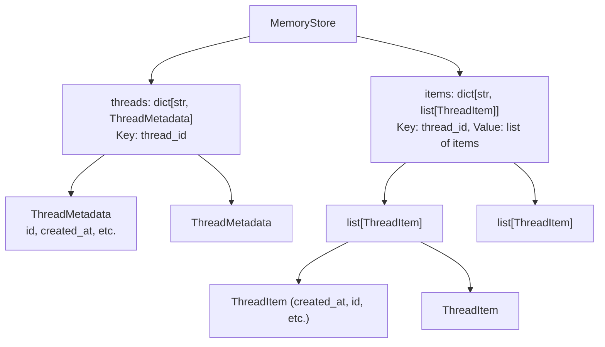
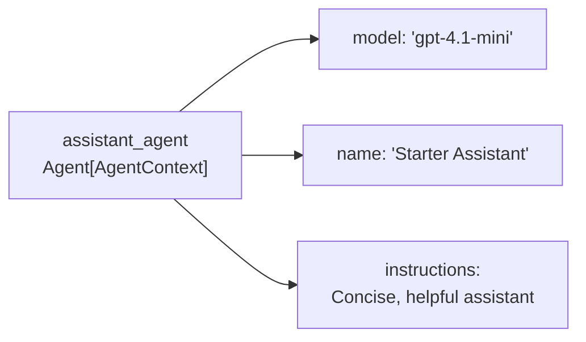
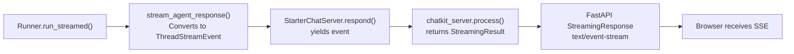

<!-- source: DeepWiki mcp.deepwiki.com · repo openai/openai-chatkit-starter-app · page 3.4 Request Flow & Data Model · fetched 2026-10-26 -->

# Request Flow & Data Model

Relevant source files

The following files were used as context for generating this wiki page:

- [chatkit/backend/app/main.py](chatkit/backend/app/main.py)
- [chatkit/backend/app/memory_store.py](chatkit/backend/app/memory_store.py)
- [chatkit/backend/app/server.py](chatkit/backend/app/server.py)

## Purpose & Scope

This page documents the complete lifecycle of a chat request through the self-hosted ChatKit system, from initial HTTP request to streaming response. It covers the request processing pipeline, data retrieval and persistence mechanisms, and the core data structures used throughout the system.

For backend implementation details of individual components, see [Backend Implementation](#3.2). For frontend configuration and UI components, see [Frontend Implementation](#3.3).

---

## Request Lifecycle Overview

The following diagram traces a user message from the browser through the FastAPI backend, MemoryStore, AI agent, and back to the user as a streaming response.

**Sources:** [chatkit/backend/app/main.py:25-35](), [chatkit/backend/app/server.py:38-67](), [chatkit/backend/app/memory_store.py:40-51]()

---

## HTTP Request Entry Point

All chat interactions enter the system through a single FastAPI endpoint that proxies requests to the ChatKit server implementation.

### The `/chatkit` Endpoint

The endpoint implementation at [chatkit/backend/app/main.py:25-35]() receives raw payload bytes from the ChatKit web component, passes them to the `StarterChatServer.process()` method, and returns either a streaming response (for chat messages) or JSON response (for other operations).

| Request Type | Response Type | Media Type |
|-------------|---------------|------------|
| User message | `StreamingResponse` | `text/event-stream` |
| Other operations | `Response` or `JSONResponse` | `application/json` |

**Sources:** [chatkit/backend/app/main.py:25-35]()

---

## Server Processing Pipeline

The `StarterChatServer` class extends `ChatKitServer` and implements the core chat processing logic through its `respond()` method.

### StarterChatServer.respond() Flow

The `respond()` method at [chatkit/backend/app/server.py:38-67]() orchestrates the following steps:

1. **Load Recent History**: Retrieves up to 30 recent items from the store in descending order
2. **Reverse Order**: Reverses items to chronological order (oldest first)
3. **Convert Format**: Transforms `ThreadItem` objects to agent-compatible input format
4. **Create Context**: Packages `thread`, `store`, and `request_context` into `AgentContext`
5. **Execute Agent**: Runs the assistant agent in streaming mode
6. **Stream Events**: Yields `ThreadStreamEvent` objects as they arrive

**Sources:** [chatkit/backend/app/server.py:38-67]()

---

## Data Retrieval from MemoryStore

The `MemoryStore` class implements the `Store` interface and manages thread metadata and conversation items in memory.

### MemoryStore Data Structures

The store maintains two primary data structures at [chatkit/backend/app/memory_store.py:14-17]():

| Field | Type | Purpose |
|-------|------|---------|
| `threads` | `dict[str, ThreadMetadata]` | Maps thread IDs to thread metadata |
| `items` | `dict[str, list[ThreadItem]]` | Maps thread IDs to lists of conversation items |

### load_thread_items() Method

The `load_thread_items()` method at [chatkit/backend/app/memory_store.py:40-51]() implements pagination logic:

1. Retrieves the item list for the specified `thread_id`
2. Calls `_paginate()` helper with sorting and cursor parameters
3. Returns a `Page[ThreadItem]` object containing:
   - `data`: List of items for the current page
   - `has_more`: Boolean indicating if more items exist
   - `after`: Cursor for fetching the next page

The `_paginate()` helper at [chatkit/backend/app/memory_store.py:85-104]() sorts items by `created_at`, applies cursor-based pagination, and calculates the `has_more` flag.

**Sources:** [chatkit/backend/app/memory_store.py:40-51](), [chatkit/backend/app/memory_store.py:85-104]()

---

## Core Data Model

The system uses several key data types from the `chatkit.types` module to represent conversations and events.

### ThreadMetadata

Represents metadata about a conversation thread. Key fields include:

| Field | Type | Description |
|-------|------|-------------|
| `id` | `str` | Unique thread identifier |
| `created_at` | `datetime` | Thread creation timestamp |

**Usage:** Passed to `StarterChatServer.respond()` at [chatkit/backend/app/server.py:40-42]()

### ThreadItem

Represents a single item (message, response) in a conversation thread. Key fields include:

| Field | Type | Description |
|-------|------|-------------|
| `id` | `str` | Unique item identifier |
| `created_at` | `datetime` | Item creation timestamp |
| `type` | `str` | Item type (e.g., user message, agent response) |

**Usage:** Stored in `MemoryStore.items` at [chatkit/backend/app/memory_store.py:17](), paginated by `load_thread_items()`

### UserMessageItem

Subtype of `ThreadItem` representing user-submitted messages. Passed to `respond()` at [chatkit/backend/app/server.py:41]() when a new user message arrives.

### ThreadStreamEvent

Represents streaming events sent back to the client during agent response generation. These events are yielded by `stream_agent_response()` at [chatkit/backend/app/server.py:66]() and converted to Server-Sent Events by FastAPI.

### Page[T]

Generic pagination container returned by store methods. Structure:

| Field | Type | Description |
|-------|------|-------------|
| `data` | `list[T]` | Items in the current page |
| `has_more` | `bool` | Whether more items exist |
| `after` | `str \| None` | Cursor for next page |

**Sources:** [chatkit/backend/app/server.py:10](), [chatkit/backend/app/memory_store.py:11]()

---

## Agent Execution and Context

The system configures a single assistant agent that processes all user messages.

### assistant_agent Configuration

The agent is defined at [chatkit/backend/app/server.py:20-28]() with:

- **Model**: `gpt-4.1-mini` (specified in `MODEL` constant at [chatkit/backend/app/server.py:17]())
- **Name**: "Starter Assistant"
- **Instructions**: Directs the agent to provide concise, focused responses

### AgentContext

The `AgentContext` object at [chatkit/backend/app/server.py:54-58]() packages contextual information for the agent:

| Field | Type | Purpose |
|-------|------|---------|
| `thread` | `ThreadMetadata` | Current thread metadata |
| `store` | `MemoryStore` | Store instance for persistence |
| `request_context` | `dict[str, Any]` | HTTP request context from FastAPI |

**Sources:** [chatkit/backend/app/server.py:20-28](), [chatkit/backend/app/server.py:54-58]()

---

## Response Streaming Pipeline

The agent response flows back to the client as a stream of events, enabling real-time UI updates.

### Streaming Event Flow

The streaming pipeline at [chatkit/backend/app/server.py:60-67]():

1. `Runner.run_streamed()` executes the agent and yields incremental results
2. `stream_agent_response()` converts agent results to `ThreadStreamEvent` objects
3. `StarterChatServer.respond()` yields events to the caller
4. `ChatKitServer.process()` wraps the event stream in a `StreamingResult`
5. FastAPI's `StreamingResponse` at [chatkit/backend/app/main.py:32]() sends events as Server-Sent Events

### Server-Sent Event Format

The `StreamingResponse` uses `media_type="text/event-stream"` to deliver events in SSE format. Each `ThreadStreamEvent` is serialized and sent to the browser, where the ChatKit web component processes it to update the UI in real-time.

**Sources:** [chatkit/backend/app/server.py:60-67](), [chatkit/backend/app/main.py:31-32]()

---

## Store Persistence Operations

While the agent streams responses, the ChatKit framework automatically handles persistence to the store.

### Automatic Item Persistence

The `MemoryStore` provides two methods for persisting items:

| Method | Purpose | Implementation |
|--------|---------|----------------|
| `add_thread_item()` | Append new item to thread | [chatkit/backend/app/memory_store.py:53-56]() |
| `save_item()` | Update existing or append new | [chatkit/backend/app/memory_store.py:58-64]() |

The `save_item()` method:
1. Searches for an existing item with matching `id`
2. Updates the item in-place if found
3. Appends as new item if not found

This idempotent behavior ensures the store accurately reflects the current conversation state, even if the same item is saved multiple times during streaming.

### Thread Management

The store also manages thread metadata:

| Method | Purpose | Implementation |
|--------|---------|----------------|
| `load_thread()` | Retrieve thread metadata | [chatkit/backend/app/memory_store.py:19-22]() |
| `save_thread()` | Persist thread metadata | [chatkit/backend/app/memory_store.py:24-25]() |
| `delete_thread()` | Remove thread and all items | [chatkit/backend/app/memory_store.py:74-76]() |

**Sources:** [chatkit/backend/app/memory_store.py:19-25](), [chatkit/backend/app/memory_store.py:53-64](), [chatkit/backend/app/memory_store.py:74-76]()

---

## Complete Request Flow Summary

The table below summarizes the complete request flow with corresponding code locations:

| Step | Component | Method/Function | File Location |
|------|-----------|----------------|---------------|
| 1. Receive HTTP request | FastAPI | `chatkit_endpoint()` | [chatkit/backend/app/main.py:25-35]() |
| 2. Process payload | `StarterChatServer` | `process()` (inherited) | Called at [chatkit/backend/app/main.py:29]() |
| 3. Route to respond | `StarterChatServer` | `respond()` | [chatkit/backend/app/server.py:38-67]() |
| 4. Load conversation history | `MemoryStore` | `load_thread_items()` | [chatkit/backend/app/memory_store.py:40-51]() |
| 5. Reverse item order | `StarterChatServer` | `respond()` line 51 | [chatkit/backend/app/server.py:51]() |
| 6. Convert to agent input | `simple_to_agent_input()` | Imported function | [chatkit/backend/app/server.py:52]() |
| 7. Create agent context | `AgentContext` | Constructor | [chatkit/backend/app/server.py:54-58]() |
| 8. Execute agent | `Runner` | `run_streamed()` | [chatkit/backend/app/server.py:60-64]() |
| 9. Stream events | `stream_agent_response()` | Imported function | [chatkit/backend/app/server.py:66]() |
| 10. Return streaming response | FastAPI | `StreamingResponse()` | [chatkit/backend/app/main.py:32]() |

The maximum conversation context retrieved per request is controlled by `MAX_RECENT_ITEMS = 30` at [chatkit/backend/app/server.py:16](), ensuring the agent receives the last 30 messages for context while avoiding excessive token usage.

**Sources:** [chatkit/backend/app/main.py:25-35](), [chatkit/backend/app/server.py:16](), [chatkit/backend/app/server.py:38-67](), [chatkit/backend/app/memory_store.py:40-51]()

---

