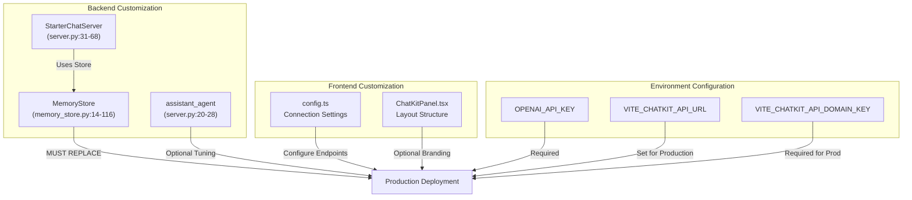
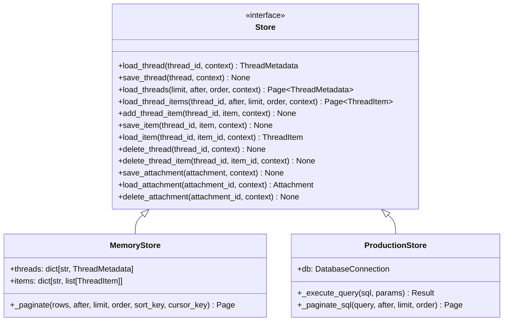
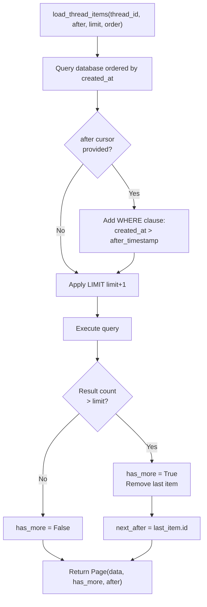

<!-- source: DeepWiki mcp.deepwiki.com · repo openai/openai-chatkit-starter-app · page 3.5 Customization Guide · fetched 2026-10-26 -->

# Customization Guide

<details>
<summary>Relevant source files</summary>

The following files were used as context for generating this wiki page:

- [chatkit/.env.example](chatkit/.env.example)
- [chatkit/.gitignore](chatkit/.gitignore)
- [chatkit/README.md](chatkit/README.md)
- [chatkit/backend/.gitignore](chatkit/backend/.gitignore)
- [chatkit/backend/app/__init__.py](chatkit/backend/app/__init__.py)
- [chatkit/backend/app/memory_store.py](chatkit/backend/app/memory_store.py)
- [chatkit/backend/app/server.py](chatkit/backend/app/server.py)

</details>


This guide documents the primary customization points in the self-hosted ChatKit starter application (`chatkit/` directory). It focuses on production-readiness modifications, particularly replacing the in-memory storage implementation with a persistent database, configuring the UI, and customizing the AI agent behavior.

For information about the managed ChatKit integration pattern, see [Managed ChatKit](#4). For deployment-specific environment configuration, see [Production Environment Variables](#8.1).

## Overview of Customization Areas

The ChatKit starter application provides three primary customization categories, each targeting different system layers:

| Customization Area | Files Affected | Production Priority | Complexity |
|-------------------|---------------|---------------------|------------|
| **Storage Layer** | `backend/app/server.py`, `backend/app/memory_store.py` | **Critical** | Medium-High |
| **UI Configuration** | `frontend/src/lib/config.ts`, `frontend/src/components/ChatKitPanel.tsx` | Medium | Low |
| **Agent Behavior** | `backend/app/server.py` (lines 20-28) | Medium | Low-Medium |
| **Environment Variables** | `.env.local` | **Critical** | Low |

**Sources:** [chatkit/README.md:28-32]()

### Customization Points Diagram



**Sources:** [chatkit/README.md:28-32](), [chatkit/backend/app/server.py:1-68](), [chatkit/backend/app/memory_store.py:1-116]()

---

## Storage Layer Customization

### Why Replace MemoryStore

The `MemoryStore` implementation [chatkit/backend/app/memory_store.py:14-116]() is designed exclusively for development and demonstration. It stores all conversation data in Python dictionaries that exist only in process memory, resulting in:

- **Data loss on restart**: All threads and messages are lost when the backend process terminates
- **No horizontal scaling**: Each backend instance maintains separate state
- **Memory constraints**: All conversation history resides in RAM
- **No persistence**: Data cannot be queried, backed up, or migrated

**Production deployments require a persistent database implementation.**

**Sources:** [chatkit/backend/app/memory_store.py:1-4](), [chatkit/README.md:32]()

### Store Interface Requirements

The `MemoryStore` class implements the `Store[dict]` interface from the `chatkit.store` module. A production replacement must implement all abstract methods defined in this interface.

#### Required Method Implementations



**Sources:** [chatkit/backend/app/memory_store.py:14-116]()

#### Method Responsibilities

| Method | Purpose | Implementation Notes |
|--------|---------|---------------------|
| `load_thread` | Retrieve thread metadata by ID | Must raise `NotFoundError` if thread does not exist [chatkit/backend/app/memory_store.py:19-22]() |
| `save_thread` | Persist thread metadata | Upsert operation; overwrite existing thread [chatkit/backend/app/memory_store.py:24-25]() |
| `load_threads` | List threads with pagination | Support `after` cursor and `order` direction [chatkit/backend/app/memory_store.py:27-38]() |
| `load_thread_items` | Retrieve messages in a thread | Paginated; ordered by `created_at` [chatkit/backend/app/memory_store.py:40-51]() |
| `add_thread_item` | Append new message to thread | Insert-only operation [chatkit/backend/app/memory_store.py:53-56]() |
| `save_item` | Update existing message or insert | Upsert by `item.id` [chatkit/backend/app/memory_store.py:58-64]() |
| `delete_thread` | Remove thread and all items | Cascade delete [chatkit/backend/app/memory_store.py:74-76]() |

**Sources:** [chatkit/backend/app/memory_store.py:14-116]()

### Implementation Patterns

#### Pattern 1: Relational Database (PostgreSQL, MySQL)

For relational databases, implement two primary tables with a foreign key relationship:

**Schema Example:**

```sql
CREATE TABLE threads (
    id TEXT PRIMARY KEY,
    title TEXT,
    created_at TIMESTAMP NOT NULL,
    updated_at TIMESTAMP NOT NULL,
    metadata JSONB
);

CREATE TABLE thread_items (
    id TEXT PRIMARY KEY,
    thread_id TEXT NOT NULL REFERENCES threads(id) ON DELETE CASCADE,
    item_type TEXT NOT NULL,
    created_at TIMESTAMP NOT NULL,
    content JSONB NOT NULL,
    INDEX idx_thread_created (thread_id, created_at)
);
```

**Implementation skeleton:**

```python
from chatkit.store import Store
from chatkit.types import ThreadMetadata, ThreadItem, Page
import asyncpg

class PostgresStore(Store[dict]):
    def __init__(self, connection_pool: asyncpg.Pool):
        self.pool = connection_pool
    
    async def load_thread(self, thread_id: str, context: dict) -> ThreadMetadata:
        async with self.pool.acquire() as conn:
            row = await conn.fetchrow(
                "SELECT * FROM threads WHERE id = $1", thread_id
            )
            if not row:
                raise NotFoundError(f"Thread {thread_id} not found")
            return self._row_to_thread_metadata(row)
    
    async def load_thread_items(
        self, thread_id: str, after: str | None, limit: int, 
        order: str, context: dict
    ) -> Page[ThreadItem]:
        # Implement SQL pagination with LIMIT and WHERE created_at > after
        ...
```

**Sources:** [chatkit/backend/app/memory_store.py:14-116]()

#### Pattern 2: Document Database (MongoDB, DynamoDB)

For document databases, store threads and items as nested or separate collections:

**Collection structure:**

```python
# threads collection
{
    "_id": "thread_abc123",
    "title": "User Conversation",
    "created_at": ISODate("2024-01-01T00:00:00Z"),
    "updated_at": ISODate("2024-01-01T00:05:00Z")
}

# thread_items collection
{
    "_id": "item_xyz789",
    "thread_id": "thread_abc123",
    "item_type": "user_message",
    "created_at": ISODate("2024-01-01T00:01:00Z"),
    "content": {...}
}
```

**Sources:** [chatkit/backend/app/memory_store.py:14-116]()

### Pagination Implementation

The `_paginate` helper method [chatkit/backend/app/memory_store.py:85-104]() demonstrates cursor-based pagination logic. Production implementations must replicate this behavior:



**Key pagination requirements:**

1. **Cursor stability**: The `after` parameter is a cursor (typically an ID or timestamp) identifying where to continue pagination
2. **Ordering**: Must respect `order` parameter (`"asc"` or `"desc"`) [chatkit/backend/app/memory_store.py:94]()
3. **Limit enforcement**: Return at most `limit` items [chatkit/backend/app/memory_store.py:101]()
4. **has_more indicator**: Set to `True` if additional results exist beyond the current page [chatkit/backend/app/memory_store.py:102]()
5. **next_after cursor**: Provide cursor for the next page if `has_more` is `True` [chatkit/backend/app/memory_store.py:103]()

**Sources:** [chatkit/backend/app/memory_store.py:85-104]()

### Integrating Custom Store

After implementing your custom store, replace the `MemoryStore` instantiation in `StarterChatServer.__init__`:

**Current implementation:**

[chatkit/backend/app/server.py:34-36]()

```python
def __init__(self) -> None:
    self.store: MemoryStore = MemoryStore()
    super().__init__(self.store)
```

**Modified for PostgreSQL:**

```python
def __init__(self, db_pool: asyncpg.Pool) -> None:
    self.store: PostgresStore = PostgresStore(db_pool)
    super().__init__(self.store)
```

**Update the FastAPI application initialization** in `backend/app/main.py` to create the database connection pool and pass it to `StarterChatServer`.

**Sources:** [chatkit/backend/app/server.py:31-36]()

---

## UI Configuration

### Connection Settings (config.ts)

The frontend configuration file `frontend/src/lib/config.ts` defines the ChatKit API endpoint and domain key. While the file is not included in the provided sources, it is referenced as a customization point [chatkit/README.md:30]().

**Typical configuration structure:**

| Configuration Variable | Purpose | Default | Production Value |
|----------------------|---------|---------|------------------|
| `VITE_CHATKIT_API_URL` | Backend API endpoint | `/chatkit` (proxied) | `https://api.yourdomain.com/chatkit` |
| `VITE_CHATKIT_API_DOMAIN_KEY` | Domain authentication key | `domain_pk_localhost_dev` | Registered production key |

**Environment variable mapping:**

These values are injected at build time from environment variables:

- `VITE_CHATKIT_API_URL` [chatkit/.env.example:2]()
- `VITE_CHATKIT_API_DOMAIN_KEY` [chatkit/.env.example:3]()

**For production deployment:**
1. Register a domain key in the OpenAI dashboard
2. Set `VITE_CHATKIT_API_DOMAIN_KEY` to the registered key
3. Update `VITE_CHATKIT_API_URL` to point to your production backend

**Sources:** [chatkit/README.md:19-26](), [chatkit/.env.example:1-3]()

### Layout Customization (ChatKitPanel.tsx)

The `frontend/src/components/ChatKitPanel.tsx` component defines the layout structure of the chat interface [chatkit/README.md:31](). Common customizations include:

- **Branding**: Add logos, custom headers, or footers
- **Styling**: Modify CSS classes or theme variables
- **Layout adjustments**: Change panel positioning, sizing, or responsive behavior
- **Feature toggles**: Enable/disable UI features like attachments or message editing

**Sources:** [chatkit/README.md:31]()

---

## Agent Customization

### Modifying Assistant Behavior

The `assistant_agent` configuration [chatkit/backend/app/server.py:20-28]() defines the AI agent's model, name, and instructions.

**Current configuration:**

```python
assistant_agent = Agent[AgentContext[dict[str, Any]]](
    model=MODEL,  # "gpt-4.1-mini"
    name="Starter Assistant",
    instructions=(
        "You are a concise, helpful assistant. "
        "Keep replies short and focus on directly answering "
        "the user's request."
    ),
)
```

**Sources:** [chatkit/backend/app/server.py:20-28]()

### Customization Options

| Parameter | Current Value | Customization Purpose |
|-----------|--------------|----------------------|
| `model` | `"gpt-4.1-mini"` [chatkit/backend/app/server.py:17]() | Change to `"gpt-4-turbo"`, `"gpt-4o"`, or other OpenAI models |
| `name` | `"Starter Assistant"` | Update for branding or role identification |
| `instructions` | Concise assistant prompt | Customize agent personality, domain expertise, or behavior constraints |

**Example: Domain-specific customization**

```python
assistant_agent = Agent[AgentContext[dict[str, Any]]](
    model="gpt-4-turbo",
    name="Technical Support Assistant",
    instructions=(
        "You are a technical support specialist for XYZ product. "
        "Always ask for the user's account ID before troubleshooting. "
        "Provide step-by-step solutions with code examples when relevant. "
        "Escalate to human support if the issue involves account access."
    ),
)
```

### Context Handling

The `StarterChatServer.respond` method loads recent conversation history for context [chatkit/backend/app/server.py:44-51]():

```python
items_page = await self.store.load_thread_items(
    thread.id,
    after=None,
    limit=MAX_RECENT_ITEMS,  # 30
    order="desc",
    context=context,
)
```

**Customization:** Adjust `MAX_RECENT_ITEMS` [chatkit/backend/app/server.py:16]() based on:
- **Token budget**: More items = more tokens consumed
- **Context relevance**: Longer history may include outdated information
- **Model limits**: Ensure total context fits within model's context window

**Sources:** [chatkit/backend/app/server.py:16-68]()

---

## Environment Variables Reference

### Backend Variables

| Variable | Required | Purpose | Example |
|----------|----------|---------|---------|
| `OPENAI_API_KEY` | **Yes** | OpenAI API authentication | `sk-proj-...` [chatkit/.env.example:1]() |

**Set in:** Shell environment or `.env.local` at repository root [chatkit/README.md:24-25]()

### Frontend Variables

| Variable | Required | Purpose | Default | Production Example |
|----------|----------|---------|---------|-------------------|
| `VITE_CHATKIT_API_URL` | No | Backend API endpoint | `/chatkit` | `https://api.example.com/chatkit` |
| `VITE_CHATKIT_API_DOMAIN_KEY` | No* | Domain authentication | `domain_pk_localhost_dev` | `domain_pk_prod_abc123` |

**Note:** `VITE_CHATKIT_API_DOMAIN_KEY` is optional for local development but **required for production** [chatkit/README.md:26]().

**Sources:** [chatkit/README.md:19-26](), [chatkit/.env.example:1-3]()

---

## Customization Implementation Checklist

Use this checklist when preparing the starter application for production:

### Storage Layer
- [ ] Implement custom `Store` class with database backend
- [ ] Test all required Store interface methods
- [ ] Verify pagination logic with `after` cursors
- [ ] Implement proper error handling (raise `NotFoundError` when appropriate)
- [ ] Update `StarterChatServer.__init__` to use custom store
- [ ] Configure database connection pooling

### UI Configuration
- [ ] Update `config.ts` with production API URL
- [ ] Customize `ChatKitPanel.tsx` layout/branding (optional)
- [ ] Test frontend build with production environment variables

### Agent Configuration
- [ ] Review and customize `assistant_agent.instructions`
- [ ] Select appropriate model for use case
- [ ] Adjust `MAX_RECENT_ITEMS` based on context requirements

### Environment Variables
- [ ] Set `OPENAI_API_KEY` in production environment
- [ ] Register production domain key in OpenAI dashboard
- [ ] Set `VITE_CHATKIT_API_DOMAIN_KEY` to production key
- [ ] Configure `VITE_CHATKIT_API_URL` for production backend

### Testing
- [ ] Verify conversation persistence across backend restarts
- [ ] Test pagination with large thread histories
- [ ] Load test backend with expected concurrent users
- [ ] Verify frontend can connect to production backend

**Sources:** [chatkit/README.md:1-32](), [chatkit/backend/app/server.py:1-68](), [chatkit/backend/app/memory_store.py:1-116]()

---

