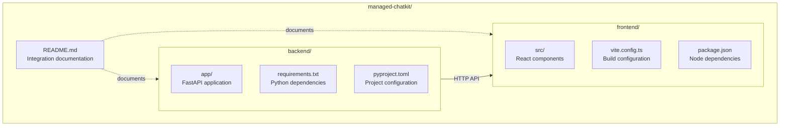
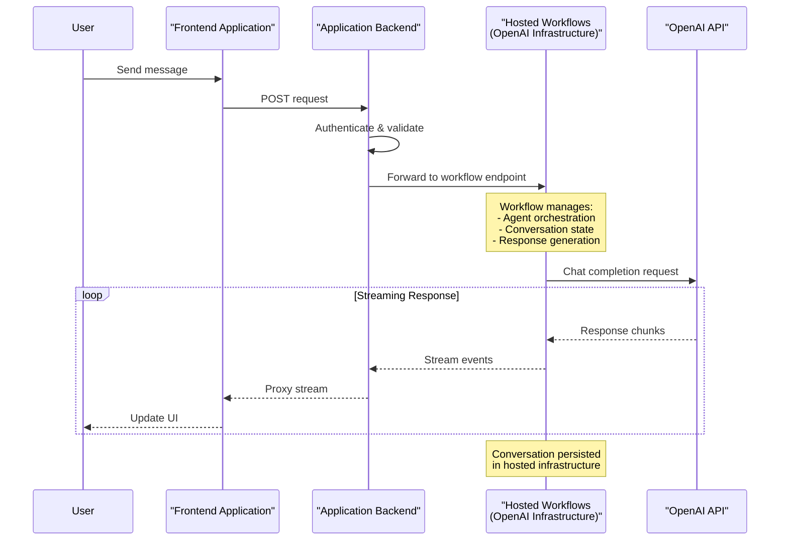
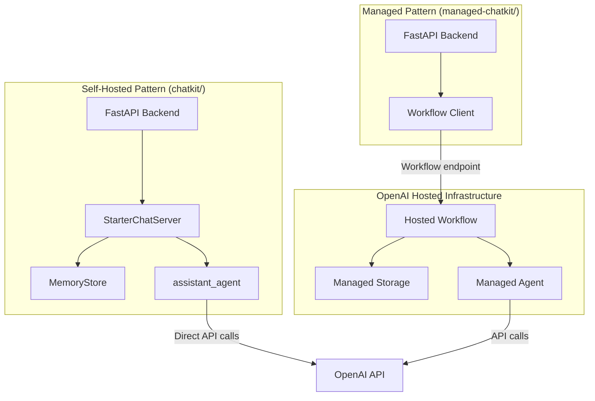
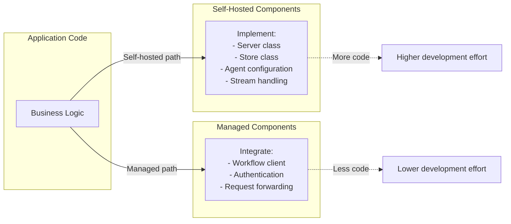

<!-- source: DeepWiki mcp.deepwiki.com · repo openai/openai-chatkit-starter-app · page 4.1 Overview & Hosted Workflows · fetched 2026-10-26 -->

# Overview & Hosted Workflows

Relevant source files

The following files were used as context for generating this wiki page:

- [README.md](README.md)

## Purpose and Scope

This page introduces the managed ChatKit integration pattern and explains the concept of hosted workflows. It describes the `managed-chatkit/` directory contents and clarifies the operational differences between managed and self-hosted integrations. For detailed architectural differences, see [Architecture Differences](#4.2). For the self-hosted integration pattern, see [Self-Hosted ChatKit](#3).

**Sources:** [README.md:1-9]()

## What are Hosted Workflows?

Hosted workflows are OpenAI-managed infrastructure components that handle agent orchestration, conversation persistence, and request processing on behalf of the application. When using hosted workflows, the application delegates conversation management responsibilities to OpenAI's infrastructure rather than implementing these components locally.

In a hosted workflow configuration:

| Component | Self-Hosted | Hosted Workflows |
|-----------|-------------|------------------|
| **Agent Orchestration** | Local `assistant_agent` instance | Managed by OpenAI infrastructure |
| **Conversation Storage** | Local `MemoryStore` implementation | Managed by OpenAI infrastructure |
| **Request Processing** | Local `StarterChatServer` | Managed workflow endpoint |
| **Infrastructure Maintenance** | Developer responsibility | OpenAI responsibility |

The managed ChatKit integration demonstrates how to connect a frontend application to hosted workflows using simplified backend integration code.

**Sources:** [README.md:8]()

## Managed ChatKit Directory Structure

**Diagram:** Managed ChatKit directory structure showing backend and frontend separation

The `managed-chatkit/` directory contains a complete starter application demonstrating hosted workflow integration. It maintains the same technology stack as the self-hosted variant (FastAPI backend, Vite/React frontend) but implements different integration logic to communicate with OpenAI's hosted infrastructure.

**Sources:** [README.md:8]()

## Operational Model Comparison

**Diagram:** Request flow through managed ChatKit with hosted workflows

### Key Operational Differences

**Infrastructure Responsibilities:**

| Aspect | Self-Hosted | Managed (Hosted Workflows) |
|--------|-------------|----------------------------|
| **Conversation Storage** | Developer implements and maintains database | OpenAI manages persistent storage |
| **Agent State Management** | Developer manages agent lifecycle | Workflow handles agent state |
| **Scaling & Performance** | Developer provisions infrastructure | OpenAI handles scaling automatically |
| **Monitoring & Debugging** | Developer implements logging/metrics | Workflow provides built-in observability |
| **Updates & Maintenance** | Developer updates dependencies | OpenAI updates workflow infrastructure |

**Sources:** [README.md:7-8]()

## Integration Architecture

**Diagram:** Comparison of self-hosted vs managed integration architectures showing component responsibilities

In the self-hosted pattern, the application backend implements all conversation management components (`StarterChatServer`, `MemoryStore`, `assistant_agent`). In the managed pattern, these responsibilities shift to the hosted workflow infrastructure, and the application backend only needs to implement authentication, validation, and request forwarding logic.

**Sources:** [README.md:7-8]()

## Domain Keys and Workflow Authentication

Managed ChatKit integrations use domain-specific authentication credentials to access hosted workflows:

| Environment Variable | Purpose | Example Value |
|---------------------|---------|---------------|
| `VITE_CHATKIT_API_DOMAIN_KEY` | Identifies workflow domain | `domain_pk_localhost_dev` (development) |
| `OPENAI_API_KEY` | Authenticates API access | OpenAI API key |

The domain key associates requests with a specific hosted workflow configuration. In development, applications typically use `domain_pk_localhost_dev`. Production deployments require production-specific domain keys obtained from OpenAI.

**Sources:** Based on high-level architecture diagrams

## When to Choose Managed ChatKit

### Choose Managed ChatKit When:

- **Minimal operational overhead** is required
- **Rapid prototyping** without infrastructure setup is desired
- **Automatic scaling** and maintenance are important
- **Built-in persistence** eliminates database management needs
- **Team expertise** focuses on application logic rather than infrastructure

### Choose Self-Hosted ChatKit When:

- **Complete control** over conversation storage is required
- **Custom integration logic** beyond workflow capabilities is needed
- **Data residency** or compliance requires on-premises storage
- **Existing infrastructure** is already available for conversation management
- **Cost optimization** through self-managed resources is preferred

**Sources:** [README.md:1-9]()

## Integration Code Differences

**Diagram:** Development effort comparison between self-hosted and managed implementations

The managed ChatKit backend requires significantly less implementation code than the self-hosted variant. Developers implement authentication and request forwarding rather than conversation management infrastructure, reducing initial development time and ongoing maintenance requirements.

**Sources:** [README.md:7-8]()

## Getting Started with Managed ChatKit

The `managed-chatkit/` directory provides a complete working example:

1. **Backend Setup**: Configure FastAPI application with workflow client integration
2. **Frontend Setup**: Connect React application to backend endpoint
3. **Environment Configuration**: Set `OPENAI_API_KEY` and `VITE_CHATKIT_API_DOMAIN_KEY`
4. **Development Server**: Run `npm run dev` to start both backend and frontend

Detailed setup instructions are provided in the managed-chatkit directory's README.

For installation and configuration details, see [Getting Started](#2). For architectural implementation details, see [Architecture Differences](#4.2).

**Sources:** [README.md:8]()

---

