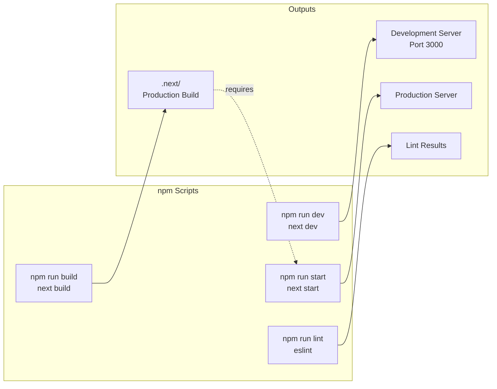
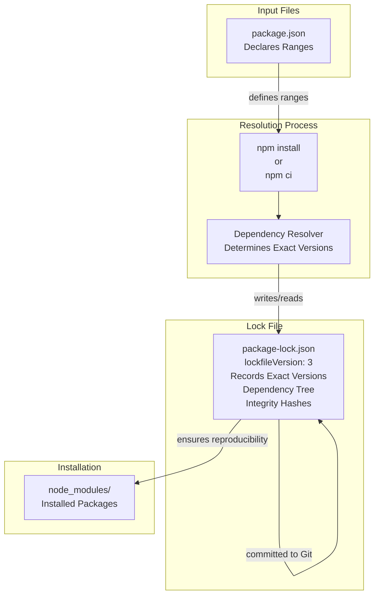
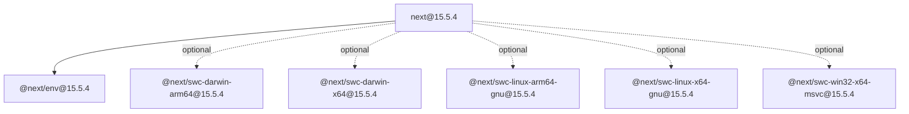

<!-- source: DeepWiki mcp.deepwiki.com · repo openai/openai-chatkit-starter-app · page 5 Dependencies & Package Management · fetched 2026-10-26 -->

# Package Management & Dependencies

<details>
<summary>Relevant source files</summary>

The following files were used as context for generating this wiki page:

- [chatkit/.env.example](chatkit/.env.example)
- [chatkit/.gitignore](chatkit/.gitignore)
- [chatkit/README.md](chatkit/README.md)
- [chatkit/backend/.gitignore](chatkit/backend/.gitignore)
- [chatkit/backend/app/__init__.py](chatkit/backend/app/__init__.py)
- [chatkit/backend/pyproject.toml](chatkit/backend/pyproject.toml)

</details>


This document describes the package management system for the OpenAI ChatKit Starter App, including the role of `package.json` and `package-lock.json`, the dependency structure, and how packages are installed and locked for reproducible builds. This page provides an overview of the dependency management system; for detailed information about specific dependency categories, see [Core Dependencies](#3.1), [Development Dependencies](#3.2), and [Optional Dependencies](#3.3). For information about how the CI/CD pipeline uses these files, see [CI/CD Pipeline](#4).

## Package Management Files

The application uses two critical files for dependency management:

| File | Purpose | Version Control |
|------|---------|----------------|
| `package.json` | Declares dependencies with version ranges | Committed to Git |
| `package-lock.json` | Locks exact versions and dependency tree | Committed to Git |

The `package.json` file [package.json:1-33]() defines the project metadata, scripts, and dependency specifications. The `package-lock.json` file [package-lock.json:1-30]() ensures that every installation produces identical dependency trees by recording exact package versions, dependency relationships, and integrity hashes.

**Sources:** [package.json:1-33](), [package-lock.json:1-6]()

## Package Metadata and Scripts

The project is identified as `openai-chatkit-starter-app` version `0.1.0` and is marked as private [package.json:2-4](). Five npm scripts are defined for development and production workflows:



**npm run dev**: Starts the Next.js development server with hot module replacement  
**npm run build**: Creates an optimized production build in the `.next/` directory  
**npm run start**: Serves the production build  
**npm run lint**: Runs ESLint for code quality checks

**Sources:** [package.json:5-10]()

## Dependency Categories

The project organizes dependencies into three categories, each serving distinct purposes in the development and runtime lifecycle:

```mermaid
graph TD
    subgraph "package.json Structure"
        PKG["package.json"]
        
        DEPS["dependencies<br/>Production Runtime"]
        DEV_DEPS["devDependencies<br/>Build & Development Tools"]
        OPT_DEPS["optionalDependencies<br/>Platform Optimizations"]
    end
    
    subgraph "Production Dependencies"
        NEXT["next: ^15.5.4"]
        REACT["react: ^19.2.0"]
        REACT_DOM["react-dom: ^19.2.0"]
        CHATKIT["@openai/chatkit-react: ^0"]
    end
    
    subgraph "Development Dependencies"
        TS["typescript: ^5"]
        ESLINT["eslint: ^9"]
        ESLINT_CONFIG["eslint-config-next: 15.5.4"]
        TAILWIND["tailwindcss: ^4"]
        TW_POSTCSS["@tailwindcss/postcss: ^4"]
        TYPES_NODE["@types/node: ^20"]
        TYPES_REACT["@types/react: ^19"]
    end
    
    subgraph "Optional Dependencies"
        LIGHTNING["lightningcss-linux-x64-gnu: 1.30.1"]
        OXIDE["@tailwindcss/oxide-linux-x64-gnu: 4.1.11"]
    end
    
    PKG --> DEPS
    PKG --> DEV_DEPS
    PKG --> OPT_DEPS
    
    DEPS --> NEXT
    DEPS --> REACT
    DEPS --> REACT_DOM
    DEPS --> CHATKIT
    
    DEV_DEPS --> TS
    DEV_DEPS --> ESLINT
    DEV_DEPS --> ESLINT_CONFIG
    DEV_DEPS --> TAILWIND
    DEV_DEPS --> TW_POSTCSS
    DEV_DEPS --> TYPES_NODE
    DEV_DEPS --> TYPES_REACT
    
    OPT_DEPS --> LIGHTNING
    OPT_DEPS --> OXIDE
```



### Production Dependencies

The `dependencies` section [package.json:11-16]() includes packages required at runtime:

| Package | Version | Purpose |
|---------|---------|---------|
| `next` | ^15.5.4 | React framework with server-side rendering |
| `react` | ^19.2.0 | UI library |
| `react-dom` | ^19.2.0 | React renderer for web |
| `@openai/chatkit-react` | ^0 | OpenAI ChatKit React integration |

**Sources:** [package.json:11-16]()

### Development Dependencies

The `devDependencies` section [package.json:21-31]() includes packages required only during development and build:

| Package | Version | Purpose |
|---------|---------|---------|
| `typescript` | ^5 | TypeScript compiler |
| `eslint` | ^9 | JavaScript/TypeScript linter |
| `eslint-config-next` | 15.5.4 | Next.js ESLint configuration |
| `@eslint/eslintrc` | ^3 | ESLint configuration resolver |
| `tailwindcss` | ^4 | Utility-first CSS framework |
| `@tailwindcss/postcss` | ^4 | Tailwind CSS PostCSS plugin |
| `@types/node` | ^20 | TypeScript definitions for Node.js |
| `@types/react` | ^19 | TypeScript definitions for React |
| `@types/react-dom` | ^19 | TypeScript definitions for react-dom |

**Sources:** [package.json:21-31]()

### Optional Dependencies

The `optionalDependencies` section [package.json:17-20]() includes platform-specific native binaries that improve build performance on Linux x64 systems:

| Package | Version | Purpose |
|---------|---------|---------|
| `lightningcss-linux-x64-gnu` | 1.30.1 | Fast CSS transformer (Linux x64) |
| `@tailwindcss/oxide-linux-x64-gnu` | 4.1.11 | Rust-based Tailwind engine (Linux x64) |

These dependencies are marked as optional because they are platform-specific and the build system can function without them using JavaScript-based fallbacks.

**Sources:** [package.json:17-20]()

## Version Constraint Syntax

The project uses npm's semantic versioning notation to specify acceptable version ranges:

| Prefix | Example | Meaning | Lock File Example |
|--------|---------|---------|-------------------|
| `^` (caret) | `^15.5.4` | Compatible with 15.5.4, allows minor and patch updates | [package-lock.json:12]() |
| `^` (caret) | `^0` | Allows any 0.x.x version | [package-lock.json:11]() |
| Exact | `15.5.4` | Exact version only | [package-lock.json:23]() |

The caret (`^`) allows updates that do not change the leftmost non-zero digit, enabling automatic security patches while preventing breaking changes.

**Sources:** [package.json:11-31]()

## Dependency Resolution and Locking



The `package-lock.json` uses `lockfileVersion: 3` [package-lock.json:4](), which is the format introduced in npm v7. This file contains:

1. **Exact Versions**: Each package's resolved version [package-lock.json:12-14]()
2. **Dependency Tree**: The complete nested dependency structure [package-lock.json:6-30]()
3. **Integrity Hashes**: SHA-512 checksums for package verification (e.g., [package-lock.json:35]())
4. **Registry URLs**: Source locations for each package (e.g., [package-lock.json:34]())

**Sources:** [package-lock.json:1-6]()

## Installation Process

The CI/CD pipeline and local development use different installation commands:

### CI Installation: `npm ci`

The GitHub Actions workflow [.github/workflows/ci.yml]() uses `npm ci` for clean, reproducible installations:

- Deletes existing `node_modules/` before installation
- Installs exact versions from `package-lock.json`
- Fails if `package.json` and `package-lock.json` are out of sync
- Faster than `npm install` in CI environments

### Local Development: `npm install`

For local development, `npm install`:

- Installs packages based on `package.json` ranges
- Updates `package-lock.json` if needed
- Preserves existing compatible packages in `node_modules/`

**Sources:** [package.json:1-33](), [package-lock.json:1-6]()

## Transitive Dependencies

The lock file records all transitive (indirect) dependencies. For example, the `next` package depends on numerous sub-packages:



Platform-specific packages like `@next/swc-*` are marked as optional dependencies [package-lock.json:794-920]() and only install on matching platforms, reducing installation size and time.

**Sources:** [package-lock.json:778-920]()

## Native Binary Packages

Several packages include platform-specific native binaries compiled from Rust or C++. The lock file contains multiple platform variants that are conditionally installed:

| Package Family | Platforms | Purpose |
|---------------|-----------|---------|
| `@next/swc-*` | darwin-arm64, darwin-x64, linux-arm64-gnu, linux-x64-gnu, win32-x64-msvc | Next.js SWC compiler |
| `@tailwindcss/oxide-*` | darwin-arm64, darwin-x64, linux-x64-gnu, linux-arm64-gnu, win32-x64-msvc | Tailwind CSS Rust engine |
| `lightningcss-*` | linux-x64-gnu | CSS transformer |

Each variant specifies CPU architecture and operating system constraints via `cpu` and `os` fields [package-lock.json:798-805](), ensuring the correct binary is installed for the host system.

**Sources:** [package-lock.json:794-1272]()

## Integrity and Security

Every package in the lock file includes an integrity hash using the Subresource Integrity format:

```
"integrity": "sha512-27SQhYp5QryzIT5uO8hq99C69eLQ7qkzkDPsk3N+GuS2XgOgoYEeOav7Pf8Tn4drECOVDsDg8oj+/DVy8qQL2A=="
```

npm verifies these hashes during installation to ensure package contents have not been tampered with. The `resolved` field [package-lock.json:780]() specifies the registry URL where the package was originally downloaded.

**Sources:** [package-lock.json:778-783]()

## Package Count Summary

The lock file defines thousands of packages in the complete dependency tree:

| Category | Direct Count | Notes |
|----------|--------------|-------|
| Production Dependencies | 4 | Runtime-required packages |
| Development Dependencies | 9 | Build and tooling packages |
| Optional Dependencies | 2 | Platform-specific optimizations |
| Total Transitive Dependencies | ~1000+ | All nested dependencies in `node_modules/` |

This extensive tree is necessary to support the full Next.js, React, TypeScript, and Tailwind CSS ecosystem.

**Sources:** [package.json:11-31](), [package-lock.json:6-30]()

---

