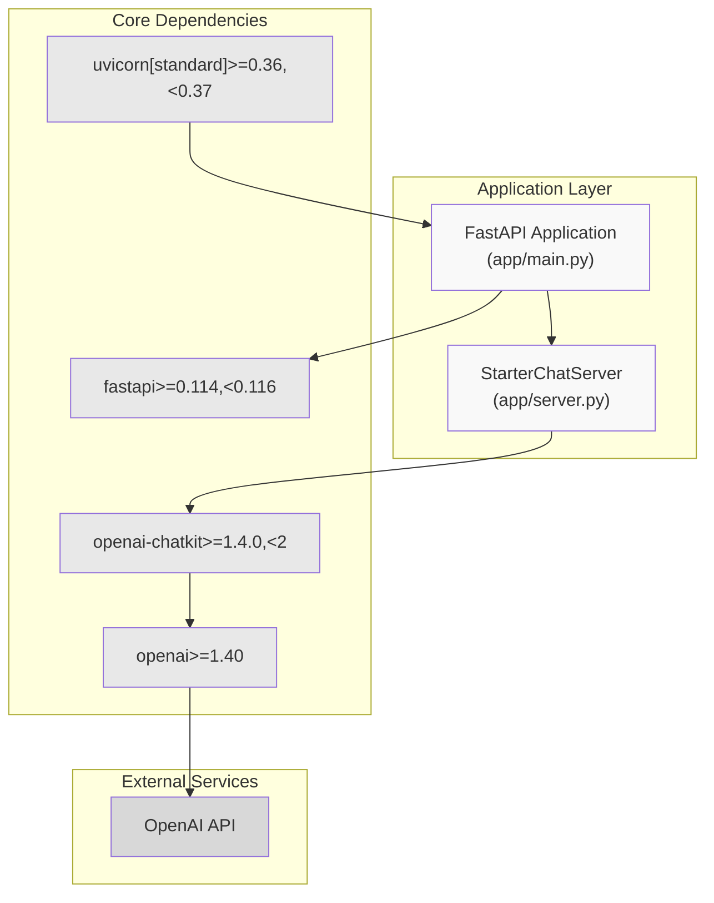
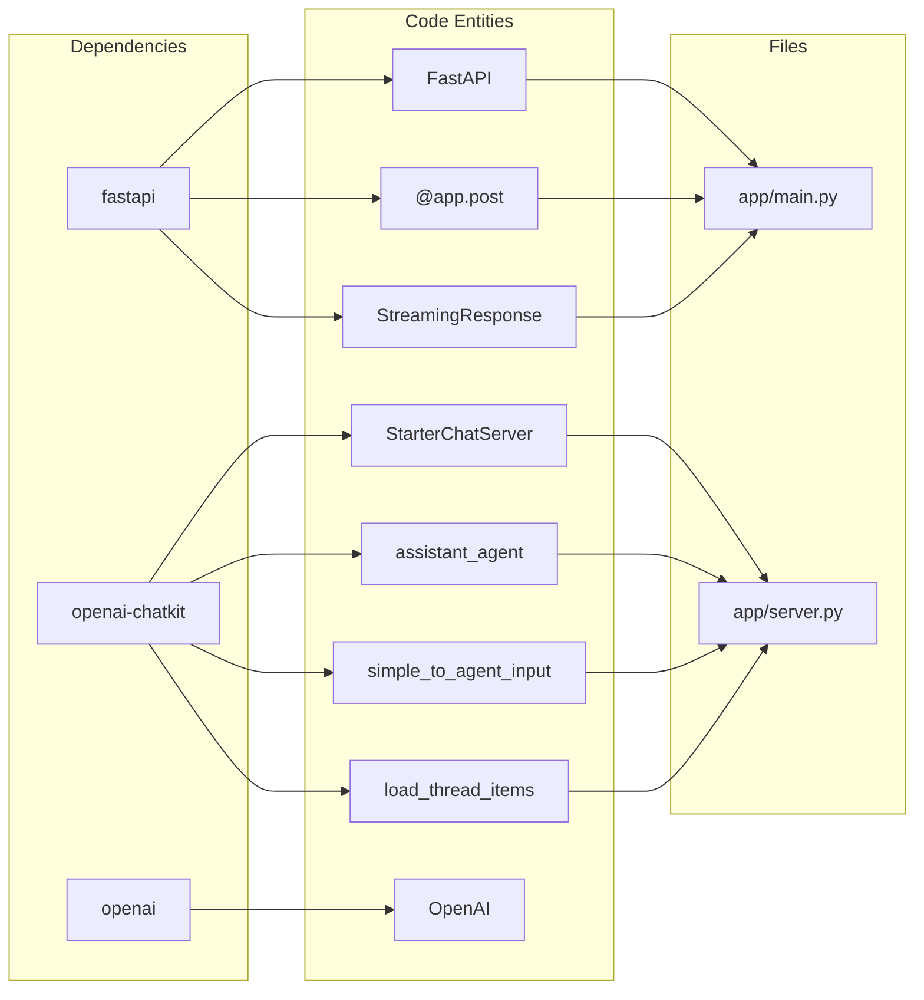

<!-- source: DeepWiki mcp.deepwiki.com · repo openai/openai-chatkit-starter-app · page 5.1 Backend Dependencies · fetched 2026-10-26 -->

# Backend Dependencies

<details>
<summary>Relevant source files</summary>

The following files were used as context for generating this wiki page:

- [chatkit/backend/pyproject.toml](chatkit/backend/pyproject.toml)

</details>


## Purpose and Scope

This document provides a comprehensive reference for all Python dependencies required by the backend components of the ChatKit starter applications. Both `chatkit/backend` and `managed-chatkit/backend` share identical dependency specifications defined in their respective `pyproject.toml` files. This page covers runtime dependencies, version constraints, and their roles in the system.

For frontend dependencies, see [Frontend Dependencies](#5.2). For development tooling (linters, formatters, type checkers), see [Development Tools](#5.3).

## Package Management Configuration

The backend uses modern Python packaging standards with `pyproject.toml` as the single source of dependency declarations. The configuration specifies both runtime dependencies and optional development dependencies.

**Key Configuration Attributes:**

| Attribute | Value | Purpose |
|-----------|-------|---------|
| `requires-python` | `>=3.11` | Minimum Python version requirement |
| `dependencies` | Core runtime packages | Required for application execution |
| `project.optional-dependencies.dev` | Development packages | Optional tools for local development |
| `build-system` | `setuptools>=68.0` | Build backend for package installation |

Sources: [chatkit/backend/pyproject.toml:1-22]()

## Runtime Dependencies

### FastAPI

**Package:** `fastapi>=0.114,<0.116`

FastAPI is the web framework powering the backend HTTP API. It provides the ASGI application, routing, request/response handling, and OpenAPI documentation generation.

**Version Constraints:**
- Minimum: 0.114 (required features for ChatKit integration)
- Maximum: <0.116 (pinned for stability and compatibility)

**Usage in Codebase:**
- `FastAPI` application instance: [chatkit/backend/app/main.py]()
- Route decorators: `@app.post("/chatkit")` 
- Request models: `Request`, `StarterChatInput`
- Response streaming: `StreamingResponse`

### Uvicorn

**Package:** `uvicorn[standard]>=0.36,<0.37`

Uvicorn is the ASGI server that runs the FastAPI application. The `[standard]` extra includes performance optimizations and additional protocol support (HTTP/2, WebSocket compression).

**Version Constraints:**
- Minimum: 0.36 (compatible with FastAPI 0.114+)
- Maximum: <0.37 (pinned for stability)
- Extra: `[standard]` includes `uvloop`, `httptools`, `websockets`, `watchfiles`

**Usage in Codebase:**
- Command-line invocation: `uvicorn app.main:app --reload`
- Development server startup: [chatkit/backend/app/main.py]()

### OpenAI Python SDK

**Package:** `openai>=1.40`

The official OpenAI Python client library provides access to OpenAI APIs, including chat completions, embeddings, and other model endpoints.

**Version Constraints:**
- Minimum: 1.40 (required for compatibility with `openai-chatkit`)
- No maximum constraint (accepts newer versions)

**Usage in Codebase:**
- Indirectly through `openai-chatkit` library
- API authentication via `OPENAI_API_KEY` environment variable

### OpenAI ChatKit

**Package:** `openai-chatkit>=1.4.0,<2`

The OpenAI ChatKit library provides high-level abstractions for building conversational AI applications, including thread management, agent runtime, and streaming support.

**Version Constraints:**
- Minimum: 1.4.0 (stable ChatKit API)
- Maximum: <2 (major version constraint to prevent breaking changes)

**Usage in Codebase:**
- `StarterChatServer` base class: [chatkit/backend/app/server.py]()
- `assistant_agent` function
- `AgentInput`, `AgentContext` types
- `simple_to_agent_input` conversion utility
- Store interface: `load_thread_items`, `save_item`

Sources: [chatkit/backend/pyproject.toml:6-11]()

## Development Dependencies

### Ruff

**Package:** `ruff>=0.6.4,<0.7`

Ruff is an extremely fast Python linter and formatter written in Rust. It replaces multiple tools (Flake8, isort, Black) with a single executable.

**Version Constraints:**
- Minimum: 0.6.4 (latest stable feature set)
- Maximum: <0.7 (pinned for consistent formatting behavior)

**Usage in CI/CD:**
- Linting: `ruff check .`
- Formatting: `ruff format --check .`
- See [Python Quality Checks](#6.2) for CI workflow integration

**Note:** While `ruff` is listed in `pyproject.toml` under `[project.optional-dependencies]`, the type checker `mypy` is not explicitly declared but is used in CI validation workflows.

Sources: [chatkit/backend/pyproject.toml:13-16]()

## Dependency Architecture

### Runtime Dependency Graph



**Diagram: Backend Dependency Hierarchy**

This diagram illustrates the layered dependency structure where application code depends on framework libraries (FastAPI, ChatKit), which in turn depend on client SDKs (openai), ultimately connecting to external services.

Sources: [chatkit/backend/pyproject.toml:1-22]()

### Code Entity Mapping



**Diagram: Dependency to Code Entity Mapping**

This diagram maps Python packages to the specific classes, functions, and decorators imported from them, showing where each dependency's API surface is utilized in the codebase.

Sources: [chatkit/backend/pyproject.toml:6-11](), [chatkit/backend/app/main.py](), [chatkit/backend/app/server.py]()

## Build System Configuration

The build system uses `setuptools` as the PEP 517 build backend, which is the standard tool for creating installable Python packages.

**Configuration:**

| Component | Value | Purpose |
|-----------|-------|---------|
| `requires` | `setuptools>=68.0`, `wheel` | Build-time dependencies |
| `build-backend` | `setuptools.build_meta` | Build backend module path |

**Installation Methods:**

```
# Development installation (editable mode)
pip install -e .

# Development installation with dev dependencies
pip install -e ".[dev]"

# Production installation
pip install .
```

The editable installation (`-e` flag) allows code changes to take effect immediately without reinstallation, which is useful for local development.

Sources: [chatkit/backend/pyproject.toml:18-20]()

## Version Constraint Strategy

The dependency specifications follow a deliberate versioning strategy:

### Tightly Constrained Dependencies

**FastAPI and Uvicorn:**
- Use both minimum and maximum version constraints
- Strategy: Pin to known-compatible minor versions
- Rationale: Web framework stability, prevent breaking API changes

**OpenAI ChatKit:**
- Constrained to major version 1.x
- Strategy: Allow patch and minor updates within v1
- Rationale: Prevent breaking changes from v2, allow bug fixes

### Loosely Constrained Dependencies

**OpenAI SDK:**
- Only minimum version specified
- Strategy: Accept any version ≥1.40
- Rationale: Mature, stable API; ChatKit handles compatibility

### Development Tools

**Ruff:**
- Constrained to 0.6.x
- Strategy: Pin to specific minor version
- Rationale: Ensure consistent linting/formatting behavior across team

Sources: [chatkit/backend/pyproject.toml:6-16]()

## Dependency Usage Summary

| Dependency | Primary Role | Key Imports | Used In |
|------------|--------------|-------------|---------|
| `fastapi` | Web framework | `FastAPI`, `Request`, `StreamingResponse` | [app/main.py]() |
| `uvicorn` | ASGI server | Command-line only | Development server |
| `openai` | OpenAI API client | Indirect (via `openai-chatkit`) | N/A |
| `openai-chatkit` | ChatKit framework | `StarterChatServer`, `assistant_agent`, `simple_to_agent_input` | [app/server.py]() |
| `ruff` | Linter/formatter | Command-line only | CI/CD pipeline |

Sources: [chatkit/backend/pyproject.toml:1-22](), [chatkit/backend/app/main.py](), [chatkit/backend/app/server.py]()

---

