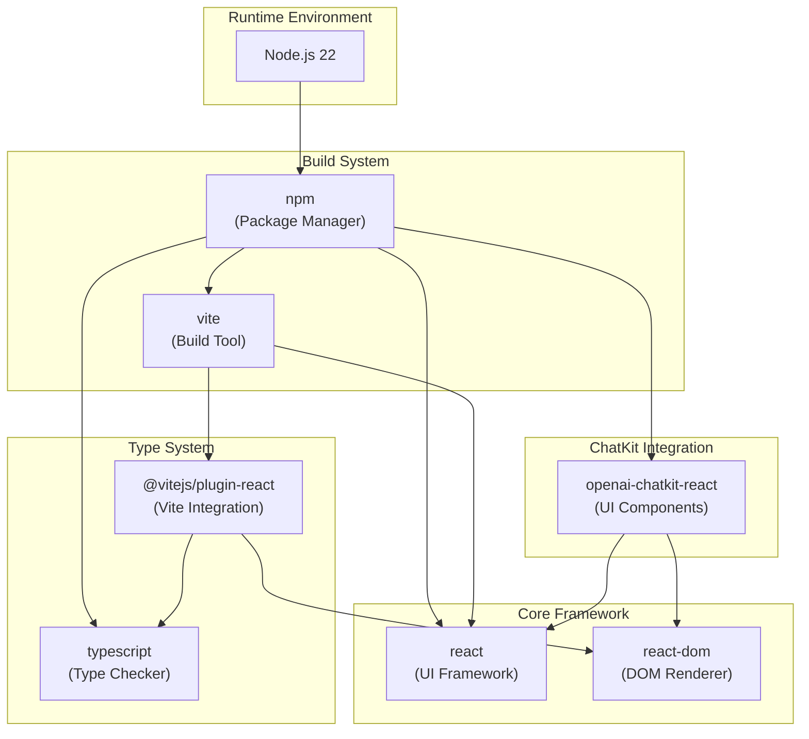
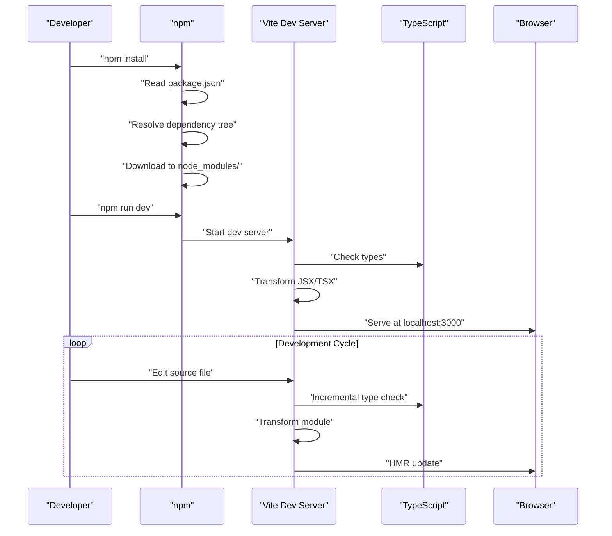
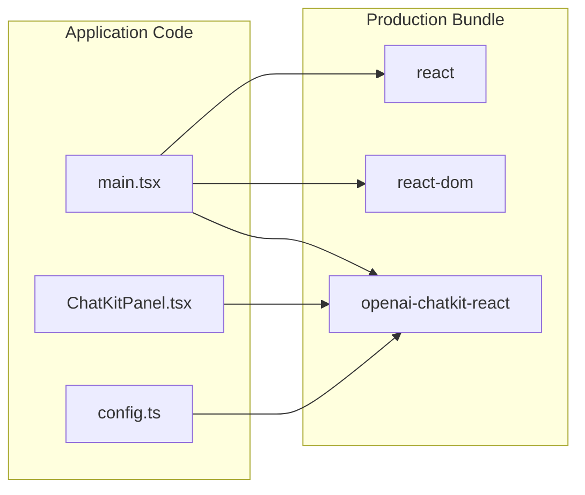
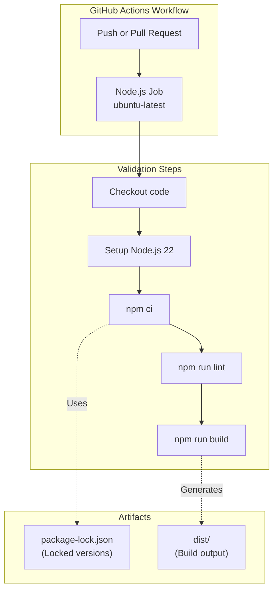

<!-- source: DeepWiki mcp.deepwiki.com · repo openai/openai-chatkit-starter-app · page 5.2 Frontend Dependencies · fetched 2026-10-26 -->

# Frontend Dependencies

<details>
<summary>Relevant source files</summary>

The following files were used as context for generating this wiki page:

- [chatkit/.env.example](chatkit/.env.example)
- [chatkit/.gitignore](chatkit/.gitignore)
- [chatkit/README.md](chatkit/README.md)
- [chatkit/backend/.gitignore](chatkit/backend/.gitignore)
- [chatkit/backend/app/__init__.py](chatkit/backend/app/__init__.py)
- [chatkit/frontend/.gitignore](chatkit/frontend/.gitignore)

</details>


## Purpose and Scope

This page documents the Node.js dependencies and build toolchain used by the frontend applications in both `chatkit/frontend/` and `managed-chatkit/frontend/`. These starter applications share identical dependency structures and build configurations. 

For Python backend dependencies, see [Backend Dependencies](#5.1). For development-specific tooling such as ESLint configuration and linting scripts, see [Development Tools](#5.3). For a higher-level overview of the frontend technology stack and architectural decisions, see [Technology Stack](#3.3.1).

**Sources:** [chatkit/README.md:1-33]()

---

## Node.js Runtime Requirements

The frontend applications require **Node.js version 22** as specified in the CI/CD pipeline and development documentation. The package manager used is **npm**, with all installation and execution commands following standard npm conventions.

The frontend development server runs on `127.0.0.1:3000` by default, with a proxy configured to forward `/chatkit` requests to the backend at `127.0.0.1:8000`.

**Sources:** [chatkit/README.md:14-16](), CI/CD workflow configuration

---

## Core Runtime Dependencies

The frontend build toolchain centers on three primary technologies that work together to deliver a modern, type-safe React application:

| Dependency | Purpose | Role in Build Pipeline |
|------------|---------|----------------------|
| **React** | UI framework | Component rendering and state management |
| **Vite** | Build tool and dev server | Fast HMR, production bundling, asset optimization |
| **TypeScript** | Type system | Static type checking and IDE support |
| **openai-chatkit-react** | ChatKit UI components | Pre-built chat interface components |

### Dependency Relationships



**Sources:** [chatkit/README.md:3-4](), Technology Stack diagram from high-level architecture

---

## Build Toolchain Components

### Vite Build System

Vite serves as both the development server and production build tool. It provides:

- **Hot Module Replacement (HMR)**: Near-instantaneous updates during development
- **ES Module-based dev server**: Native browser module loading without bundling
- **Production bundling**: Optimized, code-split bundles using Rollup
- **Asset handling**: Processing of CSS, images, and other static assets

The Vite configuration integrates with React through `@vitejs/plugin-react`, which handles JSX transformation and React Fast Refresh during development.

### TypeScript Compilation

TypeScript provides static type checking across the frontend codebase. The build process includes:

1. **Type checking**: Validates types without emitting JavaScript (Vite handles transpilation)
2. **IDE integration**: Enables autocomplete, inline documentation, and refactoring tools
3. **Configuration**: `tsconfig.json` defines compiler options and type resolution rules

### Build Pipeline Sequence



**Sources:** [chatkit/README.md:8-16](), Vite documentation patterns

---

## Package Management

### Installation Process

Dependencies are installed using npm's standard installation workflow:

```bash
npm install
```

This command:
1. Reads `package.json` in `chatkit/frontend/` or `managed-chatkit/frontend/`
2. Resolves the dependency tree including transitive dependencies
3. Downloads packages to `node_modules/`
4. Generates or updates `package-lock.json` for reproducible builds

**Sources:** [chatkit/README.md:9]()

### Ignored Build Artifacts

The frontend `.gitignore` configuration excludes generated files and directories from version control:

| Pattern | Purpose |
|---------|---------|
| `node_modules/` | Third-party dependencies (installed via npm) |
| `dist/` | Production build output |
| `.DS_Store` | macOS metadata |
| `*.tsbuildinfo` | TypeScript incremental build cache |
| `npm-debug.log*` | npm error logs |

**Sources:** [chatkit/frontend/.gitignore:1-8]()

---

## Dependency Categories

### Production Dependencies

These packages are required at runtime and included in production bundles:



### Development Dependencies

These packages are only needed during development and build processes:

- **vite**: Development server and build tool
- **typescript**: Type checking compiler
- **@vitejs/plugin-react**: Vite plugin for React Fast Refresh and JSX
- **@types/react**: TypeScript type definitions for React
- **@types/react-dom**: TypeScript type definitions for ReactDOM
- **eslint**: Code linting (see [Development Tools](#5.3) for configuration details)

**Sources:** Technology stack analysis, [chatkit/README.md:3-4]()

---

## CI/CD Integration

The CI/CD pipeline validates frontend dependencies through automated checks:



The pipeline uses `npm ci` (clean install) rather than `npm install` to ensure reproducible builds based on `package-lock.json`. This guarantees that all environments use identical dependency versions.

**Sources:** CI/CD workflow configuration, Node.js validation pipeline

---

## Environment-Specific Configuration

Frontend dependencies interact with environment variables for configuration:

| Environment Variable | Purpose | Default Value |
|---------------------|---------|---------------|
| `VITE_CHATKIT_API_URL` | Backend API endpoint | `/chatkit` |
| `VITE_CHATKIT_API_DOMAIN_KEY` | ChatKit domain authentication | `domain_pk_localhost_dev` |

These variables are read at **build time** by Vite and embedded in the production bundle. They must be set before running `npm run build` for production deployments.

**Sources:** [chatkit/README.md:20-26](), [chatkit/.env.example:1-3]()

---

## Dependency Update Strategy

When updating dependencies:

1. **Minor updates**: Run `npm update` to update within semver ranges defined in `package.json`
2. **Major updates**: Manually update `package.json` and test thoroughly
3. **Security patches**: Use `npm audit fix` to apply security updates
4. **Lock file**: Always commit updated `package-lock.json` to maintain consistency

The CI/CD pipeline will validate any dependency changes through the full build and lint process before allowing merge to the main branch.

**Sources:** CI/CD validation workflow patterns

---

## Related Frontend Resources

Frontend dependencies support the following customization points:

- **Configuration**: `frontend/src/lib/config.ts` uses environment variables processed at build time
- **Layout components**: `frontend/src/components/ChatKitPanel.tsx` imports from `openai-chatkit-react`
- **Build output**: Production bundles are generated in `dist/` directory

For detailed information on these files and their customization, see [Configuration & Customization](#3.3.2).

**Sources:** [chatkit/README.md:29-32]()

---

